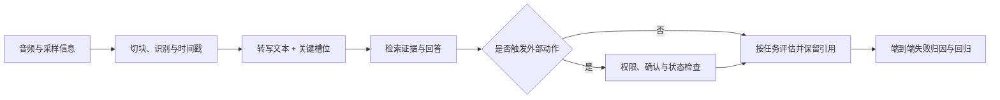

# 第 13 章 语音识别与问答实战

本章沿着“音频输入 → 自动语音识别（automatic speech recognition, ASR）→ 文本问题 → 知识检索与回答”追踪一条语音问答链路。核心问题是：识别阶段的错误如何改变后续问题、证据和最终答案？因此会保留转写、时间戳、关键字段和回答依据，而不只看最终句子是否流畅。

模型接口示例依赖外部权重、音频文件和运行环境；标准库 toy 只说明指标和状态契约，不证明真实 ASR 质量或实时系统性能。本章承接第七章的证据检索和第八章的受控动作，继续检查转写误差如何影响后续问题、依据和动作。

语音问答要沿每一层保留输入和输出。识别文本不是原始用户意图本身：数字、否定词和专有名词的错误会进入检索查询，再影响引用和后续工具动作。对高风险任务，动作前应回看关键槽位或要求确认，而不能只看整体字符错误率是否低。

图中端到端评估应同时保留 ASR 错误、检索失败、回答错误和动作是否合规。否则一个错误结果只会出现在最终答案里，难以判断问题最早出现在哪一层。

## 13.1 使用 Whisper 做语音识别

### 13.1.1 ASR 是后续推理的输入层

语音问答、会议纪要和语音 Agent 的第一步通常是 ASR。ASR 一旦把数字、否定词、商品名或专业术语识别错，后面的检索和生成即使逻辑正确，也会围绕错误问题工作。

Whisper 可以抽象成一个编码器—解码器（encoder-decoder）模型：音频波形先变成对数 Mel 频谱（log-Mel spectrogram），编码器（encoder）提取声学特征，解码器（decoder）根据语言、任务和历史词元（token）自回归生成文字。

设音频波形为 $x$，$M$ 表示其对数 Mel 声学特征。短时傅里叶变换（short-time Fourier transform, STFT）把波形变换到时频域，Mel 滤波器组将功率谱投影到 Mel 频率尺度；$\epsilon$ 是避免对数输入为零的小正数：

~~~math
M=\log\left(\mathrm{Mel}(|\mathrm{STFT}(x)|^2)+\epsilon\right)
~~~

这是声学特征的信息流简写，不是 Whisper 预处理的逐项实现。官方 `log_mel_spectrogram` 对功率谱做 Mel 投影，再 clamp 到 `1e-10`、取 `log10`、按最大值减 8 截动态范围，最后做 `(log_spec+4)/4` 缩放；采样率、窗长、hop 与 Mel 维数也必须与 checkpoint 一致。参考 [Whisper v20250625 音频实现](https://github.com/openai/whisper/blob/v20250625/whisper/audio.py)。

给定声学特征 $M$ 和控制 token $p_0$，输出序列 $y$ 的概率为：

~~~math
p(y\mid M,p_0)=\prod_{t=1}^{T}p(y_t\mid y_{1:t-1},M,p_0)
~~~

$T$ 是输出词元序列的长度，$y_{1:t-1}$ 表示生成第 $t$ 个词元前已有的前缀。$p_0$ 可以包含开始标记、语言、transcribe/translate 任务和时间戳控制。指定语言和任务不是装饰性参数，它会改变 decoder 的条件。

### 13.1.2 30 秒窗口、长音频与时间戳

Whisper 编码器一次处理的声学窗口约为 30 秒。长音频可以由 Whisper 的时间戳驱动解码顺序处理：Transformers 的 Whisper `generate()` 接收未截断的特征并启用时间戳后，会按预测时间戳推进长音频解码。这个模型自带流程不同于 Transformers 自动语音识别 pipeline（任务流水线）的通用 `chunk_length_s` 外部分块；在 v5.17.0 中，后者对序列到序列（sequence-to-sequence, seq2seq）模型是实验性功能，Whisper 长音频应调用模型自己的 `generate()`。参见 [Whisper 长音频文档](https://huggingface.co/docs/transformers/v5.17.0/en/model_doc/whisper#longform-transcription) 和 [v5.17.0 pipeline 实现](https://github.com/huggingface/transformers/blob/v5.17.0/src/transformers/pipelines/automatic_speech_recognition.py)。

若采用外部分块或语音活动检测（voice activity detection, VAD）切段，还要处理：

~~~text
句子被窗口截断
相邻片段（chunk）的重复或漏字
静音和背景音乐
多人重叠说话
说话人分离
片段时间戳合并
~~~

外部分块的重叠能减少边界漏字，却会带来重复转写，后处理需要结合时间和文本核对。下面的重叠例子用于分析自定义窗口方案，不代表 Whisper 或 Transformers pipeline 的默认长音频策略。

本例评估器选择严格不重叠的片段契约。第 $i$ 个片段的开始和结束时间分别记为 $start_i$、$end_i$，录音总时长为 $duration$；三者单位都是秒：

~~~math
0\le start_i<end_i\le duration,\qquad end_i\le start_{i+1}
~~~

这不是 Whisper 原始输出的普遍保证。若系统允许片段重叠，或 pipeline 输出未知结束时间 `None`，应先按协议标记或归一化，再交给检查器，不能直接把未知值当成 0。说话人分离是独立能力，不能从 Whisper 文本和时间戳自动得到。

### 13.1.3 官方包与 Transformers 接口

快速实验可以使用 OpenAI Whisper 20250625 版命令行工具：

~~~text
pip install openai-whisper==20250625
whisper audio.wav --model small --language Chinese
~~~

命令行工具以及以文件路径读取音频的 Transformers pipeline 都需要系统可执行文件 `ffmpeg`。下面的 pipeline 接口以 Transformers 5.17.0 文档所述 API 为例，模型权重固定到 `openai/whisper-small` 的 revision `973afd2`；这两个版本信息便于复现，不代表已在本地运行。

Transformers pipeline（面向任务的高层接口）适合快速转写：

> 代码状态：静态审阅，未运行（2026-10-30）

~~~python
import torch
from transformers import pipeline

device = 0 if torch.cuda.is_available() else -1
asr = pipeline(
    "automatic-speech-recognition",
    model="openai/whisper-small",
    revision="973afd2",
    device=device,
)
result = asr("meeting.wav", return_timestamps=True)
print(result["text"])
for chunk in result.get("chunks", []):
    print(chunk.get("timestamp"), chunk.get("text", "").strip())
~~~
返回结构为 `{"text": str, "chunks": [{"text": str, "timestamp": (start, end)}]}`；具体文本和时间取决于模型输出，未知时间戳可能为 `None`，不能当作已对齐的精确时间。对长音频，本例没有设置 `chunk_length_s`，由 Whisper 自己的 `generate()` 长音频逻辑处理。示例未提供语言提示，由模型按默认设置检测语言并执行转写。真实服务应在启动时加载模型，避免每个请求重复加载权重，并固定 Transformers 版本、模型 revision、语言/任务、解码参数和音频采样率。

### 13.1.4 词错误率、字符错误率与关键实体

英文通常报告词错误率（Word Error Rate, WER），中文通常报告字符错误率（Character Error Rate, CER）。两者都基于编辑距离；替换记为 $S$，删除记为 $D$，插入记为 $I$：

~~~math
E_{\mathrm{asr}}=\frac{S+D+I}{N_{\mathrm{ref}}}
~~~

WER/CER 的分母要求参考序列长度 $N_{\mathrm{ref}}>0$，并且替换、删除、插入计数按同一规范化协议得到。静音或空参考应单独作为无语音（no-speech）检测样本统计，不能把空分母默认为零错误率。

CER 以字符作为基本单位，但整体 CER 仍可能掩盖关键错误：

~~~text
不是会员 -> 是会员
保价 -> 报价
7 天 -> 10 天
128.50 -> 182.50
LoRA -> 其他同音词
~~~

因此业务 ASR 至少应另外统计数字、日期、金额、订单号、否定词、商品名和领域术语准确率。业务型话语错误率（Utterance Error Rate, UER）与参考引导文本规范器（reference-guided normalizer）的定义及其局限已在[第二册语音识别评估部分](../../book-02-advanced-100/chapters/12-语音识别生成与交互.md)展开，本章沿用“整体文本指标加关键字段检查”的项目口径。

### 13.1.5 纯 Python 的 ASR 评估检查

> 代码状态：静态审阅，未运行（2026-10-30）

~~~python
import math
import string

def edit_distance(left, right):
    table = [[0] * (len(right) + 1) for _ in range(len(left) + 1)]
    for i in range(len(left) + 1):
        table[i][0] = i
    for j in range(len(right) + 1):
        table[0][j] = j
    for i in range(1, len(left) + 1):
        for j in range(1, len(right) + 1):
            cost = int(left[i - 1] != right[j - 1])
            table[i][j] = min(
                table[i - 1][j] + 1,
                table[i][j - 1] + 1,
                table[i - 1][j - 1] + cost,
            )
    return table[-1][-1]

def cer(reference, prediction):
    if not isinstance(reference, str) or not isinstance(prediction, str):
        raise TypeError("reference and prediction must be strings")
    reference = [char for char in reference if not char.isspace()]
    prediction = [char for char in prediction if not char.isspace()]
    if not reference:
        raise ValueError("reference must be non-empty for CER")
    return edit_distance(reference, prediction) / len(reference)

def wer(reference, prediction):
    if not isinstance(reference, str) or not isinstance(prediction, str):
        raise TypeError("reference and prediction must be strings")
    strip = str.maketrans("", "", string.punctuation)
    reference = reference.lower().translate(strip).split()
    prediction = prediction.lower().translate(strip).split()
    if not reference:
        raise ValueError("reference must be non-empty for WER")
    return edit_distance(reference, prediction) / len(reference)

def timestamp_issues(segments, duration):
    if not isinstance(segments, (list, tuple)):
        raise TypeError("segments must be a list or tuple")
    if (isinstance(duration, bool) or not isinstance(duration, (int, float))
            or not math.isfinite(duration) or duration < 0):
        raise ValueError("duration must be finite and non-negative")
    issues = []
    previous_end = 0.0
    for index, segment in enumerate(segments):
        if not isinstance(segment, dict):
            raise ValueError("each segment must be a dictionary")
        if "timestamp" in segment:
            timestamp = segment["timestamp"]
            if not isinstance(timestamp, (list, tuple)) or len(timestamp) != 2:
                raise ValueError("timestamp must contain start and end")
            start, end = timestamp
        elif "start" in segment and "end" in segment:
            start, end = segment["start"], segment["end"]
        else:
            raise ValueError("each segment needs timestamp or start/end")
        if (isinstance(start, bool) or not isinstance(start, (int, float))
                or not math.isfinite(start)
                or isinstance(end, bool) or not isinstance(end, (int, float))
                or not math.isfinite(end)):
            raise ValueError("timestamps must be finite numbers")
        if not (0 <= start < end <= duration):
            issues.append(f"range:{index}")
        if start < previous_end:
            issues.append(f"overlap:{index}")
        previous_end = max(previous_end, end)
    return issues

zh_reference = "今天讨论大模型评估方案"
zh_prediction = "今天讨论模型评估方案"
en_reference = "we evaluate the speech model today"
en_prediction = "we evaluate speech model today"
segments = [{"timestamp": (0.0, 2.0), "text": zh_prediction}]

assert round(cer(zh_reference, zh_prediction), 4) == 0.0909
assert round(wer(en_reference, en_prediction), 4) == 0.1667
assert timestamp_issues(segments, 2.0) == []
print("cer=", round(cer(zh_reference, zh_prediction), 4))
print("wer=", round(wer(en_reference, en_prediction), 4))
print("timestamp_issues=", timestamp_issues(segments, 2.0))
~~~
根据示例输入手算，预期输出为：

~~~text
cer= 0.0909
wer= 0.1667
timestamp_issues= []
~~~

这里的 CER 是删除一个“大”字，距离 1、参考长度 11，约为 0.0909；WER 删除一个 `the`，距离 1、参考词数 6，约为 0.1667。示例 CER 仅移除空白并保留标点/大小写，WER 移除 ASCII 标点并转小写；这不是统一标准规范化器，删除标点还可能把 `128.50` 与 `12850` 混同。金额与关键实体必须另作结构化核验。插入很多字符/词时 CER/WER 可大于 1，不应截断；语料级分数按总编辑距离除以总参考长度计算，与逐句分数平均不同。

#### 跟着算一次：长录音切块带来的重叠

设一段录音长 95 秒，采用 30 秒窗口、相邻窗口重叠 5 秒。窗口起点依次是 0、25、50、75 秒，覆盖范围分别为 [0,30]、[25,55]、[50,80]、[75,95]。总共送入模型 30+30+30+20=110 秒音频，其中重复覆盖是 110-95=15 秒，占原录音的 15/95，约 15.8%。重叠可让靠近边界的词在另一窗口里再次出现，但也让同一句话可能生成两份结果。

合并时不能只对转写字符串做全局去重，因为说话者可能真的重复说了同一个词。应保留每段的原始起止时间、识别文本和 chunk 编号，再检查相邻片段的时间交叠和文本相似度；只有重叠区里高度一致的词才做合并，冲突则保留并标出低置信度或交由人工听检。若系统只返回无时间戳的文本，无法可靠区分重复识别与真实重复，数据契约应明确这一限制。

若总推理时间为 18 秒，这个样例的实时因子（Real-Time Factor, RTF）=18/95≈0.189，表示处理速度约为录音时长的 18.9%。它只描述当前音频、模型、硬件、批次和解码配置；不能直接外推到并发服务，因为排队和批处理会改变延迟。评估报告要同时给单条 RTF、并发吞吐、第 95 百分位（P95）端到端延迟，以及 chunk 合并后的 CER/WER 与关键字段准确率。

#### CER 较低仍可能把动作说反

看一句简化的转写：“订单712不要取消”，共 9 个字符；若识别成“订单712要取消”，只少了“不要”里的“不”一个字符，字符错误率是 1/9，约 11.1%。对于一般内容，这个 CER 看起来不高；对于取消操作，它却把用户意图完全反转。若系统只用 CER≤15% 作为通过条件，这条高风险样本会被判定通过。

因此先定义关键实体和关系，再设计专门指标。例如订单号要精确匹配，动作对象是“取消订单”，否定标记要与参考一致。可以报告关键槽位全正确率：订单号、意图动词和否定关系三项全部一致才记为 1。若 100 条录音有 92 条达到 CER 阈值，但只有 84 条关键槽位全正确，两种指标分别回答“文本整体接近”与“能否安全执行动作”，不能互相替代。

中文分词没有唯一标准，WER 会受分词器影响；CER 更容易复现，但仍受数字、英文缩写、全半角和标点规范化影响。规范化会改变错误含义，尤其不能把金额小数点、日期分隔符或订单号中的符号任意删除。报告应给出清洗规则，并保存规范化前后的参考与预测，方便复算。

聚合方式也会改变结论。设两条参考转写长度分别为 2 和 18 个字符，预测各错 1 个字符。逐条 CER 的宏平均是 (1/2+1/18)/2≈27.78%；把字符数汇总后计算语料 CER，则是 (1+1)/(2+18)=10%。宏平均让短句与长句权重相同，语料分数让每个字符权重相同；报告哪一种取决于产品要回答的问题，但必须写明口径，不能只留下一个“CER”字段。

如果短句恰好是“取消”“不要”这类关键信号，宏平均有助于揭示短命令错误；语料 CER 则反映整体字符流。两者都应配合关键槽位准确率和错误严重度切片。静音、录音损坏和用户主动沉默也应分别标记，避免错误地把无声片段记成模型漏字。

对语音识别置信度也要谨慎：模型输出的 token 概率未必是校准后的“转写正确概率”。若将低置信度片段交给人工复核，应在标注集上画出置信度区间与实际错误率，并分设备、噪声和口音检查校准。可以把置信度用作排序人工队列的线索，不能在没有验证时把一个固定概率阈值写成可靠的自动拒答边界。

团队还应保留原始音频可用时的受控回听入口、去标识化后的转写和修订版本。人工改正后的文本是新的标注事实，不应覆盖 ASR 原始输出；否则无法比较识别器和后续处理，也无法判断问题来自模型还是后处理规则。访问音频的权限与保存时间需要单独定义。

### 13.1.6 资料与证据边界

Whisper 的方法见 [Robust Speech Recognition via Large-Scale Weak Supervision](https://arxiv.org/abs/2212.04356)，命令行工具版本见 [OpenAI Whisper v20250625 release](https://github.com/openai/whisper/releases/tag/v20250625)，Transformers 接口见 [Whisper v5.17.0 文档](https://huggingface.co/docs/transformers/v5.17.0/en/model_doc/whisper) 和 [pipeline 文档](https://huggingface.co/docs/transformers/v5.17.0/en/main_classes/pipelines)，示例使用 [openai/whisper-small revision 973afd2](https://huggingface.co/openai/whisper-small/commit/973afd2)。论文和模型卡支持公开训练与接口事实；目标音频上的噪声、口音、专业术语、幻听、时间戳质量和实时延迟必须单独评估。

## 13.2 构建语音转文本再问答

### 13.2.1 误差会沿链路传播

语音问答可以拆为：

~~~text
audio -> ASR -> query normalization -> retrieval -> evidence prompt -> answer
~~~

令输入音频为 $a$，自动语音识别函数 $A$ 输出转写 $\hat{q}$ 和带文本/时间信息的片段集合 $S$；查询规范化函数 $N$ 将转写转换为用于检索的文本 $q$：

~~~math
(\hat{q},S)=A(a),\qquad q=N(\hat{q})
~~~

检索器从知识库 $D$ 中取出前 $K$ 条证据，$s(q,d)$ 表示查询 $q$ 与文档 $d$ 的相关性分数，$TopK$ 按该分数选择排名靠前的文档：

~~~math
E_K=TopK_{d\in D}\ s(q,d)
~~~

上下文构造函数 $C$ 把问题与证据组织成回答输入，问答器或生成函数 $F$ 根据该上下文产生最终回答：

~~~math
y=F(C(q,E_K))
~~~

合并后：

~~~math
y=F(C(N(\hat{q}),E_K)),\qquad(\hat{q},S)=A(a)
~~~

这个表达式说明：如果 q_hat 漏掉否定词，后面的检索和生成可能全部“正确地”处理错误问题。错误定位必须保留每层的输入和输出。

### 13.2.2 先做确定性基线

一个可复现的语音问答项目可以先用规则生成器作为确定性对照基线（baseline）：

~~~text
ASR 输出：确认输入文本与关键字段
检索：使用 BM25（Okapi BM25 词项排序）、字符重合或向量表征（embedding）召回规则
生成：依据证据模板拼接回答
记录：脱敏文本或受控内容引用、规范化文本版本、文档 ID、引用和延迟
~~~

这样做不是拒绝使用大语言模型（large language model, LLM），而是为后续 LLM 提供可比较的对照组。如果一开始就把 ASR、检索、提示词（prompt）和 LLM 全部接入，回答错误时很难判断是哪一层造成的。

高风险问题还应允许用户确认 ASR 文本：

~~~math
\mathrm{need\_confirm}=I(risk=1\lor \hat{p}_{\mathrm{critical\_correct}}<\tau)
~~~

其中 $I(\cdot)$ 是指示函数，条件成立时取 1，否则取 0；$risk=1$ 表示需要风险控制的任务。$\hat{p}_{\mathrm{critical\_correct}}$ 是关键槽位全正确概率的校准估计，$\tau$ 是按任务风险和标注集选定的阈值。原始 token 概率不等同于转写正确概率；没有经过本任务数据校准的分数不能直接作自动放行阈值。退款金额、订单取消、账号操作和身份信息等高风险问题无论分数如何，都应在执行动作或给出确定性结论前展示转写，让用户确认关键实体、数字和否定关系。

### 13.2.3 一个分层链路实验

> 代码状态：静态审阅，未运行（2026-10-30）

~~~python
import re

KB = [
    {"id": "rule_7d", "title": "7 天退货",
     "text": "签收 7 天内且商品完好可以申请退货。"},
    {"id": "rule_quality", "title": "质量问题",
     "text": "有杂音等质量问题时可以提交检测材料。"},
    {"id": "rule_headphone", "title": "耳机售后",
     "text": "先排查连接和固件，仍异常再申请售后。"},
]

def tokens(text):
    if not isinstance(text, str) or not text.strip():
        raise ValueError("text must be non-empty")
    values = set(re.sub(r"[^0-9A-Za-z\u4e00-\u9fff]", "", text))
    if not values:
        raise ValueError("text has no searchable tokens")
    return values

def retrieve(query, docs, top_k=3):
    if not isinstance(docs, list) or not docs:
        raise ValueError("docs must be non-empty")
    if isinstance(top_k, bool) or not isinstance(top_k, int) or top_k <= 0:
        raise ValueError("top_k must be a positive integer")
    query_tokens = tokens(query)
    ranked = []
    for doc in docs:
        if (not isinstance(doc, dict) or not isinstance(doc.get("id"), str)
                or not isinstance(doc.get("title"), str)
                or not isinstance(doc.get("text"), str)):
            raise ValueError("documents need string id, title and text")
        score = len(query_tokens & tokens(doc["title"] + doc["text"]))
        ranked.append((score, doc))
    ranked.sort(key=lambda item: (item[0], item[1]["id"]), reverse=True)
    return [doc for score, doc in ranked[:top_k] if score > 0]

def critical_errors(reference, prediction):
    if not isinstance(reference, str) or not isinstance(prediction, str):
        raise TypeError("reference and prediction must be strings")
    checks = {
        "negation": ("不是" in reference) != ("不是" in prediction),
        "number": re.findall(r"\d+", reference) != re.findall(r"\d+", prediction),
        "product": ("耳机" in reference) != ("耳机" in prediction),
    }
    return [name for name, failed in checks.items() if failed]

reference = "我买的耳机用了三天，发现有杂音，可以退货吗？"
asr_text = "我买的耳机用了三天发现有杂音可以退货吗"
hits = retrieve(asr_text, KB)
hit_ids = [doc["id"] for doc in hits]

bad_reference = "我不是会员，可以退货吗？"
bad_asr = "我是会员，可以退货吗？"
assert set(["rule_7d", "rule_quality", "rule_headphone"]) <= set(hit_ids)
assert critical_errors(reference, asr_text) == []
assert critical_errors(bad_reference, bad_asr) == ["negation"]

latency = {
    "upload": 0.12,
    "asr": 1.85,
    "normalize": 0.01,
    "retrieval": 0.03,
    "generation": 1.18,
}
assert round(sum(latency.values()), 2) == 3.19
print("retrieved=", hit_ids)
print("bad_asr_errors=", critical_errors(bad_reference, bad_asr))
print("latency_total_s=", round(sum(latency.values()), 2))
~~~
静态推演得到三条文档的字符重合分数为 5、5、2；前两条同分时按 ID 逆序，因此预期输出为：

~~~text
retrieved= ['rule_quality', 'rule_7d', 'rule_headphone']
bad_asr_errors= ['negation']
latency_total_s= 3.19
~~~

字符重合只是可运行的教学检索，本例 top-3 恰好取尽三条规则，不能当作召回效果证据；示例仅实现检索器和关键字段检查器，没有实现回答生成，也没有验证端到端问答。`critical_errors` 只识别字面“不是”、阿拉伯数字序列和“耳机”是否出现，检测不到“三天→十天”、其他否定形式或实体关系错误，返回空列表只表示这些检查未命中。生产系统应单独标注金额、日期、否定和商品实体，再比较检索方法。

示例 3.19 秒是五个合成串行阶段相加，未单列音频解码和结果返回，不是实测端到端延迟。流式或并行系统须按关键路径和事件时间测量，各阶段 P95 不能直接相加成总 P95。

下面把一条请求的证据流画出来。每个节点都保留输入输出的版本标识、脱敏摘要和受控证据引用，便于发现错误第一次出现的位置；确认环节只针对需要用户授权或可能产生副作用的任务，不是所有问答都要人为增加阻塞。

#### 跟着算一次：否定词错误会怎样穿过链路

用户说：“订单 712 不要取消，我只是想查物流。”假设 ASR 把转写变成“订单 712 要取消”，订单号保留但否定词丢失。检索器可能因此找到取消订单流程，回答模型也可能准确复述取消条件；如果只查看最终回答的语言是否通顺，整条链路会显得正常，实际意图却反了。修复点应在进入高风险工具前检查订单号、动作和否定关系，并将转写文本回显给用户确认。

做一个简化的成功率账本：假设 ASR 保留关键含义的概率为 0.90，检索命中正确证据的条件概率为 0.95，最终回答通过验收的条件概率为 0.98。若为了教学暂时假设三层成功事件相互独立，端到端成功概率是 0.90×0.95×0.98=0.8379，即约 83.79%。这不是线上测量；实际三层错误常相关，例如口音既影响 ASR，也使领域检索失败。真实系统应从同一批端到端样本计算总体成功率，同时单独统计各层和交叉切片，不能把独立假设下的乘积当成预测值。

若 100 个任务按此估计约有 16 个失败，平均分会掩盖失败集中在哪些请求。应额外标记金额、日期、订单号、肯定/否定、说话人和噪声切片，并做反事实测试：只把“不要取消”改成“要取消”，系统是否相应改变动作；把订单号替换成另一个值，是否仍查询原订单。一个可复核系统既要保留 ASR 与检索日志，也要记录用户确认前后的状态。

### 13.2.4 延迟、隐私与观测

总延迟可以拆成：

~~~math
T=T_{\mathrm{upload}}+T_{\mathrm{audio\_decode}}+T_{\mathrm{asr}}+T_{\mathrm{norm}}+T_{\mathrm{retrieve}}+T_{\mathrm{generate}}+T_{\mathrm{return}}
~~~

每个延迟分量应为有限非负数，且总延迟的起止边界固定；这里的 `audio_decode` 是音频文件解码，不能与后面的语言模型 `generate` 或 ASR 推理时间混用。

录音可能包含姓名、电话、地址、订单号和支付信息。普通日志默认只写 request ID、音频 hash、脱敏字段和内容引用，不写完整原音频、转写或生成文本。确需回听或复核时，把原始内容放在独立的受控存储中，按授权、用途和保留期限访问；训练数据、线上 trace 和人工标注不能默认互相开放。

每次请求至少记录：

~~~text
request_id、audio_hash、asr_model_revision、language、segment_timing_status
redacted_transcript 或 transcript_ref、normalized_query_ref、retrieved_ids、scores
prompt_version、generator_model、answer_ref、latency_breakdown
user_confirmation、feedback、error_type
~~~

#### 用户确认是一个状态转移，不是免责弹窗

确认界面要展示可核对的信息：识别出的完整意图、关键实体、将要执行的动作和可取消入口。仅问“确定吗？”无法发现 ASR 把订单号 712 听成 721，也无法让用户知道“取消”已经从否定句变成了肯定句。确认事件应记录原始转写的版本引用、用户修改后的文本引用、确认时间、目标资源和后续动作 ID；引用仍须由相同的受控权限检查保护。

设 100 个高风险语音任务中，有 10 个 ASR 意图被反转。若关键字段复核能拦住其中 8 个，仍有 2 个错误可能继续；因此确认流程是风险控制的一层，不是准确率保证。若用户无法确认、超时或输入含糊，系统状态应停在待确认或转人工，而不是默认执行。重复点击确认也不能创建重复订单动作，动作端仍需幂等键和业务状态检查。

确认覆盖率本身也要监测。假设 100 次高风险任务中 90 次出现确认，85 次完成、5 次取消、10 次没有进入确认；这三类分母能说明流程漏触发、用户拒绝和正常完成各有多少。只报“确认后成功率 100%”会排除那 10 次未确认请求和 5 次用户取消，产生严重的选择偏差。

将 100 个任务按上一例的 83.79% 简化成功率估计，期望约有 84 个成功、16 个失败。若每个成功任务产生 0.20 元模型和检索费用，每个失败任务平均再触发一次 0.10 元人工复核，粗略总成本为 84×0.20+16×0.30=21.6 元，单位成功成本约 21.6/84=0.257 元。这个账本假设失败任务必然人工复核且单价固定；若实际只有一部分转人工，应按 trace 中真实状态重新归集。

该计算提示了一个常见取舍：提升 ASR 或加入确认步骤可能增加单次开销，却降低动作反转和重复处理，最后单位成功任务成本可能更低。比较方案时要使用相同的任务集合和成功定义，并把确认耗时、用户取消、人工接管与重试费用记在同一任务 ID 下。不要把成功请求的平均成本与全体任务的成功率相乘，却漏掉失败请求已经花掉的推理成本。

因此，不能把一个全局 WER 阈值直接当成所有语音任务的放行标准。教学上假设两段转写各有 5% 的词错误：一段错在停顿词，另一段只把“不要扣款”中的否定词删掉；两者的词错比例相同，风险却完全不同。是否需要复述、确认或转人工，应由意图和关键字段的任务级错误切片决定，再与 WER/CER 一起报告。阈值需要用本任务标注集校准，不能从这个假设例子直接推广到真实产品。

### 13.2.5 资料与证据边界

ASR、RAG 和语音问答需要分别评估。一个端到端回答正确的样本，可能只是 ASR 错误碰巧没有影响结论；一个回答错误的样本，也不能直接归因于 LLM。正确的证据链是保存中间结果并按层复盘，而不是只保存最终答案。

本章的输出需按[第十四章多模态评估与交付](14-多模态评估与交付.md)记录来源、边界和失败；多模态机制的系统主讲见[第十五册](../../book-15-multimodal-generative-models/目录.md)。
