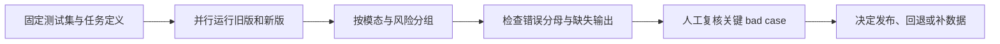
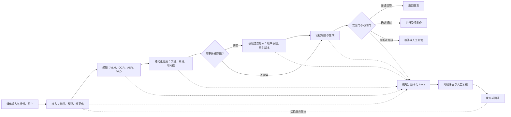

# 第 14 章 多模态评估与交付

想象一个客服助手收到一张订单截图和一段语音。截图上有金额“128 元”，语音里说“我不是会员，可以保价吗？”系统要先读图、听清否定词，再查规则并回答。若最后只报一个“回答正确率”，我们不知道它是看错金额、漏听“不是”、查错规则，还是把建议误说成已经完成的业务动作。

前面几章分别练过图文检索、Diffusion 数值实验和语音问答。本章把这些小链路接到同一套验收思路里：先把一次请求和它的参考答案记录清楚，再为不同任务选合适指标，然后比较版本、复核失败，最后检查系统的权限、资源预算和回退方案。例子中的订单和数字都是教学构造；它们用来说明怎样评估，不代表真实业务规则。

## 14.1 多模态模型评估小工具

### 14.1.1 统一记录格式，按任务选择指标

多模态系统的输入形态不同，但评估记录可以统一为：

~~~math
e_{i}=(id_{i},task_{i},input_{i},reference_{i},metadata_{i})
~~~

这里 $e_{i}$ 是第 $i$ 条评估样本。`reference` 有时叫 gold，指人工标注或任务规则给出的比较依据；它可以是一段转写、一组必需字段、允许的答案集合或预期动作，不一定是一句唯一的标准回答。可以把上面的字段读成一行记录：

| 字段 | 示例 | 作用 |
| --- | --- | --- |
| `id` | `asr_1` | 稳定标识这条样本，便于回查差异 |
| `task` | `asr` | 说明应使用哪一类评分规则 |
| `input` | 受控存储中的音频引用 | 指向被测输入；例行日志不必复制原始媒体 |
| `reference` | `我不是会员可以保价` | 说明本任务要核对的转写结果 |
| `metadata` | 切分、来源组、语言、预处理、风险级别 | 让结果能按条件复查，也能识别同一媒体派生的相关样本 |

模型输出另记为 $prediction_{i}$，状态另记为 `ok`、`timeout`、`parse_error`、`missing_prediction` 或 `refused`。把状态和答案分开很重要：超时不是一条空答案，拒答也不自动算正确或错误。拒答是否成功由任务定义决定。

把第 $j$ 个指标记为 $m_{j}$，它根据参考答案和预测结果计算第 $i$ 条样本的分数 $m_{j}(i)$：

~~~math
m_{j}(i)=m_{j}(reference_{i},prediction_{i})
~~~

令 $N$ 为符合预先定义纳入条件的样本总数；总体平均只在 $N>0$ 时有定义：

~~~math
\bar{m}_{j}=\frac{1}{N}\sum_{i=1}^{N}m_{j}(i)
~~~

这是按样本先算指标再求平均的宏平均。它让每条样本权重相同。对词错误率或字符错误率，语料级微平均则先把所有样本的编辑错误数相加，再除以全部参考词数或字符数；两种口径回答的问题不同，报告时要说明使用哪一种。Accuracy 或规则通过率也要说明它是样本等权平均，还是先分任务算比例再对任务平均。

端到端任务成功率应把未返回、超时和解析失败按预先声明的规则计为失败，并保留在 $N$ 中。字符错误率等只对有效文本有定义的指标，则另报成功返回数和条件分母，不能把无答案静默删除后仍称作全请求平均。不同任务的分数也不能直接混成一个平均数：CER 和时间 IoU 的单位、含义都不同。如果某项指标只适用于一个任务子集，应在 schema 中标记范围，并分别报告该子集的分母。

设 $E_{c}$ 是第 $c$ 组中适用的样本集合， $|E_{c}|$ 是集合大小；分组指标只在该集合内平均：

~~~math
\bar{m}_{j,c}=\frac{1}{|E_{c}|}\sum_{i\in E_{c}}m_{j}(i)
~~~

分组指标要求 $|E_{c}|>0$。某组没有样本时，结果应记为“不适用”，不能伪装成 0 分。

评估文件应记录模型、数据、processor、prompt、检索器和代码版本，否则新旧数字无法解释。

### 14.1.2 指标要跟着要回答的问题走

评估指标不是给模型贴一个总分，而是把“这次任务哪里做对了”变成可核对的量。先问任务要测什么，再挑指标：

| 评估问题 | 常见任务与指标 | 单看这个数字看不出的事 |
| --- | --- | --- |
| 字段有没有读对？ | OCR 或字段抽取用 Exact Match、字段准确率、CER | 字段字符串正确，不代表整个回答有证据或业务流程已完成 |
| 有没有找到目标？ | 分类/存在性用 Accuracy、Precision、Recall、F1 | 总体 Accuracy 可能被大量容易的负例抬高 |
| 转写错了多少？ | ASR 用 WER、CER、关键实体准确率和时间戳结构 | 整体字错率可能掩盖否定词、金额或专名的错误 |
| 数量或关系是否正确？ | 计数用绝对误差和精确计数率；图表问答用数值误差、关系正确率 | 数值接近不等于单位、比较方向或解释正确 |
| 事件定位和回答有依据吗？ | 视频用时间区间 IoU、事件顺序；开放回答看 correctness、groundedness、completeness | 区间重叠不证明事件解释正确；语言流畅不证明证据支持 |
| 系统有没有安全完成任务？ | 语音问答按 ASR、检索、回答、引用和端到端成功分层；另报泄露率、危险动作率和拒答适当性 | 只在成功返回的答案上打分，会藏起超时和失败 |

这里 OCR 是光学字符识别（optical character recognition），ASR 是自动语音识别（automatic speech recognition），VLM 是视觉语言模型（vision-language model）。WER/CER 分别是词错误率（word error rate）和字符错误率（character error rate）。

以“识别截图里是否有商品缺陷”为例，把“有缺陷”定义成正类。10 张截图中，人工标注有缺陷的 4 张，模型找出其中 3 张，同时把 1 张正常图误报为缺陷；剩下 5 张正常图都判断正确。于是 TP=3（真实缺陷且报出）、FP=1（正常却误报）、FN=1（有缺陷却漏掉）、TN=5（正常且识别正确）：

~~~math
\mathrm{Precision}=\frac{TP}{TP+FP}=\frac{3}{4}=0.75,\quad
\mathrm{Recall}=\frac{TP}{TP+FN}=\frac{3}{4}=0.75
~~~

Precision 回答“模型报出的缺陷里有多少是真的”，Recall 回答“真实缺陷里模型找出了多少”。F1 是二者的调和平均，所以此例 F1=0.75；Accuracy 则是 $(TP+TN)/10=8/10=0.8$。如果正常图片远多于缺陷图片，Accuracy 可能很高但漏掉大量缺陷，因此不能脱离正类定义和分母看数字。

宏平均与微平均的差别也会改变读法。假设两条 ASR 参考转写分别长 2 个字符和 10 个字符，模型各错 1 个字符。逐条 CER 是 1/2=0.5 和 1/10=0.1，宏平均为 0.3；把错误数和参考字符数合并后，语料 CER 是 2/12≈0.1667。前者让短句和长句权重相同，后者让每个参考字符权重相同。若错误集中在短语音、关键否定词或金额上，还要按这些类别分别统计。

Exact Match 对短字段有用，但对开放回答过于严格；关键词覆盖能粗筛信息点，却不知道词语是肯定还是否定，也不能保证逻辑正确。大语言模型评审（large language model as a judge, LLM judge）是让大语言模型按评分准则（rubric）给回答打分。它本身也是一个待校准的评估器，不能把分数当作事实真值。

如果任务要求定位视频中的一个事件，可用时间区间交并比（Intersection over Union, IoU）比较预测区间 $P$ 与人工标注区间 $G$：

~~~math
\mathrm{IoU}(P,G)=\frac{\mathrm{duration}(P\cap G)}{\mathrm{duration}(P\cup G)}
~~~

例如标注区间为 $G=[10,20]$ 秒，预测为 $P=[15,25]$ 秒，交集长 5 秒、并集长 15 秒，因此 IoU 为 $5/15=1/3$。平均交并比（mean IoU, mIoU）按评测协议对各查询的 IoU 求平均；Recall@IoU=0.3 则统计预测区间与标注区间的 IoU 至少为 0.3 的查询占比。音视频时间定位预印本 [RVG-Bench](https://arxiv.org/html/2610.32268v1) 报告这类指标；其样本、模型、输入采样和评分协议限定了结果，不能据此概括所有视频系统。更完整的多模态 benchmark 设计与限制见[第二册第十三章](../../book-02-advanced-100/chapters/13-多模态评估与开放研究.md)。IoU 只说明时间重叠，不证明事件描述正确，也不保证答案受到音频或视频证据支持。

失败样本（bad case）集合可以定义为：

~~~math
B=\{e_{i}:pass_{i}=0\}
~~~

其中 $pass_{i}$ 是预先定义的规则或人工验收门槛在样本 $i$ 上的结果；规则通过不自动等于任务真实正确。每个 bad case 还应有根因和修复状态：

~~~text
perception_error、ocr_error、asr_entity_error
retrieval_miss、evidence_conflict、generation_hallucination
format_error、privacy_risk、timeout
~~~

### 14.1.3 一个零依赖评估器

样本列表保存任务与参考答案，预测字典按样本 ID 索引。缺少字典项或值为 None 时记作 missing_prediction；预测也可携带 timeout、parse_error、missing_prediction 或 refused 状态。拒答是否成功由样本字段 refusal_is_success 明确指定。代码在 rows 中为每条样本保存规则分数与状态，并把所有纳入样本都保留在任务通过率分母中。

> 代码状态：静态审阅，未运行（2026-10-30）

~~~python
import re
from collections import defaultdict

def normalize(text):
    if not isinstance(text, str):
        raise TypeError("text must be a string")
    return re.sub(r"\s+", "", text.lower()).replace("，", ",")

def edit_distance(left, right):
    table = [[0] * (len(right) + 1) for _ in range(len(left) + 1)]
    for i in range(len(left) + 1):
        table[i][0] = i
    for j in range(len(right) + 1):
        table[0][j] = j
    for i in range(1, len(left) + 1):
        for j in range(1, len(right) + 1):
            cost = int(left[i - 1] != right[j - 1])
            table[i][j] = min(table[i - 1][j] + 1,
                              table[i][j - 1] + 1,
                              table[i - 1][j - 1] + cost)
    return table[-1][-1]

def cer(reference, prediction):
    if not isinstance(reference, str) or not isinstance(prediction, str):
        raise TypeError("reference and prediction must be strings")
    reference = [char for char in reference if not char.isspace()]
    prediction = [char for char in prediction if not char.isspace()]
    if not reference:
        raise ValueError("reference must be non-empty for CER")
    return edit_distance(reference, prediction) / len(reference)

def keyword_recall(answer, keywords):
    if not isinstance(answer, str):
        raise TypeError("answer must be a string")
    if (not isinstance(keywords, (list, tuple)) or not keywords
            or any(not isinstance(word, str) or not word.strip() for word in keywords)):
        raise ValueError("keywords must be non-empty strings")
    answer = normalize(answer)
    return sum(normalize(word) in answer for word in keywords) / len(keywords)

def prediction_text(prediction, field):
    value = prediction.get(field)
    return value if isinstance(value, str) else None

def evaluate(sample, prediction):
    if not isinstance(sample, dict):
        raise TypeError("sample must be a dictionary")
    if not isinstance(sample.get("task"), str) or "reference" not in sample:
        raise ValueError("sample needs task and reference")
    if prediction is None:
        return {"status": "missing_prediction", "rule_pass": False}
    if not isinstance(prediction, dict):
        raise TypeError("prediction must be a dictionary or None")
    status = prediction.get("status", "ok")
    if not isinstance(status, str):
        raise ValueError("prediction status must be a string")
    if status in {"timeout", "parse_error", "missing_prediction", "error"}:
        return {"status": status, "rule_pass": False}
    if status == "refused":
        refusal_is_success = sample.get("refusal_is_success", False)
        if not isinstance(refusal_is_success, bool):
            raise ValueError("refusal_is_success must be boolean")
        return {"status": status, "rule_pass": refusal_is_success}
    if status != "ok":
        raise ValueError(f"unknown prediction status: {status}")

    task = sample["task"]
    reference = sample["reference"]
    if task == "asr":
        transcript = prediction_text(prediction, "transcript")
        if transcript is None:
            return {"status": "parse_error", "rule_pass": False}
        score = cer(reference["transcript"], transcript)
        return {"status": "ok", "cer": round(score, 4),
                "rule_pass": score <= 0.2}
    if task == "image_qa":
        answer = prediction_text(prediction, "answer")
        if answer is None:
            return {"status": "parse_error", "rule_pass": False}
        score = keyword_recall(answer, reference["keywords"])
        return {"status": "ok", "keyword_recall": round(score, 4),
                "rule_pass": score == 1.0}
    if task == "voice_qa":
        transcript = prediction_text(prediction, "transcript")
        answer = prediction_text(prediction, "answer")
        if transcript is None or answer is None:
            return {"status": "parse_error", "rule_pass": False}
        asr_score = cer(reference["transcript"], transcript)
        answer_score = keyword_recall(answer, reference["keywords"])
        forbidden = any(normalize(word) in normalize(answer)
                        for word in reference["forbidden"])
        passed = asr_score <= 0.2 and answer_score >= 0.8 and not forbidden
        return {"status": "ok", "asr_cer": round(asr_score, 4),
                "keyword_recall": round(answer_score, 4),
                "forbidden_hit": forbidden, "rule_pass": passed}
    raise ValueError(f"unknown task: {task}")

samples = [
    {"id": "image_1", "task": "image_qa",
     "reference": {"keywords": ["128", "元"]}},
    {"id": "asr_1", "task": "asr",
     "reference": {"transcript": "我不是会员可以保价"}},
    {"id": "voice_1", "task": "voice_qa",
     "reference": {"transcript": "耳机有杂音可以退货吗",
                    "keywords": ["质量问题", "售后检测"],
                    "forbidden": ["一定退款"]}},
]
predictions = {
    "image_1": {"answer": "总金额是 128 元。"},
    "asr_1": {"transcript": "我是会员可以报价"},
    "voice_1": {"transcript": "耳机有杂音可以退货吗",
                 "answer": "可以提交质量问题检测，售后检测后处理。"},
}

rows = []
bad = []
by_task = defaultdict(list)
for sample in samples:
    metrics = evaluate(sample, predictions.get(sample["id"]))
    row = {"id": sample["id"], "task": sample["task"], "metrics": metrics}
    rows.append(row)
    by_task[sample["task"]].append(metrics["rule_pass"])
    if not metrics["rule_pass"]:
        bad.append(row["id"])

summary = {task: round(sum(values) / len(values), 4)
           for task, values in sorted(by_task.items())}
assert summary == {"asr": 0.0, "image_qa": 1.0, "voice_qa": 1.0}
assert bad == ["asr_1"]
print("summary=", summary)
print("bad_cases=", bad)
~~~
按例中输入手算，ASR 参考有 9 个汉字；预测删除“不”并把“保”替换成“报”，编辑距离为 2，因此 CER 为 $2/9\approx0.2222$，超过教学阈值 0.2。完整输入的预期输出为：

~~~text
summary= {'asr': 0.0, 'image_qa': 1.0, 'voice_qa': 1.0}
bad_cases= ['asr_1']
~~~

这里汇总的是 `rule_pass`，不能称为真实任务正确率：回答“不是 128 元”仍包含两个关键词，会被 image_qa 规则放过；较长转写只漏一个关键否定词也可能满足 CER≤0.2。`forbidden` 子串规则还可能把“不能保证一定退款”判为禁句命中。规则既可能误放也可能误拒，需要用结构化字段、证据标签和人工 gold 分别测误差。

评估器中的阈值是教学构造，不能直接当作上线标准。没有预测、超时与解析失败应保留在任务分母并记录失败状态，不能只统计成功返回的样本。生产系统还应使用版本化测试集、置信区间、人工抽检、风险加权和旧版本对照，并保留完整预测文件。

### 14.1.4 把自动检查和人工评估结合起来

开放式回答至少需要从以下维度打分：

~~~text
correctness（事实正确性）：回答是否与事实相符
groundedness（证据支撑度）：是否得到输入或检索证据支持
completeness（要点完整性）：是否覆盖必要信息
conciseness（简洁性）：是否包含大量无关内容
safety（安全性）：是否越过隐私和风险边界
format（格式合规性）：是否符合结构化输出要求
~~~

人工评估要有标注指南、正反例和一致性检查。若两位标注者意见不同，应记录分歧并按预先约定仲裁，不能默默把其中一人的标签当成唯一真值。LLM judge 可以降低逐条阅读成本，但也要拿人工 gold set 校准。

例如，人工把 60 个回答标成“正确”或“错误”：其中 20 个确实错误。LLM judge 找出 15 个错误，同时把 4 个正确回答误判为错误。以“错误”为正类，judge 的错误召回率是 15/20=75%，误报率是 4/40=10%。这提醒我们不能只报告 judge 与人工标签的总体一致率；还要查看漏掉了哪些错误、错误是否集中在高风险任务，以及 judge 是否对长答案、特定语气或某个模型更宽容。正式评估时，校准样本和最终报告样本应分开，避免边看答案边调 judge。

公开 benchmark 的分数只能作为外部参照，不能替代业务数据上的人工评估。benchmark 的样本、提示、输入分辨率、解码配置和评分实现共同限定分数含义；迁移到客服或其他业务前，仍须建立自己的任务定义和 gold set。

### 14.1.5 比较版本变化和失败样本

模型版本比较不能只看平均分。对同一测试集，应把样本分为：

~~~text
both_right：旧版和新版都正确
win：旧版错误、新版正确，表示新版修复了该样本
loss：旧版正确、新版错误，表示新版在该样本上回退
both_wrong：旧版和新版都错误
~~~

这些是逐样本配对结果，不是模型版本的总体判决。高风险任务中的 loss case 即使数量少，也可能比普通描述任务的许多 win case 更重要。评估报告至少写出数据版本、模型 revision、prompt、工具链、总体指标、分组指标、主要 bad case、延迟和下一步行动。

下面的流程把一次模型升级拆成可复核的评估步骤。关键是先固定样本和指标，再比较旧版与新版；如果看到退化，追踪原始失败样本，而不是从汇总分数猜原因。

#### 跟着算一次：规则通过率不等于任务正确率

假设一次回归有 100 个请求：70 个图片问答、30 个语音问答。规则检查通过的分别是 64 和 24，因此图片组通过率是 64/70≈91.43%，语音组是 24/30=80%，合并后的 rule_pass 为 88/100=88%。这个数只表示样本满足了当前自动规则，不代表人工 gold 下有 88 个正确回答。比如语音回答漏掉“不要”却命中订单号和商品名，浅规则仍可能通过。

再假设人工抽检发现 8 个任务错误，其中 5 个涉及订单取消或金额，3 个是普通图片描述。总体错误率是 8%，高风险错误占所有错误的 5/8=62.5%；仅看总分无法看见这种集中风险。评估报告应同时保留两个分母：全部请求用于总体任务成功率，高风险子集用于该类风险率。若 20 个高风险样本中有 5 个失败，该组的失败率就是 25%，而不是 5/100。没有高风险样本时应报告“不适用”，不能报告零风险。

置信区间、人工一致率和 judge 与 gold 的混淆矩阵有助于说明估计的不确定性。若结果用于发布决策，还需先固定可接受的回归范围和风险权重，并确保测试数据未被用于挑选阈值。分数的标签、覆盖范围和分母都应与预测文件一起保存；只有一个“模型得分”字段无法支撑复查。

#### 相同比例不代表相同把握

比较两组样本：第一组 5 个样本中通过 4 个，表面通过率是 80%；第二组 50 个样本通过 40 个，也是 80%。点估计相同，证据强度却不同。第一组只错 1 个样本就会变成 60% 或 100%，第二组同样一条样本只改变 2 个百分点。报告比例时必须同时给出分子和分母，重要指标还应给置信区间或重复抽样范围。

若同一用户、同一图片或同一录音派生出多个相关问题，把这些行当成完全独立样本会让置信区间显得过窄。组自助重采样（group bootstrap）先按用户、图片或原始媒体等独立组抽样，再带上该组的全部问题；这样保留组内相关性。固定测试集上的区间只反映有限样本的不确定性，不代表换了模型、业务人群或输入设备后的不确定性。

多模态系统还需要把未返回、超时、解析失败和拒答单独记为状态。若从 100 条请求中只对 88 条成功返回的答案计算准确率，另 12 条就从分母消失；当超时集中在长视频或大图上时，剩余样本的平均分会偏高。以全部有效请求作为任务分母报告完成率，同时对已完成任务报告条件准确率，才能区分服务可用性和回答质量。

再用版本对比说明为什么要保留逐样本结果。假设 100 条测试中，旧版和新版都正确 82 条；另有 8 条从旧错变新对，即 win，10 条从旧对变新错，即 loss。对于同一测试集上的二分类正确/错误结果，新版减旧版的准确率变化可直接由不一致样本计算：

~~~math
\Delta_{\mathrm{accuracy}}=\frac{\mathrm{win}-\mathrm{loss}}{N}
~~~

本例为 $(8-10)/100=-0.02$，也就是下降 2 个百分点；双方都正确或都错误的样本在差值中抵消。若 10 个 loss 中有 4 个是金额或订单操作，而 8 个 win 都是普通图片描述，单一总体准确率仍低估了风险变化。

可以先把结果列成下表，再逐项检查差异：

| 配对结果 | 样本数 | 业务复核重点 |
| --- | ---: | --- |
| both_right | 82 | 是否有共同的脆弱输入条件 |
| win | 8 | 新版收益是否集中于某类任务 |
| loss | 10 | 是否触及高风险字段或权限边界 |
| both_wrong | 0 | 是否存在应优先修复的共同盲点 |

这张表只说明配对结果数量，不判断错误严重性。下一步要检查模型版本变化是否同时改变 processor、prompt、检索索引或工具 schema；若一次改了多项，就不能判断全部差异是否由权重造成。保留原始输出、请求配置、任务标签和人工裁决（adjudication，即对标注分歧作出的最终判断）后，再提出可能原因、构造对照样本并针对问题修复。

评估集还要防止“看过答案再改规则”。如果人工抽检发现 5 个错误，其中 3 个都是规则没识别的否定句，修正规则后必须在未参与开发的留出集上重新测量；否则新结果只说明规则适配了这 5 个样本。修规则前后都保存 evaluator revision，并用相同预测文件回放，确认变化来自评分器而不是模型输出。

也要检查模型判断器本身是否可靠：选一批人工标注样本，分别统计 judge 的真阳性、假阳性、真阴性和假阴性，再按模态、回答长度与风险等级分组。若 judge 在长回答中更容易给高分，整体相关系数可能仍不错，却不能用于安全关键任务。人工 gold、judge 版本和最终 adjudication 结果要分开存储。

评估过程最终要能回答三个问题：被测对象是否相同，错误的定义是否相同，分母是否保留了失败请求。少任何一个，模型版本之间的数字就无法作可靠比较。把答案、证据、指标和版本一起保存，才可以在未来改变 rubric 时重新计算而不必重跑模型。

### 14.1.6 资料与证据边界

评估平台可参考 [HELM](https://crfm.stanford.edu/helm/latest/)、[Hugging Face Evaluate](https://huggingface.co/docs/evaluate/index) 和 [VHELM](https://arxiv.org/abs/2410.07112v2)。VHELM 将视觉感知、知识、推理、偏差、公平性、多语言、鲁棒性、毒性和安全纳入多维评估，并统一部分推理参数、提示和指标；它提供组织评估的参考，不会替业务定义正确性、风险阈值和标注标准。评估集和逐样本结果能说明候选版本在固定任务上表现如何，但还不能回答服务能否承受目标流量、证据是否按权限传递、失败时能否恢复。所以下一部分从“样本上的结果”转向“交付系统的事实”。

## 14.2 从实验到可复核系统

### 14.2.1 多模态项目记录要写清哪些事实

一个完整项目不应只留下“调用了哪个模型”的描述，而应留下可以被另一位工程师复跑和质疑的事实链：背景、目标、输入、输出、模块、数据、指标、失败、负责边界和未覆盖范围。

可以把项目记录抽象成：

~~~math
P=(B,G,I,O,D,M,E,R,C,L)
~~~

其中 B 是背景，G 是目标，I 是输入，O 是输出，D 是数据，M 是模块及其版本，E 是评估结果，R 是风险与失败，C 是个人或团队贡献，L 是适用限制。

任何效果结论都应带条件：

~~~math
claim=(statement,model,data,metric,baseline,condition,uncertainty)
~~~

这里 statement 是待检验的结论，model 是模型与 revision，data 是评估数据及切分，metric 是指标和分母，baseline 是对照版本或方法，condition 是预处理、提示和解码等条件，uncertainty 是样本量、区间或其他不确定性。“OCR 变好了”至少要写成一个可复查的句子，例如：“在教学构造的 invoice-v3 测试集 100 张截图上，固定裁剪方式和同一字段规则后，新 revision 的金额字段准确数从 92/100 变为 96/100，增加 4 个百分点；该结论只适用于这组截图，尚不能说明其他语言、拍摄角度或设备也有同样变化。”这样既写出变化，也写出分母和边界；若要据此发布，还应补不确定性范围和高风险类别的结果。

### 14.2.2 统一系统架构

一个同时处理图片和语音的业务助手可按逻辑层拆开，图中的层不要求部署成独立服务。语音活动检测（voice activity detection, VAD）用于识别音频中的语音片段，是感知层可选的一种组件：

VLM 是视觉语言模型，OCR 是光学字符识别，ASR 是自动语音识别。Whisper 是本系列前文介绍的一种 ASR 模型。embedding（嵌入表示）是把文本或媒体编码成便于检索或后续计算的向量/序列表示，具体结构依模型而异；OCR 字段、ASR 片段和 embedding 都只是候选证据，仍需记录来源、时间戳和版本。ACL 指访问控制列表（access control list）；检索只有在权限过滤后才能把证据交给生成层，直接回答的任务则可以跳过检索。

系统图不应把“模型”画成不可解释的黑盒。各层的输入、输出和中间证据要有协议，服务还要分别测量关键阶段的延迟和失败率。trace 记录足以定位处理路径的脱敏事件、配置版本和受控证据 ID；原始媒体、完整提示和敏感工具参数不应因“方便排查”而默认复制进普通日志。若确实需要回看内容，应通过单独授权的存储和访问流程读取。

### 14.2.3 容量、成本与上下文

先统一工作量的单位： $QPS_{\mathrm{peak}}$ 是峰值请求到达率，单位为请求/秒； $A$ 是每请求平均音频时长，单位为秒/请求； $V$、 $T_{\mathrm{in}}$、 $T_{\mathrm{out}}$ 分别是每请求平均视觉 token、文本输入 token、文本输出 token 数。token 数按被测模型的 tokenizer 或视觉 token 计量口径确定；不含某种模态的请求在该项记 0，或按请求类型单独统计。定义 $TPS_{\mathrm{demand}}$ 为粗略 token 工作量需求率：

~~~math
TPS_{\mathrm{demand}}\approx QPS_{\mathrm{peak}}(V+T_{\mathrm{in}}+T_{\mathrm{out}})
~~~

这只是粗略工作量估算，不是实测服务 TPS，也不表示所有 token 消耗相同资源：输入 prefill 与输出 decode 的单 token 成本不同，图像解码和视觉编码的成本还未计入。应至少分开报告 $QPS_{\mathrm{peak}}(V+T_{\mathrm{in}})$ 与 $QPS_{\mathrm{peak}}T_{\mathrm{out}}$。音频用时长而非 token 计入该近似，因此另算 $QPS_{\mathrm{peak}}A$，单位为音频秒/墙钟秒；实时因子 RTF 是处理音频所用墙钟时间与音频时长之比，仍须结合并发、模型和硬件测量容量。请求类型混合时，均值要包含不使用该模态请求的零值，或先按类型拆分流量。

例如每秒 2 个请求、每请求平均 512 个视觉 token、256 个文本输入 token 和 128 个输出 token，对应输入到达率 1536 token/s、输出需求 256 token/s，不能据此判断硬件已能承载。语音服务还要把 `QPS_peak×A` 音频秒/秒与实时因子纳入 ASR 吞吐；图片服务要计入分辨率、视觉编码和多图请求；检索服务要计入 OCR、embedding 和 rerank 的资源。

令 $L_{\mathrm{e2e}}$ 表示请求被服务接受到完整回答返回的端到端延迟；下面每个 $L$ 项的单位都是秒，分别表示排队、媒体解码、感知、检索、LLM prefill、LLM 输出 token 解码和后处理时长：

~~~math
L_{\mathrm{e2e}}=L_{\mathrm{queue}}+L_{\mathrm{media\_decode}}+L_{\mathrm{perception}}
+L_{\mathrm{retrieval}}+L_{\mathrm{prefill}}+L_{\mathrm{llm\_decode}}+L_{\mathrm{post}}
~~~

该和式只近似表示串行关键路径；若感知、检索或安全检查并行执行，应按实际依赖图计算关键路径，不能把并行阶段时长一律相加；跳过检索时 $L_{\mathrm{retrieval}}=0$。首 token 延迟（time to first token）也应与完整回答延迟分开报告。媒体解码是图片/音频预处理，不是 LLM 生成 token 的 decode。

单位成功任务成本把同一窗口内全部任务成本除以成功任务数，比单次请求成本更能反映交付效率。令 $C_{\mathrm{task}}$ 为每个纳入任务的平均总成本（含失败和重试），令 $P_{\mathrm{task\ success}}$ 为按预先定义标准成功的任务比例，则：

~~~math
C_{\mathrm{success}}=\frac{C_{\mathrm{task}}}{P_{\mathrm{task\ success}}}
~~~

单位成功任务成本要求成功概率满足 $P_{\mathrm{task\ success}}>0$，且成本、成功任务数和任务身份来自同一时间窗口。若成功概率为零，单位成功成本没有有限值，应先报告“没有成功任务”并定位失败原因。

这里 $C_{\mathrm{task}}$ 取该窗口总成本除以纳入的用户任务数，成功率也按同一批任务计算，因此该比率等于总成本除以成功任务数。若账单按请求记录，须先将同一用户任务的重试费用归并，再与任务成功数相除。例如 100 个任务总成本 20 元、成功 80 个，单位成功成本为 $20/80=0.25$ 元/成功任务。

如果更大的 VLM 让单次回答质量上升，但延迟、重试和人工转接也上升，单位成功任务成本未必下降。多模态方案要在同一任务分布、同一图片/音频质量和同一成功定义下比较。

### 14.2.4 状态、权限和失败恢复

图片问答通常是无状态请求，语音客服和多轮 VLM 则会积累会话状态。状态至少包括：

~~~text
原始输入引用和脱敏版本
ASR segments 或图片版本
用户确认状态
检索证据 ID 与版本
生成结果与引用
工具调用、重试和人工接管
~~~

权限不能只靠检索器的一次过滤来保证。可信的身份和租户范围应在生成候选时参与查询；候选被展开、取回原文或交给生成模型前，还要按当前授权重新检查。缓存键也要包含权限范围和文档版本，避免把一个用户可见的结果复用给另一个用户。检索服务可能提供预过滤、后过滤等不同语义，必须核实它们各自的召回和假阴性行为；例如 [Azure AI Search 的过滤文档](https://learn.microsoft.com/en-us/azure/search/vector-search-filters)描述的是该服务自己的过滤模式，不能直接外推到其他向量库。过滤字段本身也不负责认证用户，权限边界仍由应用落实。模型不能替代 ACL。高风险动作需要结构化参数、幂等键、二次确认和审计，不能因为 VLM 或 LLM 的回答听起来合理就直接执行。

失败恢复要区分：

~~~text
输入不可读：要求重新上传或转码
感知低置信度：请求用户确认或人工处理
检索无证据：明确说明信息不足
证据冲突：列出冲突并暂停确定性结论
生成超时：返回可解释的部分结果或重试
模型升级回归：停止扩大流量并恢复兼容版本
~~~

### 14.2.5 一个项目记录审计器

审计器检查的是项目记录是否留下必要字段，以及指标变化方向是否算对；它不运行模型，也不能证明项目结论成立。下面的版本和数字都是教学构造。

> 代码状态：静态审阅，未运行（2026-10-30）

~~~python
import math

def relative_change(base, new, higher_is_better=True):
    if (isinstance(base, bool) or not isinstance(base, (int, float))
            or not math.isfinite(base)
            or isinstance(new, bool) or not isinstance(new, (int, float))
            or not math.isfinite(new)):
        raise ValueError("metric values must be finite numbers")
    if not isinstance(higher_is_better, bool):
        raise TypeError("higher_is_better must be boolean")
    if base == 0:
        raise ValueError("zero baseline needs an absolute comparison")
    delta = new - base if higher_is_better else base - new
    return round(delta / abs(base), 4)

project = {
    "background": "业务输入包含图片、截图和语音。",
    "goal": "提高证据约束回答的可用率并定位链路错误。",
    "data": "按图片和音频来源切分的评估集 v3。",
    "modules": ["vlm", "whisper", "retrieval", "evaluation"],
    "metrics": {
        "voiceqa_pass": {"base": 0.61, "new": 0.76, "higher": True},
        "asr_cer": {"base": 0.18, "new": 0.11, "higher": False},
    },
    "bad_cases": [
        {"root": "asr_negation", "fix": "user_confirmation"},
        {"root": "ocr_small_text", "fix": "crop_and_validate"},
    ],
    "boundary": "没有实时双工语音和生产流量数据。",
}

if not isinstance(project["metrics"], dict) or not project["metrics"]:
    raise ValueError("project metrics must be non-empty")
if not isinstance(project["bad_cases"], list) or not project["bad_cases"]:
    raise ValueError("project bad_cases must be non-empty")

required = ["background", "goal", "data", "modules", "metrics",
            "bad_cases", "boundary"]
missing = [field for field in required if not project.get(field)]
changes = {
    name: relative_change(spec["base"], spec["new"], spec["higher"])
    for name, spec in project["metrics"].items()
}
bad_case_ready = all(case.get("root") and case.get("fix")
                     for case in project["bad_cases"])

assert missing == []
assert changes == {"voiceqa_pass": 0.2459, "asr_cer": 0.3889}
assert bad_case_ready
print("missing=", missing)
print("relative_changes=", changes)
print("bad_case_ready=", bad_case_ready)
~~~
按输入手算，voiceqa_pass 的相对变化是 $(0.76-0.61)/0.61\approx0.2459$；asr_cer 是低值更好，因此相对下降为 $(0.18-0.11)/0.18\approx0.3889$。预期输出为：

~~~text
missing= []
relative_changes= {'voiceqa_pass': 0.2459, 'asr_cer': 0.3889}
bad_case_ready= True
~~~

输入中的数据版本和指标全是合成设定，`voiceqa_pass` 从 0.61 到 0.76 是增加 15 个百分点、相对增加约 24.59%，CER 相对降低约 38.89%。`bad_case_ready` 只表示填了候选根因和修复文字，不表示根因成立或修复通过。审计器检查记录字段和变化方向，不能替代真实评估与证据核验。

### 14.2.6 从实验到发布

发布前至少要完成以下检查：

~~~text
固定模型、processor、prompt、检索器和工具版本
冻结 dev/test 切分，避免反复调参污染 test
跑总体、分任务、分风险、分输入质量指标
审查 win/loss cases 和高风险 bad cases
检查权限、隐私、引用和确认状态
测量 p50/p95、吞吐、显存、存储和单位成功成本
小流量观察失败率、人工转接和用户反馈
准备可回放日志与兼容回退组合
~~~

回退不能只换模型权重，还要恢复与之兼容的 tokenizer/processor、prompt、索引、工具 schema、安全策略和评估版本。多模态系统的输入协议比纯文本更容易发生隐式变化，图片占位符、音频采样率和时间戳格式都应进入版本记录。

### 14.2.7 沿着一条请求看清各环节的责任

回到开头的客服请求，截图金额读错属于 OCR 或视觉感知问题；“我不是会员”漏掉“不”属于 ASR 关键字段错误；规则库没有对应证据时，系统应该说明信息不足；回答正确但直接执行了未确认的操作，则是权限和状态治理的问题。单一总分会把这些不同故障揉在一起，分层样本、任务指标、权限检查和版本记录才能告诉我们该修哪一层。

前面各章提供了这些组件的练习入口：CLIP 用于图文表示与检索，VLM 依据图片生成回答，多模态 SFT 调整指令行为，RAG 引入外部证据，Diffusion 从噪声生成图像，Whisper 把音频转成文字。它们解决的问题不同，任何单个模型分数都不能代替输入预处理、证据质量、权限、延迟和回滚验收。教学 demo 能证明代码路径在给定输入下运作，不等于目标业务已经有效。

迁移到新任务时，先写清输入格式和允许使用哪些证据，选与任务相符的指标和分母，再用同一组分类样本比较版本；确认质量和失败边界后，再检查系统预算、授权与回退。第十五章会把这些记录整理成作品集材料。

#### 跟着算一次：版本回滚要恢复一整组接口

设发布版本 R17 使用模型 revision m17、processor p4、prompt p9、图片索引 i12、语音采样率协议 a2、工具 schema t6 和安全策略 s8。上线后发现新版对金额 OCR 的字段准确率从 96/100 降到 88/100。只把模型权重切回 R16 并不一定能恢复旧行为：若 R17 的 processor 已把图片缩放方式改掉，或新 prompt 与旧模型不兼容，回滚后的服务仍不是 R16。可回滚对象应是完整版本元组 (R16,m16,p3,p8,i11,a1,t5,s7)，并与当时通过的评估集和配置绑定。

再看成本。一个评估窗口处理 100 个用户任务，总费用为 20 元，其中 80 个满足预先定义的成功条件，单位成功任务成本是 20/80=0.25 元。若新版单请求成本降到 0.16 元，却只有 50 个成功任务，总支出约为 16 元，单位成功成本变为 16/50=0.32 元。只比较每请求成本会得出“新版更省”的结论；按成功交付衡量则成本反而上升。这个算例假设费用和成功数对应同一批任务，重试费用已计入总额。

发布记录还要指明谁拥有索引、模板、策略和回滚操作，避免出现模型团队能回权重、但无人能恢复关联数据协议的情况。演练时可以抽取一条真实失败 trace，确认版本元组、访问权限、用户确认状态和可重放输入都完整；若依赖外部模型 API，不可重放原始内部状态时，应记录哪些字段只能做脱敏复现。回滚本身也要跑一组冒烟评估，确认恢复的是旧行为，而不只是服务重新启动。

### 14.2.8 资料与证据边界

系统风险治理可参考 [NIST AI Risk Management Framework](https://www.nist.gov/itl/ai-risk-management-framework)。截至 2026-11-16，NIST 页面仍把 AI RMF 1.0 说明为自愿使用的框架，并注明正在修订；它是风险管理参考，不是法律义务，也不能证明某个产品已经合规。引用前应复核页面和适用版本。

可观测性字段可参考 [OpenTelemetry GenAI semantic conventions](https://github.com/open-telemetry/semantic-conventions-genai/blob/main/docs/gen-ai/gen-ai-spans.md)。该规范把系统指令、输入、输出等内容视为可能敏感且体积较大的数据，建议默认不采集，需要时由使用方显式启用；也描述了把内容放在外部存储、trace 只留引用的做法。规范不规定外部存储的访问控制和保存期限，也不保证每个 SDK 都采用相同默认值，因此要检查实际 SDK 与配置。无论采用哪种格式，语义约定都不能代替授权、脱敏和隐私控制。

模型服务和成本还要结合目标 runtime、硬件与业务 SLA。公开论文、官方文档、教学 demo、离线评估和线上实测属于不同证据层级，不能拿其中一层替代另一层。

## 练习与迁移

1. 修改同图同问题的答案，观察构造器拒绝冲突；再用两个路径指向同一图片，设计按内容或来源分组的切分方案。
2. 给图片关联一份未授权文本，检查关联扩展仍被拒绝；无权限或无相关候选时，应记录证据不足而非生成确定结论。
3. 对比扩散第一步与第五步的累计 alpha 和后验方差，解释已知 x0 的噪声反解与生成用噪声预测器的区别。
4. 构造低 CER 但关键否定错误、关键词命中但金额否定的回答，将规则输出和真实 gold 判断分开报告。

更多验收见[配套练习](../../EXERCISES.md)与[项目路线](../../PROJECTS.md)。多模态项目的技术答辩可继续参考[第十六章](16-项目答辩与技术表达.md)的“机制—数据—对照—失败—边界”链路；跨主题速查可继续阅读[第四册目录](../../book-04-llm-encyclopedia/目录.md)。
