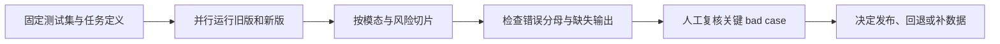

# 第 14 章 多模态评估与交付

前面各章分别建立了图文理解与检索、扩散数值实验和语音问答的小型链路。本章回答它们共同的交付问题：原始媒体经过哪些转换，哪些证据支撑结果，权限与版本是否一致，质量、成本和失败能否被复查？

多模态评估不能把输入变化隐藏在一个总分里。图像分辨率、音频采样率、时间戳、检索版本、权限范围和模型配置都可能改变任务结果。本章先建立按任务与切片评估的工具，再把它扩展为跨模态项目的可复核交付流程。

## 14.1 多模态模型评估小工具

### 14.1.1 统一 schema，分任务指标

多模态系统的输入形态不同，但评估记录可以统一为：

~~~math
e_i=(id_i,task_i,input_i,reference_i,metadata_i)
~~~

模型输出记为 prediction_i。一个指标在样本级计算：

~~~math
m_j(i)=m_j(reference_i,prediction_i)
~~~

总体平均是：

~~~math
\bar{m}_j=\frac{1}{N}\sum_i m_j(i)
~~~

总体平均要求评估集合非空，即 \(N>0\)。如果某项指标只适用于集合的一个子集，应在 schema 中标记适用范围，而不是用其他任务的样本填充分母。

切片 c 的指标应只在对应样本上平均：

~~~math
\bar{m}_{j,c}=\frac{1}{|E_c|}\sum_{i\in E_c}m_j(i)
~~~

切片指标要求 \(|E_c|>0\)。没有该切片样本时结果是“不适用”，不应伪装成 0 分。

评估文件应记录模型、数据、processor、prompt、检索器和代码版本，否则新旧数字无法解释。

### 14.1.2 指标如何对应任务

~~~text
OCR/字段抽取：Exact Match、字段准确率、字符错误率
分类与存在性：Accuracy、Precision、Recall、F1
计数：绝对误差、精确计数率
图表：数值误差、相对关系正确率
开放描述：人工 correctness、groundedness、completeness
ASR：WER/CER、关键实体准确率、时间戳结构
语音问答：ASR、检索、回答、引用和端到端通过率
安全：敏感信息泄露率、危险动作率、拒答适当性
~~~

Exact Match 对短字段有用，但对开放回答过于严格；关键词覆盖能粗筛信息点，但不能保证逻辑正确；LLM judge 需要人工 gold 校准，不能把 judge 的一个分数当作事实真值。

bad case 集合可以定义为：

~~~math
B=\{e_i:pass_i=0\}
~~~

每个 bad case 还应有根因和修复状态：

~~~text
perception_error、ocr_error、asr_entity_error
retrieval_miss、evidence_conflict、generation_hallucination
format_error、privacy_risk、timeout
~~~

### 14.1.3 一个零依赖评估器

> 代码状态：已验证（2026-10-22；Python 3.12.9，标准库教学输入；历史记录中的输入、输出与边界检查适用于此代码）

~~~python
import re
from collections import defaultdict

def normalize(text):
    if not isinstance(text, str):
        raise TypeError("text must be a string")
    return re.sub(r"\s+", "", text.lower()).replace("，", ",")

def edit_distance(left, right):
    table = [[0] * (len(right) + 1) for _ in range(len(left) + 1)]
    for i in range(len(left) + 1):
        table[i][0] = i
    for j in range(len(right) + 1):
        table[0][j] = j
    for i in range(1, len(left) + 1):
        for j in range(1, len(right) + 1):
            cost = int(left[i - 1] != right[j - 1])
            table[i][j] = min(table[i - 1][j] + 1,
                              table[i][j - 1] + 1,
                              table[i - 1][j - 1] + cost)
    return table[-1][-1]

def cer(reference, prediction):
    if not isinstance(reference, str) or not isinstance(prediction, str):
        raise TypeError("reference and prediction must be strings")
    reference = [char for char in reference if not char.isspace()]
    prediction = [char for char in prediction if not char.isspace()]
    if not reference:
        raise ValueError("reference must be non-empty for CER")
    return edit_distance(reference, prediction) / len(reference)

def keyword_recall(answer, keywords):
    if not isinstance(answer, str):
        raise TypeError("answer must be a string")
    if (not isinstance(keywords, (list, tuple)) or not keywords
            or any(not isinstance(word, str) or not word.strip() for word in keywords)):
        raise ValueError("keywords must be non-empty strings")
    answer = normalize(answer)
    return sum(normalize(word) in answer for word in keywords) / len(keywords)

def evaluate(sample, prediction):
    if not isinstance(sample, dict) or not isinstance(prediction, dict):
        raise TypeError("sample and prediction must be dictionaries")
    if not isinstance(sample.get("task"), str) or "reference" not in sample:
        raise ValueError("sample needs task and reference")
    task = sample["task"]
    reference = sample["reference"]
    if task == "asr":
        score = cer(reference["transcript"], prediction["transcript"])
        return {"cer": round(score, 4), "rule_pass": score <= 0.2}
    if task == "image_qa":
        score = keyword_recall(prediction["answer"], reference["keywords"])
        return {"keyword_recall": round(score, 4), "rule_pass": score == 1.0}
    if task == "voice_qa":
        asr_score = cer(reference["transcript"], prediction["transcript"])
        answer_score = keyword_recall(prediction["answer"], reference["keywords"])
        forbidden = any(normalize(word) in normalize(prediction["answer"])
                        for word in reference["forbidden"])
        passed = asr_score <= 0.2 and answer_score >= 0.8 and not forbidden
        return {"asr_cer": round(asr_score, 4),
                "keyword_recall": round(answer_score, 4),
                "forbidden_hit": forbidden, "rule_pass": passed}
    raise ValueError(f"unknown task: {task}")

samples = [
    {"id": "image_1", "task": "image_qa",
     "reference": {"keywords": ["128", "元"]}},
    {"id": "asr_1", "task": "asr",
     "reference": {"transcript": "我不是会员可以保价"}},
    {"id": "voice_1", "task": "voice_qa",
     "reference": {"transcript": "耳机有杂音可以退货吗",
                    "keywords": ["质量问题", "售后检测"],
                    "forbidden": ["一定退款"]}},
]
predictions = {
    "image_1": {"answer": "总金额是 128 元。"},
    "asr_1": {"transcript": "我是会员可以报价"},
    "voice_1": {"transcript": "耳机有杂音可以退货吗",
                 "answer": "可以提交质量问题检测，售后检测后处理。"},
}

rows = []
bad = []
by_task = defaultdict(list)
for sample in samples:
    metrics = evaluate(sample, predictions[sample["id"]])
    row = {"id": sample["id"], "task": sample["task"], "metrics": metrics}
    rows.append(row)
    by_task[sample["task"]].append(metrics["rule_pass"])
    if not metrics["rule_pass"]:
        bad.append(row["id"])

summary = {task: round(sum(values) / len(values), 4)
           for task, values in sorted(by_task.items())}
assert summary == {"asr": 0.0, "image_qa": 1.0, "voice_qa": 1.0}
assert bad == ["asr_1"]
print("summary=", summary)
print("bad_cases=", bad)
~~~
这里汇总的是 `rule_pass`，不能称为真实任务正确率：回答“不是 128 元”仍包含两个关键词，会被 image_qa 规则放过；较长转写只漏一个关键否定词也可能满足 CER≤0.2。`forbidden` 子串规则还可能把“不能保证一定退款”判为禁句命中。规则既可能误放也可能误拒，需要用结构化字段、证据标签和人工 gold 分别测误差。

评估器中的阈值是教学构造，不能直接当作上线标准。没有预测、超时与解析失败应保留在任务分母并记录失败状态，不能只统计成功返回的样本。生产系统还应使用版本化测试集、置信区间、人工抽检、风险加权和旧版本对照，并保留完整预测文件。

### 14.1.4 自动指标与人工评估的组合

开放式回答至少需要从以下维度打分：

~~~text
correctness：事实是否正确
groundedness：是否有输入或检索证据
completeness：关键要点是否遗漏
conciseness：是否包含大量无关内容
safety：是否越过隐私和风险边界
format：是否遵守结构化输出契约
~~~

人工评估要有标注指南、正反例和一致性检查。LLM judge 可以降低成本，但需要人工 gold set 检查位置偏差、长度偏差、风格偏差和模型自偏好。公开 benchmark 的分数只能作为外部参照，业务数据上的人工评估仍不可省略。

### 14.1.5 版本回归与 loss cases

模型版本比较不能只看平均分。对同一测试集，应把样本分为：

~~~text
both_right：两个版本都正确
win：旧版本错误，新版本正确
loss：旧版本正确，新版本错误
both_wrong：两个版本都错误
~~~

高风险任务中的 loss case 即使数量少，也可能比普通描述任务的许多 win case 更重要。评估报告至少写出数据版本、模型 revision、prompt、工具链、总体指标、切片指标、主要 bad case、延迟和下一步行动。

下面的流程把一次模型升级拆成可复核的评估步骤。关键是先固定样本和指标，再比较旧版与新版；如果看到退化，追踪原始失败样本，而不是从汇总分数猜原因。

#### 跟着算一次：规则通过率不等于任务正确率

假设一次回归有 100 个请求：70 个图片问答、30 个语音问答。规则检查通过的分别是 64 和 24，因此图片切片通过率是 64/70≈91.43%，语音切片是 24/30=80%，合并后的 rule_pass 为 88/100=88%。这个数只表示样本满足了当前自动规则，不代表人工 gold 下有 88 个正确回答。比如语音回答漏掉“不要”却命中订单号和商品名，浅规则仍可能通过。

再假设人工抽检发现 8 个任务错误，其中 5 个涉及订单取消或金额，3 个是普通图片描述。总体错误率是 8%，高风险错误占所有错误的 5/8=62.5%；仅看总分无法看见这种集中风险。评估报告应同时保留两个分母：全部请求用于总体任务成功率，高风险子集用于该类风险率。若 20 个高风险样本中有 5 个失败，风险切片失败率就是 25%，而不是 5/100。没有高风险样本时应报告“不适用”，不能报告零风险。

置信区间、人工一致率和 judge 与 gold 的混淆矩阵有助于说明估计的不确定性。若结果用于发布决策，还需先固定可接受的回归范围和风险权重，并确保测试数据未被用于挑选阈值。分数的标签、覆盖范围和分母都应与预测文件一起保存；只有一个“模型得分”字段无法支撑复查。

#### 相同比例不代表相同把握

比较两个切片：第一组 5 个样本中通过 4 个，表面通过率是 80%；第二组 50 个样本通过 40 个，也是 80%。点估计相同，证据强度却不同。第一组只错 1 个样本就会变成 60% 或 100%，第二组同样一条样本只改变 2 个百分点。报告比例时必须同时给出分子和分母，重要指标还应给置信区间或重复抽样范围。

若同一用户、同一图片或同一录音派生出多个相关问题，把这些行当成完全独立样本会让置信区间显得过窄。可按用户、图片或原始媒体进行 group bootstrap，抽样单位保持与数据独立性相符。固定测试集上的区间只反映有限样本的不确定性，不代表换了模型、业务人群或输入设备后的不确定性。

多模态系统还需要把未返回、超时、解析失败和拒答单独记为状态。若从 100 条请求中只对 88 条成功返回的答案计算准确率，另 12 条就从分母消失；当超时集中在长视频或大图上时，剩余样本的平均分会偏高。以全部有效请求作为任务分母报告完成率，同时对已完成任务报告条件准确率，才能区分服务可用性和回答质量。

再用版本对比说明为什么要保留逐样本结果。假设 100 条测试中，旧版和新版都正确 82 条；另有 8 条从旧错变新对，即 win，10 条从旧对变新错，即 loss。新版总体正确数是 90、旧版是 92，净变化为 -2 个百分点。若 10 个 loss 中有 4 个是金额或订单操作，而 8 个 win 都是普通图片描述，单一总体准确率仍低估了风险变化。

可以先列出如下账本，再逐条检查差异：

| 配对结果 | 样本数 | 业务复核重点 |
| --- | ---: | --- |
| both_right | 82 | 是否有共同的脆弱输入条件 |
| win | 8 | 新版收益是否集中于某类任务 |
| loss | 10 | 是否触及高风险字段或权限边界 |
| both_wrong | 0 | 是否存在应优先修复的共同盲点 |

这张表只说明配对结果数量，不判断错误严重性。下一步要检查模型版本变化是否同时改变 processor、prompt、检索索引或工具 schema；若一次改了多项，不能把全部差异归因于权重。保留原始输出、请求配置、任务标签和人工 adjudication 后，才能按“机制假设—反事实切片—定向修复”推进。

评估集还要防止“看过答案再改规则”。如果人工抽检发现 5 个错误，其中 3 个都是规则没识别的否定句，修正规则后必须在未参与开发的留出集上重新测量；否则新结果只说明规则适配了这 5 个样本。修规则前后都保存 evaluator revision，并用相同预测文件回放，确认变化来自评分器而不是模型输出。

模型判断器也应有自己的校准账本：选一批人工标注样本，分别统计 judge 的真阳性、假阳性、真阴性和假阴性，再按模态、回答长度与风险等级切片。若 judge 在长回答中更容易给高分，整体相关系数可能仍不错，却不能用于安全关键任务。人工 gold、judge 版本和最终 adjudication 结果要分开存储。

评估过程最终要能回答三个问题：被测对象是否相同，错误的定义是否相同，分母是否保留了失败请求。少任何一个，模型版本之间的数字就无法作可靠比较。把答案、证据、指标和版本一起保存，才可以在未来改变 rubric 时重新计算而不必重跑模型。

### 14.1.6 资料与证据边界

评估平台可参考 [HELM](https://crfm.stanford.edu/helm/latest/)、[Hugging Face Evaluate](https://huggingface.co/docs/evaluate/index) 和 VHELM 相关研究。它们提供指标和评估组织的参考，不会替你定义业务正确性、风险阈值和人工标注标准。

## 14.2 从实验到可复核系统

### 14.2.1 多模态项目的事实结构

一个完整项目不应只留下“调用了哪个模型”的描述，而应留下可以被另一位工程师复跑和质疑的事实链：背景、目标、输入、输出、模块、数据、指标、失败、负责边界和未覆盖范围。

可以把项目记录抽象成：

~~~math
P=(B,G,I,O,D,M,E,R,C,L)
~~~

其中 B 是背景，G 是目标，I/O 是输入输出，D 是数据，M 是模块和版本，E 是评估，R 是风险与失败，C 是贡献，L 是限制。

任何效果结论都应带条件：

~~~math
claim=(statement,model,data,metric,baseline,condition,uncertainty)
~~~

“ OCR 变好了”至少要写成“在某版本 VLM、某张图片预处理、某个字段评估集和相同解码参数下，字段准确率从多少变为多少”。否则它只是印象，不是实验结论。

### 14.2.2 统一系统架构

一个同时处理图片和语音的业务助手可以拆成：

~~~text
输入适配：图片解码、音频解码、身份与租户
感知层：VLM、OCR、Whisper、VAD、说话人分离
表示层：image/text/audio embedding、结构化字段、时间戳
知识层：文本索引、图片索引、权限和版本
推理层：检索、证据融合、LLM/VLM、工具调用
安全层：隐私过滤、确认、拒答、审计
评估层：离线集、人工标注、bad case、版本回归
服务层：队列、缓存、流式输出、监控和回滚
~~~

系统图不应把“模型”画成一个不可解释的黑盒。输入、输出和中间证据要有协议；每个模块都应能单独测量延迟和失败率。

### 14.2.3 容量、成本与上下文

若峰值规划请求率为 QPS_peak，每请求平均音频秒数、图片 token、输入文本 token 与输出 token 分别为 A、V、T_in、T_out，则一个粗略的 token 工作量到达率为：

~~~math
TPS\approx QPS_{\mathrm{peak}}(V+T_{in}+T_{out})
~~~

这不是可实测的同质 token 吞吐：输入 prefill 与输出 decode 单 token 成本不同，视觉编码还未计入，应至少分开报告 `QPS_peak×(V+T_in)` 与 `QPS_peak×T_out`。请求类型混合时这些均值需包含不使用该模态请求的零值，或先按类型拆分流量。

例如每秒 2 个请求、每请求平均 512 个视觉 token、256 个文本输入 token 和 128 个输出 token，对应输入到达率 1536 token/s、输出需求 256 token/s，不能据此判断硬件已能承载。语音服务还要把 `QPS_peak×A` 音频秒/秒与实时因子纳入 ASR 吞吐；图片服务要计入分辨率、视觉编码和多图请求；检索服务要计入 OCR、embedding 和 rerank 的资源。

端到端延迟可以拆成：

~~~math
L=L_{\mathrm{queue}}+L_{\mathrm{decode}}+L_{\mathrm{perception}}
+L_{\mathrm{retrieval}}+L_{\mathrm{prefill}}+L_{\mathrm{decode\_llm}}+L_{\mathrm{post}}
~~~

单位成功任务成本比单次请求成本更有意义：

~~~math
C_{\mathrm{success}}=\frac{C_{\mathrm{request}}}{P_{\mathrm{task\ success}}}
~~~

单位成功任务成本要求成功概率满足 \(P_{\mathrm{task\ success}}>0\)，且请求成本与成功定义来自同一时间窗口。若成功概率为零，单位成功成本没有有限值，应先报告“没有成功任务”并定位失败原因。

这里的请求成本取该窗口全部请求的平均成本，包含失败请求；因此该比率等于总成本除以成功数。若重试按同一个用户任务计费与判成功，还必须将请求归并到任务，不能混用两种分母。例如 100 次请求总成本 20 元、成功 80 次，单位成功成本为 0.25 元。

如果更大的 VLM 让单次回答质量上升，但延迟、重试和人工转接也上升，单位成功任务成本未必下降。多模态方案要在同一任务分布、同一图片/音频质量和同一成功定义下比较。

### 14.2.4 状态、权限和失败恢复

图片问答通常是无状态请求，语音客服和多轮 VLM 则会积累会话状态。状态至少包括：

~~~text
原始输入引用和脱敏版本
ASR segments 或图片版本
用户确认状态
检索证据 ID 与版本
生成结果与引用
工具调用、重试和人工接管
~~~

权限过滤必须在检索前后都存在：租户、用户、文档版本和图片来源应进入缓存键；模型不能替代 ACL。高风险动作需要结构化参数、幂等键、二次确认和审计，不能因为 VLM 或 LLM 的回答听起来合理就直接执行。

失败恢复要区分：

~~~text
输入不可读：要求重新上传或转码
感知低置信度：请求用户确认或人工处理
检索无证据：明确说明信息不足
证据冲突：列出冲突并暂停确定性结论
生成超时：返回可解释的部分结果或重试
模型升级回归：停止扩大流量并恢复兼容版本
~~~

### 14.2.5 一个项目记录审计器

> 代码状态：已验证（2026-10-22；Python 3.12.9，标准库教学输入；历史记录中的输入、输出与边界检查适用于此代码）

~~~python
import math

def relative_change(base, new, higher_is_better=True):
    if (isinstance(base, bool) or not isinstance(base, (int, float))
            or not math.isfinite(base)
            or isinstance(new, bool) or not isinstance(new, (int, float))
            or not math.isfinite(new)):
        raise ValueError("metric values must be finite numbers")
    if not isinstance(higher_is_better, bool):
        raise TypeError("higher_is_better must be boolean")
    if base == 0:
        raise ValueError("zero baseline needs an absolute comparison")
    delta = new - base if higher_is_better else base - new
    return round(delta / abs(base), 4)

project = {
    "background": "业务输入包含图片、截图和语音。",
    "goal": "提高证据约束回答的可用率并定位链路错误。",
    "data": "按图片和音频来源切分的评估集 v3。",
    "modules": ["vlm", "whisper", "retrieval", "evaluation"],
    "metrics": {
        "voiceqa_pass": {"base": 0.61, "new": 0.76, "higher": True},
        "asr_cer": {"base": 0.18, "new": 0.11, "higher": False},
    },
    "bad_cases": [
        {"root": "asr_negation", "fix": "user_confirmation"},
        {"root": "ocr_small_text", "fix": "crop_and_validate"},
    ],
    "boundary": "没有实时双工语音和生产流量数据。",
}

if not isinstance(project["metrics"], dict) or not project["metrics"]:
    raise ValueError("project metrics must be non-empty")
if not isinstance(project["bad_cases"], list) or not project["bad_cases"]:
    raise ValueError("project bad_cases must be non-empty")

required = ["background", "goal", "data", "modules", "metrics",
            "bad_cases", "boundary"]
missing = [field for field in required if not project.get(field)]
changes = {
    name: relative_change(spec["base"], spec["new"], spec["higher"])
    for name, spec in project["metrics"].items()
}
bad_case_ready = all(case.get("root") and case.get("fix")
                     for case in project["bad_cases"])

assert missing == []
assert changes == {"voiceqa_pass": 0.2459, "asr_cer": 0.3889}
assert bad_case_ready
print("missing=", missing)
print("relative_changes=", changes)
print("bad_case_ready=", bad_case_ready)
~~~
输入中的数据版本和指标全是合成设定，`voiceqa_pass` 从 0.61 到 0.76 是增加 15 个百分点、相对增加约 24.59%，CER 相对降低约 38.89%。`bad_case_ready` 只表示填了候选根因和修复文字，不表示根因成立或修复通过。审计器检查记录字段和变化方向，不能替代真实评估与证据核验。

### 14.2.6 从实验到发布

发布前至少需要完成以下闭环：

~~~text
固定模型、processor、prompt、检索器和工具版本
冻结 dev/test 切分，避免反复调参污染 test
跑总体、分任务、分风险、分输入质量指标
审查 win/loss cases 和高风险 bad cases
检查权限、隐私、引用和确认状态
测量 p50/p95、吞吐、显存、存储和单位成功成本
小流量观察失败率、人工转接和用户反馈
准备可回放日志与兼容回退组合
~~~

回退不能只换模型权重，还要恢复与之兼容的 tokenizer/processor、prompt、索引、工具 schema、安全策略和评估版本。多模态系统的输入协议比纯文本更容易发生隐式变化，图片占位符、音频采样率和时间戳格式都应进入版本记录。

### 14.2.7 把多模态知识放回同一张图

CLIP 解决跨模态表示对齐；VLM 解决视觉条件生成；多模态 SFT 解决指令和行为分布；RAG 解决外部证据与知识更新；Diffusion 解决从噪声到图像的生成路径；Whisper 解决音频到文字的感知入口；语音问答把感知错误传播问题暴露出来；评估工具和发布系统则决定这些能力能否被复核、比较和安全使用。

这些模块不能被一个“多模态模型”名词替代。一个模型 benchmark 很高，不代表它的图片预处理、OCR、证据引用、权限、延迟和回滚已经可靠；一个 toy demo 能运行，也不代表目标业务上的模型能力已经得到证明。

真正可迁移的判断方式是：先写出模态和证据的契约，再用最小实验验证局部机制；随后在真实切片上测量质量、成本和失败；最后把模型放进有版本、有日志、有权限、有人工作业和可回放的系统中。这样读者得到的不是一组热点名词，而是一套能够继续扩展到视频、文档、实时语音和多模态 Agent 的工程方法。

#### 跟着算一次：版本回滚要恢复一整组接口

设发布版本 R17 使用模型 revision m17、processor p4、prompt p9、图片索引 i12、语音采样率协议 a2、工具 schema t6 和安全策略 s8。上线后发现新版对金额 OCR 的字段准确率从 96/100 降到 88/100。只把模型权重切回 R16 并不一定能恢复旧行为：若 R17 的 processor 已把图片缩放方式改掉，或新 prompt 与旧模型不兼容，回滚后的服务仍不是 R16。可回滚对象应是完整版本元组 (R16,m16,p3,p8,i11,a1,t5,s7)，并与当时通过的评估集和配置绑定。

再看成本。一个评估窗口处理 100 个用户任务，总费用为 20 元，其中 80 个满足预先定义的成功条件，单位成功任务成本是 20/80=0.25 元。若新版单请求成本降到 0.16 元，却只有 50 个成功任务，总支出约为 16 元，单位成功成本变为 16/50=0.32 元。只比较每请求成本会得出“新版更省”的结论；按成功交付衡量则成本反而上升。这个算例假设费用和成功数对应同一批任务，重试费用已计入总额。

发布记录还要指明谁拥有索引、模板、策略和回滚操作，避免出现模型团队能回权重、但无人能恢复关联数据协议的情况。演练时可以抽取一条真实失败 trace，确认版本元组、访问权限、用户确认状态和可重放输入都完整；若依赖外部模型 API，不可重放原始内部状态时，应记录哪些字段只能做脱敏复现。回滚本身也要跑一组冒烟评估，确认恢复的是旧行为，而不只是服务重新启动。

### 14.2.8 资料与证据边界

系统治理可参考 [NIST AI Risk Management Framework](https://www.nist.gov/itl/ai-risk-management-framework)，可观测性接口可参考 [OpenTelemetry](https://opentelemetry.io/docs/)，模型服务与成本设计仍需结合目标 runtime、硬件和业务 SLA。公开论文、官方文档、教学 demo、离线评估和线上实测属于不同证据层级，书稿中应明确标注，不能用其中一层替代另一层。

## 练习与迁移

1. 修改同图同问题的答案，观察构造器拒绝冲突；再用两个路径指向同一图片，设计按内容或来源分组的切分方案。
2. 给图片关联一份未授权文本，检查关联扩展仍被拒绝；无权限或无相关候选时，应记录证据不足而非生成确定结论。
3. 对比扩散第一步与第五步的累计 alpha 和后验方差，解释已知 x0 的噪声反解与生成用噪声预测器的区别。
4. 构造低 CER 但关键否定错误、关键词命中但金额否定的回答，将规则输出和真实 gold 判断分开报告。

更多验收见[配套练习](../../EXERCISES.md)与[项目路线](../../PROJECTS.md)。多模态项目的技术表达可继续参考[第十六章](16-技术表达与系统设计实战.md)的“机制—数据—对照—失败—边界”链路；跨主题速查可继续阅读[第四册目录](../../book-04-llm-encyclopedia/目录.md)。
