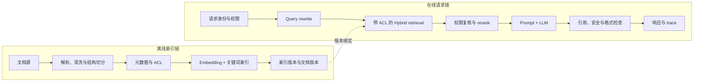

# 第 16 章：技术表达与系统设计实战

技术能力不只体现在能否实现一个模块，也体现在能否把问题、机制、测量和边界讲成一条可检查的因果链。本章训练的不是固定问答，而是从具体约束出发，解释为何选择某个方案、如何估算它的代价、用什么证据验证，并在出现反例时怎样调整判断。

本章承接[第十五章作品集实战](15-作品集实战.md)。前两节用 Attention 和 KV Cache 做短小的口头推演示范，底层实现分别回到[第二章 Transformer 组件](02-transformer组件实战.md)与[第六章推理优化](06-推理优化实战.md)，不在这里重写一遍完整教程。后续沿着同一条答辩链展开：先证明项目结果，再把开放目标变成约束下的方案比较，随后设计完整系统，最后练习评议论文证据。第 16.3 节之后保留的标准库审计程序使用合成输入，只检查记录、约束和数值，不代表真实模型效果或生产验收。

这条链可以用于技术汇报、代码评审、研究复现和系统设计面试。遇到问题时，先确认任务与约束，再选机制和估算方法；有了方案后还要说明证据能支持多强的结论。

## 16.1 把机制讲成一次可复算的解释

如果面试官问“Attention 怎样让一个位置读取其他位置的信息”，只回答“计算 Q、K、V，再做 softmax”还没有说明计算为什么会产生选择。可以用一个只有两个候选位置的例子，把相似度、归一化和信息聚合走完。

设查询向量为 q=(1,0)，两个键向量分别是 k₁=(1,0)、k₂=(0,1)，对应的值向量是 v₁=(2,0)、v₂=(0,4)。向量维度 d=2，缩放分母为 √2。点积得到 q·k₁=1、q·k₂=0，缩放后的分数约为 0.707 和 0。经过 softmax，两个权重约为 0.67 和 0.33。因此输出为：

~~~math
o \approx 0.67(2,0)+0.33(0,4)=(1.34,1.32)
~~~

这个结果说明，输出不是简单地“选中一个 token”，而是按查询与键的相对分数混合对应的值。若第二个位置被 mask，softmax 前应把它的分数设为负无穷，权重变为 (1,0)，输出变成 (2,0)。mask 改变了可访问的信息集合，因此它是计算语义的一部分，不只是一个形状相同的矩阵。

一个完整的口头回答可以按四步推进：先说输入位置要从上下文取得信息；再说明 query 与 key 的匹配分数决定权重；随后解释权重如何组合 value；最后给出边界，例如因果 mask 只能让位置访问当前位置和过去、全被屏蔽的行需要单独处理、多头机制在不同子空间重复这一过程。若被追问复杂度、mask 的具体广播形状或工程 kernel，再回到第二章对应实现与公式，不靠背一个孤立结论蒙混过去。

这个小例子是教学推演，不代表某个模型的注意力分布，也没有覆盖 dropout、批次维度和多头 reshape。表达时把“我手算了一个二位置例子”和“我测量了真实模型的注意力行为”区分开，听者就能知道证据的层级。

## 16.2 把架构解释接到容量估算

系统设计中，介绍 GPT block 或 KV Cache 只是起点。面试官更关心它对给定负载产生什么资源压力，以及哪些假设会改变答案。KV Cache 的近似内存可以从每层每个 token 保存的 key 与 value 数量估算：

~~~math
M_{\mathrm{KV}} \approx 2 L H_{\mathrm{KV}} d_h T B s
~~~

其中 2 对应 key 和 value，L 是层数，H_KV 是 KV head 数，d_h 是每个 head 的维度，T 是上下文 token 数，B 是并发序列数，s 是每个元素占用的字节数。假设有 32 层、8 个 KV head、每个 head 维度 128、FP16 每元素 2 字节、上下文 4096 token、同时保留 24 条序列：

- 每个序列每个 token 的 KV 字节数为 2 × 32 × 8 × 128 × 2 = 131,072 字节，也就是 128 KiB；
- 单条 4096-token 序列约占 128 KiB × 4096 = 512 MiB；
- 24 条序列约占 512 MiB × 24 = 12 GiB。

如果平均上下文翻倍而并发不变，KV 账本约翻倍到 24 GiB。实际 Serving 还要容纳模型权重、临时激活、kernel workspace、allocator 碎片和运行时预留，所以 12 GiB 不是整张 GPU 的需求，也不是实测容量。真实配置还可能使用量化 KV、不同 KV head 数、滑动窗口或前缀共享；每一种改变都要说明它影响公式中的哪个量，以及质量或调度会付出什么代价。

据此，系统设计回答不应从“我会用 vLLM”开始，而应先询问负载：输入长度和输出长度的分布、并发定义、到达率、SLO、拒绝率、可接受成本以及硬件类型。然后用公式给出数量级估算，再说明需要用固定 trace 做压测，测量吞吐、尾延迟、OOM 和单位成功请求成本。公式负责排除明显不可能的配置，目标硬件测量负责验证实际行为。

这种回答把第二章的模型结构和第六章的 Serving 机制连接起来，并自然引出下一步：容量估算是设计假设，项目记录必须保存相应的 workload、配置和实测证据，才能说明假设是否成立。

## 16.3 项目证据链：从技术名词到可复核结果

### 16.3.1 “做过”需要什么证据

一个系统项目不能只由组件名组成。说“用了 RAG、FAISS、LoRA、DPO 和 vLLM”，并不能说明问题是否被解决，也不能说明每个组件为什么存在。可复核的项目叙述应当包含：背景、目标、数据、方法、baseline、指标、结果、失败案例、责任边界和下一步实验。

把一条项目记录抽象成：

~~~math
P=(B,G,D,M,E,R,C,F,N)
~~~

其中 `B` 是背景，`G` 是目标，`D` 是数据，`M` 是方法，`E` 是评估，`R` 是结果，`C` 是个人或小组贡献，`F` 是失败案例，`N` 是下一步行动。这个结构不是要求把每个项目写成同样的段落，而是帮助发现证据缺口。

例如“格式合法率从 82% 提高到 94%”至少需要知道：模型和模板版本、评测样本数、JSON schema、baseline 解码参数、失败样例、是否同时增加了重试。如果没有这些上下文，数字无法判断是模型改进、解析器放宽，还是评估口径变化。

### 16.3.2 目标要能被测量

“提升质量”不是可执行目标。应先确定任务、对象和指标。例如：

~~~text
企业制度问答：提升 Recall@5 和 citation accuracy，保持权限违规率为 0
中文 SFT：提高 JSON schema 通过率，观察开放问答回归
偏好优化：提高 pairwise 胜率，控制长度偏置和过度拒答
推理服务：降低 P95 与单位成功任务成本，保持回答质量
数学推理：提高多步题准确率，报告额外 token 和工具调用成本
~~~

主指标回答“目标是否改善”，护栏指标回答“改善是否以不可接受的损失为代价”，诊断指标回答“为什么发生变化”。三类指标不应被压成一个没有解释的总分。

若一个指标越高越好，改进量为：

~~~math
\Delta_m=s_m^{(\mathrm{new})}-s_m^{(\mathrm{base})}
~~~

若延迟、错误率和幻觉率越低越好，则写成：

~~~math
\Delta_m^{(\mathrm{lower})}
=s_m^{(\mathrm{base})}-s_m^{(\mathrm{new})}
~~~

相对变化为：

~~~math
R_m
=
\frac{\Delta_m^{(\mathrm{gain})}}
{|s_m^{(\mathrm{base})}|}
~~~

这里 \(\Delta_m^{(\mathrm{gain})}\) 根据指标方向取前述绝对收益，因而“越低越好”指标下降时也报告正收益；若报告原始有符号变化，应另写 `(new-base)/abs(base)`。两种相对值都要求 \(|s_m^{(\mathrm{base})}|>0\)。baseline 为零时应报告绝对差值和样本数，不能用极小分母制造巨大提升。

### 16.3.3 baseline 是因果解释的起点

baseline 不一定是最弱的方案，而应是当前可用、可复现并能代表实际决策的对照。不同主题的 baseline 可以是：

~~~text
RAG：dense-only、keyword-only、hybrid、hybrid+rerank
SFT：base model、不同 loss mask、不同数据混合
DPO：SFT model、不同 beta、不同偏好切片
推理：单请求、不同并发、不同量化和后端
数学：direct、few-shot、CoT、self-consistency
Attention：无缩放、错误 mask 或显式矩阵对照
~~~

一次实验只改变一个主要变量，才能把差异归因到该变量。若同时切换模型、数据、模板和解码，最终结果即使提高，也无法知道是哪个改动起作用。

### 16.3.4 失败案例属于结果的一部分

平均指标描述分布的一个投影，失败案例提供原因线索。每个失败案例至少应记录：

~~~text
sample_id / request_id
输入与上下文版本
模型、模板、检索器或后端版本
原始输出与期望结果
错误类别
最可能的根因层
尝试过的修复
修复前后指标
未解决的风险
~~~

RAG 的错误可能来自 PDF 表格解析、chunk 边界、召回、rerank、生成或权限；SFT 的错误可能来自 chat template、mask、数据分布、学习率或 LoRA 目标模块；服务的错误可能来自排队、cache、超时、客户端断连或版本切换。把所有问题都写成“模型能力不足”，会失去工程定位能力。

### 16.3.5 责任边界要具体

团队项目中，“参与了整个系统”无法说明谁做了什么。可以按交付物拆分：

~~~text
数据：清洗、去重、标注指南、切片统计
模型：训练脚本、LoRA 配置、checkpoint 选择
检索：解析、chunk、embedding、召回、rerank
服务：API schema、调度、流式协议、监控
评估：评测集、评分器、人工标注、bad case 回归
上线：压测、灰度、告警、回滚和复盘
~~~

若任务权重为 `w_i`，个人负责标记为 `o_i`，可以用一个粗略的责任覆盖率帮助审查记录：

~~~math
Q_{\mathrm{own}}
=
\frac{\sum_iw_io_i}{\sum_iw_i}
~~~

这里要求任务权重满足 \(w_i\ge0\)、个人负责标记取 0 或 1，且总权重 \(\sum_iw_i>0\)。它不是团队绩效分数，只是防止把未完成的工作写成已经交付。对于外部依赖、合作团队或未实现部分，应明确写“使用了现成服务”“参与接口设计”“尚未做线上实验”，而不是用模糊语言掩盖边界。

### 16.3.6 一个项目记录审计器

下面的无依赖代码检查一个项目记录是否有目标、数据、baseline、指标、证据、失败案例、责任边界和下一步。它不判断技术方案是否先进，只判断记录是否具备可复核的最小结构。

> 代码状态：已验证（2026-10-22；Python 3.12.9，标准库教学输入；历史记录中的输入、输出与边界检查适用于此代码）

~~~python
import math
from collections import Counter

REQUIRED_FIELDS = [
    "background", "goal", "data", "method", "baseline", "metrics",
    "result", "bad_cases", "contribution", "boundary", "next_steps",
]

def field_coverage(project):
    if not isinstance(project, dict):
        raise TypeError("project must be a dictionary")
    present = {field: bool(project.get(field)) for field in REQUIRED_FIELDS}
    missing = [field for field, ok in present.items() if not ok]
    return round(sum(present.values()) / len(present), 4), missing

def metric_gain(metric):
    if not isinstance(metric, dict):
        raise TypeError("metric must be a dictionary")
    baseline = metric["baseline"]
    current = metric["current"]
    if (isinstance(baseline, bool) or not isinstance(baseline, (int, float))
            or not math.isfinite(baseline)
            or isinstance(current, bool) or not isinstance(current, (int, float))
            or not math.isfinite(current)):
        raise ValueError("metric values must be finite numbers")
    higher_is_better = metric.get("higher_is_better", True)
    if not isinstance(higher_is_better, bool):
        raise TypeError("higher_is_better must be boolean")
    if higher_is_better:
        absolute = current - baseline
    else:
        absolute = baseline - current
    relative = None if baseline == 0 else round(absolute / abs(baseline), 4)
    return round(absolute, 4), relative

def evidence_summary(claims, artifacts):
    if not isinstance(claims, (list, tuple)) or not claims:
        raise ValueError("claims must be a non-empty list or tuple")
    if not isinstance(artifacts, dict):
        raise TypeError("artifacts must be a dictionary")
    if any(not isinstance(claim, dict) or not isinstance(claim.get("claim"), str)
           or not claim["claim"] for claim in claims):
        raise ValueError("each claim must contain non-empty claim text")
    linked = []
    unlinked = []
    for claim in claims:
        evidence_id = claim.get("evidence_id")
        if (isinstance(evidence_id, str) and evidence_id.strip()
                and artifacts.get(evidence_id)):
            linked.append(claim)
        else:
            unlinked.append(claim["claim"])
    return {
        "total": len(claims),
        "linked": len(linked),
        "reference_rate": round(len(linked) / len(claims), 4),
        "unlinked": unlinked,
    }

def contribution_summary(tasks):
    if not isinstance(tasks, (list, tuple)) or not tasks:
        raise ValueError("tasks must be a non-empty list or tuple")
    for task in tasks:
        if not isinstance(task, dict):
            raise TypeError("each task must be a dictionary")
        weight = task.get("weight")
        if (isinstance(weight, bool) or not isinstance(weight, (int, float))
                or not math.isfinite(weight) or weight < 0):
            raise ValueError("task weights must be finite and non-negative")
        if not isinstance(task.get("name"), str) or not task["name"]:
            raise ValueError("task names must be non-empty strings")
        if not isinstance(task.get("owner"), str) or not task["owner"]:
            raise ValueError("task owners must be non-empty strings")
    total = sum(task["weight"] for task in tasks)
    if total <= 0:
        raise ValueError("task weights must have a positive total")
    owned = sum(task["weight"] for task in tasks if task["owner"] == "me")
    return round(owned / total, 4), [
        task["name"] for task in tasks if task["owner"] == "me"
    ]

def root_causes(bad_cases):
    if not isinstance(bad_cases, (list, tuple)) or not bad_cases:
        raise ValueError("bad_cases must be a non-empty list or tuple")
    if any(not isinstance(item, dict)
           or not isinstance(item.get("root_cause"), str)
           or not item["root_cause"]
           or not isinstance(item.get("status"), str)
           for item in bad_cases):
        raise ValueError("bad cases must contain cause and status strings")
    counts = Counter(item["root_cause"] for item in bad_cases)
    fixed = sum(item["status"] == "fixed" for item in bad_cases)
    return dict(counts), fixed

project = {
    "background": "制度问答中，模型偶尔引用错误条款。",
    "goal": "提高 Recall@5 和 citation accuracy，保持权限安全。",
    "data": {"documents": 800, "eval_questions": 300},
    "method": ["structured_parser", "hybrid_retrieval", "rerank"],
    "baseline": "dense_only",
    "metrics": {
        "recall_at_5": {"baseline": 0.78, "current": 0.89},
        "hallucination_rate": {
            "baseline": 0.18, "current": 0.09, "higher_is_better": False
        },
    },
    "result": {
        "claims": [
            {"claim": "hybrid improves recall", "evidence_id": "eval_v2"},
            {"claim": "table parsing remains weak", "evidence_id": "bad_07"},
        ]
    },
    "bad_cases": [
        {"root_cause": "table_parse", "status": "fixed"},
        {"root_cause": "chunk_split", "status": "open"},
        {"root_cause": "acl_filter", "status": "open"},
    ],
    "contribution": {
        "tasks": [
            {"name": "parser", "owner": "me", "weight": 0.25},
            {"name": "retriever", "owner": "me", "weight": 0.30},
            {"name": "evaluation", "owner": "me", "weight": 0.25},
            {"name": "deployment", "owner": "teammate", "weight": 0.20},
        ]
    },
    "boundary": "只有离线评测，没有真实用户灰度。",
    "next_steps": ["表格回归集", "权限继承测试"],
}

# Synthetic artifact descriptions, not external experimental evidence.
artifacts = {
    "eval_v2": {"kind": "offline_report", "scope": "synthetic example"},
    "bad_07": {"kind": "failure_record", "scope": "synthetic example"},
}

coverage, missing = field_coverage(project)
gains = {name: metric_gain(metric) for name, metric in project["metrics"].items()}
evidence = evidence_summary(project["result"]["claims"], artifacts)
causes, fixed = root_causes(project["bad_cases"])
owned_ratio, owned_tasks = contribution_summary(project["contribution"]["tasks"])

assert coverage == 1.0
assert missing == []
assert gains["recall_at_5"] == (0.11, 0.141)
assert gains["hallucination_rate"] == (0.09, 0.5)
assert evidence == {"total": 2, "linked": 2, "reference_rate": 1.0, "unlinked": []}
assert causes == {"table_parse": 1, "chunk_split": 1, "acl_filter": 1}
assert fixed == 1
assert owned_ratio == 0.8
assert owned_tasks == ["parser", "retriever", "evaluation"]
print("coverage=", coverage)
print("gains=", gains)
print("evidence=", evidence)
print("root_causes=", causes)
print("owned_ratio=", owned_ratio)
~~~
输出字段覆盖率 1.0，召回率的绝对收益为 0.11（11 个百分点）、相对收益约 14.10%；幻觉率由 0.18 降至 0.09，对“越低越好”指标报告绝对收益 0.09、相对收益 50%。这些数值全部来自合成记录。`reference_rate=1.0` 只表示两个 claim 都关联到本地登记的 artifact 描述，未检查文件内容、版本、样本或 claim 是否受支持；不能称为事实支持率。字段齐全也不代表内容真实。责任覆盖率 0.8 只统计自述的任务权重，不衡量贡献质量或交付是否完成。

### 16.3.7 证据可信度的三层结构

项目记录中的资料和结果可以分层：

~~~text
原始论文、标准、官方 API/模型文档：支持机制和接口事实
开源实现、维护者示例、本地最小复现：支持具体工程行为
目标数据集上的实测、人工评估、线上 trace：支持当前系统结论
~~~

博客、论坛和二手教程适合发现问题、提供直觉和寻找原始来源，但不应单独支撑关键性能或安全结论。论文中的实验结果属于论文设置；官方文档中的参数属于某个版本；toy demo 的数字只验证当前输入；本地实测才与目标硬件和数据相关。写清证据层级，比把所有内容都写成“已证明”更可信。

## 16.4 开放问题：把模糊目标变成可比较方案

### 16.4.1 先定义问题卡

开放问题通常没有唯一技术答案。它的难点不在于列出最多名词，而在于把目标、约束、baseline、指标、风险和实验顺序说清楚。可以先把问题整理成：

~~~math
P=(g,c,b,m,r)
~~~

其中 `g` 是目标，`c` 是约束，`b` 是 baseline，`m` 是指标集合，`r` 是风险集合。没有这些字段时，方案比较会退化成个人偏好。

例如“降低大模型成本”至少需要明确：质量保持到什么程度，P95 是否有上限，安全违规率是否允许变化，成本是 GPU 账单还是每千请求有效任务成本，输入输出 token 分布是否固定。

### 16.4.2 主指标、护栏与诊断指标

主指标决定优化方向，例如问题解决率或每千请求成本；护栏指标限制不可接受的副作用，例如安全违规率、权限错误、P95 延迟和格式失败率；诊断指标帮助解释结果，例如 Recall@K、输出长度、cache 命中率、重试率和 bad case 分布。

主指标提升但护栏失败时，方案不能被描述为“整体变好”。诊断指标不应被误当成用户价值：token/s 提升可能伴随质量下降，Recall@K 提升可能带来更多噪声，LLM judge 分数提升可能来自风格偏差。

### 16.4.3 先满足硬约束，再比较收益

候选方案集合为：

~~~math
A=\{a_1,a_2,\ldots,a_n\}
~~~

候选集合要求 \(n>0\)。若没有任何候选方案，不能通过对空集合取最大值来选择结果；应先补充方案或明确当前问题尚未形成可比较的设计空间。

主指标收益为：

~~~math
\Delta_{\mathrm{main}}(a)=s_{\mathrm{main}}(a)-s_{\mathrm{main}}(b)
~~~

成本降低比例为：

~~~math
\Delta_{\mathrm{cost}}(a)=\frac{cost(b)-cost(a)}{cost(b)}
~~~

成本降低比例要求 baseline 成本 `cost(b)>0`，并且两种方案的成本是同一计费口径。若 baseline 成本为零，只能报告绝对差值或“不适用”，不能用一个极小分母制造相对收益。

一个方案的软评分可以综合质量、成本、延迟、安全和实验可验证性：

~~~math
S(a)=w_qQ(a)+w_cC(a)+w_lL(a)+w_sS_{\mathrm{safe}}(a)+w_eE(a)
~~~

并满足：

~~~math
w_q+w_c+w_l+w_s+w_e=1
~~~

软评分还要求各权重非负且有限；权重和为零或不等于一时，分数不再代表预先声明的偏好。安全、权限和可复现性仍应通过硬约束单独处理。

但安全、权限和实验可复现性不应只作为软评分。以最小安全质量、最大延迟、最大风险和最小实验覆盖为例：

~~~math
P(a)=I(Q(a)\ge Q_{\min})
\cdot I(L(a)\le L_{\max})
\cdot I(R(a)\le R_{\max})
\cdot I(E(a)\ge E_{\min})
~~~

最终选择是：

~~~math
a^*=\arg\max_{a\in A,P(a)=1}S(a)
~~~

如果没有任何方案满足约束，应增加实验、调整资源或收窄目标，而不是把一个不合格方案包装成最优解。

### 16.4.4 示例：降低推理成本

假设 baseline 是一个 7B 模型服务，目标是每千请求成本降低至少 50%，同时质量下降不超过 2 个百分点，P95 不超过 2 秒，安全违规率不超过 0.6%。候选方案可以是：

~~~text
输入 prompt 压缩：减少无关历史和 RAG 上下文
小模型路由：简单请求使用较小模型，复杂请求保留大模型
INT4 量化：降低权重显存和 GPU 成本
self-consistency 默认开启：提高部分复杂任务准确率，但增加生成次数
~~~

第一种方案可能减少 token，却损害需要完整证据的 RAG 问题；第二种方案需要路由器和误判评估；第三种方案需要质量回归；第四种方案与成本目标可能直接冲突。合理的实验顺序是先用离线样本估计质量和安全，再做并发压测，最后在小流量中观察真实 token 分布。

### 16.4.5 一个开放问题方案评估器

> 代码状态：已验证（2026-10-22；Python 3.12.9，标准库教学输入；历史记录中的输入、输出与边界检查适用于此代码）

~~~python
import math

def finite_number(value, name, minimum=None):
    if (isinstance(value, bool) or not isinstance(value, (int, float))
            or not math.isfinite(value)
            or minimum is not None and value < minimum):
        raise ValueError(f"{name} must be a finite number in the allowed range")
    return value

def relative_reduction(baseline, current):
    finite_number(baseline, "baseline", minimum=0.0)
    finite_number(current, "current", minimum=0.0)
    if baseline == 0:
        raise ValueError("baseline must be positive")
    return round((baseline - current) / baseline, 4)

def failures(plan, limits):
    if not isinstance(plan, dict) or not isinstance(limits, dict):
        raise TypeError("plan and limits must be dictionaries")
    fields = ("quality_delta", "p95_ms", "safety_rate", "experiment_coverage", "cost")
    limit_fields = ("min_quality_delta", "max_p95_ms", "max_safety_rate",
                    "min_experiment_coverage", "target_cost")
    if any(field not in plan for field in fields) or any(
            field not in limits for field in limit_fields):
        raise ValueError("plan or limits is missing a constraint field")
    finite_number(plan["quality_delta"], "quality_delta")
    finite_number(plan["p95_ms"], "p95_ms", minimum=0.0)
    finite_number(plan["safety_rate"], "safety_rate", minimum=0.0)
    finite_number(plan["experiment_coverage"], "experiment_coverage", minimum=0.0)
    finite_number(plan["cost"], "cost", minimum=0.0)
    finite_number(limits["min_quality_delta"], "min_quality_delta")
    finite_number(limits["max_p95_ms"], "max_p95_ms", minimum=0.0)
    finite_number(limits["max_safety_rate"], "max_safety_rate", minimum=0.0)
    finite_number(limits["min_experiment_coverage"], "min_experiment_coverage", minimum=0.0)
    finite_number(limits["target_cost"], "target_cost", minimum=0.0)
    for values, fields in (
        (plan, ("safety_rate", "experiment_coverage")),
        (limits, ("max_safety_rate", "min_experiment_coverage")),
    ):
        if any(values[field] > 1 for field in fields):
            raise ValueError("rates and coverage must be in [0, 1]")
    if not -1 <= plan["quality_delta"] <= 1 or not -1 <= limits["min_quality_delta"] <= 1:
        raise ValueError("quality deltas use a normalized score and must be in [-1, 1]")
    result = []
    if plan["quality_delta"] < limits["min_quality_delta"]:
        result.append("quality")
    if plan["p95_ms"] > limits["max_p95_ms"]:
        result.append("latency")
    if plan["safety_rate"] > limits["max_safety_rate"]:
        result.append("safety")
    if plan["experiment_coverage"] < limits["min_experiment_coverage"]:
        result.append("experiment")
    if plan["cost"] > limits["target_cost"]:
        result.append("cost")
    return result

def score(plan, baseline, weights):
    if not isinstance(plan, dict) or not isinstance(baseline, dict) or not isinstance(weights, dict):
        raise TypeError("plan, baseline and weights must be dictionaries")
    for field in ("quality_delta", "p95_ms", "safety_rate", "experiment_coverage", "cost"):
        if field not in plan:
            raise ValueError("plan is missing a score field")
    for field in ("cost", "p95_ms"):
        if field not in baseline:
            raise ValueError("baseline is missing a score field")
    for field in ("quality", "cost", "latency", "safety", "experiment"):
        finite_number(weights.get(field), f"weight_{field}", minimum=0.0)
    if abs(sum(weights[field] for field in ("quality", "cost", "latency", "safety", "experiment")) - 1.0) > 1e-9:
        raise ValueError("weights must sum to one")
    finite_number(plan["quality_delta"], "quality_delta")
    finite_number(plan["safety_rate"], "safety_rate", minimum=0.0)
    finite_number(plan["experiment_coverage"], "experiment_coverage", minimum=0.0)
    if not -1 <= plan["quality_delta"] <= 1 or not 0 <= plan["safety_rate"] <= 1:
        raise ValueError("quality delta or safety rate is outside its allowed range")
    if not 0.0 <= plan["experiment_coverage"] <= 1.0:
        raise ValueError("experiment coverage must be in [0, 1]")
    quality = max(0.0, min(1.0, 0.5 + plan["quality_delta"]))
    cost_gain = relative_reduction(baseline["cost"], plan["cost"])
    latency_gain = relative_reduction(baseline["p95_ms"], plan["p95_ms"])
    safety = max(0.0, 1.0 - plan["safety_rate"] / 0.02)
    return round(
        weights["quality"] * quality
        + weights["cost"] * cost_gain
        + weights["latency"] * latency_gain
        + weights["safety"] * safety
        + weights["experiment"] * plan["experiment_coverage"],
        4,
    )

baseline = {"cost": 0.024, "p95_ms": 1800}
limits = {
    "min_quality_delta": -0.02,
    "max_p95_ms": 2000,
    "max_safety_rate": 0.006,
    "min_experiment_coverage": 0.8,
    "target_cost": 0.012,
}
weights = {"quality": 0.30, "cost": 0.30, "latency": 0.15,
           "safety": 0.15, "experiment": 0.10}
plans = [
    {"name": "prompt_compression", "quality_delta": -0.01, "cost": 0.015,
     "p95_ms": 1500, "safety_rate": 0.004, "experiment_coverage": 0.90},
    {"name": "small_model_router", "quality_delta": -0.015, "cost": 0.011,
     "p95_ms": 1300, "safety_rate": 0.005, "experiment_coverage": 0.95},
    {"name": "int4_only", "quality_delta": -0.035, "cost": 0.010,
     "p95_ms": 1250, "safety_rate": 0.004, "experiment_coverage": 0.75},
    {"name": "default_self_consistency", "quality_delta": 0.03, "cost": 0.080,
     "p95_ms": 4200, "safety_rate": 0.004, "experiment_coverage": 0.85},
]
evaluated = []
for plan in plans:
    rejected = failures(plan, limits)
    evaluated.append({
        "name": plan["name"],
        "rejected": rejected,
        "score": score(plan, baseline, weights),
        "cost_reduction": relative_reduction(baseline["cost"], plan["cost"]),
    })
valid = [item for item in evaluated if not item["rejected"]]
selected = max(valid, key=lambda item: item["score"], default=None)

assert selected["name"] == "small_model_router"
assert selected["cost_reduction"] == 0.5417
assert evaluated[2]["rejected"] == ["quality", "experiment"]
assert "latency" in evaluated[3]["rejected"]
print("evaluated=", evaluated)
print("selected=", selected)
~~~
在合成点估计满足全部阈值的候选中，只有 small_model_router 进入选择，成本降低约 54.17%；若没有合格方案，`selected` 为 None，应继续调查或设计实验。此处 cost 是同一货币单位下的每次请求成本，baseline 0.024 对应每千请求 24，目标 0.012 对应每千请求 12，不能把 0.024 当成每千请求费用。

软评分中的质量项按 `clip(0.5+quality_delta,0,1)` 映射，安全项以 0.02 为教学尺度，其余项依次为相对成本收益、相对延迟收益、实验覆盖率；这些人为变换只用于排序，没有通用业务意义。下降的成本/延迟必须先转换成正向收益，不能把原始延迟与“越高越好”质量直接相加。点估计满足阈值不等于真实安全或质量非劣效通过；上线还需样本数、区间和人工审查，见[第九章](09-评估与debug实战.md)。

### 16.4.6 资料与边界

开放问题的组织方法可以参考 [OpenAI Evals](https://github.com/openai/evals)、[NIST AI RMF](https://www.nist.gov/itl/ai-risk-management-framework) 和在线受控实验的公开实践，但具体权重、阈值和风险分级必须由目标业务确定。一个 toy 方案评估器只能检查指标和约束是否被写出来，不能替代真实数据、人工评估、安全审查和灰度实验。

## 16.5 大模型系统设计：从需求到容量、权限与回滚

### 16.5.1 系统设计首先是边界设计

同一个“做一个企业知识库问答系统”的句子，可以对应几百篇本地文档，也可以对应多租户、百万文档、严格权限、三秒首 token 和全天候服务。架构不能脱离用户、数据、质量、延迟、成本、安全和可用性约束。

需求卡可以写成：

~~~math
R=(U,D,Q,L,C,S,A)
~~~

其中 `U` 是用户与租户，`D` 是数据规模和类型，`Q` 是质量目标，`L` 是延迟目标，`C` 是成本约束，`S` 是安全和权限要求，`A` 是可用性目标。

需求澄清的重点不是问很多问题，而是找出会改变架构的变量：是否需要实时知识更新，是否允许外部模型 API，是否有写操作工具，是否必须返回引用，是否存在租户隔离，是否允许人工接管，是否有严格的 P95 和单位成本目标。

### 16.5.2 容量估算的最小账本

若日活用户数为 `N_user`，每人每天平均请求数为 `r_day`，平均 QPS 为：

~~~math
QPS_{\mathrm{avg}}
=
\frac{N_{\mathrm{user}}r_{\mathrm{day}}}{86400}
~~~

这里的用户数和人均请求数应为非负有限量，`86400` 是正的一天秒数；作为相对全天均值的峰值放大系数，`alpha` 应有限且不小于 1。若没有用户或请求，QPS 为零是业务输入的结果，不代表系统已经完成容量验证。

峰值放大系数为 `alpha` 时：

~~~math
QPS_{\mathrm{peak}}=\alpha QPS_{\mathrm{avg}}
~~~

平均输入和输出 token 分别为 `T_in`、`T_out`，token 吞吐近似为：

~~~math
TPS=QPS_{\mathrm{peak}}(T_{\mathrm{in}}+T_{\mathrm{out}})
~~~

根据 Little's Law，若平均端到端延迟为 `L_avg` 秒，并且在预定高负载窗口内近似稳定，可用该窗口的平均到达率 `lambda` 估计平均在途请求数：

~~~math
\overline{N}_{\mathrm{conc}}=\lambda L_{\mathrm{avg}}
~~~

这里可将规划用的 `QPS_peak` 作为高负载窗口的平均到达率假设，但不能把瞬时峰值乘上另一个时段的平均延迟当作定律。QPS 和平均延迟必须对应同一系统边界、同一稳定窗口，并计入系统内的等待和完成路径。结果是平均在途数，不是并发上限、尾部容量或 GPU 数量。

这是容量初估，不是 GPU 数量的直接答案。真实容量还要考虑 batch 形成、输入输出长度分布、KV Cache、失败重试、流式连接、检索和工具调用的额外时间。

### 16.5.3 延迟预算必须能被定位

RAG 或 Agent 系统的端到端延迟可以拆成：

~~~math
L
=L_{\mathrm{queue}}
+L_{\mathrm{rewrite}}
+L_{\mathrm{retrieval}}
+L_{\mathrm{rerank}}
+L_{\mathrm{prefill}}
+L_{\mathrm{decode}}
+L_{\mathrm{safety}}
~~~

每一项都要能被 trace 记录。否则 P95 变差时，只能重新猜是模型、向量库、网络还是排队的问题。在线系统至少保留 request_id、model_version、retriever_version、prompt_version、输入输出 token、各阶段耗时、finish_reason 和 error_code。以 vLLM 当前公开的指标面为例，它分别提供请求排队、prefill、decode、TTFT 和端到端延迟等观测量；字段名和覆盖范围属于具体实现版本，设计时应核对部署版本的文档，不能把一套引擎的指标名当成所有服务的统一协议。[vLLM Production Metrics](https://docs.vllm.ai/en/latest/usage/metrics/)

分段相加适用于互不重叠的串行耗时；并行检索应按关键路径计算，流式安全检查也可能与 decode 重叠。各阶段 P95 之和不是端到端 P95，应先汇总每条请求的端到端时间再取分位数。

KV Cache 容量的粗略估算为：

~~~math
M_{\mathrm{KV}}
=2L_{\mathrm{layer}}H_{\mathrm{KV}}D_hT_{\mathrm{cache}}B b
~~~

这里 `B` 是并发请求数，`b` 是每个 cache 元素的字节数；各层数、head 数、维度、缓存 token 数和字节数应为正值，`B` 应为非负整数。长度上限、并发上限和队列长度必须放在容量设计中，而不是等 GPU OOM 后再添加。

### 16.5.4 离线链路和在线链路

以企业 RAG 为例，离线链路负责把原始知识变成可过滤、可引用、可更新的索引：

在线链路负责把用户问题变成可审计的响应：

离线更新不能绕过版本记录，在线响应不能绕过权限和引用检查。两条链路之间通过索引版本、文档版本和 prompt 版本连接，否则更新后出现错误时无法回放。

### 16.5.5 企业 RAG 的关键模块

文档解析保留标题、章节、表格、页码、来源和更新时间；chunk 保留 doc_id、chunk_id、section_path、version 和 ACL；召回通常组合 dense 与 BM25；rerank 在有限候选上细判相关性；生成 prompt 要求只使用证据，资料不足时诚实说明；服务端根据检索记录建立 citation map，不能让模型任意编造来源。

权限过滤不能交给模型。用户角色或租户条件应尽量下推到检索层，进入 rerank 和 prompt 前再次检查；缓存键不能只包含 query，还应包含租户、用户权限版本、索引版本和模型/模板版本。缓存命中不等于可以跳过权限验证。

### 16.5.6 客服系统的动作边界

客服模型比纯问答多了订单、物流、退款和人工转接等动作。架构中应区分：

~~~text
只读工具：查询订单、物流、库存
低风险写工具：创建工单、预约回电
高风险写工具：退款、改地址、取消订单
敏感工具：涉及身份、支付、隐私和合同
~~~

高风险工具需要二次确认、权限校验、幂等键、完整审计和失败补偿。模型只能提出结构化 action，真正执行由受控 executor 完成。工具返回结果也要经过 schema 校验，不能把错误字符串当成成功状态。

### 16.5.7 评估平台的最小组成

一个跨模型评估平台至少需要：

~~~text
评测集版本与切片
模型/模板/检索器版本
任务调度和资源配额
自动评分器与人工标注
LLM judge 校准集
主指标、护栏和诊断指标
bad case 回归库
报告、原始输出和可回放 trace
~~~

人工评测需要标注指南和一致性检查；LLM judge 应用人工 gold set 校准，测试位置偏差、长度偏差和风格偏好；公开 benchmark 与业务评测不能互相替代。

### 16.5.8 高并发推理服务的状态

推理服务可以分为入口、调度和执行三层：

~~~text
API gateway：鉴权、限流、schema、request_id
scheduler：队列、动态 batch、超时、取消、优先级
runtime：模型权重、KV Cache、decode、流式事件
observability：metrics、logs、traces、成本与质量回放
~~~

长请求会占用 cache 和 decode 时间，可能拖慢短请求。可以按输入长度、预计输出长度或优先级分队列，限制单请求预算，使用 continuous batching，并为长上下文请求提供专用路由。具体策略需要通过 P95、goodput 和单位成功任务成本验证。

### 16.5.9 Agent 的工具权限和可恢复性

Agent 的状态可以抽象为：

~~~math
s_{t+1}=F(s_t,o_t,a_t)
~~~

其中 `s_t` 是当前状态，`a_t` 是动作或工具调用，`o_t` 是观察结果。系统必须记录每一步的 tool name、参数、权限判定、返回值、重试次数和状态变化。

Agent 设计需要：

~~~text
工具注册表与 JSON Schema
只读/写入/高风险分级
参数与权限校验
幂等键和重复执行保护
最大步数、超时和预算
未知状态与人工确认
补偿动作或回滚
完整 trace 与审计
~~~

最终回答正确不能掩盖中间发生的越权调用或重复扣款。Agent 评估应包括任务成功率、工具选择准确率、参数正确率、失败恢复率、越权调用率、平均步数和成本。

### 16.5.10 灰度、回滚和版本一致性

模型服务发布至少涉及模型、tokenizer、prompt、检索器、reranker、量化、工具 schema 和安全策略多个版本。回滚时必须能恢复兼容组合，不能只把模型权重切回旧版本而保留新模板或新工具协议。

灰度实验要固定分流单位。会话型产品通常按 user_id 或 session_id 分桶，避免同一会话在不同模型之间跳动。主指标和护栏指标应同时监控，发现安全、权限、错误率或尾延迟异常时，先停止扩大流量，再回放 trace 和失败样例。

### 16.5.11 一个系统设计容量审计器

> 代码状态：已验证（2026-10-22；Python 3.12.9，标准库教学输入；历史记录中的输入、输出与边界检查适用于此代码）

~~~python
import math
from math import ceil

def finite_nonnegative(value, name):
    if (isinstance(value, bool) or not isinstance(value, (int, float))
            or not math.isfinite(value) or value < 0):
        raise ValueError(f"{name} must be a finite non-negative number")
    return value

def qps_estimate(daily_users, requests_per_user, peak_factor):
    finite_nonnegative(daily_users, "daily_users")
    finite_nonnegative(requests_per_user, "requests_per_user")
    finite_nonnegative(peak_factor, "peak_factor")
    if peak_factor < 1:
        raise ValueError("peak_factor must be at least one")
    average = daily_users * requests_per_user / 86400
    return average, average * peak_factor

def concurrency(qps_peak, latency_seconds):
    finite_nonnegative(qps_peak, "qps_peak")
    finite_nonnegative(latency_seconds, "latency_seconds")
    return qps_peak * latency_seconds

def kv_cache_mib(layers, kv_heads, head_dim, tokens, requests, bytes_per_elem):
    dimensions = (layers, kv_heads, head_dim, tokens)
    if any(isinstance(value, bool) or not isinstance(value, int) or value <= 0
           for value in dimensions):
        raise ValueError("cache dimensions must be positive integers")
    if (isinstance(requests, bool) or not isinstance(requests, int)
            or requests < 0):
        raise ValueError("requests must be a non-negative integer")
    if (isinstance(bytes_per_elem, bool)
            or not isinstance(bytes_per_elem, (int, float))
            or not math.isfinite(bytes_per_elem) or bytes_per_elem <= 0):
        raise ValueError("bytes_per_elem must be finite and positive")
    total = 2 * layers * kv_heads * head_dim * tokens * requests * bytes_per_elem
    return round(total / (1024 * 1024), 2)

def latency_budget(parts):
    if not isinstance(parts, dict) or not parts:
        raise ValueError("parts must be a non-empty dictionary")
    if any(not isinstance(name, str) or not name for name in parts):
        raise ValueError("latency part names must be non-empty strings")
    for name, value in parts.items():
        finite_nonnegative(value, name)
    return round(sum(parts.values()), 3)

def missing_items(found, required):
    if not isinstance(found, (list, tuple, set)):
        raise TypeError("found must be a collection")
    if not isinstance(required, (list, tuple, set)) or not required:
        raise ValueError("required must be a non-empty collection")
    return [item for item in required if item not in set(found)]

design = {
    "daily_users": 10000,
    "requests_per_user": 4,
    "peak_factor": 6,
    "latency_seconds": 3.2,
    "parts": {
        "queue": 0.15, "retrieval": 0.12, "rerank": 0.18,
        "prefill": 0.65, "decode": 1.20, "safety": 0.12,
    },
}
required_modules = [
    "requirements", "metrics", "offline", "online", "acl", "retrieval",
    "rerank", "generation", "citation", "monitoring", "rollout", "rollback",
]
found_modules = required_modules[:]
avg_qps, peak_qps = qps_estimate(
    design["daily_users"], design["requests_per_user"], design["peak_factor"]
)
concurrent = concurrency(peak_qps, design["latency_seconds"])
latency = latency_budget(design["parts"])
cache = kv_cache_mib(24, 8, 128, 1500, ceil(concurrent), 2)
missing = missing_items(found_modules, required_modules)

assert round(avg_qps, 4) == 0.463
assert round(peak_qps, 4) == 2.7778
assert round(concurrent, 2) == 8.89
assert latency == 2.42
assert cache == 1265.62
assert missing == []
print("avg_qps=", round(avg_qps, 4))
print("peak_qps=", round(peak_qps, 4))
print("concurrent=", round(concurrent, 2))
print("latency_budget=", latency)
print("kv_cache_mib=", cache)
print("missing_modules=", missing)
~~~
输出平均 QPS 约 0.463、规划高负载 QPS 约 2.7778；乘以该负载下假设的 3.2 秒平均延迟，平均在途数约 8.89，向上取整 9 个请求时，按每请求 1500 个 KV token 估算缓存约 1265.62 MiB。中间计算保留精度，只在展示时舍入，避免 `ceil` 因提前舍入而少算请求。分段延迟和为 2.42 秒，与容量假设的 3.2 秒不相等，剩余 0.78 秒应由网络、外部依赖或预留预算解释，不能默默混用。清单齐全不证明实现存在，更不证明稳定承载峰值；真实验证需要压测、故障注入、权限测试、模型质量回归和版本回放。

### 16.5.12 系统设计的资料边界

可靠性、指标和回滚可以参考 [Google SRE 的 SLI/SLO 讨论](https://sre.google/sre-book/service-level-objectives/)及 [NIST AI RMF](https://www.nist.gov/itl/ai-risk-management-framework) 的风险管理框架。具体组件选型要以目标吞吐、GPU、租户模型、数据权限和运维能力为准。架构图是设计假设，压测和故障演练才是容量与可靠性证据。

## 16.6 论文评议：从摘要还原到机制、证据和边界

### 16.6.1 论文卡片不是摘要

论文阅读的最低要求不是记住标题和结论，而是能够说明：作者试图解决什么瓶颈，核心方法改变了哪个变量，实验如何排除替代解释，局限是什么，能否在自己的资源和数据上复现。

一页论文卡片可以抽象成：

~~~math
P=(B,M,F,E,L,A,R)
~~~

其中 `B` 是背景问题，`M` 是方法，`F` 是公式或结构，`E` 是实验设计，`L` 是局限，`A` 是工程应用，`R` 是复现计划。论文讨论覆盖率可以写成：

~~~math
C_{\mathrm{paper}}
=
\frac{1}{|K|}\sum_{k\in K}I_k
~~~

论文卡片覆盖率要求字段集合 `K` 非空。若没有任何字段，覆盖率没有定义；部分字段缺失应保留缺失列表，而不是把空卡片报告为零覆盖率后继续比较论文。

`I_k=1` 表示该字段不仅被提到，而且能用自己的变量和证据解释。只背“这篇论文效果很好”不能算覆盖实验。

### 16.6.2 Transformer：把序列依赖转成可并行的 attention

**问题。** RNN 的时间步依赖限制并行，长距离信息要经过较长路径；卷积可以并行，但扩大感受野需要更多层。

**方法。** Transformer 使用 self-attention 让任意位置直接交互，并以 multi-head attention、位置表示、残差连接、归一化和前馈网络组成序列建模架构：

~~~math
\mathrm{Attention}(Q,K,V)
=
\mathrm{softmax}\left(\frac{QK^{\mathsf T}}{\sqrt{d_k}}\right)V
~~~

**为什么有效。** 任意两个位置之间的路径长度缩短，训练时可以并行计算整个序列；多头结构允许不同子空间建模不同关系。

**边界。** 标准 attention 的长度项为二次，位置表示的外推能力取决于训练长度和具体机制，原论文的 encoder-decoder 结构也不等于现代 decoder-only GPT。

**可复现实验。** 用同一个小数据集比较 RNN、卷积和 attention 的训练吞吐、长距离复制任务准确率和序列长度扩展曲线；不要只比较最终 loss，因为并行效率和内存代价也是论文主张的一部分。

### 16.6.3 LoRA：低秩参数更新

**问题。** 全参数微调需要保存和更新所有基座参数，优化器状态和多任务 checkpoint 成本高。

**方法。** 冻结 `W_0`，只学习低秩增量：

~~~math
W'=W_0+sBA,\qquad s=\frac{\alpha}{r}
~~~

~~~math
A\in\mathbb{R}^{r\times d_{\mathrm{in}}},\qquad
B\in\mathbb{R}^{d_{\mathrm{out}}\times r}
~~~

新增参数量为：

~~~math
N_{\mathrm{LoRA}}=r(d_{\mathrm{in}}+d_{\mathrm{out}})
~~~

参数量公式要求 \(r,d_{\mathrm{in}},d_{\mathrm{out}}>0\)，并且低秩矩阵的形状与这三个维度一致。它只计算 adapter 参数，不等于训练显存、优化器状态或多 adapter 并发切换的完整成本。

**证据。** 需要比较冻结基座、全参数微调和不同 rank/target modules 的任务得分、训练显存、checkpoint 大小和通用能力回归。只报告可训练参数减少，不能证明低秩更新足以完成目标任务。

**边界。** rank 太小可能欠拟合，rank 和目标模块过大可能过拟合；任务分布差异很大时，低秩假设不一定足够。LoRA 的工程收益还取决于 adapter 的加载、合并、并发切换和 dtype。

### 16.6.4 DPO：直接优化相对偏好

**问题。** 传统 RLHF 需要偏好数据、reward model 和 PPO，训练链路较复杂。

**方法。** 对同一 prompt 的 chosen/rejected response，比较 policy 和 reference 的序列 log probability 差：

~~~math
\mathcal{L}_{\mathrm{DPO}}
=
-\log\sigma\left(
\beta[(\ell_{\pi,c}-\ell_{\pi,r})
-(\ell_{\pi_0,c}-\ell_{\pi_0,r})]
\right)
~~~

这个损失要求 chosen/rejected response 非空、四个序列 log probability 为有限值，且 \(\beta>0\)。若 response 统计采用 sum，长度差会直接进入 log probability margin；采用 mean 则改变优化目标，必须作为独立配置记录。

**证据。** 比较 SFT 与 DPO 的 pairwise 胜率、偏好切片、输出长度、安全行为、通用回归和训练成本；对 beta 做消融，记录 response log probability 是 sum 还是 mean。

**边界。** DPO 依赖偏好数据质量，可能放大长度、风格、过度拒答和 judge 偏差。偏好胜率提升不等于事实能力提升。

### 16.6.5 FlashAttention：IO-aware 的精确 attention

**问题。** 标准实现不仅要做矩阵乘法，还可能把 `T*T` 的 score/weight 中间结果反复写入和读取 GPU HBM，长序列下 IO 成为瓶颈。

**方法。** FlashAttention 使用 tiling，把局部计算放入更快的 SRAM，并用 online softmax 合并不同 tile 的统计量，在不显式保存完整 attention 矩阵的情况下得到精确结果。

对一行 score，可以维护最大值 `m`、归一化因子 `l` 和未归一化加权和 `u`。假设 tile 至少有一个可见位置，其统计量为：

~~~math
m_{\mathrm{tile}}=\max_{j\in J}s_j,\qquad
l_{\mathrm{tile}}=\sum_{j\in J}e^{s_j-m_{\mathrm{tile}}},\qquad
u_{\mathrm{tile}}=\sum_{j\in J}e^{s_j-m_{\mathrm{tile}}}v_j
~~~

~~~math
m_{\mathrm{new}}=\max(m_{\mathrm{old}},m_{\mathrm{tile}})
~~~

~~~math
l_{\mathrm{new}}
=
l_{\mathrm{old}}e^{m_{\mathrm{old}}-m_{\mathrm{new}}}
+l_{\mathrm{tile}}e^{m_{\mathrm{tile}}-m_{\mathrm{new}}}
~~~

加权和需要同步重标定，最后才除以归一化因子：

~~~math
u_{\mathrm{new}}
=u_{\mathrm{old}}e^{m_{\mathrm{old}}-m_{\mathrm{new}}}
+u_{\mathrm{tile}}e^{m_{\mathrm{tile}}-m_{\mathrm{new}}},\qquad
o=\frac{u}{l},\quad l>0
~~~

如果维护的是已归一化的 `o_old`，应先乘回 `l_old`，不能只按指数因子直接相加。下面用标量 value 验证不同 tile 大小得到相同的加权输出；向量 value 可逐通道使用同一组系数。

> 代码状态：已验证（2026-10-22；Python 3.12.9，标准库教学输入；历史记录中的输入、输出与边界检查适用于此代码）

~~~python
import math

def tiled_weighted_sum(scores, values, tile_size):
    if (not isinstance(scores, list) or not isinstance(values, list)
            or not scores or len(scores) != len(values)):
        raise ValueError("scores and values must be non-empty aligned lists")
    if isinstance(tile_size, bool) or not isinstance(tile_size, int) or tile_size <= 0:
        raise ValueError("tile_size must be a positive integer")
    if any(isinstance(s, bool) or not isinstance(s, (int, float))
           or (not math.isfinite(s) and s != -math.inf) for s in scores):
        raise ValueError("scores must be finite or negative infinity")
    if any(isinstance(v, bool) or not isinstance(v, (int, float))
           or not math.isfinite(v) for v in values):
        raise ValueError("values must be finite")
    maximum, normalizer, numerator = None, 0.0, 0.0
    for start in range(0, len(scores), tile_size):
        visible = [(s, v) for s, v in zip(scores[start:start + tile_size],
                                         values[start:start + tile_size])
                   if s != -math.inf]
        if not visible:
            continue
        tile_max = max(s for s, _ in visible)
        new_max = tile_max if maximum is None else max(maximum, tile_max)
        old_scale = 0.0 if maximum is None else math.exp(maximum - new_max)
        normalizer = normalizer * old_scale + sum(
            math.exp(s - new_max) for s, _ in visible
        )
        numerator = numerator * old_scale + sum(
            math.exp(s - new_max) * v for s, v in visible
        )
        maximum = new_max
    if normalizer <= 0:
        raise ValueError("at least one visible score is required")
    return numerator / normalizer

scores = [1000.0, 1001.0, 999.0]
values = [10.0, 0.0, 5.0]
weights = [math.exp(s - max(scores)) for s in scores]
direct = sum(w * v for w, v in zip(weights, values)) / sum(weights)
for size in (1, 2, 3):
    tiled = tiled_weighted_sum(scores, values, size)
    assert math.isclose(tiled, direct, rel_tol=1e-12, abs_tol=1e-12)
    print("tile_size=", size, "weighted_output=", round(tiled, 6))
~~~
三个 tile 大小都输出约 2.897438；指数只处理 `s-new_max`，因此无需计算会溢出的 `exp(1001)`。将全部 score 设为负无穷应报错，单个全 mask tile 则可跳过。它不实现 GPU tiling、反向重算或 HBM 调度，不能用于 FlashAttention 性能比较。论文的核心是精确 attention 的 IO 优化，不是让理论 `T^2` 算术复杂度消失；进一步实现见[第二十一册对应章节](../../book-21-transformer-architecture-evolution/chapters/20-FlashAttention与PagedAttention.md)。

### 16.6.6 RAG：把外部证据接入生成

**问题。** 参数知识更新困难、私有知识无法直接访问、答案缺少可追溯证据。

**方法。** 检索相关文档，再把文档作为条件上下文输入生成模型。RAG 的可用性取决于解析、chunk、embedding、召回、rerank、prompt、引用和权限的组合。

**证据。** 检索阶段报告 Recall@K、MRR、NDCG；生成阶段报告 correctness、groundedness、citation accuracy、资料不足时的拒答和权限错误；服务阶段报告延迟、token 和索引新鲜度。

**边界。** 召回不到证据时，生成模型仍可能编造；召回了错误或过期证据时，引用也可能成为错误结论的外衣。RAG 不能被简化成“向量库 + prompt”。

### 16.6.7 Mamba/SSM：另一种序列建模路线

**问题。** attention 的长度二次项和 cache/带宽压力推动了状态空间模型研究。

**抽象。** 状态空间模型维护隐状态：

~~~math
h_t=\bar A_t h_{t-1}+\bar B_t x_t
~~~

~~~math
y_t=C_t h_t
~~~

这是省略直通项和多通道布局的离散递推抽象：若单通道输入是标量，状态维度为 `N`，则 `h_t` 为 N 维，`bar A_t` 为状态转移，`bar B_t` 为输入注入，`C_t` 为状态读出。Mamba 的选择性主要让 `B_t,C_t` 和正的离散步长 `Delta_t` 依赖输入；连续状态矩阵 `A` 通常是学习参数，离散后的 `bar A_t` 可通过步长依赖输入，不能把所有连续参数都写成任意的 `A(x_t)`。

只看这个抽象递推，令 `h_0=0`、每步 `bar A_t=0.5`，输入依次为 2、3、4：若注入系数 `bar B_t` 为 1、0、1，则状态依次是 2、1、4.5；若每步都注入，则是 2、4、6。选择性改变了哪些输入进入状态，而非简单把所有历史相加。该数值是门控递推的教学例子，不是 Mamba 官方离散化或训练参数。

**边界。** 线性或近线性序列处理不自动保证通用任务更好；attention 的显式 token-token 交互仍有优势。模型、硬件 kernel、训练数据、任务长度和 batch 形状都会影响结论，不能只依据复杂度符号替代 benchmark。

### 16.6.8 论文复现的顺序

一个可靠的复现过程可以分四层：

~~~text
层 1：复现公式、shape 和单步数值
层 2：复现最小模型与小数据 baseline
层 3：复现关键方法和论文主指标
层 4：做 ablation、失败分析和资源/质量权衡
~~~

固定随机种子、数据切分、tokenizer、模型 revision、硬件、dtype、训练步数和评估脚本。若论文使用大规模数据而本地只能使用小数据，应把结果写成“机制最小复现”或“方向性实验”，不要声称复现了论文全部结论。

### 16.6.9 一个论文卡片审计器

下面以 LoRA 卡片为具体输入：`formula` 必须包含 `d_in`、`d_out` 和 `rank`，实验分数按越大越好解释。迁移到其他论文时，必须替换这些方法专属检查和指标方向。字段检查只帮助发现记录缺项，不能自动核验材料真实性或实验有效性。

> 代码状态：已验证（2026-10-22；Python 3.12.9，标准库教学输入；历史记录中的输入、输出与边界检查适用于此代码）

~~~python
import math

REQUIRED_FIELDS = [
    "title", "problem", "prior_limit", "method", "formula",
    "why_effective", "experiment", "limitation", "engineering",
    "reproduction", "questions",
]
REQUIRED_EXPERIMENT = ["dataset", "baseline", "metric", "ablation", "failure_case"]
REQUIRED_REPRODUCTION = [
    "minimal_model", "fixed_seed", "baseline", "paper_method", "ablation", "bad_case"
]

def coverage(found, required):
    if not isinstance(found, (dict, list, tuple, set)):
        raise TypeError("found must be a collection or dictionary")
    if not isinstance(required, (list, tuple, set)) or not required:
        raise ValueError("required must be a non-empty collection")
    def populated(value):
        return bool(value.strip()) if isinstance(value, str) else bool(value)

    missing = [item for item in required
               if item not in found or isinstance(found, dict) and not populated(found[item])]
    return round((len(required) - len(missing)) / len(required), 4), missing

def lora_counts(d_in, d_out, rank):
    if (isinstance(d_in, bool) or not isinstance(d_in, int) or d_in <= 0
            or isinstance(d_out, bool) or not isinstance(d_out, int) or d_out <= 0
            or isinstance(rank, bool) or not isinstance(rank, int) or rank <= 0):
        raise ValueError("LoRA dimensions and rank must be positive integers")
    adapter = rank * (d_in + d_out)
    full = d_in * d_out
    return adapter, full, round(adapter / full, 4)

def audit(card):
    if not isinstance(card, dict):
        raise TypeError("card must be a dictionary")
    for field in REQUIRED_FIELDS:
        if field not in card:
            raise ValueError(f"card is missing field: {field}")
    if not isinstance(card["experiment"], dict) or not isinstance(card["reproduction"], (list, tuple, set)):
        raise TypeError("experiment and reproduction have invalid types")
    if not isinstance(card["formula"], dict):
        raise TypeError("formula must be a dictionary")
    for field in ("baseline_score", "method_score"):
        value = card["experiment"].get(field)
        if (isinstance(value, bool) or not isinstance(value, (int, float))
                or not math.isfinite(value)):
            raise ValueError("experiment scores must be finite numbers")
    field_score, field_missing = coverage(card, REQUIRED_FIELDS)
    experiment_score, experiment_missing = coverage(
        card["experiment"], REQUIRED_EXPERIMENT
    )
    reproduction_score, reproduction_missing = coverage(
        card["reproduction"], REQUIRED_REPRODUCTION
    )
    adapter, full, ratio = lora_counts(
        card["formula"]["d_in"], card["formula"]["d_out"], card["formula"]["rank"]
    )
    gain = round(card["experiment"]["method_score"]
                 - card["experiment"]["baseline_score"], 4)
    issues = []
    if not card["limitation"]:
        issues.append("no_limitation")
    if experiment_missing:
        issues.append("weak_experiment")
    if reproduction_missing:
        issues.append("weak_reproduction")
    return {
        "field_score": field_score,
        "field_missing": field_missing,
        "experiment_score": experiment_score,
        "reproduction_score": reproduction_score,
        "adapter": adapter,
        "full": full,
        "ratio": ratio,
        "gain": gain,
        "issues": issues,
        "record_complete": field_score == 1.0 and experiment_score == 1.0
        and reproduction_score == 1.0 and not issues,
        "evidence_verified": False,
    }

card = {
    "title": "LoRA",
    "problem": "full fine-tuning is expensive",
    "prior_limit": "all task copies store full weights",
    "method": "freeze base and train low-rank updates",
    "formula": {
        "base_weight": "W0", "rank": 8, "alpha": 16,
        "low_rank_a": "A", "low_rank_b": "B", "d_in": 4096, "d_out": 4096,
    },
    "why_effective": "task updates can be low rank",
    "experiment": {
        "dataset": "task validation",
        "baseline": "frozen model",
        "metric": "task score",
        "baseline_score": 0.78,
        "method_score": 0.86,
        "ablation": "rank sweep",
        "failure_case": "underfit domain shift",
    },
    "limitation": "rank and target modules depend on task",
    "engineering": "share base and save adapters",
    "reproduction": REQUIRED_REPRODUCTION[:],
    "questions": ["contribution", "limitation"],
}
report = audit(card)
assert report["field_score"] == 1.0
assert report["experiment_score"] == 1.0
assert report["reproduction_score"] == 1.0
assert report["adapter"] == 65536
assert report["full"] == 16777216
assert report["ratio"] == 0.0039
assert report["gain"] == 0.08
assert report["issues"] == []
assert report["record_complete"] is True
assert report["evidence_verified"] is False
print("report=", report)
~~~
合成卡片给出 adapter 参数 65536、完整矩阵参数 16777216，比例约 0.0039（0.39%），任务分差 0.08。`record_complete=True` 只表示字段和自述实验/复现清单有内容，不能证明读者理解、公式正确或实验已经执行；因此 `evidence_verified` 明确保持 False。负结果也可以是完整而有价值的实验记录，不能因没有提升就判为记录失败。真实评议还要逐项检查原文、配置、脚本和原始输出，不能让清单覆盖率代替研究判断。

### 16.6.10 资料与边界

Transformer 参考 [arXiv:1706.03762](https://arxiv.org/abs/1706.03762)，LoRA 参考 [arXiv:2106.09685](https://arxiv.org/abs/2106.09685)，DPO 参考 [arXiv:2305.18290](https://arxiv.org/abs/2305.18290)，FlashAttention 参考 [arXiv:2205.14135](https://arxiv.org/abs/2205.14135)，RAG 参考 [arXiv:2005.11401](https://arxiv.org/abs/2005.11401)，Mamba 参考 [arXiv:2312.00752](https://arxiv.org/abs/2312.00752)。论文提供方法和实验主张；当前库版本、目标硬件和业务数据上的结论仍需独立验证。

## 16.7 统一的复现与表达纪律

### 16.7.1 把结论绑定到条件

技术表达中最危险的句式是无条件结论，例如“量化一定提升吞吐”“RAG 一定减少幻觉”“DPO 一定让回答更好”。更准确的写法应包含条件：在什么模型、什么数据、什么指标、什么硬件和什么版本上观察到什么变化。

一个结论记录可以写成：

~~~math
E=(claim,condition,measurement,uncertainty,boundary)
~~~

`claim` 是结论，`condition` 是运行条件，`measurement` 是测量，`uncertainty` 是统计或实验不确定性，`boundary` 是不能外推的范围。没有条件和测量的名词堆砌，无法支持工程决策。

### 16.7.2 先讲因果链，再讲名词

一个完整的技术说明通常遵循：

~~~text
问题是什么？
哪个机制造成问题？
改动了哪个变量？
为什么该变量可能有效？
用什么 baseline 和指标验证？
出现什么副作用？
在哪些条件下不成立？
~~~

例如“使用 GQA 降低推理显存”应继续说明：共享 KV head 减小 `H_KV`，KV Cache 公式中该项下降，显存测量和吞吐需要在相同 batch、长度、dtype 和 kernel 下比较；质量和 decode 速度仍需单独评估。这样读者才能把名词放回机制和证据。

### 16.7.3 最小实验优先

当一个概念难以解释时，先做最小实验：Attention 用小矩阵检查 mask；SFT 用字符模板检查 label；DPO 用固定 log probability 检查 beta；RAG 用三个文档检查 ACL 和 citation；系统设计用几个数字检查 QPS 和 cache；论文复现先做单步公式和小数据 baseline。

最小实验不是生产系统，也不是最终效果证明。它的作用是缩小变量空间，使错误能够被定位。只有最小实验通过后，才值得增加模型规模、数据规模和系统复杂度。

### 16.7.4 本章收束

练习与追问：

1. 用 15.1 的两个 key 手算 softmax 权重；再屏蔽第二个 key，复算输出向量，并解释 mask 如何改变可访问的信息集合。
2. 给项目 claim 填入未登记的 evidence ID，再登记一个内容无关的 artifact，区分引用完整性与语义证据支持。
3. 将所有候选方案设为超出成本上限，检查选择结果为空；说明点估计刚好通过安全阈值为何不足以放行。
4. 用相同窗口的到达率和平均延迟估算在途数；比较分段延迟之和与端到端 P95，指出并行、重叠和分位数不可相加的原因。
5. 对 FlashAttention 例子改变 tile 大小并加入全屏蔽 tile，再将论文卡片的实验指标置空，检查数值不变量与记录缺口；不能由脚本成功推出论文复现完成。

Attention 主题把公式、shape、mask 和复杂度联系起来；GPT 主题把 tokenizer、block、loss、训练、生成和 cache 串成因果链；项目证据链主题说明结果如何被 baseline、指标和失败案例支撑；开放问题主题把模糊目标变成约束下的方案比较；系统设计主题把模型放进容量、权限、安全、监控和回滚；论文评议主题要求把摘要还原成方法、实验和边界。

这些内容共同指向一个可迁移的工作习惯：不把名词当结论，不把 toy 数字当生产保证，不把一个提升指标当成整体改善，也不把未实现的部分写成已交付。真正稳定的技术判断来自机制、测量、失败和边界四者同时存在。
