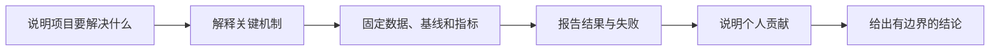

# 第 16 章：项目答辩与技术表达

假设一位候选人这样介绍项目：“我用了 RAG，引用准确率从 82% 提高到了 90%。”接下来面试官可能会问：这两个数字来自同一批样本吗？引用准确率怎样定义？提升是模型带来的，还是重试和解析规则变了？你本人做了哪一部分？如果回答停在组件名和一个百分比上，听者还无法判断项目到底做成了什么。

[第十五章](15-作品集实战.md)已经把项目主张、运行条件、指标和失败样例整理成证据。本章继续练习怎样把一项技术选择讲清楚，并让每个判断都能回到具体机制或证据。读者会先用一个小算例解释 Attention，再说明项目中的改动为什么会带来相应结果；完整的系统方案和论文评议分别放在[第十七章](17-开放问题与系统设计实战.md)与[第十八章](18-论文评议与复现实战.md)。实现细节可回查[第二章 Attention 与 Mask](02-transformer组件实战-2-attention与mask.md)以及[第六章 KV Cache](06-推理优化实战-1-缓存延迟与调度.md)。

这条链不是一份要背诵的答案模板。它提醒我们把结论的来路说出来：项目目标是什么，哪项机制影响了结果，数字怎样测得，哪些失败会改变判断。

## 16.1 Attention 怎样把相关性变成信息汇总

如果面试官问“Attention 怎样让一个位置读取其他位置的信息”，只回答“计算 Q、K、V，再做 softmax”还没有说明计算为什么会产生选择。可以用一个只有两个候选位置的例子，把相似度、归一化和信息聚合走完。

设查询向量为 $q=(1,0)$，两个键向量分别是 $k_1=(1,0)$、$k_2=(0,1)$，对应的值向量是 $v_1=(2,0)$、$v_2=(0,4)$。向量维度为 $d=2$，缩放分母为 $\sqrt{2}$。点积得到 $q\cdot k_1=1$、$q\cdot k_2=0$，缩放后的分数约为 0.707 和 0。经过 softmax，两个权重约为 0.67 和 0.33。因此输出为：

~~~math
o \approx 0.67(2,0)+0.33(0,4)=(1.34,1.32)
~~~

这个结果说明，输出不是简单地“选中一个 token”，而是按查询与键的相对分数混合对应的值。若第二个位置被 mask，softmax 前应把它的分数设为负无穷，权重变为 (1,0)，输出变成 (2,0)。mask 改变了可访问的信息集合，因此它是计算语义的一部分，不只是一个形状相同的矩阵。

一个完整的口头回答可以按四步推进：先说输入位置要从上下文取得信息；再说明 query 与 key 的匹配分数决定权重；随后解释权重如何组合 value；最后给出边界，例如因果 mask 只能让位置访问当前位置和过去、全被屏蔽的行需要单独处理、多头机制在不同子空间重复这一过程。若被追问复杂度、mask 的具体广播形状或工程 kernel，再回到第二章对应实现与公式，不靠背一个孤立结论蒙混过去。

这个小例子是教学推演，不代表某个模型的注意力分布，也没有覆盖 dropout、批次维度和多头 reshape。表达时把“我手算了一个二位置例子”和“我测量了真实模型的注意力行为”区分开，听者就能知道证据的层级。

讲清机制，回答的是“你是否理解自己选择的方法”。接下来的问题是“这个项目的结果能不能信”。回答这类追问时，组件名称要退到背景里，数据、对照、指标和失败样例才是主角。

## 16.2 从项目主张到可复核证据

### “做过”需要什么证据

一个系统项目不能只由组件名组成。说“用了 RAG、FAISS、LoRA、DPO 和 vLLM”，并不能说明问题是否被解决，也不能说明每个组件为什么存在。可复核的项目叙述应当包含：背景、目标、数据、方法、baseline、指标、结果、失败案例、责任边界和下一步实验。

把一条项目记录抽象成：

~~~math
P=(B,G,D,M,E,R,C,F,N)
~~~

其中 `B` 是背景，`G` 是目标，`D` 是数据，`M` 是方法，`E` 是评估，`R` 是结果，`C` 是个人或小组贡献，`F` 是失败案例，`N` 是下一步行动。这个结构不是要求把每个项目写成同样的段落，而是帮助发现证据缺口。

例如“格式合法率从 82% 提高到 94%”至少需要知道：模型和模板版本、评测样本数、JSON schema、baseline 解码参数、失败样例、是否同时增加了重试。如果没有这些上下文，数字无法判断是模型改进、解析器放宽，还是评估口径变化。

### 目标要能被测量

“提升质量”不是可执行目标。应先确定任务、对象和指标。例如：

~~~text
企业制度问答：提升 Recall@5 和 citation accuracy，保持权限违规率为 0
中文 SFT：提高 JSON schema 通过率，观察开放问答回归
偏好优化：提高 pairwise 胜率，控制长度偏置和过度拒答
推理服务：降低 P95 与单位成功任务成本，保持回答质量
数学推理：提高多步题准确率，报告额外 token 和工具调用成本
~~~

主指标回答“目标是否改善”，护栏指标回答“改善是否以不可接受的损失为代价”，诊断指标回答“为什么发生变化”。三类指标不应被压成一个没有解释的总分。

令 $s_m^{(\mathrm{new})}$ 和 $s_m^{(\mathrm{base})}$ 分别表示候选与基线在相同样本范围、计量单位和评估规则下的指标值。对越低越好的指标，先把方向转换成统一的收益分数，或单独使用后面的下降量定义。若指标越高越好，改进量为：

~~~math
\Delta_m=s_m^{(\mathrm{new})}-s_m^{(\mathrm{base})}
~~~

若延迟、错误率和幻觉率越低越好，则写成：

~~~math
\Delta_m^{(\mathrm{lower})}
=s_m^{(\mathrm{base})}-s_m^{(\mathrm{new})}
~~~

相对变化为：

~~~math
R_m
=
\frac{\Delta_m^{(\mathrm{gain})}}
{|s_m^{(\mathrm{base})}|}
~~~

这里 $\Delta_m^{(\mathrm{gain})}$ 根据指标方向取前述绝对收益，因而“越低越好”指标下降时也报告正收益；若报告原始有符号变化，应另写 `(new-base)/abs(base)`。两种相对值都要求 $|s_m^{(\mathrm{base})}|>0$。baseline 为零时应报告绝对差值和样本数，不能用极小分母制造巨大提升。

### baseline 是因果解释的起点

baseline 不一定是最弱的方案，而应是当前可用、可复现并能代表实际决策的对照。不同主题的 baseline 可以是：

~~~text
RAG：dense-only、keyword-only、hybrid、hybrid+rerank
SFT：base model、不同 loss mask、不同数据混合
DPO：SFT model、不同 beta、不同类型的偏好样本
推理：单请求、不同并发、不同量化和后端
数学：direct、few-shot、CoT、self-consistency
Attention：无缩放、错误 mask 或显式矩阵对照
~~~

一次实验只改变一个主要变量，有助于判断差异是否由它引起，但这本身还不足以证明因果。还要固定样本与评估协议，并按任务采用配对或随机对照、重复运行和不确定性分析。若同时切换模型、数据、模板和解码，最终结果即使提高，也无法知道是哪个改动起作用。

### 失败案例属于结果的一部分

平均指标描述分布的一个投影，失败案例提供原因线索。每个失败案例至少应记录：

~~~text
sample_id / request_id
输入与上下文版本
模型、模板、检索器或后端版本
原始输出与期望结果
错误类别
最可能的根因层
尝试过的修复
修复前后指标
未解决的风险
~~~

RAG 的错误可能来自 PDF 表格解析、chunk 边界、召回、rerank、生成或权限；SFT 的错误可能来自 chat template、mask、数据分布、学习率或 LoRA 目标模块；服务的错误可能来自排队、cache、超时、客户端断连或版本切换。把所有问题都写成“模型能力不足”，会失去工程定位能力。

失败轨迹可能包含用户输入、受限文档或工具参数。原始内容的留存和访问应遵循[第十五章的隐私边界](15-作品集实战.md)；公开复现材料应使用合成数据或经过再识别风险审查的脱敏材料。

### 责任边界要具体

团队项目中，“参与了整个系统”无法说明谁做了什么。可以按交付物拆分：

~~~text
数据：清洗、去重、标注指南、按样本类别统计
模型：训练脚本、LoRA 配置、checkpoint 选择
检索：解析、chunk、embedding、召回、rerank
服务：API schema、调度、流式协议、监控
评估：评测集、评分器、人工标注、bad case 回归
上线：压测、灰度、告警、回滚和复盘
~~~

若任务权重为 $w_i$，个人负责标记为 $o_i$，可以用一个粗略的责任覆盖率帮助审查记录：

~~~math
Q_{\mathrm{own}}
=
\frac{\sum_iw_io_i}{\sum_iw_i}
~~~

这里要求任务权重满足 $w_i\ge0$、个人负责标记 $o_i$ 取 0 或 1，且总权重 $\sum_iw_i>0$。它不是团队绩效分数，只是防止把未完成的工作写成已经交付。对于外部依赖、合作团队或未实现部分，应明确写“使用了现成服务”“参与接口设计”“尚未做线上实验”，而不是用模糊语言掩盖边界。

### 一个项目记录审计器

下面的无依赖代码检查一个项目记录是否有目标、数据、baseline、指标、证据、失败案例、责任边界和下一步。它不判断技术方案是否先进，只判断记录是否具备可复核的最小结构。

> 代码状态：静态审阅，未运行（2026-10-30）

~~~python
import math
from collections import Counter

REQUIRED_FIELDS = [
    "background", "goal", "data", "method", "baseline", "metrics",
    "result", "bad_cases", "contribution", "boundary", "next_steps",
]

def field_coverage(project):
    if not isinstance(project, dict):
        raise TypeError("project must be a dictionary")
    present = {field: bool(project.get(field)) for field in REQUIRED_FIELDS}
    missing = [field for field, ok in present.items() if not ok]
    return round(sum(present.values()) / len(present), 4), missing

def metric_gain(metric):
    if not isinstance(metric, dict):
        raise TypeError("metric must be a dictionary")
    baseline = metric["baseline"]
    current = metric["current"]
    if (isinstance(baseline, bool) or not isinstance(baseline, (int, float))
            or not math.isfinite(baseline)
            or isinstance(current, bool) or not isinstance(current, (int, float))
            or not math.isfinite(current)):
        raise ValueError("metric values must be finite numbers")
    higher_is_better = metric.get("higher_is_better", True)
    if not isinstance(higher_is_better, bool):
        raise TypeError("higher_is_better must be boolean")
    if higher_is_better:
        absolute = current - baseline
    else:
        absolute = baseline - current
    relative = None if baseline == 0 else round(absolute / abs(baseline), 4)
    return round(absolute, 4), relative

def evidence_summary(claims, artifacts):
    if not isinstance(claims, (list, tuple)) or not claims:
        raise ValueError("claims must be a non-empty list or tuple")
    if not isinstance(artifacts, dict):
        raise TypeError("artifacts must be a dictionary")
    if any(not isinstance(claim, dict) or not isinstance(claim.get("claim"), str)
           or not claim["claim"] for claim in claims):
        raise ValueError("each claim must contain non-empty claim text")
    linked = []
    unlinked = []
    for claim in claims:
        evidence_id = claim.get("evidence_id")
        if (isinstance(evidence_id, str) and evidence_id.strip()
                and artifacts.get(evidence_id)):
            linked.append(claim)
        else:
            unlinked.append(claim["claim"])
    return {
        "total": len(claims),
        "linked": len(linked),
        "reference_rate": round(len(linked) / len(claims), 4),
        "unlinked": unlinked,
    }

def contribution_summary(tasks):
    if not isinstance(tasks, (list, tuple)) or not tasks:
        raise ValueError("tasks must be a non-empty list or tuple")
    for task in tasks:
        if not isinstance(task, dict):
            raise TypeError("each task must be a dictionary")
        weight = task.get("weight")
        if (isinstance(weight, bool) or not isinstance(weight, (int, float))
                or not math.isfinite(weight) or weight < 0):
            raise ValueError("task weights must be finite and non-negative")
        if not isinstance(task.get("name"), str) or not task["name"]:
            raise ValueError("task names must be non-empty strings")
        if not isinstance(task.get("owner"), str) or not task["owner"]:
            raise ValueError("task owners must be non-empty strings")
    total = sum(task["weight"] for task in tasks)
    if total <= 0:
        raise ValueError("task weights must have a positive total")
    owned = sum(task["weight"] for task in tasks if task["owner"] == "me")
    return round(owned / total, 4), [
        task["name"] for task in tasks if task["owner"] == "me"
    ]

def root_causes(bad_cases):
    if not isinstance(bad_cases, (list, tuple)) or not bad_cases:
        raise ValueError("bad_cases must be a non-empty list or tuple")
    if any(not isinstance(item, dict)
           or not isinstance(item.get("root_cause"), str)
           or not item["root_cause"]
           or not isinstance(item.get("status"), str)
           for item in bad_cases):
        raise ValueError("bad cases must contain cause and status strings")
    counts = Counter(item["root_cause"] for item in bad_cases)
    fixed = sum(item["status"] == "fixed" for item in bad_cases)
    return dict(counts), fixed

project = {
    "background": "制度问答中，模型偶尔引用错误条款。",
    "goal": "提高 Recall@5 和 citation accuracy，保持权限安全。",
    "data": {"documents": 800, "eval_questions": 300},
    "method": ["structured_parser", "hybrid_retrieval", "rerank"],
    "baseline": "dense_only",
    "metrics": {
        "recall_at_5": {"baseline": 0.78, "current": 0.89},
        "hallucination_rate": {
            "baseline": 0.18, "current": 0.09, "higher_is_better": False
        },
    },
    "result": {
        "claims": [
            {"claim": "hybrid improves recall", "evidence_id": "eval_v2"},
            {"claim": "table parsing remains weak", "evidence_id": "bad_07"},
        ]
    },
    "bad_cases": [
        {"root_cause": "table_parse", "status": "fixed"},
        {"root_cause": "chunk_split", "status": "open"},
        {"root_cause": "acl_filter", "status": "open"},
    ],
    "contribution": {
        "tasks": [
            {"name": "parser", "owner": "me", "weight": 0.25},
            {"name": "retriever", "owner": "me", "weight": 0.30},
            {"name": "evaluation", "owner": "me", "weight": 0.25},
            {"name": "deployment", "owner": "teammate", "weight": 0.20},
        ]
    },
    "boundary": "只有离线评测，没有真实用户灰度。",
    "next_steps": ["表格回归集", "权限继承测试"],
}

# Synthetic artifact descriptions, not external experimental evidence.
artifacts = {
    "eval_v2": {"kind": "offline_report", "scope": "synthetic example"},
    "bad_07": {"kind": "failure_record", "scope": "synthetic example"},
}

coverage, missing = field_coverage(project)
gains = {name: metric_gain(metric) for name, metric in project["metrics"].items()}
evidence = evidence_summary(project["result"]["claims"], artifacts)
causes, fixed = root_causes(project["bad_cases"])
owned_ratio, owned_tasks = contribution_summary(project["contribution"]["tasks"])

assert coverage == 1.0
assert missing == []
assert gains["recall_at_5"] == (0.11, 0.141)
assert gains["hallucination_rate"] == (0.09, 0.5)
assert evidence == {"total": 2, "linked": 2, "reference_rate": 1.0, "unlinked": []}
assert causes == {"table_parse": 1, "chunk_split": 1, "acl_filter": 1}
assert fixed == 1
assert owned_ratio == 0.8
assert owned_tasks == ["parser", "retriever", "evaluation"]
print("coverage=", coverage)
print("gains=", gains)
print("evidence=", evidence)
print("root_causes=", causes)
print("owned_ratio=", owned_ratio)
~~~
输出字段覆盖率 1.0，召回率的绝对收益为 0.11（11 个百分点）、相对收益约 14.10%；幻觉率由 0.18 降至 0.09，对“越低越好”指标报告绝对收益 0.09、相对收益 50%。这些数值全部来自合成记录。`reference_rate=1.0` 只表示两个 claim 都关联到本地登记的 artifact 描述，未检查文件内容、版本、样本或 claim 是否受支持；不能称为事实支持率。字段齐全也不代表内容真实。责任覆盖率 0.8 只统计自述的任务权重，不衡量贡献质量或交付是否完成。

### 证据可信度的三层结构

项目记录中的资料和结果可以分层：

~~~text
原始论文、标准、官方 API/模型文档：支持机制和接口事实
开源实现、维护者示例、本地最小复现：支持具体工程行为
目标数据集上的实测、人工评估、线上 trace：支持当前系统结论
~~~

博客、论坛和二手教程适合发现问题、提供直觉和寻找原始来源，但不应单独支撑关键性能或安全结论。论文中的实验结果属于论文设置；官方文档中的参数属于某个版本；toy demo 的数字只验证当前输入；本地实测才与目标硬件和数据相关。写清证据层级，比把所有内容都写成“已证明”更可信。

### 练习：把结论讲到证据能支持的程度

1. 用前面的两个 key 手算 softmax 权重；屏蔽第二个 key 后再算一次输出，并解释 mask 怎样改变可访问的信息。
2. 给一条项目主张引用一个未登记的 evidence ID，再登记一份内容无关的 artifact。说明记录完整性检查发现了什么，为什么它仍然不能证明该 artifact 支持主张。

一个可信的项目回答，既要让人听懂机制，也要让人找到结果的来路。做到这一点后，面试问题往往会从“你做了什么”转向“如果规模、延迟或权限要求改变，你会怎样设计”。下一章沿着这个问题，从目标澄清走到系统方案。
