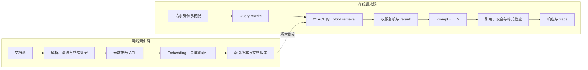

# 第 17 章：开放问题与系统设计实战

[第十六章](16-项目答辩与技术表达.md)里，我们练习把已经做过的项目讲清楚。系统设计面试则常从一个没有完整规格的目标开始：“给企业做一个知识问答系统。”文档有多少、谁能看什么、答案要不要带出处、允许多慢、一天要服务多少请求，面试官未必会一次说完。

这时先报向量库、模型服务和缓存方案，通常答得太早。需要先问出会改变设计的条件，再判断哪些方案可行，最后把数据、请求、权限、容量、监控和回滚接成一条完整路径。本章先练习如何比较开放问题的候选方案，再把选定方案放进系统边界；读完后，读者应能说明设计依赖哪些假设，以及要用什么实验验证它。

## 17.1 从开放目标到可比较的方案

开放问题通常没有唯一技术答案。它的难点不在于列出最多名词，而在于把目标、约束、baseline、指标、风险和实验顺序说清楚。可以先把问题整理成：

### 先定义问题卡

~~~math
P=(g,c,b,m,r)
~~~

其中 `g` 是目标，`c` 是约束，`b` 是 baseline，`m` 是指标集合，`r` 是风险集合。没有这些字段时，方案比较会退化成个人偏好。

例如“降低大模型成本”至少需要明确：质量保持到什么程度，P95 是否有上限，安全违规率是否允许变化，成本是 GPU 账单还是每千请求有效任务成本，输入输出 token 分布是否固定。

### 主指标、护栏与诊断指标

主指标决定优化方向，例如问题解决率或每千请求成本；护栏指标限制不可接受的副作用，例如安全违规率、权限错误、P95 延迟和格式失败率；诊断指标帮助解释结果，例如 Recall@K、输出长度、cache 命中率、重试率和 bad case 分布。

主指标提升但护栏失败时，方案不能被描述为“整体变好”。诊断指标不应被误当成用户价值：token/s 提升可能伴随质量下降，Recall@K 提升可能带来更多噪声，LLM judge 分数提升可能来自风格偏差。

### 先满足硬约束，再比较收益

候选方案集合为：

~~~math
A=\{a_1,a_2,\ldots,a_n\}
~~~

候选集合要求 $n>0$。若没有任何候选方案，不能通过对空集合取最大值来选择结果；应先补充方案或明确当前问题尚未形成可比较的设计空间。

主指标收益为：

~~~math
\Delta_{\mathrm{main}}(a)=s_{\mathrm{main}}(a)-s_{\mathrm{main}}(b)
~~~

成本降低比例为：

~~~math
\Delta_{\mathrm{cost}}(a)=\frac{cost(b)-cost(a)}{cost(b)}
~~~

成本降低比例要求基线成本为正值，而且两种方案使用同一计费口径。若基线成本为零，只能报告绝对差值或“不适用”，不能用一个极小分母制造相对收益。

一个方案的软评分可以综合质量、成本、延迟、安全和实验可验证性。相加前，各项必须映射到同一预先声明的尺度，并统一成“越高越好”的方向；否则权重和分数没有可解释的含义：

~~~math
S(a)=w_qQ(a)+w_cC(a)+w_lL(a)+w_sS_{\mathrm{safe}}(a)+w_eE(a)
~~~

并满足：

~~~math
w_q+w_c+w_l+w_s+w_e=1
~~~

软评分还要求各权重非负且有限；权重和为零或不等于一时，分数不再代表预先声明的偏好。安全、权限和可复现性仍应通过硬约束单独处理。

但安全、权限和实验可复现性不应只作为软评分。以下示例用指示函数 $I(\mathrm{condition})$ 表示条件成立时取 1、否则取 0；$Q(a)$、$L(a)$、$R(a)$ 和 $E(a)$ 分别表示方案 $a$ 的任务质量、延迟、风险和实验覆盖率，带下标的量是同一指标口径下由业务预先设定的阈值。约束分别是任务质量下限、最大延迟、最大风险和最小实验覆盖：

~~~math
P(a)=I(Q(a)\ge Q_{\min})
\cdot I(L(a)\le L_{\max})
\cdot I(R(a)\le R_{\max})
\cdot I(E(a)\ge E_{\min})
~~~

最终选择是：

~~~math
a^*=\arg\max_{a\in A,P(a)=1}S(a)
~~~

如果没有任何方案满足约束，应增加实验、调整资源或收窄目标，而不是把一个不合格方案包装成最优解。

### 示例：降低推理成本

假设 baseline 是一个 7B 模型服务，目标是每千请求成本降低至少 50%，同时质量下降不超过 2 个百分点，P95 不超过 2 秒，安全违规率不超过 0.6%。候选方案可以是：

~~~text
输入 prompt 压缩：减少无关历史和 RAG 上下文
小模型路由：简单请求使用较小模型，复杂请求保留大模型
INT4 量化：降低权重显存和 GPU 成本
self-consistency 默认开启：提高部分复杂任务准确率，但增加生成次数
~~~

第一种方案可能减少 token，却损害需要完整证据的 RAG 问题；第二种方案需要路由器和误判评估；第三种方案需要质量回归；第四种方案与成本目标可能直接冲突。合理的实验顺序是先用离线样本估计质量和安全，再做并发压测，最后在小流量中观察真实 token 分布。

### 一个开放问题方案评估器

> 代码状态：静态审阅，未运行（2026-10-30）

~~~python
import math

def finite_number(value, name, minimum=None):
    if (isinstance(value, bool) or not isinstance(value, (int, float))
            or not math.isfinite(value)
            or minimum is not None and value < minimum):
        raise ValueError(f"{name} must be a finite number in the allowed range")
    return value

def relative_reduction(baseline, current):
    finite_number(baseline, "baseline", minimum=0.0)
    finite_number(current, "current", minimum=0.0)
    if baseline == 0:
        raise ValueError("baseline must be positive")
    return round((baseline - current) / baseline, 4)

def failures(plan, limits):
    if not isinstance(plan, dict) or not isinstance(limits, dict):
        raise TypeError("plan and limits must be dictionaries")
    fields = ("quality_delta", "p95_ms", "safety_rate", "experiment_coverage", "cost")
    limit_fields = ("min_quality_delta", "max_p95_ms", "max_safety_rate",
                    "min_experiment_coverage", "target_cost")
    if any(field not in plan for field in fields) or any(
            field not in limits for field in limit_fields):
        raise ValueError("plan or limits is missing a constraint field")
    finite_number(plan["quality_delta"], "quality_delta")
    finite_number(plan["p95_ms"], "p95_ms", minimum=0.0)
    finite_number(plan["safety_rate"], "safety_rate", minimum=0.0)
    finite_number(plan["experiment_coverage"], "experiment_coverage", minimum=0.0)
    finite_number(plan["cost"], "cost", minimum=0.0)
    finite_number(limits["min_quality_delta"], "min_quality_delta")
    finite_number(limits["max_p95_ms"], "max_p95_ms", minimum=0.0)
    finite_number(limits["max_safety_rate"], "max_safety_rate", minimum=0.0)
    finite_number(limits["min_experiment_coverage"], "min_experiment_coverage", minimum=0.0)
    finite_number(limits["target_cost"], "target_cost", minimum=0.0)
    for values, fields in (
        (plan, ("safety_rate", "experiment_coverage")),
        (limits, ("max_safety_rate", "min_experiment_coverage")),
    ):
        if any(values[field] > 1 for field in fields):
            raise ValueError("rates and coverage must be in [0, 1]")
    if not -1 <= plan["quality_delta"] <= 1 or not -1 <= limits["min_quality_delta"] <= 1:
        raise ValueError("quality deltas use a normalized score and must be in [-1, 1]")
    result = []
    if plan["quality_delta"] < limits["min_quality_delta"]:
        result.append("quality")
    if plan["p95_ms"] > limits["max_p95_ms"]:
        result.append("latency")
    if plan["safety_rate"] > limits["max_safety_rate"]:
        result.append("safety")
    if plan["experiment_coverage"] < limits["min_experiment_coverage"]:
        result.append("experiment")
    if plan["cost"] > limits["target_cost"]:
        result.append("cost")
    return result

def score(plan, baseline, weights):
    if not isinstance(plan, dict) or not isinstance(baseline, dict) or not isinstance(weights, dict):
        raise TypeError("plan, baseline and weights must be dictionaries")
    for field in ("quality_delta", "p95_ms", "safety_rate", "experiment_coverage", "cost"):
        if field not in plan:
            raise ValueError("plan is missing a score field")
    for field in ("cost", "p95_ms"):
        if field not in baseline:
            raise ValueError("baseline is missing a score field")
    for field in ("quality", "cost", "latency", "safety", "experiment"):
        finite_number(weights.get(field), f"weight_{field}", minimum=0.0)
    if abs(sum(weights[field] for field in ("quality", "cost", "latency", "safety", "experiment")) - 1.0) > 1e-9:
        raise ValueError("weights must sum to one")
    finite_number(plan["quality_delta"], "quality_delta")
    finite_number(plan["safety_rate"], "safety_rate", minimum=0.0)
    finite_number(plan["experiment_coverage"], "experiment_coverage", minimum=0.0)
    if not -1 <= plan["quality_delta"] <= 1 or not 0 <= plan["safety_rate"] <= 1:
        raise ValueError("quality delta or safety rate is outside its allowed range")
    if not 0.0 <= plan["experiment_coverage"] <= 1.0:
        raise ValueError("experiment coverage must be in [0, 1]")
    quality = max(0.0, min(1.0, 0.5 + plan["quality_delta"]))
    cost_gain = relative_reduction(baseline["cost"], plan["cost"])
    latency_gain = relative_reduction(baseline["p95_ms"], plan["p95_ms"])
    safety = max(0.0, 1.0 - plan["safety_rate"] / 0.02)
    return round(
        weights["quality"] * quality
        + weights["cost"] * cost_gain
        + weights["latency"] * latency_gain
        + weights["safety"] * safety
        + weights["experiment"] * plan["experiment_coverage"],
        4,
    )

baseline = {"cost": 0.024, "p95_ms": 1800}
limits = {
    "min_quality_delta": -0.02,
    "max_p95_ms": 2000,
    "max_safety_rate": 0.006,
    "min_experiment_coverage": 0.8,
    "target_cost": 0.012,
}
weights = {"quality": 0.30, "cost": 0.30, "latency": 0.15,
           "safety": 0.15, "experiment": 0.10}
plans = [
    {"name": "prompt_compression", "quality_delta": -0.01, "cost": 0.015,
     "p95_ms": 1500, "safety_rate": 0.004, "experiment_coverage": 0.90},
    {"name": "small_model_router", "quality_delta": -0.015, "cost": 0.011,
     "p95_ms": 1300, "safety_rate": 0.005, "experiment_coverage": 0.95},
    {"name": "int4_only", "quality_delta": -0.035, "cost": 0.010,
     "p95_ms": 1250, "safety_rate": 0.004, "experiment_coverage": 0.75},
    {"name": "default_self_consistency", "quality_delta": 0.03, "cost": 0.080,
     "p95_ms": 4200, "safety_rate": 0.004, "experiment_coverage": 0.85},
]
evaluated = []
for plan in plans:
    rejected = failures(plan, limits)
    evaluated.append({
        "name": plan["name"],
        "rejected": rejected,
        "score": score(plan, baseline, weights),
        "cost_reduction": relative_reduction(baseline["cost"], plan["cost"]),
    })
valid = [item for item in evaluated if not item["rejected"]]
selected = max(valid, key=lambda item: item["score"], default=None)

assert selected["name"] == "small_model_router"
assert selected["cost_reduction"] == 0.5417
assert evaluated[2]["rejected"] == ["quality", "experiment"]
assert "latency" in evaluated[3]["rejected"]
print("evaluated=", evaluated)
print("selected=", selected)
~~~
在合成点估计满足全部阈值的候选中，只有 small_model_router 进入选择，成本降低约 54.17%；若没有合格方案，`selected` 为 None，应继续调查或设计实验。此处 cost 是同一货币单位下的每次请求成本，baseline 0.024 对应每千请求 24，目标 0.012 对应每千请求 12，不能把 0.024 当成每千请求费用。

手算 small_model_router 的成本降低比例为 $(0.024-0.011)/0.024\approx0.5417$。它的质量变化为 −1.5 个百分点，高于 −2 个百分点下限；P95 为 1,300 ms，低于 2,000 ms；安全违规率 0.5%，低于 0.6%；实验覆盖率 0.95，高于 0.80。因此该方案通过这组教学硬约束，之后才参加软评分排序。

软评分中的质量项按 $\mathrm{clip}(0.5+\Delta Q,0,1)$ 映射，安全项以 0.02 为教学尺度，其余项依次为相对成本收益、相对延迟收益、实验覆盖率；这些人为变换只用于排序，没有通用业务意义。下降的成本/延迟必须先转换成正向收益，不能把原始延迟与“越高越好”质量直接相加。点估计满足阈值不等于真实安全或质量非劣效通过；上线还需样本数、区间和人工审查，见[第九章的能力回归篇](09-评估与debug实战-3-训练调试与能力回归.md)。

### 资料与边界

开放问题的组织方法可以参考 [OpenAI Evals](https://github.com/openai/evals) 和在线受控实验的公开实践；风险识别可参考 [NIST AI RMF](https://www.nist.gov/itl/ai-risk-management-framework)，但 NIST 将它定位为自愿使用的框架，并说明 1.0 正在修订。具体权重、阈值和风险分级必须由目标业务确定。一个 toy 方案评估器只能检查指标和约束是否被写出来，不能替代真实数据、人工评估、安全审查和灰度实验。

把候选方案筛到可行范围，只回答了“选哪种方向”。接下来要追踪一次请求经过什么状态、会消耗多少资源、权限在哪一步生效，以及故障时怎样停止或恢复。技术组件只有放回这条运行路径里，才构成系统设计。

## 17.2 把方案放进系统：容量、权限与回滚

### 系统设计首先是边界设计

同一个“做一个企业知识库问答系统”的句子，可以对应几百篇本地文档，也可以对应多租户、百万文档、严格权限、三秒首 token 和全天候服务。架构不能脱离用户、数据、质量、延迟、成本、安全和可用性约束。

需求卡可以写成：

~~~math
R=(U,D,Q,L,C,S,A)
~~~

其中 `U` 是用户与租户，`D` 是数据规模和类型，`Q` 是质量目标，`L` 是延迟目标，`C` 是成本约束，`S` 是安全和权限要求，`A` 是可用性目标。

需求澄清的重点不是问很多问题，而是找出会改变架构的变量：是否需要实时知识更新，是否允许外部模型 API，是否有写操作工具，是否必须返回引用，是否存在租户隔离，是否允许人工接管，是否有严格的 P95 和单位成本目标。

### 从几项基本数据估算容量

若日活用户数为 $N_{\mathrm{user}}$，每人每天平均请求数为 $r_{\mathrm{day}}$，平均 QPS 为：

~~~math
QPS_{\mathrm{avg}}
=
\frac{N_{\mathrm{user}}r_{\mathrm{day}}}{86400}
~~~

这里的用户数和人均请求数应为非负有限量，86400 是一天的秒数；作为相对全天均值的峰值放大系数，$\alpha$ 应有限且不小于 1。若没有用户或请求，QPS 为零是业务输入的结果，不代表系统已经完成容量验证。

峰值放大系数为 $\alpha$ 时：

~~~math
QPS_{\mathrm{peak}}=\alpha QPS_{\mathrm{avg}}
~~~

平均输入和输出 token 分别为 $T_{\mathrm{in}}$、$T_{\mathrm{out}}$，token 吞吐近似为：

~~~math
TPS=QPS_{\mathrm{peak}}(T_{\mathrm{in}}+T_{\mathrm{out}})
~~~

根据 Little's Law，若平均端到端延迟为 $L_{\mathrm{avg}}$ 秒，并且在预定高负载窗口内近似稳定，可用该窗口的平均到达率 $\lambda$ 估计平均在途请求数：

~~~math
\overline{N}_{\mathrm{conc}}=\lambda L_{\mathrm{avg}}
~~~

这里可将规划用的 $QPS_{\mathrm{peak}}$ 作为高负载窗口的平均到达率假设，但不能把瞬时峰值乘上另一个时段的平均延迟当作定律。QPS 和平均延迟必须对应同一系统边界、同一稳定窗口，并计入系统内的等待和完成路径。结果是平均在途数，不是并发上限、尾部容量或 GPU 数量。

这是容量初估，不是 GPU 数量的直接答案。真实容量还要考虑 batch 形成、输入输出长度分布、KV Cache、失败重试、流式连接、检索和工具调用的额外时间。

### 延迟预算必须能被定位

RAG 或 Agent 系统的端到端延迟可以拆成：

~~~math
L
=L_{\mathrm{queue}}
+L_{\mathrm{rewrite}}
+L_{\mathrm{retrieval}}
+L_{\mathrm{rerank}}
+L_{\mathrm{prefill}}
+L_{\mathrm{decode}}
+L_{\mathrm{safety}}
~~~

每一项都要能被 trace 记录。否则 P95 变差时，只能重新猜是模型、向量库、网络还是排队的问题。在线系统至少保留 request_id、model_version、retriever_version、prompt_version、输入输出 token、各阶段耗时、finish_reason 和 error_code。以 vLLM 当前公开的指标面为例，它分别提供请求排队、prefill、decode、TTFT 和端到端延迟等观测量；字段名和覆盖范围属于具体实现版本，设计时应核对部署版本的文档，不能把一套引擎的指标名当成所有服务的统一协议。[vLLM Production Metrics](https://docs.vllm.ai/en/latest/usage/metrics/)

分段相加适用于互不重叠的串行耗时；并行检索应按关键路径计算，流式安全检查也可能与 decode 重叠。各阶段 P95 之和不是端到端 P95，应先汇总每条请求的端到端时间再取分位数。

KV Cache 容量的粗略估算为：

~~~math
M_{\mathrm{KV}}
=2L_{\mathrm{layer}}H_{\mathrm{KV}}D_hT_{\mathrm{cache}}B b
~~~

这里 $B$ 是并发请求数，$b$ 是每个 cache 元素的字节数；各层数、head 数、维度、缓存 token 数和字节数应为正值，$B$ 应为非负整数。长度上限、并发上限和队列长度必须放在容量设计中，而不是等 GPU OOM 后再添加。

把一个具体配置代入，数量级就容易检查：假设模型有 32 层、8 个 KV head、每个 head 维度为 128，使用每元素 2 字节的 FP16，最多缓存 4096 个 token，并同时保留 24 条序列。单个序列、每个 token 的 key 和 value 共占 $2\times32\times8\times128\times2=131{,}072$ 字节，也就是 128 KiB；一条 4096-token 序列约占 512 MiB，24 条序列约占 12 GiB。平均上下文翻倍、并发不变时，KV cache 显存也约翻倍到 24 GiB。

这 12 GiB 只算 KV cache，不是整张 GPU 的显存需求。模型权重、临时激活、kernel workspace、allocator 碎片和运行时预留都还要留空间。量化 KV、较少的 KV head、滑动窗口和前缀共享会改变公式中的不同项，也可能带来精度、调度或实现代价。若使用 GQA，减少的是公式里的 $H_{\mathrm{KV}}$；面试回答可以用这个估算排除明显不可行的配置，最终容量仍要在目标硬件上用固定负载测量吞吐、尾延迟、OOM 和单位成功请求成本。

### 离线链路和在线链路

以企业 RAG 为例，离线链路负责把原始知识变成可过滤、可引用、可更新的索引：

在线链路负责把用户问题变成可审计的响应：

离线更新不能绕过版本记录，在线响应不能绕过权限和引用检查。两条链路之间通过索引版本、文档版本和 prompt 版本连接，否则更新后出现错误时无法回放。

### 企业 RAG 的关键模块

文档解析保留标题、章节、表格、页码、来源和更新时间；chunk 保留文档标识、版本、来源位置和访问控制；召回可以组合稠密向量与 BM25；rerank 在有限候选上细判相关性；生成 prompt 要求只使用证据，资料不足时诚实说明；服务端根据检索记录建立 citation map，不能让模型任意编造来源。完整检索和引用链路见[第七章的检索与上下文](07-rag项目实战-1-文档与检索.md)及[引用与证据](07-rag项目实战-2-重排与证据.md)。

权限过滤不能交给模型。用户角色或租户条件应尽量下推到检索层，进入 rerank 和 prompt 前再次检查；缓存键不能只包含 query，还应包含租户、用户权限版本、索引版本和模型/模板版本。缓存命中不等于可以跳过权限验证。

### 客服系统的动作边界

客服模型比纯问答多了订单、物流、退款和人工转接等动作。架构中应区分：

~~~text
只读工具：查询订单、物流、库存
低风险写工具：创建工单、预约回电
高风险写工具：退款、改地址、取消订单
敏感工具：涉及身份、支付、隐私和合同
~~~

高风险工具需要二次确认、权限校验、幂等键、完整审计和失败补偿。模型只能提出结构化 action，真正执行由受控 executor 完成。工具返回结果也要经过 schema 校验，不能把错误字符串当成成功状态。工具注册、授权和恢复机制见[第八章工具调用协议](08-agent项目实战-1-协议与状态循环.md)及[执行安全与恢复](08-agent项目实战-2-安全审计与验收.md)。

### 评估平台的最小组成

一个跨模型评估平台至少需要：

~~~text
评测集版本与样本分类
模型/模板/检索器版本
任务调度和资源配额
自动评分器与人工标注
LLM judge 校准集
主指标、护栏和诊断指标
bad case 回归库
报告、原始输出和可回放 trace
~~~

人工评测需要标注指南和一致性检查；LLM judge 应用人工 gold set 校准，测试位置偏差、长度偏差和风格偏好；公开 benchmark 与业务评测不能互相替代。评测集、评分器和回归的完整实践见[第九章人工评测篇](09-评估与debug实战-4-人工评测.md)。

### 高并发推理服务的状态

推理服务可以分为入口、调度和执行三层：

~~~text
API gateway：鉴权、限流、schema、request_id
scheduler：队列、动态 batch、超时、取消、优先级
runtime：模型权重、KV Cache、decode、流式事件
observability：metrics、logs、traces、成本与质量回放
~~~

长请求会占用 cache 和 decode 时间，可能拖慢短请求。可以按输入长度、预计输出长度或优先级分队列，限制单请求预算，使用 continuous batching，并为长上下文请求提供专用路由。具体策略需要通过 P95、goodput 和单位成功任务成本验证；KV 分配和调度见[第六章 Serving runtime 篇](06-推理优化实战-1-缓存延迟与调度.md)，对照口径见[实验报告篇](06-推理优化实战-3-长上下文压测与报告.md)。

### Agent 的工具权限和可恢复性

Agent 的状态可以抽象为：

~~~math
s_{t+1}=F(s_t,o_t,a_t)
~~~

其中 $s_t$ 是当前状态，$a_t$ 是动作或工具调用，$o_t$ 是观察结果。系统必须记录每一步的 tool name、参数、权限判定、返回值、重试次数和状态变化。

Agent 设计需要：

~~~text
工具注册表与 JSON Schema
只读/写入/高风险分级
参数与权限校验
幂等键和重复执行保护
最大步数、超时和预算
未知状态与人工确认
补偿动作或回滚
完整 trace 与审计
~~~

最终回答正确不能掩盖中间发生的越权调用或重复扣款。Agent 评估应包括任务成功率、工具选择准确率、参数正确率、失败恢复率、越权调用率、平均步数和成本。

### 灰度、回滚和版本一致性

模型服务发布至少涉及模型、tokenizer、prompt、检索器、reranker、量化、工具 schema 和安全策略多个版本。回滚时必须能恢复兼容组合，不能只把模型权重切回旧版本而保留新模板或新工具协议。

灰度实验要固定分流单位。会话型产品通常按 user_id 或 session_id 分桶，避免同一会话在不同模型之间跳动。主指标和护栏指标应同时监控，发现安全、权限、错误率或尾延迟异常时，先停止扩大流量，再回放 trace 和失败样例。随机化单元、曝光记录与回退决策见[第十章灰度发布与实验报告](10-agent轨迹与线上评估实战.md)。

### 一个系统设计容量审计器

> 代码状态：静态审阅，未运行（2026-10-30）

~~~python
import math
from math import ceil

def finite_nonnegative(value, name):
    if (isinstance(value, bool) or not isinstance(value, (int, float))
            or not math.isfinite(value) or value < 0):
        raise ValueError(f"{name} must be a finite non-negative number")
    return value

def qps_estimate(daily_users, requests_per_user, peak_factor):
    finite_nonnegative(daily_users, "daily_users")
    finite_nonnegative(requests_per_user, "requests_per_user")
    finite_nonnegative(peak_factor, "peak_factor")
    if peak_factor < 1:
        raise ValueError("peak_factor must be at least one")
    average = daily_users * requests_per_user / 86400
    return average, average * peak_factor

def concurrency(qps_peak, latency_seconds):
    finite_nonnegative(qps_peak, "qps_peak")
    finite_nonnegative(latency_seconds, "latency_seconds")
    return qps_peak * latency_seconds

def kv_cache_mib(layers, kv_heads, head_dim, tokens, requests, bytes_per_elem):
    dimensions = (layers, kv_heads, head_dim, tokens)
    if any(isinstance(value, bool) or not isinstance(value, int) or value <= 0
           for value in dimensions):
        raise ValueError("cache dimensions must be positive integers")
    if (isinstance(requests, bool) or not isinstance(requests, int)
            or requests < 0):
        raise ValueError("requests must be a non-negative integer")
    if (isinstance(bytes_per_elem, bool)
            or not isinstance(bytes_per_elem, (int, float))
            or not math.isfinite(bytes_per_elem) or bytes_per_elem <= 0):
        raise ValueError("bytes_per_elem must be finite and positive")
    total = 2 * layers * kv_heads * head_dim * tokens * requests * bytes_per_elem
    return round(total / (1024 * 1024), 2)

def latency_budget(parts):
    if not isinstance(parts, dict) or not parts:
        raise ValueError("parts must be a non-empty dictionary")
    if any(not isinstance(name, str) or not name for name in parts):
        raise ValueError("latency part names must be non-empty strings")
    for name, value in parts.items():
        finite_nonnegative(value, name)
    return round(sum(parts.values()), 3)

def missing_items(found, required):
    if not isinstance(found, (list, tuple, set)):
        raise TypeError("found must be a collection")
    if not isinstance(required, (list, tuple, set)) or not required:
        raise ValueError("required must be a non-empty collection")
    return [item for item in required if item not in set(found)]

design = {
    "daily_users": 10000,
    "requests_per_user": 4,
    "peak_factor": 6,
    "latency_seconds": 3.2,
    "parts": {
        "queue": 0.15, "retrieval": 0.12, "rerank": 0.18,
        "prefill": 0.65, "decode": 1.20, "safety": 0.12,
    },
}
required_modules = [
    "requirements", "metrics", "offline", "online", "acl", "retrieval",
    "rerank", "generation", "citation", "monitoring", "rollout", "rollback",
]
found_modules = required_modules[:]
avg_qps, peak_qps = qps_estimate(
    design["daily_users"], design["requests_per_user"], design["peak_factor"]
)
concurrent = concurrency(peak_qps, design["latency_seconds"])
latency = latency_budget(design["parts"])
cache = kv_cache_mib(24, 8, 128, 1500, ceil(concurrent), 2)
missing = missing_items(found_modules, required_modules)

assert round(avg_qps, 4) == 0.463
assert round(peak_qps, 4) == 2.7778
assert round(concurrent, 2) == 8.89
assert latency == 2.42
assert cache == 1265.62
assert missing == []
print("avg_qps=", round(avg_qps, 4))
print("peak_qps=", round(peak_qps, 4))
print("concurrent=", round(concurrent, 2))
print("latency_budget=", latency)
print("kv_cache_mib=", cache)
print("missing_modules=", missing)
~~~
输出平均 QPS 约 0.463、规划高负载 QPS 约 2.7778；乘以该负载下假设的 3.2 秒平均延迟，平均在途数约 8.89，向上取整 9 个请求时，按每请求 1500 个 KV token 估算缓存约 1265.62 MiB。中间计算保留精度，只在展示时舍入，避免 `ceil` 因提前舍入而少算请求。分段延迟和为 2.42 秒，与容量假设的 3.2 秒不相等，剩余 0.78 秒应由网络、外部依赖或预留预算解释，不能默默混用。清单齐全不证明实现存在，更不证明稳定承载峰值；真实验证需要压测、故障注入、权限测试、模型质量回归和版本回放。

### 系统设计的资料边界

可靠性、指标和回滚可以参考 [Google SRE 的 SLI/SLO 讨论](https://sre.google/sre-book/service-level-objectives/)。[NIST AI RMF](https://www.nist.gov/itl/ai-risk-management-framework) 可用于组织风险识别；NIST 当前页面说明该框架供自愿使用，且 1.0 正在修订，因此引用它不等同于法规合规证明，也不能证明系统风险已受控。具体组件选型要以目标吞吐、GPU、租户模型、数据权限和运维能力为准。架构图是设计假设，压测和故障演练才是容量与可靠性证据。

### 练习：让方案和容量判断经得起追问

1. 把所有候选方案都设为超出成本上限，检查方案选择结果为何应为空；再解释点估计刚好达到安全阈值，为什么仍不足以证明安全非劣效。
2. 用同一个稳定高负载窗口里的到达率和平均延迟估算平均在途请求数；再比较分段延迟之和与端到端 P95，说明并行和重叠会怎样影响两种算法。

系统设计给出的首先是一组可检验的假设，不是上线保证。需求卡说明“什么结果算可接受”，架构图说明“打算怎样实现”，容量估算和故障演练则检验这些判断。在[第十八章](18-论文评议与复现实战.md)，我们把同样的证据意识带到论文：作者的结论究竟由什么机制和实验支持？
