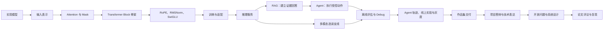

# 第三册目录：大模型算法岗实战手册

## 本册定位

本册把大模型原理转成可运行实验、应用项目和可核验作品集。主线从张量与模型实现，经过训练适配、推理服务、RAG 证据回答和 Agent 受控动作，再分层验证离线效果、Agent 执行轨迹与线上发布风险；多模态实践是选读支线，最后以作品集交付和技术表达收束。

## 阅读路径

### 主线：从模型实现到可测量应用

| 顺序 | 章节 | 本章回答的问题 | 交接产物 |
| --- | --- | --- | --- |
| 1 | [PyTorch 基础实战](chapters/01-pytorch基础实战.md) | 张量、损失、梯度和优化器如何组成一次参数更新？ | 可检查的训练循环与数值轨迹 |
| 2 上 | [Transformer 输入表示](chapters/02-transformer组件实战-1-输入表示.md) | token id 怎样变成带位置信息的向量？ | 从 tokenizer 到 `[B,T,D]` 的输入契约 |
| 2 中 | [Attention 与 Mask](chapters/02-transformer组件实战-2-attention与mask.md) | 一个位置怎样从其他位置读取信息，哪些位置可以被读取？ | 可手算的注意力权重与 mask 约定 |
| 2 下 | [Transformer Block 的骨架](chapters/02-transformer组件实战-3-decoder-block.md) | 注意力、前馈层、残差与归一化怎样组成可堆叠的一层？ | 可沿 shape 路径审计的基础 block |
| 2 续 | [现代 Decoder 组件](chapters/02-transformer组件实战-4-modern-decoder.md) | RoPE、RMSNorm 和 SwiGLU 分别改变 block 的哪一步？ | 可审计的现代组件组合与位置契约 |
| 3 | [Token 数据契约](chapters/03-从零训练小gpt-1-token数据.md) / [最小 GPT 与训练](chapters/03-从零训练小gpt-2-model-training.md) / [解码控制](chapters/03-从零训练小gpt-3-decoding.md) / [Checkpoint 与评估](chapters/03-从零训练小gpt-4-checkpoint-evaluation.md) / [Tokenizer 与公平比较](chapters/03-从零训练小gpt-5-tokenizer-comparison.md) | 文本怎样成为训练目标，模型怎样更新并提供可复核的生成证据？ | token 窗口、训练状态、固定解码样例与公平比较 |
| 4 | [模型与生成](chapters/04-huggingface微调实战-1-模型与生成.md) / [SFT 数据](chapters/04-huggingface微调实战-2-sft数据.md) / [数据审计与全参数 SFT](chapters/04-huggingface微调实战-3-data-audit-full-sft.md) / [LoRA](chapters/04-huggingface微调实战-4-lora.md) / [QLoRA](chapters/04-huggingface微调实战-5-qlora.md) / [评估协议与指标](chapters/04-huggingface微调实战-6-evaluation-metrics.md) / [自动评估与报告](chapters/04-huggingface微调实战-7-evaluation-report.md) | 如何定义监督目标、选择更新方式，并验证回答变化？ | 固定基线、可复原数据、训练状态与前后评估 |
| 5 | [偏好优化实战](chapters/05-偏好优化实战.md) | 偏好数据如何影响策略，怎样确认行为变化？ | preference pair、训练记录和行为对照 |
| 6 | [KV Cache](chapters/06-推理优化实战-1-kv-cache.md) / [Prefill 与 Decode](chapters/06-推理优化实战-2-prefill-decode.md) / [Serving runtime](chapters/06-推理优化实战-3-serving-runtime.md) / [量化](chapters/06-推理优化实战-4-量化.md) / [推测解码](chapters/06-推理优化实战-5-speculative-decoding.md) / [长上下文压测](chapters/06-推理优化实战-6-长上下文压测.md) / [实验报告](chapters/06-推理优化实战-7-实验报告.md) | 如何在同一服务负载下权衡缓存、调度、精度、速度与任务质量？ | 固定负载的推理实验报告 |
| 7 | [文档与切分](chapters/07-rag项目实战-1-文档与切分.md) / [检索与上下文](chapters/07-rag项目实战-2-检索与上下文.md) / [候选重排](chapters/07-rag项目实战-3-候选重排.md) / [引用与证据](chapters/07-rag项目实战-4-引用与证据.md) / [评估指标](chapters/07-rag项目实战-5-评估指标.md) / [失败归因与报告](chapters/07-rag项目实战-6-失败归因与报告.md) | 如何把版本化、带权限的文档变成可引用的答案证据，并定位每层失败？ | 可复查的检索、引用、评估与改进报告 |
| 8 | [工具调用协议](chapters/08-agent项目实战-1-tool-calling协议.md) / [ReAct 状态循环](chapters/08-agent项目实战-2-react状态循环.md) / [执行安全与授权](chapters/08-agent项目实战-3-执行安全与授权.md) / [轨迹审计与评估](chapters/08-agent项目实战-4-轨迹审计与评估.md) / [贯通项目验收](chapters/08-agent项目实战-5-贯通项目验收.md) | 如何把模型提议转成受权限、预算和业务规则约束的执行闭环，并确认任务确实完成？ | 工具契约、持久状态、安全策略、可回放轨迹与项目验收报告 |
| 9 | [评测协议与 benchmark](chapters/09-评估与debug实战-1-评测协议与benchmark.md) / [数据污染与泄漏](chapters/09-评估与debug实战-2-数据污染与泄漏.md) / [事实性与 claim](chapters/09-评估与debug实战-3-事实性与claim.md) / [训练不收敛](chapters/09-评估与debug实战-4-训练不收敛.md) / [微调能力回归](chapters/09-评估与debug实战-5-微调能力回归.md) / [人工评测](chapters/09-评估与debug实战-6-人工评测.md) | 如何先建立可信测量，再区分数据泄漏、事实错误、训练故障和能力取舍？ | 版本化评测集、逐样本证据、训练诊断和回归结论 |
| 10 | [轨迹诊断](chapters/10-agent轨迹与线上评估实战-1-轨迹诊断.md) / [线上 A/B 实验设计](chapters/10-agent轨迹与线上评估实战-2-ab实验设计.md) / [灰度发布与报告](chapters/10-agent轨迹与线上评估实战-3-灰度发布.md) | 如何从 Agent 的动作证据走到真实流量的发布判断？ | 失败回归集、线上实验报告和可执行的扩量/回退条件 |

### 选读支线：多模态项目

| 顺序 | 章节 | 本章回答的问题 | 交接产物 |
| --- | --- | --- | --- |
| 11 | [CLIP 图文检索](chapters/11-图文理解与检索实战-1-图文检索.md) / [对比学习损失](chapters/11-图文理解与检索实战-2-对比学习损失.md) / [VLM 图片问答](chapters/11-图文理解与检索实战-3-VLM图片问答.md) / [多模态指令数据](chapters/11-图文理解与检索实战-4-多模态指令数据.md) / [图文 RAG](chapters/11-图文理解与检索实战-5-图文RAG.md) | 图文表示怎样学习、检索怎样排名、VLM 怎样作答，训练数据和 RAG 如何保留证据与权限？ | 检索指标、任务切片、图片级数据切分、带来源和 ACL 的证据链 |
| 12 | [Diffusion 数值实验](chapters/12-diffusion数值实验.md) | 已知的前向噪声如何变成模型预测和反向采样？ | 可手算的加噪、噪声目标、反向均值/方差，以及引导与评估边界 |
| 13 | [语音识别与语音问答](chapters/13-语音识别与问答实战.md) | 怎样分别测量 ASR 文本与关键字段，并定位错误在转写、检索、回答还是确认环节？ | 固定配置、分层指标、证据 trace 与确认状态 |
| 14 | [多模态评估与系统交付](chapters/14-多模态评估与交付.md) | 如何从样本和任务指标走到系统发布判断，同时检查权限、预算与失败回退？ | 分任务回归报告、项目记录和可回滚的版本清单 |

### 收束：作品集、答辩、系统设计与论文复现

| 顺序 | 章节 | 本章回答的问题 | 交接产物 |
| --- | --- | --- | --- |
| 15 | [作品集实战](chapters/15-作品集实战.md) | 如何把项目主张、固定条件和结果证据连起来，并据风险切片判断能否发布？ | 项目 manifest、逐样本对照、失败样例和贡献说明 |
| 16 | [项目答辩与技术表达](chapters/16-项目答辩与技术表达.md) | 怎样解释一个技术机制，并让项目结果、失败和个人贡献都能回到证据？ | 可复核的项目答辩 |
| 17 | [开放问题与系统设计实战](chapters/17-开放问题与系统设计实战.md) | 规格尚不完整时，怎样先比较方案，再把选择落实为容量、权限和回滚设计？ | 带假设、预算和验收条件的系统方案 |
| 18 | [论文评议与复现实战](chapters/18-论文评议与复现实战.md) | 论文的机制、实验和局限分别支持什么结论，怎样用当前资源做最小复现？ | 有证据层级和复现边界的论文评议 |

建议逐章保存交接产物：下一章从上一章已有的模型、数据或 trace 继续，而不是重新建立一套互不相关的示例。第十一至十四章可按需要选读；多模态项目通过第十四章检查交付，第十五章再把项目证据整理成作品集。主线项目依次经过第九章的离线评估和第十章的轨迹、线上实验与灰度判断。

## 前置与书系交接

- 建议先读[第一册](../book-01-core-30/简介.md)建立文本模型的共同主线；数学薄弱时同步查第十三册，PyTorch 不熟时参考第十四册。
- 第三册深入教学规模的项目和实验。大规模训练、生产 Serving、评估科学、数据工程、Agent 方法、运行时、工具协议和完整多模态生成体系分别由第五、六、七、九、十七、二十、二十二和十五册承担。
- 多模态支线只练习图文、Diffusion 数值、语音问答和跨模态交付，不代替第十五册的图像/视频/语音生成、统一多模态模型和前沿专题。
- 作品集可以继续进入[第十二册](../book-12-career-interview-playbook/简介.md)的简历和完整面试流程。
