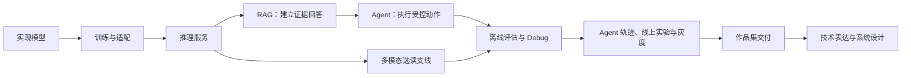

# 第三册目录：大模型算法岗实战手册

## 本册定位

本册把大模型原理转成可运行实验、应用项目和可核验作品集。主线从张量与模型实现，经过训练适配、推理服务、RAG 证据回答和 Agent 受控动作，再分层验证离线效果、Agent 执行轨迹与线上发布风险；多模态实践是选读支线，最后以作品集交付和技术表达收束。

## 阅读路径

### 主线：从模型实现到可测量应用

| 顺序 | 章节 | 本章回答的问题 | 交接产物 |
| --- | --- | --- | --- |
| 1 | [PyTorch 基础实战](chapters/01-pytorch基础实战.md) | 张量、损失、梯度和优化器如何组成一次参数更新？ | 可检查的训练循环与数值轨迹 |
| 2 | [Transformer 组件实战](chapters/02-transformer组件实战.md) | token 表示如何经过注意力、mask 和 decoder block？ | 带 shape 与数值检查的组件 |
| 3 | [从零训练小 GPT](chapters/03-从零训练小gpt.md) | 如何从文本、next-token 样本训练并解释一个小 GPT？ | checkpoint、loss 曲线、生成样例 |
| 4 | [Hugging Face 微调实战](chapters/04-huggingface微调实战.md) | 如何把对话数据变成明确的 SFT 监督信号？ | 微调配置、数据契约和前后评估 |
| 5 | [偏好优化实战](chapters/05-偏好优化实战.md) | 偏好数据如何影响策略，怎样确认行为变化？ | preference pair、训练记录和行为对照 |
| 6 | [推理优化实战](chapters/06-推理优化实战.md) | 模型如何在延迟、吞吐、显存和质量预算下服务？ | 固定负载 trace 与服务报告 |
| 7 | [RAG 项目实战](chapters/07-rag项目实战.md) | 如何把版本化、带权限的文档变成可引用的答案证据？ | 可复查的检索、引用与 RAG 评估结果 |
| 8 | [Agent 项目实战](chapters/08-agent项目实战.md) | 如何把模型工具提议变成受控、可回放的外部动作？ | 工具 schema、guard、执行回执与 Agent 轨迹 |
| 9 | [评估与 Debug 实战](chapters/09-评估与debug实战.md) | 如何建立可信的离线测量，并从样本、训练和评分中定位失败？ | benchmark、失败归因与回归集 |
| 10 | [Agent 轨迹与线上评估实战](chapters/10-agent轨迹与线上评估实战.md) | 如何把单条 Agent 轨迹、固定回归集和真实流量连成发布证据？ | 轨迹诊断、线上实验与灰度决策 |

### 选读支线：多模态项目

| 顺序 | 章节 | 本章回答的问题 | 交接产物 |
| --- | --- | --- | --- |
| 11 | [图文理解与检索实战](chapters/11-图文理解与检索实战.md) | 如何构造 CLIP/VLM、图文监督数据和图文检索链路？ | 检索结果、样本审计和证据引用 |
| 12 | [Diffusion 数值实验](chapters/12-diffusion数值实验.md) | 如何从数值上跟完加噪与一次反向去噪？ | 小规模可复算的扩散轨迹 |
| 13 | [语音识别与语音问答](chapters/13-语音识别与问答实战.md) | ASR 转写的错误如何传到后续问答？ | 转写、关键字段和问答 trace |
| 14 | [多模态评估与系统交付](chapters/14-多模态评估与交付.md) | 如何检查媒体输入、转换、中间证据、权限和整体质量？ | 多模态审计与发布报告 |

### 收束：作品集与面试表达

| 顺序 | 章节 | 本章回答的问题 | 交接产物 |
| --- | --- | --- | --- |
| 15 | [作品集实战](chapters/15-作品集实战.md) | 如何把前文实践整理成能复查、能复述的项目成果？ | 项目 manifest、运行证据、失败样例和贡献说明 |
| 16 | [技术表达与系统设计实战](chapters/16-技术表达与系统设计实战.md) | 如何从任务约束、机制、结果和边界组织面试回答？ | 技术讲解、方案比较和设计答辩 |

建议逐章保存交接产物：下一章从上一章已有的模型、数据或 trace 继续，而不是重新建立一套互不相关的示例。第十一至十四章可按需要选读；多模态项目通过第十四章检查交付，第十五章再把项目证据整理成作品集。主线项目依次经过第九章的离线评估和第十章的轨迹、线上实验与灰度判断。

## 前置与书系交接

- 建议先读[第一册](../book-01-core-30/简介.md)建立文本模型的共同主线；数学薄弱时同步查第十三册，PyTorch 不熟时参考第十四册。
- 第三册深入教学规模的项目和实验。大规模训练、生产 Serving、评估科学、数据工程、Agent 方法、运行时、工具协议和完整多模态生成体系分别由第五、六、七、九、十七、二十、二十二和十五册承担。
- 多模态支线只练习图文、Diffusion 数值、语音问答和跨模态交付，不代替第十五册的图像/视频/语音生成、统一多模态模型和前沿专题。
- 作品集可以继续进入[第十二册](../book-12-career-interview-playbook/简介.md)的简历和完整面试流程。
