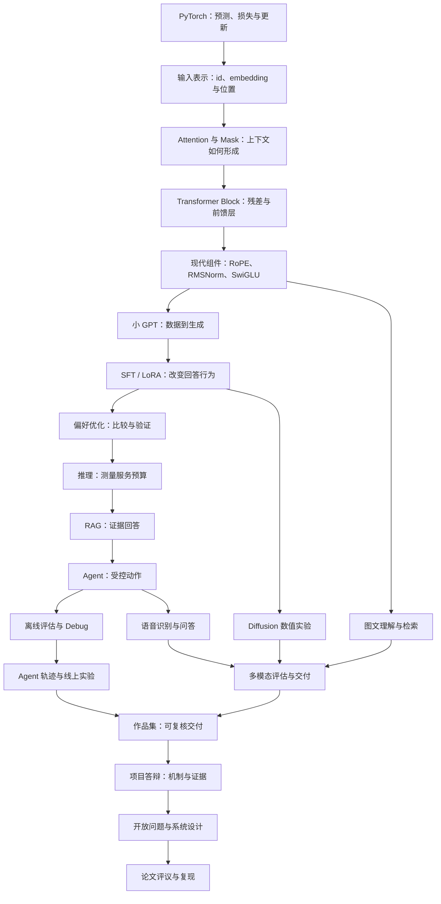

# 第三册简介：大模型算法岗实战手册

## 这本书解决什么问题

读者学过模型概念、看过公式，也知道常见框架，但动手时仍可能不知道数据怎样进入模型、一次训练究竟改了什么、评估数字是否可信，更难把这些过程整理成一个经得起追问的项目。本册按实际项目的顺序带你动手：先实现能观察的小模型，再训练模型按要求回答，接着搭建应用、检查失败，最后把过程和证据整理成项目。

它是一册项目训练教材，不是代码片段合集，也不把“程序运行了”当成“模型有效”。每个项目都要回答：输入是什么、处理经过哪些状态、输出如何核验、数字代表什么、失败时先看哪里、结论能推广到哪里。代码让机制可以运行，手算例子让读者知道代码在算什么，评估和失败记录说明结果有什么证据。

## 读者与前置

本册适合会基础 Python、了解机器学习概念，并希望把大模型原理写成代码、做成项目的读者。建议先读第一册了解共同的技术主线；如果 PyTorch 还不熟，可以参考第十四册的工程内容。本册不要求读者已经会用大规模训练平台、GPU 集群或 Agent runtime。

## 学完后应能完成

1. 用 PyTorch 检查张量、损失、梯度和优化过程，并实现 Transformer 关键组件。
2. Transformer 组件实战分为三部分：[输入表示](chapters/02-transformer组件实战-1-输入表示.md)从 token id 追到带位置信息的向量；[Attention 与 Mask](chapters/02-transformer组件实战-2-attention与mask.md)说明上下文如何形成；[Block 与现代 Decoder 组件](chapters/02-transformer组件实战-3-decoder-block与现代组件.md)把注意力、残差、归一化、RoPE 和 SwiGLU 放回同一结构。后面的小 GPT 实作沿用这套张量形状和位置约定。
3. [从零训练小 GPT](chapters/03-从零训练小gpt-1-数据与训练.md)分成两部分：先把 token 数据变成训练样本并完成一次参数更新，再沿解码、checkpoint、训练曲线和 tokenizer 比较检查生成结果与训练证据。读者最终得到可复用的数据约定、模型状态和公平比较方法。
4. Hugging Face 微调实战合为三个连续部分：[基线、监督数据与全参数 SFT](chapters/04-huggingface微调实战-1-基线与全参数sft.md)从固定基座行为走到可审计的数据和全参数训练；[LoRA 与 QLoRA](chapters/04-huggingface微调实战-2-lora与qlora.md)比较两种参数高效适配；[评估与报告](chapters/04-huggingface微调实战-3-评估与报告.md)固定比较条件并保留逐样本证据，交给偏好优化继续比较。
5. 构建带证据引用和受控工具调用的 RAG/Agent 项目，能回放并定位失败。
6. 推理优化实战分为三个阶段：[缓存、延迟与服务调度](chapters/06-推理优化实战-1-缓存延迟与调度.md)先追踪 KV 状态和请求处理；[量化与推测解码](chapters/06-推理优化实战-2-量化与推测解码.md)比较两类优化改变的对象；[长上下文压测与报告](chapters/06-推理优化实战-3-长上下文压测与报告.md)把质量、延迟、显存和成本放在同一验收条件下。
7. RAG 项目实战沿三段流程推进：[文档、检索与上下文](chapters/07-rag项目实战-1-文档与检索.md)把原文变成带来源、版本和权限的候选；[重排、引用与证据](chapters/07-rag项目实战-2-重排与证据.md)检查有限上下文里的证据是否支持回答；[评估与失败归因](chapters/07-rag项目实战-3-评估与失败归因.md)测量各层表现并交付改进报告，再把证据链交给 Agent 项目。

## 本册边界

本册侧重教学规模的代码与项目流程。它不替代第五册的大规模训练、第六册的生产部署、第七册的评估方法、第九册的数据工程、第十五册的多模态生成模型、第十七册的 Agent 方法、第二十册的 Harness runtime、第二十四册的 Serving Engine 或第十二册的求职策略。多模态部分只练习图文理解与检索、Diffusion 数值、语音问答和系统交付；更宽的图像/视频/语音生成、实时多模态交互和统一模型留在第十五册展开。

## 全书主线

前十章是必读路径：先把数学写成训练循环，把 Transformer 组件组合成小 GPT；再训练模型按要求回答、搭建推理服务、让 RAG 提供回答依据，并让 Agent 在限制内调用工具。接下来检查离线评估、Agent 执行过程和线上发布风险。第七章的 RAG 回答“依据是什么”，第八章的 Agent 回答“哪些动作可以执行”；先准备证据，再让执行流程使用这些证据。第九章检查离线评估和训练故障，第十章继续检查执行记录、线上实验和灰度发布。第十一至十四章是可选的多模态实践，分别处理图文、扩散、语音和系统交付。第十五章把前面的项目整理成有证据支持的成果；第十六章练习项目答辩，第十七章从开放目标设计系统方案，第十八章练习评议论文并复现其中的关键结果。

每章都会留下后续能用的结果。代码旁要说明关键中间值，让读者能照着例子算一遍，也要交代实现的限制。整理作品集时，应回看第九章的离线评估、第十章的执行记录和线上验证，以及第十四章的多模态交付要求；把数据、版本、实验条件和失败样例一并保存。面试中只报告自己实际运行过、并留有记录的指标。

## 各章摘要与衔接

1. [PyTorch 基础实战](chapters/01-pytorch基础实战.md)用一次可检查的预测、损失和参数更新建立数值基线，交给 Transformer 组件复用。
2. Transformer 组件实战分为三部分：[输入表示](chapters/02-transformer组件实战-1-输入表示.md)从 token id 追到带位置信息的向量；[Attention 与 Mask](chapters/02-transformer组件实战-2-attention与mask.md)说明上下文如何形成；[Block 与现代 Decoder 组件](chapters/02-transformer组件实战-3-decoder-block与现代组件.md)把注意力、残差、归一化、RoPE 和 SwiGLU 放回同一结构。后面的小 GPT 实作沿用这套张量形状和位置约定。
3. [从零训练小 GPT](chapters/03-从零训练小gpt-1-数据与训练.md)分成两部分：先把 token 数据变成训练样本并完成一次参数更新，再沿解码、checkpoint、训练曲线和 tokenizer 比较检查生成结果与训练证据。读者最终得到可复用的数据约定、模型状态和公平比较方法。
4. Hugging Face 微调实战合为三个连续部分：[基线、监督数据与全参数 SFT](chapters/04-huggingface微调实战-1-基线与全参数sft.md)从固定基座行为走到可审计的数据和全参数训练；[LoRA 与 QLoRA](chapters/04-huggingface微调实战-2-lora与qlora.md)比较两种参数高效适配；[评估与报告](chapters/04-huggingface微调实战-3-评估与报告.md)固定比较条件并保留逐样本证据，交给偏好优化继续比较。
5. [偏好优化实战](chapters/05-偏好优化实战.md)把 chosen/rejected 样本转成优化目标，并检查偏好更新是否真的改变输出。
6. 推理优化实战分为三个阶段：[缓存、延迟与服务调度](chapters/06-推理优化实战-1-缓存延迟与调度.md)先追踪 KV 状态和请求处理；[量化与推测解码](chapters/06-推理优化实战-2-量化与推测解码.md)比较两类优化改变的对象；[长上下文压测与报告](chapters/06-推理优化实战-3-长上下文压测与报告.md)把质量、延迟、显存和成本放在同一验收条件下。
7. RAG 项目实战沿三段流程推进：[文档、检索与上下文](chapters/07-rag项目实战-1-文档与检索.md)把原文变成带来源、版本和权限的候选；[重排、引用与证据](chapters/07-rag项目实战-2-重排与证据.md)检查有限上下文里的证据是否支持回答；[评估与失败归因](chapters/07-rag项目实战-3-评估与失败归因.md)测量各层表现并交付改进报告，再把证据链交给 Agent 项目。
8. Agent 项目实战分为两部分：[工具协议与状态循环](chapters/08-agent项目实战-1-协议与状态循环.md)管理模型提议、程序校验和多步执行；[执行安全、轨迹审计与验收](chapters/08-agent项目实战-2-安全审计与验收.md)控制副作用、保存可回放记录，并用一个贯通项目检查任务是否完成。
9. 评估与 Debug 实战由四部分组成：[评测协议与 benchmark](chapters/09-评估与debug实战-1-评测协议与benchmark.md)固定样本、配置和评分；[数据与事实性核验](chapters/09-评估与debug实战-2-数据与事实性核验.md)检查比较是否可信、主张是否有证据；[训练调试与能力回归](chapters/09-评估与debug实战-3-训练调试与能力回归.md)定位更新问题并衡量能力取舍；[人工评测](chapters/09-评估与debug实战-4-人工评测.md)校准开放式质量判断。
10. [Agent 轨迹与线上评估实战](chapters/10-agent轨迹与线上评估实战.md)沿“诊断轨迹—设计 A/B—灰度发布”完成一条线上验证流程，把动作证据和统计结果转成扩量或回退条件。
11. 图文理解与检索实战是选读支线，分为两部分：[CLIP 检索与对比学习](chapters/11-图文理解与检索实战-1-CLIP检索与对比学习.md)连接检索结果与训练目标；[VLM 问答、训练数据与图文 RAG](chapters/11-图文理解与检索实战-2-VLM问答数据与RAG.md)从图片问答走到多模态监督样本，再把候选、权限和证据接起来，交给第十四章做多模态评估。
12. [Diffusion 数值实验](chapters/12-diffusion数值实验.md)从前向加噪、噪声目标和反向均值/方差走到一次完整手算，再用向量代码核对公式，并讨论文本引导、少步采样与生成评估的边界。
13. [语音识别与语音问答](chapters/13-语音识别与问答实战.md)区分 Whisper 长音频转写与实时识别，测量整体文本和关键字段错误，再沿检索证据、回答依据与高风险确认定位误差。
14. [多模态评估与系统交付](chapters/14-多模态评估与交付.md)从样本约定和分任务指标开始，比较版本变化，再把质量结果放到权限、预算、trace 和回滚条件中检查，为作品集保留完整的交付记录。
15. [作品集实战](chapters/15-作品集实战.md)从一条可检验的项目主张出发，固定数据与运行条件、比较同一批样本、检查不同风险类别和失败，再把结果整理成 README、简历表述与个人贡献说明。
16. [项目答辩与技术表达](chapters/16-项目答辩与技术表达.md)从一个 Attention 算例讲到项目主张、baseline、指标、失败样例和个人贡献，让读者能把“做过”说成别人可以检查的结果。
17. [开放问题与系统设计实战](chapters/17-开放问题与系统设计实战.md)先把模糊目标变成可比较的方案，再沿容量、延迟、数据流、权限、评估和回滚完成系统设计。
18. [论文评议与复现实战](chapters/18-论文评议与复现实战.md)从论文声称解决的问题出发，拆出机制、推导和实验条件，再用最小复现判断结论能支持到哪里。

## 与其他书的关系

第一、二册解释共同原理，第三册负责把原理变成可运行项目。第十四册补 PyTorch 与深度学习工程；第五至第九册和第十五至第二十四册分别深入训练、部署、评估、数据、多模态、Agent 与基础设施。第十二册进一步处理求职材料和面试策略。本册的项目证据可以作为这些专题学习后的练习入口，但不替代专题书的完整解释。
