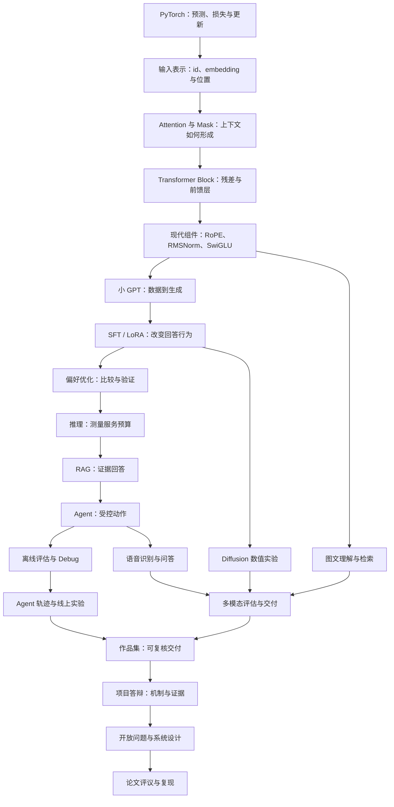

# 第三册简介：大模型算法岗实战手册

## 这本书解决什么问题

读者学过模型概念、看过公式，也知道常见框架，但动手时仍可能不知道数据怎样进入模型、一次训练究竟改了什么、评估数字是否可信，更难把这些过程整理成一个经得起追问的项目。本册按实际项目的顺序带你动手：先实现能观察的小模型，再训练模型按要求回答，接着搭建应用、检查失败，最后把过程和证据整理成项目。

它是一册项目训练教材，不是代码片段合集，也不把“程序运行了”当成“模型有效”。每个项目都要回答：输入是什么、处理经过哪些状态、输出如何核验、数字代表什么、失败时先看哪里、结论能推广到哪里。代码让机制可以运行，手算例子让读者知道代码在算什么，评估和失败记录说明结果有什么证据。

## 读者与前置

本册适合会基础 Python、了解机器学习概念，并希望把大模型原理写成代码、做成项目的读者。建议先读第一册了解共同的技术主线；如果 PyTorch 还不熟，可以参考第十四册的工程内容。本册不要求读者已经会用大规模训练平台、GPU 集群或 Agent runtime。

## 学完后应能完成

1. 用 PyTorch 检查张量、损失、梯度和优化过程，并实现 Transformer 关键组件。
2. 从 token 数据约定开始训练一个小 GPT，并解释训练曲线、生成样例和 checkpoint。
3. 使用 Hugging Face 工具完成 SFT、LoRA/QLoRA 和偏好优化实验，并审计监督范围与行为变化。
4. 测量模型服务的 KV cache、prefill/decode、延迟、吞吐、成本和多轮负载。
5. 构建带证据引用和受控工具调用的 RAG/Agent 项目，能回放并定位失败。
6. 为语言和多模态任务建立评估、回归与交付报告，知道本地 toy、公开来源和真实线上结果之间的证据差别。
7. 把代码、数据约定、配置、运行记录、失败样例和个人贡献整理进作品集，并在面试中说明自己的取舍。

## 本册边界

本册侧重教学规模的代码与项目流程。它不替代第五册的大规模训练、第六册的生产部署、第七册的评估方法、第九册的数据工程、第十五册的多模态生成模型、第十七册的 Agent 方法、第二十册的 Harness runtime、第二十四册的 Serving Engine 或第十二册的求职策略。多模态部分只练习图文理解与检索、Diffusion 数值、语音问答和系统交付；更宽的图像/视频/语音生成、实时多模态交互和统一模型留在第十五册展开。

## 全书主线

前十章是必读路径：先把数学写成训练循环，把 Transformer 组件组合成小 GPT；再训练模型按要求回答、搭建推理服务、让 RAG 提供回答依据，并让 Agent 在限制内调用工具。接下来检查离线评估、Agent 执行过程和线上发布风险。第七章的 RAG 回答“依据是什么”，第八章的 Agent 回答“哪些动作可以执行”；先准备证据，再让执行流程使用这些证据。第九章检查离线评估和训练故障，第十章继续检查执行记录、线上实验和灰度发布。第十一至十四章是可选的多模态实践，分别处理图文、扩散、语音和系统交付。第十五章把前面的项目整理成有证据支持的成果；第十六章练习项目答辩，第十七章从开放目标设计系统方案，第十八章练习评议论文并复现其中的关键结果。

每章都会留下后续能用的结果。代码旁要说明关键中间值，让读者能照着例子算一遍，也要交代实现的限制。整理作品集时，应回看第九章的离线评估、第十章的执行记录和线上验证，以及第十四章的多模态交付要求；把数据、版本、实验条件和失败样例一并保存。面试中只报告自己实际运行过、并留有记录的指标。

## 各章摘要与衔接

1. [PyTorch 基础实战](chapters/01-pytorch基础实战.md)用一次可检查的预测、损失和参数更新建立数值基线，交给 Transformer 组件复用。
2. Transformer 组件实战分成四个连续部分：[上篇：输入表示](chapters/02-transformer组件实战-1-输入表示.md)从 token id 追到带位置信息的向量；[中篇：Attention 与 Mask](chapters/02-transformer组件实战-2-attention与mask.md)说明模型怎样从允许读取的位置汇总上下文；[下篇：Block 骨架](chapters/02-transformer组件实战-3-decoder-block.md)讲清注意力、前馈层、残差和归一化怎样组成一层；[续篇：现代 Decoder 组件](chapters/02-transformer组件实战-4-modern-decoder.md)再把 RoPE、RMSNorm 和 SwiGLU 放回这副骨架。四篇会约定好张量形状和位置编号，后面的小 GPT 实作沿用这套约定。
3. [从零训练小 GPT](chapters/03-从零训练小gpt-1-token数据.md)分为五篇：[Token 数据约定](chapters/03-从零训练小gpt-1-token数据.md)、[最小 GPT 与训练](chapters/03-从零训练小gpt-2-model-training.md)、[解码控制](chapters/03-从零训练小gpt-3-decoding.md)、[Checkpoint 与评估](chapters/03-从零训练小gpt-4-checkpoint-evaluation.md)、[Tokenizer 与公平比较](chapters/03-从零训练小gpt-5-tokenizer-comparison.md)。五篇从训练窗口讲到模型生成和评估，为监督微调准备可复用的数据、checkpoint 和评估方法。
4. Hugging Face 微调实战分成七篇：[模型与生成](chapters/04-huggingface微调实战-1-模型与生成.md)先固定基座行为；[SFT 数据](chapters/04-huggingface微调实战-2-sft数据.md)标出哪些回答 token 参与训练；[数据审计与全参数 SFT](chapters/04-huggingface微调实战-3-data-audit-full-sft.md)检查切分、截断和版本，再建立全参数训练基线；[LoRA](chapters/04-huggingface微调实战-4-lora.md)与 [QLoRA](chapters/04-huggingface微调实战-5-qlora.md)比较低秩适配和量化基座；[评估协议与指标](chapters/04-huggingface微调实战-6-evaluation-metrics.md)固定比较条件；[自动评估与报告](chapters/04-huggingface微调实战-7-evaluation-report.md)保留逐样本证据，交给偏好优化继续比较。
5. [偏好优化实战](chapters/05-偏好优化实战.md)把 chosen/rejected 样本转成优化目标，并检查偏好更新是否真的改变输出。
6. 推理优化实战分为七个连续部分：[KV Cache](chapters/06-推理优化实战-1-kv-cache.md)先解释解码状态与容量，[Prefill 与 Decode](chapters/06-推理优化实战-2-prefill-decode.md)定义用户等待时间，[Serving runtime](chapters/06-推理优化实战-3-serving-runtime.md)讲分页缓存和请求调度；[量化](chapters/06-推理优化实战-4-量化.md)与[推测解码](chapters/06-推理优化实战-5-speculative-decoding.md)分别改变数值表示和生成步骤；[长上下文压测](chapters/06-推理优化实战-6-长上下文压测.md)验证容量与有效能力，最后用[实验报告](chapters/06-推理优化实战-7-实验报告.md)把质量、延迟、显存和成本放在同一验收条件下。
7. RAG 项目实战按文档、检索、排序、引用、评估和问题定位拆成六篇：[文档与切分](chapters/07-rag项目实战-1-文档与切分.md)把原文变成带来源、版本和权限的片段；[检索与上下文](chapters/07-rag项目实战-2-检索与上下文.md)召回候选并控制输入预算；[候选重排](chapters/07-rag项目实战-3-候选重排.md)在有限候选中排出优先级；[引用与证据](chapters/07-rag项目实战-4-引用与证据.md)逐项检查主张能否回到当前来源；[评估指标](chapters/07-rag项目实战-5-评估指标.md)分别测量检索、回答、引用和拒答；[失败定位与报告](chapters/07-rag项目实战-6-失败归因与报告.md)把质量、成本、风险和失败样例交给第八章 Agent 项目。
8. Agent 项目实战沿着受控执行流程拆成五篇：[工具调用协议](chapters/08-agent项目实战-1-tool-calling协议.md)区分模型提出的请求和程序实际执行的动作；[ReAct 状态循环](chapters/08-agent项目实战-2-react状态循环.md)管理多步任务、预算和中断恢复；[执行安全与授权](chapters/08-agent项目实战-3-执行安全与授权.md)限制权限、确认和可能产生的副作用；[轨迹审计与评估](chapters/08-agent项目实战-4-轨迹审计与评估.md)保存可回放的事件，并用分母明确的指标检查安全性；[贯通项目验收](chapters/08-agent项目实战-5-贯通项目验收.md)把 RAG 证据和工具执行结果连起来，完成一个可检查的政策助手。
9. 评估与 Debug 实战分为六篇：[评测协议与 benchmark](chapters/09-评估与debug实战-1-评测协议与benchmark.md)固定样本、配置和评分；[数据污染与泄漏](chapters/09-评估与debug实战-2-数据污染与泄漏.md)检查比较对象是否可信；[事实性与 claim](chapters/09-评估与debug实战-3-事实性与claim.md)逐项核对主张和证据；[训练不收敛](chapters/09-评估与debug实战-4-训练不收敛.md)从数据追到梯度更新；[微调能力回归](chapters/09-评估与debug实战-5-微调能力回归.md)衡量目标收益和保留能力；[人工评测](chapters/09-评估与debug实战-6-人工评测.md)校准开放式质量判断。六篇共同交付一套可复查的离线结论，再交给第十章做轨迹与线上验证。
10. Agent 轨迹与线上评估实战分为三篇：[轨迹诊断](chapters/10-agent轨迹与线上评估实战-1-轨迹诊断.md)区分模型提议、程序判断与真实副作用；[线上 A/B 实验设计](chapters/10-agent轨迹与线上评估实战-2-ab实验设计.md)确定随机化单元、指标和统计证据；[灰度发布与报告](chapters/10-agent轨迹与线上评估实战-3-灰度发布.md)把日志、安全底线、分组结果和回退条件落实为发布决策，并为第十五章作品集整理证据。
11. 图文理解与检索实战是选读支线，分成五篇：[CLIP 图文检索](chapters/11-图文理解与检索实战-1-图文检索.md)先把共享向量用于候选排序，[对比学习损失](chapters/11-图文理解与检索实战-2-对比学习损失.md)再解释表征怎样学得；[VLM 图片问答](chapters/11-图文理解与检索实战-3-VLM图片问答.md)从检索转向生成回答，[多模态指令数据](chapters/11-图文理解与检索实战-4-多模态指令数据.md)检查监督信号，最后由[图文 RAG](chapters/11-图文理解与检索实战-5-图文RAG.md)把候选、权限和证据接起来，交给第十四章做多模态评估。
12. [Diffusion 数值实验](chapters/12-diffusion数值实验.md)从前向加噪、噪声目标和反向均值/方差走到一次完整手算，再用向量代码核对公式，并讨论文本引导、少步采样与生成评估的边界。
13. [语音识别与语音问答](chapters/13-语音识别与问答实战.md)区分 Whisper 长音频转写与实时识别，测量整体文本和关键字段错误，再沿检索证据、回答依据与高风险确认定位误差。
14. [多模态评估与系统交付](chapters/14-多模态评估与交付.md)从样本约定和分任务指标开始，比较版本变化，再把质量结果放到权限、预算、trace 和回滚条件中检查，为作品集保留完整的交付记录。
15. [作品集实战](chapters/15-作品集实战.md)从一条可检验的项目主张出发，固定数据与运行条件、比较同一批样本、检查不同风险类别和失败，再把结果整理成 README、简历表述与个人贡献说明。
16. [项目答辩与技术表达](chapters/16-项目答辩与技术表达.md)从一个 Attention 算例讲到项目主张、baseline、指标、失败样例和个人贡献，让读者能把“做过”说成别人可以检查的结果。
17. [开放问题与系统设计实战](chapters/17-开放问题与系统设计实战.md)先把模糊目标变成可比较的方案，再沿容量、延迟、数据流、权限、评估和回滚完成系统设计。
18. [论文评议与复现实战](chapters/18-论文评议与复现实战.md)从论文声称解决的问题出发，拆出机制、推导和实验条件，再用最小复现判断结论能支持到哪里。

## 与其他书的关系

第一、二册解释共同原理，第三册负责把原理变成可运行项目。第十四册补 PyTorch 与深度学习工程；第五至第九册和第十五至第二十四册分别深入训练、部署、评估、数据、多模态、Agent 与基础设施。第十二册进一步处理求职材料和面试策略。本册的项目证据可以作为这些专题学习后的练习入口，但不替代专题书的完整解释。
