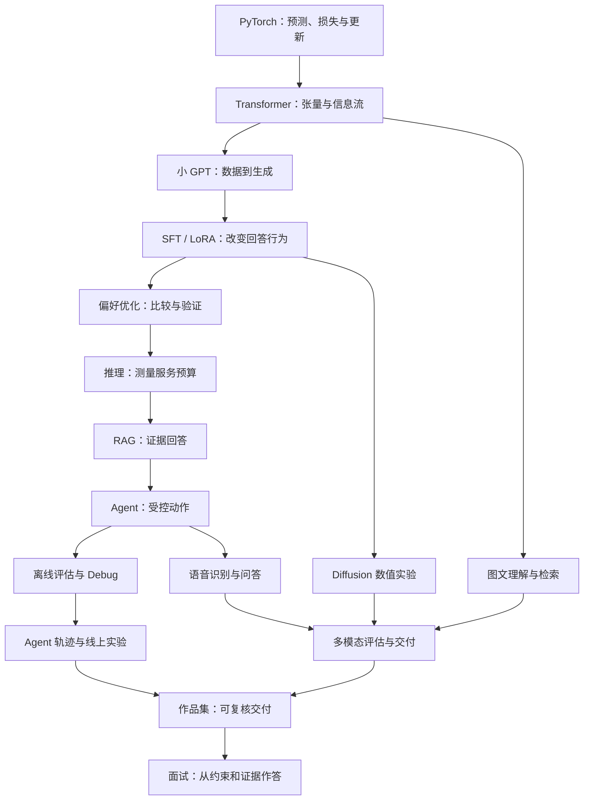

# 第三册简介：大模型算法岗实战手册

## 这本书解决什么问题

读者学过模型概念、看过公式，也知道常见框架，但动手时仍可能不知道数据怎样进入模型、一次训练到底改变了什么、评估数字是否可信，更难把这些过程讲成一个经得起追问的项目。本册把这些知识接成一条实作路径：先实现可观察的小模型，再调整回答行为、搭建应用、测量失败，最后形成可复核的项目证据。

它是一册项目训练教材，不是代码片段合集，也不把“程序运行了”当成“模型有效”。每个项目都要回答：输入是什么、处理经过哪些状态、输出如何核验、数字代表什么、失败时先看哪里、结论能推广到哪里。代码让机制可以运行，手算例子让读者知道代码在算什么，评估和失败记录说明结果有什么证据。

## 读者与前置

本册适合具备基础 Python 和机器学习概念、希望把大模型原理转化为代码和项目成果的读者。第一册提供共同技术主线；第十四册可补 PyTorch 工程细节。不会假设读者已熟练掌握大规模训练平台、GPU 集群或 Agent runtime。

## 学完后应能完成

1. 用 PyTorch 检查张量、损失、梯度和优化过程，并实现 Transformer 关键组件。
2. 从 token 数据契约开始训练一个小 GPT，解释曲线、生成样例与 checkpoint。
3. 使用 Hugging Face 工具完成 SFT、LoRA/QLoRA 和偏好优化实验，并审计监督范围与行为变化。
4. 测量模型服务的 KV cache、prefill/decode、延迟、吞吐、成本和多轮负载。
5. 构建带证据引用和受控工具调用的 RAG/Agent 项目，能回放并定位失败。
6. 为语言和多模态任务建立评估、回归与交付报告，知道本地 toy、公开来源和真实线上结果之间的证据差别。
7. 把项目整理成包含代码、数据契约、配置、运行记录、失败样例和本人贡献的作品集，并在面试中解释取舍。

## 本册边界

本册侧重教学规模的代码与项目流程。它不替代第五册的大规模训练、第六册的生产部署、第七册的评估方法、第九册的数据工程、第十五册的多模态生成模型、第十七册的 Agent 方法、第二十册的 Harness runtime、第二十四册的 Serving Engine 或第十二册的求职策略。多模态部分只练习图文理解与检索、Diffusion 数值、语音问答和系统交付；更宽的图像/视频/语音生成、实时多模态交互和统一模型留在第十五册展开。

## 全书主线

前十章构成必读路径：把数学写成训练循环，把组件组成小 GPT，再把模型适配、服务化并接入知识证据和受控工具动作；随后分别检查离线测量、Agent 执行轨迹和线上发布风险。第七章的 RAG 解决“依据什么回答”，第八章的 Agent 解决“允许采取什么动作”；先建立证据，再把证据服务交给执行流程。第九章分析离线评估与训练排障，第十章继续到轨迹回放、线上实验和灰度决策。第十一至十四章是可选的多模态实践支线，分别处理图文、扩散、语音和交付。第十五章把前文项目整理为可复核成果，第十六章练习技术表达和系统设计。

每一章都有一个交接产物：代码不只展示“怎么写”，也要带出可核对的中间量、可复算的数值例子和限制说明。完成作品集时，应回看第九章的离线评估、第十章的轨迹与线上验证，以及第十四章的多模态交付要求，为结果补上固定数据、版本、实验条件和失败样例。面试中的指标只能描述自己实际运行并保存证据的范围。

## 各章摘要与衔接

1. [PyTorch 基础实战](chapters/01-pytorch基础实战.md)用一次可检查的预测、损失和参数更新建立数值基线，交给 Transformer 组件复用。
2. [Transformer 组件实战](chapters/02-transformer组件实战.md)把张量形状、注意力和掩码拼成可核对的模型部件，再进入小 GPT。
3. [从零训练小 GPT](chapters/03-从零训练小gpt.md)沿着文本数据、训练曲线到生成样例走完最小训练闭环，为模型适配提供起点。
4. [Hugging Face 微调实战](chapters/04-huggingface微调实战.md)把对话样本变成明确的监督信号，并对照微调前后的行为，交给偏好优化继续比较。
5. [偏好优化实战](chapters/05-偏好优化实战.md)把 chosen/rejected 样本转成优化目标，并检查偏好更新是否真的改变输出。
6. [推理优化实战](chapters/06-推理优化实战.md)用固定请求负载核算延迟、吞吐、显存和质量，为后续应用准备服务预算。
7. [RAG 项目实战](chapters/07-rag项目实战.md)从有版本和权限的文档建立可引用证据，再把证据交给受控工具流程。
8. [Agent 项目实战](chapters/08-agent项目实战.md)把工具提议经过权限与参数检查，形成可回放的执行轨迹，供评估与排障。
9. [评估与 Debug 实战](chapters/09-评估与debug实战.md)建立离线基线并用失败样本定位问题，为线上实验设定回归门槛。
10. [Agent 轨迹与线上评估实战](chapters/10-agent轨迹与线上评估实战.md)连接轨迹诊断、线上实验和灰度决策，说明哪些证据支持发布。
11. [图文理解与检索实战](chapters/11-图文理解与检索实战.md)作为选读支线，从图文样本走到检索和证据审计。
12. [Diffusion 数值实验](chapters/12-diffusion数值实验.md)用小规模加噪与去噪轨迹展示扩散计算，提供独立的生成模型练习。
13. [语音识别与语音问答](chapters/13-语音识别与问答实战.md)追踪识别错误怎样传到问答结论，形成语音支线的输入和输出记录。
14. [多模态评估与系统交付](chapters/14-多模态评估与交付.md)把媒体输入、转换、证据、权限和评估收束成一份交付报告，再转入作品集整理。
15. [作品集实战](chapters/15-作品集实战.md)把代码、配置、数据、运行证据、失败样例和个人贡献整理成可复核项目。
16. [技术表达与系统设计实战](chapters/16-技术表达与系统设计实战.md)用约束、机制、结果和边界组织技术讲解与方案答辩，完成从项目到面试的迁移。

## 与其他书的关系

第一、二册解释共同原理，第三册负责把原理变成可运行项目。第十四册补 PyTorch 与深度学习工程；第五至第九册和第十五至第二十四册分别深入训练、部署、评估、数据、多模态、Agent 与基础设施。第十二册进一步处理求职材料和面试策略。本册的项目证据可以作为这些专题学习后的练习入口，但不替代专题书的完整解释。
