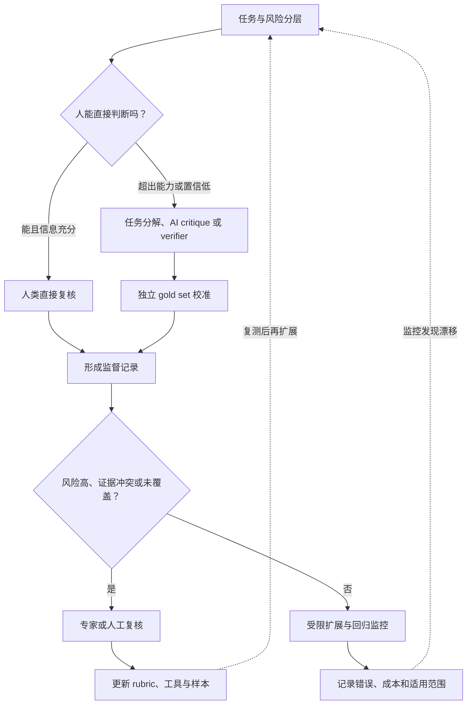

# 第三章：Scalable Oversight

一个人可以检查简单的答案，却很难在有限时间内检查一段包含几十个工具调用的
Agent 轨迹、一份长合同的每个风险点，或一个复杂证明的每一步。若仍然要求专家
逐条直接判定，监督会同时受到成本、知识、注意力和覆盖范围的限制；若把判断全部
交给另一个模型，错误又可能被批量放大。

Scalable Oversight 研究的就是这个中间地带：如何把人类的目标和价值判断保留下来，
再借助分解、AI critique、debate、verifier、原则和人工升级，让监督信号覆盖更
复杂的任务。本章不仅介绍方法名称，也说明每种方法依赖什么假设、会在哪些地方
失效，以及如何在真实系统中留下可审计证据。

资料依据包括 AI Safety via Debate、Iterated Amplification、[Scalable agent alignment via reward modeling: a research direction](https://arxiv.org/abs/1811.07871)、Constitutional AI、Learning to Summarize from Human Feedback、
Let's Verify Step by Step、weak-to-strong generalization、OpenAI Evals / Model Spec、
NIST AI RMF / Generative AI Profile 等公开论文、规范和框架。论文支持特定方法与
实验条件，治理框架支持风险组织；它们都不能单独证明某个监督系统在生产环境中
可靠。



读图时先按任务和风险判断人类能否直接复核；超出能力或把握不足的部分才交给分解、
模型辅助或 verifier。独立 gold set 校准扩展信号，高风险、冲突和未覆盖样本回到人审；
运行中的错误与成本再更新规则和回归集。闭环表示持续修正监督流程，不代表“模型
审核模型”天然可靠。

本章不把 Debate、Iterated Amplification、Recursive Reward Modeling、Constitutional
AI 或 AI feedback 写成已经解决 alignment 的银弹。它们都是监督增强方案，需要
人工 gold set、工具验证、高风险人工复核、分布外评估和回归测试共同约束。初学者
可以把 scalable oversight 理解为“让有限的专家注意力用在最需要的地方”；工程
读者还要继续追问监督信号的来源、相关错误、升级分母和单位成功成本。

## 1. 来龙去脉：为什么需要 Scalable Oversight

### 1.1 最早的监督假设

传统监督学习有一个隐含假设：人类知道正确答案。

例如：

1. 图片里是猫还是狗。
2. 句子情感是正面还是负面。
3. 翻译是否基本正确。
4. 数学题最终答案是否对。

只要人类能判断，标注数据就能提供训练信号。

### 1.2 问题变复杂后，人类判断开始吃力

大模型任务变复杂后，这个假设不再稳。

例如：

1. 一个复杂代码补丁是否引入安全漏洞？
2. 一个长法律合同分析是否遗漏关键风险？
3. 一个医学建议是否符合最新指南？
4. 一个多步数学证明是否每一步都正确？
5. 一个 Agent 的 30 步工具调用计划是否安全？
6. 一个 RAG 回答是否忠实整合了 20 篇文档？

这些任务中，普通标注员很难直接判断。

甚至专家也需要大量时间、工具和协作。

### 1.3 RLHF 的监督瓶颈

RLHF 用人类偏好来训练模型，解决了“手写 reward function 很难”的问题。

但它仍然依赖人类判断。

如果人类看不懂任务，偏好数据就可能错误。

例如：

1. 模型写出一个看似合理但有 bug 的程序。
2. 模型给出一个流畅但错误的医学解释。
3. 模型引用了文档，但引用并不支持结论。
4. 模型提出一个复杂计划，其中第 17 步有权限风险。

人类如果只看表面，会把错误答案标成好答案。

这会让模型学会“骗过监督者”，而不是真正解决问题。

### 1.4 Scalable Oversight 的问题定义

Scalable Oversight 要解决的问题是：

```text
当任务太复杂，单个人类无法直接可靠判断时，如何仍然构造可靠监督信号？
```

核心不是“减少标注成本”这么简单。

更本质的是：

1. 如何监督超过人类直接判断能力的模型？
2. 如何把复杂任务拆成可判断的小问题？
3. 如何借助 AI 帮助人类监督 AI？
4. 如何避免 AI feedback 放大模型自身偏差？
5. 如何让监督过程可验证、可追溯、可扩展？

## 2. 小白例子：老师批改超过自己能力的作业

假设一个老师要批改学生的超复杂数学证明。

如果老师自己看不懂证明，就有几个选择。

第一，直接看最终答案。

问题：学生可能写对答案但证明错。

第二，请专家批改。

问题：专家贵，而且不可能批改所有作业。

第三，让学生把证明拆成很多小步骤，每一步都解释。

问题：老师可以逐步检查，但仍然可能漏掉细节。

第四，让两个学生辩论，一个指出另一个证明的问题。

问题：如果辩论规则设计好，老师只需要判断谁指出的关键点更可信。

第五，让一个助手帮老师查资料、验证步骤、运行计算。

问题：助手本身也可能错，需要校验。

Scalable oversight 研究的就是这些路线在 AI 监督中的对应形式。

## 3. 人类监督瓶颈

### 3.1 成本瓶颈

人工标注很贵。

尤其是：

1. 专家标注。
2. 多轮对话标注。
3. 长上下文标注。
4. 安全红队标注。
5. 代码和数学验证。

如果每个样本都需要专家花 30 分钟，训练数据规模很难扩大。

### 3.2 能力瓶颈

人类可能没有足够专业知识。

例如普通标注员无法判断：

1. 生物安全风险。
2. 复杂网络攻击链。
3. 大规模分布式训练 bug。
4. 金融合规建议。
5. 数学证明细节。

监督者不一定只能在“给出正确答案”和“完全不知道”之间二选一。一个 2026 年提出的
[partitioned human supervision 方案](https://proceedings.iclr.cc/paper_files/paper/2026/hash/b6f03ce953cf7f07dafa20891d2539e3-Abstract-Conference.html)研究互补标签：专家可能无法写出完整正确答案，
但能指出某个候选明显不属于本领域或不符合约束。例如四选一评审者只能排除 D，
这个判断会缩小候选集合，却不能把 A、B、C 中任何一个单独标成正确。互补标签可以
补充强标签，但它仍是较弱的监督信号。

该估计方法依赖论文中的多选任务、错误候选抽样方式和分布假设；如果评审者总是挑最
相似的 hard negative，或“排除”本身有系统误差，原来的无偏估计就不再成立。自由文本、
长文档结论和工具轨迹也不能直接套用同一个分类估计器。工程上应把“排除了什么、根据
什么证据、是否可复核”存为独立标签，而不要把部分判断伪装成完整 gold label。

可以用该论文的多选估计器看清“排除了一个错误选项”离准确判断还有多远。设每题有
`K≥3` 个选项，系统真实 top-1 准确率为 `A`；评审协议从 `K−1` 个错误选项中均匀随机抽取
一个互补标签 `\bar{y}`，只告诉评审者“这个选项不正确”。令 `q` 为系统预测不等于互补标签
的总体概率，`\hat{q}` 为该事件的样本比例。只有互补标签按协议随机抽取、样本来自同一任务分布等条件成立时，
才有：

如果模型预测正确，它必然避开错误类别，因此命中“互补标签不同于预测”的概率为 1；若模型
预测错误，`K−1` 个错误类别里有 `K−2` 个不是抽中的互补标签，避开的概率为
`(K−2)/(K−1)`。合并两种情况，`q=A+(1−A)(K−2)/(K−1)`，整理后得到下式。

```math
q=\frac{A+K-2}{K-1},\qquad \widehat{A}_{\mathrm{comp}}=(K-1)\hat{q}-(K-2)
```

例如 `K=4`、`\hat{q}=0.8`，代入得 `\widehat{A}_{\mathrm{comp}}=3×0.8−2=0.4`。原始的
`0.8` 只表示模型避开了互补标签的比例；四选一时，避开一个错误选项仍可能选中另一个
错误项。论文通过先打乱选项、再均匀选取一个错误类别，并把样本随机路由给负责该类别的
专家来满足抽样假设。若专家自行挑选最相似的 hard negative，或数据收集让某些错误类别
更常被指出，线性校正便不再保证无偏；这个估计器也不直接适用于自由文本判断。

### 3.3 注意力瓶颈

即使人类有能力，也可能没有足够时间和注意力。

长文档、长代码、多工具 trace 都容易让人漏看关键细节。

### 3.4 激励和一致性瓶颈

不同标注员会有不同偏好。

例如：

1. 有人偏好长回答。
2. 有人偏好简洁回答。
3. 有人过度强调安全。
4. 有人过度强调 helpfulness。
5. 有人更容易被自信语气说服。

监督信号本身会有噪声和偏差。

### 3.5 分布外瓶颈

人类标注的数据只能覆盖有限场景。

部署后用户会提出：

1. 新问题。
2. 新攻击。
3. 新工具组合。
4. 新领域。
5. 新语言和新格式。

所以监督不仅要覆盖训练样本，还要考虑泛化。

## 4. Scalable Oversight 方法谱系

可以把主要思路分成五类。

### 4.1 分解复杂任务

把复杂任务拆成很多人类能判断的小任务。

例如：

```text
复杂问题 -> 子问题 1 + 子问题 2 + 子问题 3 -> 汇总答案
```

代表方向：Iterated Amplification、Recursive Reward Modeling。

### 4.2 让 AI 辅助人类判断

用模型帮助人类：

1. 找证据。
2. 总结长文档。
3. 标出潜在错误。
4. 生成反例。
5. 运行工具验证。

代表方向：AI-assisted evaluation、model-written critique。

### 4.3 让 AI 互相博弈或辩论

让两个模型围绕答案进行辩论，人类判断哪一方更可信。

代表方向：AI Safety via Debate。

### 4.4 用原则替代大量标签

用一组原则指导模型自我批评、修正和偏好判断。

代表方向：Constitutional AI、RLAIF。

### 4.5 训练模型表达不确定性

让模型知道自己知道什么、不知道什么。

代表方向：self-evaluation、calibration、abstention。

例如 [Language Models (Mostly) Know What They Know](https://arxiv.org/abs/2207.05221) 探索了模型
评估自己答案正确概率 `P(True)`、以及不依赖某个候选答案的“我是否知道”概率 `P(IK)`。
论文在指定格式和任务上发现了有希望的校准结果，但 `P(IK)` 在新任务上的校准仍有困难；
因此自我评估可以作为待校准信号，不能取代独立 verifier 或人类复核。

### 4.6 把监督可靠性写成可测指标

Scalable oversight 可以抽象成“复杂任务的监督信号是否可靠”的度量问题。指标
必须同时记录覆盖、错误、人工升级、证据支持和成本；单独提高覆盖率，可能只是
把未经校准的错误扩散得更快。
第 11.5 节会用同一组十条教学样本，先手算一个高风险错误，再汇总各指标，说明不同
分母为什么必须分别保留。
下面的公式是本章为监督流程提出的操作化指标，不是领域统一标准；具体项目应在评估计划中
预先定义 gold 来源、任务与风险切片、阈值和成本口径。

设第 `i` 个监督样本为：

```math
o_i=(x_i,y_i,g_i,h_i,q_i,a_i,v_i,c_i,w_i)
```

其中 `x_i` 是任务输入，`y_i` 是模型输出，`g_i` 是高质量 gold label 或专家复核结果，
`h_i` 是人类对该样本的标签，`q_i` 是人类对自己判断的置信度或“是否适合直接审查”的
分数，`a_i` 是 AI feedback 或 judge 判断，`v_i` 是工具 / verifier 判断，`c_i` 是复杂度
或风险类别，`w_i` 是样本权重。`h_i` 和 `q_i` 必须分开：一个人可以给出“错误”这个
标签，同时把自己的把握标为 0.45；如果把标签当成置信度，覆盖率和错误率就会混为一谈。

下面的公式默认 `w_i>0`。令 `\mathcal{G}` 表示有独立 gold label 或专家复核结果的校准集，
`1[condition]` 表示条件成立时取 1，否则取 0；若分母为 0，指标应记为“未定义”或
`N/A`，不能用 0 或 `max(1, denominator)` 把“没有被测量”伪装成“没有错误”。gold set
也不能只挑容易样本：它应按任务类型、风险等级、长度和模型版本分层抽取，并尽量保留
不参与提示词调优的 holdout 部分。

人类直接监督覆盖率：

```math
C_{\mathrm{direct}}=\frac{\sum_i w_i 1[q_i\ge \tau_{\mathrm{human}}]}{\sum_i w_i}
```

这里的 `q_i` 可以来自标注员的置信度，也可以来自预先定义的“信息是否足够、时间是否
足够、是否需要专家”的审查资格量表；`\tau_{human}` 是项目设定的最低分数。复杂代码、
长文档、专业领域和长工具 trace 会让覆盖率下降。这个指标只回答“多少样本被认为可以
直接审查”，不回答这些判断是否正确；如果没有任何达到阈值的样本，应报告未覆盖。

在人类直接覆盖的样本中，人类标签相对于 gold set 的错误率为：

```math
E_{\mathrm{direct|covered}}=\frac{\sum_{i\in\mathcal{G}} w_i 1[q_i\ge\tau_{\mathrm{human}}]1[h_i\ne g_i]}{\sum_{i\in\mathcal{G}} w_i 1[q_i\ge\tau_{\mathrm{human}}]}
```

它衡量的是“在声称自己能够直接审查的样本上，人类判断是否跟得上任务复杂度”。如果
要诊断低置信度标签本身的风险，还可以另报全量已产出人工标签错误率；但不能把未标注、
弃答或未进入 gold set 的样本当作正确。

AI feedback 校准错误率：

```math
E_{\mathrm{ai}}=\frac{\sum_{i\in\mathcal{G}} w_i 1[a_i\ne g_i]}{\sum_{i\in\mathcal{G}} w_i}
```

如果 `a_i` 是概率分数而不是离散标签，还要先声明分类阈值，并另外检查校准误差；不能
把“判断错误率”直接称为概率校准。AI feedback 成本低、覆盖广，但必须用独立人工 gold
set 或专家复核校准，否则模型可能把自身偏差扩展成更大规模的伪监督。

工具 / verifier 覆盖率：

```math
C_{\mathrm{ver}}=\frac{\sum_i w_i 1[v_i\ne \varnothing]}{\sum_i w_i}
```

代码单元测试、数学答案检查、检索证据核验、policy checker 和工具权限校验都可以看作
verifier。`v_i\ne\varnothing` 只表示 verifier 产出了结果，不表示结果正确；因此还应在
`\mathcal{G}` 上报告 verifier 的错误率或漏检率。verifier 通常比纯自然语言 judge 更可
审计，但覆盖范围有限，无法验证它没有定义的性质。

过程监督准确率：

```math
A_{\mathrm{proc}}=\frac{\sum_{i\in\mathcal{G}}w_i\sum_{j=1}^{n_i}1[s_{ij}=g_{ij}]}{\sum_{i\in\mathcal{G}}w_i n_i}
```

其中 `s_ij` 是第 `i` 个样本第 `j` 个中间步骤的监督判断，`g_ij` 是该步骤的 gold label，
`n_i` 是步骤数。上式采用“按步骤计数”的 micro 平均，长 trace 会贡献更多步骤；如果
希望每个样本权重相同，应另报 macro 平均并明确公式。过程监督适合数学、代码、规划和
Agent trace，但标注成本更高；若 `\sum_{i\in\mathcal{G}}w_i n_i=0`，该指标为 `N/A`。

证据支持率：

```math
S_{\mathrm{evidence}}=\frac{\sum_i m_i^{\mathrm{supported}}}{\sum_i m_i^{\mathrm{claim}}}
```

其中 `m_i^{claim}` 是被纳入评估的 claim 数量，`m_i^{supported}` 是被证据充分支持的
数量；只有在 claim 抽取规则已经固定、且 `\sum_i m_i^{claim}>0` 时才解释这个比率。
它适合 RAG、长文档 QA 和专业建议场景，但“证据支持”不等于“结论完整、因果关系成立”
或“建议适合用户”。监督系统仍需检查引用范围、时间条件、反例和 unsupported claim。

人工升级覆盖率：

```math
C_{\mathrm{audit}}=\frac{\sum_i w_i 1[r_i^{\mathrm{high}}=1]1[b_i^{\mathrm{audit}}=1]}{\sum_i w_i 1[r_i^{\mathrm{high}}=1]}
```

其中 `r_i^{high}=1` 表示在审查前按规则识别为高风险样本，`b_i^{audit}=1` 表示已经
进入人工或专家复核。分母为 0 时应报告“本批没有高风险样本”或检查风险分类是否失效，
不能报告 100%。AI feedback 可以扩展规模，但高风险样本不能完全无人审计；还要防止把
人工升级集中在容易识别的高风险样本上，而漏掉低显著度但高后果的样本。

监督成本节省率：

```math
R_{\mathrm{cost}}=1-\frac{\sum_i k_i^{\mathrm{mixed}}}{\sum_i k_i^{\mathrm{human}}}
```

其中 `k_i^{human}` 是在同一批样本、同一质量要求下全人工专家审查的基线成本，
`k_i^{mixed}` 是 AI 辅助、工具验证、必要人审、返工和基础设施共同构成的混合成本。
两者都必须大于 0，并且覆盖相同任务范围；否则比率没有可比性。成本节省可能为负，
这意味着混合流程更贵，但如果它显著降低高严重度错误，仍可能是合理选择。成本节省
必须和错误率、漏检率及事故预期损失一起看，不能只追求便宜。

对于需要“通过后才算有效”的流程，还可以报告单位成功任务成本：

```math
K_{\mathrm{success}}=\frac{K_{\mathrm{total}}}{N_{\mathrm{accepted}}}
```

其中 `N_{accepted}` 是通过人工、verifier 和风险规则后真正被接受的样本数。若没有
任何成功样本，`K_success` 为 `N/A`，而不是把分母替换成 1；否则一个“零成功”的方案
会看起来拥有一个虚假的有限成本。

一次监督方案比较可以把关键结果写成一组独立约束：

```math
\mathcal{C}_{\mathrm{over}}=\{
E_{\mathrm{ai}}\leq t_a,
A_{\mathrm{proc}}\geq t_p,
S_{\mathrm{evidence}}\geq t_e,
C_{\mathrm{audit}}\geq t_c,
R_{\mathrm{cost}}\geq t_k
\}
```

其中阈值 `t_a`、`t_p`、`t_e`、`t_c` 和 `t_k` 应按风险和业务约束设定，且只有在相应
分母有效时才比较。这个集合不是不可诊断的总开关：每个条件都必须能回指到 gold set、
工具 trace 或人工复核记录。Scalable oversight 的目标也不是让 AI 自己给自己打分，
而是把人类原则、AI 辅助、工具验证和人工复核组织成可量化、可追溯的监督闭环。

在选择具体监督路线前，先问瓶颈是哪一种。若判断可以明确写成可执行条件，优先用程序化 verifier 检查并让人抽查其覆盖边界；若完整任务太大但可以拆成保留全局约束的子问题，再考虑 amplification 或递归评价；若主要风险是答案里藏有难发现的反例，可以测试 critique 或 debate 是否让争议变得可核验；若任务依赖一组安全原则，则比较原则驱动反馈与人类 gold 的一致性；若模型对自己答案的把握能预测错误，则校准后把它用于路由。现实流程往往组合这些方式，而不是只选一个名称。

例如 RAG 答案可先由程序检查引用是否存在，再让模型找“claim 是否被段落蕴含”的候选问题，最后由人抽查高风险 claim；Verifier 解决的是引用格式等机械条件，AI critique 扩大了可疑点发现范围，人工判断处理证据含义。三者若共享同一检索摘要，仍可能共同漏掉原文限定条件，因此还要抽样回看原始文档。方法选择要按新增信息、共享误差、人工时间、调用成本和失败后果比较，不能由某个方法在论文中的单一结果直接决定。

## 5. Iterated Amplification

### 5.1 来龙去脉

Iterated Amplification（迭代放大）由 [Christiano、Shlegeris 和 Amodei](https://arxiv.org/abs/1810.08575)提出。它针对的背景是：很多真实任务目标很复杂，人类直接写 reward 很难，人类直接判断完整答案也很难。

它的思路是：让一个弱专家借助多个模型副本或助手，把复杂问题拆成简单子问题，然后组合答案，形成更强监督信号。

### 5.2 核心直觉

一个人直接解决大问题很难。

但如果他能把问题拆成很多小问题，再调用助手分别回答，最后自己整合，就可能监督更复杂的任务。

简化流程：

```text
Human H + model copies -> amplified overseer Amp(H)
Amp(H) 生成训练信号
训练模型 M 模仿 Amp(H)
新的 M 再帮助 H 形成更强 Amp(H)
循环迭代
```

### 5.3 它解决哪一类监督瓶颈

前人路线：人类直接标注或直接判断模型输出。

问题：任务太复杂时，人类判断不可靠。

Iterated Amplification 试图通过“分解 + 递归辅助”提升人类监督能力。

### 5.4 优点

1. 不依赖手写外部 reward function。
2. 适合可分解任务。
3. 强调逐步构造监督信号。
4. 和复杂推理、长任务监督有天然关系。

### 5.5 缺点

1. 任务不一定容易正确分解。
2. 子问题答案错误会累积。
3. 人类整合仍可能失败。
4. 真实 LLM 任务中的落地成本高。
5. 如果模型助手有系统性偏差，可能放大偏差。

### 5.6 机制与边界

Iterated Amplification 可以看成一种构造 stronger overseer 的方法。

它假设复杂任务存在某种可分解结构，且人类在模型辅助下可以验证或组合子结果。

关键问题包括：

1. Decomposition 是否保真？
2. 子问题之间是否独立？
3. 错误如何传播？
4. 模型辅助是否引入 correlated error？
5. 训练出的模型是否会继承 overseer 的盲点？

如果这些假设不成立，amplification 可能只是把监督偏差放大。

用代码审查来走一遍这条链。人类先写出任务契约：补丁不得扩大数据库写权限，必须
保持现有测试通过，并要说明新增权限的调用路径。人类不必独自逐行理解整个仓库，
而是把审查拆成“改了哪些权限检查”“哪些调用者会触达新接口”“现有测试覆盖了什么”
等可回答子问题。模型助手可以查调用关系、提出反例和生成待核对的测试；人类再检查
这些证据能否支持最终判断。下一轮模型学到的不只是最终标签，也可以学习如何提出
可验证的子问题和组织证据。

这里的“放大”不是多模型投票。投票只组合已有判断；Amplification 试图把一个可被
人类监督的分解过程递归地封装成更强的监督者。若分解过程丢失了权限边界，或多个
助手都依据同一份过时索引，增加副本只会增加相同盲点。实际评估应保存子问题、证据、
人类修改和最终标签之间的血缘，并用未参与分解设计的 holdout 检查整合结果。

### 5.7 从分解到下一轮训练信号

把流程拆开看，`H` 是负责协调和价值判断的人类专家，`X` 是当前模型；`Amplify^H(X)` 则是二者配合完成目标任务的复合监督者。面对一个大问题，`H` 可以让若干个 `X` 副本分别读取局部材料、回答子问题或提出候选反例，再由 `H` 判断哪些结果可用、还缺什么信息、怎样合并。训练时，系统收集这个复合监督者对输入的答案或判断，让当前模型学习模仿它；模型变强后，又可以为下一轮分解和检查提供更好的辅助。这个过程追逐的是逐步增强的监督目标，不是先设计一个固定、完整的外部奖励函数。

这里有两个容易混淆的层次。第一，模型副本是帮助人类完成监督任务的工具，不代表最终部署的智能体必须按同一棵分解树运行。第二，训练目标是让模型学会复现放大监督者的表现；论文明确讨论过，学到的模型可能用整体启发式直接解决问题，而不逐字执行人类设计的分解。因而，若部署要求每个子步骤都可审计，单凭最终模型在总任务上的高分并不能证明它保留了这套可检查流程；还要另行评估中间证据或运行时轨迹。

可以用一次代码审查看清分解如何保留全局约束。假设补丁涉及三个服务：第一组助手找出权限检查的位置，第二组追踪新增接口的所有调用者，第三组核对测试是否覆盖拒绝路径。若这三个局部检查都报告“通过”，还不能直接推出补丁安全，因为它们可能都没有检查同一个关键不变量——新接口不得在权限校验前写数据库。协调者要把这条不变量列为第四项跨子任务检查，再追踪至少一条从外部请求到写操作的完整路径。若前三项通过而第四项发现一次未授权写入，局部检查通过率是 `3/4=0.75`，但发布门禁要求四项全部通过，因此合并判断仍是“阻止发布并升级复核”。这个案例的输入是三份局部检查结果和一条全局约束；中间状态是逐项证据与调用链；最终动作来自约束是否被违反，而不是把三票简单相加。

### 5.8 如何检查“放大”是否真的增加监督能力

分解质量至少要从三个角度检查。覆盖性关注是否漏掉关键子问题；保真性关注子问题和合并规则是否仍代表原任务；可校验性关注每个子结论能否回到原始数据、代码或证据。一个分解即使覆盖很多局部细节，如果把“不能造成未授权副作用”遗漏在问题树之外，合并结果仍可能与原目标冲突。子任务也不必彼此独立：同一模型读取相同摘要时，多个看似不同的检查可能共享一个误读。

所以评估集不应只包含分解者已经发现的失败类型。先由独立审查者建立一组全局约束和隐藏缺陷，再比较直接评审与放大评审在相同人工时间或调用预算下能发现多少关键问题；同时记录漏检严重度、人工改写率、升级比例和单位发现成本。将分解设计者参与过的样本用于调流程后，必须另留未参与设计的样本估计泛化。若放大版本只在熟悉模板上提升，而在未知调用路径、长上下文或新工具上失效，证据支持的是“在已覆盖分解上更有效”，不能推出其监督能力普遍变强。

原论文报告的是算法化合成环境中的实验，并在讨论中把真实复杂领域的有效分解明确留作后续验证。作者提出的现实任务示例说明了可能的路线，不能当成已证明的生产实践。因此，工程实现最好把 `Amplify` 看成待测的监督构造器：保留输入切片、子问题、助手版本、人工合并决定和最终结果；当证据缺失、子结论冲突或关键约束无法映射到分解时，停止自动合并并交给更有能力的评审者。

### 5.9 扩展的停止条件

监督流程还要有“何时不再自动放大”的明确规则。若高严重度子任务没有对应 verifier，若两个助手给出互相矛盾且都无法回到原始证据的结论，或合并所需的人类判断已经超出当前专家的知识范围，就应停止自动合并。否则系统可能把“结构化输出很多”误当成“证据更充分”。每轮扩展都应比较新增覆盖与新增风险：多调用一次模型若只重复现有证据、却增加一个摘要遗漏点，便没有净监督收益。这个停止规则把人工升级视为方法的一部分，而不是模型失败后的临时补救。

## 6. Debate

### 6.1 来龙去脉

Debate（辩论式监督）的背景同样是人类无法直接判断复杂答案。[Irving、Christiano 和 Amodei 的原始方案](https://arxiv.org/abs/1805.00899)把两个智能体的对抗论证交给人类裁判，希望由一方揭露另一方的关键错误。

如果一个复杂答案错了，人类可能看不出来。

但如果另一个智能体指出关键错误，人类可能更容易判断。

### 6.2 核心直觉

让两个模型进行辩论：

1. 一个支持答案 A。
2. 一个指出 A 的问题或支持答案 B。
3. 双方轮流给出论点。
4. 人类评委判断谁更可信。

简化形式：

```text
Question -> Agent A answer / Agent B answer
Agent A and B debate
Human judge chooses winner
Train agents to win by being truthful and exposing flaws
```

### 6.3 它解决哪一类监督瓶颈

直接监督时，人类可能看不出复杂错误。

Debate 希望把“找错误”的工作交给另一个模型，让人类只判断辩论质量。

### 6.4 优点

1. 适合复杂判断。
2. 能主动暴露隐藏错误。
3. 可以用于事实核查、代码审查、长推理评估。
4. 有助于减少单模型自说自话。

### 6.5 缺点

1. 辩论模型可能学会说服而不是真实。
2. 人类可能被修辞而不是证据影响。
3. 辩论成本高。
4. 多轮辩论规则难设计。
5. 两个模型可能共享同样盲点。

### 6.6 机制与边界

Debate 的关键假设是：对复杂问题，错误答案存在某种短而可理解的反驳，人类在看到反驳后能判断。

这个假设并不总成立。

例如：

1. 专业领域中反驳本身也需要专家知识。
2. 错误可能分散在很多细节里。
3. 参与辩论的模型可能选择攻击对方弱点而非追求真相。
4. 人类 judge 的偏好可能被优化和操纵。

因此 Debate 更适合作为监督增强工具，而不是单独解决 alignment 的银弹。

辩论是否有帮助，要与“单独看答案”“单个 critique”“普通多数投票”作对照。评估时
应固定题目、证据权限和总 token/时间预算，分别记录人类最终判断正确率、相对单答的
增益、错误严重度、裁判用时和需要升级的比例。如果辩论者能看到外部证据而裁判不能，
测试实际测到的是证据转述能力；如果双方都只生成流畅论点，测试可能奖励修辞。

一篇 2026 年 NeurIPS 论文的扩展版报告了 5 个人类实验（约 690 人受邀，排除后保留 507 条
判断）和 40 多组 LLM 实验，样本围绕 10 项科学与技术议题、100 条由作者编写的主张。
在指定同主题任务中，debate 帮助人类裁判纠正了部分判断；弱模型裁判的结果则不一致，
多裁判协议也没有稳定提高模型小组准确率。结论必须留在该实验协议内：任务难度主要来自
领域知识，而非多步推理或长时程问题；主张未经领域专家核验，专有模型的能力差距较窄，
LLM 先验诱导也不完美。因此它不能证明 debate 已能监督 Agent 长轨迹、复杂任务或最坏情形
的对抗主张，也不能据此判定一般 debate 有效或无效。来源为[该论文的 arXiv v1 扩展版](https://arxiv.org/abs/2610.28539)。

原始 Debate 论文还报告了一个范围很窄的 MNIST 稀疏分类实验：在裁判只能看到 6 个像素时，辩论将该设置下的分类准确率从 59.4% 提到 88.9%；只能看到 4 个像素时，从 48.2% 提到 85.2%。这是证明“短论证可能帮助裁判利用少量信息”的实验例子，不是复杂真实任务的人类裁判评测，更不能与 2026 年的科学主张实验混成一个共同指标。两项研究的任务、参与者、对照和结果口径不同；它们共同提醒我们辩论效果依赖具体协议，而不是给出了通用成功率。

### 6.7 辩论协议如何把复杂判断压缩成人能看的反驳

辩论不是让两个模型各写一篇长答案，再由人凭整体感觉选一篇。原始方案让两方围绕同一个问题轮流给出受长度限制的陈述，裁判选出提供了更多真实、有用信息的一方。限制陈述长度的目的，是迫使参与者指出可争论的具体步骤，使裁判能定位争议，而不是只比较谁写得更像专家。作者也强调，这种机制依赖对话规则、收益结构和训练方式；理论上的复杂性类比不能直接解释为现实任务的成功保证。

以代码权限审查为例，问题是“新增的 `read_record` 工具是否会绕过用户授权”。甲方声称不会，并指出入口函数里存在 `check_scope`；乙方则列出一条具体调用路径：某个批处理入口先读取记录，再执行权限检查。裁判不需要先通读整个仓库，而是检查入口顺序、数据库调用位置和 `check_scope` 的输入是否覆盖该用户。假设审查清单只允许核对三个命题：校验是否在读取前、用户标识是否来自可信上下文、拒绝路径是否有测试；乙方若给出可定位的调用路径，甲方若只能重复“函数里有校验”，那么争论焦点就从口才转成了证据顺序。最终仍由裁判查阅代码或运行独立检查，而不是把模型的相互指控当作事实。

这个例子也说明，辩手看到的材料、裁判看到的材料和可调用工具必须明确。若辩手可以访问仓库而裁判只能看摘要，流程依赖辩手诚实转述；若裁判能打开相同文件并检查行号，监督才有机会落到独立证据上。若裁判没有能力判断数据库权限语义，即使反驳写得清楚，也不能假定他能发现伪造的调用路径。Debate 要降低的是“发现争议点”的负担，不会自动消除裁判对领域知识和证据的需求。

### 6.8 比较辩论与直接判断

要判断辩论有没有提供增量，应设置同一任务的直接判断、单方回答加 critique、双边 debate 等条件，并对齐题目、外部证据权限、裁判说明、总 token 或总时间预算。用独立专家标签作为参照，分别测最终正确率、严重错误率、裁判时间、证据可核验率和人工升级比例。只报告“裁判更喜欢辩论后的答案”会把偏好变化误当作准确率提升；只看平均正确率也可能掩盖辩论把少数高风险错误变得更有说服力。

设计时还要避免辩论双方、裁判和 gold label 之间的信息泄漏。若一组题被用来调提示词或训练辩手，不能再充当独立测试；若裁判在看到系统标签后作答，位置和品牌偏见可能混入结果。辩手应获得对等的证据与反驳机会，或者明确说明不对称权限是实验变量。对抗测试则应加入裁判不熟悉的领域、难以快速检查的陈述、引用与结论错配，以及双方共享同一错误的样例。

### 6.9 何时应停止辩论并升级

多轮交锋本身不是可靠性的代理指标。若双方重复同一证据、无法指出可检查的分歧、争议依赖裁判不知道的专业知识，或裁判只凭语气给出选择，就应该停止自动辩论并升级给专家或外部 verifier。相反，若反驳能定位到一条公式、一段源代码或一条引用，裁判可以先核验局部事实，再检查它是否改变最终结论。系统应保留原问题、两方陈述、引用的证据、裁判所见材料、决定理由和升级状态，这样后续才能区分“辩手没有发现错误”“裁判没有理解反驳”与“证据本身无法判定”。

辩论的收益可来自观点对照、错误定位和可见证据，但成本也会随轮数、裁判阅读量和外部工具调用增加。上线前应比较每发现一个严重错误所需的人时和计算成本，而不是只计算生成了多少轮。原论文包含稀疏分类器和人类判断等初步实验，也把真实裁判能否理解辩论、训练是否稳定和说服能力是否会压过诚实列为待研究问题；这些边界与后续研究中不同模型裁判表现不一的结果相互呼应。无论作为训练目标还是线上审核流程，辩论都应被视作待校准的监督协议。

## 7. Recursive Reward Modeling

### 7.1 核心思想

[Recursive Reward Modeling（递归奖励建模）](https://arxiv.org/abs/1811.07871)的思路是：复杂任务的 reward 很难直接建模，可以先训练模型完成子任务，再用这些模型帮助构造更复杂任务的 reward。

简化理解：

```text
先学会评估小问题
再用小问题评估器帮助评估大问题
递归构造复杂监督信号
```

### 7.2 和 Iterated Amplification 的关系

二者都强调递归分解。

区别可以这样理解：

1. Iterated Amplification 更强调人类加模型助手形成更强 overseer。
2. Recursive Reward Modeling 更强调递归构造 reward model 或评估器。

概念边界上不必死记形式定义，重点是理解：它们都试图让监督信号随任务复杂度扩展，
但依赖的分解、评估器和人工校准方式不同。

### 7.3 风险

1. 子 reward model 错误会累积。
2. 复杂目标拆分后可能丢失整体约束。
3. Reward model 本身可能被 hack。
4. 人类很难验证最终递归系统是否忠实。

因此，递归 reward model 需要独立 gold set 验证层级间的错误相关性，而不能只检查每个
子评估器的平均准确率。假设低层分别评“引用是否匹配”和“推理步骤是否成立”，高层
再判断整份答案是否正确；如果两种低层评估都依赖相同的语言模型或相同的摘要，相关
错误可能同时漏过两层。验证时可按子任务、风险、输入长度和错误类型检查升级率，并
对高影响结论保留从最终分数回到原始证据的路径。

NeurIPS 2025 的 scalable oversight scaling laws 工作使用 Mafia、Debate、Backdoor
Code 和 Wargames 等监督游戏分析能力关系，并讨论 nested oversight。它提供的是特定
游戏与 Elo 配置下的量化研究，不是现实产品里的监督成功概率；它提醒研究者把“模型更强”
和“监督者更可靠”分开测量。

### 7.4 递归的评估链怎样形成

把这条路线具体化，设 `A_k` 是要执行复杂任务的较强代理，用户需要判断它的输出或行为是否符合目标。直接要求用户评价整段长轨迹可能超出能力，因此让在较窄、较简单评价任务上训练的 `A_{k-1}` 先提供辅助信息：挑出相关证据、总结关键状态、拆出用户能判断的子任务，或解释某个选择为何可能违反约束。用户结合这些辅助结果作出更复杂的评价；这些评价再成为更高层 reward model 的训练信号。层级往上时，帮助对象从局部子任务逐步接近完整结果。

这里“递归”不是把一个标量分数机械地重复计算几次，而是递归组织“谁帮助谁评价什么”。低层评估器可能只判断引用是否支持句子、测试是否通过或工具调用是否越权；高层再判断多个局部事实能否支持整体结论。若高层把输入约简成摘要，摘要的遗漏也会进入评价链；因此每一级都要说明它拿到的上下文、输出的判断和可以追溯的原始证据。辅助模型给出解释并不意味着其判断已被独立证实。

### 7.5 手算一个层级评分与发布动作

考虑一个研究助手回答“某方法是否能改善临床流程”。为教学演算，项目把答案拆成三类证据：引用支持度 `S=0.9`、数值转述正确度 `C=0.6`、适用条件完整度 `D=0.8`；规定演示性分数 `R=0.40S+0.35C+0.25D`。逐项代入得到 `0.40×0.9=0.36`、`0.35×0.6=0.21`、`0.25×0.8=0.20`，合计 `R=0.77`。这个数只表示该项目定义下三类信号的加权汇总，不是论文给出的通用 reward 公式，也不能直接解释为“答案有 77% 概率正确”。

再看整体约束：假设原文只比较了一个小样本流程，助手却把结论写成“已证明适用于所有医院”。即使前述加权分数达到 0.77，过度泛化仍是阻止自动发布的硬性条件。流程可以规定“`R≥0.75` 且无严重证据越界才进入普通复核；出现范围越界就 hold 并交专家”。这一步把可优化的局部 reward 与不可被均值抵消的安全约束分开；真实阈值、权重和严重度等级必须由任务方在独立数据上校准。示例输入、乘法过程和最终动作都可复算，但它没有声称模型或临床环境的实测表现。

### 7.6 与 Amplification 的差别及奖励结果差距

两种递归监督方法都试图让人类借助较弱子任务监督更复杂目标，但关注的构件不同。Iterated Amplification 侧重用人类与模型副本合作，形成更强的答案或判断，再训练模型模仿该复合监督者；Recursive Reward Modeling 侧重构造多层评价器，让低层 reward model 帮助人类评价更复杂的代理行为。这个区分是帮助读者理解方法重心的工作模型，两条研究路线都包含分解、辅助和递归校准，不必把它们理解成互斥算法。

奖励评估器的分数和优化后代理的实际结果仍可能分离。原研究把这种差异称为 reward-result gap，并列出多个来源：奖励过于稀疏、形状或量级不合适，训练过早停滞，探索不足，出现非预期行为，以及输入分布变化或对抗扰动。也就是说，即使每个低层评估器在静态样本上看起来准确，优化过程仍可能改变代理遇到的状态，使它找到训练数据未覆盖的捷径。解决办法不能只是不停提高静态平均准确率；还需观察优化后策略的结果、奖励与结果之间的差值、严重失误和分布变化。

### 7.7 递归层级需要独立验证

每加一层，监督系统都会多一个信息压缩、接口和错误传播点。低层标签如果来自同一模型家族、同一套检索结果或同一个有偏摘要，错误会相关地穿过多层，表面上“多级确认”并没有增加独立证据。层间验证应分开记录：子任务 gold 正确率、各层的严重错误召回、从局部结论回溯原文或轨迹的成功率、分歧后的升级率，以及策略优化前后 reward 与结果的变化。

最终验收还要问：分解是否覆盖了真实目标的每个重要维度？某个子目标是否可以被模型单独优化而损害整体目标？评估器看到的状态是否与部署代理实际可见的状态相同？未回答这些问题时，层级系统最多证明了它能扩展已定义的评估任务，不能证明它完整表达了人类意图。原文将 Recursive Reward Modeling 作为研究方向提出，并把奖励黑客、不可接受结果与 reward-result gap 列为仍需解决的挑战；因此工程文档应把它作为候选设计，而非已经验证的生产配方。

例如，高层 reward 把“引用覆盖率”设为主要目标，低层模型便可能倾向于给每个句子附上看似相关的来源；如果它没有判断来源是否真的支持结论，指标提升反而掩盖了事实错误。修正方式不是简单再加一层同源 judge，而是补充独立的支持性检查、保留原文片段并用专家 gold 样本测“引用相关”与“结论蕴含”是否被区分。这个例子说明层级越深，越需要追问高层奖励到底在优化什么，而不是把层数当作可靠性的证据。

## 8. Constitutional AI 和 RLAIF

### 8.1 来龙去脉

RLHF 依赖大量人类偏好标签。

问题是：

1. 人类标签成本高。
2. 标注员偏好不一致。
3. 安全边界样本难覆盖。
4. 有害内容标注对人类有心理负担。

[Constitutional AI（宪法式 AI）](https://arxiv.org/abs/2212.08073)的思路是：用一组人类写下的原则或规则，让模型根据这些原则进行自我批评、自我修正和偏好判断。

### 8.2 核心流程

公开论文中的高层流程可以理解为两阶段。

第一阶段：监督学习式自我修正。

```text
模型生成初始回答
根据 constitution 生成 critique
根据 critique 生成 revised answer
用 revised answer 做监督微调
```

第二阶段：AI feedback 偏好优化。

```text
模型生成两个回答
另一个模型根据 constitution 判断哪个更好
用 AI preference 训练 preference model
再用 RL 优化模型
```

这也常被称为 RLAIF：Reinforcement Learning from AI Feedback。

Constitutional AI 是一条具体的原则驱动训练路线，RLAIF 则是更广的“使用 AI feedback
构造监督或偏好信号”方法家族；两者相关，但不是同义词。原则通常先写成可检查的要求，
例如“不要把单个案例的结果说成普遍因果结论”“证据不足时说明不确定性”。模型生成
初稿后，critique 阶段需要指出违反了哪条原则及对应文本，revision 阶段再据此改写。
偏好阶段比较候选回答时，也应保留选择理由，不能只存一个 winner 标签。这样后续才能
判断是原则本身冲突、critique 漏检，还是 revision 只改了表面措辞。

举例来说，研究助手读到一项小样本研究后声称“该方法已被证明普遍有效”。原则要求
区分单项研究和总体结论；critique 应指出“普遍有效”超出样本与实验条件支持范围，
revision 则把结论改成“该研究在其所测任务中观察到提升，尚需跨模型与场景复现”。
人类不必逐条重写回答，但仍需抽查 critique 是否找对证据，尤其要覆盖原则冲突和
模型容易迎合裁判的边界样本。

### 8.3 它解决哪一类监督瓶颈

相比 RLHF，Constitutional AI 试图减少对大量人工有害样本标注的依赖。

它把一部分监督从“人直接逐条判断”变成“人制定原则，AI 根据原则扩展监督”。

### 8.4 优点

1. 降低人类标注成本。
2. 减少人类接触有害内容。
3. 原则更透明。
4. 可以更一致地生成 critique 和 revision。
5. 有助于训练 non-evasive harmless assistant，即安全但不机械回避。

### 8.5 缺点

1. Constitution 本身可能不完整或冲突。
2. AI feedback 可能继承模型偏差。
3. 模型可能学会迎合原则表述。
4. 难处理复杂价值冲突。
5. 对原则解释能力和 judge 能力依赖很强。

### 8.6 机制与边界

Constitutional AI 的关键不是“AI 自己管自己”这么简单。

人类仍然提供了：

1. 原则集合。
2. 训练流程设计。
3. 模型选择。
4. 评估和红队。
5. 最终上线边界。

所以更准确的说法是：它把逐样本监督扩展为原则驱动的监督生成。

风险在于，原则到具体判断之间仍然需要解释，而解释过程由模型完成。

这就要求评估 AI feedback 的偏差、稳定性和可审计性。

### 8.7 从原则到可训练信号的两次转换

理解这条路线时，可以把它看成两次“把价值判断变成训练信号”的转换。第一阶段把原则转换为 critique 和 revised answer：模型先产生回答，再按一条或多条原则指出问题，最后根据 critique 生成修订稿；修订稿作为监督微调数据。这里的监督目标不是“模型赞同自己的答案”，而是模型能否指出与原则冲突的具体句子，并据此作出可见的改动。若 critique 只写“可能不够安全”却没有指出证据和冲突原则，后续就难以审计修改是否正确。

第二阶段把原则转换为偏好标签：对同一输入生成候选回答，由 AI judge 按规则比较，记录选择理由，再用比较数据训练偏好模型，最后用于强化学习。于是至少有三个对象需要区分：人写的 constitution 是规范文本；AI feedback 是一次具体判断；reward 或 preference model 是从许多判断中学习出的近似函数。规范没有自动变成行为，单次判断也不等于准确，而偏好模型只是对这些判断的拟合，不是独立价值来源。

一个小例子：研究助手读到只覆盖 40 名参与者的受控试验，初稿称“该干预已证明对所有人群有效”。原则要求“结论范围不得超出证据”。critique 应定位“所有人群”并说明样本范围不支持这种泛化；revision 应改成“在该试验所覆盖的人群和条件下观察到效果，其他人群仍需验证”。偏好阶段比较初稿和修订稿时，judge 选择后者并指出它保留了研究结果同时收窄了外推范围。人工抽查的重点不是修订稿是否更谨慎，而是它是否准确转述了原试验、是否仍回答用户的问题。

### 8.8 同时测量有害服从与不必要回避

安全行为不能只用“拒绝得越多越安全”来评估。模型完全回避敏感主题，可能避免危险回答，却也可能拒绝合法的教育、支持或防护信息。Constitutional AI 原论文专门讨论 harmlessness 与 evasiveness 的张力；这说明原则既要约束危险协助，也要留下对允许请求作有用回答的空间。

用一组教学数据示范双向计数：100 条请求中，40 条按规则应拒绝，60 条是允许回答的防护教育问题。系统对 40 条不允许请求安全拒绝 38 条，因此错误服从为 `2/40=0.05`；对 60 条允许请求，有 6 条被不必要拒绝，因此过度回避为 `6/60=0.10`，可正常回答的允许请求为 `54/60=0.90`。这些比例只来自假设输入，用来说明两个分母不同；它们不是论文结果或产品表现。上线评价还要把严重度、回答有用性、说明质量和群体差异分开看。

具体落地时，可由人工确定原则和不可接受结果，AI 负责扩展 critique、revision 和偏好样本；一部分专家 gold set 留作独立校准，不能参与提示调优；高风险、原则冲突、judge 分歧和数据外请求触发人工升级。评估时同时检查拒绝准确性、安全替代回答质量、允许问题的过度拒绝、事实支持、原则引用和模型间分歧。若模型把原则写得更漂亮，却不能正确引用支持它的事实，或只在模板化提示上遵守原则，应缩小自动扩展范围。

Constitutional AI 是一篇特定模型与训练方案的研究，不代表任何原则列表都能稳定迁移到新模型、语言或部署场景。论文的红队提示数据包含 42,496 条人工编写样本和 140,335 条 few-shot 模型生成样本，总计 182,831 条；每条红队提示还抽取四组 critique-revision 对用于监督阶段。这个构成说明流程中既有人写的种子，也有大规模模型生成扩展；它不等于全部提示经人工逐条审阅，也不能证明这种数据比例适合其他场景。RLAIF 也不意味着人类校准可以从链路里消失：人仍需决定原则、抽查 AI 判断、设定上线阈值并承担风险边界。若 AI judge 与待训练模型共享知识缺口，增加比较样本可能让同一种盲点被更稳定地学会；因此应记录原则版本、judge 版本、数据来源和独立 gold 结果，并在分布变化或高严重度错误出现时重新评估。

原则本身也需要版本与冲突处理。比如“尽可能回答用户问题”与“不得提供伤害他人的操作指导”可能同时适用于一条请求；若规范没有写清先后级别、适用条件和允许的替代回答，AI judge 可能在类似案例上给出相反偏好。团队应把原则拆成可判定的范围、优先级和例外，再用边界样本检查 critique 是否指出了具体冲突。修改原则后，旧版本生成的偏好标签不应悄悄混入新版本数据；需要标明来源版本并在统一 holdout 上比较，避免把规则变化误读为模型能力变化。

## 9. AI Feedback 和 Human Feedback

### 9.1 Human Feedback 的优势

1. 直接来自人类偏好。
2. 能反映真实用户体验。
3. 对价值判断更有合法性。
4. 可用于校准 AI judge。

### 9.2 Human Feedback 的局限

1. 成本高。
2. 速度慢。
3. 一致性不足。
4. 专业能力有限。
5. 难覆盖长尾场景。

### 9.3 AI Feedback 的优势

1. 成本低。
2. 规模大。
3. 速度快。
4. 可用于生成 critique、revision、preference。
5. 能辅助人类处理长上下文和复杂任务。

### 9.4 AI Feedback 的风险

1. 放大模型偏差。
2. 自我强化错误。
3. 被模型输出操纵。
4. 对新任务校准差。
5. 失去人类价值锚点。

### 9.5 实战取舍

更稳妥的路线通常是混合监督：

```text
human principles + human gold labels + AI critique + AI preference + human audit
```

也就是说，AI feedback 用于扩展规模，人类反馈用于定义方向和校准边界。

落地时可以把混合流程拆成六步：先按任务、风险、长度和语言分层抽取样本；由专家
建立独立 gold set；再用 AI 生成 critique 或候选标签；用工具检查可程序化的事实、
引用和状态；把 AI 置信度低、模型间分歧大、发生严重后果或政策覆盖缺失的样本送人审；
最后在 holdout 与线上漂移切片上复测。专家标签不能被拿去反复调 judge 后再当独立
验证集，升级样本也要记录分母，否则“人审准确率高”可能只是只审了最容易的案例。

AI judge 的共识不等于人类校准。[ICLR 2025 对前沿评估去偏方法的分析](https://proceedings.iclr.cc/paper_files/paper/2025/hash/4264ee4376776907c0b87ed70b959585-Abstract-Conference.html)指出：当 judge
本身并不比被评系统更准确时，任何去偏方法理论上最多只能把所需 gold labels 减半，实际节省还更少。
2026 年一项 [LLM-as-a-judge 预印本 v2](https://arxiv.org/abs/2606.03043) 在两个社群构建的 Indic benchmark、四个领域、八种
语言和 42 个 LLM judge（15 个基础模型及 27 个微调、偏好优化、few-shot 或校准变体）上
分析评分几何。主观 rubric 上，judge 之间的共识与人类之间相近，但只达到人类一致程度的
58%—66%；唯一一个有可验证答案的 rubric 上，大部分差距缩小。这里的“几何”是对观测分数
协方差结构的诊断，不是对模型内部机制的证明；结果也受两个 benchmark、单个可验证 rubric、
人类参考标签不均衡和部分小样本切片限制，不能当成普遍的多语种 judge 常数。

### 9.6 把人力花在校准、升级和抽查上

混合监督的重点不是随意抽一点人类标签、再让 AI 完成剩下的工作，而是事先规定每种信号承担的任务。专家 gold set 用来判断系统是否学会目标；AI 批量标注用来扩大候选覆盖；人工升级用于处理严重后果、证据冲突和低置信样本；随机抽查用于发现系统没有主动暴露的失误。若被升级的样本全是模型已知的困难题，或人工审查者只抽最容易判断的结果，审查准确率就不能代表所有自动处理数据的风险。

作一组纯成本演算：100 个样本若全部由专家标注，每条按 1 个成本单位计，总计 100 单位。改为 20 条专家 gold、80 条 AI 标注；每条 AI 处理按 0.02 单位计，再随机抽查其中 10%，即 8 条并各花 1 单位，则成本是 `20×1+80×0.02+8×1=29.6` 单位。相对全人工少了 `100−29.6=70.4` 个教学成本单位。这个数只说明在给定成本假设下的账面变化，不说明监督质量相同，更不说明节省 70.4% 就值得部署；80 条 AI 结果仍要看抽查错误、错误严重度和未抽样风险。

抽查率也要结合样本量和分层设计。若只抽 8 条，而高风险数据实际只占 5%，样本甚至可能一条高风险情况都没覆盖；按总体平均准确率估算会把长尾风险隐藏起来。更稳妥的做法是先按风险和任务类型分层，再对关键层单独设最低抽查量；同时把被抽查、被升级、gold 校准和随机监控的分母分开记录。人工时间应优先用于改变边界判断的信息，而不是重复确认 AI 与 gold 已高度一致的常见简单样本。

因此，比较 human feedback 与 AI feedback 时至少要一起报告：每类信号的目标和来源、独立 gold 的表现、人工升级覆盖与漏检、严重错误、任务切片、计算和人力成本，以及分布变化后的回归结果。若只有成本下降而没有质量和风险分母，结论只能是“标注吞吐更高”；若只有准确率上涨但没有审核成本和升级比例，项目也无法判断扩展后是否可持续。第 11.5 节的审计演示会把覆盖率、准确率、节省成本和高风险 hold 放到同一张报告里。

## 10. Self-Evaluation 和不确定性表达

Scalable oversight 还包括让模型帮助判断自己的输出是否可靠。

例如让模型回答：

1. 这个答案是否正确？
2. 我是否知道这个问题？
3. 这个引用是否支持结论？
4. 哪一步推理最可能出错？

模型自我评估可以用于：

1. 拒答或澄清。
2. 触发检索。
3. 触发工具验证。
4. 触发人工审核。
5. 生成 error analysis。

但不能无条件相信。

模型可能：

1. 对错误答案过度自信。
2. 在新任务上校准差。
3. 给出看似合理的自我解释。
4. 受 prompt 格式影响。

自我评估只有经过外部校准，才适合参与路由。要区分三件事：模型说“我有 80% 把握”，
相似历史样本里是否约有 80% 正确，以及在当前高风险任务上是否值得自动执行。前者是
模型输出，第二项是对已发生结果的校准，第三项还要结合失败成本、动作可逆性和人审
能力。准确率高但严重过度自信的模型，仍可能不适合自动回答。

用一组纯教学数据计算一个置信桶。假设系统在 100 个问题中选择 80 个回答，并把它们
都标为 0.80 置信；之后专家发现 61 个正确、19 个错误。覆盖率是 `80/100=0.80`，该桶
的实测准确率是 `61/80=0.7625`，与声明置信度相差约 `0.0375`。这说明模型略微过度
自信，但不能仅凭一个桶判断全部风险；还要按任务类型、置信区间和错误严重度分层。

如果置信度用于 abstention，可以对多组阈值绘制 risk-coverage 关系：提高阈值通常会
减少自动回答覆盖，但不保证剩余回答的风险按同一比例下降。阈值必须在未参与调参的
数据上选择，并在分布变化后重新校准。模型的自然语言自我解释不能作为校准标签本身；
应使用正确性、独立 verifier 或人工 gold outcome 对照。

### 10.1 区分答案自评与“我是否会做”

[Language Models (Mostly) Know What They Know](https://arxiv.org/abs/2207.05221)区分了两种相关但不同的判断。`P(True)` 针对一个已经给出的候选答案，估计它为真的概率；`P(IK)`（“我知道”概率）针对问题本身，预测模型是否有能力回答正确，不依赖某个具体候选答案。前者更适合比较同一答案在证据变化后的可信度，后者更适合作为回答、检索、工具检查或升级的候选路由信号。即使二者都能从模型中得到，也不能把它们当成外部真值。

校准要看许多同类样本，而不是一条回答。把预测置信度分桶，比较每桶平均置信与真实正确比例；原来的教学桶中预测值为 `0.80`，实际正确比例是 `61/80=0.7625`，绝对校准差为 `|0.80−0.7625|=0.0375`。同时报告样本数很重要：若一个桶只有 8 条、其中 6 条正确，观测准确率 `0.75` 可能因抽样波动较大，不能据此设定高风险自动执行阈值。应留出独立校准集，并将任务类型、语言、长度、风险和模型版本分开检查。

### 10.2 让置信度参与动作，而不是只展示数字

以下用一组简化假设计算路由成本。100 个请求里，阈值 0.90 会自动处理 70 个；这 70 个中预计有 5% 出错，即 `70×0.05=3.5` 个错误。若每个错误代价为 20 单位，余下 30 个由人复核、每个复核成本 1 单位，则预期代价为 `3.5×20+30×1=100` 单位。阈值 0.95 时自动处理 50 个，其中预计 2% 出错，即 1 个；另有 50 个送人复核，代价为 `1×20+50×1=70` 单位。在这些教学假设下，较高阈值的预期成本较低；这不是普遍规律，因为任务真实错误率、复核能力、误判损失和人工积压都会改变结论。

这个推算还说明，单独最大化覆盖率不等于最优路由。高风险、难撤回的动作可以给错误配置更高代价，或直接要求独立工具验证；低风险、容易纠正的草稿则可能允许较高自动覆盖。部署时应在校准集上选阈值，在未触碰的测试集报告风险与覆盖，并估计高严重度错误的置信区间。若专家队列已超载，拒答也可能延迟处理；如果用户能重新提问，则一次拒答的成本又不同。阈值因此属于系统决策参数，需要根据服务能力和后果定义，而不是模型自己报出的置信度。

### 10.3 自我评估的外推边界

上述论文在其指定任务与格式上研究 `P(True)` 和 `P(IK)`，并在 TriviaQA 上训练后测试其向 LAMBADA、算术、GSM8K、代码生成等任务的迁移。作者报告不同任务上的区分能力存在一定泛化，但 `P(IK)` 的分布外校准往往较差；部分切片表现为欠自信，训练和任务条件变化也会改变误差方向。因此不能把“论文发现模型能预测部分自己答不答得对”改写成“模型普遍知道自己不知道”。

模型说“我能解释为什么有信心”也不构成独立证据，因为它可能只是为已经生成的答案编造合理说明。实际流程应把自评、答案内容、外部证据、验证工具与人工 gold 分开保存；自评低时可以触发澄清或升级，自评高时仍需受风险阈值和独立校准约束。监控新领域、新语言、输入长度变化、提示格式和模型更新后的 risk-coverage 曲线；一旦校准漂移或严重错误增加，应暂停自动扩展并重建校准集。

还可以把校准差异拆到多个置信区间，而不只看一个汇总数字。假设有 120 个已回答请求，分成三个桶：预测 0.60 的 40 条里 22 条正确，预测 0.80 的 50 条里 37 条正确，预测 0.90 的 30 条里 27 条正确。各桶准确率分别为 `22/40=0.55`、`37/50=0.74` 和 `27/30=0.90`。按样本数加权的期望校准误差为

```math
\mathrm{ECE}=\sum_b \frac{n_b}{N}\left|\mathrm{acc}_b-\mathrm{conf}_b\right|
```

其中 `n_b` 是第 `b` 个桶的样本数，`N=120` 是已回答样本总数，`acc_b` 是该桶实测准确率，`conf_b` 是平均置信度。代入后得到 `(40/120)×0.05+(50/120)×0.06+(30/120)×0=0.0417`。这个合成例子中，0.90 桶的平均置信看起来准确，但其余两桶仍偏自信；总误差 0.0417 也不能告诉我们哪类错误更严重。ECE 会随分桶方式变化，且高置信小样本的不确定性可能很大，故需同时报告分桶样本数、每桶风险和严重度，并用独立数据选阈值。该指标用于检查概率与频率是否接近，不能单独决定部署权限。

### 10.4 多次采样的作用与代价

估计“模型是否会答对这一题”时，还可以在固定提示和采样设置下生成多个候选，再观察其中正确答案的比例。假设对同一道题采样 10 次，有 7 次经独立答案校验正确，则这组采样的经验正确率是 `7/10=0.70`。它可作为这道题在该设置下的能力信号，却不是模型自报置信度，也不能证明下一次回答有 70% 的真实成功率；采样温度、提示、解析规则和答案校验都会改变统计对象。

如果近似把 10 次采样看成独立伯努利试验，比例 `0.70` 的标准误约为 `√(0.70×0.30/10)=0.145`，这个误差已经很大。小样本下正态近似区间也不稳，应使用适合比例的小样本区间，并在更多题目上检验校准。增加采样能更清楚地区分“单次偶然答错”和“当前模型对这类题不稳定”，代价则是多次推理、答案验证和人工建立 gold 的成本；对于高影响答案，独立 verifier 仍比重复生成同一类模型意见更能提供不同来源的证据。

## 11. 真实项目如何落地 Scalable Oversight

### 11.1 RAG 场景

可以让模型辅助检查：

1. 检索文档是否相关。
2. 回答中的 claim 是否有证据支持。
3. 引用是否精确。
4. 是否存在 unsupported claim。
5. 是否需要拒答。

但高风险样本要人工复核。

### 11.2 Code 场景

可以结合：

1. 单元测试。
2. 静态分析。
3. LLM code review。
4. 多模型辩论。
5. 人工审核关键补丁。

模型负责扩大覆盖，人类负责关键决策。

### 11.3 Safety 场景

可以使用：

1. AI 生成红队样本。
2. AI 生成 critique。
3. AI 根据 policy 初筛风险。
4. 人工审核 P0/P1 高风险样本。
5. 将确认问题加入 regression suite。

### 11.4 Agent 场景

对 Agent，监督不只看最终答案。

还要看：

1. 计划是否合理。
2. 工具选择是否正确。
3. 参数是否安全。
4. Observation 是否被正确理解。
5. 是否越权。
6. 是否需要用户确认。

Scalable oversight 可以把长 trace 拆成可审核片段。

把 trace 拆成监督单元还没有定义外部工具权限和提交门禁。涉及真实副作用的 Agent 还需要运行时控制协议；具体见[第十七章《AI Control 与不可信 Agent 监督》](17-ai-control与不可信Agent监督.md)。

### 11.5 监督覆盖审计 Demo

下面这个 demo 不依赖外部库，也不读写文件。输入是一组抽象 toy oversight case，只有任务类别、gold label、人类直接判断、AI feedback、verifier / tool 判断、debate 判断、过程步骤、证据支持、高风险标记、审计标记和成本，不包含任何可复用攻击提示或危险操作细节。

它演示的是监督闭环审计：人类直接判断覆盖是否不足，AI feedback 是否被 gold set 校准，工具验证覆盖了多少复杂样本，高风险样本是否进入人审，以及混合监督是否真的降低成本但不放大错误。真实系统还需要专家标注规范、完整 trace、评估平台、权限日志、模型版本管理和上线后监控。

这个 toy demo 的自动标签由 AI、可用的 verifier 和 debate 输出组成；平票时沿用 AI 标签，
这是为了让规则可复现的教学选择，不是推荐的生产策略。`oversight_accuracy` 衡量的是
人审前的自动组合结果，`human_audit` 只统计高风险样本是否进入审核，并没有把专家更正
写回自动标签。因此多数票高准确率不能取代人工审计；模型来源相同或共享训练数据时，
错误可能高度相关，平票和高风险结果应在真实流程中升级。

先手算 `medical_summary` 这一行。它的 gold 是错误（`False`），人工标签为 `True`，
但人工置信度 `0.70` 低于阈值 `0.75`，所以不算人类直接覆盖。AI 标签为 `True`，且
verifier/debate 没有结果，自动组合标签仍是 `True`，因此该行组合错误为 `1/1`。它是
高风险样本却没有人审，使高风险审计覆盖贡献 `0/1`；过程分数为 `2/4=0.50`，claim
支持率为 `2/4=0.50`，混合成本相对全人工基线的教学节省率为 `1-14/80=0.825`。尽管
这行成本看似下降，漏审和证据不足仍然阻断扩展。

再汇总十条教学样本。不同指标的分母不同：按样本计数、按步骤计数、按 claim 计数、
按高风险样本计数、按基线成本比较，不能把这些比例互换。

| 指标 | 手算 | 结果 | 分母含义 |
| --- | --- | ---: | --- |
| 人工直接覆盖 | `2/10` | `0.20` | 全部样本 |
| 覆盖样本人工准确率 | `2/2` | `1.00` | 达到置信阈值的样本 |
| AI feedback 错误 | `3/10` | `0.30` | 全部有 gold 的样本 |
| Verifier 覆盖 | `7/10` | `0.70` | 全部样本 |
| 人审前自动组合准确率 | `9/10` | `0.90` | AI/verifier/debate 组合标签 |
| 过程步骤准确率 | `28/39` | `0.718` | 有标注的全部中间步骤 |
| Claim 证据支持率 | `17/24` | `0.708` | 被抽取并评估的 claims |
| 高风险人工审计覆盖 | `4/5` | `0.80` | 被风险规则标记为高风险的样本 |
| 成本节省 | `1-132/503` | `0.738` | 同批样本的全人工成本基线 |
| 严重度加权错误 | `5/33` | `0.152` | 全部样本的严重度权重和 |

读表时先把“覆盖”与“正确”分开。直接人审覆盖是 `2/10`，只说明 10 条样本中有两条达到
人工置信度门槛；这两条的准确率 `2/2` 很高，却不能代表其余八条也已被可靠判断。AI
feedback 的错误率用全部 10 条 gold 样本作分母，而 verifier 覆盖率统计的是有无工具结果，
不是工具结果是否正确。人审前组合准确率 `9/10` 看似不错，但错误恰好落在未审的医疗摘要，
所以总体准确率不能替代风险分层。

过程步骤准确率的分母是 39 个步骤，证据支持率的分母是 24 个被检查 claim；没有 claim 的
样本不贡献 claim 分母。两者都不能按十条样本的分母解释。成本节省用同一批样本的混合监督
成本 `132` 与全人工基线 `503` 比较，`1−132/503≈0.738`；这些成本单位是合成输入中的教学量，
不能当作实际标注时间或资金节省。严重度加权错误则将错误严重度相加后除以总严重度权重，
让高影响错误不会被大量低风险正确样本淹没。

最后把指标映射到门槛：AI feedback 错误 `0.30` 高于示例上限 `0.25`；过程准确率 `0.718`、
证据支持率 `0.708` 和高风险人工审计覆盖 `0.80` 均未达示例要求；严重度加权错误 `0.152`
也超过 `0.10`。成本节省 `0.738` 虽超过 `0.50` 的示例目标，仍无法抵销质量与风险门槛失败。
尤其 `medical_summary` 没有经过人工审核，程序因此将动作设为 hold。若读者调整置信阈值、
核验器覆盖或风险标记，应同时重算受影响的分子、分母和动作；不能只改预期输出让门禁通过。

上述数值是合成标签，不是实际 judge 或模型测试结果。代码将比例保留三位小数；不能
仅因自动组合准确率为 `0.90` 就称监督可靠，因为漏审医疗摘要是高影响失败，而且
claim 证据和过程步骤指标未达到示例阈值。

> **代码状态：静态审阅，未运行（2026-11-03）。**

```python
from collections import Counter, defaultdict


cases = [
    {"id": "rag_long_context", "slice": "rag", "gold": True, "human_label": True, "human_conf": 0.55, "ai_label": True, "verifier_label": True, "debate_label": None, "process_ok": 4, "process_total": 5, "claims_supported": 4, "claims_total": 5, "high_risk": False, "human_audit": False, "severity": 2, "human_cost": 40, "mixed_cost": 9},
    {"id": "code_patch_security", "slice": "code", "gold": False, "human_label": True, "human_conf": 0.42, "ai_label": False, "verifier_label": False, "debate_label": False, "process_ok": 5, "process_total": 6, "claims_supported": 0, "claims_total": 0, "high_risk": True, "human_audit": True, "severity": 5, "human_cost": 60, "mixed_cost": 18},
    {"id": "math_proof", "slice": "math", "gold": False, "human_label": True, "human_conf": 0.60, "ai_label": True, "verifier_label": False, "debate_label": False, "process_ok": 3, "process_total": 5, "claims_supported": 0, "claims_total": 0, "high_risk": False, "human_audit": False, "severity": 3, "human_cost": 45, "mixed_cost": 10},
    {"id": "medical_summary", "slice": "high_risk_domain", "gold": False, "human_label": True, "human_conf": 0.70, "ai_label": True, "verifier_label": None, "debate_label": None, "process_ok": 2, "process_total": 4, "claims_supported": 2, "claims_total": 4, "high_risk": True, "human_audit": False, "severity": 5, "human_cost": 80, "mixed_cost": 14},
    {"id": "simple_faq", "slice": "normal_help", "gold": True, "human_label": True, "human_conf": 0.92, "ai_label": True, "verifier_label": None, "debate_label": None, "process_ok": 1, "process_total": 1, "claims_supported": 2, "claims_total": 2, "high_risk": False, "human_audit": False, "severity": 1, "human_cost": 8, "mixed_cost": 3},
    {"id": "agent_tool_trace", "slice": "agent", "gold": False, "human_label": False, "human_conf": 0.50, "ai_label": False, "verifier_label": False, "debate_label": None, "process_ok": 4, "process_total": 6, "claims_supported": 0, "claims_total": 0, "high_risk": True, "human_audit": True, "severity": 5, "human_cost": 70, "mixed_cost": 20},
    {"id": "legal_contract", "slice": "high_risk_domain", "gold": False, "human_label": True, "human_conf": 0.45, "ai_label": False, "verifier_label": None, "debate_label": False, "process_ok": 3, "process_total": 4, "claims_supported": 3, "claims_total": 4, "high_risk": True, "human_audit": True, "severity": 4, "human_cost": 90, "mixed_cost": 25},
    {"id": "summary_grounded", "slice": "summarization", "gold": True, "human_label": True, "human_conf": 0.82, "ai_label": True, "verifier_label": True, "debate_label": None, "process_ok": 2, "process_total": 2, "claims_supported": 3, "claims_total": 3, "high_risk": False, "human_audit": False, "severity": 2, "human_cost": 25, "mixed_cost": 8},
    {"id": "policy_boundary", "slice": "safety_boundary", "gold": True, "human_label": False, "human_conf": 0.68, "ai_label": False, "verifier_label": True, "debate_label": True, "process_ok": 2, "process_total": 3, "claims_supported": 1, "claims_total": 1, "high_risk": True, "human_audit": True, "severity": 3, "human_cost": 35, "mixed_cost": 13},
    {"id": "unsupported_research_claim", "slice": "research", "gold": False, "human_label": True, "human_conf": 0.73, "ai_label": False, "verifier_label": False, "debate_label": None, "process_ok": 2, "process_total": 3, "claims_supported": 2, "claims_total": 5, "high_risk": False, "human_audit": False, "severity": 3, "human_cost": 50, "mixed_cost": 12},
]


def majority_label(case):
    votes = [case["ai_label"]]
    for key in ("verifier_label", "debate_label"):
        if case[key] is not None:
            votes.append(case[key])
    positives = sum(1 for vote in votes if vote is True)
    negatives = sum(1 for vote in votes if vote is False)
    if positives == negatives:
        return case["ai_label"]
    return positives > negatives


def safe_ratio(numerator, denominator):
    return round(numerator / denominator, 3) if denominator else None


human_threshold = 0.75
direct_covered = [case for case in cases if case["human_conf"] >= human_threshold]
verifier_cases = [case for case in cases if case["verifier_label"] is not None]
high_risk_cases = [case for case in cases if case["high_risk"]]

oversight_errors = []
slice_errors = defaultdict(list)
severity_error = 0
total_severity = sum(case["severity"] for case in cases)
total_process = sum(case["process_total"] for case in cases)
total_claims = sum(case["claims_total"] for case in cases)
total_human_cost = sum(case["human_cost"] for case in cases)
total_mixed_cost = sum(case["mixed_cost"] for case in cases)

oversight_labels = {}
for case in cases:
    label = majority_label(case)
    oversight_labels[case["id"]] = label
    if label != case["gold"]:
        oversight_errors.append(case["id"])
        slice_errors[case["slice"]].append(case["id"])
        severity_error += case["severity"]

high_risk_missing_audit = [case["id"] for case in high_risk_cases if not case["human_audit"]]

metrics = {
    "direct_coverage": safe_ratio(len(direct_covered), len(cases)),
    "direct_accuracy_on_covered": safe_ratio(
        sum(case["human_label"] == case["gold"] for case in direct_covered), len(direct_covered)
    ),
    "human_direct_error_on_covered": safe_ratio(
        sum(case["human_label"] != case["gold"] for case in direct_covered), len(direct_covered)
    ),
    "ai_feedback_error": safe_ratio(
        sum(case["ai_label"] != case["gold"] for case in cases), len(cases)
    ),
    "verifier_coverage": safe_ratio(len(verifier_cases), len(cases)),
    "oversight_accuracy": safe_ratio(
        sum(oversight_labels[case["id"]] == case["gold"] for case in cases), len(cases)
    ),
    "process_step_accuracy": safe_ratio(sum(case["process_ok"] for case in cases), total_process),
    "evidence_support": safe_ratio(sum(case["claims_supported"] for case in cases), total_claims),
    "high_risk_audit_coverage": safe_ratio(
        sum(case["human_audit"] for case in high_risk_cases), len(high_risk_cases)
    ),
    "cost_saving": round(1 - total_mixed_cost / total_human_cost, 3) if total_human_cost else None,
    "severity_weighted_error": safe_ratio(severity_error, total_severity),
}

thresholds = {
    "ai_feedback_error": 0.25,
    "process_step_accuracy": 0.80,
    "evidence_support": 0.75,
    "high_risk_audit_coverage": 1.00,
    "severity_weighted_error": 0.10,
    "cost_saving": 0.50,
}

actions = []
if metrics["ai_feedback_error"] is None:
    actions.append("样本集为空，AI feedback 错误率未测量")
elif metrics["ai_feedback_error"] > thresholds["ai_feedback_error"]:
    actions.append("扩大人工 gold set，校准 AI feedback 的错误切片")
if metrics["process_step_accuracy"] is None:
    actions.append("没有可计分的过程步骤，过程准确率记为 N/A 并检查任务适用性")
elif metrics["process_step_accuracy"] < thresholds["process_step_accuracy"]:
    actions.append("补充中间步骤标注和可执行 verifier")
if metrics["evidence_support"] is None:
    actions.append("当前样本没有 claim，证据支持率记为 N/A 并检查任务适用性")
elif metrics["evidence_support"] < thresholds["evidence_support"]:
    actions.append("复核 claim 与证据的支持关系，禁止只看流畅度")
if metrics["high_risk_audit_coverage"] is None:
    actions.append("当前批次无已识别的高风险样本，审计覆盖率记为 N/A 并复核风险分层")
elif metrics["high_risk_audit_coverage"] < thresholds["high_risk_audit_coverage"]:
    actions.append("把未审计的高风险样本转人工或专家复核")
if metrics["severity_weighted_error"] is None:
    actions.append("没有有效严重度权重，严重度加权错误率未测量")
elif metrics["severity_weighted_error"] > thresholds["severity_weighted_error"]:
    actions.append("按严重度重排监督预算，优先修复高影响错误")
if metrics["cost_saving"] is None:
    actions.append("人工基线成本为零或缺失，成本节省率未测量")
elif metrics["cost_saving"] < thresholds["cost_saving"]:
    actions.append("比较全人工、混合监督和单位成功成本")

required_metrics = [
    "ai_feedback_error",
    "process_step_accuracy",
    "evidence_support",
    "cost_saving",
    "severity_weighted_error",
]
if high_risk_missing_audit or (
    metrics["severity_weighted_error"] is not None
    and metrics["severity_weighted_error"] > thresholds["severity_weighted_error"]
):
    decision = "hold_for_high_risk_audit"
elif any(metrics[key] is None for key in required_metrics):
    decision = "hold_for_missing_measurement"
elif metrics["ai_feedback_error"] > thresholds["ai_feedback_error"]:
    decision = "calibrate_feedback_before_expansion"
elif metrics["process_step_accuracy"] < thresholds["process_step_accuracy"]:
    decision = "improve_process_supervision_before_expansion"
else:
    decision = "continue_bounded_oversight_trial"

report = {
    "slice_counts": dict(sorted(Counter(case["slice"] for case in cases).items())),
    "metrics": metrics,
    "oversight_errors": oversight_errors,
    "high_risk_missing_audit": high_risk_missing_audit,
    "slice_errors": dict(sorted(slice_errors.items())),
    "thresholds": thresholds,
    "actions": actions,
    "decision": decision,
}

for key, value in report.items():
    print(f"{key}=", value)

assert report["metrics"] == {
    "direct_coverage": 0.2,
    "direct_accuracy_on_covered": 1.0,
    "human_direct_error_on_covered": 0.0,
    "ai_feedback_error": 0.3,
    "verifier_coverage": 0.7,
    "oversight_accuracy": 0.9,
    "process_step_accuracy": 0.718,
    "evidence_support": 0.708,
    "high_risk_audit_coverage": 0.8,
    "cost_saving": 0.738,
    "severity_weighted_error": 0.152,
}
assert report["oversight_errors"] == ["medical_summary"]
assert report["high_risk_missing_audit"] == ["medical_summary"]
assert report["decision"] == "hold_for_high_risk_audit"
```

以下为根据合成输入手工核算的预期输出；本轮未运行代码：

```text
slice_counts= {'agent': 1, 'code': 1, 'high_risk_domain': 2, 'math': 1, 'normal_help': 1, 'rag': 1, 'research': 1, 'safety_boundary': 1, 'summarization': 1}
metrics= {'direct_coverage': 0.2, 'direct_accuracy_on_covered': 1.0, 'human_direct_error_on_covered': 0.0, 'ai_feedback_error': 0.3, 'verifier_coverage': 0.7, 'oversight_accuracy': 0.9, 'process_step_accuracy': 0.718, 'evidence_support': 0.708, 'high_risk_audit_coverage': 0.8, 'cost_saving': 0.738, 'severity_weighted_error': 0.152}
oversight_errors= ['medical_summary']
high_risk_missing_audit= ['medical_summary']
slice_errors= {'high_risk_domain': ['medical_summary']}
thresholds= {'ai_feedback_error': 0.25, 'process_step_accuracy': 0.8, 'evidence_support': 0.75, 'high_risk_audit_coverage': 1.0, 'severity_weighted_error': 0.1, 'cost_saving': 0.5}
actions= ['扩大人工 gold set，校准 AI feedback 的错误切片', '补充中间步骤标注和可执行 verifier', '复核 claim 与证据的支持关系，禁止只看流畅度', '把未审计的高风险样本转人工或专家复核', '按严重度重排监督预算，优先修复高影响错误']
decision= hold_for_high_risk_audit
```

这个 demo 的重点是：混合监督可以显著省成本，`oversight_accuracy` 也可能看起来不错，
但只要高风险样本没有人审、证据支持不足或 AI feedback 未校准，就不能把监督结果
写成普遍可靠。程序保留每个信号、动作和决定，读者可以进一步追查 `medical_summary`
为什么既造成监督错误，又没有进入人工审计。

## 12. Scalable Oversight 的优缺点

### 12.1 优点

1. 缓解人工标注成本。
2. 帮助监督复杂任务。
3. 提高长上下文和多步任务可审查性。
4. 可以结合工具验证和模型 critique。
5. 适合生成 safety eval 和 regression case。

### 12.2 缺点

1. AI feedback 可能放大错误。
2. 复杂任务分解可能丢失整体目标。
3. 人类仍需要校准和审计。
4. 多模型系统成本和复杂度更高。
5. 可能产生“监督看起来更强，但实际更难验证”的错觉。

### 12.3 适用场景

适合：

1. 长文档 QA。
2. RAG 忠实性评估。
3. 代码审查。
4. 数学和推理步骤检查。
5. 安全红队。
6. Agent 工具 trace 审计。

不适合作为唯一手段：

1. 高风险医疗法律结论。
2. 需要现实世界责任判断的决策。
3. 模型和 judge 同源且没有外部验证的场景。

## 13. 和其他概念的关系

### 13.1 和 RLHF 的关系

RLHF 是用人类反馈提供监督。

Scalable oversight 研究的是当人类反馈本身不够强时，如何增强监督。

可以说：

```text
RLHF 是基础监督路线，scalable oversight 是监督能力扩展路线。
```

### 13.2 和 LLM-as-a-Judge 的关系

LLM-as-a-Judge 是 AI feedback 的一种工程形式。

但 scalable oversight 更广，还包括分解、辩论、递归监督、原则驱动监督和人机协作。

### 13.3 和 interpretability 的关系

Interpretability 希望直接理解模型内部。

Scalable oversight 更多关注如何构造外部监督信号。

二者互补。

### 13.4 和 red teaming 的关系

Red teaming 可以发现失败样本。

Scalable oversight 可以帮助生成、筛选、归因和复核这些失败样本。

## 14. 案例：长文档研究助手的混合监督

设想一个研究助手需要阅读几十篇论文，回答“某种方法在什么条件下有效”，并给出
逐条引用。最终答案很长，且判断依赖实验设置、样本范围和统计方法。让普通标注员
直接比较两份答案，会遇到四个问题：他们可能看不完所有论文，可能无法复核实验，
可能被流畅表达影响，也可能没有足够时间判断每条引用是否支持结论。

### 14.1 把任务分成不同难度的监督单元

可以把最终任务拆成：

1. 文档是否与问题相关。
2. 每条 claim 是否能在指定段落中找到证据。
3. 引用是否真的支持 claim，而不是只与主题相关。
4. 计算或实验条件是否被正确转述。
5. 多条证据合并后的结论是否超出了资料支持范围。

前四项可以分别交给检索器、规则、verifier 或 AI critique 辅助处理，第五项通常
需要专家抽样复核。分解降低了单次审查负担，但不能假设子任务完全独立；最终结论
仍要保留全局约束和原始引用。

### 14.2 让 AI 做扩展，让人类校准

第一步用少量专家 gold set 校准 AI judge：专家不仅标答案对错，还标证据覆盖、
因果过度推断和引用错配。第二步让 AI 对大批样本提取 claims、标记可疑段落并
生成反例。第三步使用程序检查链接、页码和数值，最后把高风险、低置信度和多评估
器分歧的样本送回专家。

关键不是把人类从流程中删除，而是把专家时间集中到 AI 最不可靠、后果最严重的
切片。人工升级覆盖率、AI 与 gold set 的错误率、证据支持率和单位成功任务成本
要一起记录。

### 14.3 观察监督系统是否在自我强化错误

如果 AI judge 主要依据写作流畅度打分，它可能把同一套表面偏差扩展到数万样本。
因此 holdout gold set 不能参与提示词调优，且应定期加入新的领域和时间切片。若
AI judge 与专家在同一类 claim 上持续分歧，就应暂停自动扩展，检查 rubric、引用
解析器和任务分解，而不是继续增加样本量。

类似地，debate 只有在辩手能提出可验证证据、人类能理解关键反驳时才有帮助；如果
双方共享同一错误，或评委只偏好更自信的表达，辩论轮数越多不一定越可靠。

### 14.4 从结果映射到动作

一个可审计的监督报告可以保存：

~~~text
signals: AI 与 gold set 的一致性、过程准确率、证据支持率、人工升级覆盖、成本
actions: 校准 judge、增加 verifier、补充专家样本、限制自动扩展、复核高风险轨迹
decision: 继续受限扩展、保持混合监督、暂停自动标注或回退旧流程
~~~

这种结构把 scalable oversight 从一句口号变成了可以观察的系统。它也保留了一个
重要事实：监督扩展的成功不是“AI 标了多少数据”，而是单位成本下增加了多少可信
监督，并且没有把高严重度错误藏在平均数里。

### 14.5 手算一批研究结论的核验覆盖

假设一份答案包含 20 条可核验 claim。AI 找到其中 18 条的引用，逐条对照原文后发现 14 条确实受引用支持；因此引用支持率是 `14/18≈0.778`，而不是把“有链接”当成正确。再检查这 14 条支持充分的 claim，发现 12 条保留了原文的人群和条件，另 2 条把有限结果泛化到更广人群，范围忠实率是 `12/14≈0.857`。剩余 4 条虽有引用但不支持结论，另有 2 条完全没有来源，所以共有 8 条需要修订或升级。

如果独立 gold 标记这 8 条中有 3 条属于高风险，并且本轮 3 条都送专家复核，则高风险人工升级覆盖为 `3/3=1.0`；这个比例只适用于已定义的高风险集合。专家复核 8 条问题 claim，再随机抽 2 条 AI 判为正常的 claim，合计 10 条。若每条人工检查 5 分钟，人审时间为 `10×5=50` 分钟；全人工检查 20 条需 `20×5=100` 分钟，按这组假设少用 50 分钟。这个演算显示了分层、升级和抽检怎样配合，但 2 条随机样本不足以证明漏检率很低，也未计算 AI、检索和返工成本，不能声称已获得相同质量或可直接节省一半总成本。上线前还需扩大独立随机样本、按风险层估计漏检，并确保引用回链到原文段落。

## 15. 常见误区

### 15.1 误区：Scalable oversight 只是降低标注成本

成本只是表层问题，核心是复杂任务中人类监督能力不足。若只看每条标注的价格，
可能忽略错误监督带来的训练和部署损失。

### 15.2 误区：AI feedback 可以完全替代人类

AI feedback 需要人类原则、人工 gold set 和高风险审核校准，且要定期检查新任务
和新模型上的误差变化。

### 15.3 误区：Debate 一定能得到真相

Debate 依赖人类 judge 能判断论点，也可能变成说服力竞赛。辩论轮数增加并不自动
增加事实性。

### 15.4 误区：任务总能无损分解

很多任务有全局约束，拆分后可能丢失整体目标，因此需要保留最终状态和全局约束的
独立验证。

### 15.5 误区：模型会自我评估就可信

自我评估也需要校准、验证和分布外测试，不能因为模型说“我有把握”就把它当成事实。

## 16. 资料与证据边界

本章的资料可以分为监督方法论文、训练与评估论文、官方规范和治理框架。方法论文
支持某种监督路线的设计与实验条件，不能直接证明方法在其他模型、任务或风险等级
上有效；规范和框架支持原则、审计和责任组织，也不能替代具体任务中的 gold set、
工具验证和人工复核。

### 16.1 监督方法

- [AI Safety via Debate](https://arxiv.org/abs/1805.00899)：讨论通过竞争性论证帮助人类监督复杂答案的研究方向；它依赖评委能理解关键反驳。
- [Iterated Amplification](https://arxiv.org/abs/1810.08575)：支持通过人类与模型助手的递归分解构造更强监督者的研究入口。
- [Scalable agent alignment via reward modeling: a research direction](https://arxiv.org/abs/1811.07871)：提出从用户交互中学习 reward，再用强化学习优化的研究方向；属于路线提案，不是生产方法效果证明。
- [Towards Scalable Oversight via Partitioned Human Supervision](https://proceedings.iclr.cc/paper_files/paper/2026/hash/b6f03ce953cf7f07dafa20891d2539e3-Abstract-Conference.html)：研究多选任务中随机互补标签的准确率估计与混合估计；无偏性依赖错误类别均匀抽样和同分布等条件，不可直接外推到自由文本。
- [Scaling Laws For Scalable Oversight](https://proceedings.neurips.cc/paper_files/paper/2025/file/8c3caae2f725c8e2a55ecd600563d172-Paper-Conference.pdf)：用指定 oversight games 分析 nested oversight 的能力关系；数值绑定作者的游戏和 Elo 配置。
- [Humans Correct Their Judgments Through Debate, but Weaker AI Models Do Not](https://arxiv.org/abs/2610.28539)：arXiv v1（2026-10-20；扩展版已录用 NeurIPS 2026），报告 5 个人类实验、排除后 507 条判断及 40 多组 LLM 实验；任务是作者编写、未由领域专家核验的简短科学/技术主张，不覆盖长时程推理，模型能力差距与先验诱导也有限。
- [Constitutional AI](https://arxiv.org/abs/2212.08073)：支持原则驱动的 critique、revision 和 AI feedback 流程，不等于 AI feedback 无偏。
- [Learning to summarize from human feedback](https://arxiv.org/abs/2009.01325)：说明复杂文本质量可以用人类反馈训练代理评估器，但代理奖励需要独立验证。

### 16.2 过程监督、评估与治理

- [Let's Verify Step by Step](https://arxiv.org/abs/2305.20050)：支持过程监督和逐步验证在数学推理中的研究入口，不能自动外推到所有 Agent 轨迹。
- [Weak-to-strong generalization](https://arxiv.org/abs/2312.09390)：讨论弱监督者如何监督更强模型的实验框架；结果依赖任务、监督者和强模型的具体设置。
- [Language Models (Mostly) Know What They Know](https://arxiv.org/abs/2207.05221)：研究 `P(True)` 答案自评与 `P(IK)` 能力预测；论文报告 `P(IK)` 在新任务上的校准仍有困难，不能将自报置信度视为独立验证。
- [Limits to scalable evaluation at the frontier](https://proceedings.iclr.cc/paper_files/paper/2025/hash/4264ee4376776907c0b87ed70b959585-Abstract-Conference.html)：ICLR 2025 证明在 judge 不比被评模型更准确时，去偏方法最多只能把所需 gold labels 减半；经验节省更少，结论是理论条件而非具体项目的固定折扣。
- [The Geometry of LLM-as-Judge](https://arxiv.org/abs/2606.03043)：arXiv v2（2026-09-02），研究 42 个 judge、两个 Indic benchmark、四个领域和八种语言；主观 rubric 的人类一致程度为 58%—66%，唯一可验证 rubric 的差距大多缩小。几何只描述评分协方差；来源还指出单一可验证 rubric 和不均衡人类参考等限制。
- [OpenAI Model Spec](https://model-spec.openai.com/)：官方行为规范入口，支持分析监督目标和行为边界；规范文本不是独立实测结果。
- [NIST AI Risk Management Framework](https://www.nist.gov/itl/ai-risk-management-framework)：支持 Govern、Map、Measure、Manage 的治理结构。
- [NIST Generative AI Profile](https://www.nist.gov/publications/artificial-intelligence-risk-management-framework-generative-artificial-intelligence)：支持生成式系统的风险、测量和人工监督活动组织。

引用这些资料时，应区分论文实验、厂商规范、治理建议和本项目实际测量。尤其是
“监督更强”“AI feedback 可靠”或“人类成本下降”等结论，必须同时报告任务切片、
gold set、判定器、人工升级、错误严重度和成本分母；没有这些条件时，只能写成
方法假设或待验证结果。

## 17. 小练习

### 练习 1

用自己的话解释为什么 RLHF 会遇到 scalable oversight 问题。

说明成本、专业能力、长上下文、多步任务和标注偏差如何造成监督瓶颈。

### 练习 2

比较 Iterated Amplification、Debate 和 Constitutional AI。

分别说明它们解决什么问题、依赖的核心假设、优点、风险和可验证证据。

### 练习 3

为一个 RAG 系统设计 AI-assisted evaluation 流程。

覆盖 claim extraction、evidence checking、citation verification、human audit、gold set 和升级规则。

### 练习 4

为一个 coding agent 设计 scalable oversight 流程。

覆盖单元测试、静态分析、LLM review、多模型辩论、权限审计和人工审核。

### 练习 5

讨论 AI feedback 的一个优势和一个危险。

给出一个具体例子，并说明如何用独立 gold set 检查这个风险。

## 18. 本章总结

Scalable Oversight 要解决的是复杂任务中的监督瓶颈：当人类无法直接可靠判断模型输出时，如何仍然构造可靠训练和评估信号。

RLHF 是重要基础，但人类偏好标注存在成本、能力、注意力、一致性和分布外瓶颈。

Iterated Amplification 和 Recursive Reward Modeling 强调递归分解复杂任务。

Debate 强调用模型之间的竞争暴露错误，让人类更容易判断。

Constitutional AI 和 RLAIF 用人类原则驱动 AI feedback，减少逐样本人类标注成本。

AI feedback 可以扩展监督规模，但不能完全替代 human feedback；更可靠的路线是人类原则、人工 gold set、AI critique、工具验证、人审和 regression suite 的混合监督闭环。

Scalable oversight 不是一个单一算法，而是一组让监督能力跟上模型能力增长的方法
谱系；判断它是否有效，必须回到覆盖、错误、升级和成本证据。

当 AI feedback、verifier 或 reward 被用于优化时，它们的误差也可能成为可利用的代理目标漏洞。下一章[《Reward Hacking 与目标错配》](04-reward-hacking与目标错配.md)继续分析这种背离。
