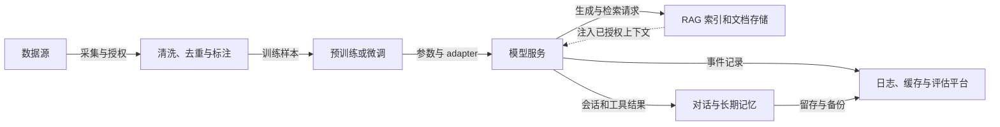

# 第十章：Privacy、Memorization 与 Watermarking

隐私风险不是一个“模型会不会主动泄密”的单点问题。数据在采集、清洗、训练、评估、检索、工具调用、日志记录和内容发布的每个环节都可能改变风险。

大模型还带来一个特殊困难：训练数据的影响不再只存在于一个可删除的数据库字段中。模型可能泛化出语言规律，也可能记住稀有、具体的训练片段。用户一次查询可能触发参数记忆；一个 RAG 应用可能因为权限错误把内部文档放进上下文；一个调试日志可能把原始 prompt 和工具返回永久保存。

Watermarking 解决的是另一类问题。它试图在生成内容中留下可统计检测的信号，或通过签名凭证记录内容来源。它可以帮助内容溯源和平台治理，却不能替代 PII 清理、访问控制、差分隐私或模型遗忘。

本章把这三条线分开讲清楚：

1. Memorization 说明模型是否复现了具体数据。
2. Privacy evaluation 说明哪些数据、路径和主体可能受到泄露影响。
3. Watermarking 与 provenance 说明如何识别或记录生成内容的来源。

每条线最后都要回到同一个工程问题：证据覆盖了什么，不能证明什么，发现风险后下一步怎么做。

## 1. 隐私问题为什么不能只看模型参数

### 1.1 传统软件的隐私对象

传统系统中的隐私对象通常比较容易命名：

1. 数据库中的一行记录。
2. 文件系统中的一个文档。
3. API 返回中的一个字段。
4. 日志中的一条事件。
5. 身份系统中的一个权限关系。

这不表示传统系统简单，而是数据位置和访问路径相对明确。工程师可以问“这条记录在哪个表”“哪些服务能读取”“保留多久”“谁能导出”。

### 1.2 大模型改变了存储边界

预训练和微调把大量样本的影响写入参数。一个样本的影响可能与其他样本重叠，也可能在不同层承担不同作用。模型没有一个名为“某用户手机号”的字段，只有对一系列 token 和上下文的概率响应。

因此，下面三个问题必须区分：

1. 数据是否进入过训练集？
2. 模型是否记住了某个具体片段？
3. 用户是否能通过当前接口得到这个片段？

数据进入训练集不等于一定会被复现；模型复现某个片段也不等于每个接口都能暴露；接口暂时没有暴露，也不等于参数中没有相关影响。

### 1.3 应用系统又增加了外部存储

现代 LLM 应用通常由多个组件组成：



图中实线表示正常数据流，虚线表示 RAG 上下文回流；每条路径都可能复制敏感数据。读图时从左侧数据源向右追踪：训练把影响写入参数，部署再把参数输出与检索、记忆和日志连接起来。因此，同一片段在不同组件出现时，事故根因和删除动作可能完全不同。模型 checkpoint 不泄露，不能替代检查索引 ACL、工具 trace 和调试缓存；索引权限正确，也不能证明训练数据或日志已清理。

隐私事故可能发生在任意箭头上。一个模型 checkpoint 没有泄露，并不能抵消 RAG 权限错误；RAG 权限正确，也不能抵消日志保存了未经脱敏的上下文。

### 1.4 隐私风险的基本分解

可以把一个风险事件 $j$ 的预期损失粗略写成：

```math
\mathrm{Risk}_j
=P(\mathrm{exposure}_j)
\times
\mathrm{Impact}_j
```
这里的概率包含攻击成功、系统误配和内部误用等路径，Impact 可以包含人数、敏感等级、持续时间、可撤回性和合规后果。这个乘法只是风险沟通模型，不是所有组织必须使用的正式风险公式。

它提醒我们：低概率事件如果影响很大，不能因为平均泄露率很低就忽略；高频低影响事件也不能只报一个总数而不看高风险切片。

## 2. Memorization 与 Generalization

### 2.1 小白例子：背作文和学写作

假设一个学生读了很多作文。

如果他学会了叙事、语法和结构，面对新题目也能写出新文章，这更接近 generalization。

如果给出某篇作文的开头，他能够逐字背出后面的内容，这更接近 memorization。

模型也可能同时具备这两种行为。泛化不是“从来没有记忆”，记忆也不是“模型没有学到规律”。

### 2.2 工作定义

在本章中，memorization 指模型对某个具体训练样本、稀有片段或局部序列形成了可检测的复现倾向。这个定义强调可观察行为，不声称能直接读取参数中的“记忆位置”。

常见风险样本包括：

1. 罕见个人信息。
2. 私密通信。
3. API key、密码和凭证。
4. 内部代码和工单。
5. 版权文本的长片段。
6. 训练时插入的唯一 canary。

常见短语、公共事实和广泛重复的文本也可能被模型高概率生成，但它们与个人隐私风险的责任边界不同。

### 2.3 为什么记忆会发生

一个样本更容易被记住的因素包括：

1. 数据重复次数高。
2. 样本在语料中很稀有但格式显著。
3. 微调数据量小而训练轮数多。
4. 样本具有固定前缀和容易续写的结构。
5. 模型容量和训练预算较大。
6. 去重、数据混合和抽样控制不足。
7. 训练目标直接奖励精确序列拟合。

这些因素只是风险相关因素，不是单独的因果判定。模型规模变大可能提高某些记忆风险，也可能改变数据混合和正则化条件；不能把“参数多”写成必然泄露。

### 2.4 记忆不等于恶意

模型记住一个公共短语不一定是隐私事故。隐私评估要同时考虑：

1. 内容是否敏感。
2. 内容是否属于特定个人或组织。
3. 复现是否逐字或足够接近。
4. 访问者是否有权得到。
5. 结果是否能与其他信息结合。
6. 事件是否可追溯和可撤回。

因此，memorization eval 不能只统计“模型是否复现了某个字符串”，还要保留数据分类和访问上下文。

## 3. 四类隐私泄露问题

### 3.1 Training data extraction

Training data extraction 关注攻击者能否通过模型查询，使模型输出训练数据中的具体片段。Carlini 等人的研究在 GPT-2 上展示了从模型中恢复逐字训练序列的可能性，论文摘要报告的例子包括姓名、电话号码、邮箱、IRC 对话、代码和 UUID。

这项研究支持一个有限结论：即使训练语料来自公开互联网，里面也可能存在不应被模型重新输出的敏感内容；黑盒查询接口也可能成为泄露通道。

它不支持以下更强结论：

1. 所有模型都同样容易抽取。
2. 所有能续写的内容都来自训练集。
3. 一次红队没有发现泄露，就证明参数没有记忆。
4. 输出过滤可以取代训练前的数据治理。

本章只讨论风险模型和防御评估，不给出针对真实系统的抽取策略。

### 3.2 Membership inference

Membership inference 关注另一个问题：给定一个数据记录，能否判断它是否出现在训练集里。

“某人的病历是否被用于训练”本身就可能是敏感信息，即使模型没有输出病历内容。Shokri 等人的经典工作把成员推断定义为在黑盒访问下区分成员和非成员样本，并研究了模型预测差异与攻击风险。

成员推断与内容复现的关系如下：

| 问题 | 关心的事实 | 典型证据 |
| --- | --- | --- |
| Extraction | 能否复现具体内容 | exact/near-duplicate 输出 |
| Membership inference | 样本是否参与训练 | TPR、FPR、AUC、advantage |
| PII leakage | 是否暴露个人身份信息 | PII 检测、人工核验、权限上下文 |

三者可能同时发生，也可能只有其中一种发生。一个模型可能不复现原文，却仍然表现出成员信号；也可能复现公共文本，但无法证明它来自特定训练集。

### 3.3 PII leakage

PII leakage 关注个人可识别信息是否通过模型或应用暴露。它包括：

1. 直接生成手机号、邮箱或地址。
2. 由上下文补全个人信息。
3. 把多个低敏字段组合成高敏画像。
4. 在 RAG 引用或工具返回中暴露无权字段。
5. 在日志、调试转储和人工标注平台中保存原始内容。

PII 不是一个只靠正则表达式就能定义的集合。姓名可能是公开信息，也可能在特定机构和上下文中成为敏感信息；地址、病历和职位组合后的风险也可能高于单个字段。

### 3.4 Inference 与 re-identification

模型不必直接输出一个完整身份证号才构成风险。它可能从多条信息推断个人身份，或把匿名记录与外部资料重新关联。

因此评估中要加入：

1. 单字段输出。
2. 多字段组合。
3. 近似值和部分值。
4. 与公开资料的关联风险。
5. 不同用户、租户和权限上下文。

这类风险超出了单纯的语言模型记忆，需要数据保护、访问控制和业务专家共同评估。

## 4. 训练数据抽取风险的机制

### 4.1 从概率分布到可复现片段

模型根据：

```math
p_\theta(y\mid x)
=\prod_{t=1}^{T}
p_\theta(y_t\mid x,y_{<t})
```
生成序列。对一个稀有且固定的片段，如果模型对后续 token 的联合概率显著高于普通替代序列，用户就可能观察到异常的续写倾向。

可用长度归一化的 log-likelihood 表示一条候选序列的拟合程度：

```math
\ell_\theta(y\mid x)
=\frac{1}{T}
\sum_{t=1}^{T}
\log p_\theta(y_t\mid x,y_{<t})
```
这里 $T$ 是目标序列 token 数。长度归一化只是为了比较不同长度样本，不能直接把高 likelihood 当成“必然来自训练集”。

### 4.2 研究中的 canary

Secret Sharer 工作研究了稀有或唯一序列的非预期记忆，并把可控的秘密序列作为评估对象。工程上也可以在授权的合成数据中植入唯一 canary，用于检测训练管线是否会过度记忆。

一个合成 canary 应满足：

1. 不包含真实个人信息。
2. 只存在于明确的实验数据中。
3. 有唯一 ID 和版本。
4. 训练前后都有基线。
5. 输出日志只保存风险标签和受控引用。

canary 评估的优势是可重复，缺点是它不能覆盖真实数据的全部分布。通过合成 canary 只能说明某类管线在该实验下的复现行为。

canary 的设计本身会影响检测能力。ICLR 2025 的隐私审计研究指出，早期审计常用的简单 canary 会导致弱成员攻击和宽松的泄露下界；作者为多类威胁模型设计了更有效的 canary。在其一个 Qwen2.5-0.5B 实验中，新 canary 在 1% FPR 下达到 49.6% TPR，论文对照的旧方法为 4.2% TPR；作者还报告，在自己的设定中可对理论隐私预算为 $\epsilon=4$ 的训练模型给出约 $\epsilon=1$ 的经验审计。这里的模型、数据、攻击能力和 canary 插入方式都绑定该论文，不能把数值直接当成任意 LLM 的隐私预算，也不能用合成审计替代正式 DP 会计。[Privacy Auditing of Large Language Models](https://proceedings.iclr.cc/paper_files/paper/2025/hash/e76814a0012a46ade4f997591e86f972-Abstract-Conference.html)

### 4.3 重复数据的作用

同一片段重复出现，会让训练目标在多个步骤上反复看到它。重复可能来自：

1. 同一页面的镜像。
2. 新闻转载。
3. 文档版本。
4. 代码仓库快照。
5. 数据集拼接。

去重降低记忆风险，但不能简单地“重复越少越好”。过度去重可能损失不同语境中的有价值样本，也可能把本来不同的版本误合并。去重策略需要保留来源、相似度阈值和误合并抽样。

### 4.4 微调的过拟合路径

小规模 SFT 数据尤其容易形成强记忆。若一条内部工单被重复训练多轮，模型可能学到具体句子，而不是抽象的客服行为。

缓解手段包括：

1. 在训练前删除或掩码敏感字段。
2. 控制同一主体和同一模板的重复比例。
3. 监控训练集与保留集的 loss 差异。
4. 训练后使用合成探针和授权数据做复现评估。
5. 对高敏样本采用不进入参数的 RAG 或专门的隐私隔离服务。

## 5. PII scrub 为什么必要但不充分

### 5.1 规则检测

邮箱、电话、银行卡和部分密钥具有格式特征，可以用规则做高召回预筛。规则的优点是可解释、速度快，缺点是对变形、上下文和新格式不稳定。

### 5.2 模型检测

NER、分类器和 LLM-assisted 审查可以识别姓名、地址、组织和上下文敏感字段。模型检测的优点是能利用语义，缺点是可能漏报、误报、受语言影响，且检测模型本身也需要隐私控制。

### 5.3 组合字段

单个字段看起来不敏感，组合后可能完成 re-identification。例如部门、城市、日期和罕见事件的组合，可能在组织内部唯一指向一个人。

清洗流程应有字段级和记录级风险，而不是只给每个 token 打标签。对高敏数据，最好采用人工抽样和数据主体知识进行复核。

### 5.4 scrub 的失败模式

常见失败包括：

1. 只清理预训练数据，忘记 SFT 和偏好数据。
2. 只清理正文，忘记 metadata、文件名和 HTML 属性。
3. 只清理输入，日志和输出没有脱敏。
4. 只识别英文格式，忽略多语言和本地格式。
5. 替换字段后保留了可重建的上下文。
6. 清洗规则更新后没有重跑历史数据。

因此 scrub 是数据治理的一层，不是 privacy proof。

## 6. Membership inference 的统计解释

### 6.1 TPR、FPR 和 advantage

设攻击器把样本判定为成员的阈值为 $\tau$。真正成员中被判为成员的比例是：

```math
TPR(\tau)=P(\mathrm{score}\ge\tau\mid \mathrm{member})
```
非成员中被误判为成员的比例是：

```math
FPR(\tau)=P(\mathrm{score}\ge\tau\mid \mathrm{nonmember})
```
常见的攻击优势为：

```math
Adv(\tau)=TPR(\tau)-FPR(\tau)
```
优势越大，说明在这个阈值下成员与非成员更容易被区分。实际报告应给出 ROC/AUC、阈值、样本构造和置信区间，而不是只报一个 advantage。

用 demo 中的六个成员分数和六个非成员分数复算一次。阈值设为 $\tau=0.60$，成员分数中 $0.91,0.83,0.62$ 达到阈值，因此 $TPR=3/6=0.5$；非成员中只有 $0.72$ 达到阈值，因此 $FPR=1/6\approx0.167$。于是 $Adv=0.5-0.167=0.333$。这个结果表示该组玩具样本在当前阈值下有区分信号；六条样本太少，既没有置信区间，也不代表总体攻击成功率。

### 6.2 为什么成员推断不能单独证明隐私事故

成员推断的结果取决于：

1. 成员和非成员是否来自同一分布。
2. 攻击器是否知道预处理和 tokenization。
3. 输出接口提供了概率、logits 还是只有文本。
4. 数据是否在互联网上重复出现。
5. 模型是否过拟合了目标样本。

Advantage 较大是风险信号，不等于攻击者已经获得了具体内容；Advantage 较小也不等于没有内容泄露。它应与 extraction、PII、权限和日志评估并列。

### 6.3 参考分布与切片

成员推断应按数据类型切片：

1. 高频公共文本。
2. 稀有合成 canary。
3. 近重复文档。
4. 个人资料代理。
5. 微调样本。

如果总体 advantage 很低，但高敏切片很高，平均值不能掩盖问题。评估报告要保留切片样本量，避免把小样本的极端结果误解为总体定律。

成员推断方法也不只看整条序列的一个分数。ICLR 2026 的 InfoRMIA 将成员推断写成信息论形式，并在论文 benchmark 上报告优于 RMIA 的结果；它进一步把信号细化到 token 级别，以定位输出中的记忆片段。细粒度定位有助于检查哪些 token 可能承载记忆，但论文 benchmark 上的优势不等于上线攻击或生产泄露的普遍保证；实践中仍要绑定模型、参考分布、攻击接口和目标切片。[Information-Theoretic Membership Inference for Granular Quantification of Memorization](https://proceedings.iclr.cc/paper_files/paper/2026/hash/ddf43af256e11499149cf06040c62caa-Abstract-Conference.html)

## 7. Differential Privacy 与 DP-SGD

### 7.1 邻接数据集

差分隐私先定义两个只相差一个样本的数据集 $D$ 和 $D'$。随机算法 $A$ 对任意输出事件 $S$ 满足：

```math
P[A(D)\in S]
\le
e^\epsilon P[A(D')\in S]+\delta
```
$\epsilon$ 控制隐私损失的乘法尺度，越小通常代表更强保护；$\delta$ 是允许的极小失败概率。这里的保证针对明确的算法、相邻关系和隐私预算，不是“模型完全不会输出任何敏感信息”。

### 7.2 DP-SGD 的逐样本裁剪

普通 SGD 先把一个 batch 的梯度平均。DP-SGD 需要先计算每个样本梯度 $g_i$，再裁剪其范数：

```math
\bar g_i
=g_i\min\left(1,\frac{C}{\lVert g_i\rVert_2}\right)
```
$C$ 是裁剪阈值。若 $\lVert g_i\rVert_2\le C$，梯度不变；若超过 $C$，梯度被缩短到范数 $C$。

用两个二维样本梯度走一遍裁剪。设 $g_1=(0.3,0.4)$，其范数为 $\sqrt{0.3^2+0.4^2}=0.5$；当 $C=1$ 时它不需要改变。设 $g_2=(3,4)$，范数为 $5$，缩放系数为 $C/\lVert g_2\rVert_2=1/5=0.2$，所以裁剪后 $\bar g_2=(0.6,0.8)$。两条裁剪梯度相加为 $(0.9,1.2)$。取 batch size $B=2$、noise multiplier $\sigma=0.5$，噪声每个坐标的标准差是 $\sigma C=0.5$。假设某一次采样恰好得到噪声向量 $(0.1,-0.2)$，那么噪声加入后的和为 $(1.0,1.0)$，平均梯度是 $\tilde g=(0.5,0.5)$。这个噪声值只是一次可能的抽样，不是期望值；它展示裁剪和加噪的顺序，不足以算出最终 $\epsilon$，后者还需要采样率、训练步数和会计方法。

然后加入高斯噪声：

```math
\tilde g
=\frac{1}{B}
\left(
\sum_{i=1}^{B}\bar g_i
+\mathcal N(0,\sigma^2C^2I)
\right)
```
$B$ 是 batch size，$\sigma$ 是 noise multiplier，$I$ 是单位矩阵。噪声尺度与 $C$ 成正比，因为裁剪后的单个样本贡献被限制在已知范围内。

### 7.3 隐私预算是累计量

每一步加入噪声并不意味着每一步都独立拥有一个完整的 $\epsilon$。多步训练、抽样率、批大小和噪声系数需要通过隐私会计器组合，得到整个训练过程的预算。

因此报告 DP 训练时至少要写：

1. 相邻关系是 sample-level 还是 user-level。
2. 数据集大小和采样率。
3. batch size、训练步数和噪声系数。
4. 梯度裁剪阈值。
5. 隐私会计方法。
6. 最终 $(\epsilon,\delta)$ 和模型质量。

如果一个用户有多条记录，sample-level DP 不自动等于 user-level DP。隐私主体的定义必须与实际风险主体一致。

### 7.4 DP 的代价

更强隐私通常需要更强噪声或更少的有效训练信息，可能带来：

1. 任务质量下降。
2. 收敛变慢。
3. 训练和显存开销增加。
4. 长序列逐样本梯度计算更困难。
5. 小数据场景下预算消耗更快。

DP-SGD 是有形式化保证的技术路线，但是否适合某个 LLM 项目要看数据规模、隐私主体、质量目标和部署责任。没有报告预算和会计过程的“使用了 DP”并不是完整技术结论。

## 8. 数据治理：模型隐私的前置条件

### 8.1 来源与用途

每个数据集合至少应记录：

1. 来源和采集时间。
2. 许可证或授权依据。
3. 计划用途。
4. 是否含个人或企业敏感信息。
5. 允许进入训练、评估还是只允许检索。
6. 删除或撤回的处理方式。
7. 责任人和版本。

公开可访问不等于允许任意训练和任意再分发。数据治理要把“能看到”和“能使用”分开。

### 8.2 数据分级

一个教学分级可以包括：

| 等级 | 示例 | 典型处理 |
| --- | --- | --- |
| 公共低敏 | 公共百科、授权语料 | 记录来源和许可证，常规去重 |
| 公共受限 | 有版权或用途限制的文本 | 许可核验、限制训练或只做检索 |
| 企业内部 | 内部制度、工单、代码 | 权限隔离、脱敏、用途限定 |
| 用户私有 | 对话、上传文件、个人记录 | 默认不进入训练，最小化留存 |
| 高敏感 | 医疗、财务、凭证 | 专门隔离、强访问控制和审计 |

分级不是法律意见，而是把不同风险的工程处理分开。

### 8.3 Data lineage

数据血缘要能回答：

1. 哪个模型版本使用了哪个数据快照。
2. 某份文档是否进入预训练、SFT 或偏好数据。
3. 某用户数据是否只出现在评估或日志。
4. 哪些重复副本仍然存在。
5. 删除请求会影响哪些模型、adapter、索引和备份。

没有 lineage，团队很难定位泄露来源，也无法证明某次删除或重训覆盖了目标范围。

### 8.4 数据最小化和用途限制

数据最小化不只是删除字段，也包括：

1. 只收集完成任务所需的信息。
2. 只保留必要的时间窗口。
3. 只把必要字段传给模型。
4. 不把完整工具响应复制到长期记忆。
5. 把评估样本与训练样本隔离。

减少进入模型上下文的数据量，往往比上线后再过滤生成结果更容易解释。

## 9. 隐私技术栈的责任边界

### 9.1 训练前治理

训练前可以做许可审查、数据分级、去重、PII 检测、凭证扫描、敏感字段掩码和数据排除。它们降低风险来源，但不能保证检测器没有漏报。

### 9.2 训练中控制

训练中可以使用 DP-SGD、正则化、采样控制、过拟合监控和 checkpoint 访问控制。它们分别影响单样本敏感度、记忆倾向和 artifact 暴露，不应合并成一个指标。

### 9.3 训练后评估和遗忘

训练后应做 canary、复现、成员推断、PII 和近邻能力评估。发现问题后可以选择数据删除、重新训练、adapter 替换、model editing、unlearning 或输出抑制。

第九章已经说明，unlearning 通常只能提供有限评估分布上的近似证据。这里要强调：privacy scrub、DP、unlearning 和 output filter 解决的对象不同。

### 9.4 部署和应用控制

部署时要把服务端权限、RAG 检索过滤、工具授权、输出脱敏、租户隔离、速率限制和日志策略放在模型外部。模型输出是一个不可信的中间结果，不能由模型自己决定用户是否有权看到数据。

### 9.5 事故响应

一旦发现泄露，应立即固定证据并限定暴露范围：

1. 保存模型、服务、数据和日志版本。
2. 暂时限制高风险接口或下游动作。
3. 区分参数泄露、RAG 越权、日志泄露和人工误用。
4. 识别受影响数据主体和时间窗口。
5. 处理索引、缓存、备份和下游副本。
6. 选择修复、重训、遗忘、通知和复测路径。

不能因为“模型已经修好了”就删除事故日志。事故日志本身也要经过访问控制和脱敏。

## 10. Watermarking 解决的是什么问题

### 10.1 内容溯源需求

生成内容大量进入搜索、教育、媒体和企业流程后，人们会问：

1. 这段内容是否由某个生成系统产生？
2. 哪个系统或版本产生了它？
3. 内容后来经历了哪些编辑？
4. 训练或评估数据是否被合成内容污染？
5. 发生争议时是否有可验证的来源记录？

Watermarking 和 provenance 都可以帮助回答其中一部分，但它们不是同一种技术。

### 10.2 统计水印

文本水印在生成时对 token 选择施加微小的统计偏置，让检测器在足够长的文本上发现异常的 token 组合。它通常不要求人类读者能直接看见标记。

一种教学抽象是：第 $t$ 步根据密钥、上下文和随机状态生成 green-token 集合 $G_t$，然后把属于该集合的 token logits 提高：

```math
\ell'_t(v)
=\ell_t(v)
+\delta I[v\in G_t]
```
$\ell_t(v)$ 是原始 logit，$\delta$ 是偏置强度，$I[\cdot]$ 是指示函数。实际水印还要处理 tokenization、上下文依赖、采样器和密钥安全。

Kirchenbauer 等人的工作提出了 green-token 选择和统计检验框架，并研究了文本质量、检测效率和鲁棒性。这个论文结果支持“统计水印可以在特定设置下工作”，不支持“所有生成文本都能可靠检测”。

### 10.3 内容凭证与签名 provenance

C2PA Content Credentials 采用签名的 manifest 和声明链记录内容来源与编辑历史。它更接近“谁在什么条件下声明了什么”，而不是从文本统计特征推断来源。当前 2.5 规范还区分内容凭证、JSON 表示、attestation、soft binding 与安全注意事项；实现时应固定采用的规范版本和验证器，不能把“符合 C2PA”当作签名链可信或声明真实的替代证明。[C2PA Specifications 2.5](https://spec.c2pa.org/specifications/specifications/2.5/index.html)

两者差异如下：

| 机制 | 信号在哪里 | 需要什么 | 主要失效方式 |
| --- | --- | --- | --- |
| 统计水印 | 生成 token 的统计分布 | 检测算法、密钥或公开规则 | 短文本、改写、翻译、分布变化 |
| C2PA 凭证 | 文件或媒体的签名 manifest | 签名链、验证器和元数据保存 | 元数据丢失、未签名编辑、信任链不完整 |
| 平台日志 | 服务端事件记录 | 可信日志和访问控制 | 离开平台后无法独立验证 |

C2PA 凭证可以证明一条签名声明在链上存在，不自动证明内容真实，也不自动证明没有经过未记录的编辑。统计水印可以在凭证丢失后提供辅助信号，但也不能替代签名身份。

### 10.4 SynthID 的位置

Google DeepMind 的 SynthID 页面把它描述为用于给 AI 生成内容加水印和识别的工具；2024 年的 SynthID-Text 论文使用 tournament sampling，在生成采样时加入信号，并把检测设计为不依赖原生成模型。论文还研究了与 speculative sampling 的组合，并报告其作者模型上的检测评估和近 2,000 万条 Gemini 响应的用户反馈。其方法不是本节 green-token 公式的直接实现：该公式只帮助理解“改变候选 token 的选择统计”这一类水印直觉。论文结果绑定作者模型、阈值和测试语料，不能外推为任意文本都可检测。[Scalable watermarking for identifying large language model outputs](https://www.nature.com/articles/s41586-024-08025-4)

Anthropic 在 2026 年公开说明，Claude 文本水印采用 SynthID-Text 路线的一个版本；该公司将检测结果描述为“Claude 曾参与文本”的可能性信号，而不是判断人类或机器的绝对分类，也不能区分生成与重度编辑。其说明同时指出，短样本、事实选择有限的文本、校对和精确代码会留下较少可用选择，整段重写可能抹去原信号；检测 API 当时处于受限预览。这是厂商对自身产品的说明，不是第三方独立评测。[How Claude's text watermark works](https://www.anthropic.com/news/claude-text-watermark)

它不能支持以下结论：

1. 所有模型输出都有 SynthID。
2. 其他厂商的内容也能被它可靠识别。
3. 检测结果是法律意义上的作者证明。
4. 水印能解决训练数据隐私。

引用产品页面时，要把厂商自述的能力、公开技术细节和独立评测分开。

## 11. 文本水印的检测统计

### 11.1 z-score 的教学形式

设文本有 $T$ 个 token，检测到其中 $G$ 个属于 green set，假设在无水印基线下每个 token 进入 green set 的期望比例为 $\gamma$，则可以定义：

```math
z_{wm}
=\frac{G-\gamma T}
{\sqrt{T\gamma(1-\gamma)}}
```
分子是观测 green 数与期望值的差，分母是二项分布近似下的标准差。若 $z_{wm}$ 很大，文本比无水印假设更偏向 green token。

这个公式有明确的适用边界：

1. token 选择并非真正独立同分布。
2. 语言上下文会改变 green 集合和 token 概率。
3. 文本太短时方差大。
4. 改写、翻译和拼接会改变统计样本。
5. 检测阈值影响误报和漏报。

还要求 $0<\gamma<1$ 且 $T>0$。没有 token、没有有效的 green 比例或没有可比的基线
时，$z_{wm}$ 没有定义，应记录为 $N/A$。所以 z-score 是统计证据，不是来源真相。

用代码中的一条长生成文本复算。它有 $T=120$ 个 token，其中 $G=78$ 个属于 green set，基线比例为 $\gamma=0.5$。无水印假设下期望数是 $\gamma T=60$，方差近似为 $T\gamma(1-\gamma)=30$，标准差为 $\sqrt{30}\approx5.477$。于是 $z_{wm}=(78-60)/5.477\approx3.286$，高于教学阈值 $2.5$。一条短回复有 $T=18,G=13$，期望数为 9、标准差为 $\sqrt{4.5}\approx2.121$，所以 $z_{wm}=4/2.121\approx1.886$，未达到阈值。即使 green 比例只多出 4 个 token，短文本也因为方差较大而没有足够统计证据。

相同阈值还会影响人工文本误报。代码中的一条合成人类控制有 $T=64,G=42$，期望数为 32、标准差为 4，得到 $z_{wm}=10/4=2.5$；由于判定规则是“大于或等于 2.5”，它恰好被检出。若平台把这个边界值改成严格大于，当前例子的误报会变化；因此比较符号、阈值版本和舍入位置都属于评估协议。不能只报告一个 z-score 数字而不报告检测规则。

### 11.2 检测率、误报率和漏报率

对带水印生成文本，检测召回率为：

```math
TPR_{wm}
=\frac{TP}{TP+FN}
```
对人工或无水印文本，误报率为：

```math
FPR_{wm}
=\frac{FP}{FP+TN}
```
平台如果把检测器用于处罚，误报率尤其重要。应按语言、文本长度、领域、编辑方式和作者群体切片报告，而不是只给一个总体准确率。

### 11.3 文本长度的作用

z-score 的分母随 $T$ 的平方根增长，足够长的文本通常更容易积累统计证据；短文本则很难可靠区分。

这带来一个产品边界：不能把一条两句的生成回复和一篇长文使用同一个阈值和解释。短文本检测结果更适合做辅助信号，不适合单独作为处罚依据。

### 11.4 质量代价

水印偏置可能改变 token 选择。质量评估至少应观察：

1. 任务正确率。
2. 语言流畅度。
3. 重复率。
4. 长度分布。
5. 多语言表现。
6. 采样温度变化下的稳定性。

“几乎不影响质量”必须绑定模型、采样器、提示集合和评价指标，不能脱离实验条件使用。

## 12. 水印鲁棒性与误用风险

### 12.1 改写和翻译

人类改写、非水印模型改写和翻译都会改变原始 token 序列。研究表明，在足够长的文本或保留足够片段时，某些水印仍可能被检测；但这不是所有长度和语言的保证。

评估要报告：

1. 原始文本检测。
2. 轻度人工改写。
3. 机器改写。
4. 翻译后再翻译。
5. 多来源文本混合。

这些测试是防御评估，不应变成公开的水印规避教程。

2026 年 7 月提交的 arXiv 预印本对 KGW、Unigram 和 MarkLLM 中的 SynthID-Text 配置做了取证准备度评估。作者报告了 846 次有效改写运行：在其测试流程中，所有最初能检测到水印的 KGW 和 Unigram 样本、以及 98.3% 的 SynthID 样本，在意义保持的改写后不再能检出；在改写前，三类配置的漏报率也分别为 70%、83% 和 80%。作者还报告某一 SynthID 配置对改写的人类对照有 5.4% 误报。该工作是预印本，方法、阈值、提示和判定规则均是特定配置；这些数字提示应报告改写条件和不确定区间，不足以证明所有商用水印在真实争议中都无效。[AI Watermark Evidence Fails Forensic Readiness: An Empirical Evaluation](https://arxiv.org/abs/2607.16010)

### 12.2 短文本和分布变化

新闻、代码、诗歌、表格和多语言文本的 token 分布不同。一个在英语长文上校准的阈值，可能在代码或中文短回答上误报。

检测器要有“不确定”状态，不能把所有输出强行分为人类或机器。证据不足时，应该请求来源凭证或人工复核。

### 12.3 密钥与检测器安全

如果生成规则和密钥泄露，攻击者可能影响统计特征或制造伪阳性。密钥轮换、访问控制和检测器版本管理会影响水印系统的安全性。

如果检测器本身不可信，水印结果也不能成为唯一证据。平台应保留模型版本、生成事件和签名凭证等独立来源。

### 12.4 不能把水印当作隐私防护

水印回答“内容可能从哪里来”，隐私控制回答“谁能看到什么、训练用了什么、能否删除”。水印不会阻止模型输出个人信息，也不会自动删除训练记忆。

把水印分数放进隐私指标，会让责任边界混乱。二者可以在治理平台汇总，但必须保持独立评估。

## 13. 隐私与水印评估的公式

### 13.1 评估样本结构

一次评估事件可以写成：

```math
p_i=(x_i,d_i,s_i,r_i,g_i,l_i,w_i)
```
$x_i$ 是提示或系统事件，$d_i$ 是数据来源，$s_i$ 是敏感类型，$r_i$ 表示训练、微调、RAG、工具或日志路径，$g_i$ 是模型或系统输出，$l_i$ 是日志记录状态，$w_i$ 是风险权重。

把路径 $r_i$ 放进数据结构很重要，因为相同的泄露文本可能来自参数、RAG 或日志，修复方式完全不同。

### 13.2 Memorization exposure

令 $m_i=1$ 表示授权合成 canary 在评估中达到预先定义的复现标准：

```math
R_{mem}
=\frac{\sum_iw_i I[m_i=1]}{\sum_iw_i}
```
该指标只能说明受控 canary 的复现比例。阈值、长度、相似度和解码设置必须写进评估卡。

### 13.3 PII 检测的 precision 和 recall

令 $z_i=1$ 表示人工或高可信标注确认样本含 PII，$\hat z_i=1$ 表示检测器标记为 PII。召回率为：

```math
Recall_{pii}
=\frac{\sum_i I[z_i=1\land\hat z_i=1]}
{\sum_i I[z_i=1]}
```
精确率为：

```math
Precision_{pii}
=\frac{\sum_i I[z_i=1\land\hat z_i=1]}
{\sum_i I[\hat z_i=1]}
```
召回率低会漏掉真实敏感内容；精确率低会让系统过度阻断。高风险出口通常偏向更高召回，但仍要检查正常任务的误伤。

### 13.4 输出泄露率

令 $g_i^{sens}=1$ 表示输出中出现敏感内容，$b_i=1$ 表示系统成功阻断或脱敏。对敏感事件集合 $S$，输出泄露率可以写成：

```math
R_{leak}
=\frac{\sum_{i\in S}w_i I[g_i^{sens}=1\land b_i=0]}
{\sum_{i\in S}w_i}
```
如果敏感样本有不同严重度，权重应在评估卡中解释；空集合不能被当作零风险，应标记为未测量。

### 13.5 RAG 越权泄露

令 $q_i=1$ 表示系统返回了敏感检索内容，$a_i=0$ 表示用户无权访问：

```math
R_{rag}
=\frac{\sum_i I[a_i=0\land q_i=1]}
{\sum_i I[a_i=0]}
```
分母是无权访问的测试请求，而不是所有请求。权限过滤正确但生成器仍从旧上下文中输出内容时，还要另算回答泄露率。

### 13.6 原始日志泄露

令 $l_i^{raw}=1$ 表示日志保存了未经处理的敏感内容，$s_i=1$ 表示事件确实含敏感内容：

```math
R_{log}
=\frac{\sum_iw_iI[l_i^{raw}=1\land s_i=1]}
{\sum_iw_iI[s_i=1]}
```
日志评估要覆盖 prompt、completion、RAG context、tool trace、异常堆栈、调试转储和人工标注平台。

### 13.7 Membership inference advantage

在阈值 $\tau$ 下：

```math
Adv_{mia}(\tau)
=TPR_{mia}(\tau)-FPR_{mia}(\tau)
```
它是一个攻击信号，不是隐私预算，也不是内容泄露率。评估结果应附带攻击器、样本切片和置信区间。

### 13.8 水印 z-score 和质量代价

令生成文本 token 数为 $T$，green token 数为 $G$，无水印 green 比例为 $\gamma$：

```math
z_{wm}
=\frac{G-\gamma T}
{\sqrt{T\gamma(1-\gamma)}}
```
把检测器输出记为 $y_{wm}=I[z_{wm}\ge\tau_{wm}]$。水印质量代价可写成：

```math
D_{qual}
=Q_{baseline}-Q_{watermarked}
```
$Q$ 可以是任务分数、人工质量或多个归一化指标，但量纲必须一致。水印评估至少要并列报告 $TPR_{wm}$、$FPR_{wm}$、改写鲁棒性和 $D_{qual}$。

## 14. 案例一：企业 RAG 的跨租户泄露

### 14.1 事故

一个企业助手为多个部门检索文档。用户 A 询问自己的报销政策，却在回答中看到了部门 B 的内部字段。初步排查发现：

1. 文档索引没有保留完整的租户标签。
2. 检索器按语义相似度返回结果，没有先做权限过滤。
3. 生成器把检索片段直接拼接到上下文。
4. 调试日志保存了完整 RAG context。

这里不需要假设模型“记住了”部门 B 的数据。泄露发生在系统的检索和日志路径。

### 14.2 分层修复

第一层修复是索引和服务端权限：

1. 文档条目保存租户、部门、字段敏感等级和生效时间。
2. 检索请求带服务端解析的身份，不使用模型自行声明的身份。
3. 权限过滤在向量检索前和结果返回前各做一次。
4. 无权结果不进入模型上下文。

第二层修复是输出和日志：

1. 对引用字段做敏感等级检查。
2. 记录文档 ID 和权限判定，不记录完整原文。
3. 对异常响应保留受控取证副本。
4. 检查工具 trace 和缓存是否复制了原始内容。

### 14.3 评估

修复后需要测试：

1. 同租户有权访问。
2. 跨租户无权访问。
3. 共享文档的部分字段。
4. 多轮追问。
5. 恶意或无关文档中的指令。
6. 空检索和权限冲突。

只有输出没有泄露，还不够；要同时确认日志、缓存和引用没有泄露。

把这次修复放进一组固定的合成请求，可以看出为什么需要分开记账。假设测试集有 20 条跨租户无权请求和 20 条本租户有权请求；修复后，20 条无权请求都没有检索到敏感片段，但其中 1 条在第二轮追问时从会话缓存中泄露了片段。于是无权检索率为 $0/20=0$，而无权输出泄露率为 $1/20=0.05$。两者不是同一个分子：检索权限过滤已阻断第一次路径，缓存和多轮回答仍有缺口。若 20 条有权请求中有 18 条答对，授权任务成功率是 $18/20=0.90$；若 40 次请求中有 1 条未经处理的敏感日志，原始日志事件率为 $1/40=0.025$。

假设上线门槛预先写为“越权检索 0 次、敏感输出泄露不超过 1%、授权任务成功率至少 95%、原始敏感日志为 0”。这组结果只有检索门槛通过，其余三项都失败；不能用一个总分把它平均成可发布。即使越权检索观察到 0/20，也只说明当前测试集没有命中；用常见的 $3/n$ 近似看，95% 上界仍约为 $3/20=15\%$。这提醒团队要增加多轮、不同身份和边界文档测试，并报告样本量，而不是把零观察写成零风险。

实施时还要固定每条请求的租户身份来源、索引版本、ACL 版本、检索候选数、重排结果、上下文组装 hash、缓存键与策略版本。否则复测时即使输入相同，也可能因索引更新或身份解析差异而不可比。应在日志中保存最少必要的事件标识与判定原因，原文只放在单独受控的取证区；这样既能回放“哪一步把文档带进回答”，也不会为了调查而制造第二份长期敏感副本。修复顺序通常是先停止越权流量、清理可见缓存，再修正索引过滤和身份链，最后通过黑盒回答与存储审计共同复测。

## 15. 案例二：敏感数据进入微调管线

### 15.1 发现

一个客服团队把工单导出用于 SFT。后来发现导出文件包含姓名、手机号和内部订单号。模型在某些模板下会复现工单句子。

事故响应要先冻结版本和数据，而不是立即覆盖 checkpoint：

1. 保存训练配置、数据快照和模型 hash。
2. 停止相关模型和 adapter 的新流量。
3. 确认敏感字段、重复副本和日志位置。
4. 重新构造合成 canary 和授权评估集。
5. 评估复现、PII、成员推断和近邻能力。

### 15.2 修复选择

如果模型尚未发布，重新训练一个不含目标数据的版本通常更容易解释。若需要快速降低线上泄露，可以先阻断高风险输出并撤回 adapter，但这只是临时控制。

若使用 unlearning，报告必须写明：

1. forget scope 如何定义。
2. 是否有 retain-only reference。
3. exact、改写和多轮如何评估。
4. 训练日志、缓存和下游副本如何处理。
5. 结果在什么范围内有效。

### 15.3 评估结果的读法

假设 exact 复现下降，但改写复现没有下降，说明系统可能学会了避开测试模板。假设复现下降但通用客服能力也大幅下降，说明方法可能通过整体破坏实现“遗忘”。

假设模型不再输出手机号，但成员推断 advantage 仍很高，说明模型可能仍保留训练参与信号。不同指标指向不同的修复方向，不能合并成“隐私已经解决”。

评估报告还要把风险结果与保留能力放在同一张决策表里。假设合成测试集中有 10 条可控 canary，旧版本 exact 复现 4 条、改写复现 3 条；重新训练后 exact 复现降到 0 条，改写复现仍有 2 条。另一个成员推断攻击从 0.33 advantage 降到 0.12，普通客服 retain set 的正确率从 98/100 降为 91/100。这些是假设值，只说明决策方法：exact 结果改善不能掩盖改写泄露仍在，MIA 下降不能替代输出检查，能力下降则要求检查是否通过整体损坏模型来获得表面遗忘。

可以在实验前设定四个独立阈值，例如 exact 和改写 canary 复现率均不超过 5%、成员推断 advantage 不超过 0.10、retain set 正确率不低于 95%。在上述小样本里，exact 通过，改写和 MIA 未通过，retain utility 也未通过，因此版本继续保持冻结。样本数只有 10 或 100 时，比例波动很大，正式评估需要扩大样本、保留分层置信区间和独立 holdout；这里的门槛是示例，不是行业统一标准。

事故处理不能只在 checkpoint 上做文章。团队应先登记原始导出、清洗版本、训练 run、adapter、checkpoint、缓存、索引和日志之间的血缘关系，再依次决定停用、重训、遗忘、凭证轮换或用户通知。若原始工单还留在标注平台或异常日志中，重新训练一个模型不会移除这些副本；若下游又把旧数据注入 RAG，新 checkpoint 也无法阻止重新暴露。每个删除动作要有责任人、完成时间、证据引用和复核结果，并区分“已从模型行为中降低风险”与“所有存储副本已删除”这两个不同承诺。

## 16. 案例三：内容溯源与统计水印

### 16.1 产品需求

一个内容平台希望：

1. 对本平台生成的长文提供来源提示。
2. 在内容被下载后仍有辅助识别信号。
3. 对人工文本尽量不误报。
4. 不因为水印显著损害质量。
5. 对版权争议保留签名的编辑记录。

单一统计水印无法覆盖全部目标。

### 16.2 组合方案

可以采用：

1. 生成服务保存模型版本、时间和请求事件。
2. 输出带 C2PA 签名 manifest。
3. 文本生成器在适用的长文本场景启用统计水印。
4. 平台检测器报告概率和不确定性，而不是“绝对机器标签”。
5. 争议处理优先核验签名链和服务端记录。
6. 水印作为签名缺失时的辅助信号。

这个组合把“可验证声明”和“统计推断”分开。签名链适合证明平台声明，水印适合在部分元数据丢失时提供辅助线索。

### 16.3 失败情况

短回复可能没有足够 token 支持可靠检测；跨平台复制可能丢失凭证；人工重写可能同时改变文字和来源；人工文本偶然出现 green-token 偏差也可能误报。

因此产品文案应使用“检测到与某类生成器一致的信号”或“存在有效来源凭证”，不要写成“已经证明作者是 AI”。

平台可以用一张按长度切片的评估表决定水印信号的用途。假设有 100 篇长生成文本，其中 88 篇被检出；有 200 篇长人工文本，其中 2 篇被误报；另有 50 条短生成回复，只有 10 条被检出。长文本的召回率为 $88/100=0.88$，长人工文本误报率为 $2/200=0.01$，短回复召回率只有 $10/50=0.20$。如果产品要求所有文本都达到 0.80 召回，这个系统明显不适用于短回复；把长文的总体成绩拿来宣传会隐藏长度差异。阈值也应在独立校准集上固定，不能看见待判文本后反复调参。

来源凭证应单独记录另一组结果。假设 100 个平台文件里有 97 个通过签名链验证，3 个因为转存过程丢失 manifest 而无法验证。97/100 只能说明当前文件中有多少保留了可验证声明，不能说明其余 3 个一定不是平台生成，也不能证明 97 个的内容陈述真实。水印是统计信号，C2PA 是可验证的签名声明，两者的证据对象不同；若系统把它们合并成“AI 真实性分数”，就会丢失失败原因和责任边界。

检测结果的界面应给出适用文本长度、模型或凭证版本、分数区间、校准日期和“不确定”状态。若误报会触发处罚，检测器应先产生复核任务而不是自动作出作者身份或学术诚信判定。人工复核需要看到凭证链、平台事件、文本编辑历史和争议方材料；水印分数只作为其中一项证据。还要记录处理何种字符规范化、文本切片和语言切换，确保同一文本重新检测时可以复现结论。

## 17. 隐私工程的生命周期

### 17.1 设计阶段

在收集数据前写清楚：

1. 任务是否必须使用个人信息。
2. 是否可以使用合成或脱敏数据。
3. 隐私主体是一条样本、一个用户还是一个组织。
4. 数据需要保留多久。
5. 删除和撤回如何传播到模型、索引和日志。

### 17.2 训练阶段

训练平台应保存数据版本和使用范围，隔离高敏样本，执行 scrub 和密钥扫描，并监控训练集与保留集差异。

采用 DP-SGD 时，隐私预算和质量结果要绑定到具体训练运行。不能把一个通用配置文件当作所有模型版本的隐私证明。

### 17.3 评估阶段

评估数据要避免污染训练集，同时包含：

1. 合成 canary。
2. 授权敏感数据代理。
3. 近重复和改写。
4. RAG 权限场景。
5. 日志和工具 trace。
6. 多语言、多租户和多轮切片。

输出日志保存最少必要的信息，原始敏感样本使用受控存储和访问审批。

### 17.4 部署阶段

服务端授权必须独立于模型输出。模型不能决定用户有没有权限读取文档，也不能自己批准工具动作。

部署监控至少记录：

1. PII 阻断和脱敏事件。
2. 越权检索和越权工具调用。
3. 高风险输出的人工升级。
4. 模型、adapter、索引和策略版本。
5. 触发重新评估的条件。

### 17.5 变更和事故阶段

模型更新、adapter 替换、提示模板修改、RAG schema 变化和日志管线调整都可能改变隐私风险。每次变更都要重新检查相关切片。

事故复盘要回答“泄露从哪里发生”，而不是只问“模型为什么生成了这句话”。如果根因是权限过滤，继续微调模型并不能修复根因。

### 17.6 把生命周期变成可执行门禁

治理流程需要把每个阶段的“负责人、工件、通过条件、失败动作”固定下来。数据负责人交付来源与用途清单，训练负责人交付样本快照、运行配置和隐私会计，评估负责人交付分层结果与未测范围，服务负责人交付授权规则、脱敏策略、日志 TTL 和回滚方案，事故负责人交付处置记录和复测结论。阶段交接时要用同一个模型版本、数据快照和策略版本串起证据；只存一份总的“隐私已审核”勾选框，无法证明具体哪个 artifact 被检查。

一个可执行的发布门禁可以先要求以下硬条件：所有高敏来源具有授权或明确排除理由；样本级或用户级隐私主体与预算一致；敏感输出、越权检索和原始日志均按预设阈值通过；模型卡和系统卡列出剩余风险；高风险问题有负责人和截止日期；回滚与缓存清理已演练。没有观测到泄露、没有样本或没有日志，不应自动视为通过，而要输出“未测”并阻止相应范围发布。阈值必须在看测试结果前冻结，避免团队为了过门禁临时调整分母或切片。

变更也应按影响范围触发复审，而不是每次都重复整套全量测量。单纯改 UI 文案可能只需核查输出声明；替换 embedding 模型或索引 schema 需要重跑 ACL 与检索路径；替换微调数据或训练 recipe 需要重新核算隐私预算和记忆评估；变更日志字段或观测代理则需检查是否新增长期保存的敏感内容。每次复审写出哪些门禁重跑、哪些沿用、为何可以沿用，以及哪类变更会使结论失效。这样的变更矩阵能减少无效重复，也避免把旧版本的安全证据错误搬到新系统上。

## 18. 一个最小的隐私与水印审计 demo

下面的代码使用合成数据，不包含真实 PII、真实密钥或抽取流程。它分别计算 PII/secret 检测、canary 复现、输出泄露、RAG 越权、原始日志、membership inference 和水印检测信号；最后保存每项证据的状态与下一动作。

代码状态：已验证（2026-10-28；Python 3.12.9；仅使用标准库）。示例输入均为合成数据，可直接运行。

```python
import math


def weighted_rate(rows, flag_key, selector=lambda row: True):
    selected = [row for row in rows if selector(row)]
    if any(row["weight"] < 0 for row in selected):
        raise ValueError("weights must be non-negative")
    total_weight = sum(row["weight"] for row in selected)
    if total_weight <= 0:
        return None
    score = sum(
        row["weight"] * (1 if row[flag_key] else 0)
        for row in selected
    )
    return round(score / total_weight, 3)


def precision(rows, truth_key, prediction_key):
    predicted = [row for row in rows if row[prediction_key]]
    if not predicted:
        return None
    true_positive = sum(
        row[truth_key] and row[prediction_key]
        for row in rows
    )
    return round(true_positive / len(predicted), 3)


def recall(rows, truth_key, prediction_key):
    actual = [row for row in rows if row[truth_key]]
    if not actual:
        return None
    true_positive = sum(
        row[truth_key] and row[prediction_key]
        for row in rows
    )
    return round(true_positive / len(actual), 3)


def compare(signal, rule):
    if signal is None:
        return "N/A"
    if rule["operator"] == ">=":
        passed = signal >= rule["value"]
    elif rule["operator"] == "<=":
        passed = signal <= rule["value"]
    elif rule["operator"] == "==":
        passed = signal == rule["value"]
    else:
        raise ValueError(f"unsupported operator: {rule['operator']}")
    return "PASS" if passed else "FAIL"


def mean_or_none(values):
    if not values or any(value is None for value in values):
        return None
    return round(sum(values) / len(values), 3)


def membership_advantage(member_scores, nonmember_scores, threshold):
    if not member_scores or not nonmember_scores:
        return None
    tpr = mean_or_none([
        1 if score >= threshold else 0
        for score in member_scores
    ])
    fpr = mean_or_none([
        1 if score >= threshold else 0
        for score in nonmember_scores
    ])
    if tpr is None or fpr is None:
        return None
    return round(tpr - fpr, 3)


def watermark_z_score(tokens, green, gamma):
    valid_counts = (
        isinstance(tokens, int)
        and not isinstance(tokens, bool)
        and isinstance(green, int)
        and not isinstance(green, bool)
        and tokens > 0
        and 0 <= green <= tokens
    )
    valid_gamma = (
        isinstance(gamma, (int, float))
        and not isinstance(gamma, bool)
        and math.isfinite(gamma)
        and 0 < gamma < 1
    )
    if not valid_counts or not valid_gamma:
        return None
    expected = gamma * tokens
    variance = tokens * gamma * (1 - gamma)
    return round((green - expected) / math.sqrt(variance), 3)


privacy_cases = [
    {
        "id": "synthetic_public",
        "weight": 1,
        "has_pii": False,
        "has_secret": False,
        "pii_detected": False,
        "secret_detected": False,
        "in_training": True,
        "canary_reproduced": False,
        "output_sensitive": False,
        "blocked": False,
        "rag_case": False,
        "authorized": True,
        "rag_sensitive": False,
        "logged_raw": False,
    },
    {
        "id": "synthetic_profile",
        "weight": 3,
        "has_pii": True,
        "has_secret": False,
        "pii_detected": True,
        "secret_detected": False,
        "in_training": True,
        "canary_reproduced": True,
        "output_sensitive": True,
        "blocked": False,
        "rag_case": False,
        "authorized": True,
        "rag_sensitive": False,
        "logged_raw": True,
    },
    {
        "id": "synthetic_ticket",
        "weight": 2,
        "has_pii": True,
        "has_secret": False,
        "pii_detected": False,
        "secret_detected": False,
        "in_training": True,
        "canary_reproduced": True,
        "output_sensitive": True,
        "blocked": True,
        "rag_case": False,
        "authorized": True,
        "rag_sensitive": False,
        "logged_raw": False,
    },
    {
        "id": "synthetic_credential",
        "weight": 4,
        "has_pii": False,
        "has_secret": True,
        "pii_detected": False,
        "secret_detected": False,
        "in_training": True,
        "canary_reproduced": True,
        "output_sensitive": True,
        "blocked": False,
        "rag_case": False,
        "authorized": True,
        "rag_sensitive": False,
        "logged_raw": True,
    },
    {
        "id": "unauthorized_document",
        "weight": 5,
        "has_pii": True,
        "has_secret": False,
        "pii_detected": True,
        "secret_detected": False,
        "in_training": False,
        "canary_reproduced": False,
        "output_sensitive": True,
        "blocked": False,
        "rag_case": True,
        "authorized": False,
        "rag_sensitive": True,
        "logged_raw": True,
    },
    {
        "id": "debug_event",
        "weight": 2,
        "has_pii": True,
        "has_secret": False,
        "pii_detected": False,
        "secret_detected": False,
        "in_training": False,
        "canary_reproduced": False,
        "output_sensitive": True,
        "blocked": False,
        "rag_case": False,
        "authorized": True,
        "rag_sensitive": False,
        "logged_raw": True,
    },
]

for row in privacy_cases:
    row["sensitive"] = row["has_pii"] or row["has_secret"]
    row["leaked"] = row["output_sensitive"] and not row["blocked"]
    row["unauthorized_rag_leak"] = (
        row["rag_case"]
        and not row["authorized"]
        and row["rag_sensitive"]
    )

privacy_signals = {
    "pii_recall": recall(privacy_cases, "has_pii", "pii_detected"),
    "pii_precision": precision(privacy_cases, "has_pii", "pii_detected"),
    "secret_recall": recall(
        privacy_cases,
        "has_secret",
        "secret_detected",
    ),
    "memorization_rate": weighted_rate(
        privacy_cases,
        "canary_reproduced",
        lambda row: row["in_training"] and row["sensitive"],
    ),
    "output_leak_rate": weighted_rate(
        privacy_cases,
        "leaked",
        lambda row: row["sensitive"],
    ),
    "rag_unauthorized_rate": weighted_rate(
        privacy_cases,
        "unauthorized_rag_leak",
        lambda row: row["rag_case"] and not row["authorized"],
    ),
    "raw_log_rate": weighted_rate(
        privacy_cases,
        "logged_raw",
        lambda row: row["sensitive"],
    ),
}

member_scores = [0.91, 0.83, 0.62, 0.58, 0.37, 0.31]
nonmember_scores = [0.72, 0.55, 0.49, 0.33, 0.28, 0.11]
membership_threshold = 0.60
privacy_signals["membership_advantage"] = membership_advantage(
    member_scores,
    nonmember_scores,
    membership_threshold,
)

privacy_thresholds = {
    "pii_recall": {"operator": ">=", "value": 0.90},
    "secret_recall": {"operator": ">=", "value": 0.95},
    "memorization_rate": {"operator": "<=", "value": 0.20},
    "output_leak_rate": {"operator": "<=", "value": 0.05},
    "rag_unauthorized_rate": {"operator": "==", "value": 0.0},
    "raw_log_rate": {"operator": "<=", "value": 0.10},
    "membership_advantage": {"operator": "<=", "value": 0.20},
}
privacy_evidence = {
    name: compare(privacy_signals[name], rule)
    for name, rule in privacy_thresholds.items()
}
privacy_actions = {
    "pii_recall": "expand_multilingual_pii_labels_and_review_false_negatives",
    "secret_recall": "block_training_artifact_and_repeat_credential_scan",
    "memorization_rate": "remove_synthetic_canary_path_and_compare_retraining",
    "output_leak_rate": "restrict_sensitive_output_and_review_blocker",
    "rag_unauthorized_rate": "disable_cross_tenant_retrieval_and_audit_index",
    "raw_log_rate": "rotate_debug_logs_and_apply_field_level_redaction",
    "membership_advantage": "repeat_with_calibrated_attack_and_hold_sensitive_scope",
}

watermark_cases = [
    {
        "id": "generated_long",
        "generated": True,
        "tokens": 120,
        "green": 78,
        "quality_drop": 0.02,
        "robust_variant": True,
    },
    {
        "id": "generated_short",
        "generated": True,
        "tokens": 18,
        "green": 13,
        "quality_drop": 0.01,
        "robust_variant": False,
    },
    {
        "id": "generated_translation",
        "generated": True,
        "tokens": 70,
        "green": 40,
        "quality_drop": 0.03,
        "robust_variant": False,
    },
    {
        "id": "generated_paraphrase",
        "generated": True,
        "tokens": 90,
        "green": 60,
        "quality_drop": 0.04,
        "robust_variant": True,
    },
    {
        "id": "human_long",
        "generated": False,
        "tokens": 110,
        "green": 56,
        "quality_drop": 0.0,
        "robust_variant": False,
    },
    {
        "id": "human_bias",
        "generated": False,
        "tokens": 64,
        "green": 42,
        "quality_drop": 0.0,
        "robust_variant": False,
    },
]

green_ratio = 0.5
z_threshold = 2.5
for row in watermark_cases:
    row["z_score"] = watermark_z_score(
        row["tokens"],
        row["green"],
        green_ratio,
    )
    row["detected"] = (
        row["z_score"] >= z_threshold
        if row["z_score"] is not None
        else None
    )

generated = [row for row in watermark_cases if row["generated"]]
human = [row for row in watermark_cases if not row["generated"]]
robust_generated = [
    row for row in generated if row["robust_variant"]
]
watermark_signals = {
    "generated_recall": mean_or_none(
        [
            None if row["detected"] is None else int(row["detected"])
            for row in generated
        ]
    ),
    "false_positive_rate": mean_or_none(
        [
            None if row["detected"] is None else int(row["detected"])
            for row in human
        ]
    ),
    "robust_recall": mean_or_none(
        [
            None if row["detected"] is None else int(row["detected"])
            for row in robust_generated
        ]
    ),
    "average_quality_drop": mean_or_none(
        [row["quality_drop"] for row in generated]
    ),
}
watermark_thresholds = {
    "generated_recall": {"operator": ">=", "value": 0.75},
    "false_positive_rate": {"operator": "<=", "value": 0.05},
    "robust_recall": {"operator": ">=", "value": 0.50},
    "average_quality_drop": {"operator": "<=", "value": 0.03},
}
watermark_evidence = {
    name: compare(watermark_signals[name], rule)
    for name, rule in watermark_thresholds.items()
}
privacy_undefined_metrics = [
    name for name, value in privacy_signals.items() if value is None
]
watermark_undefined_metrics = [
    name for name, value in watermark_signals.items() if value is None
]
watermark_actions = {
    "generated_recall": "add_long_text_slices_and_recalibrate_detection",
    "false_positive_rate": "review_human_corpus_and_do_not_auto_penalize",
    "robust_recall": "separate_short_text_from_long_text_claims",
    "average_quality_drop": "compare_sampling_and_language_quality_slices",
}

boundary_checks = {
    "empty_weighted_rate": weighted_rate([], "flag"),
    "zero_weight_rate": weighted_rate(
        [{"weight": 0, "flag": True}],
        "flag",
    ),
    "empty_precision": precision([], "truth", "prediction"),
    "empty_recall": recall([], "truth", "prediction"),
    "empty_membership": membership_advantage([], [0.2], 0.5),
    "empty_mean": mean_or_none([]),
    "zero_token_watermark": watermark_z_score(0, 0, 0.5),
    "green_count_overflow": watermark_z_score(10, 11, 0.5),
    "invalid_green_ratio": watermark_z_score(10, 4, 0.0),
    "incomplete_mean": mean_or_none([1.0, None]),
    "undefined_gate": compare(None, {"operator": "<=", "value": 0.05}),
}
try:
    weighted_rate([{"weight": -1, "flag": True}], "flag")
except ValueError:
    boundary_checks["negative_weight"] = "REJECTED"
else:
    raise AssertionError("negative weight must be rejected")
assert all(
    value is None
    for name, value in boundary_checks.items()
    if name not in {"undefined_gate", "negative_weight"}
)
assert boundary_checks["undefined_gate"] == "N/A"
assert boundary_checks["negative_weight"] == "REJECTED"

decision = {
    "privacy": {
        "scope": "synthetic_audit_and_authorized_system_cases",
        "status": "hold_sensitive_scope_for_permission_and_logging_repair",
        "signals": privacy_signals,
        "thresholds": privacy_thresholds,
        "evidence_status": privacy_evidence,
        "undefined_metrics": privacy_undefined_metrics,
        "next_actions": privacy_actions,
    },
    "watermark": {
        "scope": "toy_token_statistics",
        "status": "hold_for_false_positive_and_short_text_review",
        "signals": watermark_signals,
        "thresholds": watermark_thresholds,
        "evidence_status": watermark_evidence,
        "undefined_metrics": watermark_undefined_metrics,
        "next_actions": watermark_actions,
    },
}

print("privacy_signals=", privacy_signals)
print("privacy_evidence=", privacy_evidence)
print("privacy_undefined_metrics=", privacy_undefined_metrics)
print("watermark_signals=", watermark_signals)
print("watermark_evidence=", watermark_evidence)
print("watermark_undefined_metrics=", watermark_undefined_metrics)
print("boundary_checks=", boundary_checks)
print("decision=", decision)
```

这个 demo 的失败结果是故意保留的。隐私侧会暴露 PII 检测、canary 复现、输出阻断、RAG 权限、日志和成员推断的独立问题；水印侧会暴露长文本召回不足、人工文本误报和短文本证据不足。

先看隐私侧的分母。四条合成记录带有 PII，其中两条被检测器标出，所以召回率是 $2/4=0.5$；两条被标出的记录都是真阳性，因此精确率是 $2/2=1.0$。secret 样本只有一条且漏检，召回率为 0。记忆率只对训练中的敏感样本计算，权重分别为 3、2、4，三条 canary 都复现，因此是 $(3+2+4)/(3+2+4)=1.0$。输出泄露率的敏感分母权重合计为 16，其中未阻断的敏感输出权重为 14，因此为 $14/16=0.875$。越权 RAG 测试只有一条无权请求且返回了敏感内容，结果为 $1/1=1.0$；原始日志率同样按敏感记录的权重计算，为 $14/16=0.875$。这些比率是按输入权重的加权结果，不能读成自然流量中泄露概率。

成员推断使用六个成员和六个非成员分数，阈值是 0.60。手算得到 $TPR=3/6=0.5$、$FPR=1/6\approx0.167$，advantage 为 $0.333$；代码四舍五入到三位小数，和手算一致。水印部分使用二项近似：四条生成文本中两条达到阈值，所以召回是 0.5；两条人工文本中一条恰好在阈值上，所以误报率是 0.5；被标为鲁棒变体的两条生成文本都检出，鲁棒召回为 1.0；四条生成文本的质量下降均值为 $(0.02+0.01+0.03+0.04)/4=0.025$。其中质量下降是教学分数差，不是经过盲评得到的真实用户体验变化。

这些输出也解释了为什么每个证据要单独存。隐私侧七个门槛全部失败，水印侧召回与误报失败、鲁棒召回与质量差值通过；这个模式要求先修复数据和权限，再调查水印的短文与人工切片，不能因为部分水印门槛通过就说整套系统安全。阈值只是预先约定的本地练习值，不是法定标准或通用发布线；真实项目要按风险主体、误伤成本、基线分布和样本量制定，并在看到最终测试结果前冻结。

边界检查覆盖空列表、零总权重、没有正例、没有成员样本、零 token、green 数超过 token 数、无效基线比例，以及包含未定义值的均值。相应指标返回 `None`，含义是“没有足够定义域计算”，而不是 0；门禁将其标成 `N/A`，避免把没有数据误当作通过。若一个子组里含无效水印样本，本例把整组汇总设为未定义，以免悄悄删掉困难样本后抬高召回。负权重会直接报错，因为它会让风险率失去分母意义。

这个脚本是审计账本的最小骨架，不实现真实 PII 识别器、秘密扫描器、模型查询、canary 攻击器、DP 会计器或生产级 watermark detector。`canary_reproduced`、`output_sensitive` 和 `blocked` 是人工构造的标签，正式流程需要标注规范、双人复核和安全保存原始样本。代码把同一事件的来源路径存进字段，便于把修复责任定位到训练、RAG、输出或日志；但输入数据本身是否完整，仍需独立的覆盖率审计。修改数据、阈值或策略后，必须重新生成同一范围的证据，并保留旧版本以解释门槛变化。

落到真实评估平台时，每行还应带有不可复用的 case ID、模型/adapter 版本、索引快照、策略版本、攻击接口、语言切片和采样时间。原始敏感文本应放在有访问审计和保留期限的独立存储中，普通报表只保留哈希、标签、错误类别和受限引用。否则，审计系统可能为了证明隐私控制而把敏感文本复制到新的低保护日志。对每个未定义值，应记录原因代码，例如 `NO_POSITIVE_CASES`、`NO_UNAUTHORIZED_CASES` 或 `INVALID_TOKEN_COUNTS`，便于区分测试集没有覆盖、计算输入错误和模型真实失败。示例代码用 `None` 表达这些原因的共同结果，生产 schema 可以进一步细分。

加权比例也只适用于相应的治理问题。这里 `weight` 让高风险合成事件在演示账本中贡献更大，但它不自动等于真实人群风险、泄露人数或法律损害。若团队要报告“事件数”，应同时保留未加权计数；若报告风险加权指标，需说明权重由谁制定、依据什么影响等级以及是否在看结果前固定。加权值和原始分子、分母一起展示，才能让复核者判断一个极端权重是否支配了汇总分数。

它还体现了一个重要的记录原则：阈值、信号、证据状态和下一动作应同时保存。一个总的“安全”或“不安全”标签无法告诉工程团队下一步修哪里，也无法让审计者判断哪些范围尚未测量。

## 19. 常见误区

### 19.1 公开数据就没有隐私问题

公开可访问的数据仍可能含有个人信息、凭证、私密通信或不适合再训练的内容。公开状态、训练许可和输出许可是不同问题。

### 19.2 PII scrub 一次就够

清洗器会漏报，数据副本会重新出现，SFT、日志、RAG 和工具返回也可能引入新的敏感字段。scrub 需要版本化和持续抽样。

### 19.3 RAG 不改参数，所以没有隐私风险

RAG 可能越权检索、把敏感文档写入日志，或在多轮上下文中被诱导泄露。RAG 只是把一部分知识放在模型外，不会自动解决访问控制。

### 19.4 不输出就代表忘记

拒答、过滤、提示变化和采样都可能造成“不输出”。需要把复现、改写、多轮、成员推断和参考模型比较分开。

### 19.5 差分隐私保证绝对不泄露

差分隐私提供的是在明确邻接关系、算法和预算下的概率保证。它不等于输出永远没有敏感内容，也不替代 RAG 权限、日志保护和应用安全。

### 19.6 Watermarking 能证明作者身份

统计水印提供的是来源相关的检测信号。内容凭证提供的是签名主体对来源和编辑的声明。二者都不自动证明事实真实性、作者意图或完整的人类/机器二分。

### 19.7 平均泄露率很低就可以忽略高风险切片

医疗、财务、凭证和跨租户数据的权重不同。报告总体均值时必须同时报告高风险切片、样本量和未测量范围。

## 20. 练习：从指标回到责任链

### 练习一：画隐私生命周期

为一个企业研究助手画出从数据采集到事故响应的流程，标出预训练、SFT、RAG、用户日志、工具调用、长期记忆、输出和备份的存储位置。

每个节点回答三个问题：

1. 谁能访问？
2. 保留多久？
3. 如果用户要求删除，如何传播？

### 练习二：设计合成 canary 评估

构造不含真实个人信息的唯一序列，分别把它放入预训练代理数据和 SFT 代理数据。设计 exact、改写、长续写和不同解码设置的评估，并解释为什么它不能替代真实数据审计。

### 练习三：比较三个隐私指标

解释 extraction、membership inference 和 PII leakage 的区别。为每个指标写出一个可能的“低风险但指标高”或“指标低但仍有风险”的反例。

### 练习四：修复跨租户 RAG

为第 14 节的事故设计修复后的数据结构、服务端权限流程、日志字段和回归集。必须包含无权请求、多轮追问、空检索和文档撤回。

### 练习五：水印和内容凭证组合

设计一个长文平台的来源系统，分别写出统计水印、C2PA manifest、平台日志和人工复核的责任。说明短文本、复制粘贴、改写和签名丢失时如何解释结果。

### 练习六：DP-SGD 报告卡

给出一个 DP-SGD 训练报告所需的字段，包括隐私主体、邻接关系、采样率、裁剪阈值、噪声系数、步数、会计方法、最终 $(\epsilon,\delta)$、模型质量和局限。

## 21. 资料与证据边界

### 21.1 隐私和记忆论文

以下资料支持本章关于风险机制和评估的主要叙述：

1. [Extracting Training Data from Large Language Models](https://arxiv.org/abs/2012.07805)：支持大语言模型可能复现训练数据片段，以及公开互联网语料中也可能包含 PII、代码和唯一标识符的风险观察。
2. [The Secret Sharer](https://arxiv.org/abs/1802.08232)：支持用稀有或唯一序列评估非预期记忆，并把可控测试作为早期防线。
3. [Membership Inference Attacks against Machine Learning Models](https://arxiv.org/abs/1610.05820)：支持成员推断的定义、TPR/FPR 和成员信息泄露风险。
4. [Deep Learning with Differential Privacy](https://arxiv.org/abs/1607.00133)：支持 DP-SGD 的逐样本梯度裁剪、噪声机制和隐私/质量/工程成本权衡。
5. [Privacy Auditing of Large Language Models](https://proceedings.iclr.cc/paper_files/paper/2025/hash/e76814a0012a46ade4f997591e86f972-Abstract-Conference.html)：支持更有效 canary 在特定 threat model 下提升经验隐私审计检测能力；Qwen2.5-0.5B 的 TPR/FPR 结果只绑定论文配置。
6. [Information-Theoretic Membership Inference for Granular Quantification of Memorization](https://proceedings.iclr.cc/paper_files/paper/2026/hash/ddf43af256e11499149cf06040c62caa-Abstract-Conference.html)：提出 InfoRMIA 与 token 级记忆定位，论文的 benchmark 结果不能替代目标模型验证。

这些论文的实验模型、数据和接口条件不能直接替换为今天任意商业 LLM 的生产结论。

### 21.2 水印和内容来源资料

1. [A Watermark for Large Language Models](https://arxiv.org/abs/2301.10226)：支持 green-token 统计水印、检测统计和质量/鲁棒性讨论。
2. [On the Reliability of Watermarks for Large Language Models](https://arxiv.org/abs/2306.04634)：支持对人工改写、模型改写和长文混合场景的鲁棒性研究，以及检测依赖文本长度的边界。
3. [Scalable watermarking for identifying large language model outputs](https://www.nature.com/articles/s41586-024-08025-4)：介绍 SynthID-Text 的采样水印设计及其论文实验；结果绑定作者的模型、阈值和测试条件。
4. [Google DeepMind SynthID](https://deepmind.google/technologies/synthid/)：支持厂商公开的生成内容水印和识别产品信号；产品页不等同于独立评测。
5. [How Claude's text watermark works](https://www.anthropic.com/news/claude-text-watermark)：支持 Anthropic 对 Claude 水印方法和产品限制的公开说明；属于厂商自述，不能替代独立检测器评估。
6. [AI Watermark Evidence Fails Forensic Readiness: An Empirical Evaluation](https://arxiv.org/abs/2607.16010)：2026 年 7 月 arXiv 预印本，对三种特定配置测试意义保持改写、漏报和误报；仅支持其方法与样本范围内的结果。
7. [C2PA Specifications 2.5](https://spec.c2pa.org/specifications/specifications/2.5/index.html)：支持 Content Credentials、manifest 和签名来源链的当前规范入口。

统计水印和 C2PA 凭证的证据对象不同。前者是内容统计特征，后者是签名声明和编辑链；不能用其中一个的结果替代另一个。

### 21.3 治理资料

1. [NIST Privacy Framework](https://www.nist.gov/privacy-framework)：支持隐私风险识别、治理和组织流程的框架背景。
2. [NIST AI Risk Management Framework](https://www.nist.gov/itl/ai-risk-management-framework)：支持把隐私、可靠性、安全和治理放进 AI 生命周期的讨论。
3. [OWASP Top 10 for LLM Applications](https://genai.owasp.org/llm-top-10/)：支持 LLM 应用层风险分类；该页面会随项目更新，使用时应固定所读版本。

治理框架描述的是风险管理和组织实践，不会证明某个模型已经满足特定法域的法律义务。

### 21.4 本章能够支持的结论

本章可以严谨地说：

1. LLM 既可能泛化，也可能对稀有或重复数据形成可观察记忆。
2. extraction、membership inference、PII leakage 和 RAG 越权是不同的风险路径。
3. PII scrub、DP-SGD、unlearning、输出过滤和权限控制承担不同责任。
4. 统计水印与签名内容凭证可以辅助来源识别，但都具有适用范围和失败模式。
5. 隐私评估必须绑定数据切片、模型版本、接口、攻击能力、日志策略和时间范围。

本章不能严谨地说：

1. 一个低 extraction 分数证明参数中没有任何目标记忆。
2. DP 的存在证明所有 PII 都无法输出。
3. 水印检测结果证明内容真实或证明唯一作者。
4. RAG 不训练参数就不需要权限和日志治理。
5. 一次模型更新后的评估可以覆盖未来的 adapter、工具、索引和新数据。

## 22. 本章小结

隐私风险贯穿数据、模型、应用和组织流程。预训练、SFT、RAG、工具、长期记忆和日志都可能成为泄露路径，修复时必须先区分泄露来自参数、检索、权限还是日志。

Memorization 是可观察的具体样本复现倾向，generalization 是对规律的迁移能力。两者可以同时存在。Training data extraction 关心内容复现，membership inference 关心训练成员身份，PII leakage 关心个人信息暴露；三者不能用一个指标替代。

PII scrub 降低数据源风险，DP-SGD 以隐私预算限制单样本影响，unlearning 试图减少训练影响，guardrail 和权限控制限制可见行为与现实副作用。它们的保护对象、证据和代价不同。

统计水印在生成 token 中加入可检测信号，C2PA 通过签名 manifest 记录来源和编辑声明。水印、内容凭证和平台日志可以组合，但不能把来源信号写成真实性证明，更不能把它们当成训练数据隐私保护。

高质量隐私工程的结果不是一个“安全”总标签，而是一组带范围的 signals、thresholds、evidence_status、actions 和 decision：哪些数据被测过，哪条路径仍有泄露，哪个阈值未满足，下一步如何修复，以及哪些结论仍然不能宣称。
