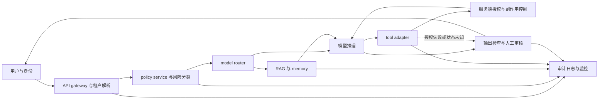

# 第十一章：Policy、Governance 与 Model Card

一个模型从实验室走到真实用户面前，最后一道困难通常不是再多算一个 benchmark 分数，而是回答一组更现实的问题：谁可以使用它，能用来做什么，哪些能力必须受到限制，出了问题谁负责，证据保存在哪里，模型更新后原来的结论还是否成立。

这些问题不能靠一句“请谨慎使用”解决。它们需要 policy、governance、model card 和 system card 共同工作。Policy 规定什么行为被允许、限制或禁止；governance 把规则变成角色、证据、审批、监控和事故响应；model card 描述模型本身；system card 描述模型进入产品以后与数据、工具、权限和人共同组成的系统。

本章不把治理写成一张勾选表，也不把发布判断压缩成一个神秘的总分。治理文档的价值在于让读者能够沿着证据链复原一个决定：

1. 发布的对象和版本是什么。
2. 模型被设计来完成什么任务，又明确不适合完成什么任务。
3. 哪些数据、评估和风险证据支持这些判断。
4. 哪些控制措施只在特定部署条件下成立。
5. 还有哪些未知、未测量或未解决的风险。
6. 模型改变、事故发生或证据失效时，谁会重新判断。

这也是初学者和专家阅读同一份 model card 时应该看到的两层内容。初学者需要知道“我能不能把它用于这件事”；专家还需要知道“这个结论由什么样本、什么版本、什么 harness、什么权限和什么统计范围支持”。

## 1. 治理究竟在治理什么

### 1.1 从模型权重到社会影响

把模型想成一个单独的文件，会让治理问题看起来比实际简单。一个上线的生成式 AI 系统至少有以下组成部分：


沿实线可以从数据和模型追到产品动作；带文字的虚线表示事故与运行反馈会触发治理复评。它不表示每次事故都要重新训练模型。

每一层都有自己的责任边界。模型可能在离线测试中表现良好，但 RAG 检索越权；工具调用可能结构正确，但服务端授权错误；模型卡可能披露了限制，但产品文案没有把限制传递给使用者；权限可能配置正确，但调试日志把敏感上下文长期保存。

因此，治理的对象不是“模型是否安全”这一句抽象判断，而是模型、数据、系统和组织之间的责任关系。一个可执行的治理问题应当像下面这样具体：

> 版本 `assistant-2026-08-11-r3` 在企业知识问答中允许只读回答，但不允许自动修改合同。它在授权租户、中文和英文测试集上完成了哪些评估？工具权限由哪个服务端组件强制？发生越权时如何停止流量、保存证据和恢复到上一个版本？

这句话同时包含对象、用途、范围、证据、控制和恢复路径。治理文档就是把这种信息从口头约定变成可检查的公共接口。

### 1.2 四个边界

可以把需要治理的边界分成四层：

| 层 | 关键对象 | 典型问题 | 主要文档或控制 |
| --- | --- | --- | --- |
| 数据 | 训练集、评估集、RAG 文档、日志 | 来源、许可、隐私、血缘是否清楚 | datasheet、数据目录、保留策略 |
| 模型 | checkpoint、adapter、tokenizer、推理配置 | 能力、限制、记忆、版本是否可复现 | model card、评估报告 |
| 系统 | API、RAG、工具、权限、监控 | 模型外的组合是否改变风险 | system card、架构图、访问策略 |
| 组织 | 责任人、审批、审计、事故机制 | 谁能决定、谁能阻断、谁必须回应 | policy、风险登记、变更记录 |

四层不能互相替代。model card 不能代替数据许可记录，system card 不能代替服务端授权，policy 不能代替实际评估，审批签字也不能把没有测过的能力变成已知事实。

### 1.3 小白视角：为什么需要“说明书”

把模型当成一台很强但不完全可靠的机器。买一台机器时，用户想知道额定电压、使用范围、危险部位、维护方式和故障处理。生成模型虽然没有电压参数，却同样需要说明：

1. 它擅长什么任务。
2. 它在哪些任务上容易出错。
3. 输出是否需要人工核验。
4. 它会接触哪些数据。
5. 它能否调用工具或改变外部状态。
6. 版本变化后哪些行为可能改变。

“模型可能出错，请谨慎使用”相当于只写了“机器可能坏，请注意安全”。它没有告诉用户如何判断风险，也没有告诉组织如何承担责任。

### 1.4 专家视角：治理文档是证据接口

专家不只看文档有没有章节，而会追问每个声明的证据对象。声明“支持一百万 token 上下文”至少要拆成 API 上限、训练长度、有效检索长度、跨段推理任务、吞吐和成本；声明“支持工具调用”至少要拆成 schema 遵循、参数正确率、权限约束、失败恢复和副作用确认。

可以把一条治理声明表示成：

```math
q=(c,v,e,s,l,u)
```

其中 $c$ 是 claim，$v$ 是模型或系统版本，$e$ 是证据集合，$s$ 是适用范围，$l$ 是限制，$u$ 是最后更新时间。缺少 $v$ 和 $s$ 的分数通常不能用于跨版本比较；缺少 $e$ 的“安全”通常只是没有展开的意见。

## 2. 从数据说明书到系统说明书

### 2.1 Datasheets for Datasets

早期机器学习工作经常只在论文中写数据集名称和规模。这样的记录对复现实验有帮助，却不一定能回答数据从哪里来、谁被代表、谁被遗漏、是否允许再分发以及数据适不适合高风险用途。

Datasheets for Datasets 提出了类似产品说明书的思路：数据集应记录动机、组成、收集过程、处理方式、推荐用途、限制、许可和维护方式。它把“数据是一个数字文件”改成“数据是一项有来源、有使用边界和有责任人的资产”。

对大模型来说，数据说明至少要追踪：

1. 原始来源和抓取或接收时间。
2. 许可证、授权依据和地域限制。
3. 去重、过滤、语言识别和 PII 处理版本。
4. 哪些快照进入预训练、SFT、偏好数据或评估。
5. 数据主体撤回、删除和重新训练如何传播。
6. 评估数据与训练数据如何隔离。

如果这些信息不存在，后续 model card 很难诚实地写“训练数据概要”，因为团队甚至不知道模型使用了哪一个可追溯快照。

### 2.2 Model Cards

Model Cards for Model Reporting 将透明度的对象从数据集扩展到训练后的模型。一个 model card 不只是参数表，而是对模型能力和限制的条件化描述。

它至少需要说明：

1. 模型身份、版本、来源和许可证。
2. 预期用途与明确不适用用途。
3. 训练数据的类别、时间范围和处理限制。
4. 评估任务、评估版本、分层结果和未覆盖范围。
5. 已知风险、失败模式和缓解措施。
6. 部署时的前置条件、人工审核和反馈渠道。
7. 版本变化、已知回归和更新责任人。

一个只有 benchmark 表格的文件不是完整 model card；一个只写安全口号、不写失败切片的文件也不是完整 model card。

### 2.3 System Card

大模型产品往往包含模型以外的关键行为来源：system prompt、工具 schema、RAG 索引、内容分类器、权限服务、速率限制、上下文压缩、记忆、日志和人工升级。System card 的任务是描述这些组件如何组合，以及组合后新增了哪些能力和风险。

举例来说，同一个 base model 在两个系统中的治理结论可能不同：

| 部署 | 外部组件 | 可能的新增风险 |
| --- | --- | --- |
| 只读问答 API | 无工具、无私有数据 | 幻觉、隐私输出、越狱 |
| 企业 RAG | 租户文档、引用、长期日志 | 跨租户泄露、权限和留存风险 |
| 代码 Agent | 沙箱、文件系统、shell 工具 | 代码执行、副作用和凭证泄露 |
| 金融工作流 | 账户 API、审批、人机协作 | 交易错误、欺诈和责任归属 |

Model card 说明“这个模型是什么”；system card 说明“这个模型在这个系统中会做什么”。产品发布不能只拿前者覆盖后者。

### 2.4 Policy、Model Card 和 System Card 的关系

三种文档的方向不同：

| 文档 | 面向对象 | 主要回答 |
| --- | --- | --- |
| Policy | 用户、开发者、员工和审核者 | 哪些行为允许、限制、禁止或需要升级 |
| Model Card | 模型使用者、评估者和维护者 | 模型具有什么能力、限制和风险 |
| System Card | 产品使用者、部署者和审计者 | 系统如何组装模型、数据、工具和控制 |

Policy 可以规定高风险医疗建议需要专业人士复核，model card 可以披露模型在医学问答上的已知局限，system card 还要说明产品是否真的设置了专业人士复核、是否记录了升级事件、是否把用户数据发送给外部服务。

## 3. Policy：把价值判断翻译成可执行行为

### 3.1 Policy 不是一句“负责任地使用”

Policy 的最小可执行单位应包含主体、动作、对象、条件和处置：

```math
P=(a,x,r,k,d)
```

这里 (a) 是 actor，(x) 是 action，(r) 是 resource，(k) 是 condition，(d) 是 decision。比如“用户可以总结自己上传的文档，但不能让模型把其他租户的文档作为上下文返回”比“保护隐私”更接近可执行 policy。

一个实际规则通常还需要写清：

1. 身份由哪个可信组件判断。
2. 模型是否只提供建议，还是可以触发外部动作。
3. 数据敏感等级和用途是否匹配。
4. 哪些场景需要澄清、人工确认或转人工。
5. 违反规则后是否阻断、记录、告警和复盘。

### 3.2 三种 Policy

#### 使用政策

使用政策面向用户和开发者，描述允许的产品用途与禁止的滥用，例如：

1. 不得把模型用于未经授权的个人信息收集。
2. 高风险医疗、法律或金融建议必须由合格人员核验。
3. 代码和工具输出必须经过权限、沙箱和副作用控制。
4. 不得绕过平台的安全控制或诱导系统泄露受保护数据。
5. 生成的合成内容需要按产品规则进行适当披露。

这类政策需要有申诉、解释和更新渠道，否则用户无法判断边界，也无法纠正误判。

#### 模型行为政策

模型行为政策把原则映射到响应方式：

1. 对正常低风险请求直接回答。
2. 对意图不清的请求先澄清，而不是猜测高风险意图。
3. 对危险请求拒绝提供可执行细节，同时给出安全替代。
4. 对事实证据不足的回答表达不确定性，不伪造引用。
5. 对隐私相关请求限制暴露，并把权限判断交给服务端。

它可以指导 SFT、偏好数据、分类器和评估，但不能代替服务端授权。模型说“这个用户有权限”不构成权限证明。

#### 组织与发布政策

组织政策规定谁可以改变模型、谁必须参与风险评审、什么问题必须阻断流量、事故在多长时间内升级，以及公开说明和内部证据如何同步。它的价值不在于写出更多原则，而在于在业务压力、技术不确定和责任冲突时仍然能执行。

### 3.3 风险分级不是严重度排序的替代品

可以按影响、可逆性、暴露范围、攻击难度和领域敏感度对任务分层：

| 级别 | 例子 | 典型控制 |
| --- | --- | --- |
| 低风险 | 草稿改写、格式转换 | 常规过滤和抽样监控 |
| 中风险 | 企业知识问答、代码建议 | 权限、引用、回归测试和人工抽检 |
| 高风险 | 医疗建议、账户操作、关键系统变更 | 专家复核、最小权限、可逆动作和强审计 |
| 不接受 | 明确违法滥用、未授权数据访问 | 拒绝、阻断、记录和必要的事故响应 |

分级只是组织资源的方法。即使低风险任务也可能因规模和长期积累产生高影响；高风险任务也可能在严格的只读和人工复核条件下被限定为辅助用途。因此，风险级别必须与实际控制和证据绑定。

### 3.4 响应行为的分层

Policy 不应只有 allow 和 deny 两个按钮。一个更有解释力的响应空间包括：

1. `answer`：在已知低风险范围内回答。
2. `clarify`：请求缺少目的、权限或关键上下文。
3. `safe_alternative`：拒绝危险细节，提供安全方向。
4. `human_review`：需要专业人士或资源所有者决定。
5. `read_only`：允许查询，不允许写入或执行。
6. `deny_and_record`：明确违反政策时阻断并留下必要审计记录。

响应层级的选择不应由模型单独决定。模型可以提出建议，策略服务和权限服务应当在动作真正发生前强制约束。

### 3.5 Policy 冲突怎么处理

治理中经常出现价值冲突：帮助用户与避免伤害冲突，透明披露与防止攻击冲突，隐私与滥用监控冲突，开放访问与能力控制冲突。

处理冲突时，应该先区分三件事：

1. 哪一个主体承担现实损失。
2. 哪一个动作不可逆或难以撤回。
3. 哪一个信息可以通过最小披露满足任务。

例如，用户要求系统自动修改生产数据库。帮助用户完成任务是有价值的，但写操作具有外部副作用。一个合理的 policy 可以允许模型生成变更计划，要求服务端验证权限和参数，再由人确认执行；这不是单纯拒绝帮助，而是改变动作的可逆性和责任分布。

## 4. Governance：让规则真的发生

### 4.1 Governance 的四个问题

治理不是开会次数，而是能否持续回答四个问题：

1. 谁拥有决定权和阻断权。
2. 决定基于哪些版本化证据。
3. 风险变化时谁必须重新评估。
4. 事故发生后能否恢复、追责和改进。

没有阻断权的安全团队只能提出建议；没有版本记录的评估团队无法解释变化；没有事故响应的 policy 无法面对现实故障。

### 4.2 角色与责任分离

一个中大型项目至少需要明确以下角色：

| 角色 | 主要责任 | 不应单独承担的责任 |
| --- | --- | --- |
| 模型负责人 | checkpoint、训练配置、模型卡 | 不能单独决定所有高风险用途 |
| 评估负责人 | 任务契约、数据、指标、统计 | 不能把未测范围写成安全结论 |
| 安全负责人 | 威胁模型、红队、缓解建议 | 不能代替业务和法律判断 |
| 隐私/数据负责人 | 数据来源、留存、删除和访问 | 不能忽略模型外日志和工具路径 |
| 产品负责人 | intended use、用户体验和成本 | 不能用商业目标覆盖硬性风险 |
| 平台负责人 | 权限、部署、监控、回滚 | 不能假设模型会正确执行授权 |
| 事故负责人 | 分级、通知、取证和复盘 | 不能在证据固定前覆盖日志 |

角色越多，越需要把责任写进记录，而不是只依赖会议记忆。对高风险能力，决定权、执行权和审计权最好由不同角色承担。

### 4.3 生命周期

治理流程可以按下面的生命周期展开：


沿实线从用途定义进入评估和发布，再进入线上监控；带文字的虚线表示证据或产品范围变化后重新审视用途、威胁模型和所需评估。若发布目标先于评估协议确定，指标容易被事后挑选；文档也要记录训练和系统演进过程。

### 4.4 变更管理

以下变化都可能改变治理结论：

1. checkpoint、adapter 或 tokenizer 变化。
2. system prompt、chat template 或采样参数变化。
3. RAG 索引、文档权限或 chunk 策略变化。
4. 工具 schema、服务端授权或写操作变化。
5. safety classifier、拒答策略或路由规则变化。
6. 日志字段、保留时间、地区和第三方供应商变化。

变更记录至少关联旧版本、新版本、影响的风险条目、需要重跑的评估、审批人和回滚方式。版本号存在于仓库里，不等于使用者能够知道行为发生了什么变化。

## 5. Model Card 的内容与写法

### 5.1 身份：先说清楚“哪个模型”

第一部分不是宣传语，而是身份契约：

1. 模型名称、版本、发布日期和修订时间。
2. 权重、API alias、adapter、tokenizer 和 chat template 的对应关系。
3. 参数规模、激活规模、模态、语言和上下文范围。
4. 许可证、使用条款、部署方式和已知区域限制。
5. 训练配置、量化格式或推理引擎对结果的影响。

总参数与激活参数、API 最大上下文与有效上下文、模型能力与产品能力不能混写。一个 MoE 模型的 total parameters 不等于每个 token 都会参与计算；一个 API 宣传的上下文上限也不等于长文档任务一定成功。

### 5.2 Intended Use 与 Out-of-Scope Use

Intended use 要写任务、用户、输入、输出和人工责任。例如：

> 面向企业员工的内部知识问答，回答只读问题并附带文档引用；用户仍需核对引用，系统不自动修改业务记录。

这个描述比“适合企业场景”更有用，因为它暴露了只读、引用和人工责任。

Out-of-scope use 也要具体：

1. 不作为无人审核的医疗诊断或处方系统。
2. 不作为自动化招聘、信贷、保险或执法决定的唯一依据。
3. 不把生成结果直接作为生产数据库写操作。
4. 不在未授权条件下推断、拼接或传播个人敏感信息。
5. 不让高风险 Agent 在没有沙箱、最小权限和回滚的情况下自主执行。

不适用场景不是推卸责任，而是帮助部署者避免把模型放进它没有被评估的责任位置。

### 5.3 Training Data：写类别，也写未知

训练数据披露需要在透明度与安全、许可和商业机密之间取得平衡。至少应说明：

1. 数据类别、时间窗口、语言和模态。
2. 公共、授权、合成和人工标注数据的大致角色。
3. 去重、PII scrub、版权过滤和质量筛选方法的范围。
4. 哪些数据未进入训练，哪些只用于评估或检索。
5. 已知的地域、语言、群体和领域偏差。
6. 不能公开的细节，以及为什么不能公开。

“数据来自互联网”不是足够的治理说明。它既没有说明许可，也没有说明时间、重复、个人信息和数据处理。

截至 2026-10-28，欧盟《人工智能法案》为通用目的 AI 模型供应商设置了技术文档、版权政策和训练内容公开摘要等义务，自 2025-08-02 起适用。欧盟 GPAI Code of Practice 是帮助履行相关义务的自愿工具；其 Transparency 章节提供 Model Documentation Form，Safety and Security 章节适用于承担系统性风险义务的模型供应商。这个表格是特定法规路径的文档接口，不能与所有组织都适用的通用 model card 混为一谈；团队仍需按供应商角色、模型分类、市场范围和适用日期逐项确认。可查阅欧盟委员会的 [GPAI obligations](https://digital-strategy.ec.europa.eu/en/factpages/general-purpose-ai-obligations-under-ai-act) 与 [GPAI Code of Practice](https://digital-strategy.ec.europa.eu/en/policies/contents-code-gpai)。

### 5.4 Evaluation：指标必须带条件

评估表至少包含任务、数据版本、提示模板、解码设置、工具、harness、模型修订、样本数量和不确定性。分数 $s$ 只有在这些条件相近时才有可比意义：

```math
s=f(m,v,D,p,h,\pi,b)
```

其中 $m$ 是模型，$v$ 是版本，$D$ 是数据，$p$ 是 prompt 或协议，$h$ 是 harness，$\pi$ 是推理和工具策略，$b$ 是预算。省略这些变量的排行榜容易制造虚假的跨模型结论。

评估应同时报告：

1. 总体结果和高风险切片。
2. 结果、过程、泛化、安全和成本指标。
3. 人工、程序判定、模型评审和线上信号的差异。
4. 已测范围、未测范围和无法测量的范围。
5. 失败样例、回归样例和评估集污染风险。

### 5.5 Limitations：限制要能改变使用行为

“可能产生幻觉”太抽象。更好的限制写法包含触发条件和用户动作：

> 在长文档中间位置的证据检索任务上，模型可能遗漏相关段落。若用于合同或政策分析，应要求模型返回引用，使用独立检索核对，并由专业人员复核关键结论。

一个有用的 limitation 通常说明：

1. 什么时候更容易失败。
2. 错误是什么类型。
3. 错误的现实后果是什么。
4. 使用者如何发现或降低风险。
5. 哪些评估仍然不能支持更强结论。

### 5.6 Safety and Mitigations：控制措施的适用范围

缓解措施应与威胁路径对应：

| 风险路径 | 可能控制 | 控制不能保证什么 |
| --- | --- | --- |
| 有害生成 | 安全训练、分类器、拒答和人工复核 | 不能证明未知攻击永远失败 |
| PII 泄露 | 数据清理、输出检测、权限和日志脱敏 | 不能替代数据血缘和删除机制 |
| 工具越权 | 服务端授权、最小权限、沙箱和审批 | 不能只靠模型理解规则 |
| RAG 越权 | 过滤前置、租户隔离、引用检查 | 不能修复已经泄露的旧日志 |
| 长周期 Agent | checkpoint、预算、状态审计和回滚 | 不能保证每一步计划正确 |

卡片要写控制何时启用、由哪个组件执行、测过哪些攻击和已知失效方式。否则“有 guardrail”仍然只是一个无法复核的名词。

### 5.7 Deployment Conditions、Feedback 和更新

模型卡还要告诉部署者：

1. 需要什么身份、权限和网络隔离。
2. 哪些场景必须人工审核。
3. 输出是否必须带引用、来源或生成标记。
4. 需要监控哪些指标和严重度事件。
5. 如何报告漏洞、偏差、隐私问题和删除请求。
6. 哪些版本变化会触发重新评估和卡片更新。

一个模型卡如果描述了“必须人工确认工具动作”，但系统 API 没有强制确认字段，文档与实际系统就产生了治理矛盾。

版本差异也要按影响范围处理。模型权重改变通常要求重新确认能力与安全结论；tokenizer 或 chat template 改变会影响输入切分和提示解释；评估 harness 改变则可能只使相关指标失去直接可比性。团队应保留旧版本的卡片和证据，不把它们静默覆盖，再为变更建立影响清单：哪些声明继续有效、哪些需要重跑、哪些暂时标成 stale。这样做既避免所有小改动都无差别地重跑全套评估，也避免把旧结果沿版本链无限继承。

## 6. System Card：描述组合后的真实行为

### 6.1 系统拓扑

System card 的开头应画出系统边界：



图中的服务端授权节点必须独立校验模型生成的工具参数，检索结果和模型策略判断也要保留各自的可信边界。审阅 system card 时，应逐条说明数据流、权限判断、日志字段和失败动作；虚线表示授权失败或状态未知时停止自动动作并交由安全处理路径。

### 6.2 工具、RAG 和权限

System card 要回答以下问题：

1. 哪些工具是只读，哪些工具会改变外部状态。
2. 工具参数由谁校验，是否有幂等键和范围限制。
3. RAG 是否在检索前按服务端身份过滤。
4. 多租户、文档字段和缓存是否隔离。
5. 长期记忆保存什么，用户如何查看和删除。
6. prompt、completion、tool trace 和检索原文如何记录和脱敏。

这些问题属于系统治理，不应被缩写为“模型经过安全调优”。模型可以影响动作选择，但不能独立证明权限和现实状态。

### 6.3 Model Card 与 System Card 的对照

| 问题 | Model Card | System Card |
| --- | --- | --- |
| 评估对象 | checkpoint 或模型 API | 真实产品链路和用户任务 |
| 数据范围 | 训练、微调和评估数据 | 用户输入、RAG、工具返回、日志和备份 |
| 控制范围 | 模型行为和推理配置 | 权限、路由、沙箱、人工和回滚 |
| 失败表现 | 幻觉、推理、偏见、记忆 | 越权、误操作、跨租户、延迟和事故 |
| 版本变化 | 权重、tokenizer、模型 alias | schema、索引、策略、供应商和部署 |

如果用户问“这个模型能不能自动发邮件”，单看 model card 无法回答。必须查看 system card 中工具权限、收件人策略、确认机制、审计和回滚。

System Card 还要解释组件之间怎样共同产生行为，而不是把每个组件卡片简单拼在一起。沿着一次邮件请求，审核者应能从用户身份和租户权限追到检索范围、生成的收件人、服务端动作检查、用户确认、发送结果与审计日志。任一环节若使用了不同的身份、策略版本或数据边界，局部组件各自“符合要求”也可能组合出越权路径。卡片应记录交接字段、失败时的停止位置以及如何复原外部状态；这类端到端关系通常不能从模型卡或单个工具说明中推断。

### 6.4 System Card 数字的证据账本：Claude Opus 5.5 案例

System Card 中的分数不是脱离条件的模型常数。审计一项结论时，至少把它写成：

```text
claim = (model_snapshot, safeguards, task_set, harness, success_definition,
         numerator/denominator, fallback_policy, metric_clock, uncertainty)
```

Claude Opus 5.5 的 System Card 展示了这些字段为何不能省略：

| 证据字段 | System Card 中的例子 | 审计时要避免的误读 |
|---|---|---|
| 模型快照 | 大多数评测使用最终 snapshot；少数章节使用早期/替代 snapshot | 不把不同 snapshot 的风险变化写成同一版本的稳定属性 |
| Safeguards 与实际执行模型 | 部分 cyber 能力评测关闭 cyber safeguards；另一些安全测试会触发 fallback | 关闭 safeguard 的能力分数不等于生产表现；记录 `original_model`、`actual_model`、触发原因和策略状态 |
| 成功定义与分母 | OSWorld 2.0 的 partial/strict 为 `81.8%/48.7%`，基于 108 个任务、5 runs、最多 500 actions 等条件 | 两个比例对应不同成功定义；同时保留任务数、runs 和判定规则，不能只挑较高比例 |
| 时钟与系统边界 | 五 Agent team 在相同 ProgramBench 分数下报告约 `2.7x` latency improvement；多 Agent 指标按 context token、tool time 和 handoff clock 计算 | 这是 derived latency，不是端到端 wall-clock；线上 SLO 还要实测排队、共享资源、失败恢复和真实耗时 |

本案例依据 Anthropic 的 [Claude Opus 5.5 System Card](https://www.anthropic.com/claude-opus-5-5-system-card)。评测记录应同时保留原始 numerator/denominator、snapshot、权限与 safeguard 配置、fallback 轨迹、任务环境、verifier 和计时定义。官方 System Card 能证明发布方在这些条件下报告了什么；它本身不等于独立复现，也不自动覆盖不同产品路由或生产环境。

### 6.5 System Card 的版本更新也属于评测证据：Claude Opus 5

Claude Opus 5 System Card 的 2026-08-19 changelog 补入跨 surface prompt-injection bug-bounty 结果，并因发现 Cowork browser harness 不一致而重跑模型基线。修订后的比较统一使用 Cowork harness；该产品不能关闭 thinking，因此不再报告“thinking disabled”条件。这不是模型升级，而是测量协议的修正：harness 变化时应重跑旧基线，不能只更新新模型分数。

| 评测面 | 官方披露的设置 | Opus 5 观测 | 正确解读 |
|---|---|---|---|
| Gray Swan IPI | 28 个场景、1,130 个去重高迁移攻击；比较攻击者在 1/10/15 次内成功的概率 | 1 次 `0.2%`、15 次 `2.0%`；Opus 4.8 是 `0.5%`、`5.5%` | Claude 评测关闭产品级保护，外部模型走公开 endpoint；不能据此宣称严格同配置跨模型排名 |
| Adaptive coding | 40 场景、每场景 200 次尝试；统计 attempt-level ASR，也统计被攻破场景数 | thinking 条件无 probes `0.56%`、启用 tool-result probes `0.18%` | probes 检查进入模型的 tool result；这是模型与输入侧防护的消融，不是同一条件下的裸模型分数 |
| Computer use | 14 个 GUI 场景、每场景 200 次攻击 | thinking 条件无 probes `0.54%`、启用 probes `0.25%` | disabled 条件启用 probes 后从 `0.39%` 到 `0.43%`只差 2,800 次中的 1 次，Card 认为不能与噪声区分 |
| Cowork browser | 129 个未见环境、每场景 10 次；medium effort、thinking enabled | 不启用 Auto mode 时 `3.84%`，启用 Auto mode 后 `0/129` 场景成功 | Auto mode 同时检查不可信 tool result 与危险 tool call；它是产品系统结果。Cowork 实际始终有 probes，不能把“raw comparison”误写成真实无防护产品模式 |

阅读注入结果时同时保存两种分母：`successful_attempts / valid_attempts` 与 `scenarios_with_success / tested_scenarios`。多次自适应攻击彼此不必独立，attempt-level 比率不等于每个真实用户/部署的风险概率。跨表比较还要绑定 snapshot、thinking/effort、攻击预算、probe、Auto mode、harness 版本和成功判据。完整版本和快照信息见 [Claude Opus 5 研究笔记](../../research/model-update-2026-09/claude-opus-5-source-notes.md)。

## 7. 访问边界：把治理决定交给系统执行

治理流程会决定哪些用户、任务、数据和动作进入发布范围。系统需要把这份范围声明映射到服务端身份、策略、工具和审计规则；模型的自我判断不能作为授权凭据。第十五章完整讨论 risk-calibrated access 的请求状态、策略决策点与访问评估，本节只说明治理文档需要保存哪些接口。

### 7.1 质量、成本和风险的候选比较

候选路由 $r$ 的教学效用可以写成 $U(r|x)=Q(r|x)-\lambda C(r|x)-\mu H(r|x)$，其中 $Q$ 是任务质量，$C$ 是延迟或成本，$H$ 是风险信号，$\lambda$ 和 $\mu$ 是事先确定的权重。设 $\lambda=0.5$、$\mu=2$。只读路由的 $Q=0.82,C=0.10,H=0.02$，因此 $U=0.82-0.5\times0.10-2\times0.02=0.73$；可写 Agent 的 $Q=0.90,C=0.20,H=0.24$，因此 $U=0.90-0.5\times0.20-2\times0.24=0.32$。所有输入都是教学假设。若可写 Agent 缺少服务端授权、回滚或覆盖当前任务的评估证据，它不具备进入候选集合的资格。

这个分数只能在可行候选之间帮助比较，不能替代准入规则。实际使用时，先用授权、证据覆盖和可逆性等硬条件排除不合格路线，再比较剩余路线的质量、成本与风险。权重 $\lambda$、$\mu$ 表达组织对延迟、成本和风险的选择；它们改变后，候选排序可能反转。因此必须记录权重的制定者、适用任务和复核时间，并检查风险估计的不确定性。若两个路线的质量差异小于评估噪声，稳妥做法是保持权限更窄的路线，而不是把不稳定的小数差异解释成安全收益。

### 7.2 将审批绑定到访问配置

治理审批至少记录访问主体、用途、数据范围、动作、证据、有效期、责任人和撤销条件。同一模型可以有不同的访问配置：

| 配置 | 数据与动作 | 进入条件 | 复核证据 |
| --- | --- | --- | --- |
| 默认问答 | 公共资料，只读回答 | 常规账户和已发布范围 | 基础质量、安全与隐私切片 |
| 租户 RAG | 当前租户文档，只读引用 | 服务端身份和文档 ACL 有效 | 租户隔离、缓存和日志评估 |
| 沙箱 Agent | 经授权任务数据，只读或可撤销动作 | 可信项目、沙箱、预算和期限 | 工具轨迹、逃逸与副作用测试 |
| 生产写入 | 高敏业务数据，外部状态变更 | 服务端授权、幂等、审批和回滚 | 动作级验收、人工责任和事故预案 |

审批到期、版本变更、权限撤销或证据过期时，原配置应失效或进入复核。第十五章展开请求级授权和状态检查。

### 7.3 Fallback 作为发布范围保护

评估证据缺失、策略服务不可用或授权状态不明时，系统可以暂停动作、切到只读建议、请求补充信息或转人工。备用模型不能扩大原有权限，也不能绕过拒绝。事件记录应保留触发原因、实际使用的模型与策略版本、动作是否已提交、影响范围和恢复责任人。

第十六章详细说明错误分类、状态账本、幂等、回滚和安全降级路径。此处的治理要求是：发布文件明确哪些条件触发降级、谁批准恢复、是否需要更新 model card / system card，以及降级后的数据和动作边界。

## 8. 发布决定：从指标到范围

### 8.1 发布不是一个永恒的通过标签

“这个模型可以发布”没有写清对象和边界。更可复核的决定会说明版本、用户、任务、数据、工具、评估、人工责任与剩余风险。例如：版本 v3 在当前索引、已授权租户和中文/英文切片上完成只读企业问答的灰度评估；代码写操作、高敏数据和无人审核的医疗建议不在本次范围。

这个范围声明会随版本、工具 schema、数据集、模型路由或用户权限变化而失效。批准记录应列出触发复审的条件，而不是只保存一个永久的通过标签。

### 8.2 文档完整度与证据覆盖

设 model card 的必填字段集合为 M，第 j 项有当前、可追溯证据时 c_j=1。教学 demo 用等权覆盖率：

```math
C_{\mathrm{model}}=\frac{\sum_{j\in M}c_j}{|M|}
```

若 9 个必填字段中有 8 个具备证据，则 C_model=8/9≈0.889；最低门槛为 0.90 时，这份材料不能通过该项门禁。必填集合为空时结果为 N/A。若字段状态明确为“缺少证据”，它计入分母但不计入分子；若字段状态本身未知，则总体状态应标记为待核查。生产团队可以预先为字段设置不同权重，但计算、代码和审批规则必须使用同一套权重。

系统评估覆盖率用同样的分母原则：

```math
C_{\mathrm{evidence}}=\frac{\sum_{k\in E}e_k}{|E|}
```

其中 E 是当前发布范围要求的评估切片，e_k 表示切片已经有可复核结果。7 个固定切片若只有核心质量、安全、RAG 权限和工具动作 4 项完成，则 C_evidence=4/7≈0.571。空集合为 N/A；只有计划、没有运行结果的评估不计入分子。总体覆盖率不能掩盖高风险切片，因此门禁还要列出关键条件的逐项状态。

### 8.3 未关闭风险权重

demo 把每条风险记录的 w_i 定义为预先分配的审查权重，resolved 表示是否有证据证明问题已关闭。未关闭权重占比为：

```math
R_{\mathrm{open}}=\frac{\sum_i w_i\,\mathbf{1}[i\text{ 未解决}]}{\sum_i w_i}
```

五条合成记录的权重为 5、4、2、1、4，总和 16；前四条未关闭，权重和为 12，所以 R_open=12/16=0.75。这是风险登记表的加权未关闭比例，不是事故概率或模型总体风险率。没有风险条目或权重总和为 0 时结果是 N/A，表示资料不足以计算，而不是风险为零。

### 8.4 高风险缓解覆盖

设 H 是预先标记的高风险问题集合，有当前系统证据支持的缓解记作 b_i=1：

```math
C_{\mathrm{mit}}=\frac{\sum_{i\in H}w_i b_i}{\sum_{i\in H}w_i}
```

demo 的三条 P0/P1 风险权重合计 5+4+4=13，其中两条已有有效缓解，权重合计 4+4=8，因此 C_mit=8/13≈0.615。缓解须在当前系统中执行并通过相应评估；前端确认按钮不能替代服务端强制审批。高风险集合为空或权重总和为 0 时为 N/A。文档完整度、风险状态、缓解和硬性约束仍分开审阅，不能用高覆盖率抵销单个硬性失败。

### 8.5 证据状态和后续动作

发布报告至少保留事先设定的门槛、实际测量、样本量和切片、证据状态、修复动作及有范围的决定。证据状态可以是 supported、partial、stale、missing 或 contradicted；每个状态都应连接到责任人和下一步。

固定 demo 的手算结果如下：

| 信号 | 计算 | 门槛 | 结果 |
| --- | --- | --- | --- |
| Model Card 字段 | 8/9≈0.889 | 至少 0.90 | 未过 |
| System Card 字段 | 8/10=0.800 | 至少 0.90 | 未过 |
| Policy 覆盖 | 4/6≈0.667 | 至少 0.80 | 未过 |
| Evaluation 切片 | 4/7≈0.571 | 至少 0.80 | 未过 |
| 未关闭风险权重 | 12/16=0.750 | 至多 0.20 | 未过 |
| 高风险缓解覆盖 | 8/13≈0.615 | 至少 0.80 | 未过 |
| 审批覆盖 | 4/5=0.800 | 至少 0.80 | 通过 |

即使若干比例达到门槛，隐私日志控制仍是独立硬性约束。硬性约束失败时，demo 返回 hold_and_repair_hard_constraints；覆盖率、缓解比例和发布决定不能互相抵销。阈值要在查看结果前确定，缺失测量也不能自动当成通过。

### 8.6 分阶段发布

一个可审计的发布过程可以分为：

1. 离线评估：确认任务、风险和协议匹配。
2. shadow：接收真实流量，但不产生外部副作用。
3. 小范围灰度：限定用户、地区、数据和预算。
4. 只读或人工确认：先开放建议，再按证据开放动作。
5. 扩大范围：线上信号和事故记录支持扩大时才继续。

每个阶段都需要明确退出条件。tool call 参数正确率提高不代表越权率降低，业务成功率提高也不代表日志隐私合格。扩大范围前，要重新检查新增的用户、数据和动作组合。

阶段推进还应有可操作的停止与回退条件。例如，只读 RAG 灰度通过后，开放写入工具仍是新的风险组合，必须单独验收服务端授权、确认状态、幂等、撤销和事故恢复。若监控显示越权检索、日志泄露或误操作达到预设阈值，应停止扩大并退回上一个已批准配置；若仅有质量下降，则可先切换到只读或人工辅助，再确认问题来自模型、索引、策略还是工具。发布决定记录目标范围、停止阈值和恢复人，才能把“逐步发布”变成真实的治理控制。

## 9. Responsible Scaling：能力增长与控制增长

### 9.1 核心思想

Responsible Scaling 的核心不是一句“越强越不能发布”，而是：当模型在某类任务上获得更强能力，组织应同步提高评估、访问、监控、权重保护和事故响应的强度。

能力增长可能来自：

1. 更强的基础模型和推理训练。
2. 更长上下文、更大的工具预算和更持久的状态。
3. 多 Agent 并行、代码执行和 computer use。
4. 更强的专业领域能力。
5. 模型与外部检索、工具、记忆组合后的系统能力。

因此，能力评估不能只看模型裸跑分数，还要看在真实 harness 和权限条件下能完成什么。

### 9.2 能力触发控制升级

可以建立能力触发器：

| 能力信号 | 可能增加的现实风险 | 对应控制升级 |
| --- | --- | --- |
| 更长自主运行时间 | 错误累积和状态漂移 | checkpoint、预算、阶段审批 |
| 更强代码能力 | 漏洞、凭证和文件破坏 | 沙箱、最小权限、静态检查 |
| 更强网络或工具能力 | 数据越权和外部副作用 | 工具分级、服务端授权、审计 |
| 更强生物/化学/网络知识 | 高风险知识被转成行动 | 领域限制、专家评估、受控访问 |
| 更强多模态理解 | 从图像或文档提取敏感信息 | 数据分级、OCR 评估、输出控制 |

能力信号触发的是重新评估和控制升级，不是自动证明模型有恶意。反过来，未测量的能力也不能被写成不存在。

### 9.3 不同机构框架的证据边界

这些框架的版本、受众和责任基础不同。以下是截至 2026-10-28 可从发布方材料确认的快照：

| 框架 | 当前公开版本或日期 | 主要对象 | 阅读边界 |
| --- | --- | --- | --- |
| OpenAI Preparedness Framework | Version 2，2025-04-15 | 严重风险能力评估、风险阈值与部署 safeguard | 是 OpenAI 的机构承诺；不能直接当作普遍法律标准 |
| OpenAI Frontier Governance Framework | 2026-05-28 发布 | 对齐加州 TFAIA 与欧盟 GPAI Code of Practice 的公开治理与报告 | 与 Preparedness Framework 有交叠但用途不同；该文件说明 OpenAI 如何组织其承诺 |
| Anthropic Responsible Scaling Policy | Version 3.4，2026-07-08 生效；政策页 2026-08-14 更新 | 能力阈值、安全标准、外部评审和风险报告 | 是持续更新的机构政策，版本变更可能改变阈值与流程 |
| Google DeepMind Frontier Safety Framework | Version 3.1，2026-04-17 | 前沿能力评估；新增 Tracked Capability Levels 以更早跟踪部分风险 | 属于发布方框架；能力分类和评估仍由其定义 |
| NIST AI RMF | AI RMF 1.0 与 Generative AI Profile 1.0；主框架正在修订 | 跨行业自愿风险管理方法 | 提供治理、映射、测量和管理的通用结构，不构成法规或模型发布认证 |

这些版本信息可分别在 [OpenAI Preparedness Framework](https://openai.com/index/updating-our-preparedness-framework/)、[OpenAI Frontier Governance Framework](https://openai.com/index/openai-frontier-governance-framework/)、[Anthropic RSP 版本页](https://www.anthropic.com/responsible-scaling-policy)、[Google DeepMind Frontier Safety Framework](https://deepmind.google/frontier-safety/) 和 [NIST AI RMF 页面](https://www.nist.gov/itl/ai-risk-management-framework)复核。

机构框架表达的是各自的流程和承诺。欧盟法规与其配套文件则具有不同的法律地位：GPAI Code of Practice 是自愿的合规工具，底层义务来自适用法规；欧盟委员会的 [GPAI Code of Practice 页面](https://digital-strategy.ec.europa.eu/en/policies/contents-code-gpai)说明透明度章节提供模型文档表格，而只承担系统性风险义务的供应商才适用安全与安保章节。模型卡应记录适用司法辖区、角色、版本和法律审阅责任，不应把机构 policy 或自愿代码直接写成普遍法律义务。

本书借鉴“能力、评估、缓解和访问范围绑定”的方法；具体阈值应由组织与领域定义，并随来源页面的更新时间复核。

## 10. 风险披露：让读者知道下一步怎么做

### 10.1 可行动的风险披露

风险披露至少包含触发条件、失败表现、后果、评估范围和使用建议。例如：

> 在长文档问答中，模型可能忽略位于多个章节之间的证据，尤其是在输入超过已验证长度或上下文经过压缩时。当前评估覆盖中文和英文政策文档，但未覆盖所有表格和扫描件。用于合同审查时，应要求返回原文引用，使用独立检索复核，并由专业人员确认关键结论。

这段话告诉读者哪里可能失败、测过什么、没测什么以及如何降低风险。

### 10.2 避免无条件的百分比

“准确率 95%”没有分母和任务定义。更清楚的写法是：

> 在版本 `r3`、500 个授权中文客服问题、固定 prompt、无工具、温度为 0 的设置下，程序判定的意图分类准确率为 95%，95% 置信区间为某范围；该结果不代表开放式回答、工具调用或其他语言的准确率。

如果无法给出可靠的区间，就应说明样本量和估计的不确定性，而不是用很多小数位制造精确感。

### 10.3 公开版与内部版

透明度和安全可能冲突。公开文档应让用户理解用途、限制、数据处理和反馈方式；内部文档可以包含更细的红队样例、检测规则、漏洞复现和补丁细节，但也需要权限、版本和审计。

“公开得越多越透明”不是普遍规律。过度公开可复用攻击路径可能增加风险；过度隐藏又会让用户无法判断是否适合使用。关键是让不同读者获得完成其责任所需的最小充分信息。

法规版本也是 system card 的部署条件。欧盟 AI Act 第 50 条的内容透明义务自 2026-08-02 起适用；欧盟委员会的透明度 Code of Practice 提供一种自愿的符合路径，底层法定义务仍需按具体角色和内容类型判断。其范围与水印、内容凭证的技术证据不同；本册第十章讨论水印和 provenance 信号，不能将它们当成作者身份或真实性证明。适用状态应以[第 50 条 FAQ](https://digital-strategy.ec.europa.eu/en/faqs/transparency-obligations-under-article-50-ai-act)及[透明度 Code of Practice](https://digital-strategy.ec.europa.eu/en/policies/code-practice-ai-generated-content)的现行页面为准。


## 11. 组织审计与事故响应

### 11.1 审计记录

治理记录应能把一条公开声明追溯到原始证据：

1. 模型、adapter、tokenizer、策略和部署版本。
2. 数据快照、许可证和评估集血缘。
3. prompt、harness、工具、硬件和预算条件。
4. 指标、样本数、切片、置信区间和失败样例。
5. 风险问题、严重度、负责人、缓解和复测结果。
6. 发布范围、审批、灰度、监控和回滚记录。
7. 卡片、政策和用户文案的更新时间。

审计不是把所有原始用户数据复制进一个更大的数据库。日志和证据本身也要遵守最小化、脱敏、访问控制和留存规则。

### 11.2 事故响应顺序

当系统发生越权、隐私泄露、危险工具动作或严重错误时，顺序很重要：

1. 限制继续暴露或副作用，必要时切到只读或暂停相关路由。
2. 固定模型、策略、索引、工具、日志和配置版本。
3. 区分参数行为、RAG 权限、工具授权、日志和人为流程根因。
4. 确认影响时间、租户、数据主体、动作和下游副本。
5. 选择修复、回滚、撤销访问、通知和重新评估路径。
6. 更新 system card、风险登记、回归集和用户说明。

事故复盘不应只写“模型产生了错误回答”。如果根因是服务端没有做租户过滤，继续训练模型可能反而掩盖真正问题；如果根因是文档没有披露限制，修复也应包含产品交互和使用政策。

### 11.3 文档更新触发器

以下事件应该触发 model card 或 system card 更新：

1. 权重、adapter、模型 alias 或 tokenizer 变化。
2. 训练数据、数据许可证或隐私处理方式变化。
3. 关键 benchmark、风险评估或已知失败模式变化。
4. RAG、工具、记忆、权限、日志或第三方服务变化。
5. 发生新类型事故或发现旧缓解失效。
6. 用户范围、地区、语言、价格或自动化程度变化。

更新不应覆盖历史版本。读者需要知道旧结论何时失效，以及新版本是否真正改善了问题。

## 12. 三个工程案例

### 12.1 案例一：模型卡把产品宣传写成事实

一个团队发布新模型时写道：“支持 1M context，具备最强代码推理能力，适用于复杂 Agent 任务。”

第一句可能混合了 API 上限和有效能力；第二句没有指定 benchmark、harness 和预算；第三句把模型能力和系统能力混在了一起。审阅者要求把声明拆开：

1. API 最大输入长度是多少，训练和评估长度是多少。
2. 在 RULER、长文检索、跨段推理和真实代码任务上的结果如何。
3. Agent 是否使用工具、记忆、重试和并行子 Agent。
4. 代码任务的成功率是否包含隐藏测试、成本和副作用。
5. 哪些结果来自官方自测，哪些来自独立复现，哪些仍待核验。

跟踪表、产品页和社区讨论可能使用简称、内部代号或尚未核验的候选名称。评审时先记录发布方、来源链接、检索日期、可核验的 canonical model ID、公开 artifact 和证据类型；无法确认的字段标记为未知或观察项，不由名称本身推断参数、能力或模型卡存在。发布方公开一项产品功能，也不能自动证明内部架构、训练配方或独立评测结论。

### 12.2 案例二：企业 RAG 的文档与系统不一致

一个企业助手的 system card 写着“所有检索结果按租户权限过滤，敏感上下文不进入长期日志”。事故调查发现，检索服务按相似度返回候选，再由模型判断是否可见；调试模式还保存了完整上下文。

问题不是 system card 写得不够漂亮，而是声明与真实控制不一致。修复需要同时改变系统和文档：

1. 服务端在向量检索前使用可信身份过滤租户和字段。
2. 返回模型前再次校验权限和撤回状态。
3. 日志只保存文档 ID、权限结果和哈希，不保存完整原文。
4. 对多轮追问、缓存、异常堆栈和人工标注副本做回归。
5. 在灰度期间分别报告有权回答、无权请求、空检索和日志泄露。
6. 更新 system card 的架构、限制、事故记录和版本号。

修复完成后，不应直接宣布“系统安全”。更准确的说法是：在当前租户 schema、权限服务、日志配置和评估切片下，已降低已知越权路径；其他工具和新索引仍需单独复测。

### 12.3 案例三：强模型的分层访问

一个模型在代码修复、长周期规划和工具调用上明显增强。产品团队希望所有用户默认使用完整 Agent 能力，安全团队担心凭证、网络和文件系统副作用。

一个折中的系统可以分四层：

1. 默认用户只获得只读问答和代码解释。
2. 经过组织验证的用户可以在沙箱中运行测试，网络关闭、文件范围受限。
3. 可信项目可以申请有限的网络和只读工具，所有动作带 trace 和预算。
4. 生产写操作必须经过服务端审批、幂等检查、人工确认和回滚。

这里的“强模型”没有被简单地全开或全关，而是根据能力、用户、环境、动作和证据分配。若某层评估显示越权率、凭证泄露或长周期失败超过约束，系统可以 fallback 到更低权限层，同时保留原因和复测任务。

## 13. 治理中的核心取舍

### 13.1 Transparency 与 Security

透明可以帮助研究者发现问题、帮助用户选择模型，也可能暴露攻击面、内部检测规则或高风险能力细节。解决办法不是一律公开或一律隐藏，而是分离公开版、部署者版和受限审计版，并记录各版本的读者、用途和更新责任。

### 13.2 Innovation 与 Risk Control

过严限制会阻碍探索，过松限制会把未知能力直接暴露给真实世界。灰度、shadow、沙箱、只读工具、预算和可撤销权限允许团队在较小影响范围内积累证据。

### 13.3 Open Release 与 Controlled Access

开放权重有利于研究、透明和生态创新，但也会改变能力传播、滥用和责任边界。controlled access 可以降低暴露，却需要更强的身份、配额、监控和申诉机制。选择哪一种方式，不能只根据参数规模，而要根据能力、可复制性、领域风险和组织控制能力判断。

### 13.4 User Autonomy 与 Safety Guardrails

用户希望模型按自己的意图工作，系统又必须保护第三方和公共资源。一个成熟的设计会尽量把限制放在高风险动作和数据边界上，而不是把所有不确定性都转成笼统拒答；同时为误拒提供解释、申诉和人工升级路径。

### 13.5 Documentation 与 Accountability

文档只能让责任可见，不能独立产生责任。真正的问法是：文档中的每条关键声明是否有证据，证据是否有人维护，失败后是否有人能阻断和修复。没有这些连接，越完整的模板也可能只是形式主义。

## 14. 一份可执行的 Model Card 与 System Card 结构

下面的结构不是填空题，而是每一部分都要连接到证据、限制和责任人的工作目录。

### 14.1 Model Card

1. **身份与版本**：模型、修订、tokenizer、许可证和发布日期。
2. **能力摘要**：任务、语言、模态、上下文、推理和工具接口。
3. **预期用途**：用户、任务、输入、输出和人工责任。
4. **不适用用途**：高风险决策、自动动作和未评估领域。
5. **数据概要**：来源类别、时间、许可、处理和未知。
6. **训练与后训练**：SFT、偏好优化、RL、蒸馏和安全调优的公开边界。
7. **评估**：任务契约、版本、harness、分层结果、成本和不确定性。
8. **限制与风险**：触发条件、失败表现、现实后果和使用建议。
9. **缓解措施**：控制组件、适用条件、测试范围和失效模式。
10. **部署条件**：权限、人工审核、日志、回滚和不允许的组合。
11. **反馈与更新**：漏洞、隐私请求、偏差申诉、版本差异和联系人。
12. **适用义务**：司法辖区、供应商角色、法规/标准版本、申报工件、适用日期和法律复核责任人。

### 14.2 System Card

1. **系统边界与拓扑**：模型、路由、RAG、工具、记忆和外部服务。
2. **用户与权限**：身份、租户、角色、数据范围和高风险访问。
3. **输入处理**：文件、图像、检索、提示注入和数据保留。
4. **模型与策略**：模型版本、system prompt、分类器、路由和 fallback。
5. **工具与外部动作**：schema、授权、幂等、审批、沙箱和回滚。
6. **输出与证据**：引用、来源、水印、脱敏和不确定性。
7. **评估与红队**：干净/攻击/线上切片、工具轨迹和人工复核。
8. **隐私与日志**：字段、访问、保留、删除、缓存和备份。
9. **已知风险与限制**：按版本、用户、区域和部署条件说明。
10. **发布范围**：允许的路由、禁止组合、灰度阶段和暂停条件。
11. **监控与事故响应**：指标、告警、升级、取证、通知和恢复。
12. **变更记录**：组件变化、复测、卡片更新和历史版本。

填卡时，应把每个关键声明写成可追踪的记录，而不是孤立的一句话。一个实用记录至少包含声明、对象版本、支持它的证据、证据适用的任务和条件、责任人、复核日期以及状态。比如“支持企业代码助手”还不够；需要说明使用的是哪个模型与推理配置、评测仓库和工具权限是什么、通过条件如何定义、哪些语言或代码库没有覆盖。读者由此才能判断结论能否迁移到自己的使用场景。

身份、能力、用途、评估和限制之间要互相约束。若 Model Card 声称模型适用于只读代码分析，评估中却只有自动写文件任务，那么证据并不直接支持用途声明；若只报告总体正确率，则无法看出安全敏感仓库、语言或用户群体中的差异。遇到证据缺失时，应区分“尚未测量”“资料未公开”“测量过但结果不确定”和“结果与声明矛盾”。缺测不能写成零风险，也不能因为模板字段已填写就变成通过。

可以用一次版本变化检验两张卡是否分工清楚。假设基础权重仍为 M3，但 tokenizer 从 T1 更新到 T2，系统又换了提示策略 P5 和 RAG 索引 R4。Model Card 应绑定具体模型制品及 tokenizer，并说明哪些模型级评估仍适用；System Card 则记录 P5、R4、检索权限、日志和工具组合。RAG 权限变化会使原来的系统级越权评估变旧，即使模型权重没有变化，也要重跑相关切片并更新发布范围。只有把模型制品、系统配置和评测记录分别编号，才能解释分数变化来自哪里。

最后，应把模板当成审计入口，而不是评分表。每个字段可以链接到报告、配置快照、批准记录或事故工单；隐私或安全原因不便公开的材料，可以在公开卡中说明范围与保管责任人，再由受控审计确认。若一个字段不适用，应写明判断理由和适用边界；若暂时无法确认，则标成未知并指定下一步。这样填写后，卡片既帮助读者理解系统，也能让责任人知道何时需要复测、暂停或修订。

## 15. 一个最小的治理审计 demo

下面的代码使用完全合成的审计记录。它不判断真实模型，也不代表任何机构的发布标准；它演示如何把文档完整度、政策覆盖、评估切片、严重度加权风险、缓解、审批和硬性约束拆成独立信号，并保留每个信号对应的动作。

输入被分成四类：卡片字段和评估切片用布尔值表示是否有可用证据；policy 用必需类别集合与已覆盖类别集合计算覆盖；风险条目包含严重等级、正权重、是否解决和是否缓解；审批则记录各责任角色是否给出决定。如此拆分后，读者可以沿输入找到每个输出指标的来源。覆盖率这里按必需项等权计算，不能解释为不同义务或不同用户在现实中的概率；风险权重也只是刻意构造的优先级账本，绝不是未来事故率。

运行时先验证输入合同，再计算独立信号。布尔比例有明确样本才定义；集合覆盖以 required 为分母；未解决风险以未解决条目权重除以全部条目权重；高风险缓解只在 P0/P1 子集中汇总。比如五个风险条目的权重总和为 $5+4+2+1+4=16$，其中未解决项权重为 $5+4+2+1=12$，所以 unresolved signal 是 $12/16=0.75$。这一步保留风险数量级的教学关系，但没有生产流量、损失函数和发生概率，不能把 0.75 读作 75% 的事故概率。

决策分两层执行。第一层检查每个比例是否达到事先设定的阈值，形成 failed thresholds 和对应修复动作；第二层检查不可被均值抵销的硬约束，例如 P0 是否清零、日志是否受控、工具授权是否在服务端实施、回滚制品是否可用。代码先检查硬约束，因此即使审批覆盖恰好达到 0.80，隐私日志仍失控时结果仍为 hold。实际组织应由适当责任人确定硬约束，不能照抄示例阈值。

未定义值与错误输入采用不同处理：空切片、零分母或缺测产生 None，并在门禁中按未通过处理；负权重、无穷权重、错误类型和不支持的比较符则是数据合同错误，应停止计算并修正来源。这样的区分可避免把没有证据的指标伪装成 0 分，也防止程序悄悄接受不可解释的数据。边界断言覆盖这些状态，帮助读者确认系统会在证据不足时保守停下。

代码状态：已验证（2026-10-28；Python 3.12.9；仅使用标准库）。

```python
import math
from dataclasses import dataclass


def is_finite_number(value):
    return (
        isinstance(value, (int, float))
        and not isinstance(value, bool)
        and math.isfinite(value)
    )


def ratio(values):
    values = list(values)
    if not values or any(value is None for value in values):
        return None
    if any(type(value) is not bool for value in values):
        raise ValueError("ratio values must be booleans or None")
    return round(sum(values) / len(values), 3)


def weighted_ratio(numerator, denominator):
    if not is_finite_number(numerator) or not is_finite_number(denominator):
        raise ValueError("weights must be finite numbers")
    if numerator < 0 or denominator < 0 or numerator > denominator:
        raise ValueError("ratio weights must satisfy 0 <= numerator <= denominator")
    if denominator == 0:
        return None
    return round(numerator / denominator, 3)


def set_coverage(required, covered):
    if not isinstance(required, (set, frozenset)) or not isinstance(
        covered, (set, frozenset)
    ):
        raise ValueError("coverage inputs must be sets")
    if not required:
        return None
    return round(len(required & covered) / len(required), 3)


def meets(signal, threshold):
    if signal is None:
        return False
    if not is_finite_number(signal):
        raise ValueError("signal must be a finite number")
    if not isinstance(threshold, dict):
        raise ValueError("threshold must be a mapping")
    operator = threshold.get("operator")
    value = threshold.get("value")
    if not is_finite_number(value):
        raise ValueError("threshold value must be a finite number")
    if operator == ">=":
        return signal >= value
    if operator == "<=":
        return signal <= value
    raise ValueError(f"unsupported operator: {operator}")


@dataclass
class RiskIssue:
    issue_id: str
    severity: str
    weight: float
    resolved: bool
    mitigated: bool


model_card = {
    "overview": True,
    "intended_use": True,
    "out_of_scope": True,
    "training_data": True,
    "evaluation": True,
    "limitations": True,
    "mitigations": True,
    "deployment_conditions": False,
    "version_history": True,
}

system_card = {
    "topology": True,
    "permissions": True,
    "rag_and_memory": True,
    "tools": True,
    "safety_policy": True,
    "privacy_and_logs": False,
    "red_team": True,
    "monitoring": True,
    "rollback": True,
    "change_history": False,
}

policy_required = {
    "privacy",
    "prompt_injection",
    "tool_misuse",
    "high_risk_advice",
    "appeals",
    "children_safety",
}
policy_covered = {
    "privacy",
    "prompt_injection",
    "tool_misuse",
    "high_risk_advice",
}

evaluation_slices = {
    "core_quality": True,
    "safety": True,
    "privacy": False,
    "rag_permissions": True,
    "tool_actions": True,
    "multilingual": False,
    "long_running": False,
}

risk_issues = [
    RiskIssue("privacy_logging", "P1", 5, False, False),
    RiskIssue("tool_permission_edge", "P1", 4, False, True),
    RiskIssue("multilingual_overrefusal", "P2", 2, False, False),
    RiskIssue("stale_model_card", "P3", 1, False, False),
    RiskIssue("known_jailbreak", "P1", 4, True, True),
]

for issue in risk_issues:
    if issue.severity not in {"P0", "P1", "P2", "P3"}:
        raise ValueError(f"unsupported severity: {issue.severity}")
    if not is_finite_number(issue.weight) or issue.weight <= 0:
        raise ValueError("risk weights must be positive finite numbers")
    if type(issue.resolved) is not bool or type(issue.mitigated) is not bool:
        raise ValueError("risk state fields must be booleans")


thresholds = {
    "model_card_min": 0.90,
    "system_card_min": 0.90,
    "policy_min": 0.80,
    "evaluation_min": 0.80,
    "open_risk_max": 0.20,
    "high_risk_mitigation_min": 0.80,
    "approval_min": 0.80,
}

signals = {
    "model_card": ratio(model_card.values()),
    "system_card": ratio(system_card.values()),
    "policy": set_coverage(policy_required, policy_covered),
    "evaluation": ratio(evaluation_slices.values()),
}

total_weight = sum(issue.weight for issue in risk_issues)
open_weight = sum(
    issue.weight for issue in risk_issues if not issue.resolved
)
signals["open_risk"] = weighted_ratio(open_weight, total_weight)

high_risk = [
    issue for issue in risk_issues
    if issue.severity in {"P0", "P1"}
]
high_risk_weight = sum(issue.weight for issue in high_risk)
mitigated_high_risk_weight = sum(
    issue.weight for issue in high_risk if issue.mitigated
)
signals["high_risk_mitigation"] = weighted_ratio(
    mitigated_high_risk_weight,
    high_risk_weight,
)

approvals = {
    "model_owner": True,
    "safety_owner": True,
    "privacy_owner": False,
    "platform_owner": True,
    "product_owner": True,
}
signals["approval"] = ratio(approvals.values())

hard_constraints = {
    "p0_unresolved_zero": not any(
        issue.severity == "P0" and not issue.resolved
        for issue in risk_issues
    ),
    "privacy_logging_controlled": False,
    "tool_authorization_server_side": True,
    "rollback_artifact_available": True,
}

threshold_status = {
    "model_card": meets(
        signals["model_card"],
        {"operator": ">=", "value": thresholds["model_card_min"]},
    ),
    "system_card": meets(
        signals["system_card"],
        {"operator": ">=", "value": thresholds["system_card_min"]},
    ),
    "policy": meets(
        signals["policy"],
        {"operator": ">=", "value": thresholds["policy_min"]},
    ),
    "evaluation": meets(
        signals["evaluation"],
        {"operator": ">=", "value": thresholds["evaluation_min"]},
    ),
    "open_risk": meets(
        signals["open_risk"],
        {"operator": "<=", "value": thresholds["open_risk_max"]},
    ),
    "high_risk_mitigation": meets(
        signals["high_risk_mitigation"],
        {"operator": ">=", "value": thresholds["high_risk_mitigation_min"]},
    ),
    "approval": meets(
        signals["approval"],
        {"operator": ">=", "value": thresholds["approval_min"]},
    ),
}

evidence_status = {
    name: "supported" if passed else "partial_or_missing"
    for name, passed in threshold_status.items()
}
actions = {
    "model_card": "document_deployment_conditions",
    "system_card": "document_privacy_logs_and_change_history",
    "policy": "add_appeal_and_children_safety_policy",
    "evaluation": "add_privacy_multilingual_and_long_running_slices",
    "open_risk": "hold_high_risk_scope_and_retest_open_issues",
    "high_risk_mitigation": "repair_p1_controls_before_expansion",
    "approval": "obtain_privacy_owner_decision",
    "privacy_logging_controlled": "stop_raw_sensitive_logging",
}

failed_thresholds = [
    name for name, passed in threshold_status.items() if not passed
]
failed_constraints = [
    name for name, passed in hard_constraints.items() if not passed
]

if failed_constraints:
    decision = "hold_and_repair_hard_constraints"
elif failed_thresholds:
    decision = "allow_shadow_only_with_retest"
else:
    decision = "allow_scoped_rollout_and_monitor"

report = {
    "thresholds": thresholds,
    "signals": signals,
    "evidence_status": evidence_status,
    "failed_thresholds": failed_thresholds,
    "failed_constraints": failed_constraints,
    "undefined_metrics": [
        name for name, value in signals.items() if value is None
    ],
    "actions": actions,
    "decision": decision,
}

print("signals=", signals)
print("evidence_status=", evidence_status)
print("failed_thresholds=", failed_thresholds)
print("failed_constraints=", failed_constraints)
print("undefined_metrics=", report["undefined_metrics"])
print("decision=", decision)


def rejects(call):
    try:
        call()
    except ValueError:
        return True
    return False


boundary_checks = {
    "empty_ratio": ratio([]),
    "missing_ratio": ratio([True, None]),
    "zero_weight_denominator": weighted_ratio(0, 0),
    "empty_policy_set": set_coverage(set(), set()),
    "undefined_gate": meets(
        None, {"operator": ">=", "value": thresholds["approval_min"]}
    ),
    "negative_weight_rejected": rejects(lambda: weighted_ratio(-1, 1)),
    "nonfinite_weight_rejected": rejects(lambda: weighted_ratio(1, math.inf)),
    "non_boolean_signal_rejected": rejects(lambda: ratio([1])),
}
assert boundary_checks["empty_ratio"] is None
assert boundary_checks["missing_ratio"] is None
assert boundary_checks["zero_weight_denominator"] is None
assert boundary_checks["empty_policy_set"] is None
assert boundary_checks["undefined_gate"] is False
assert boundary_checks["negative_weight_rejected"] is True
assert boundary_checks["nonfinite_weight_rejected"] is True
assert boundary_checks["non_boolean_signal_rejected"] is True
print("boundary_checks=", boundary_checks)
```

在这组故意不完整的合成数据中，privacy_logging_controlled 为假，未解决的 P1 风险也使 open_risk 超过范围，因此最终决定为 hold_and_repair_hard_constraints。该决定说明当前发布范围和证据不足以支持更大的自动化范围。

固定输入的实际输出与手算一致：七个信号依次为 0.889、0.800、0.667、0.571、0.750、0.615、0.800；六个比例门槛未过，审批门槛通过，隐私日志硬性约束失败。边界检查中空比例、缺测比例、零权重分母和空 policy 集返回 None；未定义信号不通过门禁；负数、非有限权重和非布尔比例输入被拒绝。

代码把 threshold、signal、evidence_status、actions 与发布 decision 分开保存。若以后改成只读范围、完成日志修复并补测多语言和长周期任务，应生成一份新版本审计记录并保留旧结果，以便追溯发布范围变化。

这些结果适合用来检查审计逻辑是否连贯：卡片字段不足会触发补文档，评估切片不足会触发补测，风险超出容许范围会缩小访问范围，硬性约束失败则直接阻断。修复动作不能只改报告里的状态，必须有新的证据证明系统配置或评测结果已变化。一次通过也只代表这组固定输入满足当前门槛；当模型、tokenizer、policy、数据、路由、工具或服务责任边界改变时，应重新建立对应的输入账本。

因此，这个 demo 展示的是“如何把治理判断变得可追溯”，不是自动给模型盖章。真实发布还需要批准人确认其权限和利益冲突，风险分类需由业务领域参与，评估切片需覆盖目标用户和部署条件，且应保留阈值制定时间、变更历史与回滚责任。若组织没有可解释的阈值依据，程序算得再精确也只会精确地复现错误前提。

## 16. 阅读和审计时最容易犯的错误

### 16.1 把 Model Card 当宣传页

只列参数、榜单和优点会让使用者误判适用边界。完整卡片必须同时写限制、数据未知、失败切片和部署责任。

### 16.2 有文档就等于治理完成

文档可能过期、缺证据或与真实系统不一致。治理还需要责任人、权限、监控、事故响应和版本更新。

### 16.3 只看总体分数

总体平均会掩盖语言、群体、领域、工具、长上下文和高风险任务的失败。切片和分母必须与使用范围对应。

### 16.4 把模型拒答当成权限控制

拒答是行为层信号，权限是服务端控制。模型可能误答，系统也可能在模型拒答后仍把原始检索结果写入日志；两层都要评估。

### 16.5 把官方自报当成独立复现

官方 model card 能证明发布方公开了某个声明，不自动证明声明在所有条件下成立。资料记录要保留来源类型、版本、评估协议和独立复现状态。

### 16.6 把“未发现”写成“不存在”

一次红队没有发现漏洞，只能说明在当前样本、预算、工具和时间内没有观察到该行为。严谨写法应标明测试范围、未测范围和剩余不确定性。

### 16.7 只在上线前决定标准

如果阈值和证据标准在看到结果后才确定，团队容易把业务压力带进解释。评估前应定义任务、分母、切片、风险处理和扩大范围的条件。

## 17. 练习：把文档写成可以执行的判断

### 练习一：拆解一条模型声明

把“支持 1M context，适合复杂 Agent”拆成模型版本、接口上限、训练长度、任务评估、harness、工具预算、成本、失败边界和证据等级。写出一条可以放入 model card 的限定性表述。

### 练习二：画一个企业 system card

选择企业 RAG 或代码 Agent，画出身份、权限、模型、检索、工具、日志、人工审核和回滚之间的数据流。对每条边写出可信来源、可逆性和审计字段。

### 练习三：设计分层访问

为同一个模型设计默认用户、可信用户、沙箱 Agent 和生产写操作四层访问。说明每层的模型能力、数据范围、工具权限、预算、人工责任和 fallback 条件。

### 练习四：写一段风险披露

选择一个已知失败模式，写出触发条件、失败表现、现实后果、评估范围、未测范围和使用者补救动作。避免使用“可能不准确，请谨慎使用”这种没有行动指引的句子。

### 练习五：模拟一次版本变更

假设 tokenizer、RAG 索引和工具 schema 同时更新。列出需要重跑的评估、需要更新的 card 字段、需要重新审批的角色和发生事故时的回滚对象。

## 18. 资料与证据边界

### 18.1 数据与模型报告

1. [Datasheets for Datasets](https://arxiv.org/abs/1803.09010)：支持记录数据集动机、组成、收集过程、用途、限制和维护信息的基本思想。
2. [Model Cards for Model Reporting](https://arxiv.org/abs/1810.03993)：支持模型卡的预期用途、评估、限制、伦理考虑和使用边界。

这两篇论文说明的是报告框架和透明度理念，不会自动证明某个商业模型的数据或评估完整。

### 18.2 风险管理和治理

1. [NIST AI Risk Management Framework](https://www.nist.gov/itl/ai-risk-management-framework)：用于组织治理、映射、测量和管理 AI 风险；NIST 页面标明 AI RMF 1.0 为自愿使用，并说明该框架正在修订。
2. [NIST Generative AI Profile](https://nvlpubs.nist.gov/nistpubs/ai/NIST.AI.600-1.pdf)：2024 年发布的 AI RMF 配套 profile，列出生成式 AI 特定风险与建议行动。
3. [EU Artificial Intelligence Act](https://eur-lex.europa.eu/eli/reg/2024/1689/oj)：法规原文入口，具体适用范围和日期应依据最新官方指南与修订文本核对。
4. [GPAI model obligations](https://digital-strategy.ec.europa.eu/en/factpages/general-purpose-ai-obligations-under-ai-act)：列出供应商的技术文档、版权政策、训练内容公开摘要等义务，以及系统性风险模型的附加要求。
5. [GPAI Code of Practice](https://digital-strategy.ec.europa.eu/en/policies/contents-code-gpai)：自愿合规工具，Transparency 章节包含 Model Documentation Form；Safety and Security 章节针对系统性风险义务。
6. [Article 50 transparency FAQ](https://digital-strategy.ec.europa.eu/en/faqs/transparency-obligations-under-article-50-ai-act)：说明生成内容标记等透明义务的适用时间与角色范围。

本章用于说明治理文档和证据边界，不提供特定司法辖区法律意见。动态法律义务应由负责人员按部署地区、系统角色和当前官方版本确认。

### 18.3 机构发布和 Responsible Scaling 资料

1. [OpenAI Preparedness Framework v2](https://openai.com/index/updating-our-preparedness-framework/)：2025-04-15 发布的机构严重风险能力评估和 safeguard 框架。
2. [OpenAI Frontier Governance Framework](https://openai.com/index/openai-frontier-governance-framework/)：2026-05-28 发布，说明 OpenAI 如何整理其关于加州 TFAIA 与欧盟 GPAI Code of Practice 的公开治理承诺。
3. [Anthropic Responsible Scaling Policy](https://www.anthropic.com/responsible-scaling-policy)：截至 2026-10-28，公开政策页列出 Version 3.4（2026-07-08 生效）和 2026 年风险报告。
4. [Google DeepMind Frontier Safety Framework](https://deepmind.google/frontier-safety/)：页面列出 Version 3.1（2026-04-17）及此前版本，介绍其 capability thresholds 与 Tracked Capability Levels。

这些资料来自各机构自身发布，支持“发布方公开了什么政策、版本和流程”的判断。它们不等于独立评测、统一行业标准或对所有部署环境适用的法律结论；引用具体阈值时应绑定所读版本。

### 18.4 前沿模型信息的证据等级

模型目录、产品页、模型卡、技术报告、公开权重、独立复现和社区转述的证据强度不同。记录 frontier model 时应至少保留：

1. `source_type`：论文、官方模型卡、开发者文档、一方产品页、独立评测或待核验。
2. `model_revision`：checkpoint、alias、发布日期和更新时间。
3. `conditions`：硬件、prompt、模板、推理预算、工具和 harness。
4. `scope`：API 上限、训练范围、推荐范围和实测有效范围。
5. `limitations`：未公开架构、未复现 benchmark、区域限制和 fallback。

对于尚未找到可核验官方 model ID、模型卡或公开权重的名字，应保留“观察项”状态；对于产品页明确公开但技术细节未公开的模型，应把产品页信号和结构推断分开。这样的写法不会阻碍跟踪新模型，反而能避免把新闻、宣传和事实混成一个版本记录。

### 18.5 本章能够支持的结论

本章可以严谨地说：

1. Policy、governance、model card 和 system card 解决不同层次的责任问题。
2. 模型能力、系统组合、访问范围和现实风险必须放在同一条证据链上。
3. 发布决定应绑定版本、用户、数据、工具、评估条件和限制，而不是给模型一个永久的通过标签。
4. Responsible Scaling 的可迁移原则是能力增强时同步增强评估、访问、监控和事故处理，但具体阈值要由组织和领域定义。
5. 文档、评估、权限、监控和事故响应缺一不可；一份漂亮的 card 不能代替真实控制。

本章不能严谨地说：

1. 有 model card 就证明模型没有隐私、偏见或安全问题。
2. 某个总体 benchmark 分数可以推出所有用户和任务的适用性。
3. 一次红队没有发现问题，就证明不存在未知攻击。
4. 一个模型级安全结果可以覆盖 RAG、工具、日志、权限和人机流程。
5. 某机构的 Responsible Scaling policy 自动成为所有地区的法律义务。

## 19. 小结：治理是持续的责任链

Model card 让模型的能力、用途、限制、数据和评估可被理解；system card 让模型进入真实产品后的 RAG、工具、权限、日志、监控和事故边界可被检查；policy 把价值判断翻译成允许、澄清、替代、人工审核和阻断等行为；governance 则把这些规则连接到责任人、证据版本、发布范围、变更和恢复。

前沿模型的能力增长会改变治理问题的规模。更长上下文、更强推理、更多工具、更持久记忆和多 Agent 协作都可能增加任务价值，也可能扩大错误的现实影响。Risk-calibrated access 和 fallback routing 提供了一种中间路径：按用户、任务、数据、动作和证据分层，而不是把全部能力平均开放或全部关闭。

高质量的发布记录不是一句“可以上线”，而是一份可追溯的范围声明：哪些条件已测量，哪些风险仍然开放，哪些控制在工作，哪些用户可以获得什么能力，以及下一个变化或事故发生时谁会重新判断。这样，治理文档才真正成为工程系统的一部分，而不是发布结束后才补上的附件。
