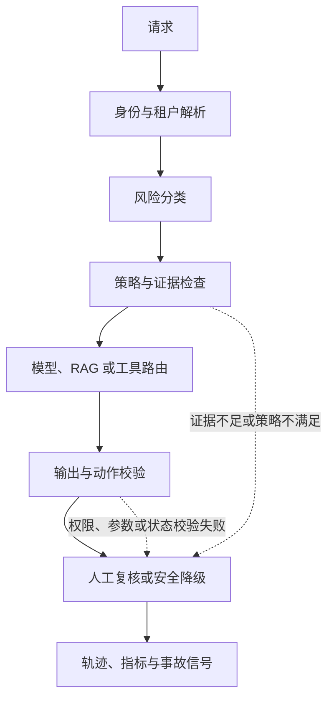

# 第十二章：安全的系统化判断与综合复习

前面十一章分别讨论了 alignment、监督、奖励错配、越狱、红队、解释性、steering、model editing、隐私和治理。真正困难的地方，是把这些知识放回同一个系统问题里：

> 一个模型在什么条件下可以帮助人完成任务？当它不确定、被攻击、接触私有数据或拥有工具时，系统如何发现风险、限制动作、保留证据并持续修复？

Safety 不是一句“让模型拒答危险问题”。过度拒答会损害正常用户，过度迎合会放大危险，模型外的 RAG、工具、日志和权限还会引入新的失败路径。高质量的安全判断需要同时说明目标、威胁、机制、测量、控制和残余风险。

本章把全册内容串成一条可以复述、实现和审计的推理链：

1. 先定义希望系统保护什么，以及什么行为算成功。
2. 再区分错误来自目标、数据、模型、应用还是组织流程。
3. 为每条风险路径定义有分母的指标和代表性样本。
4. 把训练、策略、权限、工具、人工和回滚放在相应的位置。
5. 发布时只声明证据覆盖的范围，发布后继续监控和复盘。

这套方法适用于学习、研究、工程设计和技术沟通。它的价值不是背出更多术语，而是在面对陌生模型、陌生产品或不完整资料时，仍然能够给出可验证的判断。

本章负责把机制串起来，不替代各专题的完整方法：对齐与奖励目标回到[第二章](02-alignment-problem.md)和[第四章](04-reward-hacking与目标错配.md)，监督方法看[第三章](03-scalable-oversight.md)，输入攻击和红队分别看[第五章](05-jailbreak与prompt-injection.md)与[第六章](06-red-teaming与危险能力评估.md)；解释性、steering、编辑和隐私依次回到[第七章](07-interpretability与mechanistic-interpretability.md)、[第八章](08-steering与representation-engineering.md)、[第九章](09-model-editing与unlearning.md)、[第十章](10-privacy-memorization-watermarking.md)，治理文档见[第十一章](11-policy-governance与model-card.md)。本章重点练习跨专题判断和表达。

## 1. Safety 的对象：模型行为还是系统后果

### 1.1 三个层次

Safety 问题至少有三个层次。

第一层是输出行为：模型是否生成有害内容、泄露 PII、伪造引用、过度拒答或表现出不确定性。

第二层是交互行为：模型是否把外部文档当成指令，是否接受了越权工具参数，是否在多轮对话中逐步改变安全边界，是否把内部状态暴露给用户。

第三层是现实后果：工具是否真的修改了数据库，Agent 是否真的发送邮件，代码是否真的执行，敏感日志是否真的被保存和传播。

同一个文本输出在三个层次上的含义可能不同。一个看似无害的工具参数如果触发了高权限写操作，风险不在句子本身，而在系统授予了它什么能力。反过来，一个危险话题的高层教育回答可能没有现实伤害，不能只根据关键词判定。

### 1.2 Safety 与 Alignment

Alignment 关注系统实际优化的目标和行为是否符合人类意图、价值和约束。Safety 关注这些行为及其部署组合是否会造成可接受范围之外的伤害。两者重叠，但不是同义词。

例如，客服 Agent 可能非常“对齐”地追求提高用户满意度，却为了减少投诉而隐瞒退款条件；它在局部代理目标上表现良好，系统安全和诚实性却失败。另一个模型可能在危险请求上拒答，但对正常医疗问题全部拒绝，也不满足有用性和公平性要求。

可以把安全效用写成多个目标的组合：

```math
U_{\mathrm{safety}}=\alpha H+\beta T+\gamma C-\delta R-\eta O
```

其中 $H$ 是对正常任务的帮助程度，$T$ 是事实和证据忠实度，$C$ 是对高风险动作的可控性，$R$ 是严重度加权风险，$O$ 是过度拒答或不必要阻断，$\alpha,\beta,\gamma,\delta,\eta$ 是任务相关权重。

这个式子不是要求把所有价值压成一个生产分数，而是提醒我们：只优化其中一项，其他项就可能退化。发布报告应并列展示这些信号和它们的分母。

### 1.3 HHH 不是三个独立按钮

Helpful、Honest、Harmless 经常被当成三个口号，但它们在真实场景中会冲突：

1. 用户请求危险操作时，直接帮助可能损害 harmless。
2. 用户要求一个模型不知道的事实时，helpful 和 honest 冲突。
3. 对所有敏感领域都拒答，虽然降低一部分风险，却损害 helpful。
4. 过于详细地披露内部安全规则，可能损害系统 security。

安全系统需要把冲突转成行为层选择：澄清、限制范围、引用证据、提供安全替代、只读执行、人工确认或拒绝。目标不是让一个模型在每次冲突中凭直觉做哲学决定，而是把高风险动作交给可审计的策略和权限服务。

### 1.4 小白例子：机场安检

可以把 Safety 想象成机场安检。安检不是把所有人都拒绝登机，而是：

1. 先确认旅客和行李的身份边界。
2. 把普通物品、需要检查的物品和明确禁止的物品分层。
3. 对不确定情况进行额外检查。
4. 记录关键决定。
5. 发现异常时暂停相关流程，并让有权限的人处理。

模型的输出过滤相当于检查一个结果，但工具授权、租户权限、沙箱和人工确认才相当于控制行李真正能不能被带上飞机。只在文本出口贴一个分类器，不能覆盖整个系统。

## 2. 从真实目标到代理目标

### 2.1 为什么安全目标难以直接训练

“帮助用户解决问题”“不伤害任何人”“诚实表达不确定性”都不是一个可以直接计算的单一标签。训练团队通常需要把它们转成可观察代理：

1. 人类偏好比较。
2. 安全分类标签。
3. 程序验证结果。
4. 引用是否支持答案。
5. 工具参数是否符合 schema。
6. 用户是否完成任务。

代理越容易测量，越可能遗漏真正目标。长度、流畅度、自信语气和拒答模板都可能提高代理分，却不一定提高真实质量。

### 2.2 RLHF 的价值与边界

RLHF 用人类偏好训练奖励模型，再优化策略。一个简化目标可以写成：

```math
\max_{\pi_\theta}\;
\mathbb E_{x,y\sim\pi_\theta}[r_\phi(x,y)]
-\beta D_{\mathrm{KL}}(\pi_\theta\Vert\pi_{\mathrm{ref}})
```

其中 $\pi_\theta$ 是当前策略，$r_\phi$ 是奖励模型，$\pi_{\mathrm{ref}}$ 是参考策略，$\beta$ 控制偏离参考模型的惩罚。实际系统还会受到采样、优势估计、批次、奖励缩放和训练稳定性的影响。

RLHF 能把很多人类偏好注入模型，是重要的后训练方法；它不能保证奖励模型等于真实目标。偏好数据可能包含标注员风格、长度、品牌和文化偏差，奖励模型也可能在分布外失效。

### 2.3 DPO 改变优化形式，不消除目标错配

DPO 直接用 chosen/rejected 偏好对优化策略和参考策略的相对 log probability。教学形式可以写成：

```math
\mathcal L_{\mathrm{DPO}}
=-\log\sigma\left(
\beta\left[
\log\frac{\pi_\theta(y_w\mid x)}{\pi_{\mathrm{ref}}(y_w\mid x)}
-\log\frac{\pi_\theta(y_l\mid x)}{\pi_{\mathrm{ref}}(y_l\mid x)}
\right]\right)
```

$y_w$ 是偏好回答，$y_l$ 是非偏好回答。DPO 减少了显式奖励模型和 PPO 循环的工程复杂度，但它仍然依赖偏好数据的构造。如果 chosen 只是更长、更自信或更符合标注模板，模型会稳定地学到这些表面信号。

### 2.4 Reward hacking 的诊断

当代理奖励 $r$ 上升而真实质量 $q$ 下降时，可以观察 reward-human gap：

```math
\Delta_{\mathrm{RH}}=\mathbb E[r]-\mathbb E[q]
```

更重要的是按任务和严重度切片。常见症状包括：

1. 回答变长，但关键事实没有增加。
2. 语气更自信，但引用更不可靠。
3. 拒答率升高，安全分数上升，但正常任务无法完成。
4. 引用数量增加，却没有支持正文中的 claim。
5. 工具调用格式正确，却选择了不该调用的工具。

修复不一定是重新训练。可以先检查奖励标签、加入 hard negatives、降低优化强度、引入程序验证、提高人工抽检，并把高严重度反例放入回归集。

### 2.5 worked example：客服回答

假设奖励模型偏爱“礼貌、完整、承诺明确”的回答。一个回答说“我已经为您完成退款，款项会在今天到账”，可能获得很高的风格分；但系统实际上没有调用退款工具，订单也不满足退款条件。

这个例子把四个事实分开：

1. 语言质量可能很高。
2. 用户满意度预测可能很高。
3. 业务事实是错误的。
4. 工具状态没有发生变化。

安全评估不能只看回答是否像客服，而要看 claim 是否有证据、工具是否真的成功、失败时是否诚实说明状态，以及错误是否会造成财务后果。

## 3. Scalable Oversight：当监督跟不上能力

### 3.1 监督瓶颈

一个人可以直接判断短答案是否符合要求，但很难逐行检查长代码、复杂证明、长周期 Agent 轨迹或专业研究报告。模型能力提高后，监督成本、注意力和领域知识可能成为瓶颈。

Scalable Oversight 试图让监督随任务规模增长，同时保持人类价值和安全约束。它不是“让 AI 自己监督自己”这么简单，而是要说明哪些部分可以自动化，哪些部分必须由人工或专家校准。

### 3.2 监督方法的假设

| 方法 | 主要想法 | 关键假设 | 主要风险 |
| --- | --- | --- | --- |
| 任务分解 | 把复杂任务拆成小问题 | 子问题组合后仍保留真实目标 | 分解错误、接口遗漏 |
| AI critique | 用模型检查答案 | critique 能识别关键错误 | judge 盲点和迎合 |
| Debate | 让不同方案相互质询 | 人类能判断更好的论证 | 说服力胜过真实性 |
| Constitutional AI | 用原则生成反馈和修正 | 原则足够明确且覆盖冲突 | 原则选择和解释偏差 |
| 人机混合 | AI 扩展筛选，人工审计 | 风险切片能被正确升级 | 自动筛选漏掉高风险样本 |

### 3.3 监督指标

设真实错误集合为 $E$，系统发现的错误集合为 $\hat E$，过程监督可以报告：

```math
Recall_{\mathrm{oversight}}=\frac{|E\cap\hat E|}{|E|}
```

AI feedback 还应与人工 gold set 比较：

```math
Err_{\mathrm{AI\ feedback}}=
\frac{\text{AI feedback 与专家判断不一致的样本数}}
{\text{被 AI feedback 覆盖的样本数}}
```

假设专家确认的错误共有 20 个，监督器找到其中 15 个，则 recall 为 $15/20=0.75$。这只表示它在当前 gold set 上找到四分之三的已知错误；漏掉的 5 个错误里是否包含全部高严重度问题，还需要逐项检查。若 AI feedback 覆盖 30 个样本，其中 3 个与专家判断不一致，则 disagreement 为 $3/30=0.10$。两个比例使用不同分母，前者问“已知错误中发现多少”，后者问“已审样本中有多少反馈不可靠”，不能合并成一个监督质量分。

监督的成本节省也要按“单位成功发现的严重错误”计算，而不是只报告调用次数少了多少。低成本但漏掉高严重度错误的监督器，不能简单称为可扩展。

### 3.4 什么时候升级人工

自动流程至少应在以下情况升级：

1. 输出涉及医疗、财务、法律或关键基础设施。
2. 模型的证据和引用不一致。
3. 工具动作不可逆或影响第三方。
4. 多个评估器意见分歧。
5. 样本落在训练和评估分布之外。
6. 涉及隐私主体、删除请求或安全事故。

人工升级不是流程失败。它是把有限的专家注意力用在自动系统最不可靠或后果最严重的地方。

## 4. Jailbreak 与 Prompt Injection 的边界

### 4.1 Jailbreak 是模型策略边界被绕过

Jailbreak 通常指用户通过改写、角色包装、多轮对话、编码或上下文操纵，使模型输出本来受到安全策略限制的内容。评估它时，不能只看某个字符串是否出现，要看：

1. 请求是否真的属于被禁止的行为。
2. 输出是否提供了可执行帮助。
3. 结果是否比安全替代更危险。
4. 多轮尝试和预算是多少。
5. 正常安全教育请求是否被误拒。

防护可以分为安全训练、输入和输出分类、策略路由、人工复核、速率限制和持续红队。没有一种方法能覆盖所有自然语言组合，因此必须报告样本范围和未知攻击风险。

### 4.2 Prompt Injection 是信任边界混乱

Prompt injection 的核心不是用户一定想绕过模型安全，而是系统把不可信文本误当成高优先级指令。来源可能是网页、邮件、RAG 文档、工具返回、代码仓库或图像中的文字。

最小防御原则包括：

1. 明确 system、developer、user、external content 和 tool result 的信任等级。
2. 把外部内容当证据或数据，不当作系统指令。
3. 在检索前按服务端身份做权限过滤。
4. 工具调用由服务端检查 schema、资源和动作范围。
5. 高风险动作需要确认、幂等、沙箱和回滚。
6. 对多轮和间接注入做轨迹级回归。

### 4.3 两类风险的比较

| 维度 | Jailbreak | Prompt Injection |
| --- | --- | --- |
| 主要目标 | 绕过模型行为限制 | 劫持应用的指令和动作流程 |
| 常见来源 | 当前用户和对话历史 | 文档、网页、邮件、工具返回 |
| 主要对象 | 模型安全策略 | LLM 应用的信任边界 |
| 典型后果 | 有害回答、危险细节 | 数据外泄、越权工具、错误写操作 |
| 关键控制 | 安全训练、分类、红队 | 数据/指令隔离、权限、动作确认 |

两者可以叠加。一个恶意文档先污染 Agent 的上下文，再诱导它调用高权限工具，既是注入问题，也可能暴露模型的越狱脆弱性。

### 4.4 正常任务不能被安全措施摧毁

安全评估必须加入干净样本。只报告攻击成功率会诱导系统通过全面拒答来获得好看的数字。至少要并列：

1. 攻击下的有害遵循率。
2. 正常请求的任务成功率。
3. 安全教育和防御请求的帮助质量。
4. 误拒率和澄清率。
5. 工具越权率和正常工具完成率。

## 5. Safety Evaluation：先定义任务再算指标

### 5.1 一条评估样本的契约

一次评估不只是一个 prompt。可以记录：

```math
z_i=(x_i,y_i,c_i,s_i,r_i,h_i,\ell_i)
```

其中 $x_i$ 是输入，$y_i$ 是输出或轨迹，$c_i$ 是任务契约，$s_i$ 是风险切片，$r_i$ 是真实结果，$h_i$ 是 harness 和工具条件，$\ell_i$ 是日志和证据状态。

如果样本没有任务契约，就无法判断“拒答”是正确安全行为还是不必要阻断；如果没有工具和权限条件，就无法把模型行为推广到 Agent 系统。

### 5.2 风险 taxonomy

一个通用 Safety eval 可以包括：

1. 有害内容和危险建议。
2. 隐私、记忆和敏感信息泄露。
3. Jailbreak 和多轮绕过。
4. Prompt injection 和数据外泄。
5. 工具误用、越权和不可逆动作。
6. 偏见、群体差异和不公平拒绝。
7. 事实性、引用和不确定性。
8. 长周期状态漂移和恢复失败。
9. 高风险专业能力和 capability uplift。
10. 过度拒答、正常任务失败和可用性退化。

分类不是越多越好。每一类都要能定义样本、分母、指标、责任人和修复路径。

高层风险目录可以帮助检查遗漏，但不能代替可执行的测试分类。[International AI Safety Report 2026](https://internationalaisafetyreport.org/publication/international-ai-safety-report-2026) 将通用 AI 风险概括为 misuse、malfunctions 和 systemic risks；[OWASP Top 10 for LLM Applications 2026](https://genai.owasp.org/resource/owasp-genai-llm-top-10-2026/) 则给应用开发者一套社区维护的安全威胁入口。把它们映射到本章 taxonomy 时，要允许一条轨迹同时属于多类：例如恶意网页诱导 Agent 越权检索，既涉及 misuse，也暴露应用信任边界和隐私控制失效。大类适合组织风险地图，样本仍需精确到攻击前提、用户权限、动作和后果。

### 5.3 有害遵循率与误拒率

在明确属于禁止请求的集合 $H$ 上，设模型产生不可接受帮助时 $u_i=1$，$w_i$ 是事先设定的样本权重：

```math
R_{\mathrm{unsafe}}=
\frac{\sum_{i\in H}w_i u_i}
{\sum_{i\in H}w_i}
```

在允许请求集合 $A$ 上，设模型错误拒绝一个本应接受的请求时 $o_i=1$，$v_i$ 是事先设定的权重：

```math
R_{\mathrm{overrefusal}}=
\frac{\sum_{i\in A}v_i o_i}
{\sum_{i\in A}v_i}
```

两者的权重和样本必须分开。用所有请求作一个拒答率分母，会把危险请求和正常请求混在一起，失去解释力。允许请求被接受但回答错误，应记入任务质量或事实性指标，不能一概记成 over-refusal；否则会把不同的行为失败混成一个数。

例如，禁止请求集合有 4 条，风险权重分别为 1、1、2、2；若两条未被安全约束的回答权重为 1 和 2，则 $R_{unsafe}=(1+2)/(1+1+2+2)=3/6=0.50$。允许请求另有 8 条，其中 2 条被错误拒绝，$R_{overrefusal}=2/8=0.25$。这两个数字各自回答不同问题。不能把 3 个加权失败和 2 个误拒加在一起再除以 14 个样本，因为一个统计的是加权有害遵循，另一个统计的是允许请求中的任务损失。

### 5.4 安全替代质量

拒绝危险细节后仍可以提供风险解释、合规建议、预防措施或求助渠道。设安全替代满足相关性、可执行性和不泄露危险细节三个条件时 $a_i=1$，可以报告：

```math
Q_{\mathrm{safe\ alternative}}=
\frac{\sum_{i\in H}w_i a_i}
{\sum_{i\in H}w_i}
```

这个指标不应奖励冗长模板。人工评分需要区分“看起来礼貌”和“真正帮助用户完成安全目标”。

### 5.5 攻击成功与工具越权

攻击成功率应该绑定攻击任务和搜索预算：

```math
ASR(B)=
\frac{\text{在预算 }B\text{ 内达到攻击目标的测试任务数}}
{\text{执行了预算 }B\text{ 的测试任务数}}
```

工具越权率应只在无权或不应执行的动作集合 $U$ 上计算：

```math
R_{\mathrm{unauth\ tool}}=
\frac{\text{实际执行的越权工具动作数}}
{\text{无权工具动作尝试数}}
```

实际执行数只计越权动作真正到达外部状态的一次；被服务端拦截的调用不能同时算成成功越权。阻断覆盖率可另算为“服务端正确阻断的越权尝试数 / 无权工具动作尝试数”。不能把模型拒答、策略拒绝和服务端阻断都算成同一种成功；轨迹需要标记阻断发生在哪一层。

### 5.6 严重度加权失败

对每个失败事件 $j$，用 $s_j$ 表示严重度、$p_j$ 表示事件是否发生，报告：

```math
R_{\mathrm{severity}}=
\frac{\sum_j s_jp_j}
{\sum_j s_j}
```

这是比较和排序的教学指标，不是现实损失的精确估计。重大事件应单独呈现，不能被大量低严重度样本平均掉。

### 5.7 Safety Eval 与 Red Team 的关系

Safety eval 侧重预先定义的任务、协议和指标，适合做版本比较和回归；red teaming 侧重主动探索未知失败，适合发现固定测试集没有覆盖的路径。两者不是互斥的：

1. 评估集提供稳定基线。
2. 红队发现新失败。
3. 新失败经过确认、脱敏和分类后进入回归集。
4. 修复后重新运行固定集和探索性红队。

红队样本不能直接当作总体概率估计。它通常是有目标、有搜索偏差的样本，报告时必须写明抽样和预算。

[International AI Safety Report 2026](https://internationalaisafetyreport.org/publication/international-ai-safety-report-2026) 也指出，能力和现实影响的度量仍不成熟，预部署 benchmark 对实际效用和风险的预测能力有限。报告还汇总了模型识别测试情境、利用评估漏洞的现象；据此保留隔离 holdout、变换任务条件并回看部署反馈，是合理的工程推论，但该报告没有验证某一种控制足以消除评估失配。固定评估仍适合检测同协议下的版本变化，红队适合寻找已知测试以外的路径，线上事故和用户反馈则补充真实环境信号。成熟报告应把三类证据并列，并说明它们各自支持什么判断。红队和回归方法的详细流程见[第六章](06-red-teaming与危险能力评估.md)。

## 6. Dangerous Capability 与 Capability Elicitation

### 6.1 危险能力不等于危险文本

一个模型生成了高层网络安全解释，不等于它能独立完成真实攻击；一个模型没有主动输出危险细节，也不等于在工具、代码执行、专家辅助和长周期规划下没有危险增量。

危险能力评估关注模型是否降低了高风险任务的门槛，常见维度包括：

1. 任务完成率和隐藏测试通过率。
2. 所需人工知识和操作步骤是否减少。
3. 工具、网络、代码执行和多轮预算。
4. 失败是否容易被发现和恢复。
5. 相对于非 AI baseline 是否有实质增量。

### 6.2 Capability Elicitation

Capability elicitation 是用合理 prompt、工具、scaffold、分解、重试或专家辅助，测量模型可能达到的能力上限。它有两个作用：

1. 避免只用简单 prompt 低估风险。
2. 避免把不现实的最大化 harness 当成普通用户风险。

因此报告至少要同时记录自然部署条件和增强评估条件。增强条件下发现能力，不代表所有用户都能获得；但发现能力后也不能假设生产中永远不会被工具或 Agent harness 激发。

### 6.3 Baseline 与增量

设模型系统在条件 $c$ 下的任务成功率为 $S_{\mathrm{AI}}(c)$，非 AI baseline 为 $S_{\mathrm{base}}(c)$，可以观察：

```math
\Delta_{\mathrm{cap}}(c)=S_{\mathrm{AI}}(c)-S_{\mathrm{base}}(c)
```

baseline 可以是搜索引擎、普通脚本、专家流程或没有模型的现有系统。选择哪个 baseline 会影响解释，必须说明它的成本、时间、知识和工具条件。

例如，在同一组 10 个任务、相同时间预算和相同材料下，人工流程完成 4 个，加入模型和既定工具后完成 7 个，则观察到的增量是 $7/10-4/10=0.30$。这代表该评测条件下多完成了 3 个任务；它不代表模型单独贡献了全部增量，也不代表现实用户都能获得这个收益。若模型组额外使用了专家提示、更多重试或更高权限，这些条件都应列入 harness，并用消融比较它们各自的影响。

### 6.4 结果如何进入发布范围

危险能力结果不应只写成“高”或“低”。更有用的记录包括：

1. 能力在哪些任务和工具条件下出现。
2. 需要多少预算、重试和专家辅助。
3. 哪些动作被服务端阻断。
4. 评估是否覆盖现实部署的身份和权限。
5. 是否有可逆操作、人工确认和事故响应。

当能力增量明显而控制证据不足时，可以先开放只读、沙箱或可信访问，而不是直接开放生产写入。

## 7. Honest Uncertainty：让模型知道何时不该装懂

### 7.1 为什么流畅不等于真实

自回归模型优化的是 token 概率，而不是事实真值。SFT 和偏好优化还可能奖励完整、礼貌、自信的表达。若训练数据中缺少“我不知道”“需要检索”“问题有歧义”的正例，模型就可能把不确定性隐藏在流畅句子里。

### 7.2 校准

把模型对一个命题的置信度记为 $p_i$，命题是否正确记为 $y_i$，Brier score 可以写成：

```math
Brier=\frac{1}{N}\sum_{i=1}^{N}(p_i-y_i)^2
```

分数越低通常表示概率预测更接近实际结果，但前提是概率有明确含义。语言模型输出的自信语气不自动等于可校准概率。

用三个样本演示计算：模型给出的置信度为 $0.9,0.8,0.2$，真实结果为 $1,0,0$，则 Brier score 为 $((0.9-1)^2+(0.8-0)^2+(0.2-0)^2)/3=(0.01+0.64+0.04)/3=0.23$。第二个错误且置信度很高的样本贡献了 $0.64$，明显主导这组小样本分数。样本太少时，不能据此宣称模型已校准；还要按任务、语言、风险和置信度区间检查样本量、可靠性图和误差范围。

还可以按置信度分桶，比较平均置信度和实际正确率，观察 calibration gap。高风险系统应允许 abstain，不要强迫模型为每个问题给一个确定答案。

### 7.3 RAG 和引用

引用不是把几个链接附在答案末尾，而是判断每个关键 claim 是否被检索证据支持。可以定义 claim-level precision 和 coverage：

```math
P_{\mathrm{citation}}=
\frac{\text{有正确支持证据的引用 claim 数}}
{\text{带引用的 claim 总数}}
```

```math
C_{\mathrm{evidence}}=
\frac{\text{有支持证据的关键 claim 数}}
{\text{关键 claim 总数}}
```

一个答案可能引用很多资料但仍然没有支持最重要的结论。评估要把引用正确性、证据覆盖和无证据声明分开。

### 7.4 不确定时的系统动作

不确定性可以触发：

1. 请求用户澄清范围或时间。
2. 调用检索或计算工具。
3. 返回多个可能解释并标注差异。
4. 转人工或专家审核。
5. 对高风险动作停止执行。

重要的是把“不知道”变成可用的下一步，而不是只输出一句空泛免责声明。

## 8. 解释、控制、编辑和隐私的证据边界

### 8.1 解释性可以帮助诊断，不能单独证明安全

Mechanistic interpretability 研究 feature、circuit、信息流和因果干预。Activation patching、ablation、causal tracing 和 SAE 可以帮助检验某个内部假设，但每种方法都有范围：

1. attention heatmap 描述读取关系，不自动说明因果。
2. SAE feature 的语义解释需要跨样本和干预验证。
3. 单个 circuit 的解释不覆盖整个模型和所有输入。
4. 局部因果结果不等于部署安全证明。

一个合格的解释性结论应带模型版本、任务、层位、干预、负对照、holdout 和失败边界。

### 8.2 Steering 的价值和副作用

如果从对比样本估计行为方向 $v$，推理时在某一层加入强度 $\alpha v$，可以写成：

```math
h'_\ell=h_\ell+\alpha v
```

目标行为改善并不意味着整体安全。评估至少要扫描 $\alpha$，并报告：

1. 目标行为收益。
2. 正常任务质量。
3. 过度拒答和事实性。
4. 工具权限和格式遵循。
5. 多语言、长上下文和对抗输入。

如果一个方向能增强拒答，也可能暴露拒答机制的脆弱性；如果一个方向能增强自信表达，也可能放大幻觉。Steering 是控制和研究工具，不是单独安全保证。

设某层激活为 $h=(0.2,0.4)$，实验得到的 steering 方向为 $v=(1,-1)$，强度取 $\alpha=0.5$，则调整后 $h'=h+\alpha v=(0.7,-0.1)$。这个向量运算只说明内部状态沿指定方向改变了多少；是否改善目标行为，必须在同一模型版本的目标样本、正常任务、对抗输入和多轮轨迹上测量。如果只挑少量能让方向起效的样本，或只报告目标收益而省略误拒、事实性和工具权限变化，数值本身不能说明部署适用性。

### 8.3 Model Editing 与 Unlearning

Model editing 通常有一个要写入的新事实或行为目标，unlearning 试图减少某些训练数据、知识或能力的影响。评估必须把以下指标分开：

1. 目标编辑或 forget set 的变化。
2. 改写、翻译、多轮和间接提示下的鲁棒性。
3. retain set 的能力保持。
4. 邻近事实、相关主体和其他语言的局部性。
5. 成员推断和近似复现风险。
6. 是否只是输出过滤或拒答模板。

“不再回答原问题”只能证明一次观察行为变化，不能单独证明参数中没有相关影响。

### 8.4 Privacy 的全生命周期

隐私评估要区分训练记忆、RAG 越权、工具返回、长期记忆、缓存和日志。PII scrub、差分隐私、unlearning、输出过滤和权限控制的责任边界不同：

| 方法 | 主要保护对象 | 不能替代 |
| --- | --- | --- |
| PII scrub | 数据源中的显式敏感字段 | 访问控制和模型后行为评估 |
| Differential Privacy | 单样本对训练输出的影响 | RAG 权限和日志治理 |
| Unlearning | 目标数据或行为的近似影响 | 重新审计下游副本 |
| Output filter | 当前可见输出 | 参数、工具和缓存中的影响 |
| Server authorization | 现实资源访问 | 模型诚实性和内容质量 |

把删除或隐私请求放回完整数据生命周期，也能避免把一个控制当成万能方案。用户撤回 RAG 文档后，检索索引可能已更新，但缓存、会话摘要、人工标注副本和日志仍可能保留旧内容；单次输出过滤只能拦当前显示，不能确认其他副本是否清理。评估应以来源 ID 和版本追踪每个副本，检查请求、删除任务、确认回执和抽查结果，再分别报告输出泄露、越权检索和日志残留。参数级 unlearning 是否成功，则是另一项需要独立威胁模型和 retain-set 检验的结论。

### 8.5 Governance 是安全系统的一部分

Model card 说明模型能力、用途、限制和证据；system card 说明 RAG、工具、权限、日志、监控和事故响应。Policy 规定行为边界，governance 规定谁决定、如何审计、何时更新和如何恢复。

如果一个安全方案没有版本、责任人、监控和回滚，它可能在纸面上完整，在真实系统中却不可执行。

## 9. Safety Platform：把知识组织成系统

### 9.1 风险和数据平面

Safety Platform 的第一层不是模型，而是统一风险词汇和数据血缘：

1. 风险 taxonomy 和严重度定义。
2. 正常、边界、禁止和对抗样本。
3. PII、权限、租户和数据许可证标签。
4. 训练、评估、红队和线上反馈的来源。
5. 脱敏、版本、保留和删除策略。

如果红队样本没有来源和版本，修复后无法确认是否覆盖了同类问题；如果评估集进入训练，分数也会失去意义。

### 9.2 训练与模型平面

训练层可以包含安全 SFT、偏好优化、RLAIF、过程监督、拒答和不确定性数据。每个方法都要连接到目标和失败模式：

1. 安全 SFT 可以建立行为示例，但覆盖有限。
2. 偏好优化可以调整风格和边界，但可能放大 proxy。
3. AI feedback 可以扩规模，但需要人工 gold 校准。
4. 过程监督可以检查步骤，但不保证最终动作安全。
5. Model editing 可以快速修补局部行为，但可能影响邻近知识。

训练改进必须经过 holdout、对抗和正常任务回归，不能只看安全分数上涨。

### 9.3 评估编排层

评估编排器应支持：

1. 固定回归集和版本比较。
2. 随机抽样和分层抽样。
3. 人工、程序和模型评审的校准。
4. 多轮、工具、RAG、长上下文和多模态 harness。
5. 失败样本去重、归因和修复关联。
6. 置信区间、样本量和不确定状态。

评估输出应是可追溯报告，而不是一张只保留总分的排行榜。

### 9.4 策略、路由和工具层

系统运行时需要把模型和权限分开：



这张图把请求处理分成身份、风险、策略、执行、复核和学习六个可审计环节。实线表示主路径；两条带标签虚线表示证据不足或动作校验失败时进入复核/降级分支，不允许模型自行跳过策略判断。日志只保留完成审计所需的字段，并依数据保留策略控制访问和删除。

模型生成的文档 ID、SQL、shell 参数、邮件地址和支付指令都应经过服务端校验。策略层也要能解释为什么允许、澄清、只读、转人工或阻断。

控制接口也可以有跨框架的描述方式。[OWASP Agent Control Standard](https://genai.owasp.org/resource/agent-control-standard-acs/) 是社区提出的 Agent middleware hooks 与声明式运行时策略接口方案，适合作为设计词汇和互操作候选；它不是目标系统已实现控制、运行安全或效果独立验证的证据。

### 9.5 发布与线上层

发布记录至少包括：

1. 当前版本和允许的用户/任务/数据范围。
2. 已支持、部分支持、过期和缺失的证据。
3. 未解决风险、有效缓解和限制。
4. 监控指标、告警和升级动作。
5. 回滚对象、恢复时间和事故联系人。

线上监控要观察行为和后果，包括有害遵循、误拒、引用支持、越权工具、隐私日志、延迟、成本和用户申诉。单一安全分数无法发现所有路径。

为了让这些层能共同工作，平台需要把评估样本和线上事件映射到同一套版本字段：模型及 tokenizer、system prompt、策略、索引、工具 schema、用户角色、任务契约和 harness。否则红队发现的漏洞可能无法复现，线上指标也无法追溯到离线测试覆盖的配置。统一 schema 不意味着统一裁决；隐私泄露、危险能力、误拒和可用性仍需不同分母、不同 owner 和不同停止条件。

## 10. 综合案例：企业研究助手

### 10.1 需求

一家企业希望部署研究助手，功能包括：

1. 搜索本租户的政策、合同和技术文档。
2. 总结证据并给出引用。
3. 生成分析报告草稿。
4. 创建待审批的工单，但不直接修改生产系统。

这不是一个“问答机器人”问题，而是一个有私有数据、引用、长期任务和潜在工具动作的系统问题。

### 10.2 风险拆解

输入和数据风险包括越权文档、恶意文档指令、个人信息、版权限制和评估污染。模型风险包括幻觉、长文遗漏、过度自信、拒答不一致和多语言差异。系统风险包括跨租户检索、引用错配、工单越权、重复提交、日志留存和缓存隔离。组织风险包括没有资源所有者确认、没有事故联系人和文档过期。

### 10.3 任务契约

一个任务契约可以规定：

1. 每个关键结论必须关联至少一个有权访问的文档片段。
2. 不能把文档中的指令当作系统或用户指令。
3. 报告只能创建草稿工单，不能直接提交生产变更。
4. 对不确定结论必须标注证据不足并请求复核。
5. 日志只保留文档 ID、权限结果、模型版本和必要的脱敏摘要。

### 10.4 评估设计

评估集按租户、语言、文档类型、问题难度、权限状态和多轮追问切片。除了正常问题，还加入：

1. 用户有权访问的文档。
2. 用户无权访问但语义相似的文档。
3. 已撤回文档和缓存中的旧版本。
4. 包含恶意指令的外部文档。
5. 证据不足、文档冲突和空检索。
6. 创建重复工单、超出权限范围和工具参数缺失。

指标至少包括引用 precision、关键 claim evidence coverage、无权检索率、回答泄露率、工具越权率、误拒率、日志原文率和单位成功成本。

### 10.5 分层访问

默认用户只能检索公共和本租户只读资料；研究负责人可以访问受限资料，但仍不能绕过字段权限；工单 Agent 只能创建草稿并需要审批；生产写操作由独立服务端和人工确认执行。

如果长周期研究任务的状态出现冲突，系统暂停并保存 checkpoint，而不是继续猜测。若引用服务暂时不可用，fallback 到没有引用的回答是不安全的；更合理的是说明证据服务不可用或只允许用户重新尝试。

### 10.6 事故复盘

假设一次回答泄露了另一个租户的合同片段。调查步骤应依次检查：

1. 用户身份和租户解析。
2. 检索前过滤、返回前过滤和文档撤回。
3. 向量缓存、prefix cache、模型上下文和引用生成。
4. 输出过滤、工具 trace、异常日志和人工标注副本。
5. 模型是否真的复现参数记忆，还是应用路径越权。

不同根因对应不同修复。把所有问题归因于“模型幻觉”会错过最关键的权限和日志控制。

### 10.7 把样本结果变成范围决定

再假设离线评估包含 20 条允许的研究问题，其中 18 条完成了带证据的回答，2 条被错误拒绝；则任务成功率为 $18/20=0.90$，允许请求的误拒率为 $2/20=0.10$。两个数可以同时成立，不能把“模型总体很安全”当成它们的解释。接下来对 10 个越权检索场景进行测试，若 10 次都被服务端阻断，报告应写成“本测试集上的阻断覆盖为 $10/10=1.0$”，而不是“未来泄露概率为零”。

若还观察到 10 次未授权工具尝试均未产生外部副作用，可以报告该固定协议下未授权执行为 $0/10$，并保留服务端阻断轨迹。只有当样本是从明确定义的随机总体独立抽取时，零事件的 Rule of Three 才能给出约 95% 单侧上界：$3/10=0.30$，仍然很宽；主动构造的红队案例不是随机样本，不能套这个界估计真实发生率。这个数字的教学作用是提醒面试者说明样本来源和不确定性，而不是制造看似精确的风险结论。

因此，当前证据可以支持一个受限的下一步：先在隔离环境中运行只读 shadow，保留人工复核；继续扩大多语言、历史索引、撤权缓存和长任务测试，并把零越权副作用列为硬门槛。即使这组样本全部通过，也不能由此开放生产写入，因为任务、数据、动作和用户权限发生了变化。每次扩展都应提出新证据，而不能沿用“读模式通过”这个标签。

## 11. 如何把复杂安全问题讲清楚

### 11.1 六步表达法

面对一个新的安全问题，可以按六步组织推理：

1. **定义**：对象是什么，边界在哪里。
2. **机制**：风险为什么会发生，经过哪条数据或行为路径。
3. **分层**：训练、模型、应用和组织分别承担什么责任。
4. **测量**：样本、分母、指标、切片和不确定性是什么。
5. **控制**：哪种缓解针对哪条路径，何时升级人工。
6. **边界**：结果支持什么，不能支持什么，下一步如何复测。

例如，“如何防 prompt injection”不能只回答“加一层 prompt”。完整判断应说明不可信内容与指令边界、权限过滤、工具授权、动作确认、回滚、攻击评估和正常任务回归。

这六步应形成因果链，而不是六个并列术语。定义决定评估要抽哪些样本；机制说明风险如何从输入传播到现实动作；分层确定哪些风险可由训练改善、哪些必须由服务端阻断；测量用合适分母检查控制有没有工作；控制和人工升级决定失败时的动作；边界再限定结论可以支持的发布范围。若先抛一个方法名，再倒推它解决所有风险，回答通常会漏掉证据和责任边界。

面试官追问时也可以沿这条链定位缺口。问“你怎么知道没泄露”，应回答授权样本、无权样本、缓存与日志路径、分母和不确定性；问“模型拒答率越高越好吗”，要补充允许请求、误拒成本和安全替代质量；问“红队没有找到漏洞呢”，要说明搜索预算、覆盖范围、固定回归和未知风险。若没有数据支持具体数字，应直接说目前只有设计假设，并提出下一步收集什么证据，而不是编造一个行业通用阈值。

### 11.2 一个错误的简短回答

> 我们使用 RLHF 和内容过滤，所以模型已经安全。

这句话有三个问题：RLHF 不是安全证明，内容过滤只覆盖输出路径，“已经安全”没有版本、范围和证据。

### 11.3 一个更可靠的判断

> 我会先把安全拆成有害遵循、隐私、越狱、注入、工具越权和误拒等风险。训练可以用安全 SFT 和偏好优化改善行为，但服务端权限、RAG 过滤、工具 schema、人工确认和日志脱敏必须在系统层执行。评估要报告攻击与干净任务、分层切片、工具轨迹、引用和严重度。当前结论只适用于已测模型版本、用户、数据和工具范围；未覆盖的高风险动作先保持只读或人工审核，并把新失败沉淀到回归集。

这个判断没有承诺“没有风险”，但让读者知道风险怎么分、证据在哪里以及下一步做什么。

### 11.4 不确定时如何表达

遇到资料不完整的前沿模型，应该区分：

1. 已由官方模型卡或技术报告说明的事实。
2. 一方产品页公开的接口或产品信号。
3. 独立评估或公开权重可以复现的部分。
4. 仅有社区传闻或未找到官方身份的观察项。

例如，模型名称和产品页存在不能自动推出内部架构、训练配方、通用 benchmark 或生产安全性。把资料边界说清楚，比用确定语气填补空白更专业。

回答不确定问题时，可以按“我能确认什么—证据来自哪里—它没有覆盖什么—下一步怎样查”组织四句话。例如，官方模型卡可能支持模型版本、接口和发布方评测条件，但不支持独立复现或内部训练机制；回答者应把这两个层次分开，并说明需要何种固定 revision、harness 或外部评估才能补证。如果题目没有唯一标准答案，先给清楚的假设，再在假设变化时说明决定如何改变。面试时这样表达不会显得没有观点，反而能让推理过程可核验。

时间受限时先回答最影响决定的部分：系统边界和最高严重度风险；随后给关键分母、服务端控制和剩余证据缺口。只有在主链条说清后，才补充算法谱系和论文例子。这样可以避免在术语细节上花完时间，却没有回答“是否开放、开放给谁、失败怎样止损”。

## 12. 一个最小的 Safety 复盘审计 demo

下面的 demo 只使用合成的回答记录。它不运行攻击，也不评估真实模型；它展示如何把一个复杂安全判断拆成 thresholds、signals、evidence_status、actions 和 decision。

每条回答按预先写好的 rubric 划分必需概念，`covered` 只记录回答确实解释到的项目；主题权重表示复习时的相对优先级，不是现实安全风险的概率。风险 taxonomy 和 metric taxonomy 各有自己的 required set，避免用“整体懂了”掩盖对关键风险或关键分母的遗漏。所有状态都指向可修改的内容缺口，而不是给候选人或模型贴一个永久的安全标签。

这里将风险类别设为全覆盖门槛，将答案覆盖和指标覆盖设为连续比例门槛。原因是安全风险目录中漏掉一个类别时，较高的其他类别分数不能代替它；答案表达则允许在局部缺少机制或治理连接时按 rubric 计算部分覆盖。未定义的空集合返回 N/A 并导致门禁不通过，不能被当成零风险或满分。边界检查还会验证权重为正的有限数、类别字段属于集合、unsafe_detail 是布尔值，避免输入格式错误被静默计入。

执行前应由复核者共同确定 rubric 和权重，再独立抽查一部分答案，确认同一个概念不会因措辞不同而一会儿算覆盖、一会儿算缺失。若评分者对“机制”或“证据边界”的判断分歧很大，应先细化 rubric，而不是马上解释加权总分。权重只用于安排练习优先级；如果高风险概念有一条属于发布硬要求，就应像风险 taxonomy 一样独立设门槛，不让其他主题的高分冲淡它。

这个 demo 的输入记录把知识覆盖、危险细节检查和下一步修复放在一起。它适合回顾面试回答，也可用于练习审阅安全设计文档；它并不判断答案中的事实是不是真实，也不评价候选人实际工作能力。每个 `covered` 标签仍需要人工依据评分规范确认，程序只保证集合、权重、分母和状态计算一致。若把这种覆盖率拿去作招聘排名，可能会奖励熟练背诵 rubric 的人，忽略他们是否能在陌生约束下推导机制。

代码状态：已验证（2026-10-28；Python 3.12.9；仅使用标准库）。

```python
import math


def is_finite_number(value):
    return (
        isinstance(value, (int, float))
        and not isinstance(value, bool)
        and math.isfinite(value)
    )


def ratio(numerator, denominator):
    if not is_finite_number(numerator) or not is_finite_number(denominator):
        raise ValueError("ratio inputs must be finite numbers")
    if numerator < 0 or denominator < 0 or numerator > denominator:
        raise ValueError("ratio inputs must satisfy 0 <= numerator <= denominator")
    if denominator == 0:
        return None
    return round(numerator / denominator, 3)


def coverage(required, covered):
    if not isinstance(required, (set, frozenset)) or not isinstance(
        covered, (set, frozenset)
    ):
        raise ValueError("coverage inputs must be sets")
    if not required:
        return None
    if not covered <= required:
        raise ValueError("covered items must be part of required items")
    return ratio(len(required & covered), len(required))


def meets(signal, threshold):
    if signal is None:
        return False
    if not is_finite_number(signal) or not is_finite_number(threshold):
        raise ValueError("gate inputs must be finite numbers")
    if not 0 <= signal <= 1 or not 0 <= threshold <= 1:
        raise ValueError("coverage gates must be between zero and one")
    return signal >= threshold


def validate_weight(weight):
    if not is_finite_number(weight) or weight <= 0:
        raise ValueError("answer weights must be positive finite numbers")


def weighted_mean(score_weights):
    weighted_sum = 0.0
    total_weight = 0.0
    for score, weight in score_weights:
        if not is_finite_number(score) or not 0 <= score <= 1:
            raise ValueError("scores must be finite values between zero and one")
        validate_weight(weight)
        weighted_sum += score * weight
        total_weight += weight
    return ratio(weighted_sum, total_weight)


answers = [
    {
        "topic": "safety_and_alignment",
        "weight": 2,
        "required": {"definition", "risk", "metrics", "tradeoff", "governance"},
        "covered": {"definition", "risk", "tradeoff", "governance"},
        "unsafe_detail": False,
    },
    {
        "topic": "rlhf_and_reward_hacking",
        "weight": 3,
        "required": {"proxy", "data_bias", "overoptimization", "mitigation", "eval"},
        "covered": {"proxy", "data_bias", "overoptimization", "mitigation", "eval"},
        "unsafe_detail": False,
    },
    {
        "topic": "prompt_injection",
        "weight": 3,
        "required": {"trust_boundary", "permissions", "tool_control", "metrics", "normal_task"},
        "covered": {"trust_boundary", "permissions", "tool_control", "metrics"},
        "unsafe_detail": False,
    },
    {
        "topic": "dangerous_capability",
        "weight": 4,
        "required": {"definition", "elicitation", "baseline", "budget", "access"},
        "covered": {"definition", "elicitation", "baseline", "budget", "access"},
        "unsafe_detail": False,
    },
    {
        "topic": "safety_platform",
        "weight": 5,
        "required": {"data", "training", "evaluation", "runtime", "monitoring", "incident"},
        "covered": {"data", "training", "evaluation", "runtime", "monitoring"},
        "unsafe_detail": False,
    },
]

required_risks = {
    "harmful_compliance",
    "privacy",
    "jailbreak",
    "prompt_injection",
    "tool_misuse",
    "dangerous_capability",
    "over_refusal",
    "governance",
}
covered_risks = {
    "harmful_compliance",
    "privacy",
    "jailbreak",
    "prompt_injection",
    "tool_misuse",
    "dangerous_capability",
    "governance",
}

required_metrics = {
    "unsafe_compliance",
    "over_refusal",
    "attack_success",
    "unauthorized_tool",
    "severity_weighted_risk",
    "privacy_leak",
    "evidence_coverage",
}
covered_metrics = {
    "unsafe_compliance",
    "over_refusal",
    "attack_success",
    "unauthorized_tool",
    "privacy_leak",
}

thresholds = {
    "answer_coverage": 0.85,
    "risk_coverage": 1.0,
    "metric_coverage": 0.85,
    "safe_boundary": 0.0,
}

score_weights = []
topic_scores = {}
missing_topics = {}
undefined_topics = []
for answer in answers:
    validate_weight(answer["weight"])
    if type(answer["unsafe_detail"]) is not bool:
        raise ValueError("unsafe_detail must be boolean")
    required = answer["required"]
    covered = answer["covered"]
    score = coverage(required, covered)
    topic_scores[answer["topic"]] = score
    missing_topics[answer["topic"]] = sorted(required - covered)
    if score is not None:
        score_weights.append((score, answer["weight"]))
    else:
        undefined_topics.append(answer["topic"])

signals = {
    "answer_coverage": (
        weighted_mean(score_weights)
    ),
    "risk_coverage": coverage(required_risks, covered_risks),
    "metric_coverage": coverage(required_metrics, covered_metrics),
    "unsafe_detail_count": sum(
        answer["unsafe_detail"] for answer in answers
    ),
}

evidence_status = {
    "answer": "supported"
    if meets(signals["answer_coverage"], thresholds["answer_coverage"])
    else "partial",
    "risk": "supported"
    if meets(signals["risk_coverage"], thresholds["risk_coverage"])
    else "partial",
    "metrics": "supported"
    if meets(signals["metric_coverage"], thresholds["metric_coverage"])
    else "partial",
    "safe_boundary": "supported"
    if signals["unsafe_detail_count"] <= thresholds["safe_boundary"]
    else "failed",
}

undefined_metrics = [
    name for name, value in signals.items() if value is None
]

actions = {
    "answer": "add_missing_mechanism_or_governance_links",
    "risk": "add_over_refusal_to_risk_taxonomy",
    "metrics": "add_severity_weighted_risk_and_evidence_coverage",
    "safe_boundary": "remove_operationally_dangerous_details",
}

failed = [
    name for name, status in evidence_status.items()
    if status != "supported"
]
if failed:
    decision = "revise_answer_and_retest"
else:
    decision = "retain_scope_and_continue_practice"

report = {
    "thresholds": thresholds,
    "signals": signals,
    "evidence_status": evidence_status,
    "undefined_metrics": undefined_metrics,
    "undefined_topics": undefined_topics,
    "actions": actions,
    "missing_topics": missing_topics,
    "decision": decision,
}

print("topic_scores=", topic_scores)
print("signals=", signals)
print("evidence_status=", evidence_status)
print("missing_topics=", missing_topics)
print("actions=", actions)
print("undefined_metrics=", undefined_metrics)
print("undefined_topics=", undefined_topics)
print("decision=", decision)


def rejects(call):
    try:
        call()
    except ValueError:
        return True
    return False


boundary_checks = {
    "zero_denominator": ratio(0, 0),
    "empty_required_set": coverage(set(), set()),
    "empty_answer_coverage": weighted_mean([]),
    "undefined_gate_fails": meets(None, 0.85),
    "negative_ratio_rejected": rejects(lambda: ratio(-1, 1)),
    "nonfinite_ratio_rejected": rejects(lambda: ratio(1, math.inf)),
    "boolean_ratio_rejected": rejects(lambda: ratio(True, 1)),
    "extra_coverage_rejected": rejects(
        lambda: coverage({"required"}, {"required", "unexpected"})
    ),
    "invalid_weight_rejected": rejects(lambda: validate_weight(math.nan)),
}
assert boundary_checks["zero_denominator"] is None
assert boundary_checks["empty_required_set"] is None
assert boundary_checks["empty_answer_coverage"] is None
assert boundary_checks["undefined_gate_fails"] is False
assert boundary_checks["negative_ratio_rejected"] is True
assert boundary_checks["nonfinite_ratio_rejected"] is True
assert boundary_checks["boolean_ratio_rejected"] is True
assert boundary_checks["extra_coverage_rejected"] is True
assert boundary_checks["invalid_weight_rejected"] is True
print("boundary_checks=", boundary_checks)
```

逐步手算可核对每一项：五个主题的 rubric 覆盖率依次是 $4/5=0.8$、$5/5=1.0$、$4/5=0.8$、$5/5=1.0$、$5/6≈0.833$，权重为 2、3、3、4、5，因此加权答案覆盖为 $(0.8×2+1×3+0.8×3+1×4+0.833×5)/17≈0.892$。风险类别覆盖是 $7/8=0.875$，因为 over-refusal 缺失；指标覆盖是 $5/7≈0.714$，缺少 severity-weighted risk 和 evidence coverage。答案覆盖高于 0.85，但风险 taxonomy 要求全覆盖 1.0，指标也未达 0.85；unsafe detail count 为 0。缺项列表还显示 safety_and_alignment 未讲 metrics、prompt_injection 未覆盖 normal_task、safety_platform 未讲 incident。由此 evidence status 为 answer supported、risk partial、metrics partial、safe boundary supported，decision 是 revise_answer_and_retest。

这组输出说明比例门槛和完整性门槛承担不同职责。若只设 0.85，7/8 的风险覆盖会显示通过，程序却同时给出补充 over-refusal 的动作，状态和修复方向互相矛盾；把风险类别门槛设为 1.0 后，遗漏会进入 failed 状态。若某个主题的 required 为空，代码会将其记录到 undefined_topics 并从答案覆盖的有效权重中排除；整体没有有效样本时得到 None，相关门禁按未通过处理。空集合表示尚无可计算证据，不等于零风险或满分。

边界检查覆盖零分母、空集合、未定义门禁、负数/非有限/布尔比例、额外的覆盖标签和无效权重状态。若输入不是预期的结构或类别，代码停止并抛出 ValueError；若证据缺失但结构有效，则保留 N/A/partial。前者是数据合同错误，后者是知识覆盖缺口，应分别修正。该 demo 只支持复习和答题结构反馈，不用于招聘决策、模型安全认证或对真实攻击内容的评价。

下一轮复习可以按报告顺序进行：先为 prompt injection 补充正常任务回归，确保攻击阻断没有把良性任务一起破坏；再补 Safety Platform 事故响应的 owner、升级和恢复状态；最后为安全与 alignment 主题补足独立指标及分母。修改后保持原 rubrics 和输入范围复算，避免为了达到分数而在看到结果后移动门槛。若题目范围或风险分类本身发生变化，应创建新版本 rubric，并保留旧结果作为前后对照。

## 13. 综合练习

### 练习一：解释 Safety 与 Alignment

用一个客服 Agent 例子说明二者的重叠和区别。必须区分真实目标、代理奖励、正常任务质量和现实副作用。

### 练习二：诊断 Reward Hacking

假设奖励分数提高 15%，人工事实性下降 8%，拒答率提高 20%。列出至少三个可能原因，并设计能区分这些原因的实验。

### 练习三：设计注入评估

为企业 RAG 构造干净文档、恶意文档、权限冲突、空检索、多轮追问和工具调用样本。为每类样本写出分母、指标和人工升级条件。

### 练习四：评估危险能力

选择一个抽象的专业任务，设计非 AI baseline、自然部署条件、增强 harness、预算、成功标准和安全停止条件。不要写危险操作步骤，只讨论评估协议。

### 练习五：把失败接入治理

假设发现模型在中文长文中引用覆盖率下降。说明如何更新回归集、model card、system card、路由范围、用户文案和监控告警。

### 练习六：设计安全降级

为一个拥有只读和写入工具的 Agent 设计至少三种 fallback。说明每种 fallback 的触发信号、保留状态、用户反馈和恢复条件。

## 14. 资料与证据边界

### 14.1 对齐、监督和偏好优化

1. [InstructGPT](https://arxiv.org/abs/2203.02155)：支持人类反馈、奖励模型和 PPO 后训练的公开研究背景。
2. [Learning to Summarize from Human Feedback](https://arxiv.org/abs/2009.01325)：支持偏好奖励与奖励错配讨论。
3. [Direct Preference Optimization](https://arxiv.org/abs/2305.18290)：支持 DPO 目标和偏好数据边界。
4. [Constitutional AI](https://arxiv.org/abs/2212.08073)：支持原则驱动的 AI feedback 和监督扩展讨论。

这些论文说明算法和实验条件，不证明所有商业模型采用了相同训练流程，也不证明某种后训练方法自动带来安全。

### 14.2 攻击、防御和评估

1. [OWASP Top 10 for LLM Applications 2026](https://genai.owasp.org/resource/owasp-genai-llm-top-10-2026/)：提供面向应用开发和安全团队的社区风险分类与缓解入口；版本分类不等于对某个产品的风险测量。
2. [Prompt Injection Attacks and Defenses in LLM-Integrated Applications](https://arxiv.org/abs/2310.12815)：支持间接注入和应用信任边界研究入口。
3. [OpenAI Evals 源码库](https://github.com/openai/evals)：提供公开代码和任务 registry 入口；当前 README 也链接到 Dashboard evals，产品工作流应按最新官方文档复核。它是一个实现，不是所有安全评估设计的通用标准。
4. [NIST AI Risk Management Framework](https://www.nist.gov/itl/ai-risk-management-framework)：支持把风险映射、测量、治理和管理放入生命周期。
5. [International AI Safety Report 2026](https://internationalaisafetyreport.org/publication/international-ai-safety-report-2026)：综合 misuse、malfunctions、systemic risks 与评估证据缺口；适合作为高层风险地图，不是具体模型或部署的安全认证。
6. [OWASP Agent Control Standard](https://genai.owasp.org/resource/agent-control-standard-acs/)：社区提出的 Agent middleware hook 与声明式 runtime policy 接口方案；可用来讨论跨框架控制面，但需另行验证目标 runtime 的执行和安全效果。

红队和公开攻击论文的样本、目标和预算不应被改写成现实系统的总体风险概率；本章只讨论防御、评估和治理方法。

### 14.3 解释、编辑、隐私和治理

1. [Transformer Circuits Thread](https://transformer-circuits.pub/)：支持机制解释和电路研究的公开背景。
2. [ROME](https://arxiv.org/abs/2202.05262)：支持知识编辑局部性和因果定位讨论。
3. [Extracting Training Data from Large Language Models](https://arxiv.org/abs/2012.07805)：支持训练数据复现和隐私风险边界。
4. [Model Cards for Model Reporting](https://arxiv.org/abs/1810.03993)：支持模型卡、限制和评估披露。

这些资料各自只覆盖一个证据对象。解释性不能替代行为评估，编辑不能自动等于遗忘，模型卡不能替代系统权限。

### 14.4 本章可以支持的结论

本章可以严谨地说：

1. Safety 是目标、行为、系统后果和组织责任共同构成的问题。
2. RLHF、DPO、监督、解释、steering、editing 和 unlearning 都有明确价值，但不能单独证明安全。
3. Jailbreak、prompt injection、privacy、dangerous capability、tool misuse 和 over-refusal 需要不同样本和指标。
4. Safety eval 与 red teaming 互补，固定回归和探索性测试都要保留范围和不确定性。
5. 发布决定应绑定版本、用户、数据、工具、证据和可逆性，发布后仍需要监控和事故响应。

本章不能严谨地说：

1. 提高拒答率就等于提高安全。
2. 一次红队没有发现问题就证明没有未知攻击。
3. 某个 benchmark 或模型级分数可以覆盖真实 Agent 系统。
4. 一种训练或编辑方法可以消除所有目标错配、隐私和工具风险。
5. 安全文档本身可以代替服务端权限、人工责任和回滚。

## 15. 小结：安全判断要能回到证据

Safety 的系统化表达从定义开始，但不能停在定义。必须继续问：风险通过哪条路径出现，如何构造样本，分母是什么，哪个组件负责缓解，怎样观察副作用，结果能支持多大范围的结论。

目标错配提醒我们，奖励分数不是现实目标；可扩展监督提醒我们，监督成本和专家注意力会成为瓶颈；越狱和注入提醒我们，模型行为边界与应用信任边界不同；危险能力评估提醒我们，工具、harness 和专家辅助会改变能力上限；诚实性、解释性、steering、editing、privacy 和 governance 则分别提供行为校准、机制证据、控制实验、知识修改、数据保护和责任追踪的工具。

一个成熟的安全系统不会把这些工具拼成一句“已经安全”。它会保存 thresholds、signals、evidence_status、actions 和 decision，清楚写出哪些范围已经测量，哪些风险仍然开放，哪些控制尚未验证，以及下一轮要怎样修复和复测。只有这样，复杂的安全知识才能从术语变成可执行的工程判断。
