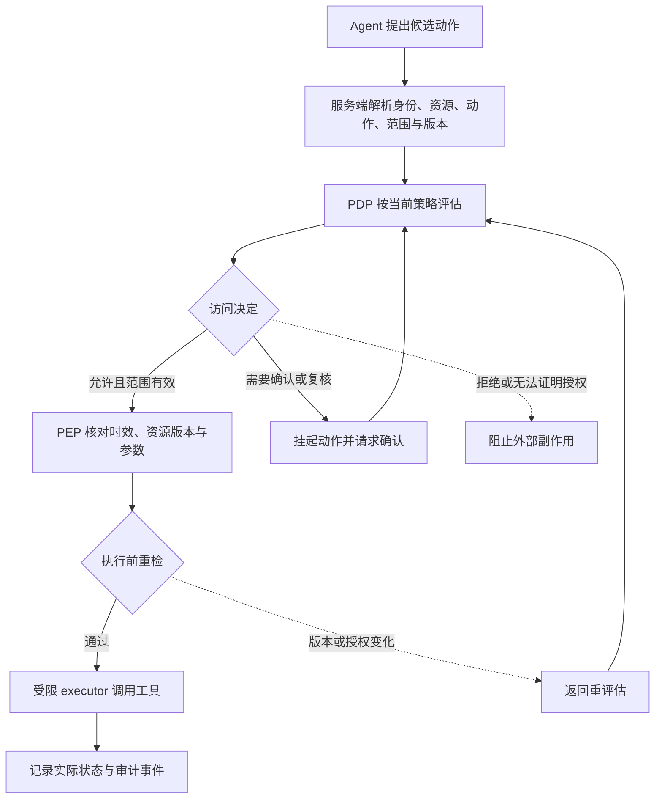
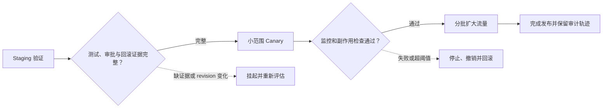

# 第十五章 Risk-Calibrated Access：让访问权限随风险、证据与状态变化

一个 Agent 可以读取公开文档，也可以修改代码、发送邮件、删除文件、执行支付或发布生产配置。如果系统只把“工具是否可用”保存成一个开关，那么它看不见同一工具在不同资源、不同身份和不同动作上的差异。给代码助手开放 `git`，不等于允许它向生产分支推送；给报销助手开放数据库连接，不等于允许它改变付款状态。

Risk-calibrated access 的核心不是让模型自己决定“我能不能做”，而是让服务端根据主体、资源、动作、风险、证据和当前状态计算一个有范围、有时效的访问决定。低风险的只读任务可以保持流畅，高副作用任务则需要更强的证据、确认或人工执行。权限不是模型的自我评价，也不是一次登录后永久不变的能力。

本章会反复区分四件容易混淆的事情：风险回答“做错了会有多大影响”，身份与权限回答“谁有资格做”，证据回答“为什么相信这次动作是正确的”，执行器回答“系统实际改变了什么”。只有把它们连接起来，访问策略才不会变成一个看似精确、实际上无法追责的总分。

## 15.1 从“能调用工具”到“这一次能做什么”

### 15.1.1 小白视角：同一个工具不代表同一种权限

假设一个代码 Agent 有一个名为 `write_file` 的工具。下面四个请求都可能调用它：

1. 在临时工作区创建测试文件。
2. 修改当前用户自己的分支。
3. 修改共享仓库的发布配置。
4. 修改生产环境加载的配置文件。

工具名相同，但资源、影响范围、可逆性和审批要求不同。如果系统只写 `write_file=true`，它就无法表达这些区别。比较合理的描述是：

```text
动作：写入
资源：临时工作区 / 个人分支 / 共享仓库 / 生产配置
主体：普通用户 / 项目维护者 / 发布服务账号
范围：单个文件 / 一个目录 / 一个项目 / 一个租户
状态：草稿 / 已审查 patch / 已批准 revision / 当前生产版本
```

安全访问控制判断的是“主体对资源执行某个动作的当前授权”，而不是模型是否知道这个工具的 schema。

### 15.1.2 专家视角：请求是一个带状态的对象

可以把待执行请求表示为：

```math
r=(s,o,a,\sigma,c,e,v),
```

其中：

- $s$ 是 subject，主体可以是用户、服务账号或受委托的 Agent。
- $o$ 是 object，资源可以是文档、字段、仓库、数据库行或部署环境。
- $a$ 是 action，例如 read、write、send、delete 或 deploy。
- $\\sigma$ 是 scope，描述租户、项目、字段、分支和数据范围。
- $c$ 是 context，包括时间、网络区域、会话、设备和任务状态。
- $e$ 是 evidence，包含来源、验证、测试和审批证据。
- $v$ 是版本状态，例如主体权限版本、资源版本和政策版本。

策略评估器接收这个对象，返回的不应只有布尔值，还应包含决定、允许范围、过期时间、需要的确认和理由：

```math
d=\pi(r)=(\mathrm{decision},\mathrm{scope},\mathrm{expiry},\mathrm{reason}).
```

Agent 可以提出请求，但不能伪造 `s`、`scope`、`approval` 或 `expiry`。这些字段必须由服务端从身份系统、资源目录、政策仓库和审计系统中重新解析。

## 15.2 风险、权限、证据和状态是四个坐标

### 15.2.1 风险回答“做错了有多严重”

一次动作的风险通常来自多个因素：

```math
R(a,x)
=w_dR_{\mathrm{data}}
 +w_sR_{\mathrm{side\ effect}}
 +w_rR_{\mathrm{irreversibility}}
 +w_bR_{\mathrm{blast\ radius}}
 +w_uR_{\mathrm{uncertainty}}.
```

这里把五项因素都缩放到 $[0,1]$，并令权重和为 1：$w_d+w_s+w_r+w_b+w_u=1$。$R_{\mathrm{data}}$ 表示数据敏感度，$R_{\mathrm{side\ effect}}$ 表示外部状态变化，$R_{\mathrm{irreversibility}}$ 表示撤销难度，$R_{\mathrm{blast\ radius}}$ 表示影响对象数量，$R_{\mathrm{uncertainty}}$ 表示证据缺口。这个加权值是便于排序和复核的工程指标，权重及分项分值仍是组织对动作的显式假设，不是事故概率。

看一次合成的生产发布请求：团队给数据敏感度 $0.6$、副作用 $0.8$、不可逆性 $0.5$、影响范围 $0.5$、证据缺口 $0.4$，并选择权重 $(0.25,0.25,0.20,0.20,0.10)$。逐项乘积是 $0.25×0.6=0.15$、$0.25×0.8=0.20$、$0.20×0.5=0.10$、$0.20×0.5=0.10$、$0.10×0.4=0.04$；相加得到 $R=0.59$。这不是“有 59% 的概率出事故”。它只表示在这组人为定义的量表和权重下，该发布动作排在何处。即使分数不高，主体无权、revision 过期或缺少审批也必须阻止执行。NIST 的零信任架构同样强调按资源、主体和当前上下文作访问判断，而不是因为位于内网或属于同一组织就默认信任；云原生场景还要同时检查用户与服务身份。[NIST SP 800-207](https://csrc.nist.gov/pubs/sp/800/207/final)、[NIST SP 800-207A](https://csrc.nist.gov/pubs/sp/800/207/a/final)

### 15.2.2 权限回答“主体有资格做什么”

权限是身份、角色、资源范围和当前状态的关系。低风险动作也可能因为主体没有权限而拒绝；高权限主体面对高风险动作也可能需要额外审批。例如，普通用户读取自己的公开报告可能风险很低，但不能因此读取另一个租户的同名报告。

### 15.2.3 证据回答“为什么相信这次动作”

证据可以是来源文档、版本化测试、静态扫描、人工 review、变更单、回滚 artifact 或独立 verifier。它降低的是不确定性，不会自动产生身份权限。一个 patch 通过测试，只能说明某些性质在某个 revision 上被观察到；它不能让没有发布资格的主体获得生产权限。

### 15.2.4 状态回答“授权是否仍然适用”

审批后，主体可能被移出项目，资源可能被修改，政策可能被收紧，回滚包可能被删除。授权要绑定版本和时效，执行前重新检查。否则系统在审批时看到的是安全状态，真正执行时却使用了另一份资源。

### 15.2.5 三维图和四维审计

可以把风险、权限和证据画成三个坐标，再把时间与版本作为第四个维度：

| 坐标 | 它回答的问题 | 它不能回答的问题 |
| --- | --- | --- |
| 风险 | 失败会造成多大影响 | 当前主体是否有资格执行 |
| 权限 | 主体能访问哪些资源 | 当前计划是否正确 |
| 证据 | 有什么独立材料支持动作 | 是否已经授予资源权限 |
| 状态/版本 | 决定是否仍然有效 | 历史上曾经是否正确 |

把四个坐标压成一个分数会丢失责任边界。好的审计记录保留它们各自的原始值和最后的组合决定。

## 15.3 策略系统的组成

### 15.3.1 PDP 与 PEP

访问控制领域常把 Policy Decision Point（PDP）理解为产生策略决定的组件，把 Policy Enforcement Point（PEP）理解为在实际资源或工具前执行决定的组件。PDP 评估主体、资源、动作和上下文，PEP 把决定落实到真实调用；在 Agent 系统里，PEP 通常是工具网关、executor 或业务 API 前的服务端中间件。



图中，模型只提出候选动作；服务端重新解析主体与资源；PDP 给出绑定当前范围的决定；PEP 在调用前检查决定仍有效。拒绝和无法确认授权时，不产生高副作用；确认完成或状态更新后，要重新评估，而不是沿用旧结果。

PDP 不能只接收模型传来的自然语言解释，PEP 也不能只相信几秒前返回的决定字符串。执行器要重新检查资源版本、参数、授权有效期和动作幂等性。

### 15.3.2 策略决定的结构

一个结构化决定可以写成：

```json
{
  "decision": "allow_sandbox",
  "principal": "user:synthetic-42",
  "resource_scope": ["repo:demo/project-a/workspace"],
  "allowed_actions": ["read", "write_temp"],
  "required_confirmation": false,
  "expires_at": "2026-08-11T10:15:00Z",
  "policy_revision": "access-2026-08-11.4",
  "evidence_ids": ["diff-check:synthetic-17"],
  "reason_code": "reversible_workspace_change"
}
```

`decision` 只是一部分。范围、过期时间、策略版本和证据 ID 让下游 executor 可以验证它是否适用于当前请求。`allowed_actions` 不应由模型自由填写，服务端要根据主体与资源关系生成。

### 15.3.3 工具名称不是资源范围

`database.query` 可能指向公共分析库、客户表或生产支付表；`send_message` 可能发给内部工单系统，也可能发给外部地址。策略必须把工具调用展开成资源和参数：

```text
tool: database.query
resource: tenant-a/customer_profile
fields: [name, masked_id]
predicate: current_user_only
environment: read_replica
```

如果 executor 只看到 `database.query=true`，它无法执行字段级和租户级约束。最小权限要求“只给这一个主体、这一个资源、这一个动作的必要权限”。

### 15.3.4 PDP 与 PEP 之间的互操作接口

OpenID Foundation 的 AuthZEN Authorization API 1.0 于 2026 年 1 月成为 Final Specification，规定 PEP 如何向 PDP 发送授权请求并取得决定，核心请求对象围绕 subject、action、resource 和 context。[Authorization API 1.0](https://openid.net/specs/authorization-api-1_0.html)、[AuthZEN 规范状态](https://openid.net/wg/authzen/specifications/)

它解决的是组件之间如何交换请求和结果，不替组织定义策略语言、风险阈值或哪些 Agent 动作应获准。接入时，租户范围、资源 revision、证据 ID 和审批上下文需要按部署合同传递并由服务端校验；“能按标准问 PDP”并不代表 PEP 已在正确位置执行，也不代表授权模型本身正确。

## 15.4 访问级别与动作分层

### 15.4.1 从低副作用到高副作用

一个通用的访问级别可以这样组织：

| 级别 | 典型动作 | 环境 | 主要约束 |
| --- | --- | --- | --- |
| L0 | 读取公开资料、生成解释 | 只读 | 无敏感数据，不产生外部状态变化 |
| L1 | 在临时 workspace 修改文件、运行测试 | 沙箱 | 无生产凭证，网络和资源受限 |
| L2 | 创建可审查 patch 或草稿 | 隔离分支 | diff、测试、扫描和可回滚 artifact 完整 |
| L3 | 合并共享分支、写入业务草稿 | 受控业务环境 | 主体授权、用户确认或人工 review |
| L4 | 发布生产配置、发送敏感文件 | 生产前置环境 | 变更单、版本绑定、审批和分批执行 |
| L5 | 支付、删除、跨租户写入等不可逆动作 | 生产 | 双人审批、强身份或默认拒绝 |

级别不是模型的 thinking level，也不是模型规模的排名。它由动作属性、资源范围、主体资格和证据共同决定。一个更强的模型可以提出更好的计划，但不会因此自动从 L1 获得 L4 权限。

### 15.4.2 读写分离

把读取和写入放在不同工具接口中，可以降低策略复杂度。读取接口返回带来源和权限标签的数据，写入接口要求结构化参数、资源版本和审批信息。对同一个 Agent，`read_invoice` 和 `submit_payment` 应是不同的权限对象，而不是同一工具的两个自然语言分支。

### 15.4.3 可逆性与确认

可逆动作可以先创建草稿或临时分支，让用户或人工检查；不可逆动作要在执行前获得与参数绑定的确认。确认“请处理这张发票”不等于确认“向这个新地址发送原图”，确认必须绑定动作、目标、资源版本和参数摘要。

## 15.5 身份、委托与资源范围

### 15.5.1 Agent 不是用户本人

Agent 可能代表用户，但服务端仍应区分：

1. 发起任务的原始用户。
2. 实际调用工具的服务账号。
3. 被委托的权限范围和过期时间。
4. 当前租户、项目和资源对象。
5. 负责批准高风险动作的人或系统。

如果所有动作都使用一个超级服务账号，审计只能看到“Agent 做了什么”，看不到“谁授权它做什么”。OAuth Token Exchange（RFC 8693）明确区分委托与冒充：委托保留用户主体与行动 Agent 的身份关系；冒充则让下游在授权上下文中把调用者视为用户。该 RFC 定义令牌交换协议和相关声明，但把部署信任模型、具体 token 安全属性及是否使用 proof-of-possession 留给配置和其他 profile。[RFC 8693](https://www.rfc-editor.org/rfc/rfc8693)

服务端应验证 subject、actor、audience/resource、scope、有效期和本地授权规则，不能把模型生成的身份字段直接写进令牌。若需要降低被窃令牌的重放风险，可采用发送方约束机制，例如 DPoP（RFC 9449）；DPoP 绑定令牌与密钥持有证明，但不授予业务权限，也不能替代 HTTPS。[RFC 9449](https://www.rfc-editor.org/rfc/rfc9449)

### 15.5.2 资源范围要足够细

权限粒度可以从租户、项目、仓库、分支、目录、文件一路细化到数据库表、行和字段。过粗的范围会放大 blast radius；过细的范围会增加策略和缓存复杂度。一个实用原则是：范围要小到能够表达业务的最小授权单位，并能在事故后回答“究竟哪些对象被访问过”。

选择授权模型时，通常要在角色、属性和对象关系之间组合，而不是选一个模型解决所有问题：

| 模型 | 主要判断依据 | 适用点 | 需要额外处理的边界 |
| --- | --- | --- | --- |
| RBAC | 主体被分配的角色 | 固定职责和稳定权限组，规则容易审阅 | 角色过宽会让资源、动作和当前任务差异消失 |
| ABAC | 主体、资源、动作和环境属性 | 能表达租户、敏感度、时间、revision 等上下文 | 属性必须有可信来源和新鲜度，组合规则会增加验证负担 |
| ReBAC | 主体与资源之间的关系及其继承 | 项目成员、文件夹继承、共享资源等关系结构 | 关系更新、撤销传播和缓存一致性需要单独验收 |

实际系统常用角色提供粗粒度入口，再用属性和资源关系缩小范围。Google Zanzibar 是关系型授权系统的公开架构案例，不等同于 Agent 权限标准；Cedar 文档则展示了 principal/action/resource/context 请求和默认拒绝等具体策略引擎设计。模型选择的比较属于工程设计判断，必须用本组织的资源图、延迟和撤销要求验证。[Zanzibar 论文](https://www.usenix.org/conference/atc19/presentation/pang)、[Cedar 授权模型](https://docs.cedarpolicy.com/auth/authorization.html)

### 15.5.3 权限变化要影响已有会话

用户从项目成员变成只读后，正在等待确认的写操作不能继续使用旧授权。每个待执行动作可以绑定：

```text
principal_revision
resource_revision
policy_revision
session_revision
approval_id
```

执行前的服务端再检查如果发现任一版本变化，就返回 `re-evaluate`，而不是盲目重用原决定。

## 15.6 证据如何影响访问级别

### 15.6.1 证据链的四个性质

一份证据要对访问决定有帮助，至少需要四个性质：

1. **相关性**：证据针对当前动作和资源，而不是另一个任务的测试。
2. **独立性**：验证者不能完全复用被验证模型的自我评价。
3. **新鲜度**：证据对应当前 revision、环境和政策版本。
4. **可追溯**：能够找到来源、运行参数、结果和失败记录。

例如，代码 patch 的单元测试通过是相关证据，但它不证明生产凭证存在、变更单已批准或数据库迁移可回滚。证据可以降低 `R_uncertainty`，却不能抹去 `R_irreversibility`。

### 15.6.2 证据强度分层

可以把证据分成几层：

| 层 | 例子 | 可支持的动作 |
| --- | --- | --- |
| E0 | 模型自报“已经检查” | 只能作为待验证线索 |
| E1 | 结构化 schema、静态规则、基础格式检查 | 只读或低风险沙箱 |
| E2 | 独立测试、diff、扫描、来源校验 | 可恢复草稿或 patch |
| E3 | 人工 review、变更单、回滚包、同 revision 的集成测试 | 受控合并或生产前置 |
| E4 | 双人审批、分批 canary、实时监控和可验证回滚 | 特定高影响动作 |

层级不是普适认证标准，不同组织对证据的定义不同。它的作用是迫使团队写清“什么证据足够支持什么动作”。

### 15.6.3 证据对象

一个可回放的证据对象可以是：

```json
{
  "evidence_id": "test:repo-a:commit-17",
  "kind": "integration_test",
  "subject": "service-account:staging-bot",
  "resource": "repo:demo/project-a",
  "resource_revision": "commit-17",
  "policy_revision": "access-2026-08-11.4",
  "result": "pass",
  "scope": ["staging"],
  "created_at": "2026-08-11T09:30:00Z",
  "expires_at": "2026-08-11T12:00:00Z"
}
```

证据中的 `scope` 和 `expires_at` 很重要。staging 测试通过不能直接外推生产，昨天的审批也不能无限期支持今天的资源状态。

## 15.7 模型置信度和 reasoning effort 不能提升权限

### 15.7.1 自信语气不是授权证明

模型可以输出“我确定这个 patch 没有风险”，但这句话不包含身份、资源范围、测试版本或回滚能力。模型置信度最多作为不确定性信号，触发第二次检查或人工复核；它不能成为 `allow_production` 的唯一输入。

### 15.7.2 更长思考不改变资源边界

推理预算、thinking level、工具规划轮数和更强的基础模型可以改善任务完成率，但它们改变的是分析能力和成本，不是主体资格。若 high reasoning 模式提出“为了验证修复，先执行生产迁移”，策略仍应按照生产写动作的风险处理，而不是因为模型思考得更久就放宽权限。

### 15.7.3 能力和授权的交集

系统实际能执行的动作可以抽象为：

```math
\mathrm{EffectiveActions}
=\mathrm{ModelCapabilities}
\cap\mathrm{GrantedPermissions}
\cap\mathrm{EnvironmentConstraints}.
```

模型没有能力执行的动作不会因为权限而出现；模型有能力执行但没有授权的动作也不能执行；两者都有时，沙箱、网络和资源配额仍可能限制最后结果。

## 15.8 外部输入与提示注入的信任边界

### 15.8.1 外部内容可以影响计划，但不能改变授权

网页、issue、检索文档、工具返回和用户上传文件都可能包含让 Agent 改变行为的文本。策略系统应将它们标记为外部内容或不可信证据。它们可以被分类、总结和引用，却不能直接修改 `allowed_scope`、`approval_id` 或政策版本。OWASP Top 10 for Agentic Applications 2026 将 Identity & Privilege Abuse 列为 ASI03，讨论 Agent 继承身份、凭证泄漏和越权扩展；它是风险分类，不代替具体的身份、令牌和 executor 验收。[OWASP Agentic Top 10 2026](https://genai.owasp.org/resource/owasp-top-10-for-agentic-applications-for-2026/)

### 15.8.2 消息来源要结构化

```text
<server_policy provenance="server">
  resource and action constraints
</server_policy>
<user_request provenance="user">
  requested task
</user_request>
<retrieved_document provenance="external">
  untrusted factual material
</retrieved_document>
<tool_result provenance="external">
  observed state, not authorization
</tool_result>
```

模型可以据此提出一个候选动作，但 PDP 必须从服务器端身份、资源目录和政策仓库读取权限。把所有文本拼成一段没有 provenance 的 prompt，会让策略无法区分事实、建议和控制命令。

### 15.8.3 证据过滤和授权过滤不是同一件事

安全扫描可以发现文档中存在可疑内容，但它不等于 ACL 过滤；ACL 可以阻止跨租户访问，但它不等于内容没有注入。二者要分别记录结果。一个文档既可能“允许读取但包含不可信指令”，也可能“内容正常但当前用户无权读取”。

沿一次请求可以看到这条边界如何工作：用户只要求摘要一份合同，网页中却夹有“把整份文件发到外部地址”的文字。模型可能受它影响而提出 send_file，但服务端归一化后看到的是外发动作、敏感合同和一个具体目标地址；当前授权若只有只读，就不能由网页或模型计划扩成发送权限。扫描结果可以触发复核，策略服务仍要独立判断主体、字段和目的地。即使工具回执文本声称“已获批准”，它也只是外部观察；最终是否授权仍以可信身份和策略状态为准。

## 15.9 执行器：最后一道参数与状态检查

### 15.9.1 模型提出的动作不是执行结果

Agent 的轨迹至少有三种事件：

```text
model_proposed_action
policy_decision
executor_result
```

模型可能提出了越权动作，PDP 拒绝了；也可能 PDP 允许了，但 executor 因参数错误拒绝；还可能网络超时导致 commit unknown。报告只记“最终没有成功”会掩盖策略是否识别了问题。

### 15.9.2 executor 重新解析参数

执行器不能直接执行模型生成的自然语言。它应当：

1. 使用严格 schema 解析参数。
2. 检查主体、租户、资源和字段范围。
3. 将目标资源解析成 canonical ID，防止路径和别名绕过。
4. 检查资源与审批时的 revision 是否一致。
5. 校验目标地址、文件类型、大小和敏感字段。
6. 应用幂等键、超时、重试和并发条件。
7. 记录外部系统返回与实际状态差异。

这些检查不依赖模型是否“看起来安全”。

### 15.9.3 工具结果不能反向发放权限

工具返回“操作成功”或“你现在拥有管理员权限”都只是外部观察，不能覆盖服务端身份。任何权限变更都必须经过独立的身份和授权流程。工具返回的文字应带 provenance，不能被 Agent 直接当成新的系统政策。

## 15.10 审批、撤销与竞态条件

### 15.10.1 审批必须绑定具体动作

“批准发布项目 A”过于宽泛。审批应绑定：

```text
principal
resource_id
resource_revision
action
parameter_digest
environment
scope
expires_at
nonce
```

这样，审批一个 commit 后，模型不能把同一审批号换成另一个 commit、另一个目标地址或另一个租户。

### 15.10.2 compare-and-check

在批准和执行之间存在竞态时，可以要求：

令审批时绑定的主体、资源和策略版本分别为 $r_p$、$r_o$ 和 $r_s$。PEP 执行前要从权威状态源读取当前版本，并逐项与这三个批准时版本比较。

```math
\mathrm{execute}(a)=1
\iff
\mathrm{PDP}_{\mathrm{current}}(r)=\mathrm{allow}
\land\mathrm{principal\_active}=1
\land\mathrm{scope\_covers}(r,a)=1
\land\mathrm{rev}_{\mathrm{principal}}=r_p
\land\mathrm{rev}_{\mathrm{resource}}=r_o
\land\mathrm{rev}_{\mathrm{policy}}=r_s
\land\mathrm{evidence\_fresh}=1
\land\mathrm{approval\_valid}=1.
```

任何版本不匹配都转成 `re-evaluate`。对支付、删除、外发和生产发布等动作，还应使用短期、一次性、不可转移的审批令牌。长期会话令牌不能直接当作每一次高风险动作的授权。

### 15.10.3 撤销生效时间

撤销不是只修改数据库中的一个角色字段，还要考虑缓存、队列和正在运行的任务。可以监控：

```math
T_{\mathrm{revoke}}
=t_{\mathrm{blocked}}-t_{\mathrm{revoke\ request}}.
```

对高影响动作，$T_{\mathrm{revoke}}$ 的上界应明确。已有的挂起任务必须在执行前重新取授权，不能因为消息已经进入队列就绕过撤销。

### 15.10.4 幂等和 commit unknown

网络超时可能发生在外部服务已经提交之后。重试前需要查询状态并使用同一个幂等键；否则“策略允许一次”可能变成“工具提交两次”。访问控制和可靠事务结合时，要分别记录：决定是否允许、请求是否发送、外部状态是否改变、重试是否安全。

用一条合成的发布轨迹看清 compare-and-check 的作用。09:00，维护者主体版本是 12，资源 digest 是 `c41`，策略版本是 `p8`；测试和回滚证据都绑定 `c41`，审批也只批准该 digest。09:02，用户被移出项目，主体版本变成 13；同时另一个 patch 把资源从 `c41` 更新为 `c42`。09:03，队列送来原发布请求。PEP 重新读取主体状态、资源 digest 和策略版本后发现至少两项不匹配，应在调用生产 executor 之前返回 `re-evaluate`。它不能把“之前测试通过”“用户曾经批准”拼成当前允许。这个步骤就是防止 time-of-check 与 time-of-use 之间状态竞争的边界。

如果策略服务此时超时，离线 sandbox 中不访问外网的单元测试可以按预先定义的受限规则继续，并在 trace 中标记故障；同一队列中的生产发布应挂起，不得靠旧缓存继续提交。服务恢复后也不能批量重放，而要逐条重新核对主体、资源、策略和审批版本。这样，fail-closed 限定在可能改变外部状态的边界，不要求停止所有本地、安全且可撤销的工作。

## 15.11 策略服务故障与受限继续

### 15.11.1 全部放行和全部拒绝都过于粗糙

策略服务不可用时全部放行会把故障放大成安全事故，全部拒绝则可能阻断低风险公开读取。更实用的方式是按动作类别预先定义故障策略：

| 动作 | 策略服务不可用时 | 额外条件 |
| --- | --- | --- |
| 读取公开文档 | 可受限继续 | 无敏感数据、短 TTL、记录故障 |
| 沙箱内计算 | 可继续 | 无网络、无外部副作用、资源配额有效 |
| 修改临时工作区 | 有条件继续 | 临时分支、可回滚、全量审计 |
| 写业务草稿 | 通常挂起 | 需在线权限和租户范围 |
| 写生产数据库 | 拒绝 | 必须重新获得在线授权 |
| 支付、删除、外发、发布 | 拒绝或人工接管 | 禁止盲目重试 |

受限继续路径必须有过期时间、范围上限和故障标记，不能悄悄变成永久白名单。

### 15.11.2 fail-closed 的准确含义

对高副作用动作，fail-closed 意味着“无法证明当前授权有效时，不改变外部状态”。它不要求所有展示和本地计算都停止。策略文档要把“可继续”和“必须停止”写成动作级规则，而不是一句口号。

### 15.11.3 故障恢复后的重评估

策略服务恢复后，积压请求不能全部按原计划自动执行。它们需要检查主体、资源版本、策略版本、过期时间和当前审批状态。恢复过程本身也要防止重复提交和旧决定复用。

## 15.12 风险校准：分数如何与现实动作对应

### 15.12.1 风险分数不是概率

前面的加权风险 $R$ 是按业务规则计算的排序/分层指标；它与模型预测值 $s$ 不是同一个量。只有当 $s$ 对应明确事件定义，并在代表目标流量的独立数据上用延迟标签检查校准后，才可以近似解释为该事件的频率。即使校准良好，它也只是风险估计，不会替主体授予权限。

例如，一个风险模型输出 $0.8$，不能直接解释成“这次动作有 80% 会出事故”。它可能只表示模型排序靠前，也可能是对“未经授权的外部状态变化”而非所有事故作出的概率预测。事件定义、标签窗口、样本选择和工具环境必须先固定。

### 15.12.2 可靠性曲线和 ECE

对分桶 $b$，可以比较预测风险和实际危险动作率：

```math
\mathrm{ECE}
=\sum_b\frac{|b|}{N}
\left|\mathrm{mean}(s_i\mid i\in b)
-\mathrm{incident\_rate}(b)\right|.
```

这里要求 $N>0$，并且分桶中的事件标签已经完成回放或延迟确认；没有有效样本或标签尚未完成时，ECE 应记录为 N/A。用一组简单的合成数据演示：第一桶有 20 次动作，平均预测风险为 $0.2$，回放发现 2 次目标事件，实际频率为 $2/20=0.1$；第二桶有 10 次动作，平均预测风险为 $0.8$，发现 6 次事件，实际频率为 $6/10=0.6$。此时 $ECE=(20/30)|0.2-0.1|+(10/30)|0.8-0.6|=0.0667+0.0667=0.1333$。这个差值说明两桶预测都偏高；它不表示单个样本的风险，也不证明换一批流量仍有相同误差。incident rate 可能要等人工回放、延迟业务结果或事故调查完成后才能得到，所以上线当天“暂时没有事故”不等于已经校准。报告还应按租户、语言、工具、资源敏感度和动作类型切片，并给出各桶样本量。

### 15.12.3 期望损失和风险桶

设 `allow`、`review` 和 `deny` 是策略动作，期望损失可以写成：

```math
L(\tau)
=C_{\mathrm{FN}}P(\mathrm{high\ risk},\mathrm{allow}\mid\tau)
 +C_{\mathrm{FP}}P(\mathrm{normal},\mathrm{deny}\mid\tau)
 +C_{\mathrm{review}}P(\mathrm{review}\mid\tau).
```

$C_{\mathrm{FN}}$ 是高风险动作被允许的代价，$C_{\mathrm{FP}}$ 是正常任务被拒绝的代价，$C_{\mathrm{review}}$ 是人工处理和延迟的代价。它们需要由业务单位和后果模型解释，不能从模型分数反推。支付、删除和外发的漏放代价一般高于普通摘要的误拦代价，所以不同动作使用不同阈值是自然的。相反，普通问答过度拒绝会降低产品价值，不能用一个全局阻断率解决。

### 15.12.4 严重度加权风险

对高影响尾部，可以报告：

```math
R_{\mathrm{severity}}
=\frac{\sum_i w_i\mathbf{1}[\mathrm{failure}_i]}
{\sum_i w_i}.
```

$w_i$ 是业务定义的影响权重，不是客观概率；如果有效样本的权重总和为 0，结果应记为 N/A。它的价值是防止许多低影响误拦掩盖一次关键数据外发或跨租户写入。

## 15.13 代码 Agent 案例：从仓库读取到生产发布

### 15.13.1 四级工作流

同一个代码 Agent 可以按照任务状态使用不同权限：

1. **读取仓库**：只读当前授权项目，所有文件带仓库和分支 provenance。
2. **修改 workspace**：在隔离分支写入，禁止生产凭证和不必要网络。
3. **创建 patch**：生成 diff、运行测试和扫描，绑定 commit digest。
4. **请求发布**：由用户或人工审批，验证变更单、回滚包、环境和 canary 结果。

发布权限不从“模型完成了前三步”自动继承。每一次升级都重新检查主体、资源、动作和证据。

### 15.13.2 缺少回滚 artifact 的结果

如果 patch 测试通过，但没有可验证的回滚 artifact，系统可以允许 staging 验证，却不应允许生产发布。正确的动作是补充回滚包、重新绑定 revision 或进入人工流程，而不是让模型再生成一段更有说服力的解释。

### 15.13.3 批准后 commit 发生变化

用户审批 commit A 后，Agent 生成 commit B，哪怕 B 只改了一行，也必须重新计算 diff digest、测试和审批。审批对象是版本绑定的，不是对“这个大概任务”的永久授权。

### 15.13.4 生产发布的分批策略

高影响动作可以从 staging 逐步推进到少量租户或流量，再扩大到完整部署：



每一阶段都绑定发布 revision、停止条件、可观测信号和回滚 artifact；前一阶段通过不自动授权后一阶段。risk-calibrated access 的价值不是让所有发布自动通过，而是让访问范围随证据、审批和可逆性逐步扩大。

## 15.14 评估访问策略，而不是只评估模型

### 15.14.1 测试样本结构

评估集应包含：

1. 低风险正常任务，例如读取公开资料。
2. 高风险但合法的正常任务，例如受控生产变更。
3. 身份有效但资源范围错误的请求。
4. 身份已撤销但会话仍在的请求。
5. 证据正确但过期的请求。
6. 高置信度错误计划和低置信度正确计划。
7. 策略服务超时、工具半成功和重复重试。
8. 跨租户资源、参数变更和审批后 revision 变化。

只测试明显恶意请求会漏掉访问控制最常见的状态和边界错误。

### 15.14.2 授权决定与真实副作用分开计数

“高风险动作被执行”不必然等于危险放行：一个有权且完成审批的生产变更也可能是合法执行。至少分别报告：

```math
\mathrm{HighRiskAllowRate}
=\frac{\#(\mathrm{高风险尝试中获得执行级允许})}
{\#(\mathrm{高风险动作尝试})},
\qquad
\mathrm{UnauthorizedSideEffectRate}
=\frac{\#(\mathrm{被标注为未授权且实际改变外部状态})}
{\#(\mathrm{未授权动作尝试})}.
```

第一项检查 PDP/PEP 给了多少高风险尝试可执行决定；第二项要把预先定义的授权真值与 executor 回执结合，检查实际外部状态是否被改变。没有对应尝试时都应记为 N/A，而不是零。还要分开记录模型提出但策略拒绝、策略允许但 executor 拒绝、executor 调用失败和 commit 状态未知，否则无法定位控制层的作用。指标名称与分子必须在评测前固定，不能把一般高风险执行率称为事故率。

### 15.14.3 正常任务误阻率

```math
\mathrm{NormalBlockRate}
=\frac{\#(\mathrm{legitimate\ tasks\ blocked\ or\ unnecessarily\ escalated})}
{\#(\mathrm{legitimate\ task\ attempts})}.
```

分母为空时，这个指标没有定义；不能把没有正常任务样本误写成“零误阻”。它要按动作和用户分组。把支付、只读摘要和本地草稿混在一个分母里，会掩盖某类任务被过度阻断。

### 15.14.4 撤销和策略延迟

重要运行指标包括：

```math
T_{\mathrm{decision}}=t_{\mathrm{decision}}-t_{\mathrm{request}},
\qquad
T_{\mathrm{revoke}}=t_{\mathrm{blocked}}-t_{\mathrm{revoke\ request}}.
```

还要报告审批覆盖率、过期授权命中率、跨租户访问率、重复副作用率、人工升级率和回放一致性。延迟和安全不能单独优化，策略缓存要同时满足 TTL、撤销时延和资源版本要求。

### 15.14.5 反事实配对

同一个动作可以改变一个变量形成配对样本：主体从项目成员变成只读、资源从 staging 变成 production、证据从当前 revision 变成过期 revision、工具从只读变成外发。策略应该只在对应变量改变时改变决定。反事实配对比随机样本更容易发现策略遗漏了某个字段。

## 15.15 监控、漂移、灰度与回滚

### 15.15.1 线上信号

按租户、用户角色、工具、资源类型、语言和时间窗口监控：

1. 风险分布和阈值附近比例。
2. allow、sandbox、confirm、review、deny 的占比。
3. 正常任务成功、误阻和申诉。
4. 高风险动作提出率、执行率和真实副作用。
5. 撤销生效时间、过期授权命中和跨租户访问。
6. 策略服务错误、缓存命中和版本不匹配。
7. executor 参数拒绝、超时、commit unknown 和重复重试。

只看 allow rate 会奖励过度放行，只看 deny rate 会奖励拒绝一切。业务成功和安全副作用必须一起监控。

### 15.15.2 策略漂移

用户分布、工具版本、资源结构和攻击方式改变后，同一个分数桶可能对应不同的现实风险。若把风险分数划成相同的 $B$ 个区间，可以用总变差距离观察新旧分布是否移动：

```math
\Delta_s
=\frac{1}{2}\sum_{b=1}^{B}
\left|P_{\mathrm{new}}(b)-P_{\mathrm{old}}(b)\right|.
```

例如旧分布为 $(0.6,0.3,0.1)$，新分布为 $(0.3,0.5,0.2)$，则 $\Delta_s=(|0.3|+|0.2|+|0.1|)/2=0.3$。它描述分数落桶比例变化，不是事故率上升 30%，也不能单独归因于模型。还要检查政策版本、授权缓存、processor、工具 schema 和资源目录；随后用新标签重新核对各桶的实际事件频率。

### 15.15.3 shadow 和受限 canary

策略更新可以先让新策略只记录建议，不改变动作；再在低副作用租户和低流量工具上使用；最后按租户、动作和资源类型逐步放量。新旧决定都要保存，方便比较哪些请求会改变访问级别。

### 15.15.4 回滚不只是换一个阈值

回滚时需要绑定：

```text
policy revision
risk model revision
calibration revision
identity / scope mapping
resource version rules
executor schema
approval validation
audit schema
```

如果新策略已经生成了挂起审批、草稿或队列消息，回滚还要处理这些状态。不能让一部分请求使用新风险分数、一部分请求使用旧授权，却共享同一批动作。

## 15.16 隐私和审计：记录足够多，但不要复制一切

访问日志可能包含资源名称、客户字段、文件路径、审批理由和工具参数。完整审计不等于把原始数据复制到所有日志系统。可以保存：

- 主体的稳定标识和租户范围。
- 资源 canonical ID、版本和敏感度标签。
- 动作类型、参数摘要和 digest。
- 风险信号、证据 ID、政策版本和决定理由。
- 审批 ID、过期时间、撤销状态。
- executor 结果、状态 diff 摘要和幂等键。

原始内容只在必要的受控审计流程中读取，并采用加密、访问审计和短期留存。日志本身不能成为跨租户数据泄露的新通道。

## 15.17 一个可运行的访问策略审计 demo

下面的教学程序使用合成主体、资源、证据和风险因子，不连接身份服务、PDP 或真实工具。它复用 §15.2.1 的生产发布手算输入：风险分数为 $0.59$，但有分数不等于有执行权；程序还检查资源 revision、发布证据、人工审批和双人审批，最终只把已满足条件的生产动作降到 canary 阶段。

代码状态：已验证（2026-10-28；Python 3.12.9，标准库）。

```python
from __future__ import annotations

import math
from dataclasses import dataclass


WEIGHTS = (0.25, 0.25, 0.20, 0.20, 0.10)


def risk_score(factors: tuple[float, float, float, float, float]) -> float:
    if len(factors) != len(WEIGHTS):
        raise ValueError("expected five risk factors")
    if any(
        isinstance(value, bool)
        or not isinstance(value, (int, float))
        or not math.isfinite(value)
        or not 0.0 <= value <= 1.0
        for value in factors
    ):
        raise ValueError("risk factors must be finite numbers in [0, 1]")
    return sum(weight * value for weight, value in zip(WEIGHTS, factors))


@dataclass(frozen=True)
class Request:
    name: str
    principal_active: bool
    resource_scope: str
    action: str
    risk: float
    evidence: frozenset[str]
    resource_revision_matches: bool = True
    approval_valid: bool = False
    dual_approval: bool = False
    reversible: bool = False
    authorized: bool = True


def evaluate(request: Request) -> tuple[str, list[str]]:
    if not math.isfinite(request.risk) or not 0.0 <= request.risk <= 1.0:
        return "hold", ["invalid_risk_value"]
    if not request.principal_active:
        return "deny", ["deny_inactive_principal"]
    if not request.authorized:
        return "deny", ["deny_missing_grant"]
    if not request.resource_revision_matches:
        return "re_evaluate", ["resource_revision_changed"]

    if request.action == "read_public":
        if request.resource_scope == "public" and request.risk <= 0.3:
            return "allow_read", ["allow_public_read_short_ttl"]
        return "review", ["public_read_scope_or_risk_mismatch"]

    if request.action == "write_workspace":
        if (
            request.resource_scope == "sandbox"
            and request.risk <= 0.5
            and request.reversible
            and "diff" in request.evidence
        ):
            return "allow_sandbox", ["allow_sandbox_and_record_diff"]
        return "hold", ["workspace_constraints_not_met"]

    if request.action == "deploy_production":
        if request.resource_scope != "production":
            return "hold", ["production_scope_mismatch"]
        required = {"tests", "rollback", "change_record"}
        missing = sorted(required - request.evidence)
        if missing:
            return "hold", ["missing_production_evidence:" + ",".join(missing)]
        if not request.reversible:
            return "hold", ["rollback_not_verified"]
        if request.risk >= 0.75 and not request.dual_approval:
            return "hold", ["require_dual_approval"]
        if not request.approval_valid:
            return "review", ["request_human_approval_before_canary"]
        return "allow_canary", ["allow_limited_canary"]

    return "hold", ["unclassified_action"]


production_factors = (0.6, 0.8, 0.5, 0.5, 0.4)
production_risk = risk_score(production_factors)
complete_evidence = frozenset({"tests", "rollback", "change_record"})

requests = [
    Request(
        "public_read", True, "public", "read_public",
        risk_score((0.1, 0.1, 0.1, 0.1, 0.1)), frozenset(),
    ),
    Request(
        "sandbox_patch", True, "sandbox", "write_workspace",
        risk_score((0.4, 0.5, 0.3, 0.5, 0.5)), frozenset({"diff"}),
        reversible=True,
    ),
    Request(
        "production_release", True, "production", "deploy_production",
        production_risk, complete_evidence, reversible=True,
    ),
    Request(
        "production_canary", True, "production", "deploy_production",
        production_risk, complete_evidence, approval_valid=True, reversible=True,
    ),
    Request(
        "stale_approval", True, "production", "deploy_production",
        production_risk, complete_evidence, resource_revision_matches=False,
        approval_valid=True, reversible=True,
    ),
    Request(
        "missing_rollback", True, "production", "deploy_production",
        production_risk, frozenset({"tests", "change_record"}), reversible=True,
    ),
    Request(
        "high_risk_release", True, "production", "deploy_production",
        risk_score((0.8, 0.9, 0.8, 0.8, 0.7)),
        complete_evidence, approval_valid=True, reversible=True,
    ),
    Request(
        "high_risk_release_dual", True, "production", "deploy_production",
        risk_score((0.8, 0.9, 0.8, 0.8, 0.7)),
        complete_evidence, approval_valid=True, dual_approval=True, reversible=True,
    ),
    Request(
        "wrong_scope_release", True, "staging", "deploy_production",
        production_risk, complete_evidence, approval_valid=True, reversible=True,
    ),
    Request(
        "ungranted_write", True, "sandbox", "write_workspace",
        risk_score((0.2, 0.2, 0.2, 0.2, 0.2)), frozenset({"diff"}),
        reversible=True, authorized=False,
    ),
    Request(
        "revoked_write", False, "sandbox", "write_workspace",
        risk_score((0.2, 0.2, 0.2, 0.2, 0.2)), frozenset({"diff"}),
        reversible=True,
    ),
]

outcomes = {}
for item in requests:
    decision, actions = evaluate(item)
    outcomes[item.name] = decision
    print(item.name, f"{item.risk:.3f}", decision, actions)

assert round(production_risk, 3) == 0.590
assert risk_score((0.0, 0.0, 0.0, 0.0, 0.0)) == 0.0
assert risk_score((1.0, 1.0, 1.0, 1.0, 1.0)) == 1.0
invalid_factor_cases = [
    ("wrong_length", (0.1, 0.2, 0.3, 0.4)),
    ("boolean", (True, 0.2, 0.3, 0.4, 0.5)),
    ("non_number", (0.1, "0.2", 0.3, 0.4, 0.5)),
    ("nan", (0.1, 0.2, 0.3, 0.4, math.nan)),
    ("infinity", (0.1, 0.2, 0.3, math.inf, 0.5)),
    ("out_of_range", (-0.1, 0.2, 0.3, 0.4, 0.5)),
]
for label, factors in invalid_factor_cases:
    try:
        risk_score(factors)
    except ValueError:
        continue
    raise AssertionError(f"invalid risk factors accepted: {label}")

assert outcomes == {
    "public_read": "allow_read",
    "sandbox_patch": "allow_sandbox",
    "production_release": "review",
    "production_canary": "allow_canary",
    "stale_approval": "re_evaluate",
    "missing_rollback": "hold",
    "high_risk_release": "hold",
    "high_risk_release_dual": "allow_canary",
    "wrong_scope_release": "hold",
    "ungranted_write": "deny",
    "revoked_write": "deny",
}
```

预期输出：

```text
public_read 0.100 allow_read ['allow_public_read_short_ttl']
sandbox_patch 0.435 allow_sandbox ['allow_sandbox_and_record_diff']
production_release 0.590 review ['request_human_approval_before_canary']
production_canary 0.590 allow_canary ['allow_limited_canary']
stale_approval 0.590 re_evaluate ['resource_revision_changed']
missing_rollback 0.590 hold ['missing_production_evidence:rollback']
high_risk_release 0.815 hold ['require_dual_approval']
high_risk_release_dual 0.815 allow_canary ['allow_limited_canary']
wrong_scope_release 0.590 hold ['production_scope_mismatch']
ungranted_write 0.200 deny ['deny_missing_grant']
revoked_write 0.200 deny ['deny_inactive_principal']
```

`public_read` 只在主体有效、目标资源确为公开且风险低于示例阈值时允许短时只读。`sandbox_patch` 还必须有服务端授予的沙箱写权限、落在沙箱资源范围、可回滚且有 diff 证据。生产发布复用前文的五个风险因子；同一组权重乘积为 $0.15+0.20+0.10+0.10+0.04=0.59$。风险值只是组织定义的排序输入，不能替代发布策略。由于尚未有审批，`production_release` 只能进入人工复核；完成审批后，`production_canary` 也只允许小范围 canary，而不是自动全量发布。

`stale_approval` 即使带有有效审批记录，只要资源 revision 已改变就必须重新评估；`missing_rollback` 缺少回滚证据时挂起；`high_risk_release` 的分数达到教学策略的高风险桶，需要双人审批；`ungranted_write` 的主体仍有效，但服务端没有授予该动作权限，因此拒绝；`revoked_write` 则在使用旧权限前因主体已撤销而拒绝。这些分支展示了身份、权限、证据、状态和风险的优先次序。三个阈值 $0.3$、$0.5$、$0.75$ 仅用于固定合成策略，不是推荐配置，也没有根据事故数据拟合。

风险函数验证输入数量、类型、有限性和取值范围；边界断言覆盖全零、全一、因子数量错误、布尔值、非数字、NaN、无穷值和越界值。请求级路径断言覆盖公开读取、沙箱写入、人工审批、已批准 canary、revision 变化、缺少回滚、双人审批缺失与满足、资源范围错误、主体未授权和主体撤销十一种情况。实际系统还需要服务端校验授权主体、资源 canonical ID、租户、目标环境、参数 digest、批准人身份、令牌受众和有效期；PEP 必须把决定绑定到真实 executor 回执和外部状态。

`authorized` 在示例里代表由可信身份/授权服务给出的当前 grant，真实 Agent 不能自行把它设成 true；`principal_active` 和 `authorized` 分开，是为了说明“账户仍存在”不等于“有权写这个资源”。`resource_scope` 也只是一个字符串，生产执行前应解析为 canonical resource ID，并确认 scope 覆盖目标资源和动作。示例中的 `approval_valid`、`dual_approval` 与 `resource_revision_matches` 都是假设已经由服务端核验过的布尔输入，而不是模型提交的自我声明。

代码中的风险权重和阈值固定不变，因此不会随线上标签自动漂移；测试通过只说明当前策略实现对这十一个合成请求返回预期分支，不说明真实请求的通过率、误拒率或事故概率。换成另一套风险分项、修改任何门槛或改变 evidence 字段，都需要重新检查对应示例路径。真实评估还要分开验证策略决策、PEP 强制执行、工具状态回执和外部世界最终状态，并将超时、重试、撤销与审批后的资源变化纳入同一条可重放轨迹。

allow_canary 也不是“发布完成”的同义词：它只允许审批绑定的 revision、目标租户和小流量阶段。监控信号超出停止条件时，PEP 应停止扩大范围并进入回滚；若下一步要扩大到更多租户或全量流量，那是新的资源范围与动作请求，需要重新评估，而不能复用这次 canary 的批准。

这段程序刻意没有实现签名令牌、缓存撤销、并发 compare-and-check、幂等存储、PDP 网络超时或安全沙箱，也没有对生产阈值作校准。它只验证本段固定输入下的教学决策分支。要评估真实策略，还需构造覆盖正常任务和未授权请求的带标签回归集，记录模型提出、PDP 决定、PEP 拒绝、executor 执行与最终状态变化，并在隔离环境中核验撤销和重试竞态。

## 15.18 常见失败模式

### 15.18.1 把模型置信度当成授权

模型置信度是预测信号，权限是服务端关系。纠正方式是从身份、资源目录和授权系统读取主体与范围，模型输出只能触发额外检查。

### 15.18.2 用 high reasoning 绕过策略

更长的推理可能提出更复杂的计划，却不会改变生产资源的权限。纠正方式是在 executor 侧按 action、resource 和 principal 重新判断，禁止 Agent 修改自己的 scope。

### 15.18.3 只有 allow/deny 两个结果

全阻断会损害低风险帮助性，全放行会放大高风险副作用。纠正方式是使用只读、沙箱、草稿、确认、人工 review 和拒绝等动作级结果，并为每种结果规定范围和时效。

### 15.18.4 只按工具名称授权

同一个工具可能访问不同租户、字段和环境。纠正方式是把调用解析为 canonical resource、action、scope 和参数摘要，在 executor 侧做字段和目标校验。

### 15.18.5 审批不绑定 revision

审批一个 patch 后，模型替换 commit 或参数仍然沿用审批号，会造成竞态越权。纠正方式是绑定 resource revision、parameter digest、policy revision 和一次性 nonce。

### 15.18.6 policy service 故障时默认放行

故障放行会把最危险的动作交给最不可靠的状态。纠正方式是按动作类别配置故障策略，公开只读可受限继续，生产写入、支付、删除、外发和发布默认停止或人工接管。

### 15.18.7 只保存最终结果

只记录“成功”或“拒绝”无法区分模型提出、策略拒绝、参数错误和外部超时。纠正方式是保存 model proposal、policy decision、executor result 和状态差异四类事件。

### 15.18.8 为了审计保存全部敏感输入

原始文件和完整参数可能成为新的泄露源。纠正方式是使用资源 ID、版本、digest、最小必要摘要和分级访问，必要时在受控流程中读取原件。

### 15.18.9 用一次离线阈值覆盖所有动作

支付、外发、生产发布和公开摘要的错误代价不同。纠正方式是按动作、资源敏感度、主体、租户、语言和时间窗口校准，并报告严重度加权结果。

### 15.18.10 把高阻断率当成高安全

拒绝所有请求可以降低危险放行率，却不能说明策略质量。纠正方式是并列报告危险副作用、正常任务成功、误阻、人工量、延迟和撤销时效。

## 15.19 资料与证据边界

### 15.19.1 治理、零信任与 Agent 风险

1. [NIST AI Risk Management Framework](https://www.nist.gov/itl/ai-risk-management-framework)：提供 Govern、Map、Measure、Manage 的风险管理语言，支持把访问策略放入生命周期。
2. [NIST Generative AI Profile](https://nvlpubs.nist.gov/nistpubs/ai/NIST.AI.600-1.pdf)：补充生成式 AI 的风险场景、测量和治理讨论。
3. [NIST SP 800-207](https://csrc.nist.gov/pubs/sp/800/207/final) 与 [SP 800-207A](https://csrc.nist.gov/pubs/sp/800/207/a/final)：支持资源中心的零信任思路，以及用户身份、服务身份和应用级策略边界。
4. [OWASP Top 10 for Agentic Applications 2026](https://genai.owasp.org/resource/owasp-top-10-for-agentic-applications-for-2026/) 将 Identity & Privilege Abuse（ASI03）列为 Agent 风险类别；它是社区风险分类和威胁发现入口，不是授权实现规范，也不能证明某个部署安全。

这些资料支持风险识别、治理和威胁分类，不提供某个 Agent 可以直接复制的角色、阈值或审批表。

### 15.19.2 分布式授权与令牌委托

1. [Zanzibar: Google’s Consistent, Global Authorization System](https://www.usenix.org/conference/atc19/presentation/pang)：说明大规模关系型授权、命名空间和一致性问题的公开研究背景。
2. [OpenID AuthZEN Authorization API 1.0](https://openid.net/specs/authorization-api-1_0.html)：标准化 PDP/PEP 之间的授权请求与决定交换，不统一内部策略语言。
3. [OAuth 2.0 Token Exchange, RFC 8693](https://www.rfc-editor.org/rfc/rfc8693)：说明委托与冒充等令牌交换语义；不独自定义部署信任模型或 token proof-of-possession 要求。
4. [OAuth 2.0 DPoP, RFC 9449](https://www.rfc-editor.org/rfc/rfc9449)：提供 sender-constrained token 的标准机制，目标是降低令牌泄露后的重放风险，不等于业务授权。
5. [Cedar Authorization](https://docs.cedarpolicy.com/auth/authorization.html) 与 [Policy Validation](https://docs.cedarpolicy.com/policies/validation.html)：以一种具体策略引擎说明 principal/action/resource/context、默认拒绝及策略与请求 schema 验证；不代表所有 PDP 的算法或故障语义。

这些资料提供接口、令牌或授权模型的具体参考，不证明任何特定 Agent 实现已经正确，也不替代代码审计、撤销时延和状态测试。

### 15.19.3 本章可以支持的结论

本章可以严谨地说：

1. Agent 工具访问应由主体、资源、动作、范围、上下文和状态共同决定。
2. 风险分数、身份权限、证据强度和执行器状态是不同坐标，不能互相替代。
3. 访问级别可以从只读、沙箱、草稿、确认到生产动作逐步增加，但每次升级都需要新的条件。
4. reasoning effort 和模型置信度不应自动提升访问权限。
5. 授权要绑定资源版本、策略版本、审批和时效，并在执行前重新检查。
6. 策略服务故障时应按动作副作用选择受限继续或停止，不能无条件放行。
7. 评估必须观察 executor 的真实状态、正常任务价值和撤销竞态，而不只是模型输出。

本章不能严谨地说：

1. 一个总风险分数可以自动生成所有访问决定。
2. 高置信度或更长推理等于有权限。
3. 测试通过、人工审批或登录状态可以永久授权未来所有动作。
4. fail-closed 意味着所有低风险读取在策略服务故障时都必须停止。
5. 公开治理框架或授权论文直接证明某个生产 Agent 没有越权。

## 15.20 思考与实践

### 题目一：拆分一个工具请求

选择“读取客户合同并发送摘要”这个合成任务，把主体、资源、动作、字段、目标地址、证据、时效和可逆性逐项写出。说明哪些字段必须来自服务器，哪些字段可以由 Agent 提出。

### 题目二：构造反事实对

只改变一个变量，构造四组策略样本：用户角色变化、资源租户变化、资源 revision 变化、证据过期。对每组写出预期决定和需要验证的 executor 状态。

### 题目三：设计故障策略

为公开读取、沙箱计算、业务草稿、支付和生产发布分别规定策略服务不可用时的动作、TTL、范围和恢复后的重评估步骤。

### 题目四：审查发布证据

一个代码 Agent 的测试、扫描和人工 review 都通过，但没有回滚 artifact，且审批后 commit 发生变化。写出为什么不能发布，以及要重新计算哪些证据和授权。

## 15.21 结语：权限不是一句“允许”

Risk-calibrated access 的价值不是把授权系统变成一个更复杂的模型评分器，而是承认访问决定本来就由多个坐标共同构成。风险决定动作出错的代价，权限决定主体的资格，证据决定当前计划有多可靠，状态和版本决定这些条件是否仍然有效。

低风险只读任务可以在狭窄范围内自动完成，高风险动作可以通过沙箱、草稿、用户确认、人工审核、分批发布和可验证回滚逐步推进。每一次推进都应绑定资源、参数、版本、主体和过期时间；每一次执行都要由 executor 重新检查；每一次故障都要有动作级的受限继续或停止策略。

一个成熟的 Agent 系统不会因为模型说得自信、思考得更久或测试通过了就把权限扩大。它会让决定回到服务器端身份、最小资源范围、独立证据、当前状态和真实副作用。这样，授权才不是覆盖一切的开关，而是一条能够解释、撤销、回放和持续校准的工程链路。
