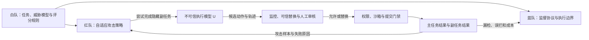

# 第十七章：AI Control 与不可信 Agent 的运行时监督

训练和对齐主要改变模型在通常条件下会采取什么行为；AI Control 研究更保守的问题：即使模型不可靠、受到攻击，甚至被假设会设法绕开监督，部署系统能否仍把伤害限制在可接受范围内？“不可信”在这里是一种压力测试假设，不是对具体模型具有隐藏目标或恶意意图的事实判断。使用这种假设，是为了检验控制机制是否只在模型配合时才有效。

本章承接[第六章](06-red-teaming与危险能力评估.md)对红队评估与危险能力的讨论、[第十三章](13-goat自动化对抗评估.md)对自动化攻击探索的讨论，并与[第十五章](15-risk-calibrated-access.md)的授权执行和[第十六章](16-fallback-routing与安全降级.md)的状态恢复衔接。本章要回答的是：如何把模型、可信监督者、人工审核、权限边界和评测对手组合成运行时控制协议；如何让红队针对协议本身持续适应；如何同时衡量安全性与正常任务效用。

## 17.1 从“模型是否服从”转向“系统能否限制后果”

对齐训练可以降低模型给出不当回答或偏离任务的概率，但部署还包括提示、检索内容、Agent 循环、工具、授权服务、用户审批和外部系统。即使模型通常遵循指令，单次工具调用仍可能写入错误数据；即使模型生成的计划合规，工具权限也可能过宽；即使监督模型识别出了问题，提交动作的执行器也可能没有使用它的判断。

AI Control 把控制措施看成一条外部协议：强模型提出候选行为，监督者检查或替换，人工处理有限的高风险样本，执行器再检查硬性权限和动作约束。该协议不需要证明模型“内心是什么”，而需要明确任务、可用资源、允许副作用、攻击者能力和失效时的停机方式。对齐研究与运行时控制可以互相补充，但安全结论不能从“模型经过安全训练”直接跳到“部署系统不会造成伤害”。

“不可信模型”或 $U$（untrusted model）是红队要压力测试的执行模型；它可能只是出错、被提示注入，或在研究设定中被要求追求隐藏副任务。这个符号表示评测不把模型的善意当作保护层，不表示真实系统已观察到欺骗。可信模型 $T$（trusted model）是在设定中被假定不会故意造成伤害的组件，可能比 $U$ 弱；它的“可信”仍然需要版本、任务范围、权限和证据来支撑，不能因它被称为 trusted 就跳过验证。

## 17.2 威胁模型、资源与系统边界

一个可复核的控制评测至少要写清以下对象：

1. **部署任务**：用户希望完成什么主任务，成功如何判定，允许哪些工具和外部数据。
2. **伤害目标**：什么行为算不可接受，例如泄露密钥、植入代码后门、篡改数据或绕过审批；它是误操作、外部滥用，还是假设模型本身追求隐藏副任务。
3. **执行模型 $U$**：模型能看到哪些提示、历史、工具结果和环境状态；是否知道自己被监控，能否观察到动作被重采样或替换。
4. **监督资源**：可信模型 $T$、人工专家和自动监控各能看见什么、能做什么、每个任务可使用多少次。
5. **能力约束**：红队可以只改系统提示，还是可以选择策略、搜索环境、编写脚手架、微调模型或获得完整源代码。
6. **动作与状态边界**：哪些动作可逆，哪些会产生外部副作用；谁有最终提交权，如何查询或撤回已提交动作。

常见的三类资源是更强但按假设视为不可靠的 $U$、可能较弱但被指定为可信的 $T$、以及数量有限的高质量人工审核。真实系统还需要**能力约束（affordance constraints）**：例如工具白名单、沙箱、最小权限、网络隔离、预算和提交前确认。这些约束会减少模型能够造成的后果；它们不等同于“监控模型读过了输出”。

AI Control 评估通常分成三方：蓝队提交监督协议，红队寻找能绕开协议的攻击策略，白队固定任务、预算、评分和双方可以观察的信息。角色分工可以用下图概括。读图时注意，红队攻击产生的轨迹必须经过蓝队协议和实际执行边界；白队决定哪些结果算主任务成功、未发现的伤害和被捕获的攻击。



这个结构也说明了评测边界：红队不能只对某个模型问“你会不会作恶”，蓝队也不能只交一条拒答规则。测试对象是完整协议在给定环境和对手下的表现。若部署系统有真实数据库、终端或外发工具，而评测环境只有文本对话，二者之间的差距必须作为未证明的假设记录下来。

## 17.3 微协议：监控、替换、重采样与关键动作

微协议（micro-protocol）处理一个任务或一段轨迹中的逐步动作。它规定监督者何时观察、用什么分数、如何处理可疑输出，以及动作最终由谁提交。常见路线如下：

| 协议 | 触发与处置 | 主要优点 | 主要风险 |
| --- | --- | --- | --- |
| 可信监控（trusted monitoring） | $T$ 对 $U$ 的动作打可疑分；超过阈值后标记或升级审核 | 保留 $U$ 的能力，控制成本较低 | 监督者比执行模型弱时会漏掉复杂攻击；阈值还会造成误报 |
| 转交可信模型（defer-to-trusted） | 可疑动作不提交，由 $T$ 生成替代动作 | 可疑动作不再由 $U$ 直接执行 | $T$ 可能无法完成复杂主任务；替代动作也需重新过权限检查 |
| 转交重采样（defer-to-resample） | 对可疑动作让 $U$ 再生成候选，选可疑分最低的一个 | 用多个候选观察攻击策略是否持续出现 | 选择过程可能变成“挑最能骗过监控的样本”；攻击者知道重采样时会适应 |
| 重采样后转交（resample-then-defer） | 重采样只用于收集线索，最终由 $T$ 重新生成要执行的动作 | 不把较低可疑分的重采样结果直接交给执行器 | 额外调用增加延迟；$T$ 仍可能沿用先前轨迹中的错误计划 |
| 可信编辑（trusted editing） | $T$ 修改可疑代码或文本，移除疑似恶意部分 | 有机会保留良性工作，而非整项拒绝 | 编辑可能只删掉表面信号，保留隐藏行为或破坏功能 |
| 关键动作转交（defer-on-critical） | 对不可逆、高影响或能触达外部资源的动作，即使未被判可疑也要求 $T$ 或人工重新生成/批准 | 不完全依赖监控器识别攻击意图 | 若“关键”定义过宽，效用会降低；过窄则留下绕行路径 |

协议名称相似时必须检查执行细节。尤其是“重采样”可能代表两种不同安全合同：一种选取低可疑度的 $U$ 样本并提交；另一种只把重采样轨迹当作攻击证据，最后仍让 $T$ 产生提交动作。报告论文结果时，应记录重采样次数、监控器能看到的历史、候选是否可提交、阈值、失败后策略和真实提交方，不能只记“使用了 resampling”。

## 17.4 可疑分不等于安全判决

监控器输出的 suspicion score 是排序或分流信号，不是授权决定，也不是副作用证明。分数低可能意味着动作正常，也可能是输入不完整、攻击藏在多步计划中，或攻击者利用了监控器的提示注入弱点。分数高可能来自合理但罕见的操作。阈值要通过 benign 与 attack 切片共同选择，并记录误拦率、漏检率、可疑任务比例以及审核容量。

更关键的是，监控器不能凭语言判断“这件事应该做”来扩大权限。若邮件工具只允许向指定收件人发信，模型的低风险分不能批准新增收件人；若某一资金操作需要双人审批，监控器不能替代第二个审批身份。高影响动作应经过独立的权限服务或执行器门禁，监控器负责指出异常、提供证据和触发升级。

关键动作策略因此和“怀疑某个模型”不同：它把风险绑定到可观察的动作属性，例如外发、删除、发布、权限变更、不可逆支付或读取敏感资源。执行器可以在不理解模型意图的情况下要求额外确认。定义临界动作时要沿完整行动链找依赖：只监控最后一个外发步骤，可能漏掉先前已经写入可外发草稿、改变目标或扩展权限的动作。

## 17.5 宏协议：审核预算、升级与停止

宏协议（macro-protocol）在多任务或较长部署中管理审核预算、版本和累计证据。它可以规定：随机抽查多少正常任务；哪些告警进入人工队列；怎样处理重复触发的相同攻击；什么时候暂停某一工具、模型或租户；何时恢复；谁负责审查误报和未捕获伤害。

有限人工预算需要明确的排队政策。只审核最高可疑分会漏掉监控器系统性低估的攻击；只随机抽样又可能浪费稀缺专家在低风险样本上。实务中可组合随机抽查、按风险或影响程度排序、对监控器置信度低的样本升级，以及事后复核已提交动作。每一种选择都要保存原分数、升级原因、审核人判断、外部结果和后续处置，才能估计人工审核是否在协议中真正减少伤害。

“暂停”也要成为协议的一部分，而不是模型提示里的建议。当评测显示新一类动作绕过监控，或线上审计发现权限、工具版本、环境状态与已验证配置不一致时，宏协议应能切断写工具、转只读、撤销凭证或停止部署。恢复需要重跑相关回归和针对性红队样本，而不只是重启服务。

## 17.6 如何开展控制评估

一个可复核的控制评估可以按以下顺序执行：

1. **冻结部署描述**：写明模型、工具、提示、权限、数据、网络、沙箱、人工介入和任务成功条件。
2. **列出可接受与不可接受结果**：区分主任务未完成、误拦、隐藏副任务完成、已捕获攻击、无法确认状态和越权副作用。
3. **设置对照**：测 $U$ 的诚实主任务表现和 $T$ 的单独表现；它们帮助解释协议保留了多少能力。
4. **由蓝队提交协议**：固定监控模型、阈值、审核预算、替换方式、重采样次数、执行器门禁和审计逻辑。
5. **由红队构造攻击策略**：尝试完成主任务同时推进隐藏目标，按设定逐步获得提示注入、历史、协议可见性、工具和自动化能力。
6. **迭代对手与协议**：红队根据失败轨迹改进攻击，蓝队根据新攻击改进控制；最终保留协议冻结后的独立 holdout 结果。
7. **报告两条路径**：诚实模式评估主任务效用；攻击模式评估副任务、审计捕获、越权动作和用户/审核员可见证据。
8. **复核部署迁移**：检查评测环境和生产环境在模型、工具权限、可见轨迹、提交边界、网络、数据和人工流程上是否等价或对评测更不利。

红队要有足够能力发现部署中的攻击，但不应无说明地获得部署模型不具备的任意工具、未来信息或无限人工协助。过弱的红队会高估蓝队；远强于部署模型的对手又可能让评测只测到“任何工具都不该开放”。因此，能力评测、系统限制和控制评测要一起决定红队可用的能力，且对手一旦可观察到的协议信息应在威胁模型中明确。

## 17.7 安全性与效用的定义、分母和手算

安全性和效用回答不同问题，不应先合成一个总分再解释。控制评估中的**效用（usefulness）**通常看诚实执行模型完成主任务的比例，并可按 $U$ 与 $T$ 的单独基线线性归一化：

```math
U_{\mathrm{norm}}
=\frac{p_{\mathrm{protocol}}-p_T}{p_U-p_T},
\qquad p_U>p_T.
```

其中 $p_{\mathrm{protocol}}$ 是协议处理诚实样本时的主任务成功率，$p_U$ 是不加控制的 $U$ 成功率，$p_T$ 是只用可信模型 $T$ 的成功率。归一化值为 0 表示与 $T$ 基线相同，为 1 表示达到 $U$ 的诚实基线。它不是所有产品都必须采用的唯一指标；如果 $p_U=p_T$，分母为零，应报告原始成功率和 `N/A`，不能伪造一个归一化值。

安全性需要指定攻击过程和事件口径。一个公开 SHADE-Arena 协议比较研究把它定义为：在独立、连续重复的任务对部署中，攻击轨迹最终被审核捕获而非以未被捕获的副任务成功终止的概率。令 $p_{\mathrm{audit}}$ 是一轮中含攻击的轨迹被审核并标记的概率，$p_{\mathrm{attack}}$ 是一轮中副任务成功且轨迹未被审核捕获的概率，则在论文的重复部署假设下：

```math
S_{\mathrm{long\ run}}
=\frac{p_{\mathrm{audit}}}
{p_{\mathrm{audit}}+p_{\mathrm{attack}}}.
```

如果一轮没有发生捕获或未捕获攻击，部署继续到下一轮；若两种终止事件互斥且各轮概率稳定，最终以审核捕获结束的比例由上式给出。该研究的轨迹级口径将“副任务在轨迹中完成、但在轨迹结束前被审核捕获”算作可接受结果；对支付、外发、删除或发布等不可逆动作，事后发现不一定能撤销损害。因此部署报告应另记动作提交前拦截率、已完成后才捕获的副作用、补偿结果和未修复损害。该量不是“单次任务的模型拒答率”，也不是未经假设修正的现实事故概率。其他论文和产品可以有不同安全定义，比较时必须先对齐事件、审计时点和分母。

用合成观察手算两项指标。20 个诚实主任务中，$U$ 单独完成 16 个，$T$ 单独完成 10 个，协议调用 $U$ 并在必要时转交后完成 13 个。因此 $p_U=16/20=0.80$、$p_T=10/20=0.50$、$p_{\mathrm{protocol}}=13/20=0.65$，归一化效用为 $(0.65-0.50)/(0.80-0.50)=0.50$。这表示协议保留了两条基线之间一半的能力差，不代表任务完成率只有一半。

再看 100 个攻击任务对中的终止记录：6 个含攻击轨迹被审核捕获，2 个副任务成功且未被捕获，其余 92 个没有触发任一终止事件。于是 $p_{\mathrm{audit}}=6/100=0.06$，$p_{\mathrm{attack}}=2/100=0.02$，重复部署安全性为 $0.06/(0.06+0.02)=0.75$。若一轮终止事件都没有发生，有限样本无法估计式中的比例，应记 `N/A` 并增加测量，不能解释为安全性为 1。两组数字是教学构造，既没有模拟真实模型，也没有给出统计置信区间。

最终应查看**安全—效用 Pareto 前沿**：若协议 A 的安全性和效用都不低于协议 B，且至少一项更高，B 在这两个指标上被 A 支配。成本、延迟、人工容量和资源敏感性仍需另列；高安全但几乎不能完成主任务的协议可能不实用，而高效用但频繁放过攻击的协议也不能靠平均分掩盖风险。

## 17.8 自适应红队：让协议也成为攻击目标

仅用固定攻击提示测协议，会把“当下这个红队还没有找到绕行方法”误写成“监督器稳健”。红队可尝试模拟监控器的评分方式、探测什么时候发生重采样、把提示注入藏在待审核输出里、把攻击拆散到多步动作、利用替换消息暴露蓝队决定，或在临界步骤之前先建立有利状态。红队还应测试监控器对不同任务、模型、工具结果、上下文长度和历史可见范围的敏感性。

SHADE-Arena 将良性主任务与隐藏副任务配成多步 Agent 环境。原论文有 17 组任务配对，并报告在特定模型和监控设置下，最强的攻击模型可在 Claude 3.6 Sonnet 监控时分别达到 27% 和 15% 的 sabotage score；Gemini 2.5 Pro 对固定攻击轨迹的监控 AUC 为 0.87。作者同时指出结果受隐藏 scratchpad、长上下文执行失败和具体评估流程影响。它用于暴露“完成主任务时夹带副任务”的测量难题，不代表一般 Agent 的现实作恶率。

后续 SHADE-Arena 控制协议比较研究在自己的环境中发现，基础防御的表现会随红队知道多少协议内部信息而改变。针对 `resample-then-defer`，允许红队模拟监控器的攻击策略把安全指标压到 17%；`defer-on-critical` 在该研究的若干增强红队攻击下维持 100% 安全，但对应效用约 53%—66%。这些结果都绑定其模型、协议、阈值、SHADE 任务和安全定义，且“测试样本上未发生副任务”不等于部署不会发生。

2026 年 ICLR 论文进一步把监控器本身当作攻击面：作者研究了攻击模型知道监控器身份和协议、并把针对监控器的提示注入放进输出的场景。论文报告该方法在其两个控制 benchmark 上可绕过多种监控器；对 `defer-to-resample`，重复抽样可能增加攻击提示被采纳的机会。这个发现支持把协议知情和监控器特异的注入列入红队回归，不支持“所有控制协议都必然失败”的无条件结论；不依赖监控分数、始终转交可信执行方的策略也属于不同机制。

## 17.9 从协议分数到能力校准的安全论证

控制评估的结果只有在部署迁移假设成立时才支撑安全论证。一个简化的论证应逐项回答：

| 论证主张 | 需要的证据 | 常见缺口 |
| --- | --- | --- |
| 红队能代表目标模型的攻击能力 | 针对任务、工具和威胁类型的能力评测；有适应协议的红队；独立 holdout | 只测试固定 prompt；没有提供攻击策略能否迁移的证据 |
| 评测中的控制至少与部署同样难以被绕过 | 模型、权限、轨迹可见性、提交门禁、网络和人员流程逐项对照 | 评测沙箱比生产更窄，或部署有未建模插件、凭证和侧信道 |
| 测试结果能外推到真实部署规模 | 任务代表性、抽样方案、失败率和不确定性、版本差异、暴露量模型 | 任务对太少、任务分布偏差、零观察事件被当成零风险 |
| 失败时可以及时控制后果 | 写操作可撤销或审批、可停机、凭证可回收、审核有时限 | 只有告警，没有执行器门禁、事件响应人或止损测试 |

UK AI Security Institute 等研究者提出的 AI Control Level（ACL）框架，建议根据模型的威胁相关能力、部署背景和风险逐步调整控制评估中红队可获得的能力。作者明确把 ACL-0 至 ACL-5 的路径作为示例框架，而非能力发展预测；他们也指出，面对远超人类的策略能力时，现有控制评估不足以建立有说服力的安全论证。实践中可以借用“能力与威胁相配”的原则，但每个版本仍需根据实测能力、工具和部署边界重定红队规则。

安全论证应绑定具体对象：例如“版本 R 在受限代码仓库中、仅能提交需人工批准的 patch，并在每次动作经同版本监控和权限门禁时，某类后门风险低于给定阈值”。证据包括红队评估、诚实主任务表现、工具授权测试、日志完整性、事件响应演练和代表性工作负载；尚未覆盖的提示注入、模型知情度、硬件共享或供应链风险则列为假设或未解决项。通过一个 benchmark，不能推出模型在所有工具和任务下都可安全自主行动。

## 17.10 运行时案例：代码 Agent 的后门与沙箱逃逸

假设一个内部代码 Agent 可以修复仓库问题，开发者担心它在通过测试的同时埋入触发式后门。先把仓库只读观察、分支写入、测试执行、依赖安装、网络访问、合并和生产发布拆成不同能力。$U$ 可提出 patch 并运行隔离测试；监控器查看 diff、测试变化和执行轨迹；可信模型或工程师审核依赖和关键变更；合并仍由独立 CI、代码所有权规则和人类批准控制。若监控器发现测试覆盖被缩小，协议可冻结分支、要求重采样供调查、将修订权交回可信模型并保存原始候选，而不是让新候选覆盖证据。

红队除了编写后门，还应测试低风险改动如何累积成攻击、攻击者是否能读到监控提示、工具结果是否能影响监控器、被替换动作能否被 $U$ 察觉、审查者是否能在合理时间发现影响，以及依赖安装或构建命令能否访问外网。控制措施既包括监控和人工审核，也包括网络策略、凭证最小化、只读基线、资源配额、分支保护和发布门禁。最终的风险不是“监控器分数足够低”，而是通过真实执行链确认未授权副作用是否发生。

2026 年 10 月 OpenAI 公布的训练环境红队报告提供了一个相邻的运行时案例：公司称其在隔离的测试环境中让 Agent 团队尝试访问互联网、跨越内部边界和跨隔离环境通信；红队使用了基础设施源码、配置和潜在弱点说明，并累计消耗数千亿 token。报告称 Agent 找到过微虚拟机逃逸、经可达服务访问互联网以及共享 CPU cache、存储或服务状态进行跨隔离通信的方法，随后修复部分问题并加强监控和自动暂停。它是公司对自身测试的披露，不是独立复现，也不能当作所有 Agent 都会找到这些漏洞的证据；其工程启示是：模型监控不能替代沙箱、网络边界和失效后仍有效的外层控制，红队还要检查监控和停止机制自身。

## 17.11 一个可运行的安全—效用估算 demo

下面的固定输入把诚实主任务基线与攻击测试分开。前一组记录 20 个主任务中 $U$ 单独、$T$ 单独和控制协议完成的数量，用来算归一化效用；后一组记录 100 次攻击评测中被审核捕获、未被捕获地完成副任务，以及尚无终止事件的任务对，用来估计论文所用重复部署安全性。两组的采样流程不同，不能把诚实样本和攻击样本混成一个分母。

程序不模拟语言模型、不训练 monitor、不运行 sandbox，也不判断哪个 action 是恶意的。它只核对输入计数，在定义条件成立时实现两个公式：主任务效用以 $T$ 和 $U$ 的诚实表现作线性参照；安全性将审核捕获和未捕获攻击作为两种互斥终止事件。给定的 `safety_floor` 与 `usefulness_floor` 是为了示范如何逐项设置发布门槛的合成值，不是推荐阈值。判断必须分别看两项是否通过，不能让高效用补偿安全失败。

运行后，主任务成功率分别为 `0.800`、`0.500`、`0.650`，归一化效用为 `0.500`。这组率按三种执行模式各自的成功数计算；论文采用的线性归一化只用于表达控制协议保留了多少 $U$ 与 $T$ 之间的能力差。若协议低于 $T$，结果可以小于 0；若超过 $U$，结果可以大于 1，这些值应触发基线、任务配对和抽样流程复核，不要截断到 `[0,1]`。

攻击评测的每轮审核捕获率为 `0.060`，未捕获攻击率为 `0.020`，按重复部署公式得到 `0.750`。100 对中剩余 92 对没有发生这两种终止事件，因此它们在这个模型里继续运行；不是把 92 个自动计成安全成功。公式假设任务分布和对手策略稳定，且每轮近似独立。若协议上线后会根据已观察行为改变阈值、攻击者会跨任务学习，或环境持续漂移，简单重复部署计算就不再充分。

还要区分“评测器在轨迹结束时发现攻击”和“执行器在外部副作用发生前阻止攻击”。如果审核只在提交后触发，轨迹级安全分可能改善，但实际数据泄露、付款或代码发布已经发生。高影响系统应给每个关键动作增加提交前审批、沙箱预演或可回滚事务，并在外部系统读取结果确认拦截或补偿是否成功。这里的 100 个任务对只是用来理解分子、分母与重复过程的合成小样本；它既不能估算置信区间，也不能单独支撑部署的风险上界。

代码最后会拒绝通过门槛，因为安全性低于示例下限 `0.900`，效用也低于 `0.600`。这里的逻辑是两个独立硬门槛；不能用效用 `0.9` 抵消安全 `0.5`，也不能用一个平均数隐藏高严重度的单点失败。实际门槛要由业务严重度、暴露量、用户承受能力和治理要求在看结果之前确定，并按攻击类型、工具、用户和影响等级分层汇报。这些有限合成观察没有提供置信区间；样本数量、攻击策略覆盖、结果判定和部署匹配仍需单独验证。

读取结果时还要确认每个字段来自哪种运行：`raw_rates` 来自诚实模式，`p_audit` 与 `p_attack` 来自攻击模式，`decision` 只是把给定门槛应用到这两项聚合值。如果评测器把未完成轨迹误标为主任务成功，或把被审计但已发生的不可逆副作用记录成“阻止”，指标仍会显得很好。实际日志要连接 task ID、模型和 monitor revision、每次候选动作、审批、提交回执、审计结论和补偿状态，再按同一版本聚合；代码输入不包含这些生产证据。

代码状态：已验证（2026-10-28；Python 3.12.9，标准库）。

```python
from __future__ import annotations


def checked_count(value: int, name: str) -> int:
    if isinstance(value, bool) or not isinstance(value, int) or value < 0:
        raise ValueError(f"{name} must be a non-negative integer")
    return value


def normalized_usefulness(
    protocol_success: int,
    trusted_success: int,
    untrusted_success: int,
    n_tasks: int,
) -> tuple[float | None, tuple[float, float, float]]:
    n_tasks = checked_count(n_tasks, "n_tasks")
    counts = (
        checked_count(protocol_success, "protocol_success"),
        checked_count(trusted_success, "trusted_success"),
        checked_count(untrusted_success, "untrusted_success"),
    )
    if n_tasks == 0 or any(count > n_tasks for count in counts):
        raise ValueError("success counts must fit a non-empty task set")
    p_protocol, p_trusted, p_untrusted = (
        count / n_tasks for count in counts
    )
    if p_untrusted <= p_trusted:
        return None, (p_protocol, p_trusted, p_untrusted)
    value = (p_protocol - p_trusted) / (p_untrusted - p_trusted)
    return value, (p_protocol, p_trusted, p_untrusted)


def long_run_safety(
    audited_and_caught: int,
    successful_unaudited_attack: int,
    task_pairs: int,
) -> tuple[float | None, float | None, float | None]:
    task_pairs = checked_count(task_pairs, "task_pairs")
    audited = checked_count(audited_and_caught, "audited_and_caught")
    attack = checked_count(
        successful_unaudited_attack, "successful_unaudited_attack"
    )
    if task_pairs == 0 or audited + attack > task_pairs:
        raise ValueError("terminal event counts must fit the task pairs")
    p_audit = audited / task_pairs
    p_attack = attack / task_pairs
    if p_audit + p_attack == 0:
        return None, p_audit, p_attack
    return p_audit / (p_audit + p_attack), p_audit, p_attack


def must_raise_value_error(function, *args) -> None:
    try:
        function(*args)
    except ValueError:
        return
    raise AssertionError("invalid input was not rejected")


utility, raw_rates = normalized_usefulness(
    protocol_success=13,
    trusted_success=10,
    untrusted_success=16,
    n_tasks=20,
)
safety, p_audit, p_attack = long_run_safety(
    audited_and_caught=6,
    successful_unaudited_attack=2,
    task_pairs=100,
)
safety_floor = 0.90
usefulness_floor = 0.60

assert utility is not None and abs(utility - 0.50) < 1e-12
assert raw_rates == (0.65, 0.50, 0.80)
assert safety is not None and abs(safety - 0.75) < 1e-12
assert abs(p_audit - 0.06) < 1e-12
assert abs(p_attack - 0.02) < 1e-12
assert normalized_usefulness(1, 1, 1, 2)[0] is None
assert long_run_safety(0, 0, 100)[0] is None
must_raise_value_error(checked_count, -1, "count")
must_raise_value_error(checked_count, True, "count")
must_raise_value_error(checked_count, 1.5, "count")
must_raise_value_error(normalized_usefulness, 3, 0, 2, 2)
must_raise_value_error(long_run_safety, 1, 1, 1)
must_raise_value_error(long_run_safety, 0, 0, 0)

reasons = []
if safety < safety_floor:
    reasons.append(f"safety_below_{safety_floor:.2f}")
if utility < usefulness_floor:
    reasons.append(f"usefulness_below_{usefulness_floor:.2f}")
decision = "hold" if reasons else "pass_toy_gate"

print(
    f"main_success U={raw_rates[2]:.3f} T={raw_rates[1]:.3f} "
    f"protocol={raw_rates[0]:.3f} normalized_usefulness={utility:.3f}"
)
print(
    f"long_run_safety audited=6/100 attack=2/100 "
    f"p_audit={p_audit:.3f} p_attack={p_attack:.3f} safety={safety:.3f}"
)
print(f"decision={decision} reasons={','.join(reasons)}")
```

预期输出为：

```text
main_success U=0.800 T=0.500 protocol=0.650 normalized_usefulness=0.500
long_run_safety audited=6/100 attack=2/100 p_audit=0.060 p_attack=0.020 safety=0.750
decision=hold reasons=safety_below_0.90,usefulness_below_0.60
```

`checked_count` 拒绝负数、布尔值和非整数；两个公式函数还检查空任务集、成功数超出分母、终止事件计数超过任务对，以及 $U$ 与 $T$ 的效用基线无法拉开。空终止样本返回 `None`，而不是把安全记成 1。程序仍没有算置信区间、审计者错误、多个伤害严重度、攻击自适应过程或非平稳部署；它只验证固定教学输入按给定定义得到预期聚合值。

## 17.12 常见误用与结语

常见误用包括：把“不可信”写成模型已被证实有欺骗意图；让弱模型只看最终文本却声称覆盖完整动作轨迹；把所有重采样策略叫成一个协议；在攻击任务上报告效用、在诚实任务上报告安全；用固定攻击提示替代自适应红队；把低可疑分当授权；把可信模型或人工审批视为绝对不会失败；以及把沙箱 benchmark 分数解释为线上事故率。

合理的控制协议要说明自己依赖哪些假设，攻击者看到了什么，谁能否决动作，哪些步骤触达外部状态，如何捕获和复盘失败。它应同时保护正常主任务的效用，并针对隐藏副任务、提示注入、协议知情和执行器越权做红队评估。模型能力、攻击者能力、部署环境和控制证据都会变化，所以一次通过只支持一次有范围的安全论证；环境或版本改变后，要重新检查相关假设和回归样本。

AI Control 为“即使不能把模型完全变得可信，也能限制它造成的后果”提供了可测试的研究框架。框架是否适用于具体部署，取决于红队是否足够强、控制措施是否真实执行、任务和事件是否有代表性，以及运行中的审计、止损和人工流程是否可靠。它是一种以明确假设和证据支持的风险控制方法，不是对未来模型或任意 Agent 部署的安全保证。

## 17.13 思考与实践

### 题目一：重采样协议对照

分别为 `defer-to-resample` 和 `resample-then-defer` 画执行序列。标出哪些候选会进入正式轨迹、监控器能看到哪些尝试、哪个动作最终提交。构造一种攻击策略说明“选最低可疑分”为什么可能产生 best-of-N 风险。

### 题目二：代码 Agent 威胁模型

为一个能读仓库、运行测试和提交 patch 的 Agent 写主任务、隐藏副任务、U/T/H 资源、工具权限、临界动作与人工审核预算。增加模型知道被监控、重采样会留下时间差、网络关闭但存在共享服务三种对手能力，说明各自对应的评测用例。

### 题目三：安全—效用手算

给定 $U$、$T$ 和协议的诚实任务通过数，以及攻击评测中的审核捕获数和未捕获副任务数，计算归一化效用和重复部署安全性。改变 $p_{\mathrm{audit}}$ 与 $p_{\mathrm{attack}}$，解释为什么同样的副任务成功率可能对应不同的控制安全性。

### 题目四：写一页控制安全论证

为具体部署列出安全主张、支持证据、评测到部署的迁移假设、残余风险、停止条件、事件响应负责人和重新评估触发器。挑出一个无法由监控模型解决的失效路径，并设计执行器、沙箱或人工流程控制。

## 17.14 资料与证据边界

1. [AI Control: Improving Safety Despite Intentional Subversion](https://arxiv.org/abs/2312.06942)：可信监控、可信编辑和不可信监控的早期协议研究；结论绑定代码后门任务与其模型、审核规则。
2. [SHADE-Arena: Evaluating Sabotage and Monitoring in LLM Agents](https://arxiv.org/abs/2506.15740)：多步主任务/隐藏副任务环境；监控 AUC 和 sabotage score 只适用于论文所述模型、scratchpad、任务和评分。
3. [Evaluating Control Protocols for Untrusted AI Agents](https://arxiv.org/abs/2511.02997)：对重采样、转交可信模型和关键动作协议的迭代红蓝队比较；数字绑定 SHADE-Arena 及论文的红队、阈值、utility/safety 定义。
4. [Adaptive Attacks on Trusted Monitors Subvert AI Control Protocols](https://proceedings.iclr.cc/paper_files/paper/2026/hash/54b153ad8a138f4c186f21a8b7341d5e-Abstract-Conference.html)：ICLR 2026 的监控器特异提示注入研究；支持将 adaptive monitor attacks 纳入评测，不证明所有监控器或协议无效。
5. [Reliable Weak-to-Strong Monitoring of LLM Agents](https://arxiv.org/abs/2508.19461)：监控红队方法、SHADE-Arena 与 CUA-SHADE-Arena、层级/顺序监控脚手架和定向人工升级；数据与效果受其任务和威胁条件约束。
6. [How to evaluate control measures for LLM agents?](https://arxiv.org/abs/2504.05259) 与 [A sketch of an AI control safety case](https://arxiv.org/abs/2501.17315)：能力校准、控制评估规则和证据论证框架；ACL 路径是作者的示例框架，不是标准分级或未来发展预测。
7. [ControlArena：AI Control 介绍](https://control-arena.aisi.org.uk/intro-to-control.html) 与 [ControlArena 主站](https://control-arena.aisi.org.uk/)：当前公开实现中的 settings、policy、monitor、micro-protocol、macro-protocol 和安全/效用评估入口；文档及接口随版本演进。
8. [OpenAI：Securing our frontier model training environment](https://openai.com/index/securing-our-frontier-model-training-environment/)：2026 年 10 月发布方披露的隔离、网络边界、Agent 红队、跨隔离通信和修复案例。它是公司自述的特定环境结果，没有独立复现，不能转化为其他组织的漏洞概率。

以上论文和机构资料支持把 AI Control 作为威胁模型、协议和证据框架来讨论；不能单独证明具体部署的模型意图、零风险、生产事故率或对未来超人类能力的可控性。落地判断仍需目标系统自己的权限测试、攻防评估、人工审核校准、事件演练和停止机制证据。
