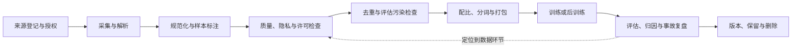

# 第一章 数据总览：从原始资料到模型能力

一台机器可以拥有很多 GPU，却仍然训练不出一个可靠的大模型。原因并不神秘：模型只能从数据中看到语言、事实、代码、任务结构、行为反馈和错误边界。数据不只是训练开始前搬运到对象存储里的“燃料”，而是决定模型学什么、如何回答、哪些地方会犯错、哪些评估结果可信的控制面。

当数据规模变大，问题也从“找一些文本”变成了完整工程：来源是否有权限，文档是否解析正确，语言和领域是否覆盖目标用户，重复和 benchmark 污染是否被控制，个人信息是否被清理，合成数据是否把教师错误复制给学生，训练版本是否可回放，删除请求是否能沿着血缘生效。任何一环失控，都可能最终表现为模型问题。

本章从总览角度建立一条因果链：数据对象如何进入 pipeline，pipeline 如何改变样本分布，样本分布如何影响预训练、后训练、评估和 RAG，治理如何把一次训练变成可复现、可审计的系统。为避免在总览里重复整套方法，细节按职责交给后续章节：[来源采集](02-web-scale数据采集.md)、[质量过滤](03-清洗过滤与质量评分.md)、[去重和污染](04-去重与污染检测.md)、[数据配比](05-data-mixture与配比.md)、[专项数据](06-code-math-domain-data.md)、[合成数据](07-synthetic-data与distillation-data.md)、[偏好和安全数据](08-preference-data与安全数据.md)、[多模态数据](09-多模态语音视频数据.md)、[归因](10-data-attribution与valuation.md)、[版本与治理](11-dataset-versioning与governance.md)，最后在[综合设计与故障诊断](12-数据工程综合设计与故障诊断.md)中贯通。本章负责建立全册共用对象、术语和依赖地图。

## 1.1 数据首先决定“模型看见了什么”

### 1.1.1 小白视角：教材、练习、考试和资料库

把模型想象成一个学习者：

- 预训练数据像大量教材和阅读材料。
- SFT 数据像带示范答案的作业。
- 偏好数据像老师对多个答案的比较和反馈。
- 安全数据像行为规范、边界案例和纠错记录。
- 评估集像没有提前泄露的考试。
- RAG 文档像工作时可以查阅的资料库。

如果教材里充满错误，学习者会形成错误的事实记忆；如果练习只覆盖简单题，考试遇到长尾问题就会失分；如果考试题提前出现在教材里，分数看起来很高，却没有说明真正的泛化能力；如果老师只奖励“听起来很确定”，学习者可能学会用自信语气掩盖不知道。

大模型中的数据问题也有同样的结构。模型产生幻觉，可能不只是模型结构不够大，也可能是训练文本互相矛盾、事实来源质量低或后训练奖励了流畅而不是诚实。模型过度拒答，可能不只是安全策略太强，也可能是安全数据把所有相近词都标成危险，缺少正常教育和澄清样本。

### 1.1.2 专家视角：数据改变经验分布

设训练样本来自分布 `P_train(x, y)`，产品真正关心的任务来自分布 `P_task(x, y)`。训练目标通常只能直接优化前者：

```math
\mathcal{L}_{\mathrm{train}}(\theta)
=\mathbb{E}_{(x,y)\sim P_{\mathrm{train}}}
\left[\ell(f_\theta(x),y)\right].
```

当 `P_train` 与 `P_task` 差异很大时，即使训练损失下降，也不代表任务质量提高。数据工程的规模、清洗、覆盖、配比和治理，本质上是在设计一个更接近目标能力的训练分布，并控制其中的风险信息流。

### 1.1.3 数据不是单向输入

评估失败经根因确认后可以进入回归集，人工纠错可能产生新偏好样本，用户问题也能暴露覆盖缺口；这些反馈首先是待核实的证据线索，不是可直接训练的样本。进入下一版数据前仍要检查授权、脱敏、去重、评估隔离和版本。完整反馈回路见 §1.5。

## 1.2 从 GPT-3 到 compute-optimal 再到高质量数据

### 1.2.1 GPT-3 带来的规模启发

GPT-3 的公开研究展示了大规模自回归语言模型在海量文本上预训练后，能够通过 few-shot 上下文完成多种任务。它让行业清楚看到模型参数、训练 token 和计算资源共同扩大时，能力可以出现明显跃迁。

但“更多网页”不是完整结论。web-scale 语料通常混合了高质量文章、重复页面、模板、广告、错误事实、隐私和不同许可状态的数据。规模放大了有用信号，也放大了噪声、偏见、污染和合规负担。

### 1.2.2 Chinchilla 改变参数中心论

Chinchilla 研究说明，在固定计算预算下，参数量和训练 token 数需要共同设计；许多较大的早期模型相对于自身参数量使用了不足的训练 token。一个常见的粗略计算关系是：

```math
C\approx kND,
```

其中 `C` 是训练计算量，`N` 是参数量，`D` 是训练 token 数，`k` 代表与架构和训练实现有关的常数。这个式子不是所有训练设置的精确定律，但足以说明：只增加参数而不准备足够且高质量的 token，可能把计算花在了不充分的学习上。

Chinchilla 的启发不是“永远训练更久”，而是把数据规模、数据质量、参数规模和计算预算放在同一项设计中。数据团队因此需要提前回答：目标 token 从哪里来，哪些 token 能被保留，质量和覆盖如何测量，训练后如何知道某一份数据真的有帮助。

### 1.2.3 phi-1 和教材式数据的启发

phi-1 相关工作展示了在代码任务上，高质量、教材式和合成增强的数据可以让较小模型获得很强的特定能力。它不意味着所有预训练都应该只使用教材，也不意味着合成数据天然优于网页数据。后续预训练研究进一步显示，“合成数据”内部差异很大：一项 EMNLP 2025 研究在自己的模型规模和预算中发现，改写文本与自然网页混合可能加快达到给定验证损失的速度，而纯教材式生成数据在一些下游域表现较差；比例还随模型规模和数据预算变化。把这一结果写成固定的“三成配方”会越过论文证据范围。[该研究](https://aclanthology.org/2025.emnlp-main.544/)

更稳妥的结论是：

1. 数据质量和任务匹配可以提高样本效率。
2. 结构化解释和可验证答案有助于学习特定能力。
3. 小模型更容易受到数据选择、格式和教师错误的影响。
4. 领域能力不能只用总体平均质量衡量。
5. 任何高质量数据结论都必须带上任务、模型、训练预算和评估条件。

### 1.2.4 规模与质量不是二选一

设数据源 `j` 的有效 token 数为 `D_j`，质量代理值为 `q_j∈[0,1]`，则一个教学用的加权量可以写成：

```math
D_{\mathrm{effective}}
=\sum_j q_jD_j.
```

`q_j` 是教学代理，不是客观真理；若不同数据源的评分协议不同，连加前就需要校准，很多时候不应把它们压成一个数。它只提醒我们：相同 token 数不保证相同的目标任务价值。实际工程应同时报告原始量、过滤后量、切片质量和任务效果，而不是只报一个总量。

## 1.3 数据工程的五个核心维度

### 1.3.1 规模：有多少可用数据

规模可以按文档数、样本数、字节数、token 数、音频小时、视频帧或图文对统计。不同模态不能未经说明直接相加；一个图像的 token 化成本和一段文本的 token 数也不是同一个质量单位。

规模影响语言和知识覆盖、长尾概念、代码库多样性以及训练稳定性，但规模数字必须配合：

- 去重后的有效量。
- 过滤后的保留率。
- 各语言、领域和任务切片。
- 可合法使用的比例。
- 评估污染和 PII 风险。
- 训练中实际采样的量。

### 1.3.2 质量：样本是否值得学习

质量至少有四层：

1. 表面质量：编码、乱码、格式、重复模板和解析完整性。
2. 内容质量：事实可靠性、信息密度、逻辑清楚和时效性。
3. 任务质量：是否具有清楚的输入输出、难度梯度和可验证答案。
4. 行为质量：是否诚实、安全、不过度拒答、遵守格式和正确使用工具。

不同阶段的质量标准不同。预训练可以容忍一定的自然噪声，医学问答或代码执行数据则需要更强的来源和验证；SFT 的格式错位可能直接破坏对话行为；偏好数据中的长度偏差可能教模型输出更长而不是更好。

### 1.3.3 覆盖：目标能力有没有被看见

覆盖不是“领域名称出现过”，而是目标能力在语言、难度、上下文、工具、用户和错误类型上有足够样本。例如一个代码数据集有很多 Python 函数，却没有仓库级修改、测试失败和依赖管理，它可能覆盖了代码语法，却没有覆盖真实软件工程。

常见切片包括：

- 多语言、方言和脚本。
- 代码语言、仓库规模和运行环境。
- 数学难度、证明类型和可验证性。
- 科学、法律、医疗等专业场景。
- 对话轮数、上下文长度和用户目的。
- 工具调用、错误恢复和权限变化。
- 图像、文档、音频、视频及模态冲突。

### 1.3.4 配比：哪些信号被重复看到

配比决定模型能力结构。代码、数学、中文、合成、偏好和安全数据的比例，会影响模型的知识、风格、推理和拒答行为。配比不是静态的：预训练、继续预训练、SFT、偏好优化和安全修复可能使用不同的混合。

过度增加某一类数据可能带来副作用：代码比重过高改变自然语言风格，安全数据过于粗糙导致过度拒答，合成数据模式单一造成模板化，某个网页来源过多导致来源偏差。配比要通过消融、proxy training 和分层评估迭代。

### 1.3.5 治理：数据能否被解释和控制

治理回答的是：数据从哪里来，谁允许使用，经过哪些变换，进入了哪个训练版本，能否删除，发生事故时能否定位。至少包括来源、许可、PII、风险、版本、血缘、评估隔离、访问控制、保留期限和审计。

没有治理，数据规模越大，错误归因、删除困难、隐私泄露和 benchmark 污染越难处理。治理不是训练完成后的文档工作，而是数据对象进入 pipeline 时就应写入的元数据。

## 1.4 不同数据类型承担不同责任

### 1.4.1 预训练数据

预训练数据学习语言、知识、代码和世界模式。来源可能包括网页、书籍、论文、百科、代码和多语言语料。主要风险是质量差异、重复、错误事实、偏见、隐私、许可和评估污染。

预训练数据的一个特点是规模大、单条样本难以全部人工检查，因此需要多级过滤、抽样审计、来源权重和风险分层。它的“平均质量”不能替代对高影响来源的单独检查。

### 1.4.2 继续预训练和领域数据

领域数据用于把通用模型适配到医学、法律、代码、企业知识或某种语言。它通常规模较小但专业约束更强，需要来源可靠、版本清楚、时间范围明确和许可证可追溯。

领域数据可能带来灾难性遗忘、风格变化和敏感信息。训练前要定义保留哪些通用能力，训练后要用通用、领域和安全切片共同评估。

### 1.4.3 SFT 数据

SFT 数据教模型按照指令完成任务。它的关键不只是数量，还包括角色格式、输入输出边界、答案质量、难度覆盖、多轮状态、工具 schema 和拒答/安全替代。

SFT 样本错误可能直接进入行为：错误的系统角色会改变优先级，错误的工具参数会形成协议习惯，所有困难问题都用拒答回答会制造过度拒答。SFT 数据应保留任务契约和来源，不能只保存一段拼接后的字符串。

### 1.4.4 偏好数据

偏好数据常见形式是：

```text
prompt + chosen answer + rejected answer
```

它可用于 RLHF、DPO、RLAIF 等方法。偏好标签塑造的不只是内容，还包括长度、语气、拒答、引用、格式和工具行为。数据工程要检查标注者一致性、位置偏差、长度偏差、安全与帮助性的冲突以及多轮上下文是否完整。

### 1.4.5 安全数据

安全数据应包含应该拒绝的请求、正常的安全教育、边界案例、澄清、隐私、提示注入、工具越权和安全替代。只有“有害/无害”两类粗标签，无法告诉模型在合法帮助和危险执行之间如何分界。

安全数据还要注意过度拒答：若负样本覆盖广而正常对照不足，模型可能把领域词、敏感实体或讨论风险本身都当作危险。安全数据需要和有用性、事实性以及动作层评估一起看。

### 1.4.6 评估数据

评估数据的责任是测量，不是训练。它需要独立血缘、明确任务契约、答案或 rubric、程序判定器、污染监控和版本生命周期。评估集被反复用于调参，就会逐渐变成训练信号；即使没有显式加入权重，也可能通过 prompt、选择模型和反馈链路泄漏。

### 1.4.7 RAG 数据

RAG 数据是模型运行时查阅的外部资料，重点从“训练覆盖”转向“检索、权限、更新和引用”：

1. 文档是否属于当前租户。
2. chunk 是否保留标题、页码和版本。
3. 权限过滤发生在检索前还是生成后。
4. 文档是否包含不可信指令。
5. 引用是否支持答案中的具体声明。
6. 文档更新和删除如何传播到索引、缓存和日志。

### 1.4.8 多模态、语音和视频数据

多模态数据包括图文对、OCR、图表、视频字幕、音频转写、语音对话和文档图像。它的难点是模态对齐、时间/空间范围、转写错误、版权与隐私、采样和标注成本。

同一视频的字幕可能缺少画面事件，OCR 可能丢失图像边缘文字，音频转写可能把说话人混在一起。原始媒体、解析结果和人工标签应分别保存，不能把转写文本当成无损事实。

## 1.5 从来源到训练的完整 pipeline

### 1.5.1 总体链路

下面的图把数据治理和模型训练放在一条可回放的链路中。实线是正常处理顺序；虚线回路表示评估、归因或事故发现的问题应返回到对应的数据检查环节。线上日志只有经过授权、脱敏和抽样审查后，才可能成为新数据，不能从反馈节点直接回灌训练。



每一步都应有输入和输出契约、版本、失败统计及可抽样复核的中间产物。只保存最终 shard，会让团队无法区分问题来自解析、过滤、采样还是 tokenizer。后续章节分别展开图中的环节；本章只建立它们之间的依赖。

### 1.5.2 来源注册

来源注册要记录 source ID、所有者、获取时间、许可状态、区域限制、内容类型、预计风险、更新方式和删除联系人。网页、公共代码、商业数据库和用户上传资料不能共用一个“public”标签。

### 1.5.3 采集与解析

采集阶段要保留原始 hash、HTTP 元数据或文件版本，但不把原始敏感内容无限复制。解析阶段处理 HTML、PDF、Markdown、表格、代码、多语言编码、图像和音视频。解析失败需要可见地标记，不能静默丢掉难解析的领域样本并把剩余数据当作总体。

### 1.5.4 规范化与结构保留

规范化可以统一空白、Unicode、HTML boilerplate 和文档结构，但过度规范化会丢掉代码缩进、表格布局、标题层级、数学公式和引用关系。每种模态都要定义可逆性：哪些变换可从 artifact 重建，哪些只能保留摘要和版本。

### 1.5.5 过滤和质量评分

过滤可以使用规则、分类器、语言模型、人工抽样或组合。规则适合高精度格式和明确风险，模型适合语义分类，人工适合边界和新分布。每个过滤器要报告 precision、recall、误删样本和分组差异，而不是只报告“删除了多少”。

### 1.5.6 去重和污染

两个检查都在训练前产生独立的候选和处置记录，但输出门禁不同；详细机制见 §1.8 和第四章。

### 1.5.7 配比、tokenization 和打包

配比决定抽样分布，tokenizer 决定实际 token 预算，packing/sharding 决定训练吞吐和样本边界。字符数、字节数和 token 数不能互换；不同 tokenizer 或版本可能改变领域配比和上下文截断。训练 manifest 应记录 tokenizer、special token、最大长度、packing 策略和每个数据源的采样权重。

## 1.6 用一个数据对象串起元数据

可以把单个样本抽象成：

```math
d_i=(x_i,n_i,q_i,z_i,\ell_i,r_i,t_i),
```

其中 `x_i` 是文本、代码、图片、音频或组合内容，`n_i` 是 token 或样本权重，`q_i` 是质量信号，`z_i` 是语言、领域、任务和来源元数据，`ell_i` 是许可/合规标签，`r_i` 是风险标签，`t_i` 是时间和版本信息。

一个实际记录还应包含 content hash、parent source、processor revision、过滤器结果、split、保留期限和删除状态。元数据不能全部写进 prompt，但必须进入数据 catalog 和训练 manifest。

### 1.6.1 token 保留率

```math
R_{\mathrm{keep}}
=\frac{\sum_i n_i g_i}{\sum_i n_i},
```

其中 `g_i` 表示样本是否通过当前过滤条件。保留率太低可能表示过滤过严、解析失败或目标领域被误删；保留率太高也不能证明质量好，可能表示过滤器过松。

### 1.6.2 加权质量分

```math
Q_{\mathrm{data}}
=\frac{\sum_i n_iq_ig_i}{\sum_i n_ig_i}.
```

它适合做切片比较和版本 diff，不应替代事实正确性、任务成功率或安全事件。不同数据源的 `q_i` 如果使用不同标注协议，不能直接比较而不做校准。

### 1.6.3 数据配比

```math
p_k
=\frac{\sum_i n_ig_i\mathbf{1}[z_i=k]}
{\sum_i n_ig_i}.
```

`k` 可以是语言、领域、任务或风险切片。报告配比时要同时说明按原始 token、过滤后 token、采样后 token 还是训练中实际看到的 token 统计。

### 1.6.4 覆盖率

```math
C_{\mathrm{coverage}}
=\frac{\sum_{k=1}^{K}\mathbf{1}[T_k\ge\tau_k]}{K},
```

其中 `T_k` 是切片 `k` 的有效覆盖量，`tau_k` 是该切片的最低目标。覆盖率高不等于切片质量高；一个领域有很多重复和错误样本，仍然可能是低效覆盖。

### 1.6.5 重复率和污染风险

一个简单的重复率可以写成：

```math
R_{\mathrm{dup}}
=1-\frac{N_{\mathrm{unique}}}{N_{\mathrm{raw}}}.
```

评估样本 `e_j` 与训练样本 `d_i` 的污染检测可以写成：

```math
R_{\mathrm{contam}}
=\frac{1}{M}\sum_{j=1}^{M}
\mathbf{1}\left[
\max_i\mathrm{sim}(e_j,d_i)\ge\tau_{\mathrm{sim}}
\right].
```

`sim` 可以是 exact match、n-gram、Jaccard、embedding 或结构化代码相似度。阈值需要在人工标注和负对照上校准，不能把相似当作确定泄漏。

### 1.6.6 用一组小数据复算审计信号

后面的代码使用 9 份合成记录，原始 token 总量为 `6,190`。按代码中的规则，精确重复、低质量、PII、未知许可和评估重叠记录不会进入候选训练集，最后保留 `3,320` token。因此保留率为 `3,320/6,190≈0.536`。保留样本的 token 加权质量分为 `(1,200×0.82+900×0.91+700×0.88+520×0.74)/3,320=2,803.8/3,320≈0.845`。

保留的四个领域分别有 web `1,200`、code `900`、math `700`、safety `520` token；例如 web 占比是 `1,200/3,320≈0.361`。评估题 `eval_a` 与提示 `what is 17 plus 25` 有 5 个共同词，两个集合的并集有 9 个词，因此相似度为 `5/9≈0.556`，超过代码阈值 `0.40`。9 份原始记录中，精确重复、评估重叠、低质量、PII 和许可缺口各出现 1 次，所以每个相应信号的记录级比率是 `1/9≈0.111`。质量分升高并没有抵消这些独立门禁：污染、PII 和许可问题都需要单独处置，决定仍是暂缓进入训练。

## 1.7 质量过滤是在不同错误代价间做选择

过滤不是一个通用“干净度”按钮。表面规则能发现乱码、空文档和解析错误，却不能判定事实；内容审查看来源、时效和信息密度，却不能替代任务验证；代码、数学和工具样本要有相应的测试、验证器或状态结果；后训练样本还要检查诚实性、安全边界和工具权限。任何一类筛选都可能误删少数语言、专业术语或边界案例，也可能误留高风险内容。

设 `P(false delete)` 是应保留样本被误删的概率，`P(false keep)` 是应移除样本被误留的概率：

```math
L_{\mathrm{filter}}
=C_{\mathrm{false\ delete}}P(\mathrm{false\ delete})
 +C_{\mathrm{false\ keep}}P(\mathrm{false\ keep}).
```

例如，一个保守的过滤器可能减少隐私误留，却同时误删更多低资源语言样本；只看总保留率看不出这两种代价。阈值需要按切片校准，报告误删与误留，并保留人工抽样。规则、分类器和人工复核的具体校准方法见[第三章](03-清洗过滤与质量评分.md)。

## 1.8 去重与污染解决的是两种不同问题

精确去重用规范化文本或内容 hash 找完全重复；近重复方法再用 n-gram、MinHash、SimHash、embedding 或结构化代码特征找候选。候选相似不等于确认重复，阈值过低会误合并独立教材，过高则会漏掉改写和模板复制。保留哪一份、如何处理有意重复，也应和采样目的绑定。

训练集内部的重复会改变来源权重和暴露次数；训练集与评估集之间的信息重叠则威胁评估解释力。两者即使复用相似度工具，分母、确认流程和处置结果也不同。时间隔离、私有 holdout、访问记录和命中复核由[第四章](04-去重与污染检测.md)深入讲解；本章只要求不要把“相似”直接写成“泄漏”。

## 1.9 Data mixture：把能力目标变成采样分布

### 1.9.1 比例必须绑定目标、分母和评估

如果代码、数学、中文和安全各占一个百分比，仍然不知道这些比例按原始 token、过滤后 token，还是训练实际看到的 token 计算；也不知道样本难度、tokenizer 成本和重复率是否可比。增加某领域的比例可能提升对应切片，也可能降低通用能力或改变行为。第五章会把这些变量变成可比较的实验设计。

### 1.9.2 温度采样

假设数据源 `i` 的有效大小为 `n_i`，采样权重可以使用一个教学抽象：

```math
p_i
=\frac{n_i^{\alpha}}{\sum_jn_j^{\alpha}}.
```

当 `alpha = 1` 时接近按数据量采样，`alpha < 1` 会提高小数据源的相对权重，`alpha = 0` 则趋向源级均匀。真实训练还要考虑质量、重复、难度、语言和预算，不能只改一个温度指数。配比之外，数据出现的顺序也会改变训练看到信号的节奏：ICLR 2025 的 Data Mixing Laws 研究用小规模混合实验拟合比例与表现的关系；ACL 2026 的数据组织研究进一步比较循环调度、课程连续性和局部多样性。它们支持“配比和排序都值得测量”，并没有给所有模型通用的最佳比例或顺序。[Data Mixing Laws](https://proceedings.iclr.cc/paper_files/paper/2025/hash/cc84bfabe6389d8883fc2071c848f62a-Abstract-Conference.html)、[Demystifying Data Organization](https://arxiv.org/abs/2605.30334)

### 1.9.3 小规模 proxy training

直接在大模型上试所有配比成本太高。可以用更小模型、较短训练或低成本任务做 proxy，观察趋势，再在目标训练上复核。proxy 只能提供方向，不保证规模放大后结论不变；配比改变可能在大模型的能力和遗忘边界上出现不同效应。

### 1.9.4 消融和因果边界

若混合 A 得分更高，不能直接说是某一种数据带来的收益，因为训练步数、总 token、采样顺序和随机种子可能同时变化。至少需要保持预算一致的消融、多个种子、分层任务和质量回归。数据 attribution 可以帮助定位贡献，但 attribution 结果依赖方法和评估任务；第十章再讨论怎样描述这类证据。

## 1.10 数据问题如何表现为模型问题

| 模型现象 | 可能的数据原因 | 可区分的检查 |
| --- | --- | --- |
| 幻觉和事实错误 | 来源错误、冲突、过时、缺少不确定性样本 | 来源切片、时间切分、事实集和 abstention 评估 |
| 代码能力弱 | 代码比例低、无测试、缺少仓库级任务 | 语言/仓库/测试/错误恢复切片 |
| 数学推理弱 | 步骤错误、答案不可验证、难度缺口 | verifier、难度和改写泛化 |
| 过度拒答 | 安全负样本粗糙、正常对照不足 | 安全/帮助性成对样本与语言切片 |
| 有害遵循 | 安全数据覆盖不足、工具轨迹缺失 | 多轮、注入、工具和状态评估 |
| 评估分数虚高 | benchmark 泄漏、反复调参、模板污染 | 血缘、近重复、私有 holdout |
| 格式不稳定 | chat template、角色和 schema 不一致 | processor 版本和结构化解析日志 |
| 长文档失败 | 长上下文覆盖不足、截断、分块错误 | 位置、长度、证据覆盖和成本切片 |

诊断不是把一个现象归因给一个数据集，而是构造能区分假设的对照。例如代码弱可能来自数据不足，也可能来自 tokenizer、训练预算或执行环境；数据工程的价值是提供血缘、切片和可复现实验，让这些假设可以被检验。

## 1.11 数据与 RAG、后训练、安全和评估的边界

### 1.11.1 数据和模型权重

预训练和后训练会把数据中的统计规律写入权重。删除一份数据、修改事实或降低危险能力，可能需要重新训练、编辑、unlearning 或其他方法；不能把“从 RAG 索引删除”说成“权重已经忘记”。

### 1.11.2 数据和 RAG 索引

RAG 数据通常在运行时保留，可更新、权限过滤和删除，但它会进入上下文、缓存、日志和模型回答。索引删除不一定立即清除所有缓存和日志；数据血缘要覆盖原文、chunk、embedding、索引、缓存和答案。

### 1.11.3 数据和安全

安全行为由预训练、SFT、偏好、安全分类器、策略和执行器共同塑造。安全数据不足会产生危险遵循，安全数据过粗会过度拒答。仅增加拒答样本不能解决工具越权和跨租户访问，后者还需要服务端权限。

### 1.11.4 数据和评估

训练数据、调参数据、judge 参考答案、用户反馈和回归集之间存在多条污染路径。评估团队要记录数据血缘和访问权限，不能因为某个样本“不在训练文件夹里”就断言它独立。

## 1.12 数据治理：把样本变成可控制的资产

治理要把“知道来源、重建处理、控制访问和证明处置”变成能检查的证据。它不是目录里的一个合规标签，而是附着在数据对象、派生对象和训练版本上的控制信息。

| 控制目标 | 最小证据 | 容易误判的地方 |
| --- | --- | --- |
| 可追溯 | source ID、获取时间、原始 hash、processor/filter revision、parent ID | 保存最终文件名不等于保留来源血缘 |
| 可复现 | dataset version、采样权重、随机种子、tokenizer、packing 和 artifact digest | 同名数据集不保证字节或训练分布相同 |
| 可访问和分级 | 数据级别、租户/部门 ACL、处理区域、允许用途和访问日志 | “公开可访问”不自动表示允许任意用途 |
| 可删除 | 删除请求、受影响派生对象、处理状态和遗留 artifact 决策 | catalog 标记删除不证明 shard、缓存或模型权重已消除影响 |
| 可审计 | 规则变更、数据进入版本的记录、评估访问和责任人 | 日志要能解释变更，同时避免复制原始个人信息 |

本章只定义这些控制目标；字段设计、manifest、删除传播和审计流程由[第十一章](11-dataset-versioning与governance.md)主讲。公开数据集文档通常也会记录来源、用途和限制，例如 Hugging Face 的 dataset card 指南，但卡片是公开说明，不替代内部逐样本血缘或组织审查。[Dataset Cards](https://huggingface.co/docs/hub/main/datasets-cards)

## 1.13 企业知识助手案例：从文档到可引用回答

### 1.13.1 目标和数据边界

企业知识助手要回答内部政策和流程。原始资料可能包括文档、工单、网页、表格和历史回答。目标不是把所有内容喂给模型，而是在租户、部门、版本和权限范围内检索可用证据。

### 1.13.2 处理流程

处理时先登记来源和文档 ACL、保留期，再解析标题、表格和页码；切分时保留来源坐标，然后检查质量和过期状态，生成带版本的 embedding/索引。运行时按用户权限检索证据，回答给出逐项引用；用户反馈经过授权和脱敏后，才进入回归样本复核。

每个 chunk 要保存文档 ID、版本、页码或段落范围、租户、ACL、更新时间和删除状态。检索器返回越权文档，即使模型没有把它写进答案，也已经发生了数据边界问题。

### 1.13.3 失败诊断

回答错误时，可以区分：解析漏掉表格，chunk 丢掉标题，索引过期，ACL 过滤错误，检索召回错误，模型没有使用证据，还是引用范围不支持结论。没有这些中间证据，团队只能重新调 prompt。

### 1.13.4 数据与产品指标

除了答案质量，还要监控引用精确率、证据覆盖、过期文档率、越权检索、删除传播时间、用户纠正率和单位成功任务成本。平均回答满意度不能覆盖一次跨租户泄露。本节只用 RAG 说明“数据仍在运行时流动”；本册第十二章负责完整系统设计，RAG 索引也不等于训练权重。

## 1.14 数据生命周期和版本差异

### 1.14.1 数据集版本不是文件夹名

一个可回放的数据版本至少绑定：

```text
dataset_id
source_snapshot
processor_revision
filter_revision
dedup_revision
contamination_revision
mixture_revision
tokenizer_revision
manifest_digest
created_at
retention_policy
```

文件名变化不等于内容变化可解释，内容变化也不一定改变文件名。版本对象要有不可变 digest 和变更摘要。

### 1.14.2 版本 diff

新旧版本比较要分开报告总 token、保留率、质量和语言/领域切片、重复、污染、PII、许可缺口与样本增删。平均质量提高但中文或代码覆盖下降，仍可能是回归；总量增加但污染上升，也不能直接发布。

### 1.14.3 回滚和删除

训练前可以回到旧 manifest；训练后还需要记录模型 artifact 使用过哪些数据版本。删除请求到达后，要阻止新使用、定位派生对象和下游 artifact，再决定重训、编辑、过滤或风险披露。具体版本状态机和删除证据由[第十一章](11-dataset-versioning与governance.md)主讲；一个 catalog 开关不能证明完整删除。

## 1.15 一个可运行的数据集审计示例

下面的 demo 只使用合成数据，展示数据总览中最容易被平均数掩盖的事情：过滤后质量变高了，但评估污染、合规缺口和个人信息仍然会让数据集进入“需要修复”的状态。代码使用 `signals`、`actions` 和 `decision`，没有把所有条件压成一个不可解释的总开关。

代码状态：已验证（2026-10-28，Python 3.12.9，标准库）

```python
from __future__ import annotations

import re
from collections import Counter


docs = [
    {
        "id": "web_a",
        "domain": "web",
        "tokens": 1200,
        "quality": 0.82,
        "license": "ok",
        "text": "Transformer tutorial with clear examples and explanations.",
    },
    {
        "id": "web_a_copy",
        "domain": "web",
        "tokens": 1180,
        "quality": 0.80,
        "license": "ok",
        "text": "Transformer tutorial with clear examples and explanations.",
    },
    {
        "id": "code_a",
        "domain": "code",
        "tokens": 900,
        "quality": 0.91,
        "license": "permissive",
        "text": "Python function with unit tests and edge cases.",
    },
    {
        "id": "math_a",
        "domain": "math",
        "tokens": 700,
        "quality": 0.88,
        "license": "ok",
        "text": "Algebra problem with verified answer and explanation.",
    },
    {
        "id": "safety_a",
        "domain": "safety",
        "tokens": 520,
        "quality": 0.74,
        "license": "ok",
        "text": "Privacy boundary with a safe alternative response.",
    },
    {
        "id": "spam_a",
        "domain": "web",
        "tokens": 480,
        "quality": 0.32,
        "license": "ok",
        "text": "Keyword boilerplate repeated repeated repeated.",
    },
    {
        "id": "pii_a",
        "domain": "web",
        "tokens": 360,
        "quality": 0.68,
        "license": "ok",
        "text": "Synthetic contact user@example.invalid and invoice record.",
    },
    {
        "id": "license_a",
        "domain": "medical",
        "tokens": 610,
        "quality": 0.86,
        "license": "unknown",
        "text": "Clinical summary with unclear redistribution permission.",
    },
    {
        "id": "eval_a",
        "domain": "math",
        "tokens": 240,
        "quality": 0.90,
        "license": "ok",
        "text": "Benchmark question what is 17 plus 25 answer 42.",
    },
]

eval_prompts = ["what is 17 plus 25", "transformer tutorial", "privacy boundary"]


def normalize(value: str) -> str:
    return " ".join(re.findall(r"[a-z0-9\u4e00-\u9fff]+", value.lower()))


def token_overlap(left: str, right: str) -> float:
    a = set(normalize(left).split())
    b = set(normalize(right).split())
    union = a | b
    return len(a & b) / len(union) if union else 0.0


def safe_ratio(numerator: float, denominator: float):
    return round(numerator / denominator, 3) if denominator else None


seen = set()
reports = []
for doc in docs:
    normalized = normalize(doc["text"])
    duplicate = normalized in seen
    seen.add(normalized)
    similarity = max(
        (token_overlap(doc["text"], prompt) for prompt in eval_prompts),
        default=0.0,
    )
    pii = bool(re.search(r"[\w.-]+@[\w.-]+", doc["text"]))
    low_quality = doc["quality"] < 0.60
    license_ok = doc["license"] in {"ok", "permissive"}
    contaminated = similarity >= 0.40
    keep = not (duplicate or pii or low_quality or not license_ok or contaminated)
    reports.append({**doc, "duplicate": duplicate, "pii": pii,
                    "low_quality": low_quality, "license_ok": license_ok,
                    "contaminated": contaminated, "keep": keep})

raw_tokens = sum(row["tokens"] for row in reports)
kept = [row for row in reports if row["keep"]]
kept_tokens = sum(row["tokens"] for row in kept)
weighted_quality = safe_ratio(
    sum(row["quality"] * row["tokens"] for row in kept),
    kept_tokens,
)
mixture = Counter()
for row in kept:
    mixture[row["domain"]] += row["tokens"]
required = {"web", "code", "math", "safety"}
covered = required & set(mixture)

risk_rates = {
    "duplicate": safe_ratio(sum(row["duplicate"] for row in reports), len(reports)),
    "contamination": safe_ratio(
        sum(row["contaminated"] for row in reports), len(reports)
    ),
    "low_quality": safe_ratio(
        sum(row["low_quality"] for row in reports), len(reports)
    ),
    "pii": safe_ratio(sum(row["pii"] for row in reports), len(reports)),
    "license_gap": safe_ratio(
        sum(not row["license_ok"] for row in reports), len(reports)
    ),
}
signals = {
    "retention": safe_ratio(kept_tokens, raw_tokens),
    "weighted_quality": weighted_quality,
    "mixture": dict(sorted(mixture.items())),
    "missing_domains": sorted(required - covered),
    "risk_rates": {
        key: round(value, 3) if value is not None else None
        for key, value in risk_rates.items()
    },
}
actions = []
if not reports:
    actions.append("collect_dataset_samples")
if not kept:
    actions.append("restore_nonempty_training_set")
if risk_rates["contamination"] is not None and risk_rates["contamination"] > 0:
    actions.append("remove_or_isolate_eval_overlap")
if risk_rates["pii"] is not None and risk_rates["pii"] > 0:
    actions.append("scrub_synthetic_or_sensitive_fields")
if risk_rates["license_gap"] is not None and risk_rates["license_gap"] > 0:
    actions.append("resolve_license_before_training")
if signals["missing_domains"]:
    actions.append("collect_missing_domain_data")
decision = "hold_for_repair" if actions else "continue_to_manifest"

print(f"signals={signals}")
print(f"actions={actions}")
print(f"decision={decision}")
```

固定输入的预期输出如下；比例按三位小数显示：

```text
signals={'retention': 0.536, 'weighted_quality': 0.845, 'mixture': {'code': 900, 'math': 700, 'safety': 520, 'web': 1200}, 'missing_domains': [], 'risk_rates': {'duplicate': 0.111, 'contamination': 0.111, 'low_quality': 0.111, 'pii': 0.111, 'license_gap': 0.111}}
actions=['remove_or_isolate_eval_overlap', 'scrub_synthetic_or_sensitive_fields', 'resolve_license_before_training']
decision=hold_for_repair
```

这个 demo 的关键输出不是一个质量总分，而是每个独立信号和后续动作。过滤后质量可能提高，但只要仍有评估污染、PII 或许可缺口，决定就应当是 `hold_for_repair`。空数据或所有样本都被过滤时，分母保护会让加权质量返回 `None`；这表示指标不可解释，不是零风险。真实 pipeline 还要增加来源血缘、删除状态、语言切片、人工抽样和数据版本 digest。

## 1.16 数据工程的观测和实验闭环

### 1.16.1 训练前观测

训练前至少观察原始量、过滤量、token 保留率、质量分、语言/领域配比、重复、污染、PII、许可和解析失败。每个数字要带分母、时间范围和版本。

### 1.16.2 训练中观测

训练中可以观察不同数据源的采样计数、loss 分布、长度、异常 batch、tokenizer 截断、数据加载失败和 shard 访问。一个数据源被配置为 20% 不等于训练实际看到 20%；过滤失败、长度截断和 sampler 可能改变实际分布。

### 1.16.3 训练后观测

训练后用能力、行为、安全、事实性、工具、泛化和成本切片评估。把训练版本与数据 manifest 绑定，才能回答“这次代码能力提高是否来自代码配比，安全回归是否来自新的安全数据”。

### 1.16.4 线上反馈

用户纠正、人工升级、越权事件、引用错误和工具失败可以产生新的评估样本，但需脱敏、去重、许可和访问控制。线上反馈是有偏的：投诉多的任务不一定是总体分布，沉默用户也不等于满意。采样和权重要显式记录。

## 1.17 常见误区和边界

| 误区 | 为什么不成立 | 应观察的证据 |
| --- | --- | --- |
| 数据越多越好 | 低质量、重复、污染或不合规样本会浪费预算并扩大风险 | 有效 token、目标覆盖、切片质量和训练实际曝光量 |
| 清洗就是删垃圾 | 解析、识别、去重、许可、PII、评估隔离和版本都属于数据处理 | 每一步的输入输出、误删/误留和失败统计 |
| 平均质量分代表整体价值 | 平均数会遮住少数语言、关键任务和高影响错误 | 分组样本量、切片指标、置信区间和风险严重度 |
| SFT 数据越多越好 | 格式、答案、难度和安全边界会直接进入助手行为 | 任务契约、可验证答案、对照样本和行为回归 |
| 公开数据没有治理成本 | 可访问不等于任何用途都被授权，也不等于无隐私义务 | 来源、许可、区域、保留和删除血缘 |
| 评估数据不在训练目录就独立 | 答案、模板、prompt 和 judge 反馈也会形成污染路径 | 独立血缘、访问记录、时间切分和近重复复核 |
| 删除 RAG 索引等于模型忘记 | 权重、缓存、日志和历史回答属于不同数据层 | 各层删除证据和模型 artifact 影响评估 |
| 一个过滤器可以解决全部问题 | 规则、分类器和人工各有盲区，误删与误留代价也不同 | 负对照、分层抽样、阈值校准和人工复核 |

## 1.18 资料与证据边界

### 1.18.1 规模与数据效率

1. [GPT-3: Language Models are Few-Shot Learners](https://arxiv.org/abs/2005.14165)：支持大规模自回归模型、数据和 few-shot 能力的公开研究背景。
2. [Training Compute-Optimal Large Language Models（Chinchilla）](https://arxiv.org/abs/2203.15556)：支持参数、token 和计算预算共同设计的结论。
3. [Textbooks Are All You Need（phi-1）](https://arxiv.org/abs/2306.11644)：支持教材式高质量数据和小模型代码能力的研究案例。
4. [Demystifying Synthetic Data in LLM Pre-training](https://aclanthology.org/2025.emnlp-main.544/)：在作者的 100M–3B 参数模型、1B–200B token 预算中比较改写数据、教材式生成数据及其混合；更大规模结果是拟合外推，不是 frontier 模型实测。
5. [Collapse or Thrive](https://proceedings.mlr.press/v267/kazdan25a.html)：比较递归替换、累积和固定大小子集等训练工作流；说明“合成数据会不会退化”依赖数据维护方式和实验设定。
6. [Data Mixing Laws](https://proceedings.iclr.cc/paper_files/paper/2025/hash/cc84bfabe6389d8883fc2071c848f62a-Abstract-Conference.html) 与 [Demystifying Data Organization](https://arxiv.org/abs/2605.30334)：分别研究来源比例预测和数据排序/调度；具体收益绑定作者模型、数据和训练任务。

这些论文支持特定实验条件下的规模、数据和效率观察，不证明所有模型都遵循同一比例或调度，也不提供某个闭源模型的完整训练配方。

### 1.18.2 公开语料和去重

1. [Documenting Large Webtext Corpora: A Case Study on the Colossal Clean Crawled Corpus（C4）](https://arxiv.org/abs/2104.08758)：支持 C4 的来源追踪、过滤效果、评估样本混入和数据集文档化讨论。
2. [The RefinedWeb Dataset](https://arxiv.org/abs/2306.01116)：支持网页过滤、质量和开放数据集讨论。
3. [Dolma: An Open Corpus of Three Trillion Tokens](https://arxiv.org/abs/2402.00159)：支持开放大规模语料、数据处理和文档化案例。
4. [Deduplicating Training Data Makes Language Models Better](https://arxiv.org/abs/2107.06499)：支持训练数据去重、记忆和泛化讨论。

公开语料论文说明作者如何构造和评估数据，不自动授予所有用户相同的版权、隐私或商业使用权。数据许可应按实际来源和适用法域核对。

### 1.18.3 风险和治理

1. [NIST AI Risk Management Framework](https://www.nist.gov/itl/ai-risk-management-framework)：支持数据、模型和系统风险治理的生命周期语言。
2. [NIST Generative AI Profile](https://nvlpubs.nist.gov/nistpubs/ai/NIST.AI.600-1.pdf)：支持生成式 AI 的数据来源、隐私、评估和治理边界。
3. [Model Cards for Model Reporting](https://arxiv.org/abs/1810.03993)：支持记录用途、限制和评估条件的文档思路。
4. [Tracing the Data Trail](https://arxiv.org/abs/2601.14311)：综述 LLM 数据 provenance、transparency、traceability 及隐私和偏差工具；是研究分类入口，不代表每种方法都能恢复模型的逐样本来源。
5. [Hugging Face Dataset Cards 文档](https://huggingface.co/docs/hub/main/datasets-cards)：说明公开数据集卡片可记录内容、创建方式、用途、偏差和元数据；不能替代组织内部 manifest 与授权判断。

这些资料提供风险与披露框架，不替代组织自己的数据 catalog、法律审查、PII 检测、删除流程和训练回归。

### 1.18.4 本章能支持的结论

本章可以严谨地说：

1. 数据规模、质量、覆盖、配比和治理共同决定训练可见的信号与可核验的目标表现；它们还要和模型、优化方法及计算预算一起考量。
2. GPT-3、Chinchilla 和 phi-1 代表了规模、compute-optimal token 与高质量任务数据的不同研究启发。
3. 预训练、SFT、偏好、安全、评估、RAG 和多模态数据承担不同责任，不能混为一类。
4. 数据 pipeline 必须记录血缘、版本、过滤、去重、污染、许可、PII 和实际采样分布。
5. 数据问题可以表现为能力、行为、安全、评估可信度和产品副作用问题。
6. 数据治理和评估隔离是模型工程的一部分，不是训练后的文档补充。

本章不能严谨地说：

1. 参数更多或网页更多就必然得到更好的模型。
2. 公开论文中的数据比例可以直接复制到任意模型。
3. 平均质量分或单一 benchmark 可以代表数据集整体价值。
4. 过滤通过就证明没有隐私、版权、污染或偏见风险。
5. 从索引删除、输出过滤或一次编辑就能证明权重已经遗忘。

## 1.19 思考与实践

### 题目一：画出数据血缘

为一份企业合同从原始文件、解析文本、chunk、embedding、索引、模型上下文到最终引用画出血缘。标出 ACL、版本、删除和审计字段在哪些节点保留。

### 题目二：设计数据混合实验

为代码、数学、中文和安全数据设计两个保持总 token 与训练预算相近的混合方案。说明要用哪些任务切片、多个随机种子和哪些副作用指标比较它们。

### 题目三：诊断一个模型现象

假设模型在中文长文档上的引用覆盖下降、普通英文问答不变、工具误调用增加。列出至少三个数据假设，并设计能区分解析、配比、训练污染、SFT 格式和策略数据缺口的检查。

### 题目四：建立删除流程

为一个含有个人信息的数据源设计删除流程：阻止新训练、定位处理副本、更新 catalog 和索引、处理缓存和日志、评估模型 artifact，并记录哪些结论仍不能由删除动作直接推出。

## 1.20 结语：数据工程是能力、行为和责任的连接层

从 GPT-3 的规模启发，到 Chinchilla 对 token 与计算的重新平衡，再到教材式高质量数据对小模型效率的展示，数据观念一直在变化，但主线没有变化：模型只能从它看见并有效学习的分布中获得相应知识与任务模式，最终表现还受模型、优化方法和计算预算共同影响。

规模让长尾信号有机会出现，质量决定计算是否被有效使用，覆盖决定目标能力是否被看见，配比决定哪些信号被反复强化，治理决定我们能否解释、复现、删除和承担责任。预训练、后训练、评估和 RAG 的数据虽然处在不同环节，却通过血缘、污染、隐私、权限和反馈相互连接。

因此，数据工程不是把文件变成 token 的流水线。它是一套可以回答“数据从哪里来、改变了什么、进入了哪个版本、支持了什么结论、还留下什么风险”的系统。数据影响模型能观察和学习的模式，行为还受策略与运行时控制塑造；工程团队对这些结果的信任，来自可追溯、可评估和可治理的数据链路。接下来的章节从来源采集开始，逐步把这张总览地图变成可运行、可回放的工程流程。
