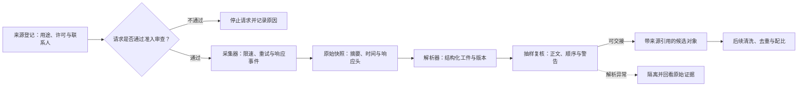

# 第二章 Web-Scale 数据采集：来源、快照与可复核解析

大模型的数据采集常被简化成“写一个爬虫，把网页下载下来”。这个比喻只描述了最早的一步，甚至容易把真正困难的部分遮住：下载成功不代表获得了训练许可，解析出文本不代表保留了原文结构，页面数量增加不代表有效知识增加，公开可见也不代表没有隐私、版权或评估污染风险。

更准确的对象是一个带有来源、权限状态、时间、载体和处理历史的数据资产。它要能回答：这段内容来自哪里、何时以什么方式取得、保存的是哪个快照、解析器生成了什么结构化结果，以及后续团队如何从结果回到原始证据。本章聚焦来源登记、合规访问、快照采集、解析和证据交接；清洗与隐私校准见第三章，去重和污染见第四章，配比见第五章，专项代码数据见第六章，版本和删除治理见第十一章，端到端系统见第十二章。

本章从 Web-scale 采集的动机和来源类型开始，讲清访问与使用边界、Common Crawl 的数据形态、采集事件、原始快照和解析工件，并用一个合成案例算出各阶段的成功率。后续质量、风险、重复和分布处理会在交接处说明输入输出，不在这里重讲完整算法。所有工程例子都使用公开、授权或合成场景；涉及具体法域的法律结论必须交由组织的法务和隐私团队确认。

## 2.1 采集的对象不是网页，而是带证据的数据对象

### 2.1.1 小白视角：建一座有借阅记录的图书馆

可以把 Web-scale 采集想象成建设一座城市图书馆。把纸箱运到仓库只是搬运，真正的图书馆还要知道每本书的来源、版本、许可、分类、保存期限和借阅记录。某本书被发现有错误时，管理员要能找到它存在哪些书架；版权方要求撤下某一版时，管理员要知道哪些复制品和索引需要处理。

网页数据也有同样的层次：

1. URL 或文件地址只是定位线索，不是内容身份。
2. HTML 响应只是原始载体，不是适合训练的文本。
3. 清洗后的文本不是“无来源的字符串”，仍然需要保留内容 hash、来源、时间和处理版本。
4. 进入训练的 token 不是唯一副本，数据还可能存在于 raw lake、解析缓存、去重索引、token shard、评估副本和日志中。
5. 一条“可以访问”的记录，不能自动推出“可以用于训练、可以商业发布或可以再分发”。

因此，采集项目的第一个交付物不应是 URL 数量，而应是一个可审查的 source registry、可复核的采集事件和一套明确的数据对象 schema。数据对象至少区分三个层次：来源记录描述“谁提供、允许什么用途”；采集记录描述“何时、按什么请求取得哪个响应”；解析工件描述“哪个解析器版本从哪个响应中生成了哪些字段”。这三类记录关联起来，才可以定位一次解析错误或用途变化影响了哪些对象。

### 2.1.2 专家视角：采集是受约束的分布构造

设一次采集得到的原始记录为：

~~~math
r_i=(s_i,u_i,t_i,q_i,b_i,h_i,m_i),
~~~

其中 `s_i` 是来源标识，`u_i` 是请求地址，`t_i` 是取得时间，`q_i` 是请求与响应事件，`b_i` 是原始载荷，`h_i` 是载荷摘要，`m_i` 是 MIME、语言、响应头和其他元数据。授权状态保存在来源及用途审查记录中，不应仅靠原始响应里的一个标记代替。解析工件可写成：

~~~math
A_i=P_{v}(r_i),
~~~

`P_v` 表示版本为 `v` 的解析器，`A_i` 必须保留到 `r_i` 的引用和解析警告。质量、隐私、去重、污染及训练配比作用在解析工件之后，分别由本册后续章节展开。这个边界很重要：采集章节可以说明一个样本为何没有形成可用工件，但不应把传输成功率、解析可用率和训练保留率混成一个数。

## 2.2 为什么大模型需要 Web-scale 数据

### 2.2.1 从专项标注到通用预训练

早期 NLP 系统通常围绕一个任务收集标注样本，例如情感分类、命名实体识别、机器翻译或问答。这样的数据集可以有很高的标签质量，却很难覆盖一个通用助手需要的全部内容：多种文体、多个领域、不同语言、代码、表格、长文结构和真实用户表达。

预训练把学习目标改成从大规模文本中预测下一个 token 或重建被遮挡的内容。模型因此有机会接触语言结构、事实陈述、程序语法、文档布局和任务模式。Web 的优势是规模大、更新快、领域广、语言多；它的代价是噪声、重复、权利状态和偏见也一起被放大。

### 2.2.2 GPT-3 的规模启发不能被误读

GPT-3 研究展示了大规模自回归模型在海量文本上预训练后，通过上下文示例完成多种任务的能力。它支持一个重要判断：训练数据规模和多样性是通用能力的重要条件。

它并不支持以下更强的结论：

1. 所有网页都同样有价值。
2. 只增加抓取页面就能线性增加能力。
3. 公开网页可以不经许可、隐私和安全审查直接使用。
4. 一个公开 benchmark 的高分就能证明数据分布没有污染。

Web-scale 的真正难点从“找到更多页面”转向“找到能够解释、筛选、复现和治理的有效信号”。

### 2.2.3 The Pile、C4 与开放语料的启发

The Pile 把多种来源组织为一个公开语料，说明来源多样性、子集文档化和领域覆盖可以共同设计。C4 则展示了从 Common Crawl 快照经过过滤得到大规模语料的过程，同时也暴露了来源意外、评估样本混入和过滤规则可能产生群体差异等问题。

这些工作的共同启发不是“复制某个公开数据集”，而是把数据集当作研究对象：要记录来源组成、过滤规则、重复处理、语言分布、风险和评估边界。一个数据集名称本身不能替代这些信息。

## 2.3 不同来源承担不同责任

来源类型不能只按“质量高/质量低”排序。每类来源都提供特定能力信号，也带来特定的结构、许可、隐私和偏差问题。

### 2.3.1 网页：覆盖广，但来源和结构复杂

网页可以提供新闻、教程、讨论、产品文档、百科、博客、代码和多语言内容。它的优势是覆盖广、更新快、真实用户表达丰富；弱点是模板、广告、SEO 页面、镜像、自动生成内容和过时信息数量巨大。

网页采集至少要区分：

1. 页面本身的内容和导航、广告、推荐等 boilerplate。
2. 页面当前版本与历史版本。
3. 页面发布者、托管平台和内容作者的不同身份。
4. 页面可见性、抓取偏好和训练使用权的不同含义。
5. 正文中的事实、引用、代码、图片和外部链接。

“抓到了一个 HTML 文件”只说明传输完成，不说明正文抽取、事实可靠性或用途授权已经完成。

### 2.3.2 书籍：长结构和完整解释，但权利边界更敏感

书籍对长文结构、系统知识、叙事和专业表达很有价值。它们通常比碎片网页更连贯，也更适合学习章节层次、定义和推导。

但书籍常有明确版权和发行渠道限制。扫描书还会引入 OCR 错误、页眉页脚重复、公式丢失和图表断裂。采集时要把许可来源、版本、页码和 OCR/解析版本记录下来，不能因为文件已经在某个下载目录中就把它视为可训练资产。

### 2.3.3 论文和技术文档：信息密度高，但解析误差会改变含义

论文和 API 文档包含定义、实验条件、代码接口和引用关系，适合科学、工程和专业领域能力。PDF 解析却可能把双栏顺序打乱，把上下标丢失，把表格变成无序文本，把代码和正文粘在一起。

对于论文数据，应尽量保留标题、作者、章节、公式、图表说明、引用和版本；对技术文档，还要保留版本号、发布日期、接口路径和示例代码的边界。解析出的文本应与原始页面或 PDF 建立坐标关系，便于抽样复核。

### 2.3.4 代码：需要文件级和许可证级上下文

代码来源可能包括开源仓库、官方文档、教程、问答和测试。代码模型不仅要学习局部语法，还要学习依赖、目录结构、构建命令、测试和错误修复。

代码采集的特殊问题包括：

1. 仓库 fork 和复制造成的重复权重。
2. 不同文件的许可证和仓库级声明可能不一致。
3. 示例中的邮箱、内部 URL、凭证和测试秘密。
4. 代码能够运行不等于安全，漏洞模式可能被重复学习。
5. 函数片段脱离依赖和测试后，无法代表真实工程任务。

如果目标是 coding agent，最好保留 commit、目录、依赖、测试结果和文件关系；如果目标只是代码补全，可能选择更细的片段，但要明确能力边界。

### 2.3.5 论坛和问答：真实问题多，但答案质量分布宽

论坛和问答包含长尾问题、调试过程、用户语言和失败经验，这是正式文档不容易覆盖的信号。它们也更容易出现未经验证的答案、过时版本、攻击性内容、个人故事和平台条款限制。

处理论坛数据时，问题、回答、评论、投票和编辑时间不能全部拼成一段文本。应保存角色、时间、上下文、采纳状态和版本；“得票高”可以作为质量先验，但不是事实正确性的证明。

### 2.3.6 对话和用户日志：最贴近产品，也最需要治理

人工标注对话、客服记录、用户反馈和线上日志可以揭示真实任务、失败模式和语言分布。但它们可能包含个人信息、商业秘密、健康信息、身份关系和未授权的第三方内容。

用户日志进入训练前至少要明确用途、同意或其他适用依据、脱敏方式、保留期限、人工访问权限、删除流程和数据版本。日志中的“用户没有投诉”不能当作质量标签，“用户说得很像某人”也不能直接保留为训练文本。

### 2.3.7 多语言数据：采集覆盖不等于语言覆盖

高资源语言在互联网上更容易获得大量文本，低资源语言可能只有少量、翻译生成或质量不均的样本。采集报告至少要区分“站点覆盖”“识别出的语言”“解析成功的文档”和“最终有效 token”；其中任一层有偏，后面的配比都无法补回未采集或误识别的内容。

语言识别在短文本、混合语言、方言、代码和低资源语言上可能出错。FineWeb2 的 COLM 2025 工作用 96 个 Common Crawl 快照构造约 20 TB 语料，覆盖 1,868 个语言—文字系统组合；关键设计消融在 9 种语言进行，比较实验覆盖 14 种。作者也指出，许多低资源组合的样本极少，不能把语料覆盖数当成同等程度的质量或能力验证。这个案例说明快照和语言切片必须可追溯；本章不展开其语言过滤、去重和再平衡方法，这些分别交给第三、第四和第五章。

## 2.4 访问、许可、robots 和用途不是同一件事

### 2.4.1 四个问题必须分开

采集项目经常把下面四个问题混在一起：

| 问题 | 它回答什么 | 它不能推出什么 |
| --- | --- | --- |
| 能否建立连接 | 网络和服务是否允许这次请求到达 | 不能推出训练许可 |
| robots 规则怎么写 | 站点向自动抓取程序表达的访问偏好 | 不能单独替代版权或合同审查 |
| Terms of Service 怎么写 | 平台与使用者之间的合同和使用条件 | 具体法律效力需结合适用法域解释 |
| 内容许可是什么 | 内容作者或权利人授予的使用范围 | 不能自动覆盖页面中的第三方内容或个人信息 |

RFC 9309 标准化了 Robots Exclusion Protocol 的语法和处理方式，并明确其规则不是访问授权。工程上应尊重站点声明和访问控制；对于是否可以训练、商业使用、再分发或永久保存，应另行完成许可、隐私和法务审查。COLM 2025 的一项研究在其 FineWeb-Edu 语料上按 2025 年 1 月可见的 robots 规则回溯过滤；1.5B 模型从头训练 100B token 时，通用知识基准的平均表现没有显著差异，但结构化和对抗性事实任务存在差距。后续 continual pre-training 结果显示，加入特定医学来源的数据在作者的 1.7T token 条件下改善了 PubMedQA 等医学任务。这个结果说明合规与能力取舍可以被实验化，但只适用于论文的语料、模型、过滤定义和评测；它既不是授权判断，也不证明其他模型或领域没有代价。

### 2.4.2 代码许可证和数据集许可证也要分层

开源代码不等于“没有条件”。仓库可能使用 MIT、Apache-2.0、GPL 或其他许可证，文件还可能包含第三方代码、生成文件和不同声明。训练使用、模型发布、生成代码分发和许可证义务之间的关系不能用一个 `license = open` 字段表示。

数据集也可能只允许研究使用、禁止再分发、要求署名或限制商业用途。source registry 应保存原始许可证文本或稳定引用、审查结论、审查人/团队、用途范围和失效时间；不确定时应把不确定性作为状态，而不是默认为允许。

### 2.4.3 个人信息和秘密是另一条风险轴

即使一段文本可以公开访问，也可能包含邮箱、电话号码、地址、健康信息、账户标识、访问令牌、内部 URL 或商业秘密。许可证审查不能替代 PII、秘密和安全扫描；把邮箱替换成占位符也不一定能解决可重识别问题。

对于高风险字段，处理动作可能是删除、泛化、脱敏、隔离、人工复核或不进入训练。动作要保留理由和版本，避免“扫描通过”被误读成“绝对没有个人信息”。

## 2.5 Common Crawl 及其数据形态

### 2.5.1 为什么需要区分原始归档和提取文本

Common Crawl 等公开 Web 归档让研究者可以使用已经完成的抓取结果，但使用归档并不等于跳过治理。数据中仍有来源、时间、重复、版权、隐私、恶意文件和评估污染问题。

Web 归档通常至少有三类互补信息：

1. WARC 保存抓取记录和响应载荷，适合追溯原始响应、响应头和时间。
2. WAT 保存面向元数据和链接等结构的提取结果，适合筛选和来源分析。
3. WET 保存从网页响应中提取的纯文本，便于批量文本处理，但可能已经丢失布局、图片、脚本关系和部分结构。

不同产品或快照的字段和处理细节要以对应版本文档为准。WET 不是 WARC 的无损替代：当正文抽取出现疑问时，需要回到原始归档或可核验的页面版本。

### 2.5.2 快照选择会改变时间分布

选择单个 crawl 快照会引入时间偏差。选择多个快照可以增加更新覆盖，却可能重复采集同一页面、放大某些站点的更新频率或把已删除内容再次带入数据集。Common Crawl 的官方入口会持续更新可用快照；截至 2026-10-28，页面列出 `CC-MAIN-2026-43`。因此记录中应保存具体快照 ID 与使用日期，不能只写“Common Crawl 最新版”。

设某个来源在时间窗口 `T` 内被采集 `n_s(T)` 次，训练中真正使用的 token 数为 `d_s(T)`，则来源权重不仅由页面数量决定，还由更新频率、页面长度、过滤结果和采样策略共同决定：

~~~math
w_s
=\frac{d_s(T)}{\sum_j d_j(T)}.
~~~

报告来源比例时要注明是原始记录比例、过滤后文档比例、token 比例还是训练实际采样比例。否则同一个数据集可以产生几个看似矛盾的“来源占比”。

## 2.6 从来源规划到可回溯采集对象

### 2.6.1 先定义能力目标和排除范围

采集前要回答模型要服务什么任务：通用文本、多语言、代码、科学、企业知识、实时资料还是多模态理解。目标会影响来源优先级、时间窗口、保留结构、质量标准和评估集合。

还要明确排除范围：未授权登录内容、无法解释许可证的来源、未经处理的用户私密日志、带秘密的代码、评估 holdout、不能安全解析的文件和超出组织处理区域的数据。排除范围写清楚，后续才能解释为什么“采集总量”比“最终 token”大很多。

### 2.6.2 source registry：把来源当作一等对象

一个来源记录至少应包括：

~~~text
source_id
owner_or_publisher
source_type
access_method
license_reference
allowed_use
terms_reference
robots_snapshot
region_constraint
privacy_class
collection_window
retention_policy
deletion_contact
processor_revision
status
~~~

`robots_snapshot` 记录当时看到的规则，不能假设今天的 robots 文件能解释半年前的采集行为。`processor_revision` 用来区分同一来源经过不同解析和过滤代码后的结果。`status` 可以是待审查、授权使用、限制使用、暂停、撤回或不使用，不能只有一个布尔字段。

### 2.6.3 采集请求的工程行为

在获得适用授权并确认请求范围后，采集器仍需要像一个可靠的分布式客户端：

1. 遵守服务端明确的速率和并发限制。
2. 设置清晰的 User-Agent 和联系信息。
3. 使用超时、指数退避和有限重试。
4. 区分 4xx、5xx、连接失败、内容截断和解析失败。
5. 使用 ETag、Last-Modified 或来源提供的快照机制减少重复传输。
6. 保存请求时间、响应状态、内容长度和 hash，而不是只保存成功 URL。
7. 对压缩包、PDF、脚本和图片使用隔离解析环境，限制资源和文件大小。
8. 绝不把绕过登录、绕过访问控制或规避站点限制当成采集策略。

采集器的成功率不能只看 HTTP 200。一个返回 200 的登录页、验证码页或错误模板可能会污染整个数据集，因此还要检查内容类型、正文长度、模板指纹和解析状态。

### 2.6.4 raw layer：可重放但不过度复制敏感内容

原始层的目标是支持审计和重跑。常见字段包括原始字节的 hash、来源 ID、URL 的规范化和原始形式、响应头、状态码、取得时间、快照 ID、内容长度、压缩方式和存储位置。

原始层并不意味着无限期保存所有个人信息。对高敏感数据，可以保留受控的加密原文、内容摘要、哈希和访问记录，并将保留期限和删除流程写入数据资产管理。原始副本越多，删除和访问审计的范围越大。

## 2.7 解析：把载体变成结构，同时保留可复核性

### 2.7.1 HTML 解析不能只用正则删除标签

HTML 页面可能包含主标题、章节、代码、表格、引用、图片 alt、导航、评论、广告和脚本。简单删除所有标签会丢失标题层级和代码边界；只保留 `article` 标签又可能漏掉正文或把用户评论当成正式内容。

解析器应输出结构化 artifact，例如：

~~~text
document_id
source_id
title
sections[]
paragraphs[]
code_blocks[]
tables[]
links[]
published_at
updated_at
parser_revision
source_coordinates
parse_warnings[]
~~~

`source_coordinates` 可以是 DOM 路径、页码、字符区间或快照记录。它让人工审计能够从清洗文本回到原始载体；`parse_warnings` 则避免把“解析失败后得到的空文本”误当成页面没有内容。

### 2.7.2 PDF、扫描件和技术文档

PDF 可能是可搜索文本、双栏排版、扫描图像或混合文档。不同类型需要不同路径：

1. 可搜索 PDF 要检查阅读顺序、字符编码和公式上下标。
2. 扫描 PDF 需要 OCR，并记录 OCR 引擎、语言和置信度。
3. 双栏和表格需要版面分析，不能只按字符流拼接。
4. 公式、代码和引用要单独识别，避免把变量名变成普通词。
5. 图像中的文字要保留图像坐标和 OCR 版本，不能只存一段不可定位的文本。

解析质量可以用人工抽样、字段召回、标题顺序准确率、表格单元格准确率和公式可读性评估。对于高影响领域，解析失败样本应进入隔离队列而不是静默丢弃。

### 2.7.3 代码仓库的解析

代码解析要同时保留语言、路径、仓库、commit、依赖、许可证和测试信息。删除注释和字符串可能损伤上下文；保留全部文件又可能包含构建产物、二进制、锁文件和秘密。

一个仓库级样本可以表示为：

~~~math
\mathcal{R}=(F,G,T,E,L,V),
~~~

其中 `F` 是文件集合，`G` 是目录和依赖关系，`T` 是测试或执行结果，`E` 是运行环境，`L` 是许可证信息，`V` 是 commit 或版本。不同训练目标可以从同一仓库对象构造函数级、文件级或任务级样本，但不能在构造时忘记它们的共同来源。

### 2.7.4 Boilerplate removal 的反事实检查

去导航、页脚和 cookie banner 可以提高信息密度，但规则可能误删正文。一个可靠的检查不是只看删除比例，而是抽取删除前后的成对样本：

1. 删除的文本是否在不同页面重复出现。
2. 被保留的标题是否仍能解释段落。
3. 代码、表格和警告框是否被错误删除。
4. 不同语言页面是否受到不同影响。
5. 低资源领域是否比普通网页有更高的误删率。

过滤器的 precision 和 recall 只能相对于一个标注协议解释。若没有人工样本和负对照，“删除了 70% 模板”并不能证明剩下的 30% 都是正文。

## 2.8 采集结果如何交给下游处理

采集章节交付的是带来源引用的原始对象和解析工件，不是已经“适合训练”的最终样本。一个可用工件至少能回答：原始对象在哪里、来自哪个 source ID、使用哪个快照和解析器版本、正文是否完整、哪些字段缺失、解析时出现什么警告。下游处理应接收这些字段和状态，而不是只接收一段脱离来源的文本。

| 下游问题 | 采集侧交付 | 后续主讲位置 |
| --- | --- | --- |
| 文本是否有用，隐私或秘密是否需要处置 | 文本、来源类别、MIME、语言候选、解析警告、原始对象引用 | 第三章：过滤、质量、隐私和误删校准 |
| 是否与其他页面重复，是否接近评估样本 | 原始/规范化 URL、载荷摘要、抓取时间、快照 ID | 第四章：内容去重与评估污染 |
| 哪些来源和时间段进入训练、各占多少 | 来源、时间、语言候选、可计量的解析输出 | 第五章：数据配比与采样预算 |
| 代码或媒体结构是否保留 | 仓库/文件/commit 或媒体坐标、格式与解析器版本 | 第六章和第九章：专项及多模态数据 |
| 许可变化或删除请求影响哪些派生数据 | source ID、原始引用、处理版本、下游对象关系 | 第十一章：版本、治理和删除 |

例如，语言识别器给短网页打出 `zh` 并不证明这是中文正文，低质量分类器也不能替代解析器检查。如果抓取阶段已经把双栏论文顺序拼错，第三章再精细的质量分也无法还原原意。相反，正文结构正确并不代表训练用途被授权。各阶段要保留自己的判断和分母，避免一个综合分数掩盖责任边界。

## 2.9 采集证据、版本和删除交接

一条记录从来源到解析结果的最小关联可以表示为：

~~~text
source_id + purpose_review
  -> request_id + snapshot_id + response_event
  -> raw_object_id + payload_digest
  -> parsed_artifact_id + parser_revision + warnings
~~~

`source_id` 连接来源负责人、许可状态和适用用途；`request_id` 让团队看到失败、重试和响应变化；`raw_object_id` 指向受控原始证据；`parsed_artifact_id` 标明哪个解析器版本产出了当前文本。对长期保留的数据，还应保存采集窗口、保留策略和下游引用。这些字段并不构成完整数据血缘，但它们是第十一章开展版本审计和删除定位的输入。

收到来源暂停、许可变化或删除请求时，采集侧先阻止新的请求或新的快照进入候选集，并记录处理时间与责任人。然后用 source ID、对象摘要和处理版本列出受影响的 raw/parsed 对象，交给版本治理流程决定如何处置下游数据。删除采集存储中的一份对象只证明该存储位置已处理；它不能单独证明 token shard、训练运行、模型权重、缓存或历史输出也已删除。对已训练模型的处置和结论边界属于第十一章及相应模型治理流程。

版本标识要能区分“同一原始记录被重新解析”和“来源提供了新快照”。最低限度应分别记录 `snapshot_id`、`raw_digest`、`parser_revision`、`schema_revision` 和 `created_at`。这样同一输入可以复跑解析器作差异比较，而不同输入也不会因 URL 相同就被覆盖。具体的不可变 manifest、删除传播和模型端处理不在本章重复展开。

## 2.10 采集器与解析器的运行边界

持续运行的采集服务可以分为五个责任明确的组件：source registry 保存来源和用途状态；scheduler 只派发通过准入审查的请求；collector 记录请求、重试和响应；raw store 保存受控原始快照；parser 生成结构化工件及警告。组件间传递对象 ID 和状态，不以无上下文的字符串队列作为唯一接口。

下图给出一条采集与解析链。菱形判断是是否允许发出请求；解析异常沿虚线回到原始证据检查。图末的第三至第五章负责候选数据的后续处理，本章不会把它们并入采集器。



网络状态只描述请求结果，不等同于内容可用。可观测指标至少分开报告总尝试数、按来源和 MIME 分组的最终 2xx URL 比率、受支持格式的解析可用率、被隔离的原因和重试次数。一次 URL 发生三次请求仍然是一条逻辑 URL；若分子按响应次数、分母按 URL 数量，指标就没有解释意义。失败应分类处理：429 或可恢复的 5xx 按策略有限退避，404 记为终态，格式不支持或解析异常进入隔离，权限状态变化则暂停来源而不是自动重试。

## 2.11 工程案例：企业研究助手的公开资料和授权资料混合

### 2.11.1 目标和边界

一家企业要构建研究助手，资料来自公开技术文档、已授权的行业报告和内部知识库。助手需要给出带页码或段落位置的引用，不能把内部资料泄露给其他租户，也不能把许可已撤回的报告继续检索出来。

采集团队把三个来源分开注册：

1. 公共技术文档：记录快照、版本和页面更新时间。
2. 授权行业报告：记录合同范围、地区、到期日和禁止再分发字段。
3. 内部知识库：记录租户、部门 ACL、保留期限和删除联系人。

它们可以共享解析器和索引服务，但不能共用一个无差别的 `public = true` 字段。

### 2.11.2 一次解析事故

某批 PDF 的双栏阅读顺序被解析器颠倒，研究助手把“不得用于生产”的限制条件和上一段的“可以用于生产”拼在了一起。问题不是模型突然变笨，而是 parser artifact 丢失了版面关系。

修复步骤是：

1. 用原始 PDF 和页码坐标复核错误样本。
2. 把该 parser revision 产生的所有 artifact 标为受影响集合。
3. 对标题、表格、警告框和双栏顺序增加抽样指标。
4. 重新解析并生成新的 dataset/index version。
5. 用包含限制条件的回归问题测试引用范围和答案方向。
6. 检查旧 artifact、缓存和日志的访问与删除状态。

这个案例说明数据采集的质量问题可能在产品层表现为事实错误、引用缺失或权限事故；如果没有 source、page、processor revision 和 index version，团队只能重新猜测问题发生在哪里。

## 2.12 可运行的合成采集与解析审计示例

本例只审计从来源准入到 HTML 解析工件的过程，不联网，也不判断真实来源的法律状态。样本中的来源审查、robots 规则和访问方式是三个分开的字段；`robots_allowed` 记录站点抓取偏好，不能单独给出训练授权。9 个候选中，受限来源在发送请求前被拦截；其余 8 个来源各代表一个逻辑 URL。两条 URL 经一次限速重试后取得 200，因此总请求数为 10。

| 逻辑 URL | 请求状态序列 | 最终载体 | 解析结果 |
| --- | --- | --- | --- |
| `html_good` | 200 | HTML | 生成工件 |
| `login_page` | 200 | HTML 登录页 | 不作为正文 |
| `empty_parse` | 200 | HTML 空正文 | 无可用文本 |
| `not_found` | 404 | 无载荷 | 获取失败 |
| `retry_503` | 503 → 200 | HTML | 生成工件 |
| `pdf_payload` | 200 | PDF | 当前示例未实现 PDF 解析 |
| `retry_429` | 429 → 200 | HTML | 生成工件 |
| `html_good_2` | 200 | HTML | 生成工件 |
| `restricted_forum` | 未请求 | 受限来源 | 来源准入拦截 |

计算时要固定分母。10 次 HTTP 尝试中有 7 次返回 2xx，尝试级成功率为 `7/10=0.700`；8 个已准入的逻辑 URL 中有 7 个最终返回 2xx，URL 级比率为 `7/8=0.875`。7 个成功响应中，6 个是本例支持的 HTML，得到 4 个可交接工件，因此 HTML 解析可用率是 `4/6≈0.667`，准入 URL 到可用工件的端到端比例是 `4/8=0.500`。如果把被来源准入拦截的候选也放进最后一个分母，则候选到工件的比例为 `4/9≈0.444`。这些比例回答不同问题，不能互相替代；尤其重试增加请求尝试次数，却没有增加逻辑 URL 数。

代码使用 Python 标准库 `HTMLParser` 抽取示例中的正文，并为每个工件记录来源、快照、抓取时间、原始载荷摘要和解析器版本。真实系统还需要正确处理编码、压缩、重定向、HTTP 头、完整 HTML 语义和更多文件格式；本例的登录页判断与 HTML 解析都只是教学实现。

代码状态：已验证（2026-10-28，Python 3.12.9，标准库）

```python
from __future__ import annotations

import hashlib
from collections import Counter
from html.parser import HTMLParser


sources = {
    "public_docs": {
        "use_allowed": True,
        "robots_allowed": True,
        "access_ok": True,
        "review_status": "approved",
    },
    "licensed_docs": {
        "use_allowed": True,
        "robots_allowed": True,
        "access_ok": True,
        "review_status": "approved",
    },
    "restricted_forum": {
        "use_allowed": False,
        "robots_allowed": False,
        "access_ok": False,
        "review_status": "blocked",
    },
}


candidates = [
    {
        "id": "html_good",
        "source_id": "public_docs",
        "url": "https://docs.example.invalid/attention",
        "snapshot_id": "demo-2026-06",
        "fetched_at": "2026-06-01T00:00:00Z",
        "content_type": "text/html",
        "attempts": [200],
        "body": "<main><article>Attention uses queries, keys, and values.</article></main>",
    },
    {
        "id": "login_page",
        "source_id": "public_docs",
        "url": "https://docs.example.invalid/account",
        "snapshot_id": "demo-2026-06",
        "fetched_at": "2026-06-01T00:01:00Z",
        "content_type": "text/html",
        "attempts": [200],
        "body": "<main><form><input type='password'>Sign in</form></main>",
    },
    {
        "id": "empty_parse",
        "source_id": "public_docs",
        "url": "https://docs.example.invalid/empty",
        "snapshot_id": "demo-2026-06",
        "fetched_at": "2026-06-01T00:02:00Z",
        "content_type": "text/html",
        "attempts": [200],
        "body": "<html><head><title>Archive</title></head><body><script>ignored()</script></body></html>",
    },
    {
        "id": "not_found",
        "source_id": "public_docs",
        "url": "https://docs.example.invalid/missing",
        "snapshot_id": "demo-2026-06",
        "fetched_at": "2026-06-01T00:03:00Z",
        "content_type": "text/html",
        "attempts": [404],
        "body": "",
    },
    {
        "id": "retry_503",
        "source_id": "licensed_docs",
        "url": "https://reports.example.invalid/method",
        "snapshot_id": "demo-2026-06",
        "fetched_at": "2026-06-01T00:04:00Z",
        "content_type": "text/html",
        "attempts": [503, 200],
        "body": "<article>The report defines a reproducible measurement protocol.</article>",
    },
    {
        "id": "pdf_payload",
        "source_id": "licensed_docs",
        "url": "https://reports.example.invalid/table",
        "snapshot_id": "demo-2026-06",
        "fetched_at": "2026-06-01T00:05:00Z",
        "content_type": "application/pdf",
        "attempts": [200],
        "body": "synthetic PDF payload",
    },
    {
        "id": "retry_429",
        "source_id": "public_docs",
        "url": "https://docs.example.invalid/retry",
        "snapshot_id": "demo-2026-06",
        "fetched_at": "2026-06-01T00:06:00Z",
        "content_type": "text/html",
        "attempts": [429, 200],
        "body": "<article>Retry only after the service backoff window.</article>",
    },
    {
        "id": "html_good_2",
        "source_id": "licensed_docs",
        "url": "https://reports.example.invalid/summary",
        "snapshot_id": "demo-2026-06",
        "fetched_at": "2026-06-01T00:07:00Z",
        "content_type": "text/html",
        "attempts": [200],
        "body": "<article>Every parsed field points back to its source record.</article>",
    },
    {
        "id": "restricted_forum",
        "source_id": "restricted_forum",
        "url": "https://forum.example.invalid/member/thread/1",
        "snapshot_id": "demo-2026-06",
        "fetched_at": "2026-06-01T00:08:00Z",
        "content_type": "text/html",
        "attempts": [],
        "body": "synthetic content not requested",
    },
]


class MainTextParser(HTMLParser):
    ignored_tags = {"head", "title", "script", "style", "nav", "aside", "footer", "form"}

    def __init__(self) -> None:
        super().__init__(convert_charrefs=True)
        self.parts: list[str] = []
        self.ignored_stack: list[str] = []
        self.has_password_input = False

    def handle_starttag(self, tag: str, attrs: list[tuple[str, str | None]]) -> None:
        if tag == "input" and (dict(attrs).get("type") or "").lower() == "password":
            self.has_password_input = True
        if tag in self.ignored_tags:
            self.ignored_stack.append(tag)

    def handle_endtag(self, tag: str) -> None:
        if self.ignored_stack:
            if tag == self.ignored_stack[-1]:
                self.ignored_stack.pop()
            return

    def handle_data(self, data: str) -> None:
        if not self.ignored_stack:
            text = " ".join(data.split())
            if text:
                self.parts.append(text)


def eligible_source(source: dict) -> bool:
    return (
        source.get("use_allowed") is True
        and source.get("robots_allowed") is True
        and source.get("access_ok") is True
        and source.get("review_status") == "approved"
    )


def ratio(numerator: int, denominator: int) -> float | None:
    return round(numerator / denominator, 3) if denominator else None


def audit_collection(items: list[dict], source_registry: dict) -> dict:
    eligible = []
    rejected: dict[str, str] = {}
    for item in items:
        source = source_registry.get(item.get("source_id"))
        if source is None or not eligible_source(source):
            rejected[item["id"]] = "source_not_eligible"
        else:
            eligible.append(item)

    attempts = sum(len(item["attempts"]) for item in eligible)
    successful_attempts = sum(
        200 <= status < 300
        for item in eligible
        for status in item["attempts"]
    )
    final_2xx = 0
    html_2xx = 0
    artifacts = []

    for item in eligible:
        statuses = item["attempts"]
        if not statuses or not 200 <= statuses[-1] < 300:
            status = statuses[-1] if statuses else "missing"
            rejected[item["id"]] = f"http_status_{status}"
            continue
        final_2xx += 1
        if item["content_type"].split(";", 1)[0].strip().lower() != "text/html":
            rejected[item["id"]] = "unsupported_mime"
            continue
        html_2xx += 1
        parser = MainTextParser()
        parser.feed(item["body"])
        text = " ".join(parser.parts)
        if parser.has_password_input:
            rejected[item["id"]] = "login_or_auth_template"
            continue
        if not text:
            rejected[item["id"]] = "empty_parse"
            continue

        raw_digest = hashlib.sha256(item["body"].encode("utf-8")).hexdigest()
        artifacts.append(
            {
                "id": item["id"],
                "source_id": item["source_id"],
                "url": item["url"],
                "snapshot_id": item["snapshot_id"],
                "fetched_at": item["fetched_at"],
                "raw_digest": raw_digest,
                "parser_revision": "main-text-demo/1.0",
                "text": text,
            }
        )

    return {
        "candidate_count": len(items),
        "eligible_url_count": len(eligible),
        "attempt_count": attempts,
        "successful_attempt_count": successful_attempts,
        "final_2xx_url_count": final_2xx,
        "html_2xx_count": html_2xx,
        "artifact_count": len(artifacts),
        "attempt_2xx_rate": ratio(successful_attempts, attempts),
        "final_2xx_url_rate": ratio(final_2xx, len(eligible)),
        "html_parse_usable_rate": ratio(len(artifacts), html_2xx),
        "eligible_to_artifact_rate": ratio(len(artifacts), len(eligible)),
        "candidate_to_artifact_rate": ratio(len(artifacts), len(items)),
        "artifact_ids": [artifact["id"] for artifact in artifacts],
        "rejected": dict(sorted(rejected.items())),
    }


result = audit_collection(candidates, sources)
print(f"candidate_count={result['candidate_count']}")
print(f"eligible_url_count={result['eligible_url_count']}")
print(f"attempt_count={result['attempt_count']}")
print(f"successful_attempt_count={result['successful_attempt_count']}")
print(f"attempt_2xx_rate={result['attempt_2xx_rate']}")
print(f"final_2xx_url_rate={result['final_2xx_url_rate']}")
print(f"html_parse_usable_rate={result['html_parse_usable_rate']}")
print(f"eligible_to_artifact_rate={result['eligible_to_artifact_rate']}")
print(f"candidate_to_artifact_rate={result['candidate_to_artifact_rate']}")
print(f"artifact_ids={result['artifact_ids']}")
print(f"rejected={result['rejected']}")
```

预期输出如下：

```text
candidate_count=9
eligible_url_count=8
attempt_count=10
successful_attempt_count=7
attempt_2xx_rate=0.7
final_2xx_url_rate=0.875
html_parse_usable_rate=0.667
eligible_to_artifact_rate=0.5
candidate_to_artifact_rate=0.444
artifact_ids=['html_good', 'retry_503', 'retry_429', 'html_good_2']
rejected={'empty_parse': 'empty_parse', 'login_page': 'login_or_auth_template', 'not_found': 'http_status_404', 'pdf_payload': 'unsupported_mime', 'restricted_forum': 'source_not_eligible'}
```

输出里，采集尝试成功率、最终 URL 响应率和解析可用率使用不同层级的记录。重试 503/429 之后最终取得的页面计为一个成功 URL，但两次 HTTP 尝试都进入请求级分母。登录页虽返回 200，却没有成为正文；PDF 响应也不能因为下载成功就算作解析成功。成功产生的每个 artifact 都保存 `raw_digest`、`snapshot_id` 和 `parser_revision`，所以解析策略变化后可以比较新旧工件，并回到同一个原始输入。

代码先运行来源准入，再读取响应事件。`eligible_source` 要求用途审查、robots 状态、访问方式和审查状态分别满足条件；其中 robots 只是准入信息之一，不能替代用途授权。没有通过准入的 `restricted_forum` 在请求发生前就被拒绝，因此它不算一次 HTTP 失败，也不进入已准入 URL 的分母。样本中的 `attempts` 是预先记录的状态序列，不是真正发出的网络请求；`[503, 200]` 和 `[429, 200]` 分别代表一次失败后成功的有限重试。生产调度器还必须执行退避、并发控制和重试上限，不能因为响应状态可重试就持续请求。

对每个已准入 URL，代码把最后一次响应作为该逻辑 URL 的最终状态。404 是终态失败；最终状态为 2xx 后，还要检查 `content_type`。这一步把成功下载的 PDF 归入 `unsupported_mime`，因为本例只实现 HTML 解析。只有受支持的 HTML 才增加 `html_2xx_count`，进入 `MainTextParser`；因此 `html_parse_usable_rate` 的分母是 6，而不是全部 8 个 URL、10 次请求或 7 个最终 2xx 响应。

解析器使用标准库把字符数据收集成可见文本，跳过 `head`、脚本、导航和表单等教学例中不作为正文的节点；遇到密码输入框时另标记为登录/认证模板。这个规则只能覆盖代码明确列出的结构：比如无密码框的自定义登录页、把正文放在非标准脚本中的网页、DOM 中需要执行 JavaScript 才加载的内容，都可能误判或漏判。它也没有选定 `article` 主区域，所以实际使用前还需针对来源模板做标注抽样、测量正文字段召回和误删，而不是把“非空文本”当作解析正确。

工件创建时，摘要由输入载荷字节计算，并同时保存 URL、来源、快照、抓取时间和 `parser_revision`。摘要可用于确认两次解析是否使用相同载荷，但不能证明网页作者、许可证或响应内容的真实性；URL 也可能随时间返回不同版本。若更换解析器，应保留旧工件和新 revision 的关系，抽样比较标题、阅读顺序、表格/代码边界和警告变化，再决定是否让新工件下游流转。

`ratio` 在分母为零时返回 `None`。空候选列表不会被报告成“解析成功率 0%”或“失败率 0%”；如果全部候选都在来源准入阶段被阻断，最终 URL 比率、HTML 解析率和准入 URL 到工件率都是 `N/A`，同时可以单独报告“候选数大于 0、准入数为 0”。这样可以区分没有请求、请求失败和请求成功但无法解析三种完全不同的系统状态。

本例只验证来源准入、HTTP 事件口径、HTML 正文抽取和工件追溯，不覆盖真实授权判断、robots 文件抓取、压缩与重定向、PDF/OCR、隐私过滤、去重或实际网页服务。生产解析器还需要按 MIME 分路、资源限制、失败隔离和人工抽样；质量、PII/秘密、去重与污染交由第三、第四章进一步处理。

## 2.13 如何评估采集与解析

采集指标要把逻辑 URL、HTTP 尝试、最终响应、解析工件分开。重试反映服务可达性和采集成本，不应让同一 URL 在 URL 级成功率中被重复计算；解析成功率也要按受支持 MIME 设分母，否则 PDF 未接入解析器会被误报成解析器故障。

记 `N_attempt` 为 HTTP 尝试数，`N_2xx_attempt` 为其中返回 2xx 的尝试数，`N_eligible_url` 为通过来源准入的逻辑 URL 数，`N_final_2xx_url` 为最终响应为 2xx 的 URL 数，`N_supported_2xx` 为成功响应且属于当前支持格式的数量，`N_artifact` 为可交接工件数：

~~~math
R_{attempt}=A_{2xx}/A_{all},\quad
R_{url}=U_{final2xx}/U_{eligible},\quad
R_{parse}=P_{artifact}/P_{supported2xx}.
~~~

它们分别描述一次请求、一个 URL 的最终结果和支持格式的解析产出。若分母为零，应报告 `N/A`，不能把缺少观测当作成功或零失败。

| 阶段 | 指标 | 统计分母 | 解释边界 |
| --- | --- | --- | --- |
| 来源准入 | 可请求来源数、拦截数、审查状态缺失数 | 候选来源或候选 URL | 不是训练授权率；各用途需分别审查 |
| 请求尝试 | 2xx 尝试率、重试次数、超时率、429/5xx 数 | HTTP 请求尝试 | 反映请求事件和服务交互 |
| URL 结果 | 最终 2xx URL 比率、截断 URL 数 | 已准入的逻辑 URL | 每个 URL 只计最终状态一次 |
| 解析 | 可用工件率、字段召回率、警告率 | 成功且属于受支持 MIME 的响应；召回率用人工标注样本 | 按 MIME、来源和语言切片 |
| 追溯 | raw 引用完整率、parser revision 完整率 | 输出工件 | 不能用 catalog 中有 URL 代替原始证据 |

例如本章 demo 的 `7/10` 是请求尝试级 2xx 比率，`7/8` 是已准入 URL 的最终 2xx 比率，而 `4/6` 是支持的 HTML 响应中可用工件的比例。如果把 10 次尝试拿来作 URL 分母，或把全部 9 个候选用作 HTML 解析器分母，数值虽然能算出来，却回答不了所声称的问题。

所有关键指标还要按来源、MIME、时间快照和语言候选分桶。总体 HTML 可用率为 95% 时，若某个来源、非英语页面或双栏 PDF 几乎全失败，仍然不能交付。字段召回率需要先定义“重要字段”，再用人工检查的样本对照 title、正文段落、代码、表格或页码坐标；仅统计非空文本会把错误阅读顺序也当成成功。

如果后续训练指标变化，不能仅凭采集器的某项分数解释模型增益。需要固定模型、token 预算、评估和统计口径做受控实验；来源价值与数据归因实验放在第十章。本章的验收终点是对象可追溯、请求可解释、解析可抽检，而不是宣称某来源普遍提升模型能力。

## 2.14 采集阶段常见失败

| 失败 | 为什么容易误判 | 处理方式 |
| --- | --- | --- |
| 把 HTTP 200 当作正文 | 登录页、验证码和错误模板可能返回 200 | 保存 MIME、状态和载荷摘要；抽样检查正文结构，模板页单独计数 |
| 把 robots 当作训练授权 | robots 记录的是 crawler 访问偏好，不等于许可、合同和用途审查 | 将 robots snapshot、许可引用、用途状态和访问方式分开登记 |
| 重试导致 URL 重复计数 | 尝试次数与逻辑 URL 数不同 | 为 URL/job 使用稳定 ID，分别报告尝试级与 URL 级指标 |
| 只保存解析文本 | 无法复核阅读顺序、字段丢失或 parser regression | 保留受控原始引用、摘要、快照和 parser revision |
| 静默跳过不支持的格式 | 下载成功掩盖了格式覆盖缺口 | 按 MIME 报告支持状态，将未知格式隔离而非计作解析成功 |
| 全局指标掩盖切片故障 | 语言、来源和文件格式的结构不同 | 按来源、MIME、快照、语言候选报告错误和抽检结果 |
| 把采集候选直接当作训练样本 | 后续过滤、隐私、去重和用途判断尚未完成 | 交给第三至第五章处理并保留各阶段账本 |
| 来源状态变化后继续自动重试 | 网络重试可能绕过人工暂停或用途变更 | 重新检查准入状态；暂停来源时阻止新请求并升级审查 |

## 2.15 资料与证据边界

### 2.15.1 规模与训练数据研究

1. [Language Models are Few-Shot Learners（GPT-3）](https://arxiv.org/abs/2005.14165)：支持大规模自回归模型、预训练语料与 few-shot 能力之间的研究背景。
2. [Training Compute-Optimal Large Language Models（Chinchilla）](https://arxiv.org/abs/2203.15556)：支持模型参数、训练 token 和计算预算共同设计的结论。
3. [Textbooks Are All You Need（phi-1）](https://arxiv.org/abs/2306.11644)：支持教材式和合成增强数据在代码模型案例中的效率启发。
4. [The Pile](https://arxiv.org/abs/2101.00027)：支持多来源、子集组织和大规模公开语料的研究案例。

这些论文支持各自实验条件下的观察，不提供任意闭源模型的完整配方，也不证明某个来源在所有模型和任务上都有相同边际价值。

### 2.15.2 Web 语料和数据处理

1. [Common Crawl Get Started](https://www.commoncrawl.org/get-started)：官方入口列出当前可用 crawl、下载方式，并区分存放原始响应的 WARC、派生元数据的 WAT 和提取纯文本的 WET；不同快照和字段以对应记录文档为准。
2. [Documenting Large Webtext Corpora: A Case Study on the Colossal Clean Crawled Corpus（C4）](https://arxiv.org/abs/2104.08758)：支持 C4 来源追踪、过滤效果、评估样本混入和数据集文档化讨论。
3. [The RefinedWeb Dataset for Falcon LLM](https://arxiv.org/abs/2306.01116)：支持网页过滤、去重和开放 Web 数据构造的研究案例。
4. [The FineWeb Datasets](https://arxiv.org/abs/2406.17557)：支持大规模网页数据处理、质量分析和训练数据研究的较新案例。
5. [Dolma: an Open Corpus of Three Trillion Tokens](https://arxiv.org/abs/2402.00159)：支持多来源开放语料、构造流程记录和数据处理工具的案例。
6. [DataComp-LM](https://arxiv.org/abs/2406.11794)：支持通过受控数据选择实验比较训练数据价值的研究方向。
7. [Deduplicating Training Data Makes Language Models Better](https://arxiv.org/abs/2107.06499)：支持近重复、记忆、训练效率和 train-test overlap 的讨论。
8. [FineWeb2: One Pipeline to Scale Them All](https://arxiv.org/abs/2506.20920)：COLM 2025 工作用 96 个 Common Crawl 快照构造 20 TB、覆盖 1,868 个语言—文字系统组合的语料；关键处理消融集中在 9 种语言、比较实验覆盖 14 种，不能把覆盖规模等同于每种语言都通过同等评估。
9. [Can Performant LLMs Be Ethical? Quantifying the Impact of Web Crawling Opt-Outs](https://arxiv.org/abs/2504.06219)：COLM 2025 工作在其 FineWeb-Edu、1.5B 模型、特定 robots 回溯过滤和 token 预算下测量能力差异；结果不构成授权解释或跨模型、领域保证。

这些论文和数据集文档说明作者如何构造、过滤和评估数据，不自动授予读者相同的版权、隐私或商业使用权。真实项目必须根据实际来源、合同和适用法域单独审查。

### 2.15.3 访问、文档与治理

1. [RFC 9309: Robots Exclusion Protocol](https://www.rfc-editor.org/rfc/rfc9309.html)：支持 robots 语法和协议行为；标准明确指出该规则不是访问授权，不能替代许可证或法务结论。
2. [Datasheets for Datasets](https://arxiv.org/abs/1803.09010)：支持记录数据集动机、组成、收集过程、推荐用途和限制。
3. [NIST AI Risk Management Framework](https://www.nist.gov/itl/ai-risk-management-framework)：支持从生命周期、风险识别和治理角度组织数据管理。
4. [NIST Generative AI Profile](https://nvlpubs.nist.gov/nistpubs/ai/NIST.AI.600-1.pdf)：支持生成式 AI 的数据来源、隐私、评估和治理风险讨论。

这些资料提供协议、研究方法和治理框架；它们不能替代组织自己的许可证审查、隐私影响评估、秘密扫描、删除流程和安全测试。

## 2.16 思考与实践

### 题目一：设计来源登记表

为一个包含公共文档、授权报告和内部知识库的研究助手设计 source registry。说明每个字段如何影响采集、索引、训练、删除和再分发。

### 题目二：分析 WARC、WAT 和 WET

解释三种数据形态分别适合什么任务。设计一个解析错误案例，说明为什么只保留 WET 会让问题难以定位。

### 题目三：复算采集指标的分母

使用本章 demo 的 9 个候选、8 个已准入 URL 和 10 次 HTTP 尝试，分别计算尝试级 2xx 比率、最终 URL 2xx 比率、HTML 解析可用率和准入 URL 到工件比例。解释为什么 429/503 重试不能让一个 URL 变成两个样本。

### 题目四：复核版面解析错误

设计一份包含双栏论文、表格、代码块和脚注的抽样集。标注阅读顺序、字段召回和定位坐标，给出发现解析错误后如何从 artifact 回到 raw 快照、比较 parser revision 并隔离受影响工件。

### 题目五：设计来源暂停后的采集处置

假设一个来源由“批准”变成“暂停”。说明如何阻止 scheduler 派发新请求、处理排队重试、标记已有快照和解析工件，并把受影响对象交给第十一章的版本与删除流程。区分采集侧已完成的动作和模型侧仍需核验的结论。

## 2.17 结语：采集是可追溯的数据入口

Web-scale 采集的难点不在于发出更多请求，而在于把来源、用途、请求、响应、原始快照和解析结果连成可核验的证据链。不同来源提供不同结构与上下文；它们是否可以使用、如何解析、如何保留原文定位，都需要分别作出判断。

本章的交付终点是一个可追溯的候选工件：能说明来源和用途审查状态，能区分 URL 与请求尝试，能定位原始载荷和快照，能报告解析器版本与警告。它还不是训练样本。第三章再校准质量、隐私和过滤，第四章处理重复与污染，第五章设计训练分布；第十一章接手版本、权限和删除治理。把这些阶段的输入输出分清，才能在规模增加时仍然知道数据从何而来、哪里发生了变化，以及证据能支持到哪一步。
