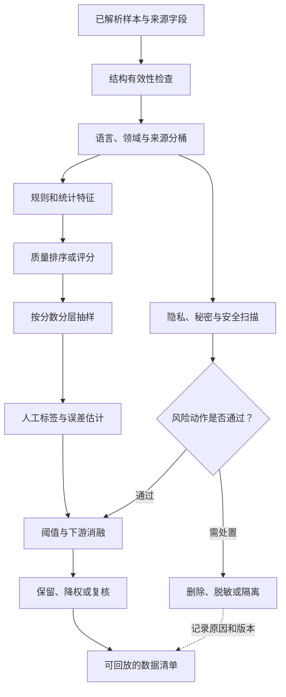

# 第三章 清洗、过滤与质量评分：决定哪些信号值得学习

上一章解决的是数据从哪里来、按照什么边界取得，以及如何保留来源和原始证据。本章继续沿着这条链路往前走，处理一个更难的问题：取得的记录中，哪些内容值得让模型学习，哪些内容应该删除、降权、隔离或交给人工复核。

清洗过滤经常被描述成“去掉脏数据”。这个说法不够准确。模型不会自动知道一段文本是正文、广告、导航、乱码还是带有敏感信息的记录；它只会把最终看到的 token 当作训练分布的一部分。过滤规则因此会改变模型的知识覆盖、语言风格、事实性、安全边界和训练效率。重复与评估污染有专门的候选召回、确认和处置方法，本章只保留它们与质量分数之间的边界，细节由[第四章去重与污染检测](04-去重与污染检测.md)主讲。

本章把清洗看成一个有目标、有代价、有证据的样本决策过程。主线是先分开结构有效性、目标相关质量和必须单独处理的风险信号，再说明启发式规则、统计特征、质量分类器与困惑度分别能提供什么证据；最后用人工抽样、阈值代价和下游小模型实验判断过滤是否值得。隐私、秘密和安全信号可以触发删除、脱敏或隔离，但不能被一个综合质量分抵消。重复、评估污染、数据配比和专项数据生成分别交给本册第四、第五、六、七章完整讲解。

这里的“质量”始终是相对于目标任务而言的。适合百科预训练的文章，不一定适合对话；适合代码补全的片段，不一定适合 coding agent；适合安全分类器的风险样本，也不应未经分层直接混进普通预训练池。涉及个人信息、版权、安全和用户日志的处理，需要组织的隐私、安全和法务团队共同确认。

## 3.1 清洗对象：不是“干净文本”，而是可解释样本

### 3.1.1 小白视角：图书馆中的四种书

把采集后的数据想成一座还没有整理的图书馆。书架上有教材、广告传单、读者留言、损坏页面和带个人地址的信件。管理员不会只用一个问题判断它们是否“干净”，而会分别问：

1. 这是不是一本能读的书，而不是乱码纸片？
2. 它是不是正文，而不是书架标签或重复广告？
3. 它是否适合当前区域，例如儿童区、医学区或技术区？
4. 它是否包含不应公开保存的个人信息？
5. 它是否包含必须单独处置的隐私、凭证或安全风险？

模型数据也一样。一条记录可能结构完整却信息空洞，语言流畅却事实错误，质量很高却包含不能使用的个人信息；另一些风险文本在普通预训练中不应原样保留，却可能适合受控的安全数据池。重复和评估题泄漏也会改变可用性，但它们需要独立检查，不能把“质量高”解释成“可以直接训练”。

### 3.1.2 专家视角：质量是多目标决策

设样本 `x_i` 有 token 数 `T_i`、质量特征 `f_i`、来源和领域桶 `c_i`，风险向量 `r_i`。过滤输出不是一个不可解释的“好/坏”标签，而是彼此不能互相抵消的信号：

~~~math
signals_i = (valid_i, quality_i, privacy_i, safety_i, task_value_i).
~~~

随后根据训练阶段和目标能力选择动作：保留、降权、隔离、脱敏、人工复核或删除。可以把过滤决策写成：

~~~math
action_i = A(signals_i, target, policy, budget, version).
~~~

`target` 是目标任务或数据池，`policy` 是用途和风险约束，`budget` 是审计与训练成本，`version` 绑定规则、标签协议与分类器版本。同一条样本可能因任务而有不同的质量判断，但硬性隐私或安全约束不能由较高质量分覆盖。重复和污染信号单独进入第四章的检测与处置流程。

## 3.2 为什么更多数据不自动等于更好数据

### 3.2.1 每个 token 都有计算成本

一个 token 会消耗加载、tokenization、前向、反向、通信和存储资源。如果训练集含有大量重复页脚、乱码、模板导航、关键词堆砌和空洞改写，模型仍会对这些 token 做完整训练计算。

更大的问题在于，噪声会产生可观察的行为：

1. 低信息密度降低有效 token 的比例。
2. 模板和广告改变输出的风格与格式。
3. 低可信内容增加事实冲突和幻觉。
4. 稀有个人信息可能增加记忆和泄漏风险。
5. 风险语料被无上下文混入时，模型可能学习到有害续写而不是安全识别。

因此，数据报告不能只写原始 TB 或文件数，还要报告解析后 token、过滤后 token、各桶保留率、人工抽样误删/漏删、PII/秘密信号以及实际训练采样量。重复和污染候选由第四章的独立账本记录，实际训练采样量与配比则由第五章处理。

### 3.2.2 质量也不是越高越好

如果质量分类器只偏好正式、完整、长篇的文章，系统可能误删口语、短问题、方言、社区调试和低资源语言。一个聊天模型需要看到自然用户表达，一个代码模型需要看到错误代码和修复过程，一个安全模型需要看到风险语义和安全替代。

所以更准确的目标是：在给定训练预算和风险约束下，让当前数据池保留与目标能力相关的有效信号。过滤器不决定不同数据池的训练配比；它应提供分桶质量、覆盖和误差证据，交给第五章在完整训练预算中比较。

## 3.3 清洗历史：从启发式规则到模型化治理

早期 NLP 数据通常由研究者或标注团队整理，预处理重点是分词、大小写、长度截断和标签格式。预训练规模扩大后，数据不再是几万条人工检查样本，而是从网页、书籍、论文、代码、论坛和日志中构成的复杂混合。

过滤方法大致经历了三个阶段：

1. 启发式阶段：长度、字符比例、语言、重复、黑名单和模板规则。
2. 统计阶段：词频、n-gram、压缩率、困惑度、重复度和来源分布。
3. 模型化阶段：质量分类器、毒性分类器、PII/秘密检测器、领域分类器、embedding 聚类和人工审计闭环。

现代数据管线通常把三类方法组合起来。规则负责便宜、明确、可解释的异常；统计特征负责发现同桶分布中的极端样本；模型负责处理语义质量和上下文风险；人工审计负责校准标签、发现新分布和检查误删。

公开数据研究也显示，过滤和数据选择会显著改变训练结果，但不同论文使用的模型规模、训练配方、数据来源和评估集合不同。近期对分类器质量过滤机制的分析表明，过滤分数可能更多反映样本与某个“高质量”参考集的关系，而非普适质量；多语言过滤研究则显示，不同标注器分数尺度可以不同，但样本排序和分位阈值仍可能支持有用的选择。这些结果要求工程团队先验证自己的标签协议和目标切片，不能直接复制论文中的绝对分数阈值。

## 3.4 一条可追溯的过滤流水线

### 3.4.1 阶段顺序

一个可解释的清洗流程可以是：



图中先形成可比较的质量分层，再由人工样本检查分数是否对应本任务的判断；隐私、秘密和安全是另一条风险分支。高风险凭证可以在评分前先隔离，图表达的是职责关系而非唯一执行顺序。评估污染和去重在第四章拥有各自的检索方法与处置记录，不与质量排序合并。每一步都要保留输入、输出、版本、失败原因和可抽样的中间结果。

### 3.4.2 数据对象和特征

对解析后的样本记录：

~~~math
x_i = (text_i, source_i, type_i, language_i, domain_i, T_i, version_i).
~~~

可以抽取如下特征：

~~~math
f_i = (length_i, unique_i, symbol_i, repeat_i, link_i, boilerplate_i, ppl_i).
~~~

`length_i` 描述 token 或字符长度，`unique_i` 描述 token 多样性，`symbol_i` 描述符号和异常字符比例，`repeat_i` 描述重复行或 n-gram，`link_i` 描述链接密度，`boilerplate_i` 描述模板信号，`ppl_i` 是参考模型困惑度或其分桶统计。特征只是证据，不是自动真相。

### 3.4.3 质量分的教学抽象

可以把一个简单的质量分写成：

~~~math
q_i = sum_k(w_k * f_ik)
      - lambda_repeat * repeat_i
      - lambda_noise * noise_i
      - lambda_template * template_i.
~~~

`w_k` 是正向特征权重，`lambda_*` 是惩罚强度。真实系统可以用分类器、ranker 或多任务模型取代线性式，但这个式子能清楚说明：质量分是多个信号的组合，并且惩罚项的代价会改变分布。

### 3.4.4 分桶比全局阈值更重要

设样本属于语言、领域或来源桶 `c_i`，阈值写成 `tau_c` 而不是全局的 `tau`：

~~~math
keep_i = I(q_i >= tau_{c_i}).
~~~

代码、数学、论文、聊天和网页的字符结构不同；中文、英文和低资源语言的 token 统计也不同。分桶阈值不能解决所有偏差，却能避免把一种数据的正常特征当作另一种数据的异常。

## 3.5 基础有效性：先处理明显不能用的记录

### 3.5.1 长度和空内容

空文档、只有标题的页面、单个按钮和截断响应通常不能直接进入普通预训练。超长样本也不一定有价值，可能是日志倾倒、重复模板堆叠或解析器把多个页面连接在一起。

长度阈值要按数据类型设定：短数学题、代码函数、对话轮次和长论文不能使用同一个最小或最大长度。长度异常更适合作为复核信号，而不是无条件删除。

### 3.5.2 字符、控制符和不可见字符

基础检查可以统计不可打印字符、Unicode replacement character、方向控制符、异常空白和二进制残留。乱码会增加稀有 token，干扰语言分布，也可能制造极长序列。

但代码、公式、表格和多语言文本本来就可能有高符号比例。检查要同时观察 MIME、领域、语言和解析器版本，不能单独用“非字母比例高”作为删除理由。

### 3.5.3 tokenizer 视角的异常

同一个字符数下，样本被 tokenizer 切成极多 token，可能说明编码异常、混入二进制或语言与 tokenizer 不匹配。可以使用 token/character 比率作为特征：

~~~math
ratio_i = tokens_i / max(chars_i, 1).
~~~

它适合发现同一桶中的极端值，不适合跨语言直接比较。中文、日文、代码和数学的正常比率本来就不同。

## 3.6 正文、模板和低信息密度

### 3.6.1 boilerplate 的问题

网页正文旁边常有导航、页脚、版权说明、cookie banner、相关推荐、分享按钮和评论框。它们单独看并不一定是错误，但在数百万页面中重复出现，会消耗 token 并改变模型风格。

正文抽取可以使用 DOM 结构、文本密度、链接比例、站点模板指纹和段落位置等信号。删除前后应保留对照 artifact，检查标题、警告、表格和代码是否被一起删掉。

### 3.6.2 反事实审计

过滤器的一个实用审计方法是构造反事实对：同一页面分别经过旧规则和新规则，人工比较删除和保留的片段。重点观察：

1. 删除的是不是跨页面重复模板。
2. 保留段落是否仍有标题和上下文。
3. 代码块和表格是否完整。
4. 不同语言、领域和页面布局是否有差异。
5. 过滤结果改变后，模型是否出现风格或能力回归。

### 3.6.3 SEO 和广告文本

SEO 垃圾往往语言通顺，却信息密度低、关键词堆砌、句子改写重复、链接和联系方式过多。单个推广词不能直接作为删除理由，因为新闻、商业案例、合同和电商评论也可能包含价格、品牌或地址。

更稳的组合信号包括：词汇重复、段落相似、链接比例、模板指纹、来源、质量分和人工样本。过滤系统还可以把边界样本降权或隔离，而不是把所有营销语言当成同一类。

## 3.7 规则过滤：便宜、明确，但不能代替判断

规则适合处理空样本、替换字符过多、明确的秘密格式、重复行、超出安全范围的字段和已知评估模板。它的优点是快、可解释、易于回放；缺点是难以理解语义，容易在边界处误删。

规则版本应记录：

1. 规则目的和适用数据桶。
2. 输入字段和正则/词表版本。
3. 阈值和例外列表。
4. 正例、负例和边界样本。
5. 命中后动作是删除、隔离、降权还是复核。
6. 版本变更前后的命中率和下游影响。

一个规则命中率升高不一定代表质量变好，可能只是某个来源或语言被系统性删掉。每条规则都应该能回答“删掉谁、误删谁、留下谁、代价是什么”。

## 3.8 质量分类器：从启发式到语义评分

### 3.8.1 标签从哪里来，分数代表什么

质量分类器可以用人工标注、弱监督、来源先验、对比样本、LLM 辅助标注和下游反馈训练。无论来源是什么，标签都不是世界真理，而是一个面向目标任务的判断协议。训练用正例与负例定义了模型可学到的差别；模型分数首先表示“更像这批正例还是负例”，并不天然表示事实正确、覆盖全面或对所有任务都重要。

例如，把技术文档和百科当作正例、模板页和明显垃圾当作负例，分类器可能学到正式文风和较长段落；它未必学到事实正确性，也可能把口语、方言和低资源语言判成低质量。训练与负例的长度、来源和格式若存在系统差异，模型可能利用这些容易识别的线索，而不是目标质量本身。上线前应检查正负样本的语言、长度、来源、格式、文档类型和主题分布，并用反事实对照验证改变某个表面特征时分数是否异常跳变。

### 3.8.2 二分类、排序和校准不是一回事

二分类输出可以用于粗筛，连续分数更适合排序和版本比较。排序能力回答“在这批候选中，哪些样本更符合标签协议”；阈值校准回答“分数到某一位置时，误删、漏删与保留量分别是多少”；概率校准还要求分数能对应某个明确概率事件。三者不能混为一谈。一个分数 `q_i` 至少要伴随模型版本、训练标签、标注协议、校准集、语言/领域桶和不确定性。

如果分类器只输出“保留/删除”，后续无法区分高置信度垃圾和边界样本。保存连续分数、命中特征和人工复核结果，可以让边界样本进入下一轮标签与阈值校准。若目的是从有限语料挑出前 20%，相对排序可能就足够；若目标是保证误删率低于某个限值，则必须有代表性标注集、明确分母和该切片上的置信区间。

### 3.8.3 LLM-as-judge 的边界

更强模型可以辅助判断可读性、结构和任务价值，但它也会偏好自己的文风、过度相信流畅表述、忽略事实错误，或对非主流语言缺乏判断能力。LLM judge 适合生成候选标签和解释，不能跳过人工协议、负对照和下游消融。

### 3.8.4 分组审计

至少要按以下切片检查质量分类器：

1. 语言、脚本和方言。
2. 领域、文档类型和长度。
3. 来源、时间和作者类型。
4. 代码、数学、表格、对话和普通正文。
5. 高质量但非主流的边界样本。

如果某个切片的保留率突然下降，应先查看样本和标签协议，而不是立即把阈值调高或调低。

近期研究把这两个风险说明得更具体。《Removing Noise, not Finding Gold》分析分类器质量过滤（Classifier-based Quality Filtering，CQF）：它用小型“高质量”参考集和大规模网页集训练分类器，再按分数筛选。作者在 32 万亿 token 的 RedPajama-V2 上开展 125M 至 1.3B 模型实验，观察到 CQF 可以改善特定下游任务，但分数不等于普适质量；不同参考集会形成不同的任务偏向，甚至长度等表面特征也可能被当成质量线索。论文发表于 ICML 2026，具体结论仍受其语料、模型规模和评估任务约束。[原始论文 v4](https://arxiv.org/abs/2510.00866v4)

多语言工作 JQL 则展示了另一种路径：先用人工样本校验 LLM 质量标注，再把标注能力蒸馏到轻量级多语言模型。研究标注集覆盖 35 种语言；端到端预训练消融使用 2B 模型，主体结果来自 13 种欧洲语言，并采用按标注器分布选择的分位阈值。作者报告的留存与 benchmark 改善是该数据、语言、token 预算和欠训练规模下的结果，不能推成“分位阈值总是有效”；它支持的是先检查各模型排序能力和分数分布，再用同预算消融选阈值。[EMNLP 2025 论文](https://aclanthology.org/2025.emnlp-main.449/)

这两类结果合在一起给出一个工程判断：正例参考集、标注协议和目标任务共同决定分数含义。分数适合把样本排成待审计的队列；是否删除，要由切片留存、人工误差和下游证据共同决定。

多维度数据选择也可以直接把评分问题转成下游实验问题。ACL 2025 的 Meta-rater 为数据设计专业性、可读性、推理性和整洁度等评分，再用 proxy model 的验证损失学习这些分数的组合；作者在指定 SlimPajama、1.3B/30B-token 和更大模型实验中报告训练效率与下游指标改善。它展示了“哪些分数对目标训练有用”可以被实验估计，但评分维度、回归器和训练规模都绑定作者设置，不能把其权重当成通用标准。[ACL 2025 原文](https://aclanthology.org/2025.acl-long.533/)

## 3.9 困惑度：有用的异常信号，不是质量裁判

参考语言模型对文本的平均负对数似然可以转成困惑度：

~~~math
PPL_i = exp((1 / T_i) * sum_{t=1}^{T_i}(-log p_ref(x_t | x_{1:t-1}))).
~~~

困惑度高可能表示乱码、拼接错误、专业领域陌生或语言不匹配；困惑度低可能表示自然文本，也可能表示重复模板和常见套话。因此应在语言、领域和来源桶内计算分布，使用同桶极端值，而不是全局阈值。

可进一步使用标准化分数：

~~~math
z_i = (log(PPL_i) - mean_c) / std_c.
~~~

`mean_c` 和 `std_c` 是桶 `c` 的统计量。低资源语言和专业技术文本的参考模型本身可能不充分，困惑度过滤尤其需要人工负对照和小模型验证。

## 3.10 PII、秘密和安全语义

### 3.10.1 PII 检测不是一个正则表达式

邮箱、电话、证件号和常见 token 格式可以用规则发现；人名、地址、健康信息、多个字段组合后的身份关系则需要实体识别、上下文分类和人工复核。Microsoft Presidio 等工具可以提供可扩展的检测与匿名化组件，但工具输出仍需按组织数据和法域校准。

误报包括小说人物、公开机构地址、论文作者邮箱和明确标注为 fake 的示例；漏报包括图片 OCR、非标准电话格式、口语地址和组合型身份信息。工程上要保存命中类型、检测器版本、处理动作和人工复核结果。

### 3.10.2 秘密检测和轮换

代码、日志和配置中可能有 API key、访问令牌、密码、私钥和内部 URL。发现秘密后不能只把字符串替换掉，还要判断凭证是否已经使用，必要时轮换相关凭证，并清理缓存、日志和版本库副本。

训练数据处理应使用合成值和占位符测试检测器，不要在测试代码中放入可复用真实密钥。秘密扫描通过只说明当前扫描器没有命中，不能证明内容没有敏感信息。

### 3.10.3 毒性和风险内容的分层

普通预训练、风险识别、安全 SFT 和红队评估对风险文本的需要不同。把所有仇恨、暴力、自伤或危险语义都删除，可能削弱模型识别和安全回应能力；不加上下文地全部保留，又可能增加有害续写。

可以按用途分层：

1. 明显高风险、无法安全处理的内容删除或受控隔离。
2. 新闻、研究、教育和安全讨论保留上下文、来源和用途标签。
3. 安全拒答、澄清和替代帮助进入安全或后训练数据池。
4. 需要模型识别但不应复述的样本使用受控评估和最小暴露。

### 3.10.4 评估污染与质量过滤的边界

benchmark 题目、答案和模板可能质量很高，却不应该进入某个训练池；高质量分不能覆盖评估污染信号。污染的检索、相似度证据和人工确认在[第四章](04-去重与污染检测.md)主讲。本章的过滤账本只接收该章交来的独立风险结论，不把污染样本伪装成普通低质量样本。

## 3.11 合成数据和机器生成数据

机器生成样本既可能是模板化噪声，也可能补足数学、代码、指令或安全边界；“机器生成”不是自动删除标签，“高质量”也不能替代验证。第三章只要求把来源与教师版本作为质量判断的切片，并用执行、证明、事实核查或人工审阅验证适用标签。生成流程、teacher 反馈和自然/合成比例由[第七章合成数据与蒸馏数据](07-synthetic-data与distillation-data.md)主讲。

## 3.12 按数据类型使用不同过滤策略

过滤策略应跟着样本结构改变，而不是为每种数据硬套一套“自然文本质量”规则。下面的表只列本章过滤阶段需要保留的判断接口；类型专属 schema、验证器、许可证与训练方法在[第六章](06-code-math-domain-data.md)、第七章和第九章完整展开。

| 样本桶 | 常见误判来源 | 本章需要保留的质量证据 | 专题交接 |
| --- | --- | --- | --- |
| 网页正文 | 模板页脚被当正文，或短正文被当成无效 | 抽取版本、正文比例、模板/广告信号、长度分布 | 第二章采集解析；第四章重复检测 |
| 代码 | 符号多、函数短、注释少被当作噪声 | 解析/编译结果、测试或验证信号、语言与仓库切片 | 第六章代码数据；凭证扫描留在本章风险支路 |
| 数学与科学 | 符号密集、低频表达式和短证明被误删 | 公式结构、答案/证明验证状态、语言与领域切片 | 第六章专项数据；污染检测交第四章 |
| 对话与安全数据 | 单句分数忽略角色、轮次和拒答上下文 | 会话完整性、说话方、风险用途和人工标签 | 第八章偏好与安全数据；第八册安全目标 |
| 多语言与翻译文本 | 识别器、标注器和参考模型的语言偏差 | 分语言排名、留存率、标注协议、翻译/原生来源 | 第九章多模态数据；目标能力由第五章配比 |

表中各桶应分别维护抽样分母和阈值结果。比如，中文总体留存率稳定并不能说明低资源语言切片也稳定；代码总量增加也不能说明可编译或有测试的代码比例提高。评价时还应区分解析器变化和内容质量变化，避免把数据生成过程的差异误归因给过滤器。

## 3.13 阈值校准：把误删和漏删放进同一张账

### 3.13.1 两种错误

先固定人工标签含义：在质量审计里，把“按目标协议应保留”设为正类，把模型的“保留”设为正预测。这样，**误删**是好样本被预测为拒绝，即 false negative（FN）；**漏删**是低质量样本被预测为保留，即 false positive（FP）。这两个名字只有在写清正类和动作后才有意义，日常报告应同时写中文错误名称，避免把不同团队的标签约定混在一起。

~~~math
L(tau) = C_del * N_FN(tau) + C_keep * N_FP(tau).
~~~

`C_del` 表示误删一条合格样本的代价，`C_keep` 表示漏删一条不合格样本的代价，`N_FN` 和 `N_FP` 分别是审计样本上的误删数和漏删数。这是决策模型，不是天然存在的客观价格。低资源语言、关键领域或安全识别样本的 `C_del` 可能更高；隐私、凭证或严重风险内容若进入不该进入的数据池，`C_keep` 可能更高。对这些硬性风险，不能靠把成本乘大来“换取通过”，应直接走单独的删除、脱敏或隔离门禁。

用 8 条合成审计记录手算两个阈值。人工标签把 `good` 定义为当前目标下合格、`bad` 定义为不合格；模型分数越高越倾向保留。

| 样本 | 人工标签 | 质量分 | 样本 | 人工标签 | 质量分 |
| --- | --- | --- | --- | --- | --- |
| A | good | 0.95 | E | good | 0.65 |
| B | bad | 0.85 | F | bad | 0.55 |
| C | good | 0.80 | G | good | 0.40 |
| D | bad | 0.70 | H | bad | 0.30 |

阈值 `tau=0.60` 时，A、B、C、D、E 保留：其中 3 条 good 是 TP，2 条 bad 是 FP；G 是 1 条 FN，F、H 是 2 条 TN。于是 precision 为 `3/5=0.60`，recall 为 `3/4=0.75`，文档留存率为 `5/8=0.625`。阈值升至 `0.75` 后，只保留 A、B、C：TP=2、FP=1、FN=2、TN=3，precision `2/3≈0.667`，recall `2/4=0.50`，留存率 `3/8=0.375`。高阈值提升了保留样本的合格比例，却把一半人工判定的合格样本删掉。

若教学假设 `C_del=5`、`C_keep=2`，则低阈值损失为 `5×1+2×2=9`，高阈值损失为 `5×2+2×1=12`。在这个假设下，虽然高阈值 precision 更高，低阈值仍因少误删而代价较低。换成更重视漏删的任务，最优点可能反过来。每个比例的分母也不同：precision 分母是保留数 5 或 3，recall 分母是人工 good 数 4，留存率分母是输入数 8；绝不能用“过滤了多少”代替这些指标。

阈值的取舍应按用途和切片报告，不能把一个全局精度数字当成各数据桶的风险保证。

### 3.13.2 分层抽样

人工审计不能只随机抽总体，因为高质量样本和稀有风险样本的比例可能很低。可以按质量分桶、语言、领域、来源、风险命中和长度分层抽样。若为了发现低资源问题而对某一语言过采样，估计总体错误率时要按各桶在真实语料中的比例加权；否则样本中的桶占比会被误当成总体占比。

标注协议要先说清“合格”对应哪个目标、是否有风险硬门禁、边界样本如何判。高影响样本可以双人独立标注并记录分歧；裁决标签用于阈值校准，分歧本身则提示标签定义不足。报告应记录抽样框、每桶样本数、抽取概率、标注者一致性、置信区间和未覆盖切片。一个“抽了 100 条”的数字没有这些信息就很难解释。

### 3.13.3 阈值扫描

对质量分阈值 `tau` 扫描，记录文档和 token 留存率、precision、recall、误删率、漏删率、各切片留存率、每种错误代价，以及下游小模型结果。应在分层审计样本上计算，并保留其抽样权重；若某个切片没有合格样本或没有负样本，对应 recall 或 false-positive rate 应报告为 `N/A`，不能填 0。阈值变化引起的语言、领域和来源分布变化应进入版本差异，不能只保留最终阈值。

## 3.14 过滤后的验证：数据指标和模型指标要连起来

### 3.14.1 过滤前后数据指标

至少比较：

1. raw、parsed、kept 和 sampled token。
2. 语言、领域、来源和时间分布。
3. 质量分、困惑度和长度分布。
4. PII/secret 与安全风险的独立命中、处理和复核结果。
5. 人工 precision、recall、误删和漏删；重复与污染指标由第四章的专门报告交接。

平均质量提高但中文覆盖下降，或保留率提高但污染上升，都可能是回归。

### 3.14.2 小模型消融

在昂贵的大模型训练前，可以用较小模型、较短 token 预算和多个随机种子比较过滤版本。对照至少包括原数据、规则过滤和规则加质量排序；固定模型架构、tokenizer、优化器和训练 token 预算，单独报告为凑足 token 而重复采样的情况。应同时观察验证 loss、语言/领域能力、事实支持、安全误拒、风险输出和训练成本；没有被目标质量协议覆盖的任务，也应作为负对照切片。

小模型趋势不保证大模型完全一致，但可以发现明显的过滤灾难，例如某个规则删掉了大多数代码、某个质量分类器压低了低资源语言或某个风险过滤使目标识别能力骤降。JQL 在其 2B 参数和指定 token 预算下使用训练曲线比较过滤数据；这可以支持“小模型/中小模型实验有筛选价值”，不能证明同一排序在目标大模型上必然保序。通过筛选后仍需在目标训练配方中复验。

### 3.14.3 训练 loss 不是唯一答案

某个过滤版本可能降低验证 loss，却让事实引用、对话风格或安全边界变差；也可能保留更多真实噪声，让 loss 略高但用户任务更好。数据实验应把能力、行为、安全、覆盖和成本放在同一张评估表中。

## 3.15 教学案例：高质量分类器误删低资源语言

### 3.15.1 现象

这是一个合成教学案例，不是生产观察。团队用英文高质量文章和百科作为正例训练质量分类器。版本上线后总体平均质量分提高，网页模板比例下降，但某低资源语言的留存率从 62% 降到 18%。若该语言桶有 10,000 篇文档，旧版留 6,200 篇，新版仅留 1,800 篇，差值是 4,400 篇；总体平均分提高不能解释这些被删内容是否低质。固定训练预算的小模型对照同时显示，该语言问答和代码注释切片退步，而英语平均指标改善。这些数字只用于演示切片读法，真实结论必须用项目自己的语料与评估集复算。

### 3.15.2 根因

分类器把较短句子、不同标点、少见词和非标准拼写当作低质量特征。它的标签协议没有覆盖该语言，评估只看总体 precision，没有按语言统计误删。

### 3.15.3 修复

1. 从被删除样本中按语言和质量分桶抽样。
2. 引入该语言的原生高质量样本和正常口语负对照。
3. 重新校准分类器并使用语言桶阈值。
4. 将重要教育、政策和技术来源设置为保留候选，不绕过隐私和许可证检查。
5. 用小模型和目标语言任务做过滤前后消融。
6. 把保留率、误删率和能力回归加入版本报告。

### 3.15.4 教训

总体质量分并没有回答“哪些人、哪些语言、哪些任务被删掉了”。质量系统必须报告每个切片的输入分母、保留量、人工误差和能力变化，才能把平均收益与分布损失放在一起判断。只有在标签协议覆盖该语言、不同阈值被同预算比较、低资源切片样本足够且复现实验方向一致时，才有理由把问题归于过滤器；否则应把根因写成待验证假设。

## 3.16 可运行的合成阈值审计示例

上一节用 8 条合成审计记录手算阈值差异，本节用同一组标签和分数复现计数。人工标签 `gold_good=True` 表示依照当前目标协议应保留，`score` 越高表示模型越倾向保留。代码只检查质量排序阈值；它不训练分类器、不扫描 PII 或秘密、不判断许可，也不执行去重或污染检测。

代码状态：已验证（2026-10-28；Python 3.12.9 标准库；固定 8 条审计记录、空审计集和无正例切片）。

```python
from __future__ import annotations


samples = [
    {"id": "A", "gold_good": True, "score": 0.95},
    {"id": "B", "gold_good": False, "score": 0.85},
    {"id": "C", "gold_good": True, "score": 0.80},
    {"id": "D", "gold_good": False, "score": 0.70},
    {"id": "E", "gold_good": True, "score": 0.65},
    {"id": "F", "gold_good": False, "score": 0.55},
    {"id": "G", "gold_good": True, "score": 0.40},
    {"id": "H", "gold_good": False, "score": 0.30},
]


def ratio(numerator: int, denominator: int) -> float | None:
    return round(numerator / denominator, 3) if denominator else None


def audit_threshold(
    rows: list[dict],
    threshold: float,
    delete_cost: int = 5,
    keep_cost: int = 2,
) -> dict:
    counts = {"tp": 0, "fp": 0, "fn": 0, "tn": 0}
    for row in rows:
        gold_good = row["gold_good"]
        predicted_keep = row["score"] >= threshold
        if gold_good and predicted_keep:
            counts["tp"] += 1
        elif not gold_good and predicted_keep:
            counts["fp"] += 1
        elif gold_good and not predicted_keep:
            counts["fn"] += 1
        else:
            counts["tn"] += 1

    true_positive = counts["tp"]
    false_positive = counts["fp"]
    false_negative = counts["fn"]
    true_negative = counts["tn"]
    total = len(rows)
    cost = (
        delete_cost * false_negative + keep_cost * false_positive
        if total
        else None
    )
    return {
        "threshold": threshold,
        "counts": counts,
        "precision": ratio(true_positive, true_positive + false_positive),
        "recall": ratio(true_positive, true_positive + false_negative),
        "document_retention": ratio(true_positive + false_positive, total),
        "false_delete_rate": ratio(false_negative, true_positive + false_negative),
        "false_keep_rate": ratio(false_positive, false_positive + true_negative),
        "cost_units": cost,
    }


for threshold in (0.60, 0.75):
    print(audit_threshold(samples, threshold))

empty_audit = audit_threshold([], 0.60)
no_good_audit = audit_threshold(
    [{"id": "bad_only", "gold_good": False, "score": 0.20}], 0.60
)
print("empty_audit=", empty_audit)
print("no_good_audit=", no_good_audit)
```

运行后，`0.60` 会得到 TP=3、FP=2、FN=1、TN=2，precision=0.600、recall=0.750、文档留存率=0.625、代价=9；`0.75` 会得到 TP=2、FP=1、FN=2、TN=3，precision 约为 0.667、recall=0.500、文档留存率=0.375、代价=12。空审计集的比率与代价返回 `None`；只有 bad 样本的切片没有可计算的 recall，也返回 `None`。这些结果只验证公式和决策代码与给定标签一致，不说明人工标签本身无偏，也不代表实际语料的最优阈值。

代码报告文档留存率而不是 token 留存率，因为这组输入没有文本或 token 数。生产审计应分别按文档数与 token 数统计，并保留语言、领域、来源和风险切片；否则长文档的流失可能被文档计数掩盖。阈值审计也只回答目标质量协议下的误删/漏删，不会覆盖隐私、秘密、安全或许可门禁。

## 3.17 过滤策略的版本和回放

要解释一次保留率或能力变化，必须能区分内容本身变了、解析器变了、标签协议变了，还是分类器和阈值变了。质量过滤这一层至少要绑定：

~~~text
dataset_id
source_snapshot
parser_revision
quality_feature_revision
label_policy_revision
quality_model_revision
threshold_config
audit_sample_manifest
privacy_detector_revision
safety_policy_revision
filtered_manifest_digest
created_at
~~~

一次版本差异不只写最终保留 token，还要按语言、领域、来源、长度和标签桶报告留存率、人工误删/漏删、分数分布与风险动作变化。若解析器升级，先比较同一批 raw objects 的新旧解析结果；若标注协议升级，要在固定样本上同时保留旧标签与新标签；若分类器升级，则应对同一候选集并行打分，再抽审排序换位最大的样本。这样能把“文本变了”与“决策变了”分开。

该清单只负责解释本章过滤动作。数据集完整 manifest、删除传播与审计由[第十一章 Dataset Versioning 与 Governance](11-dataset-versioning与governance.md)主讲；dedup/污染的版本和证据由第四章记录，训练 mixture 变更由第五章记录。过滤结果被删除也不等于模型权重已经遗忘，数据过滤器本身不能证明模型完成遗忘。

## 3.18 常见失败模式

### 3.18.1 用一个全局质量阈值处理所有数据

语言、领域、代码、数学、对话和网页的正常特征不同。全局阈值容易偏爱某种语言和文风。修复方式是分桶统计、边界抽样和目标任务消融。

### 3.18.2 只看删除比例

删除 50% 可能意味着过滤有效，也可能意味着解析器失败或低资源数据被误删。必须同时看分桶保留率、precision、recall、风险和下游能力。

### 3.18.3 把质量分类器当事实裁判

分类器反映标签协议和训练来源，可能把流畅误认为正确，把正式误认为重要。需要事实抽样、领域专家、负对照和能力回归。

### 3.18.4 把困惑度低当作高质量

模板和套话可以很容易被参考模型预测，专业文本和低资源语言可能困惑度高。困惑度适合作为同桶异常信号，不是最终裁判。

### 3.18.5 PII 只用正则处理

正则适合结构化模式，无法覆盖组合型身份、图像 OCR、非标准格式和上下文风险。需要多检测器、人工抽样、保留记录和删除链路。

### 3.18.6 把所有风险语义删除

安全模型需要风险识别、拒答和替代帮助的训练信号。应按用途分层、隔离和最小暴露，而不是让普通预训练池承担所有安全数据责任。

### 3.18.7 过滤后不做小模型验证

规则和分类器的局部指标可能很好，整体分布却已变化。小模型消融不是大模型结论，但可以低成本发现灾难性回归。

## 3.19 资料与证据边界

### 3.19.1 数据集构造和选择

1. [Documenting Large Webtext Corpora: A Case Study on the Colossal Clean Crawled Corpus（C4）](https://arxiv.org/abs/2104.08758)：支持网页语料来源、过滤影响、评估样本混入和数据文档化讨论。
2. [The RefinedWeb Dataset for Falcon LLM](https://arxiv.org/abs/2306.01116)：支持网页过滤、去重和高质量 Web 数据构造的研究案例。
3. [The FineWeb Datasets](https://arxiv.org/abs/2406.17557)：支持多快照网页数据、过滤/去重消融和教育数据切片的较新案例。
4. [Dolma: an Open Corpus of Three Trillion Tokens](https://arxiv.org/abs/2402.00159)：支持多来源语料构造、处理文档和数据工具开放的案例。
5. [DataComp-LM](https://arxiv.org/abs/2406.11794)：支持通过受控数据选择实验比较过滤、去重和配比价值的方法。
6. [Deduplicating Training Data Makes Language Models Better](https://arxiv.org/abs/2107.06499)：支持重复、记忆和 train-test overlap 的研究讨论。
7. [Removing Noise, not Finding Gold: Quality Filtering for Large-Scale Pretraining](https://arxiv.org/abs/2510.00866v4)：ICML 2026 对分类器质量过滤的机制分析；参考集偏好、长度偏差和优化目标均需按作者语料、模型与任务理解。
8. [Judging Quality Across Languages: A Multilingual Approach to Pretraining Data Filtering with Language Models](https://aclanthology.org/2025.emnlp-main.449/)：EMNLP 2025 的多语言标注与蒸馏过滤研究；训练和评估覆盖范围并不等同于全部 35 种语言都做了同等规模的模型预训练。
9. [Meta-rater: A Multi-dimensional Data Selection Method for Pre-training Language Models](https://aclanthology.org/2025.acl-long.533/)：ACL 2025 通过多个质量维度和 proxy model 估计选择信号组合；报告结果依其 SlimPajama、模型规模、token 预算和评测协议。

这些论文的过滤规则和结果依赖具体数据、模型、训练预算和评估，不是所有项目的默认阈值。它们也不自动授予任何来源的版权、隐私或商业使用权。

### 3.19.2 隐私、质量与治理工具

1. [Microsoft Presidio](https://data-privacy-stack.github.io/presidio/)：提供 PII 识别和匿名化工具入口，不能替代组织的隐私影响评估和人工复核。
2. [Datasheets for Datasets](https://arxiv.org/abs/1803.09010)：支持记录数据集动机、组成、采集过程、推荐用途和限制。
3. [NIST AI Risk Management Framework](https://www.nist.gov/itl/ai-risk-management-framework)：支持把数据质量、隐私、安全和治理放进生命周期管理。
4. [NIST Generative AI Profile](https://nvlpubs.nist.gov/nistpubs/ai/NIST.AI.600-1.pdf)：支持生成式 AI 的数据来源、隐私、评估和风险管理边界。

这些资料说明工具和治理框架能覆盖哪些问题，但不能证明某个数据集已经没有 PII、偏见、版权、污染或安全风险。

## 3.20 思考与实践

### 题目一：设计分桶阈值

为英文网页、中文论坛、Python 代码和数学证明分别设计质量特征、阈值和人工抽样方案。说明哪些指标不能跨桶直接比较。

### 题目二：比较规则和分类器

构造一个包含正文、模板、SEO、口语、代码和低资源语言的标注集。分别测量规则和质量分类器的 precision、recall、误删切片和处理成本。

### 题目三：设计过滤消融

固定 tokenizer、训练 token、模型和评估集，比较无过滤、规则过滤和规则加质量模型三种数据版本。除 loss 外，增加语言覆盖、代码执行、事实支持、安全误拒和成本指标。

### 题目四：处理 PII 误报

列出论文作者邮箱、小说人物、合成邮箱和真实用户邮箱四种样本，设计规则、上下文和人工复核的组合流程，并说明怎样记录处理依据。

### 题目五：解释风险样本的分层

把一段风险新闻、一条有害请求、一条安全拒答示例和一条研究论文分别放入普通预训练、SFT、安全数据和评估池，说明每个选择的理由、风险和验证方法。

## 3.21 结语：过滤是在选择模型要学什么

清洗、过滤与质量评分不是数据管线中可有可无的“卫生工作”。它们决定哪些语言、文体、事实、代码、错误、风险和行为信号进入模型；也决定训练预算花在什么地方。

规则提供速度和可解释性，统计特征帮助发现异常，质量模型提供语义排序，PII/秘密和安全检测控制风险，人工审计校准边界，小模型消融检验下游后果，版本血缘让结果可以复现和回滚。任何一个信号都不应被写成普遍真理，也不能由平均质量分替代分桶覆盖和风险证据。

一个成熟的清洗系统最终要回答的不只是“删掉了多少数据”，还要回答：哪些样本被删掉，哪些被降权或隔离，谁因此获得或失去覆盖，过滤器可能错在哪里，训练结果是否支持这次选择，以及下一次数据版本能否复核这条因果链。只有这样，过滤才真正成为模型能力工程，而不是一组看似整洁的删除规则。
