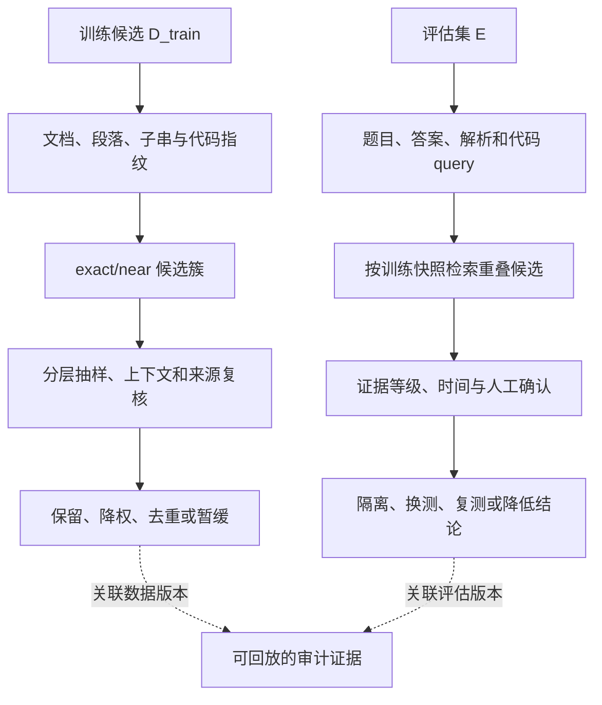

# 第四章 去重与污染检测：让训练和评估各自保持可信

上一章讨论了样本是否可读、是否有价值以及是否带有隐私和安全风险。本章处理两个容易被混为一谈的问题：训练数据内部是否有不合理的重复，以及训练数据是否已经看到了评估集的题目、答案或近似变体。

重复和污染都表现为“相似文本”，但责任不同。训练集内部的重复会浪费 token、放大某些来源、提高记忆风险并改变 data mixture；训练集与评估集的重叠会削弱 benchmark 的解释力，让分数看起来像泛化能力。前者的主要动作是去重、聚类、降权和保留代表样本，后者的主要动作是隔离、改换评估集、降低结论等级和在报告中披露。

本章从一个数据对象的生命周期开始，逐层讲清 exact dedup、段落和子串重复、近重复、MinHash/LSH、SimHash、embedding 相似、代码 fork、benchmark contamination、时间切分、私有 holdout 和合成 canary。最后用人工复核过的合成 pair、评估题和 canary 结果，演示如何分别计算重复误差、候选/确认暴露、评分切片和探针复现率。

下面两条路径共用候选检索工具，但不能共用同一判定阈值：训练内部重复要回答“保留几份、怎样控制频率”；训练与评估重叠要回答“哪些测试结果还可解释”。候选相似度先进入人工复核和证据记录，再决定数据处置或评估动作。

图中两个分支最后都留下可回放证据，但“相似”“重复”“污染”和“分数受影响”是不同命题。后文会分别给出它们各自的复核方法。

## 4.1 两类相似：重复与污染不是同一个问题

### 4.1.1 小白视角：复印资料和提前看到试卷

假设你准备考试。复习资料中有十份同一篇文章的复印件，这是馆藏内部重复；复习资料中出现了考试题和答案，这是评估污染。两者都可能让你“读过很多页”，但处理方法不同：复印件可以保留质量最高的一份，试卷内容则应该从复习资料中隔离，并检查考试分数是否仍然可信。

模型数据也一样：

1. 同一网页换了 URL，是内容重复问题。
2. 同一文章加了广告和页脚，是近重复问题。
3. 同一代码仓库被 fork 多次，是结构化代码重复问题。
4. benchmark 题目被博客转载，是训练-评估重叠问题。
5. 评估答案出现在题解中，即使题目表面没有完全匹配，也可能污染评估。

### 4.1.2 专家视角：两个集合和两个目标

设训练候选为 `D_train`，评估集合为 `E`。训练内部去重研究的是：

~~~math
pair(d_i, d_j),  d_i, d_j in D_train.
~~~

污染检测研究的是：

~~~math
pair(e_j, d_i),  e_j in E, d_i in D_train.
~~~

它们可以使用相似度工具，但阈值、分母、人工协议和后续动作不能混用。去重报告可以说“训练候选中有多少文档被聚成近重复簇”；污染报告要说“评估样本中有多少被检出重叠、重叠的是题目还是答案、证据强度如何”。

## 4.2 为什么重复会改变模型行为

### 4.2.1 重复不是无害的存储浪费

训练集的 token 数常被当作数据规模，但重复 token 的信息增量远低于独立 token。重复会产生几种后果：

1. 训练计算反复花在同一模式上。
2. 某个网站、作者、模板或观点获得过高隐含权重。
3. 罕见文本更容易被模型记住并原样复述。
4. 去重前后语言、领域和来源比例发生变化。
5. train-test overlap 让验证结果失去独立性。

重复不一定总是坏的。标准数学定义、常用 API 和安全边界需要一定曝光量，完全删除相似表达会损失泛化。因此目标不是集合意义上的“每个字符串只出现一次”，而是控制不合理的频率和来源放大。

NeurIPS 2025 的多预算预训练研究报告：在调整 weight decay 等训练 recipe 后，DCLM-baseline 过滤语料重复最多十轮，在论文测试的 1B、3B、7B 和 12.6B 参数/计算预算下，其 22 任务 centered-core 分数可以高于十倍规模 RefinedWeb 子集只训练一轮的对照；12.6B 参数、252B 总 token 的比较也使用了按重复次数调整的 weight decay。DCLM-baseline 本身是 FastText 质量分类器从 RefinedWeb 中选出的前 10% 文档。这个结果不说明重复普遍有益；它说明“唯一 token 越多越好”也不是通用目标。论文同时观察到过度重复收益递减，且不同重复强度需要不同正则化。策略需把重复结构、样本质量、有效训练轮数和目标能力一起看，训练配比与预算的完整设计见[第五章](05-data-mixture与配比.md)。[NeurIPS 2025 重复数据研究](https://papers.neurips.cc/paper_files/paper/2025/hash/2aba6ec20299931d46ddeefd5ddcb442-Abstract-Conference.html)

### 4.2.2 数据分布的频率视角

如果来源 `s` 在去重前有 `d_s` 个 token，训练候选总量为 `D`，其原始比例是：

~~~math
p_s = d_s / D.
~~~

当该来源有大量转载和镜像时，`p_s` 可能远高于它在真实知识分布中的合理权重。去重后比例变为 `p_s'`，即使模型架构和训练步数不变，实际经验分布也已经变化。去重因此必须和 data mixture 一起报告。

## 4.3 去重层次：从完全相同到语义相似

### 4.3.1 exact dedup

对规范化后的文档计算 hash，相同 hash 的样本属于完全重复候选。它适合发现重复下载、镜像页面、同一文件多份拷贝和相同版本的训练 shard。

常见规范化包括统一换行、合并空白、Unicode 规范化、去除明确的 HTML 残留和保留原文与规范化版本的双份证据。是否统一大小写、标点和代码格式，要按数据类型决定。

exact dedup 的优点是快、便宜、可解释；缺点是无法发现只改了标题、页脚、广告、空格或少量词语的内容。它是第一层证据，不是完整去重结论。

### 4.3.2 文档、段落和子串

去重粒度决定误删风险：

1. 文档级去重适合整页镜像和重复文件，但会把一个页脚差异视为不同文档。
2. 段落级去重适合模板、免责声明和转载片段，但直接删除段落可能破坏上下文。
3. 子串级去重适合查找重复数万次的固定句子、题目和敏感片段，但索引和存储成本更高。

段落和子串重复可以先作为质量和采样信号。只有当重复来源明确、上下文替代关系清楚时，才适合直接删除。

### 4.3.3 near dedup

近重复包括轻微改写、转载、翻译、插入广告、OCR 差异、代码 fork 和格式变换。它要回答的不是“两个文本是否相似”，而是“共享部分占多少、剩余部分是否仍有独立训练价值、再保留一份的边际作用如何”。相似度只描述文本关系；是否删除还要看匹配单位、上下文、来源、许可、语言和训练目标。

常用相似度包括字符或 token n-gram、Jaccard、包含率、编辑距离、MinHash 签名、SimHash 汉明距离和 embedding cosine。不同方法观察的是不同层次，不能把一个阈值在所有数据类型上复用。整篇重复和局部片段重复还要区分：短片段完全嵌在长文中时，Jaccard 会被长文的其余部分稀释，可以同时看较短一侧被较长一侧覆盖的比例：

~~~math
Containment(A, B) = |A intersect B| / min(|A|, |B|).
~~~

若短片段 shingles 为 `{a,b,c}`，长文 shingles 为 `{a,b,c,d,e,f,g}`，则 Jaccard 为 `3/7≈0.429`，包含率为 `3/3=1`。这只说明短片段完全出现在长文中，不说明整篇文档可互换；子串删除前仍要检查重复跨度、局部上下文和删除后句段是否破碎。

## 4.4 规范化和 exact hash

### 4.4.1 为什么原文 hash 不够

同一篇文章可能因为换行、HTML 实体、空格、编码和广告字段不同而得到不同 hash；如果规范化过度，又可能把不同语言版本、不同查询结果或不同代码配置错误合并。

因此应保留：

1. 原始载体 hash。
2. 规范化文本 hash。
3. 规范化函数和版本。
4. 原始 URL、规范化 URL 和取得时间。
5. 内容长度、语言、领域和解析器版本。

hash 用于高效分桶，不宜只比较截断后的短摘要并把相同值当作数学证明。审计敏感的去重任务可以使用足够长的密码学摘要，并在同桶后比较规范化载荷或保留可复核的内容指纹；还要固定 hash、规范化和 tokenizer 版本。对代码不要默认删除注释、常量或大小写：它们有时改变语义，也可能影响许可证和来源判断。

### 4.4.2 exact 重复率

设候选文档总数为 `N`，规范化 hash 的第 `k` 个桶大小为 `n_k`，文档口径的 exact 删除率为：

~~~math
R_exact = sum_k(max(n_k - 1, 0)) / N.
~~~

如果按 token 计算，则应把每个被删除副本的 token 加总，而不能拿文档比例代替 token 比例。报告中要明确分母和保留哪一份的规则。

### 4.4.3 保留代表样本

一个重复簇中可以按质量分、来源可信度、解析完整性、许可证范围、时间和语言版本选择代表样本。不要简单保留遇到的第一份，因为它可能是转载、解析损坏或许可状态不清的副本。

代表样本选择也要保留 cluster ID 和被移除成员的 provenance，否则后续无法解释数据量下降和删除请求传播。

## 4.5 Jaccard 和 shingle：近重复的可解释基础

把文档切成 token 或字符 shingles，得到集合 `S_i`。两个文档的 Jaccard 相似度是：

~~~math
J(i, j) = |S_i intersect S_j| / |S_i union S_j|.
~~~

如果两个文档完全相同，Jaccard 接近 1；如果共享的 n-gram 很少，值就低。shingle 大小越小，对局部改动越宽容，但也更容易把主题相近的短文本误判为重复；shingle 大小越大，对改写越敏感，但可能漏掉复制片段。

短文本特别容易出现相似度虚高：两个问题都包含“什么是 Transformer”，并不代表它们只应保留一个。短样本要结合长度、意图、答案和领域处理。

## 4.6 MinHash：把大规模集合比较变成候选检索

### 4.6.1 它解决的计算问题

如果有十亿篇文档，逐对计算 Jaccard 不可行。MinHash 为每个 shingle 集合生成紧凑签名，使相似文本更可能拥有相同的签名位置；LSH 再用这些签名召回候选。

工程流程通常是：

1. 按语言和类型规范化。
2. 生成字符或 token shingles。
3. 计算多个 MinHash 分量。
4. 用 LSH band 把可能相似的样本放进候选桶。
5. 对候选对计算精确 Jaccard 或其他相似度。
6. 按阈值和人工协议建簇。

### 4.6.2 MinHash 的概率性质

对集合 `A`、`B` 和一个均匀随机排列 `pi`，MinHash 的基本性质是：

~~~math
P(minhash_pi(A) = minhash_pi(B)) = J(A, B).
~~~

用 `K` 个独立或近似独立的签名分量，可以用相等比例估计 Jaccard：

~~~math
J_hat(A, B) = (1 / K) * sum_k I(sig_k(A) = sig_k(B)).
~~~

这不是“相似度必然准确”的保证。hash 函数、shingle 大小、签名长度、短文本和多语言切分都会影响误差。

可以用一个很小的集合跟算。令 `A={a,b,c,d}`、`B={b,c,d,e}`，交集有 3 个元素、并集有 5 个元素，所以真实 Jaccard 为 `3/5=0.6`。假设从五个元素的次序里抽到下表四个不同排列：

| 随机排列顺序 | `min(A)` | `min(B)` | 是否相等 |
| --- | --- | --- | --- |
| `a,b,c,d,e` | `a` | `b` | 否 |
| `b,e,c,d,a` | `b` | `b` | 是 |
| `d,c,e,b,a` | `d` | `d` | 是 |
| `c,d,a,e,b` | `c` | `c` | 是 |

四个签名中有三处相等，估计值为 `3/4=0.75`。它高于 `0.6` 并不矛盾：四个分量只是有方差的估计，增大签名数通常让估计更稳定，但增加存储和计算。

### 4.6.3 LSH 的候选概率

若签名被分为 `b` 个 band，每个 band 有 `r` 行，band 之间按独立 MinHash 分量构造，真实 Jaccard 相似度为 `s` 时被至少一个 band 召回的概率可近似写成：

~~~math
P_candidate(s) = 1 - (1 - s^r)^b.
~~~

band 太宽会产生过多候选，band 太窄会漏掉相似样本。LSH 只是候选召回器，最终判定仍要回到精确相似度、来源和人工抽样。

这种以概率控制候选召回、减少高维空间全量近邻比较的思路属于 LSH 框架的经典应用；这里的 band 公式是适用于独立 band/签名假设下的推导，不是对任意实现召回率的保证。[Indyk 与 Motwani，STOC 1998](https://doi.org/10.1145/276698.276876)

继续用真实相似度 `s=0.6`，若把 8 个签名分成 `b=4` 个 band、每个 band 有 `r=2` 行，则至少一个 band 命中的概率为 `1-(1-0.6^2)^4=1-0.64^4≈0.832`。这表示在该简化随机模型下约有 83.2% 的召回概率，不表示该候选有 83.2% 概率是真重复。后一个概率还取决于非重复对的基率、候选规则和数据类型，需要人工标签估计。

## 4.7 SimHash：快速筛选相似指纹

SimHash 把文本特征映射为固定长度二进制指纹，相似文本通常具有较小的汉明距离。它适合快速发现网页近重复和模板变化，但其效果依赖 token 特征、权重、位数和阈值。

设每个 bit 的加权投票为 `v_b`，指纹位为：

~~~math
z_b = I(v_b >= 0).
~~~

两个指纹的汉明距离是：

~~~math
H(a, b) = sum_k I(z_k(a) != z_k(b)).
~~~

SimHash 的优点是指纹短、计算快、索引简单；缺点是对短文本、语义改写和特征选择敏感。它可以与 MinHash 并行，用一个方法扩大召回，再用另一个方法和人工审计减少误合并。

例如，四个 bit 的投票为 `(2,-1,0,3)`，并规定零值置 1，则指纹为 `1011`。另一篇文本的指纹为 `1001`，汉明距离为 1；它们在这个表示下接近，但阈值结论仍受特征权重、位数和文本长度影响。短文本的每个 token 可能主导多个 bit，因此应设类型门槛或单独审计，不能把同一距离直接套到一行代码和一篇长文。

## 4.8 embedding 相似：发现语义近邻，但不要直接删除

embedding 检索能够找到字面不同但语义相近的文本，例如改写后的 FAQ、同一道题的不同表述和同一功能的代码说明。这对污染候选发现、聚类和人工审计很有价值。

但语义相似不等于训练冗余：

1. 同一主题的两篇文章可能提供不同事实和细节。
2. 数学题方法相似，数值和推理步骤可能不同。
3. 法律解释的适用条件可能不同。
4. 多个用户问法相似，有助于指令泛化。
5. 不同语言的平行表达可能是多语言能力所需的信号。

embedding 去重应记录模型版本、距离、阈值、语言和人工判断。更安全的默认动作是聚类、降权或抽样，而不是根据一个向量距离直接删除所有近邻。

## 4.9 去重后的频率控制和 data mixture

去重改变的不只是数据量，还包括各来源和领域的相对权重。假设来源 `s` 的有效 token 从 `d_s` 变为 `d_s'`，去重后比例为：

~~~math
p_s' = d_s' / sum_j(d_j').
~~~

新闻转载、代码 fork、题库模板和百科镜像的重复率不同，去重后它们的相对比例会重新排序。每个数据版本都要报告：

1. raw、parsed、deduped 和 sampled token。
2. 语言、领域、来源和时间比例。
3. 每个重复簇的大小分布。
4. 代表样本选择规则。
5. 被删除副本的质量和许可状态。

有价值的标准表述可以保留一定 exposure；低质量模板、隐私复制和 benchmark 复制需要更严格处理。去重系统是频率控制器，而不是唯一性追求者。

这个区别会改变实现：先定义检测单位和重复簇，再单独定义保留函数。2026 年一篇大规模研究把两步拆开，按子文段全局频次与片段长度分配保留预算，并用连续片段长度减少删除造成的文档破碎。作者在其 FineWeb-Edu 设置中，30B-A3B 模型训练 36,000 步、约 294.9B token；完整方案八项基准平均为 52.90，Suffix-Array 基线为 52.79，Keep-One 为 52.14。代码网页实验的五项平均为 41.40，对照未额外去重为 37.98。结果说明保留策略会改变有限预算下的表现；模型、数据、token 预算和评测都来自该研究，不能直接移植其参数或宣称普遍收益。[频率与长度感知子文档去重研究](https://arxiv.org/abs/2608.03089)

同理，严格 keep-one 和降权/抽样是不同策略。FineWeb2 等流程利用簇频次构造重采样；SoftDedup 以估计常见度调低重复文档权重。若后续仍要上采样稀缺来源或维持常见模式，应把去重后的有效暴露量交给 mixture 阶段共同核算，不能把“已去重”当作完整配比方案。

“重复很多”也不一定等于“低质量”。同一 NeurIPS 研究在 7B 模型、138B token 的 DCLM-baseline 采样实验中，22 任务 CORE 分数分别为：保留重复组的 duplicate-aware sampling `34.1`，先全局去重再抽样 `41.7`，均匀抽样 `44.4`，保留重复次数至少 7 的文档后再去重 `45.8`。作者指出该过滤数据中重复次数与分类器质量分可能相关，重复计数于是同时承载“频率”与“被筛选保留”的信息。这个单语料、特定分类器和训练预算的结果不证明应保留重复；它提醒工程师审计去重前后样本质量及分布，不能把重复频率本身当作价值标签。

## 4.10 代码数据：fork、vendor 和生成文件

代码的重复关系比普通文本更复杂：同一实现可以出现在原仓库、fork、vendor 目录、依赖镜像、教程和题解中。文件级 hash 只能发现完全复制，函数级 token 或 AST 相似度可以发现改名和轻微重排。

代码去重应分层处理：

1. 自动生成文件和构建产物通常优先移除。
2. vendor 和第三方依赖要结合许可证与用途处理。
3. fork 仓库应保留来源、commit 和差异，而不是把所有 fork 当成同一份。
4. 常见 API 模式不应因为相似就全部删除。
5. 题库、测试答案、函数签名和 benchmark 代码需要单独做污染检测。

代码重复的保留策略要与目标能力绑定。代码补全需要常见 API exposure，coding agent 还需要仓库结构、依赖和测试；一个只有函数字符串的 dedup 结果不能代表仓库级训练价值。代码样本契约、许可证、secret、测试和专项验证由[第六章 Code、Math 与 Domain Data](06-code-math-domain-data.md)继续展开。

## 4.11 Benchmark contamination：评估为何会失真

### 4.11.1 污染的形态

公开 benchmark 可能被论文、博客、课程、题解、GitHub 和论坛复制。广义的数据污染还可能发生在预训练、SFT、RL、合成数据生成、prompt/harness 调整、检索缓存和反复看评估反馈的过程中。本章重点审查数据集之间的暴露；做模型级审计时，要同时核对训练阶段和评测迭代链路。

训练集与评估集的重叠包括：

1. 题目原文重叠。
2. 选项、答案或解析重叠。
3. 题目轻微改写、翻译或格式转换。
4. 评估代码、函数签名、测试样例和参考实现重叠。
5. benchmark 讨论中的隐藏答案或解题模板重叠。

题目原文不匹配不代表没有污染。对生成模型来说，答案、解析和固定模板可能比题干更直接地提供了得分路径。

### 4.11.2 污染的结果如何影响结论

污染会让分数混合了泛化、记忆、提示模板熟悉度和答案复现。确认评估内容曾进入某个训练或调参输入，是“发生过暴露”的证据；它本身不能量化模型学到了多少，也不能证明该暴露造成了多少分数增益。相反，某次重叠扫描未命中，也不能证明模型从未通过别的来源或训练阶段见过相同信息。

因此评估报告应记录评估集版本、公开时间、训练数据时间窗口、相似度方法、阈值、人工复核、污染候选数量和最终结论等级。不要在发现污染后只删除命中数字，应该重新评估或明确不确定性。

## 4.12 污染检测：从 query 到证据

可访问训练语料时，把每个评估样本作为 query，在固定版本的训练快照中检索：

1. exact hash 和规范化文本。
2. n-gram overlap 和长公共片段。
3. MinHash/LSH 近重复。
4. embedding 或 BM25 语义候选。
5. 答案、选项、解析和代码测试的单独匹配。
6. 时间和来源证据。
7. 人工对候选关系进行分级。

评估样本 `e_j` 对训练集合的最大相似度可以写成：

~~~math
c_j = max_i sim(e_j, d_i).
~~~

若有 `M` 个评估样本，阈值 `tau` 下的污染候选率是：

~~~math
R_contam(tau) = (1 / M) * sum_j I(c_j >= tau).
~~~

这个指标只表示候选命中，不表示所有命中都已人工确认。至少应分开报告：候选命中率（按评估样本为分母）、人工确认暴露率、候选中的确认比例、答案/解析/代码字段命中数，以及各项覆盖了哪些数据源和训练阶段。候选命中率不是“污染率”；确认比例也不能不加权地外推到未抽样候选。

在无法读取训练集时，只能使用模型行为信号作为间接证据。Data Contamination Quiz（DCQ）为评估样本构造词级扰动选项并要求模型选回原始措辞，利用它对原始表述的偏好发现可能的暴露痕迹；论文特别讨论了位置偏差，并报告在其受控和非受控模型/数据实验中可估计特定分区的污染信号。[DCQ 原论文](https://aclanthology.org/2025.tacl-1.37/)。这种测试不能单独确定训练样本来源或暴露阶段，还可能受到措辞熟悉度、扰动自然度、模型偏好和安全过滤影响。

2026 年两项 ICLR 研究进一步显示，后训练会改变这些行为信号。Self-Critique 用“让模型先答、再自我批评”产生路径一致性探针，并比较原回答与批评回答的熵特征；作者构造 RL-MIA，把已知测试样本注入数学/逻辑 RL 语料，再评估模型级检测。Qwen2.5-7B-Instruct 和 DeepSeek-Math-7B-Instruct 上的四类任务平均 AUC 分别为 `0.70` 和 `0.64`，均比各自最强非该方法基线高 `19%`；论文摘要报告在不同实验中最高提升 `30%`。AUC `0.5` 表示随机排序，因此这里报告的是特定 7B 模型与受控注入任务的区分能力，不是自然污染率或任意 API 模型的保障。[Self-Critique 研究](https://proceedings.iclr.cc/paper_files/paper/2026/hash/ab003a4f85ecb1b7b1514ff539dc7395-Abstract-Conference.html)。

另一项 ICLR 研究报告，SFT 污染信号在 Qwen2.5-7B-Instruct 上原本可被若干方法检测，但后续 GRPO 会缩小成员/非成员概率差；作者在其 10K DeepMath、156 步设置中看到多种检测器 AUROC 随 RL 步数下降，部分方法接近 `0.50`。对已具备推理能力的模型再加入 CoT 污染时，研究中的多数检测器也接近随机猜测。结果绑定 Qwen/Llama 等指定模型、数学/科学等 benchmark 和作者的 SFT/RL 构造，不足以推断所有 RL 算法或所有模型都会同样失效。[推理模型检测脆弱性研究](https://proceedings.iclr.cc/paper_files/paper/2026/hash/a3860475ddbfb8c644c43f0dcd266b66-Abstract-Conference.html)。两项结果合起来意味着：模型行为探针既可能发现线索，也可能被训练过程隐藏，不能把“检测未命中”写成“确认未污染”。

因此，审计应说明访问假设和覆盖面：可访问快照时做内容级检索及来源回溯；只有模型 API 时做多种行为探针、盲测和时间后新题；已知有意注入的控制样本用于测方法召回，随机抽样未命中区用于发现漏检。合成控制样本有助于检查管线是否工作，却不等同于自然污染的全分布保证。

### 4.12.1 训练集内部去重与污染检测分离

同一个训练集可以内部高度去重，却包含某个 benchmark；也可以内部重复很多，却没有污染某个私有评估集。系统要分别维护 `train_dedup_version` 和 `eval_overlap_version`，让数据和评估报告能独立回放。

## 4.13 时间切分、私有 holdout 和公开 benchmark

训练数据早于 benchmark 发布日期可以降低直接泄漏的可能，但不是独立性证明：题目可能提前出现在教材、预发布稿、题库或相似问题中。训练数据晚于评估发布则需要更严格的污染检查和结论披露。

私有 holdout 可以减少公开复制，但它也需要访问控制、调参隔离、judge 隔离和反馈链路审计。一个没有公开的评估集，如果结果被反复用于选模型，仍可能通过反馈间接成为训练信号。时间切分、隐藏答案和动态出题可以降低某些暴露路径，却都不能独自提供“不污染”的保证。

长期运行的 benchmark 应记录：

1. 题目和答案版本。
2. 谁访问过原始内容。
3. 哪些结果用于调参或 prompt 修改。
4. 哪些训练快照已经做过污染检查。
5. 题目何时退役或替换。

评估协议、污染结论等级与可信报告由[第七册第五章污染检测与可信评估](../../book-07-evaluation-experiments/chapters/05-污染检测与可信评估.md)主讲；本章聚焦训练侧的样本检索、来源证据和数据动作。

动态题目尤其需要同时保持新鲜度与测量一致性。2025 年一项对 10 个模型、5 个 benchmark、20 类缓解策略及两种污染场景的受控比较，用“结果保真度”和“污染抵抗力”评估改写或生成新题的做法；作者报告，没有一种语义保留策略在所有基准上显著提高抵抗力，而语义改写策略会牺牲保真度。[ICML 2025 缓解策略评估](https://proceedings.mlr.press/v267/sun25t.html)。因此刷新题目时应固定能力构念、难度、评分规则和版本桥接；新题需要先与旧题在目标群体上做等值性检查，不能只因题面没公开就称为更可靠。

## 4.14 Canary：受控记忆风险探针

canary 是插入或标记的特殊合成字符串，用来测量模型是否更容易复现罕见序列。它不应使用真实用户隐私、真实凭证或可复用攻击内容。

一个安全的 canary 实验要固定：

1. 合成字符串的生成方式。
2. 出现次数和上下文。
3. 训练阶段和数据版本。
4. 查询模板、采样温度和尝试次数。
5. 精确复现、部分复现和近似复现的判定。

若进行 `N_trial` 次受控查询，精确复现次数为 `N_hit`，可以报告：

~~~math
R_canary = N_hit / N_trial.
~~~

例如固定同一模型版本、提示模板和解码设置做 20 次互相独立的查询，3 次精确复现，则该实验条件下的复现率是 `3/20=0.15`。重复查询若共享随机种子或相同缓存，不一定是独立试验；比较两种训练策略时还须固定 canary 出现次数、上下文、训练预算和查询次数，并报告不确定性。这个比率只描述当前模型、提示、解码和探针条件下的风险信号，不代表真实用户数据的总体泄露率。canary 应用于比较去重、隐私训练和输出防护前后的变化，而不是用来复原真实训练内容。

## 4.15 去重、记忆与隐私的边界

重复会增加罕见文本被模型记住的机会，但记忆还受到模型容量、训练轮数、采样策略、文本长度、熵、后训练和推理提示影响。去重可以降低风险，却不能替代 PII/秘密检测、隐私评估、访问控制、输出监控和删除流程。

尤其要区分：

1. 从训练候选中删除一个重复副本。
2. 从 RAG 索引删除一份文档。
3. 限制模型输出某类字符串。
4. 证明模型权重已经忘记某段内容。

这些动作作用于不同层，不能互相替代。

## 4.16 去重系统的工程架构

一个持续运行的系统可以包括：

1. 规范化和 tokenizer 版本服务。
2. 文档、段落和子串 hash。
3. MinHash/SimHash 签名生成。
4. LSH 或近邻索引。
5. 候选对精确相似度服务。
6. cluster/连通分量构造。
7. 代表样本选择和 provenance。
8. benchmark query 检索和答案泄漏分析。
9. canary/记忆风险评估服务。
10. 人工审计、申诉和阈值校准。
11. 与[第十一章 Dataset Versioning 与 Governance](11-dataset-versioning与governance.md)维护的 dataset manifest、lineage 和评估报告关联。

每个服务都要记录输入版本、参数、输出、失败和处理时间。近重复候选不是最终删除证据；污染候选也不是自动判定模型分数无效，二者都需要审计状态。基础设施可以共享检索索引和证据存储，但内部去重与评估重叠要有各自的规则版本、阈值、人工结论和处置账本。

## 4.17 阈值和审计：控制误合并与漏检

### 4.17.1 近重复的两种错误

把本来有独立价值的文档合并，是 false merge；放过本应合并的重复，是 false separate。先定义人工判定标签 `y_ij`：在当前数据类型和训练目标下应作为重复簇处理记为 1，否则记为 0；系统动作 `m_ij=1` 表示将这一对合并。对一批已标注的 pair，可以写成：

~~~math
R_merge_fp = FP / (FP + TN).
~~~

~~~math
R_merge_fn = FN / (FN + TP).
~~~

其中 `FP` 是错误合并数，`TN` 是正确分开数，`FN` 是漏掉的重复数，`TP` 是正确合并数。设 6 对人工复核样本的结果为 `TP=2, FP=1, FN=1, TN=2`，则错误合并率为 `1/(1+2)=1/3≈0.333`，漏合并率为 `1/(1+2)=0.333`，pair precision 和 recall 都是 `2/3≈0.667`。这六对只是便于手算的审计样本，不是生产估计；真实语料应按语言、长度、领域、来源和算法分数切片，并给区间或样本量。

这些率只评价已进入标注集的 pair。若人工只审了检索器返回的候选，检索器漏掉的重复不会出现在分母里，不能据此报告全库召回。检索召回需要独立的已知重复对或可穷举的小语料；随机审查未召回区、受控注入对可帮助发现漏检，但各自只覆盖相应抽样/合成分布。

### 4.17.2 候选对分层抽样

按 Jaccard、SimHash 距离、embedding 距离、长度、语言、领域和来源分桶抽样，人工标注“同一内容”“高重复但有独立价值”“主题相似”“无关”。这比只看阈值附近的少数样本更能发现系统偏差。若不同分桶采用了不同抽样概率，计算总体误差时应按各层真实规模加权；不能直接把过采样的难例比例当成全库错误率。相关 pair 又可能共享同一文档或簇，区间估计也要按簇或来源考虑依赖，避免把高度相关的 pair 当作独立样本。

### 4.17.3 污染证据等级

可以把污染候选按“对评估题暴露的直接程度”分成：

1. 强证据：训练快照命中题目、答案、解析或测试实现的 exact/高置信近重复，并能回溯到具体样本和版本。
2. 中证据：存在稳定的改写、翻译、关键实体和结构对应，多个独立信号支持关系，但源样本或答案暴露仍需确认。
3. 弱证据：只共享主题、方法或常见表达，无法证明来自同一评估样本；单一 embedding 近邻通常先落在这一层。

强证据可以触发训练快照隔离和对已训练 checkpoint 重新评测；中证据需要人工和多方法交叉；弱证据适合报告为不确定性，不应直接宣布 benchmark 无效。即使强证据确认“见过题目”，也要额外测量影响：对受影响样本做分层结果分析，与新写/时间后匹配样本比较，并报告样本数和评分变化。仅靠污染计数不能把分数上涨归因于污染。

## 4.18 工程案例：公开题解污染了新模型评估

### 4.18.1 现象

一个数学模型在公开 benchmark 上得分大幅提高，但私有新题和改写题提升很小。训练数据审计发现，benchmark 题目和一批公开题解出现在网页语料中。团队抽取 8 道题做教学审计：3 道有题目或答案/解析的可追溯强重叠，2 道只在主题或方法上相似，另 3 道没有检索命中。8 道中模型答对 5 道；强重叠组答对 2/3，其他 5 道答对 3/5。

### 4.18.2 排查

团队先对评估集做 exact、n-gram、MinHash 和答案检索，发现部分题目没有原文匹配，但答案数值、固定解题模板和题目实体组合高度相似。仅查题干会低估污染范围。这个小样本里，候选命中率为 `5/8=62.5%`，其中人工确认的暴露为 `3/8=37.5%`，弱相似候选为 `2/8=25%`。确认暴露题正确率为 `2/3≈66.7%`，其余题为 `3/5=60%`。如此小的分组差异既不能证明污染造成了性能提升，也不能排除影响；它只说明原始 benchmark 分数应附带暴露证据，并扩大独立复测。

随后记录每个命中：训练来源、数据版本、发布时间、相似度方法、题目/答案/解析字段、人工等级和是否进入训练 shard。

### 4.18.3 处置

1. 将已确认样本从未来训练快照隔离，并保存来源、规则和复核证据；删除候选语料中的样本不会自动移除旧 checkpoint 已学到的信息。
2. 对已训练模型使用私有 holdout、新写/时间后题和独立 verifier 重新评估，并确保这些反馈没有继续进入 prompt 或训练迭代。
3. 在报告中并列原始分数、受影响样本数、证据层级、重新评测结果和未知范围，不用简单扣除命中题数生成一个“校正分”。
4. 修正数据构建的 benchmark quarantine 列表和版本流程。
5. 若评估记忆/复现风险，使用合成 canary 并报告具体实验条件；它不能取代 benchmark 重测。

### 4.18.4 教训

公开评测的高分不是孤立事实。数据血缘、发布时间、答案泄漏和评估独立性共同决定分数的解释范围。发现污染后，重新测量比争论一个“是否算泄漏”的标签更重要。

## 4.19 合成审计汇总：把候选、确认和影响分开

前面的相似度方法负责召回候选；它们本身不决定是否合并、样本是否已经污染评估，或评分到底受了多大影响。下面的教学代码接收已经检索和人工复核的合成摘要，只计算审计指标。6 对候选对给出人工重复标签和系统合并动作；8 道评估题给出候选命中、证据等级与模型答题结果；另给一个受控 canary 复现计数。这样可以直接核对误合并率、候选率、确认暴露率和特定探针复现率各自的分母。

代码不执行网页爬取、MinHash/LSH 检索、模型推理或真实数据过滤；它也不把弱相似自动升格为污染结论。输入中的 gold_duplicate、evidence 和 correct 是本例已知的人工标签与结果，生产审计需要记录来源、抽样方式和判定指南。

~~~python
from collections import Counter

def safe_ratio(numerator: int, denominator: int):
    return round(numerator / denominator, 3) if denominator else None

pair_audit = [
    {"gold_duplicate": True, "merged": True},
    {"gold_duplicate": True, "merged": True},
    {"gold_duplicate": True, "merged": False},
    {"gold_duplicate": False, "merged": True},
    {"gold_duplicate": False, "merged": False},
    {"gold_duplicate": False, "merged": False},
]

pair_counts = Counter()
for row in pair_audit:
    gold = row["gold_duplicate"]
    merged = row["merged"]
    if gold and merged:
        pair_counts["TP"] += 1
    elif not gold and merged:
        pair_counts["FP"] += 1
    elif gold and not merged:
        pair_counts["FN"] += 1
    else:
        pair_counts["TN"] += 1

tp, fp = pair_counts["TP"], pair_counts["FP"]
fn, tn = pair_counts["FN"], pair_counts["TN"]
pair_metrics = {
    "false_merge_rate": safe_ratio(fp, fp + tn),
    "missed_duplicate_rate": safe_ratio(fn, fn + tp),
    "precision": safe_ratio(tp, tp + fp),
    "recall": safe_ratio(tp, tp + fn),
}

eval_audit = [
    {"candidate": True, "evidence": "confirmed", "correct": True},
    {"candidate": True, "evidence": "confirmed", "correct": True},
    {"candidate": True, "evidence": "confirmed", "correct": False},
    {"candidate": True, "evidence": "weak", "correct": True},
    {"candidate": True, "evidence": "weak", "correct": False},
    {"candidate": False, "evidence": "none", "correct": True},
    {"candidate": False, "evidence": "none", "correct": True},
    {"candidate": False, "evidence": "none", "correct": False},
]

candidate_count = sum(row["candidate"] for row in eval_audit)
confirmed = [row for row in eval_audit if row["evidence"] == "confirmed"]
other = [row for row in eval_audit if row["evidence"] != "confirmed"]
weak_count = sum(row["evidence"] == "weak" for row in eval_audit)
eval_metrics = {
    "candidate_rate": safe_ratio(candidate_count, len(eval_audit)),
    "confirmed_exposure_rate": safe_ratio(len(confirmed), len(eval_audit)),
    "weak_signal_rate": safe_ratio(weak_count, len(eval_audit)),
    "accuracy_confirmed": safe_ratio(
        sum(row["correct"] for row in confirmed), len(confirmed)
    ),
    "accuracy_other": safe_ratio(
        sum(row["correct"] for row in other), len(other)
    ),
}

canary_trials, canary_hits = 20, 3
canary_rate = safe_ratio(canary_hits, canary_trials)

print("pair_counts=", dict(pair_counts))
print("pair_metrics=", pair_metrics)
print("eval_metrics=", eval_metrics)
print("canary_rate=", canary_rate)
print("undefined_precision=", safe_ratio(0, 0))
~~~

代码状态：已验证（2026-10-28；Python 3.12.9 标准库；6 对重复审计、8 道评估题、20 次 canary 查询及空分母边界）。输出中错误合并率与漏合并率均为 `0.333`，pair precision/recall 均为 `0.667`；候选命中率、确认暴露率和弱信号率分别为 `0.625/0.375/0.250`；确认暴露题与其他题的正确率为 `0.667/0.600`；canary 复现率为 `0.150`，空分母 precision 为 `None`。这些数值与 §4.17、§4.18 的手算一致。

## 4.20 常见失败模式

### 4.20.1 只有 exact hash

转载加页脚、OCR 差异、代码 fork 和轻微改写会绕过 exact dedup。修复方式是分层使用段落、shingle、MinHash/LSH、结构化代码相似度和人工抽样。

### 4.20.2 embedding 相似就删除

语义相似样本可能提供不同事实、问法、语言和推理路径。embedding 更适合作为候选召回、聚类和审计信号，直接删除需要很高置信度和领域验证。

### 4.20.3 把 LSH 当最终判定

LSH 只解决候选召回。桶参数变化会改变召回和计算量，最终仍要用精确相似度、来源和人工协议确认。

### 4.20.4 用训练集内部去重代替污染检测

内部重复减少后，benchmark 题目和答案仍可能留在训练集。必须把评估集作为独立 query，检查题目、答案、解析和代码。

### 4.20.5 只查题目不查答案

答案、选项、解析和固定模板可能提供更强的泄漏信号。污染检测应保存字段级命中证据。

### 4.20.6 只看一个污染比例

强命中和主题相似的弱命中不能混成一个数字。报告要提供证据等级、人工确认率、评估集覆盖和结论边界。

### 4.20.7 canary 使用真实敏感信息

canary 应是合成、受控、不可用于真实访问的字符串。真实 PII 和凭证必须在数据处理层隔离，不应拿来做实验探针。

### 4.20.8 将行为探针未命中解释为“没有污染”

只有模型 API 时，DCQ、顺序似然或置信度变化都属于间接信号。后训练可能改变甚至掩盖这类信号；应同时核对训练阶段、可访问语料、控制注入样本和时间后新题。没有命中只能写“本次探针未检测到”，不能写“确认未污染”。

### 4.20.9 动态改题后直接比较新旧分数

新题可能更难、更易，或检验了不同能力构念。刷新 benchmark 时要做难度和评分等值性检查、保留版本桥接样本，并把题目新鲜度收益与测量变化分开报告。

## 4.21 资料与证据边界

### 4.21.1 去重和数据构造

1. [Deduplicating Training Data Makes Language Models Better](https://arxiv.org/abs/2107.06499)：支持训练数据中的近重复、记忆复现和 train-test overlap 讨论。
2. [The RefinedWeb Dataset for Falcon LLM](https://arxiv.org/abs/2306.01116)：支持网页过滤、去重和开放 Web 语料构造案例。
3. [The FineWeb Datasets](https://arxiv.org/abs/2406.17557)：支持多快照网页数据中的过滤、去重消融和数据选择实验。
4. [Dolma: an Open Corpus of Three Trillion Tokens](https://arxiv.org/abs/2402.00159)：支持开放多来源语料和处理文档化案例。
5. [DataComp-LM](https://arxiv.org/abs/2406.11794)：支持受控比较过滤、去重和 mixture 的数据选择实验。
6. [On the Resemblance and Containment of Documents](https://doi.org/10.1109/SEQUEN.1997.666900)：给出基于文档 shingle 集合的 resemblance/containment 与 MinHash 思路的经典来源，支持本章对大规模近重复候选检索的算法解释。
7. [Similarity Estimation Techniques from Rounding Algorithms](https://doi.org/10.1145/509907.509965)：给出随机投影和舍入算法的相似度估计基础，可作为 SimHash 类二进制指纹方法的经典方法来源。
8. [Approximate nearest neighbors: towards removing the curse of dimensionality](https://doi.org/10.1145/276698.276876)：Indyk 与 Motwani 的 STOC 1998 论文提出用于近似近邻检索的 LSH 框架，支持用概率召回换取少于全量比较的候选检索。
9. [Datasets, Documents, and Repetitions: The Practicalities of Unequal Data Quality](https://papers.neurips.cc/paper_files/paper/2025/hash/2aba6ec20299931d46ddeefd5ddcb442-Abstract-Conference.html)：NeurIPS 2025 在多计算预算下研究过滤后数据的重复使用；“最多十轮优于十倍上位语料一轮”的发现绑定该论文的训练 recipe、数据集和评测。
10. [Scalable Frequency- and Length-Aware Subdocument Deduplication for Large Language Model Pretraining](https://arxiv.org/abs/2608.03089)：2026-08 arXiv 预印本把子文段检测与频率/长度保留预算分离；FineWeb-Edu 和代码网页实验数字绑定 Hy-MT2-30B-A3B、36,000 步、约 294.9B token 及作者的八项/五项 benchmark。

这些研究说明去重和数据选择会影响训练和评估，但具体阈值依赖数据类型、模型规模、训练预算和评估条件。

### 4.21.2 评估和文档化

1. [Language Models are Few-Shot Learners（GPT-3）](https://arxiv.org/abs/2005.14165)：支持公开大规模语料与 benchmark 方法问题的研究背景。
2. [Datasheets for Datasets](https://arxiv.org/abs/1803.09010)：支持记录数据来源、组成、收集过程、用途和限制。
3. [NIST AI Risk Management Framework](https://www.nist.gov/itl/ai-risk-management-framework)：支持把评估可信度、数据风险和生命周期治理联系起来。
4. [Data Contamination Quiz](https://aclanthology.org/2025.tacl-1.37/)：TACL 2025 通过词级扰动选项和原文识别测量指定模型/数据分区的措辞暴露信号；黑盒结果不直接给出训练来源证明。
5. [The Emperor’s New Clothes in Benchmarking?](https://proceedings.mlr.press/v267/sun25t.html)：ICML 2025 以 fidelity 与 contamination resistance 比较 10 个模型、5 个 benchmark、20 类缓解策略和两种污染场景；结论受其实验设计约束。
6. [Detecting Data Contamination from Reinforcement Learning Post-training](https://proceedings.iclr.cc/paper_files/paper/2026/hash/ab003a4f85ecb1b7b1514ff539dc7395-Abstract-Conference.html) 与 [On the Fragility of Benchmark Contamination Detection in Reasoning Models](https://proceedings.iclr.cc/paper_files/paper/2026/hash/a3860475ddbfb8c644c43f0dcd266b66-Abstract-Conference.html)：ICLR 2026 分别研究 RL 后训练探针和推理模型对污染检测的规避/掩盖；数字与结论绑定两文各自构造的训练方式、模型和 contamination task。

这些资料提供研究和治理框架，不自动证明某个模型没有记忆、某个 benchmark 没有污染，或某个公开数据集可以无条件训练。

## 4.22 思考与实践

### 题目一：设计三层去重

为网页、代码和数学数据分别设计 exact、near 和语义相似层。说明每层的输入、阈值、候选动作和误合并风险。

### 题目二：解释 MinHash/LSH

用一个小的 shingle 集合手算 Jaccard 和两个 MinHash 签名，说明为什么 LSH 只能召回候选，不能直接作为删除结论。

### 题目三：建立污染报告

给定一个公开 benchmark 和一份训练语料，设计题目、答案、解析、代码签名和时间证据的检索表。定义强、中、弱三档证据及其处置。

### 题目四：比较代表样本

对一个包含原文、转载、低质量镜像和不同语言版本的重复簇，设计代表样本选择函数，说明质量、来源、许可、时间和覆盖如何共同影响选择。

### 题目五：设计 canary 实验

使用不可访问的合成字符串设计出现次数、训练版本、查询模板、解码参数和复现率报告。说明实验不能推出哪些关于真实用户数据的结论。

## 4.23 结语：保护训练分布，也保护评估解释力

去重控制的是训练数据内部的频率、冗余和记忆风险；污染检测控制的是训练与评估之间的独立性。exact hash 提供便宜的第一层，MinHash/LSH 和 SimHash 扩大近重复召回，embedding 帮助发现语义候选，代码结构和答案字段补足专门场景，人工审计和版本血缘把相似度变成可复查的工程证据。

真正成熟的系统不会把“删除了多少 token”当作唯一成绩，也不会把一个相似度阈值写成普遍规律。它会说明哪些簇被合并、为什么保留某个代表、哪些评估样本命中题目或答案、污染证据有多强、去重如何改变 data mixture，以及 canary 结果只覆盖什么实验条件。

当训练数据内部的重复被合理控制，评估数据的独立性被明确记录，模型分数才更接近我们真正想知道的能力，而不是数据处理过程制造的假象。
