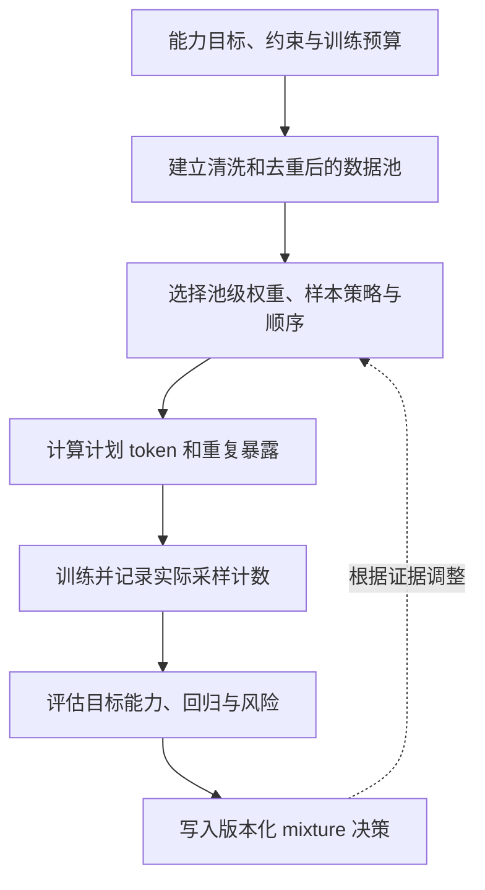

# 第五章：Data Mixture 与配比

前几章讨论了数据从哪里来、如何清洗、如何去重、如何避免污染。本章进入一个更隐蔽但更关键的问题：数据配比，也就是 data mixture。

所谓 data mixture，是指训练集中不同数据来源、语言、领域、模态和任务类型之间的比例安排。它回答的问题不是“有没有这些数据”，而是“这些数据各占多少、以什么顺序出现、用什么采样权重参与训练”。

很多人第一次接触大模型训练时，会以为数据配比只是工程配置：网页多少、书籍多少、代码多少、中文多少、英文多少，随便设一个比例就可以。实际上，data mixture 是训练目标的一部分。模型最终学到什么能力、偏向什么语言、擅长什么领域、输出什么风格，都会受到配比影响。

本章围绕一个贯穿数据工程和模型训练的问题展开：在有限 token budget 下，哪些数据应该进入训练分布，它们应当以多大概率出现，又如何用实验判断这种安排是否真的带来目标能力。

## 0. Data mixture 是训练分布的设计

data mixture 不是若干文件的简单拼接，而是把数据池、采样概率、训练顺序和重复次数连成一个分布。数据先经过清洗、去重和污染隔离，再根据来源、语言、领域、质量、风险和能力标签进入采样器。采样器最终决定优化器在不同数据上的更新频率。

可以把配比设计看作一条带反馈的决策链：

图中应区分配置权重和训练日志中的实际计数：采样器会受文档长度、打包、过滤和分布式 worker 影响。第五章负责把已经筛选的数据池转成可审计的训练分布；质量阈值和去重见[第三章](03-清洗过滤与质量评分.md)与[第四章](04-去重与污染检测.md)，代码、数学和领域样本的专属契约见[第六章](06-code-math-domain-data.md)，生成数据、偏好/安全数据和多模态数据分别见[第七章](07-synthetic-data与distillation-data.md)、[第八章](08-preference-data与安全数据.md)和[第九章](09-多模态语音视频数据.md)。

本章讨论通用文本、代码、数学、多语言、专业领域和合成数据如何进入 mixture，也解释池级权重、样本级选择、训练顺序、重复暴露和实验方法。Chinchilla、T5/mT5、Gopher、FineWeb、Dolma、DataComp-LM、Llama 系列公开报告以及 phi-1 提供了不同层面的背景，但它们不能拼成一个适用于所有模型的固定比例。真实配比还受模型目标、tokenizer、许可证、安全约束、训练预算和评估方法共同限制。

---

## 1. 先建立直觉：配比决定模型“读过什么世界”

可以把预训练想象成给一个学生安排阅读书单。你不能只问“读了多少页”，还要问读了什么。

如果 90% 是网络论坛，学生会很熟悉口语和情绪表达，但可能缺少严谨知识。如果 90% 是论文，学生会更正式、更专业，但可能不懂普通用户怎么提问。如果 50% 是代码，学生会很会写程序，但普通对话和文学表达可能被压缩。如果英语占绝对多数，其他语言能力会被牺牲。

大模型也是一样。模型不是抽象地学习“智能”，它是在训练分布中学习统计规律。data mixture 决定了训练分布的形状。上面的比例只是帮助理解曝光差异的假设例子，不是实测配方，也不表示某一类能力会随占比单调上升。

因此，配比不是训练前随便拼数据，而是能力设计。

一个通用助手模型、代码模型、数学模型、医疗模型、金融模型、多语言模型、儿童教育模型，它们的理想 data mixture 都不一样。

---

## 2. 来龙去脉：从“越多越好”到“配比优化”

早期语言模型规模较小，数据主要来自新闻、百科、书籍或任务数据集。那时数据配比的重要性已经存在，但没有今天这么突出，因为模型容量和训练数据规模有限。

GPT-3 之后，web-scale 数据成为大模型训练主流。论文强调大规模无监督预训练带来 few-shot 能力，但也暴露出大型网页语料的质量、污染、偏见和来源分布问题。模型能力不只由参数量决定，也由训练语料决定。

Chinchilla 进一步提醒大家：在固定 compute budget 下，参数量和训练 token 数需要共同扩展。它把行业注意力从“模型越大越好”拉回到“同样算力下，模型大小和数据 token 数如何平衡”。但 Chinchilla 讨论的是 token 数和模型规模的宏观关系，真正落地时还要问：这些 token 来自哪里？什么质量？什么语言？什么领域？

phi-1 则从另一个角度强调高质量数据的重要性。它使用 textbook-quality web 数据和合成教材/练习数据，在较小模型规模下取得较强代码能力。这说明在某些目标上，数据质量和配比可以显著改变训练效率。

所以大模型数据工程的发展路线大致是：

1. 先追求规模：尽可能收集更多网页、书籍和代码。
2. 再追求质量：清洗、过滤、去重、降低污染。
3. 再追求配比：让不同数据类型按目标能力合理组合。
4. 最后追求闭环：用训练实验和评估反馈反向优化 data mixture。

---

## 3. Data mixture 到底在配什么？

data mixture 不只是“网页占多少”。它至少包含以下维度：

1. 来源维度：Common Crawl、书籍、论文、百科、代码仓库、论坛、问答、文档、课程、合成数据。
2. 语言维度：英语、中文、日语、法语、西班牙语、低资源语言、混合语言。
3. 领域维度：通用知识、科学、工程、法律、医学、金融、教育、娱乐、生活服务。
4. 能力维度：事实知识、推理、代码、数学、写作、翻译、对话、工具使用、安全拒答。
5. 质量维度：高质量教材、普通网页、低质量网页、人工标注、合成数据。
6. 风格维度：正式、口语、学术、新闻、社交媒体、教程、文档、对话。
7. 阶段维度：预训练、继续预训练、SFT、偏好训练、安全训练、领域适配。

同一份数据在不同维度上可能有不同标签。例如一份 Python 教程同时属于代码、英文、教育、技术文档、高质量结构化文本。配比系统最好支持多标签，而不是把数据硬塞进一个单一类别。

工程上还要把三种控制分开。**池级配比** `p_k` 决定每个来源或领域拿到多少 token 预算；**样本级选择**决定一个池内哪些文档更容易进入训练，或是否跨池按样本全局抽样；**训练顺序/调度**决定这些样本在何时、以什么阶段权重出现。相同的 `p_k` 可以对应不同的样本集合和训练轨迹，不能把它们都称为“比例”。最终应同时记录计划权重和训练日志里的实际 token 暴露。

---

## 4. 为什么配比会影响能力？

模型训练本质上是在最小化训练分布上的预测误差。某类数据出现得越多，模型越有机会优化这类模式。

如果代码 token 占比提高，模型会更多看到缩进、函数、变量、API、注释、测试和错误信息。这增加了代码模式的训练曝光，但不保证代码生成能力按比例提升；质量、仓库重复、训练目标和评估题是否泄漏都会影响结果。固定预算下，代码曝光上升也会挤占其他池的预算，因此要同时检查代码收益与通用语言回归。

如果数学数据占比提高，模型更常见到题目、证明、公式、推理步骤和答案格式，但泛化是否改善仍要用可靠解答、改写题和独立评估核验。数学数据质量不高时，模型也可能学到错误推理模板。

如果多语言数据占比提高，目标语言会获得更多训练曝光；跨语言迁移、tokenizer 效率、语言间干扰和池内重复会共同影响最终能力，不能把曝光份额直接当成性能增益。在固定 token budget 下，英语和其他高资源领域的配额也会相应下降。

这就是配比的基本 trade-off：训练 token 是有限预算。提高一种数据的采样权重，通常意味着降低另一种数据的有效权重。

### 4.1 关键公式与审计指标

设数据经过清洗、去重和所需的污染隔离后，按同一个 tokenizer 统计，当前可参与采样的池共有 $K$ 个：

~~~math
\mathcal{P} = \{P_{k}\}_{k=1}^{K}
~~~

下标 $k$、$j$ 表示池，$m$ 表示能力维度。$\mathcal{M}$ 是本次设计纳入的能力维度集合，例如通用语言、代码或多语言；它不是所有任务的固定清单。$n_{k}$ 是池 $P_{k}$ 中可供采样的唯一 token 数；本节先假设 $n_{k}>0$。质量代理 $q_{k}$、风险代理 $r_{k}$ 和能力覆盖代理 $a_{km}$ 都按项目固定的口径记录。为便于解释，下面假设它们已归一化到 $[0,1]$，但这些代理值不是模型能力实测，也不能跨项目直接比较。

本节把 $p_{k}$ 定义为训练预算中预期分配给池 $k$ 的 token 曝光比例，因而 $p_{k}\geq 0$ 且总和为 $1$。若采样器先按文档抽样，文档数比例不必等于 token 比例；需要另外汇报 sampler 实际产生的 token 计数。

最简单的自然配比按清洗、去重后的 token 数分配：

~~~math
p_{k}^{\mathrm{nat}} = \frac{n_{k}}{\sum_{j=1}^{K} n_{j}}, \qquad \sum_{k=1}^{K}p_{k}^{\mathrm{nat}}=1
~~~

为减少大池对小池的支配，可以对池规模做幂次平滑：

~~~math
p_{k}(\alpha) = \frac{n_{k}^{\alpha}}{\sum_{j=1}^{K}n_{j}^{\alpha}}, \qquad 0\leq\alpha\leq 1
~~~

$\alpha=1$ 保持自然规模比例；$\alpha=0$ 时，所有非空池等概率采样；介于两者之间则提高小池的相对曝光。不同论文或采样器可能用 temperature 的倒数、temperature 本身或 softmax 温度，因此复现时要记录具体函数和最终概率，而不只记录参数名。

如果目标还包括能力覆盖，可以给能力维度 $m$ 指定非负权重 $v_{m}$，并令 $\sum_{m\in\mathcal{M}}v_{m}=1$。池 $k$ 的加权覆盖代理效用为：

~~~math
u_{k} = \sum_{m\in\mathcal{M}} v_{m} a_{km}
~~~

下面的分数是一个可解释的教学启发式，不是文献中的统一最优算法。假设 $q_{k}$、$r_{k}$ 和 $a_{km}$ 使用一致的 $[0,1]$ 标度；非负系数 $\beta$、$\gamma$ 和 $\lambda$ 决定质量、目标效用和风险在分数中的相对影响：

~~~math
s_{k} = n_{k}^{\alpha}\exp\!\left(\beta q_{k} + \gamma u_{k} - \lambda r_{k}\right)
~~~

将池分数归一化后得到采样比例：

~~~math
p_{k} = \frac{s_{k}}{\sum_{j=1}^{K}s_{j}}
~~~

总训练 token 预算记为 $B$，则池 $k$ 的计划 token 配额为：

~~~math
b_{k} = Bp_{k}
~~~

实现时 $b_{k}$ 可能不是整数，分配器需要规定取整规则，并检查各池配额之和仍等于 $B$。有效训练轮数（effective epoch）估计唯一池被重复暴露的程度：

~~~math
e_{k} = \frac{b_{k}}{n_{k}}
~~~

$e_{k}$ 是计划 token 暴露量与去重后池大小之比，可以是小数；它不是每份文档的精确重复次数。若 $e_{k}$ 较高，应进一步检查采样日志、近重复簇、池间内容重叠和目标验证损失，不能直接套用跨任务通用的 epoch 上限。

用三个合成数据池手算。通用文本有 $800{,}000$ token，代码和数学各有 $100{,}000$ token，所以自然比例为 $0.80/0.10/0.10$。取 $\alpha=0.5$ 后，三个未归一化权重分别是 $\sqrt{800{,}000}\approx894.4$、$\sqrt{100{,}000}\approx316.2$ 和 $316.2$，总和约为 $1{,}526.8$。归一化得到约 $0.586/0.207/0.207$。若预算 $B=1{,}000{,}000$ token，计划分配约为 $585{,}800/207{,}100/207{,}100$ token；对应 $e_{k}$ 约为 $0.73/2.07/2.07$。这个例子只展示平滑如何改变曝光，不证明代码或数学的最优比例是 $0.207$。

以上公式都只对有效池求和。空池不应把 $n_{k}=0$ 直接代入幂次公式，尤其 $\alpha=0$ 时 $0^0$ 没有通用的工程定义；应将其排除在当前采样集合之外，并记录为待补充。数据登记还应区分“尚未登记”“已登记但为空”和“有 token 但未采样”，因为三种状态对审计的含义不同。若没有任何有效池或归一化分母为零，当前 mixture 无效，不能伪造一个概率分布。

对能力维度 $m$，按计划比例线性汇总的覆盖代理为：

~~~math
A_{m}(p)=\sum_{k=1}^{K}p_{k} a_{km}
~~~

如果要做教学用的多目标打分，可以把目标覆盖、风险和重复暴露惩罚并列写为：

~~~math
U(p)=\sum_{m\in\mathcal{M}}v_{m} A_{m}(p)-\lambda_{r}\sum_{k=1}^{K}p_{k} r_{k}-\lambda_{e}\sum_{k=1}^{K}p_{k}\max(0,e_{k}-e_{\max})
~~~

这里 $\lambda_{r}$ 和 $\lambda_{e}$ 是项目自行设定的权重，$e_{\max}$ 是需要实验和风险策略共同确定的阈值，不是公式推导出的通用安全上限。$A_{m}(p)$ 只把池标签按比例加权，无法表达跨域迁移、共享样本、模型容量和训练顺序；它不能替代模型训练与目标评估。

相对基线比例 $p_{0}$ 的分布变化可用 Kullback–Leibler divergence（KL 散度）记录：

~~~math
D_{\mathrm{KL}}(p\Vert p_{0})=\sum_{k:p_{k}>0}p_{k}\log\frac{p_{k}}{p_{0,k}}
~~~

这里 $p_{0}$ 是按同一组数据池和索引定义、总和为 $1$ 的基线采样分布；它可以是自然比例或上一版已记录的配方。当 $p_{k}>0$ 而 $p_{0,k}=0$ 时，该散度为无穷；$p_{k}=0$ 的项按极限记为零。基线必须与当前比例使用相同的池定义和索引。KL 散度不是越小越好，而是帮助回答“这次 mixture 相对哪个基线改变了多少”。

与其把目标压成一个总分，更适合并列检查几个量：

~~~math
C_{\mathrm{mix}}(p)=\left(\min_{m\in\mathcal{M}}A_{m}(p),\;\max_{1\leq k\leq K}e_{k},\;\sum_{k=1}^{K}p_{k} r_{k},\;D_{\mathrm{KL}}(p\Vert p_{0})\right)
~~~

四项依次描述最低能力覆盖代理、最大计划重复暴露、加权风险和相对基线的分布漂移。覆盖代理不足时先检查标签和目标，再决定是否增加相关数据；重复暴露高时检查内容重叠、扩充数据或降低权重；风险超限则回到清洗、授权和隔离；漂移较大时增加可解释的对照实验。

池标签的线性加权不能预测真实训练表现，因此研究开始用小规模实验拟合“配比—目标损失”关系。ICLR 2025 的 Data Mixing Laws 在 RedPajama 上用小模型拟合验证表现，并报告：其 1B 参数、100B token 的特定设置中，优化配比取得了与默认配比多训练 48% 步数相近的表现；这是该实验的作者报告，不等于普遍节省 48% 训练成本。[Data Mixing Laws](https://proceedings.iclr.cc/paper_files/paper/2025/hash/cc84bfabe6389d8883fc2071c848f62a-Abstract-Conference.html)

NeurIPS 2025 的 Scaling Laws for Optimal Data Mixtures 则在 7 个 SlimPajama 文本域上拟合含模型规模、训练 token 和域权重的 loss 关系；其 LLM 实验模型规模为 186M–7B，并用 7B、150B token 训练验证选出的权重。论文假设各域可持续供数（以不重复、近似无限的数据流建模）且训练全程使用固定 mixture，同时优化的是指定目标域或域集合上的 loss；稀缺池重复、动态调度和具体下游能力不在这一结论的直接保证范围内。[Scaling Laws for Optimal Data Mixtures](https://proceedings.neurips.cc/paper_files/paper/2025/hash/bc1d640f841f752c689aae20b31198c1-Abstract-Conference.html)

---

## 5. 自然分布 vs 人工配比

一种简单做法是按数据自然规模混合：哪个来源 token 多，就占更大比例。比如网页最多，网页就占绝大多数；英语最多，英语就占绝大多数。

这种做法有好处：

1. 简单。
2. 接近当前采集快照中观测到的来源规模分布。
3. 不需要太多人工假设。
4. 覆盖范围广。

但缺点很明显：

1. web 分布不等于理想训练分布。
2. 高资源语言会压制低资源语言。
3. 娱乐、营销、模板和低质内容可能过多。
4. 数学、代码、专业知识等高价值数据可能被稀释。
5. 模型能力会被“互联网上什么最多”支配。

项目可以根据明确的能力目标调整这些权重，例如提高代码、数学、结构化书籍、技术文档或低资源语言的曝光，也可以在完成风险审查后降低低质量或高度重复内容的权重。调整方向是待验证的假设；“高质量”标签本身不说明数据对每个目标都有效，也不能代替授权、隐私和污染门禁。

人工配比的风险是引入主观偏置。团队认为重要的数据，不一定对最终模型最优。所以配比必须通过实验验证，而不是只靠直觉。

---

## 6. 通用文本的角色

通用文本池通常包括网页正文、百科、书籍、新闻、论坛、问答、博客和文档。它提供广泛的话题与语言形式，因此在很多 base model 配方中占较大份额；实际覆盖取决于来源、采集、清洗和去重。“通用”标签本身不保证事实准确或覆盖完整。

通用文本的优点：

1. 覆盖广。
2. 规模大。
3. 风格多样。
4. 能支撑开放域问答和通用语言能力。

缺点：

1. 质量不均。
2. 噪声多。
3. 重复和污染风险高。
4. 事实可信度不稳定。
5. 可能包含偏见、毒性和隐私信息。

配比时要避免两个极端：通用文本太少，模型缺少世界知识；通用文本太多，高价值专业能力被稀释。

---

## 7. 代码数据的配比

当目标包含代码补全、生成或解释时，代码语料提供直接的训练信号。它也可能迁移到符号处理、结构化输出或工具使用等行为，但这种迁移不能由代码 token 占比单独推出，仍需针对目标任务评估。

代码数据包括：

1. 源代码文件。
2. README 和技术文档。
3. issue 和 pull request。
4. 单元测试。
5. API 文档。
6. 编程问答。
7. 教程和代码解释。

提高代码比例会增加模型接触以下结构的机会，但是否转化为能力收益取决于数据质量、重复程度、预算和评估：

1. 代码补全。
2. bug 修复。
3. API 使用。
4. 结构化输出。
5. 算法题能力。

但代码占比过高可能带来：

1. 普通自然语言能力下降。
2. 输出风格更像代码或模板。
3. 许可证和版权风险上升。
4. secrets、凭据和私有片段风险增加。
5. benchmark contamination 风险增加，尤其是编程题库。

代码数据配比要结合模型定位。如果是通用助手，可以保留适中比例；如果是代码模型，需要显著提高代码及相关解释数据；如果是行业模型，代码可能只是辅助能力。

---

## 8. 数学和推理数据的配比

在许多公开网页语料中，数学教材、证明和高质量解答比普通网页文本更稀缺；实际规模仍取决于来源和筛选口径。若目标包含数学任务，这些数据提供直接训练样本，但它们能否迁移到更广泛的推理能力需要独立验证。数据类型包括教材、题库、解答、证明、竞赛题、合成推理题、符号推导和数学论坛。

数学数据的特殊性在于：质量比数量更重要。错误解答、跳步解答、格式混乱和答案泄漏会严重误导模型。

提高数学数据比例可能改变以下行为的训练曝光；是否形成收益，需要在独立、改写后的任务上验证：

1. 算术任务表现。
2. 多步解题过程。
3. 公式和符号的条件预测。
4. 解题过程格式。
5. 对不同推理轨迹的适配。

但风险包括：

1. 题库污染。
2. 模板化推理。
3. 错误步骤被学习。
4. 对自然语言表达挤占。
5. 合成数据同质化。

数学配比要特别重视评估闭环。不能只看数学 benchmark 提升，还要看通用能力是否下降、污染是否可控、推理是否真实泛化。

---

## 9. 多语言数据的配比

多语言配比需要同时考虑可用数据规模、质量和目标语言。在多种公开网页采集快照中，英语通常是较大的语言池，但相对规模会随快照、语言识别、过滤和 tokenizer 统计变化；按观察到的自然比例采样，可能使高资源语言获得更多 token 曝光。

常见策略包括：

1. 对低资源语言上采样。
2. 对高资源语言下采样。
3. 按语言质量分设置不同阈值。
4. 使用平滑采样，而不是完全按 token 数采样。
5. 对关键目标市场语言设置最低比例。
6. 使用翻译数据或平行语料增强跨语言能力。

多语言配比的 trade-off 很明显：提高低资源语言的计划比例会增加其 token 曝光，但实际能力是否改善仍需按语言切片验证；固定 token budget 下，这也会占用其他语言、代码或专业领域的预算。

还要注意，低资源语言的数据质量过滤不能直接套用英语规则。否则会因为语言识别误差、字符分布差异、短文本特征不同而误删大量有效数据。

语言比例和跨语言迁移也不能混为一谈。He 等人在 ACL 2025 的实验训练了 100 多个模型，覆盖 23 种语言和 5 个语系；论文提出并在其设置中检验了“语系验证损失主要随本语系采样比例变化”的假设，并报告从 85M 模型拟合的比例可迁移到 1.2B。ATLAS（2026 预印本）报告 774 次多语言训练实验，模型规模覆盖 10M–8B，训练数据覆盖 400 多种语言、评估覆盖 48 种语言；其迁移矩阵比较 38×38=1,444 个有方向的源语言—目标语言组合。两类结果提示语言分组和迁移矩阵可辅助实验设计，但迁移可能不对称，模型、tokenizer 和目标语言仍需重新验证；它们都不提供通用语言配比表。[Scaling Laws for Multilingual Language Models](https://aclanthology.org/2025.findings-acl.221/)；[ATLAS](https://arxiv.org/abs/2510.22037)

---

## 10. 专业领域数据的配比

专业领域数据包括医学、法律、金融、材料、生物、芯片、机器人、教育等。将其纳入 mixture 的目标，通常是为专业问答、术语理解或领域任务提供更多训练曝光；是否提升目标表现要结合数据质量、时效、授权和领域评估验证。

但专业数据配比有几个难点：

1. 高质量数据稀缺。
2. 授权和合规要求更高。
3. 专家审核成本高。
4. 错误知识风险更大。
5. 与通用能力存在 trade-off。

专业领域数据通常有三种用法：

1. 预训练阶段少量混入，提供基本术语和背景。
2. 继续预训练阶段提高比例，做领域适配。
3. SFT/RAG/工具阶段解决高准确率和实时知识问题。

不要把所有专业能力都压到预训练配比上。对于医学、法律、金融这类高风险领域，单靠预训练记忆不是可靠方案，通常需要检索、工具、引用、审核和安全策略配合。

---

## 11. 合成数据的配比

合成数据可以来自规则生成、程序生成、模拟器、强模型生成、专家模板或数据增强。它在代码、数学、指令跟随、安全训练和低资源语言中很常见。

合成数据的优点：

1. 可控。
2. 可定向补能力短板。
3. 格式统一。
4. 能生成稀缺任务。
5. 可用于构造难例和安全样本。

缺点也明显：

1. 同质化。
2. 事实错误。
3. 风格模板化。
4. 可能继承教师模型偏差。
5. 过量使用会让模型学习生成器的分布，而不是现实分布。

phi-1 论文报告了一个特定代码模型设置：研究者将筛选后的教材式网页文本与合成教材和练习结合，评估其代码模型表现；结果支持继续研究高质量合成教材的价值，但不证明这种做法在其他语料或任务中必然有效。[Textbooks Are All You Need（phi-1）](https://arxiv.org/abs/2306.11644)。这不意味着合成数据越多越好；关键仍是目标、质量、覆盖、多样性、验证和配比。

一个稳妥原则是：合成数据要有明确目的、明确来源、明确标签、明确评估，不要不可追踪地混入自然语料。

---

## 12. 数据配比和训练阶段

不同训练阶段的 data mixture 应该不同。

### 12.1 预训练

预训练目标是建立广泛语言能力、世界知识和基础模式。配比要重视覆盖面、多样性和有效 token 数。

### 12.2 继续预训练

继续预训练常用于领域适配、语言适配或能力增强。此时可以提高目标领域数据比例，但要防止 catastrophic forgetting，即模型在新领域变强的同时通用能力下降。

### 12.3 SFT

SFT 的数据更偏指令、问答、对话、工具调用和格式规范。这里的配比决定助手风格、任务覆盖和指令遵循能力。

### 12.4 偏好训练

偏好训练数据配比影响模型对回答风格、安全边界、简洁性、帮助性和拒答策略的偏好。

### 12.5 安全训练

风险类别在自然语料中的出现频率，不一定对应项目希望覆盖的风险和允许边界。安全训练数据应围绕目标策略组织，并同时检查风险类别覆盖、拒答边界、合规场景、误拒问题和多语言表达。

这些阶段不能共用一个没有单位的“配比”。预训练常按 token 或序列采样，SFT 可以按任务、轮次或 token 统计，偏好训练中的样本还包含成对比较，安全训练要同时看风险类别覆盖和允许请求误拒。每个阶段都应写清采样单位、分母、损失和验收指标；第八章负责偏好/安全标签的构造，本章只交代它们如何进入阶段级训练配方。

| 训练阶段 | 常见采样单位 | 必须报告的分母 | 配比实验的主要观察项 |
| --- | --- | --- | --- |
| 预训练 | packed token 或序列 | 计划 token、实际非 padding token、去重后池大小 | 通用与分域验证 loss、语言/领域切片、重复暴露 |
| 继续预训练 | token 或序列 | 目标域 token、通用回放 token、阶段总预算 | 领域收益、通用能力保留、遗忘和过拟合 |
| SFT | 对话、样本、目标 token 或任务类别 | 各任务样本数与目标 token 数 | 指令任务覆盖、格式/工具成功、长尾任务回归 |
| 偏好训练 | chosen/rejected pair 或比较样本 | 有效 pair 数、去重 pair 数及对应 token | 偏好目标、帮助性/安全切片、标签冲突 |
| 安全训练 | 风险类别、允许/拒绝样本或轨迹 | 每类有效请求、误拒样本与可执行轨迹 | 风险覆盖、拒答边界、误拒和工具副作用 |

这些分母不能互换：一个长对话可能包含多个轮次和远多于短样本的 token；一个偏好 pair 也不是两个独立普通样本。汇报 mixture 时，应同时给配置权重和训练日志中的实际计数，并说明 loss 是按 token、样本还是 pair 聚合。否则“某类占 20%”无法被复现或与另一阶段比较。

---

## 13. 静态配比 vs 动态配比

静态配比是在整个训练过程中使用固定采样比例。例如网页 60%、代码 15%、数学 5%、书籍 10%、多语言 10%。

优点是简单、可复现、易分析。缺点是不够灵活。

动态配比会随训练阶段调整。下面是一种待实验的课程安排假设，不是适用于所有训练的阶段定律：

1. 前期更多通用文本，建立基础语言能力。
2. 中期增加代码、数学和高质量知识数据。
3. 后期增加高质量、低噪声和目标能力数据。
4. 对 loss 下降慢或评估薄弱的数据域增加采样。

动态配比更像 curriculum learning，但也更难评估。写成 `p_{k,t}` 可表示训练阶段 `t` 中数据池 `k` 的计划权重；同一组阶段平均比例，若顺序不同，也会产生不同优化轨迹。最终效果来自配比、顺序、学习率、数据质量和训练阶段共同作用。

静态配比通常适合建立可复现的第一版基线，动态配比则适合已经有稳定评估和训练监控的系统。动态策略增加了实验变量：最终效果同时受到数据种类、出现顺序、学习率、训练阶段和调度规则影响，因此必须保存每阶段计划权重及采样器实际计数。若在线策略根据验证集变化调权，还要保留独立评估集，避免把反复调参后的验证收益误当成泛化证据。

---

## 14. Temperature sampling 和多语言平滑

多语言训练常用一种思想：不要完全按原始 token 数采样，而是对语言分布做平滑。

如果按原始规模采样，英语等高资源语言会占据绝大多数。若完全均匀采样，低资源语言可能被过度重复，导致过拟合和质量下降。因此需要介于两者之间的策略。

直观做法是：对每种语言的 token 占比做平滑，降低大语言的优势，提高小语言的采样概率。

设 $n_{i}>0$ 是语言池 $i$ 在固定 tokenizer 下的有效 token 数，池的分布权重可按温度 $\tau>0$ 平滑为：

~~~math
p_{i}(\tau)=\frac{n_{i}^{1/\tau}}{\sum_{j=1}^{K}n_{j}^{1/\tau}}, \qquad i\in\{1,\ldots,K\}
~~~

按这个定义，$\tau=1$ 保持自然分布，$\tau>1$ 时小池相对增重，$\tau\to\infty$ 时趋向对非空语言池均匀采样；它与 §4.1 的幂次平滑在 $\alpha=1/\tau$ 时相同。比如两种语言各有 $900$ 和 $100$ 个有效 token，取 $\tau=2$，未归一化权重为 $\sqrt{900}=30$ 和 $\sqrt{100}=10$，因此小语言的比例为 $10/(30+10)=0.25$，采样率为 $0.75/0.25$；自然分布则为 $0.90/0.10$。这组比例只说明平滑的计算过程，不说明该温度适合任何具体语料。其他系统可能把 temperature 定义为幂指数或 softmax logits 温度，因此必须记录公式、参数和最终概率，而不能只记一个名为 temperature 的数字。真正需要观察的是覆盖、重复暴露和各语言验证损失的折中。

这种思想也可以用于领域配比：对小而高价值的数据源上采样，对大而低价值的数据源下采样。

---

## 15. 配比实验怎么做？

data mixture 不能只靠直觉，必须通过实验闭环。

2026 年 EACL 的综述把离线方法分为启发式、算法优化和函数拟合，把在线方法分为 min-max、online mixing law 和其他在线路线。这个分类能帮助选工具，但每类方法优化的对象、训练成本和反馈信号不同：[Rethinking Data Mixture](https://aclanthology.org/2026.findings-eacl.15/)。

| 方法族 | 主要输入和优化对象 | 代表思路 | 主要边界 |
| --- | --- | --- | --- |
| 固定启发式 | 池大小、质量或人工目标 | 自然比例、temperature smoothing | 成本低，但不直接观测目标模型损失 |
| 代理模型/鲁棒权重 | 域级训练损失或相对参考模型的 excess loss | DoReMi 用 Group DRO 学域权重；GRAPE 通过 min-max 同时调整多目标任务权重和来源域权重 | proxy、域划分、目标切片和损失定义决定权重含义 |
| 回归与 mixing law | 多个候选配比及相应训练表现 | RegMix 用小模型拟合未见 mixture；Data Mixing Laws 与 scaling law 拟合 mixture—loss 映射 | 需要设计代理训练点；RegMix 依赖跨规模的 mixture 排名假设，其他外推也必须在未见配比和规模核验 |
| 多保真贝叶斯搜索 | 候选 mixture、模型规模、训练步数及其不确定性 | NeurIPS 2025 的 Data Mixture Optimization 用实验模拟器逐步选择信息量高的训练点 | 472 次 SlimPajama 训练运行、20M–1B 参数是论文模拟器/评估范围；不是所有语料上的固定搜索成本收益 |
| 梯度/在线优化 | proxy 参数、当前 mixture 和验证反馈 | FastMix 将 mixture 系数纳入双层优化，在训练与验证反馈间交替更新 | 外层反复用验证反馈会增加调参自由度，需保留独立验收集 |
| 样本级全局选择 | 文档质量、多样性分数及 token 预算 | SampleMix 按样本权重做跨域采样，不先固定各域比例 | 质量/多样性打分器、训练语料和 token 预算都会影响入选样本 |
| 质量与领域联合优化 | 多种质量信号、领域标签和 proxy 目标 | QuaDMix 联合搜索质量标准组合及领域频率 | 结果受语料、打分器、proxy 和 benchmark 目标影响；目标 benchmark 不能同时充当独立验收集 |

这些方法选择的对象不完全相同：temperature 直接平滑池大小；DoReMi 用 reference model 的域级 excess loss 训练 Group DRO，再把得到的域权重用于大模型；GRAPE 额外对目标任务加权，优先处理当前改善较慢的任务；RegMix 训练 512 个 1M 参数 proxy，每个训练 1B token，再用回归预测未见配比，关键假设是不同规模和 token 预算下的配比排名大致稳定。Data Mixing Laws 与 mixture scaling law 也拟合配比到 loss 的关系，但输入设计、拟合形式和外推范围并不相同。多保真搜索按当前不确定性选择下一组 mixture/规模/步数；FastMix 则通过可微的双层优化，根据验证反馈更新来源权重。它们产生的最终比例可以相似，但不代表机制或证据等价。

SampleMix 在 SlimPajama 上训练 1B 参数 LLaMA、使用 100B token；其主要 mixture 对照排除 GitHub 域并重归一化其他域权重。作者报告，在论文所测下游任务和 perplexity 评估中，达到相应基线表现所需步数约为基线的 $1/1.4$ 至 $1/2.1$；在平均基线准确率比较中，作者报告约 $1.9$ 倍的步数效率差异。这是特定语料、评分器和实验设置的结果，不保证换语料后仍有同样收益。[SampleMix](https://aclanthology.org/2025.findings-emnlp.741/)

QuaDMix 是另一种把质量和多样性连起来的路线：论文在英文 RefinedWeb 上组合三种质量信号与 26 个领域标签，用 proxy 实验和回归选择质量标准及领域频率。它与 SampleMix 的文档权重机制不同；尤其使用 benchmark 训练集作为 proxy 目标的结果，必须和不使用 benchmark 目标的结果分开解释。[QuaDMix](https://arxiv.org/abs/2504.16511)

无论使用哪种方法，都要先固定目标能力、数据快照、tokenizer、总 token、训练 recipe 和评估口径；先用自然比例或现有 recipe 建 baseline，再做少量可解释的对照、检查不同种子和切片，最后在未参与调参的留出集和更大规模上复验。小模型上的最佳配比不一定适用于大模型，短训练上的最佳配比也不一定适用于长训练；不要只凭一次 ablation 决定最终配方。

---

## 16. 评估矩阵：配比优化看什么指标？

一个配比方案不能只看平均分，可以用四组互补指标核对：

| 检查组 | 例子 | 需要保留的分母或切片 |
| --- | --- | --- |
| 训练拟合 | 通用语言 loss、各来源 held-out loss | 各池验证 token 数和 tokenizer 版本 |
| 目标能力 | 代码、数学、多语言和专业任务 | 任务数、语言/领域切片、难度区间 |
| 非目标回归 | 通用问答、安全、事实性、输出风格和人工样例 | 同一评测版本及前后模型配对 |
| 数据风险 | 记忆、污染、隐私、许可和重复暴露 | 候选/确认定义、唯一样本数和实际采样 token |

下列变化只用于构造对照和评估切片，是待验证的实验假设，不是由配比直接推出的方向：

提高代码比例后，HumanEval 类指标可能提升，但多语言聊天能力下降；提高数学合成数据后，GSM 类指标可能提升，但模型回答变得模板化；提高论坛数据后，聊天自然度可能提升，而安全风险也可能上升。不同单位的 loss、任务分数和风险率不能直接混成一个平均值。报告要说明采用题目宏平均、token 加权还是产品目标权重，保留最差切片和区间，并在对照间固定训练 token、优化器、学习率计划、tokenizer 和数据版本。否则观察到的是一组因素的组合变化，不是纯配比效应。完整统计检验和 benchmark 设计由第七册主讲。

---

## 17. 数据上采样和过拟合

当某类数据很重要但规模小，团队常会考虑上采样，例如低资源语言、数学题、代码解释或专业文档。用 $\rho_{k}$ 表示池 $k$ 的计划平均重复暴露因子，预算为 $B$、计划比例为 $p_{k}$、唯一池大小为 $n_{k}$，则：

~~~math
\rho_{k}=\frac{Bp_{k}}{n_{k}}
~~~

这与 §4.1 的计划有效 epoch $e_{k}$ 是同一类估算；此处换用 $\rho_{k}$，避免与前面的风险代理 $r_{k}$ 混淆。比如目标池有 $20\,\mathrm{M}$ 个去重 token，预算 $B=500\,\mathrm{M}$、目标比例 $p_{k}=0.20$，则池获得 $500\,\mathrm{M}\times0.20=100\,\mathrm{M}$ token，平均重复因子为 $100\,\mathrm{M}/20\,\mathrm{M}=5$。其余 $400\,\mathrm{M}$ token 可以由仍有新样本的其他池提供。这个平均值不表示每条样本恰好出现五次，打包、长度和采样器策略都会改变单条样本的实际曝光。

上采样增加目标池的训练曝光，也可能增加过拟合和记忆风险。2026 年 arXiv v2 预印本报告了超过 2,000 次、101M–805M 参数的训练实验，覆盖德语、法语、斯瓦希里语、数学、科学论文、Wikipedia 和质量过滤子集；在其混合训练条件下，面向目标验证表现的最优重复因子在部分设置中达到 15–20。作者将这一现象与通用池持续提供新 token 的训练结构联系起来：单一有限数据集被整体重复时的经验，不能直接作为混合训练的重复上限。该数值不能变成项目阈值；最优重复随目标池规模、模型规模、训练预算和验证目标变化，且该研究仍是预印本。[Scaling Laws for Mixture Pretraining Under Data Constraints](https://arxiv.org/abs/2605.12715)

如果一个小数据池被重复训练太多次，模型可能记住具体样本，而不是学到泛化规律。尤其是题库、隐私文本、专业文档和代码数据，更要谨慎；把唯一 token、实际采样次数、近重复簇和目标域验证损失放在一起看，比单独设置一个经验 epoch 上限更可解释。

缓解方法包括：

1. 增加数据多样性。
2. 做去重和污染检测。
3. 控制 epoch 数。
4. 使用数据增强或合成变体，但要验证质量。
5. 在评估中加入记忆检测。
6. 对小数据池使用更高质量阈值。

---

## 18. 配比和 tokenizer 的关系

不同语言和数据类型在 tokenizer 下的 token 化效率不同。同样 1000 个字符，英文、中文、代码、数学公式和低资源语言可能对应不同 token 数。

如果配比按 token 计算，tokenizer 会影响实际信息量。如果某种语言 token 化效率低，它在相同 token budget 下能表达的信息更少，训练成本更高。

所以多语言配比不能只看原始字符数或文档数，也要看 token 分布、压缩效率和模型实际 loss。

代码和数学也类似。符号、缩进、特殊字符会影响 token 数。配比实验需要基于最终 tokenizer 统计，而不是原始文本大小。

---

## 19. 配比和去重清洗的关系

配比发生在清洗和去重之后，但也会反过来影响清洗策略。

比如某个领域数据很稀缺，如果用普通规则过滤，可能被误删很多；为了保留这个领域，团队可能降低某些过滤阈值，同时加强人工审计。又比如某个来源规模巨大且重复率高，去重后占比下降，需要重新计算采样权重。

因此，data mixture 不是简单地在最后拼接文件，而是和数据清洗、质量评分、去重、污染检测共同设计。清洗和去重会改变每个池的唯一 token 数；重新采样又会改变训练曝光。每次数据快照变化后，都要重新计算自然比例、计划比例、有效重复因子和风险切片，不能把旧采样权重直接贴到新数据版本上。

例如，某一版本中网页池有 `600,000` 个 token，代码池有 `400,000` 个，按自然 token 数采样就是 `60%/40%`。如果网页去重后只剩 `300,000` 个唯一 token，代码池仍有 `400,000` 个，那么新快照的自然比例变为 `300,000/700,000≈42.9%` 和 `400,000/700,000≈57.1%`。若总预算为 `1,000,000` token，计划曝光约为 `428,600/571,400`；代码看起来“占比增加”，即使团队没有手工提高它的目标权重。若目标配比固定，则权重不变但代码池的有效重复因子会改变。两种情形都要求重算，并与 sampler 实际日志中的 token 计数核对。

成熟的数据表通常会保存：source、language、domain、quality score、dedup cluster、safety label、license、token count、sampling weight。训练时 sampler 根据这些字段动态采样。

---

## 20. 机制与边界：Data mixture 是隐式目标函数设计

从机制上看，data mixture 会改变优化器反复看到的样本分布。这里 $\mathcal{D}_{k}$ 表示池 $k$ 在清洗、切分和打包后产生的“上下文—下一个目标 token”训练位置分布；$x$ 是其中一个训练位置，$\ell_{\theta}(x)$ 是参数为 $\theta$ 的模型在该位置上的 next-token 负对数似然。这样定义时，$p_{k}$ 是落在池 $k$ 的非 padding 目标 token 曝光比例，而不是文档抽样概率或序列条数比例。忽略 batch 组织和优化器状态时，期望的逐 token 训练损失可写成：

~~~math
L(\theta;p)=\sum_{k=1}^{K}p_{k}\,\mathbb{E}_{x\sim\mathcal{D}_{k}}[\ell_{\theta}(x)]
~~~

若实际 sampler 先按文档概率抽样、文档长度又不同，则上述 $p_{k}$ 应按最终非 padding 目标 token 曝光重新定义，或在期望中显式建模采样过程。若训练损失按序列而非目标 token 等权平均，目标函数也应按实际聚合口径重写。改变 $p_{k}$ 会改变当前参数 $\theta$ 处的期望梯度。用一个单参数方向做合成手算：固定在同一参数位置，假设 web 池在该方向的平均梯度是 $1$，代码池是 $-2$。当 $p_{\mathrm{web}}=0.8$、$p_{\mathrm{code}}=0.2$ 时，混合梯度为 $0.8\times1+0.2\times(-2)=0.8-0.4=0.4$；若把代码提高到 $0.4$、web 降到 $0.6$，则为 $0.6\times1+0.4\times(-2)=0.6-0.8=-0.2$。在这个假设例子里，平均更新方向发生了变化；它不能预测最终 benchmark，也不是实测模型结果。真实训练中的梯度还会随参数、样本顺序、学习率和数据交互持续变化。

这也解释了为什么能力标签的线性覆盖不能替代训练实验。NeurIPS 2025 的受控实验用合成传记数据与网页混合，观察到在特定模型容量或混合比例附近，记忆行为会出现阈值式变化；该结果只支持“配比效果可能非线性”的机制案例，不说明真实语料都存在相同相变。[Data Mixing Can Induce Phase Transitions in Knowledge Acquisition](https://proceedings.neurips.cc/paper_files/paper/2025/hash/eee7ae5cf0c4356c2aeca400771791aa-Abstract-Conference.html)

因此，配比是训练目标、模型能力和产品定位之间的接口。需要同时权衡多样性与质量、通用与专项能力、高低资源语言、自然与合成数据、短期基准收益与泛化，以及能力短板补充和重复暴露风险；这些取舍应通过分层实验和风险门禁说明，而不能被一个总分掩盖。

---

## 21. 一个可落地的 data mixture 方案

以一个同时服务中文和英文用户的通用助手为例，配比设计首先从能力目标和约束开始，而不是从一个看似精确的百分比开始。目标可以包括通用知识、双语对话、代码、数学、安全拒答和事实性；约束则包括总 token budget、可用许可证、最大重复暴露、隐私风险和可接受的评估成本。

数据池随后被组织成带有来源、语言、领域、质量、安全、许可证、去重簇和 token 数的记录。通用文本提供广度，书籍和技术文档提高结构化知识，代码和数学覆盖专项能力，多语言池补充目标语言，合成数据只承担已知短板或难例构造。每个池的采样权重都应能追溯到这些字段，而不是隐藏在一个不可解释的配置数字里。

第一版 mixture 可以从自然分布开始，再用平滑、质量和目标能力效用做有限幅度的调整。调整时需要同时生成对照方案：自然分布、提高代码、提高数学、提高低资源语言、提高高质量书籍，以及加入或移除合成数据。这样才能把某一类数据的收益与训练总量、学习率和随机种子区分开。

小模型实验的评估矩阵应同时包含通用验证损失、各数据池验证损失、代码、数学、多语言、安全、事实性、记忆风险和人工样例。若代码分数提高但普通对话退化，结论不是“代码数据无效”，而是“代码池的边际收益与通用能力成本需要重新定价”。若数学分数提高但改写题失效，则要检查题库重复、解析模板和合成数据同质化。

趋势只有在多个模型规模、训练 token 数和随机种子下大体稳定，才值得放大到正式训练。最终记录应包含数据版本、tokenizer 版本、采样函数、每阶段权重、实际采样计数、验证结果和异常处理；产品反馈可以推动下一轮实验，但不能直接替代受控评估。

### 21.1 最小 data mixture 审计示例

下面这个 demo 不依赖外部库，也不读写文件。输入是一组 toy 数据池，每个池有清洗后 token 数、质量分、风险分和能力标签；输出包括自然配比、目标采样配比、计划采样 token、effective epoch、上采样倍数、能力覆盖、平均质量、风险、并列检查信号、后续动作和结论。将代码块保存为 `.py` 文件后，可使用 Python 3.12.9 运行；唯一导入的 `math` 属于标准库。

它演示的是配比审计机制，不是生产级 sampler。真实训练还需要和 tokenizer 统计、数据版本、分布式采样器、训练曲线、验证 loss、下游评估和安全审计联动。

目标能力权重、各能力覆盖门槛、风险阈值和 `MAX_EPOCH` 都是合成的教学策略，用来展示审计分支；能力标签是 toy proxy，不能当作实测能力、论文结论或通用配方。

代码状态：静态审阅，未运行（2026-11-03；示例声明 Python 3.12.9 标准库）

~~~python
import math

pools = [
    {"name": "general_web", "tokens": 500_000, "quality": 0.72, "risk": 0.06, "cap": {"general": 0.85, "code": 0.10, "math": 0.10, "multilingual": 0.25, "safety": 0.25}},
    {"name": "books_reference", "tokens": 120_000, "quality": 0.88, "risk": 0.02, "cap": {"general": 0.75, "code": 0.05, "math": 0.25, "multilingual": 0.15, "safety": 0.15}},
    {"name": "code_docs", "tokens": 80_000, "quality": 0.90, "risk": 0.04, "cap": {"general": 0.25, "code": 0.95, "math": 0.30, "multilingual": 0.10, "safety": 0.15}},
    {"name": "math_reasoning", "tokens": 30_000, "quality": 0.93, "risk": 0.03, "cap": {"general": 0.20, "code": 0.25, "math": 0.95, "multilingual": 0.08, "safety": 0.10}},
    {"name": "zh_multilingual", "tokens": 70_000, "quality": 0.82, "risk": 0.04, "cap": {"general": 0.45, "code": 0.05, "math": 0.15, "multilingual": 0.95, "safety": 0.20}},
    {"name": "domain_science", "tokens": 40_000, "quality": 0.87, "risk": 0.05, "cap": {"general": 0.55, "code": 0.10, "math": 0.45, "multilingual": 0.10, "safety": 0.10}},
    {"name": "synthetic_reasoning", "tokens": 20_000, "quality": 0.86, "risk": 0.08, "cap": {"general": 0.35, "code": 0.30, "math": 0.85, "multilingual": 0.08, "safety": 0.20}},
    {"name": "safety_data", "tokens": 10_000, "quality": 0.92, "risk": 0.02, "cap": {"general": 0.15, "code": 0.05, "math": 0.15, "multilingual": 0.20, "safety": 0.98}},
]

target = {"general": 0.35, "code": 0.20, "math": 0.20, "multilingual": 0.15, "safety": 0.10}
BUDGET = 200_000
SMOOTHING_POWER = 0.65
QUALITY_BETA = 1.2
TARGET_GAMMA = 0.9
RISK_LAMBDA = 1.8
MAX_EPOCH = 2.5

def validate_pools(items):
    if not items:
        raise ValueError("at least one non-empty data pool is required")
    names = []
    for item in items:
        if not isinstance(item, dict):
            raise ValueError("each data pool must be a mapping")
        name = item.get("name")
        if not isinstance(name, str) or not name.strip():
            raise ValueError("each data pool needs a non-empty name")
        names.append(name)
        tokens = item.get("tokens")
        if isinstance(tokens, bool) or not isinstance(tokens, int) or tokens <= 0:
            raise ValueError("data pools must have positive integer token counts")
        for key in ("quality", "risk"):
            value = item.get(key)
            if (
                isinstance(value, bool)
                or not isinstance(value, (int, float))
                or not math.isfinite(value)
                or not 0 <= value <= 1
            ):
                raise ValueError(f"{key} must be a finite value in [0, 1]")
        cap = item.get("cap")
        if not isinstance(cap, dict) or set(cap) != set(target):
            raise ValueError("capability labels must match the target dimensions")
        for value in cap.values():
            if (
                isinstance(value, bool)
                or not isinstance(value, (int, float))
                or not math.isfinite(value)
                or not 0 <= value <= 1
            ):
                raise ValueError("capability values must be finite values in [0, 1]")
    if len(names) != len(set(names)):
        raise ValueError("data pool names must be unique")

def normalize(weights):
    if not isinstance(weights, dict) or not weights:
        raise ValueError("cannot normalize an empty or zero-sum mixture")
    for value in weights.values():
        if (
            isinstance(value, bool)
            or not isinstance(value, (int, float))
            or not math.isfinite(value)
            or value < 0
        ):
            raise ValueError("mixture weights must be finite and non-negative")
    total = sum(weights.values())
    if not math.isfinite(total) or total <= 0:
        raise ValueError("cannot normalize an empty or zero-sum mixture")
    return {k: v / total for k, v in weights.items()}

def allocate_tokens(budget, weights):
    if isinstance(budget, bool) or not isinstance(budget, int) or budget <= 0:
        raise ValueError("token budget must be a positive integer")
    quotas = {name: budget * weight for name, weight in weights.items()}
    allocation = {name: math.floor(quota) for name, quota in quotas.items()}
    remainder = budget - sum(allocation.values())
    order = sorted(
        weights,
        key=lambda name: (-(quotas[name] - allocation[name]), name),
    )
    for name in order[:remainder]:
        allocation[name] += 1
    return allocation

def utility(pool):
    return sum(target[k] * pool["cap"][k] for k in target)

validate_pools(pools)
raw_mix = normalize({p["name"]: p["tokens"] for p in pools})
raw_ability = {
    cap: round(sum(raw_mix[p["name"]] * p["cap"][cap] for p in pools), 3)
    for cap in target
}

scores = {}
for p in pools:
    scores[p["name"]] = (
        (p["tokens"] ** SMOOTHING_POWER)
        * math.exp(
            QUALITY_BETA * (p["quality"] - 0.75)
            + TARGET_GAMMA * utility(p)
            - RISK_LAMBDA * p["risk"]
        )
    )
mixture = normalize(scores)
token_plan = allocate_tokens(BUDGET, mixture)

plan = {}
for p in pools:
    name = p["name"]
    planned = token_plan[name]
    plan[name] = {
        "mix": round(mixture[name], 3),
        "raw_mix": round(raw_mix[name], 3),
        "planned_tokens": planned,
        "effective_epoch": round(planned / p["tokens"], 3),
        "utility": round(utility(p), 3),
    }

ability = {
    cap: round(sum(mixture[p["name"]] * p["cap"][cap] for p in pools), 3)
    for cap in target
}
risk = round(sum(mixture[p["name"]] * p["risk"] for p in pools), 3)
avg_quality = round(sum(mixture[p["name"]] * p["quality"] for p in pools), 3)
up_sampling = {
    name: round(mixture[name] / raw_mix[name], 2)
    for name in sorted(plan)
}
watchlist = sorted(
    name for name, row in plan.items()
    if row["effective_epoch"] > MAX_EPOCH
)
checks = {
    "code_floor": ability["code"] >= 0.21,
    "math_floor": ability["math"] >= 0.28,
    "multilingual_floor": ability["multilingual"] >= 0.25,
    "safety_floor": ability["safety"] >= 0.21,
    "risk_ok": risk <= 0.055,
    "epoch_ok": not watchlist,
}
signals = {
    "code_floor_shortfall": not checks["code_floor"],
    "math_floor_shortfall": not checks["math_floor"],
    "multilingual_floor_shortfall": not checks["multilingual_floor"],
    "safety_floor_shortfall": not checks["safety_floor"],
    "risk_exceeds_budget": not checks["risk_ok"],
    "effective_epoch_watchlist": not checks["epoch_ok"],
}
actions = []
if signals["code_floor_shortfall"] or signals["math_floor_shortfall"]:
    actions.append("increase_target_capability_data")
if signals["multilingual_floor_shortfall"]:
    actions.append("review_language_sampling_and_tokenizer_cost")
if signals["safety_floor_shortfall"]:
    actions.append("add_safety_coverage_and_retest")
if signals["risk_exceeds_budget"]:
    actions.append("remove_or_isolate_high_risk_sources")
if signals["effective_epoch_watchlist"]:
    actions.append("expand_small_pools_or_reduce_resampling")
decision = "continue_to_ablation" if not actions else "hold_for_repair"

print("raw_mix=", {k: round(raw_mix[k], 3) for k in sorted(raw_mix)})
print("target_mix=", {k: plan[k]["mix"] for k in sorted(plan)})
print("planned_tokens=", {k: plan[k]["planned_tokens"] for k in sorted(plan)})
print("planned_total=", sum(row["planned_tokens"] for row in plan.values()))
print("effective_epoch=", {k: plan[k]["effective_epoch"] for k in sorted(plan)})
print("upsampling=", up_sampling)
print("raw_ability=", raw_ability)
print("target_ability=", ability)
print("avg_quality=", avg_quality, "risk=", risk)
print("watchlist=", watchlist)
print("checks=", checks)
print("signals=", signals)
print("actions=", actions)
print("decision=", decision)

assert round(sum(mixture.values()), 6) == 1.0
assert sum(token_plan.values()) == BUDGET
assert watchlist == []
assert ability == {"general": 0.591, "code": 0.218, "math": 0.285, "multilingual": 0.256, "safety": 0.212}
assert avg_quality == 0.823
assert risk == 0.045
assert all(checks.values())
assert not any(signals.values())
assert actions == []
assert decision == "continue_to_ablation"
try:
    validate_pools([])
except ValueError as error:
    assert "non-empty" in str(error)
else:
    raise AssertionError("empty pool input must be rejected")
try:
    validate_pools([{**pools[0], "tokens": 0}])
except ValueError as error:
    assert "positive" in str(error)
else:
    raise AssertionError("zero-token pool must be rejected")
try:
    validate_pools([pools[0], {**pools[0]}])
except ValueError as error:
    assert "unique" in str(error)
else:
    raise AssertionError("duplicate pool names must be rejected")
try:
    normalize({"bad": float("nan")})
except ValueError as error:
    assert "finite" in str(error)
else:
    raise AssertionError("non-finite mixture weights must be rejected")
~~~

运行示例会输出自然分布、目标分布、逐池预算、有效 epoch、能力/风险检查和后续动作。读者可以核对计划 token 总和是否等于 `BUDGET`，并根据自己的项目策略调整各阈值；示例中的能力覆盖和风险值是合成代理，不是模型实测。

---

## 22. 决策边界：几个配比选择为什么没有固定答案

### 22.1 自然分布什么时候有意义

自然分布是一个有用的 baseline，因为它保留了真实来源的规模关系，也减少了人为假设。但它不是“互联网真实世界”的无偏样本：网页抓取策略、语言可访问性、重复镜像、商业内容和公开程度都会改变观察到的分布。自然分布适合用来测量偏差从哪里来，不适合未经实验就作为最终目标。

### 22.2 代码数据增加后要观察什么

代码池增加可能改善补全、API 使用、测试生成和结构化推理，同时消耗原本可用于自然语言和多语言数据的预算。评估不能只看代码 benchmark，还要看普通对话、许可证风险、秘密残留、仓库 fork 重复和题库污染。若收益主要出现在已见过的函数模板，说明增加的是记忆或格式熟悉度，而不一定是可迁移的编程能力。

### 22.3 多语言平滑的真正对象

平滑采样不是把每种语言强行设成相同比例，而是在语言覆盖、tokenizer 成本、数据质量和重复暴露之间做选择。低资源语言的采样权重提高后，要检查有效 epoch、验证损失和真实任务覆盖；如果一小批重复文本被反复看到，表面上的语言比例改善可能只是记忆风险上升。

### 22.4 合成数据如何进入分布

合成数据最适合补充自然数据难以提供的结构，例如可验证数学步骤、程序执行轨迹或特定安全边界。它需要保留教师版本、生成模板、验证器结果和去重信息，并与自然数据分桶评估。合成比例没有跨任务通用上限，关键是观察教师偏差、风格坍缩、错误循环和改写题泛化。

### 22.5 专业数据为什么不总是放进预训练

医学、法律和金融数据可能带来术语与背景知识，但也携带更高的授权、时效和事实风险。继续预训练可以改善领域语言，却不能保证实时正确或具有合规解释；检索、工具、引用和人工审核往往更适合承担最新事实和高风险决策。配比决策因此应与产品责任边界一起做，而不是只看领域 benchmark。

### 22.6 配比与 Chinchilla 的关系

Chinchilla 讨论的是给定计算预算下参数量与训练 token 总量的平衡，data mixture 讨论的是这些 token 的来源和权重。总量相同的两个训练方案，如果一个包含更多高质量代码和数学、另一个主要由重复网页构成，优化目标和最终能力仍会不同。前者提供总预算约束，后者决定预算如何分配。

### 22.7 为什么小模型实验不能直接决定大模型比例

小模型适合快速发现明显趋势，但其容量、优化噪声、训练时长、上下文长度和数据重复次数都可能与正式训练不同。一个数据池在小模型上产生的收益，放大后可能出现边际收益递减、能力竞争或过拟合。可靠做法是保留多个尺度、随机种子和训练长度的对照，并把结论写成适用条件，而不是一个脱离条件的比例。

---

## 23. 常见误区

误区一：data mixture 只是数据拼接。

它实际上决定训练分布，是隐式目标函数设计。

误区二：比例有标准答案。

不同模型目标、token budget、数据质量和评估体系下，最佳比例不同。

误区三：高质量数据越多越好。

高质量很重要，但过度偏向单一高质量风格会损失真实世界多样性。

误区四：专项数据越多专项能力越强。

超过一定比例后可能收益递减，并带来过拟合、记忆、污染和通用能力下降。

误区五：小模型 ablation 结论可以直接放大。

小模型趋势有参考价值，但大模型、长训练和不同 tokenizer 下可能变化。

误区六：SFT 可以弥补所有预训练配比问题。

SFT 能调整行为和格式，但很难补齐预训练阶段缺失的大规模知识和语言能力。

---

## 24. 资料与证据边界

1. [Training Compute-Optimal Large Language Models（Chinchilla）](https://arxiv.org/abs/2203.15556)：说明模型参数量与训练 token 总量应在计算预算下共同考虑；论文不提供适用于所有数据类型的领域配比。
2. [Exploring the Limits of Transfer Learning with a Unified Text-to-Text Transformer（T5）](https://arxiv.org/abs/1910.10683) 与 [mT5](https://arxiv.org/abs/2010.11934)：提供统一文本到文本训练和多语言训练的公开背景，不能直接推出特定项目的语言比例。
3. [Scaling Language Models: Methods, Analysis & Insights from Training Gopher](https://arxiv.org/abs/2112.11446)：记录大规模语言模型训练中的数据、模型和评估经验，具体数据构造仍绑定其研究条件。
4. [The RefinedWeb Dataset for Falcon LLM](https://arxiv.org/abs/2306.01116)、[The FineWeb Datasets](https://arxiv.org/abs/2406.17557) 和 [Dolma](https://arxiv.org/abs/2402.00159)：展示开放网页和多来源语料的过滤、去重、质量处理与训练实验，支持“数据构造会改变训练结果”的论点。
5. [DataComp-LM](https://arxiv.org/abs/2406.11794)：提供受控数据选择实验框架，支持比较数据过滤、去重和 mixture 的影响，但实验结果不能脱离模型规模和预算外推。
6. [Textbooks Are All You Need（phi-1）](https://arxiv.org/abs/2306.11644)：展示 textbook-quality 与合成练习数据对小型代码模型的影响；它支持质量和目标配比的重要性，不证明合成数据在任何任务中都应占高比例。
7. [DoReMi](https://arxiv.org/abs/2305.10429) 与 [GRAPE: Optimize Data Mixture for Group Robust Multi-target Adaptive Pretraining](https://proceedings.neurips.cc/paper_files/paper/2025/hash/e7bba023351f8262c22e3328e42645ec-Abstract-Conference.html)：分别研究基于相对参考损失的域重权，以及面向多个目标任务的 group-robust mixture 优化；结果绑定论文的域、proxy、目标和模型设置。
8. [RegMix](https://arxiv.org/abs/2407.01492)：用多个小型 proxy 模型的实验拟合 mixture—performance 回归并预测候选配比；其跨规模配比排名假设和数据范围限制外推。
9. [Data Mixing Laws: Optimizing Data Mixtures by Predicting Language Modeling Performance](https://proceedings.iclr.cc/paper_files/paper/2025/hash/cc84bfabe6389d8883fc2071c848f62a-Abstract-Conference.html) 与 [Scaling Laws for Optimal Data Mixtures](https://proceedings.neurips.cc/paper_files/paper/2025/hash/bc1d640f841f752c689aae20b31198c1-Abstract-Conference.html)：以小规模训练拟合配比与目标 loss 的关系；固定配比、数据重复、预算和目标指标限制外推范围。
10. [Data Mixture Optimization: A Multi-fidelity Multi-scale Bayesian Framework](https://proceedings.neurips.cc/paper_files/paper/2025/hash/8e49d32f4668a41b013fbc1ed929c007-Abstract-Conference.html)：将 mixture、模型规模和训练步数作为多保真贝叶斯搜索的决策变量；作者结果依其 SlimPajama 模拟器与实验范围。
11. [FastMix](https://proceedings.iclr.cc/paper_files/paper/2026/hash/01d845baaa31b1043e5f280592d57dc4-Abstract-Conference.html)：以单个 proxy 联合优化模型参数与来源权重，并根据验证反馈交替更新；论文的预训练和 SFT 结果不构成通用训练成本保证。
12. [Rethinking Data Mixture for Large Language Models: A Comprehensive Survey and New Perspectives](https://aclanthology.org/2026.findings-eacl.15/)：整理离线启发式、算法优化、函数拟合和在线 min-max、online mixing law 等方法族；分类用于建立方法地图，不代表同一数据/预算上的直接比较。
13. [SampleMix](https://aclanthology.org/2025.findings-emnlp.741/)：EMNLP 2025 Findings 研究跨域样本级质量/多样性加权；训练步数结果绑定 SlimPajama、GitHub 排除设置、1B LLaMA、100B token 和论文任务集。
14. [QuaDMix: Quality-Diversity Balanced Data Selection for Efficient LLM Pretraining](https://arxiv.org/abs/2504.16511)：在英文 RefinedWeb 上联合搜索质量信号组合和领域频率；proxy 与 benchmark-target 结果须分开解释。
15. [Scaling Laws for Multilingual Language Models](https://aclanthology.org/2025.findings-acl.221/) 与 [ATLAS](https://arxiv.org/abs/2510.22037)：分别提供特定语系比例拟合和跨语言迁移/干扰分析；实验不构成通用语言配比表。
16. [Scaling Laws for Mixture Pretraining Under Data Constraints](https://arxiv.org/abs/2605.12715)：2026 年预印本研究有限数据重复暴露与混合池训练；报告的最优重复因子只适用于其模型、数据、预算和验证目标，不能当作通用 epoch 上限。
17. [Data Mixing Can Induce Phase Transitions in Knowledge Acquisition](https://proceedings.neurips.cc/paper_files/paper/2025/hash/eee7ae5cf0c4356c2aeca400771791aa-Abstract-Conference.html)：合成传记和网页混合的受控任务显示特定记忆行为可能呈阈值变化；不证明真实语料普遍存在同一相变。

这些论文属于公开研究证据，能够支持机制、实验设置和条件化结论；模型卡、产品页和内部数据配方则需要单独标注版本与证据等级。本文给出的效用函数、能力标签和 demo 是教学抽象，不是上述论文公布的统一训练配方。实际项目还必须补充 tokenizer 统计、许可证审计、数据版本、污染检查、训练曲线和独立评估。

## 25. 结语

Data mixture 是数据工程与模型能力之间的接口。它在有限预算下决定哪些分布被反复看到，因而改变 next-token prediction 的期望，也改变模型在语言、代码、数学、专业知识和安全行为上的相对能力。

自然分布可以作为基线，质量加权和温度采样可以用于修正资源不平衡，专项数据和合成数据可以补充能力短板，但每一次调整都要同时记录收益、机会成本、重复暴露、风险和评估条件。真正可复现的配比不是一个漂亮的百分比，而是一组带版本的数据池、一套采样函数、一份实际计数和一张多维评估矩阵。
