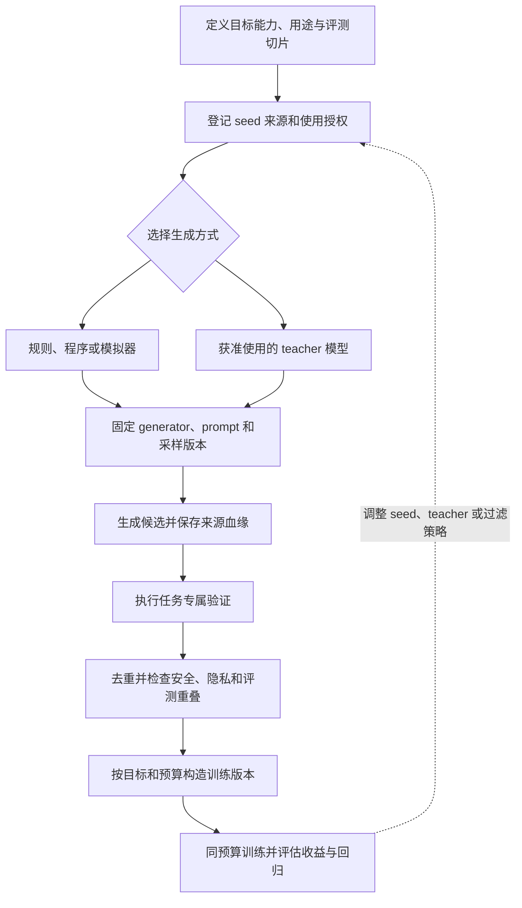

# 第七章：Synthetic Data 与 Distillation Data

前面几章讨论的大多是自然产生的数据：网页、代码仓库、数学题、专业文档、论坛、书籍和论文。本章讨论另一类越来越重要的数据：合成数据和蒸馏数据。

合成数据是由规则、程序、模拟器或模型生成的数据。蒸馏数据通常是强模型作为 teacher，为弱模型或小模型生成回答、解释、偏好或推理轨迹，让 student 模型学习 teacher 的行为。

合成数据和 teacher 生成的监督信号已经出现在指令微调、数学与代码任务、工具使用和多语言训练等研究中，但某类数据是否有用取决于任务、生成器、筛选方法和训练预算；“由模型生成”本身不代表质量高或可用。

但合成数据不是免费午餐。它可以快速扩充能力，也可能制造同质化、错误放大、评估污染、teacher 偏差继承和数据退化。

本章讨论合成数据和蒸馏数据的训练、评估、治理和风险控制。合成数据不是绕过模型服务条款、复制专有模型能力、生成有害内容或规避安全策略的方法；任何 teacher 输出都必须有明确授权、可追踪来源和适用范围。

## 0. 合成数据是可审计的分布编辑

合成数据工程的核心不是一次生成多少文本，而是把目标能力、seed、生成器、验证器、配比和训练结果连成一条可回放的链路：

读图时把“获准生成”与“样本通过验证”看作两道独立门：授权不说明答案正确，答案质量也不能抵消来源、隐私或评测污染问题。评估结果应反馈到新的 seed、teacher 或规则版本；每次比较固定训练预算和留出切片，避免把生成数量当作收益。

Self-Instruct、WizardLM/Evol-Instruct、phi-1、Orca、经典 knowledge distillation、Distilling Step-by-Step 以及 model collapse 相关研究提供了不同证据层面的入口。本章会区分这些论文真正展示的实验结果与工程上的教学抽象，并进一步讨论 teacher 授权、prompt/sampling 记录、正确性验证、自然数据锚点和数据退化。

---

## 1. 先建立直觉：为什么要合成数据？

自然数据有两个问题：不够可控，也不一定覆盖你想要的能力。

例如，你想训练模型学会复杂指令跟随。互联网上当然有问答和教程，但不一定有大量“清晰指令 -> 高质量回答”的样本。你想训练数学分步推理，网页上有题目和答案，但步骤可能缺失、错误或格式混乱。你想训练安全拒答，自然语料里可能有风险内容，但不一定有安全、合规、边界清晰的回答。

合成数据的价值在于：它可以按目标能力主动构造训练样本。

可以把合成数据想成“定制练习册”。自然数据像从世界各地收来的书，有价值但混杂；合成数据像老师根据学生短板编的练习，目标明确、格式统一、覆盖可控。

但练习册质量取决于出题老师。如果老师水平高、覆盖广、验证严格，练习册很有用。如果老师重复、偏科、答案错误，学生会被带偏。

---

## 2. 来龙去脉：从数据增强到大模型自举

合成数据不是大模型时代才有。传统机器学习里早就有数据增强：图像旋转裁剪、语音加噪、机器翻译回译、规则生成样本等。这些方法的目标是增加数据量、提升鲁棒性、覆盖边界情况。

大模型时代，合成数据的形态发生了变化。模型本身可以生成高质量文本、代码、题目、解释和对话，于是数据生成不再只是简单扰动，而是能力自举。

Self-Instruct 是一个代表性工作。它用模型生成 instructions、inputs 和 outputs，过滤无效或相似样本，再用这些合成指令数据微调模型；其结果说明这条生成与过滤路线在论文设置中可行，不代表任意生成器或任务都能获得同样收益。[Self-Instruct](https://arxiv.org/abs/2212.10560)

WizardLM/Evol-Instruct 进一步研究复杂指令生成：从初始指令出发逐步改写约束和任务结构。复杂度提升只有在指令仍可回答、约束一致、答案可验证时才可能有训练价值；论文结果绑定其生成配方和评测。[WizardLM](https://arxiv.org/abs/2304.12244)

phi-1 报告了 textbook-quality web 数据与 GPT-3.5 合成教材/练习用于小型代码模型训练的案例；这支持在明确任务和筛选流程下研究高质量合成内容，不支持跨模型或跨领域的固定比例结论。[Textbooks Are All You Need](https://arxiv.org/abs/2306.11644)

---

## 3. Synthetic data 和 distillation data 的区别

这两个概念有重叠，但关注点不同。

Synthetic data 强调数据是人工或模型生成的，不是自然采集来的。生成方式可以是规则、程序、模拟器或 LLM。

Distillation data 强调 teacher-student 关系：teacher 为 student 提供回答、解释、偏好、分数或概率分布等监督信号。两者是不同维度；teacher 生成的回答可以同时是合成数据和蒸馏数据。

例子：

1. 用规则生成 10 万道算术题：synthetic data，但不一定是 distillation。
2. 用 GPT-4 给指令生成高质量答案：既是 synthetic data，也是 distillation data。
3. 用模拟器生成机器人状态轨迹：synthetic data。
4. 用强代码模型为问题生成参考实现和解释：distillation data。
5. 用 teacher 模型给多个回答排序：偏好蒸馏数据。

合成数据关注“来源是否由规则或模型生成”，蒸馏数据关注“是否存在 teacher 到 student 的监督关系”；字段应分别记录 `origin`、`generator`、`teacher` 和 `student objective`。只用一个互斥枚举会丢掉重叠信息；统计比例时，同一条记录只能计一次。

### 3.1 关键公式与审计指标

训练数据可以按生成来源与 teacher 关系分别打标签：

~~~math
o_i \in \{\mathrm{natural},\mathrm{generated}\},\quad d_i \in \{0,1\}
~~~

`o_i` 表示原始来源类别，`d_i=1` 表示样本携带 teacher 到 student 的蒸馏关系；合成集与蒸馏集可以重叠，不能默认互斥。

一条合成或蒸馏样本可以表示为：

~~~math
s_i = (x_i, y_i, a_i, t_i, p_i, q_i, r_i, z_i)
~~~

其中 `x_i` 是指令或上下文，`y_i` 是生成答案或轨迹，`a_i` 是目标能力标签，`t_i` 是 teacher / generator 标识，`p_i` 是 prompt 和采样参数版本，`q_i` 是质量分，`r_i` 是风险分，`z_i` 是授权、验证、去重、污染和版本元数据。

如果是普通 SFT 合成样本，目标仍是条件语言建模：

~~~math
L_{\mathrm{sft}} = -\frac{1}{N_{\mathrm{tok}}}\sum_{i=1}^{m} w_i \sum_{j=1}^{L_i}\log p_{\theta}(y_{i,j} \mid x_i, y_{i,1:j-1})
~~~

其中 `m` 是样本数，`L_i` 是第 `i` 个目标回答实际参与 loss 的 token 数，`w_i≥0` 是样本权重；`N_tok=Σ_i(w_iL_i)` 是加权目标 token 分母，必须大于零。若使用不同的 loss mask，应按实际参与 loss 的 token 重算 `L_i` 和分母。`w_i` 不应只由 teacher 分数决定，还要考虑任务覆盖、独立验证、重复和风险。这里使用自然对数。比如 `w=1`、3 个目标 token 的条件概率分别为 `0.5、0.25、0.8`，则 `L_sft=-(ln 0.5+ln 0.25+ln 0.8)/3≈0.768`。这是一个 token 级教学计算，不代表生成样本质量。

如果 teacher 提供 soft distribution，蒸馏损失常写成 KL 形式：

~~~math
L_{\mathrm{kd}} = \frac{\tau^2}{N_{\mathrm{ctx}}}\sum_{i=1}^{N_{\mathrm{ctx}}} D_{\mathrm{KL}}\left(p_{T,\tau}(\cdot \mid c_i)\parallel p_{S,\tau}(\cdot \mid c_i)\right)
~~~

其中 `p_T_tau` 和 `p_S_tau` 是温度 `tau` 下 teacher、student 对词表的概率分布，`c_i` 是上下文，`N_ctx` 是有效蒸馏上下文数；实现也可能按 token 或 batch 采用其他 reduction，比较前要核对分母。如果只有 teacher 的 hard answer，则使用交叉熵监督，不再计算完整软分布 KL。以一个上下文、`tau=2` 为例，若温度后的分布分别为 `p_T=(0.8,0.2)`、`p_S=(0.6,0.4)`，则 `KL=0.8 ln(0.8/0.6)+0.2 ln(0.2/0.4)≈0.0915`，温度缩放后 `L_kd=4×0.0915≈0.366`。

合成样本质量分可以写成可审计的加权形式：

~~~math
q_i = w_v V_i + w_e E_i + w_d D_i + w_s S_i - \lambda_h H_i - \lambda_u U_i - \lambda_c C_i
~~~

其中各特征先按固定规则或标注映射到 `[0,1]`，权重与惩罚系数非负，并在同一任务和数据版本内固定；`V_i` 是正确性证据，`E_i` 是引用、测试或执行支持，`D_i` 是覆盖/多样性贡献，`S_i` 是内容安全质量，`H_i` 是幻觉风险，`U_i` 是近重复或模板化风险，`C_i` 是评测污染风险。`q_i` 是可审计代理分，不是概率；授权、PII、污染等硬门禁必须单独执行，不能用高分抵消。比如设权重为 `0.35、0.20、0.20、0.25`，惩罚系数 `lambda_h=0.20、lambda_u=0.20、lambda_c=0.30`，样本特征 `V=0.95、E=0.90、D=0.70、S=1、H=0.05、U=0.10、C=0`，则 `q=0.35×0.95+0.20×0.90+0.20×0.70+0.25×1−0.20×0.05−0.20×0.10−0.30×0=0.8725≈0.873`。这个手算只说明代理分怎样得到，不是准入或授权结论。

合成数据样本的状态不宜压缩成一个准入开关，可以保留并列的检查量：

~~~math
\mathrm{checks}_i = (quality\_ok_i, authorized_i, verified_i, dedup\_ok_i, safe_i, contamination\_clear_i, privacy\_clear_i)
~~~

这里 `authorized_i` 表示 teacher 输出或生成规则的使用授权成立；`verified_i` 表示答案、代码、引用、安全边界或工具参数通过验证；`contamination_clear_i` 表示没有命中评测污染。不同失败原因对应隔离、重生成、人工复核、脱敏或删除等不同动作。

合成和蒸馏样本合并后、在保留训练集合中的 token 占比为：

~~~math
R_{\mathrm{gen}} = \frac{\sum_{i \in G}(keep_i T_i)}{\sum_i(keep_i T_i)},\quad G = D_{\mathrm{syn}} \cup D_{\mathrm{distill}}
~~~

其中 `T_i` 是 token 数，`keep_i` 表示样本保留；`G` 是合成与蒸馏样本的并集，因此重叠记录只计一次。`R_gen` 高时应审计质量、重复、覆盖与风险，不能单独推断会发生 model collapse。

这些比例的定义域必须写清楚：只有保留集合中的 token 总数大于零时，`R_gen` 才有定义；只有目标标签集合非空且存在保留样本时，`C_cover` 才有定义；pairwise `R_dup` 至少需要两条可比较样本，上游逐条重复标记率则至少需要一条审计样本。没有保留样本时应记录为 `undefined`，而不是把“没有可测分母”写成占比或覆盖率 `0`。如果原始数据存在但经过过滤后一个样本也没有，token 保留率可以是 `0`，同时应触发补充或恢复数据的动作。

能力覆盖可以按标签集合计算：

~~~math
C_{\mathrm{cover}} = \frac{|A_{\mathrm{target}} \cap A_{\mathrm{kept}}|}{|A_{\mathrm{target}}|}
~~~

若按固定顺序逐条与前序样本比较，同质化或近重复率可以写成：

~~~math
R_{\mathrm{dup}} = \frac{1}{n-1}\sum_{i=2}^{n} I\left(\max_{1 \leq j < i}(\mathrm{sim}(s_i,s_j)) > \tau_{\mathrm{sim}}\right), \quad n>1
~~~

这里 `I(条件)` 在条件成立时取 1，否则取 0；先按固定顺序比较每个样本与此前样本，第一条没有前序比较对象，所以分母是 `n-1`。相似度方法、阈值 `tau_sim` 和候选复核策略都要记录。若上游只提供逐条 `duplicate` 标记，可另报标记率。对本章 demo 的 12 条原始样本，1 条命中标记，因此上游标记率是 `1/12≈0.083`；demo 只执行该标记门禁，不自行计算语义相似度，也不把标记率伪装成 pairwise 相似度估计。

保留样本上的残余风险标记率可以写成：

~~~math
R_{\mathrm{risk}} = \frac{1}{|S_{\mathrm{kept}}|}\sum_{i\in S_{\mathrm{kept}}} I(r_i=1)
~~~

其中 `r_i∈{0,1}` 表示样本是否带有硬门禁后仍需人工判断或补充证据的残余风险标记。它不是风险概率，也不表示风险面面俱到；没有保留样本时该指标未定义。demo 为六条保留记录提供该字段，手算为 `0/6=0`。

最终训练前可以保留一个配比和风险向量：

~~~math
C_{\mathrm{syn}} = (R_{\mathrm{gen}}, C_{\mathrm{cover}}, R_{\mathrm{dup}}, R_{\mathrm{risk}})
~~~

它分别描述合成/蒸馏 token 的并集占比、目标标签覆盖、pairwise 重复率和保留样本残余风险标记率。将 demo 的六条保留样本代入可复核：原始 token 为 `8,350`，保留 `4,560`，token 保留率 `4,560/8,350≈0.546`；其中 2,160 token 来自非蒸馏合成样本，另有 780 token 来自同时标为 synthetic 与 distilled 的教师样本，因此并集为 `2,160+780=2,940`，`R_gen=2,940/4,560≈0.645`；蒸馏标签另计 `780/4,560≈0.171`，不与合成来源互斥。保留样本覆盖 10 个目标标签中的 10 个，`C_cover=10/10=1.0`；残余风险标记率为 `0/6=0`。上游重复标记率另算为 `1/12≈0.083`，因为示例没有执行 pairwise 相似度计算。这些都是 toy 输入的审计结果，不是推荐比例。合成数据是主动编辑训练分布；需连同 teacher、prompt、sampling、验证、过滤、配比和训练结果记录。

---

## 4. 合成数据常见类型

大模型训练中的合成数据主要有以下类型：

1. 合成指令数据：instruction、input、output 三元组。
2. 合成对话数据：多轮用户和助手对话。
3. 合成数学数据：题目、解题步骤、答案、验证标签。
4. 合成代码数据：需求、代码、测试、解释、bug fix。
5. 合成领域数据：医学、法律、金融等场景问答和文档问答。
6. 合成安全数据：风险识别、拒答、边界解释、合规替代建议。
7. 合成工具调用数据：用户意图、工具选择、参数填充、结果总结。
8. 合成多语言数据：翻译、跨语言问答、低资源语言增强。
9. 合成偏好数据：chosen/rejected 回答对。
10. 合成评估数据：用于内部评测和回归测试的任务集。

不同类型的数据目标不同，生成和验证方法也不同。

---

## 5. 合成指令数据

指令数据是 instruction tuning 的核心。它让模型从“续写文本”转向“理解用户要求并完成任务”。

一条典型指令样本包括：

1. instruction：用户要求。
2. input：可选上下文。
3. output：理想回答。

合成指令数据的优势：

1. 可以快速扩大任务覆盖。
2. 可以补充长尾任务。
3. 可以控制格式和风格。
4. 可以构造不同难度。
5. 可以多语言扩展。

风险：

1. 指令类型重复。
2. 回答风格同质化。
3. teacher 幻觉被 student 学到。
4. 难度分布不真实。
5. 过度训练后模型变得模板化。

Self-Instruct 的关键启发不是“让模型随便生成数据”，而是“生成后必须过滤无效、重复和相似样本，并用评估验证收益”。

---

## 6. Evol-Instruct：让指令变复杂

普通合成指令容易停留在简单任务，例如总结、翻译、改写、列要点。模型如果只训练这些数据，面对复杂约束、多步骤任务、组合任务时容易失败。

Evol-Instruct 的思想是从简单指令出发，通过改写逐步提高复杂度，例如增加限制条件、增加推理步骤、增加输入复杂度、要求多角度分析或引入更具体场景。

它解决的问题是指令复杂度不足。

但复杂不等于高质量。复杂指令也可能不合理、不可回答、约束冲突或答案质量差。因此需要过滤和审计：

1. 指令是否清楚。
2. 约束是否一致。
3. 答案是否满足约束。
4. 难度是否真实有用。
5. 是否覆盖多种能力，而不是只会堆限制。

---

## 7. 推理轨迹数据

推理轨迹数据包含中间思路、步骤、证明、计算过程或解释。它在数学、代码、科学问答、规划和复杂决策中很重要。

推理轨迹的价值：

1. 给模型提供分步解决问题的模式。
2. 提升复杂任务可解释性。
3. 让模型学会检查中间结果。
4. 支持 verifier 或 judge 训练。
5. 可用于生成过程监督数据。

但推理轨迹也有明显风险：

1. 错误步骤会被学习。
2. 模型可能学会“看起来合理”的伪推理。
3. 轨迹可能过长，挤占有效上下文。
4. 不同任务不一定需要显式长推理。
5. 如果来自 teacher，student 可能模仿 teacher 的偏差和风格。

所以推理轨迹数据一定要重视正确性验证。数学题可以校验最终答案，代码题可以运行测试，领域题需要引用依据或专家抽检。

---

## 8. Teacher-student 蒸馏

蒸馏的基本思想是：用强模型教弱模型。

在大模型数据工程中，teacher 可以提供：

1. 高质量回答。
2. 分步解释。
3. 多候选答案。
4. 答案评分。
5. chosen/rejected 偏好对。
6. 错误分析。
7. 任务分解。
8. 工具调用轨迹。

student 通过监督微调或偏好训练学习这些数据。

蒸馏的好处：

1. 降低人工标注成本。
2. 把强模型行为迁移到小模型。
3. 构造更稳定的回答格式。
4. 补足长尾任务。
5. 支持私有模型能力定制。

蒸馏的风险：

1. teacher 的错误被继承。
2. teacher 的风格被过度模仿。
3. student 难以超过 teacher 的知识边界。
4. 可能违反 teacher 服务或数据使用条款。
5. 多代蒸馏可能导致数据分布退化。

工程上必须确认 teacher 输出的使用授权和合规边界。

teacher 参数更大或通用 benchmark 更高，并不保证它在目标语言和目标任务上生成的训练样本更好。2026 年一篇多语言合成数据预印本比较了 10 个 teacher、6 种语言、超过 140 万条 SFT 样本和 240 个 student；在该研究设置中，prompt 多样性、回答长度和流畅度比参数规模更能预测所测 student 表现。这里的 Polyglot Score 和结果只适用于论文语种、生成方式和评估任务，不能直接据此选定其他项目的 teacher。[Polyglot Teachers](https://arxiv.org/abs/2604.11290)

---

## 9. Distillation data 不等于复制能力

蒸馏不是简单“复制某个闭源模型”。合规项目要关注授权、数据使用条款、输出归属和安全限制；技术上 student 学到的是经过筛选的行为信号，而不是 teacher 的参数或全部能力。

从技术角度看，蒸馏也不是直接复制参数。student 学到的是训练数据中的行为模式，受 student 容量、训练策略、数据覆盖、优化目标和评估体系限制。

合理的蒸馏场景包括：

1. 用自有 teacher 为自有 student 生成训练数据。
2. 使用授权允许的数据和模型输出。
3. 用专家审核后的 teacher 数据增强内部模型。
4. 用 teacher 辅助标注、评分和质量过滤。

不合理的做法包括无授权大规模复制专有模型输出、绕过限制获取数据或生成违反安全边界的内容。本书不讨论这类做法。

---

## 10. 合成数据生成 pipeline

一个成熟的合成数据 pipeline 通常包括：

1. 目标定义：要补什么能力。
2. 种子数据：初始任务、领域文档、题型、用户场景。
3. 生成策略：prompt、模板、规则、模型、采样参数。
4. 多样性控制：任务类型、难度、语言、领域、格式。
5. 初步过滤：去重、长度、格式、无效样本、明显错误。
6. 质量评分：LLM judge、规则校验、模型评分、人工抽样。
7. 正确性验证：测试、计算、引用、事实核验、专家审计。
8. 安全过滤：风险分类、PII、政策边界、拒答质量。
9. 配比控制：不要让合成数据淹没自然数据。
10. 训练实验：小规模 ablation 验证收益和副作用。
11. 版本化：记录 teacher、prompt、参数、过滤器和数据版本。

这条链路的核心不是“生成很多”，而是“生成、过滤、验证、评估、迭代”。

---

## 11. 质量验证：合成数据最关键的一步

合成数据的问题不是不能生成，而是太容易生成。真正难的是验证。

不同任务的验证方法不同：

1. 数学题：校验答案、步骤、单位、边界条件。
2. 代码题：运行单测、静态检查、编译、lint。
3. 事实问答：检索证据、引用来源、人工抽检。
4. 翻译：双向一致性、人工评估、术语一致性。
5. 安全回答：边界是否正确，是否误拒或漏拒。
6. 工具调用：参数是否正确，工具结果是否被正确使用。
7. 领域问答：专家审计和权威资料对照。

如果验证缺失，合成数据很容易把 hallucination 包装成训练信号。

工具使用数据的研究提供了直接的训练对照：EMNLP 2024 的 Quality Matters 用人工定义的正确性条件和模型辅助评估检查两个工具 benchmark，并报告经过验证的数据即使数量较少，也优于未验证数据训练出的模型。这个结果支持“先验证再计量”的流程，但指标和收益绑定该论文的 benchmark、teacher 和训练配置。[Quality Matters](https://aclanthology.org/2024.emnlp-main.285/)

---

## 12. 去重和多样性控制

合成数据经常高度重复。模型会生成相似指令、相似开头、相似答案结构和相似解释模板。

常见重复包括：

1. 指令重复。
2. 任务类型重复。
3. 回答模板重复。
4. 推理步骤重复。
5. 领域场景重复。
6. 安全拒答话术重复。

控制方法包括：

1. embedding 聚类去重。
2. n-gram overlap 过滤。
3. 按任务类型分桶采样。
4. 控制难度分布。
5. 多 teacher 或多 prompt 生成。
6. 人工审计高频模式。
7. 对同质模板降权。

多样性不是为了好看，而是为了避免 student 学到单一风格。

合成数据多样性研究还发现，在其 350M/1.4B 模型、指定自然语料和预训练预算下，增加 topic 与 prompt 风格覆盖、减少每个 topic 的重复生成，和更好的下游结果相关；这不证明某个多样性分数可以单独预测任意任务的收益。[On the Diversity of Synthetic Data](https://arxiv.org/abs/2410.15226)

---

## 13. 数据退化风险

数据退化是需要测量的风险，不是所有合成数据必然导致的结果。一个具体风险路径是：模型输出逐代替代原始样本，生成器的偏好被反复采样，低频尾部和表达多样性在重复微调中减弱。

递归训练研究给出的是条件化证据。Findings NAACL 2024 在英文生成任务上的递归微调中观察到词汇、句法和语义输出多样性随迭代下降，在创造性任务上更明显；ICML 2025 的 Collapse or Thrive 则区分“每代用纯合成数据替换原数据”与“将生成数据和已有数据一同累积”的工作流，只有前者在论文所测设置中一致出现 collapse，累积流程呈现不同结果。[The Curious Decline of Linguistic Diversity](https://aclanthology.org/2024.findings-naacl.228/), [Collapse or Thrive](https://proceedings.mlr.press/v267/kazdan25a.html)

EMNLP 2025 对预训练合成数据的系统比较也发现，结果会随生成类型变化：其大规模实验中，重写文本单独训练与自然网页文本的速度不同于混合训练；某些预算下，约三分之一重写文本与三分之二自然网页文本的组合更快达到同一验证损失，而教材式合成数据单独训练在若干小预算下有较高下游损失。这些比例、损失和加速只绑定论文的模型、数据类型与训练预算，不能转成通用门槛。[Demystifying Synthetic Data in LLM Pre-training](https://aclanthology.org/2025.emnlp-main.544/)

表现包括：

1. 语言更模板化。
2. 观点更平均。
3. 长尾知识减少。
4. 错误事实被重复强化。
5. 难题覆盖下降。
6. 安全边界变得机械。
7. 多语言和小众表达被削弱。

工程上的防护应包括来源分层、保留经过授权且有代表性的非生成数据、验证合成样本覆盖与重复、比较不同代次，并用未参与生成和调参的切片评估长尾、事实、安全和语言多样性。保留比例和过滤方式应通过目标训练配方验证；现有研究没有给出跨领域通用的 collapse 阈值。

---

## 14. 合成数据在不同训练阶段的用法

### 14.1 预训练

预训练阶段可以把重写文本、教材式生成或可验证练习作为不同候选数据类型，分别做同预算对照；不能把论文中的某个合成比例直接当成通用 recipe。

### 14.2 继续预训练

继续预训练可以评估是否用合成数据补目标领域或能力短板，例如代码教材、数学练习或多语言问答；训练前应检查来源授权、目标域覆盖和原有能力回归。

### 14.3 SFT

SFT 是合成指令数据最常用的阶段。instruction-response、multi-turn dialogue、tool use、format following 都可以合成。

### 14.4 偏好训练

可以用 teacher 或 judge 生成 chosen/rejected 数据，但偏好质量必须审计，否则会让模型学到表面偏好。

### 14.5 安全训练

安全合成数据可以覆盖风险类别、拒答边界、误拒案例和安全替代建议。此类数据必须保持防御和合规导向。

---

## 15. 合成数据和真实用户数据

经授权处理的产品交互可以反映该产品已观察到的请求、表达和失败模式，但会受用户选择、产品入口和日志策略影响，并不自动代表目标总体。合成数据便于控制种子和构造边界样例，但生成、审核、验证和回放也有成本，且可能偏离部署分布。

两类来源回答的问题不同：已观察的自然数据提供现实表达线索，合成数据可围绕明确目标补充缺失切片；任何用户数据都必须先满足用途授权和隐私处理要求。

真实用户数据适合发现真实分布和产品问题；合成数据适合针对性补齐覆盖不足、构造安全边界、生成难例和统一格式。

一种可检验的流程是：用经授权的日志或人工研究估计目标任务分布，用合成数据补足已识别的覆盖缺口，再用独立标注、静态 holdout 或受控实验验证；若目标分布未知，不能把生成器分布当成替代值。

---

## 16. 合成数据配比

合成数据占比没有标准答案。不同阶段、任务和质量下差异很大。

判断合成数据比例时要看：

1. 目标能力是否稀缺。
2. 合成数据质量是否可验证。
3. 是否覆盖真实用户分布。
4. 是否和自然数据重复。
5. 是否导致风格同质化。
6. 是否提升目标指标但损害通用能力。
7. 是否增加幻觉、安全或记忆风险。

可以先用小规模 ablation 探测多个比例，再固定数据版本、总训练 token 和训练配方比较目标指标、自然数据能力、覆盖、重复及安全风险。EMNLP 2025 的约 30% 重写文本结果只是该论文模型和预算下的经验结论，不应当作默认比例；不同生成类型和训练阶段要重新测量。

---

## 17. 机制与边界：合成数据是分布编辑

从机制上看，合成数据不是单纯增加样本，而是在编辑训练分布。

“自然数据”只是来自实际来源的观测样本，不等同于无偏的世界分布；合成数据来自生成器及其 seed、prompt、采样参数、过滤器和任务模板共同定义的分布。二者都可能覆盖不足，因此应明确目标分布并保留来源切片。

因此，合成数据引入的是一种新的偏置。如果这种偏置与目标能力一致，模型会受益；如果偏置过强，模型会被塑造成“像生成器一样说话”。

专家级问题包括：

1. 生成器分布和真实用户分布差多少？
2. 合成数据是否覆盖目标任务的长尾？
3. teacher 错误如何被发现和阻断？
4. student 是否只是模仿格式，而没有获得能力？
5. 合成数据提升 benchmark 是否来自污染或模板匹配？
6. 多代合成是否导致数据退化？

---

## 18. 一个可落地的合成与蒸馏数据方案

第十节已经列出生成 pipeline；本节将其落到数据版本和实验记录。通用质量阈值见[第三章](03-清洗过滤与质量评分.md)，代码、数学和领域验证器见[第六章](06-code-math-domain-data.md)，训练 mixture 和预算对照见[第五章](05-data-mixture与配比.md)。

先把每条样本绑定下列证据，再比较它是否值得生成或保留：

| 记录层 | 最小字段 | 要回答的问题 |
| --- | --- | --- |
| 目标与 seed | 目标能力、目标分布、任务标签、seed 来源、使用授权 | 样本补哪类已知缺口，来源是否允许使用？ |
| 生成器 | generator/teacher 型号与 revision、prompt 版本、采样参数、生成时间 | 哪种设置产生了这条样本，能否重放？ |
| 样本与验证 | origin、teacher 关系、输入/输出、验证器与 revision、结果、人工复核 | 哪些独立证据支持答案、行为或格式正确？ |
| 风险与处置 | PII、安全、污染、重复标记、拒绝原因、人工动作 | 哪些硬门禁通过，失败样本去了哪里？ |
| 训练实验 | 不可变数据版本、保留 token、目标/对照比例、checkpoint、holdout 指标 | 收益是否来自同预算对照，是否有非目标回归？ |

seed 可以来自获准使用的任务、公开数据、专家模板或人工设计；规则和程序适合可计算样本，LLM 适合开放式指令、解释和对话。数学答案要有答案/过程验证，代码要有运行环境和测试，事实回答要保留来源引用，安全回答要用安全与误拒切片检查。LLM judge 可以排序候选，但需要人工、工具或独立事实证据校准，不能单独当作 gold label。

训练实验固定 student 初始 checkpoint、tokenizer、训练 token 预算和评测协议，分别比较自然样本基线、合成类型、teacher 或过滤策略。按任务、难度、风险、语言、teacher 和 prompt 切片报告目标指标、通用回归、覆盖、重复和安全结果；留出样本不能参与生成提示设计或阈值选择。这样才能区分数据数量变化、数据质量变化和训练配方变化。

### 18.1 最小可运行合成与蒸馏数据审计 demo

下面这个 demo 不依赖外部库，也不读写文件。输入是一组 toy natural / synthetic 样本，并用独立的 `distilled` 字段标记 student 是否学习了 teacher 信号；因此一条合成的 teacher 轨迹可以同时属于 synthetic 和 distillation。输出包括保留样本、拒绝原因、来源配比、任务配比、teacher 配比、多样性覆盖、重复标记率、残余风险标记率和验收结果。字段缺失、类型不符、重复 ID、非有限质量分和非法阈值会被拒绝；空输入或全拒绝输入返回未定义指标并暂停决策。

它演示的是合成数据治理机制，不是生产级合规审查、LLM judge、数学 verifier、代码沙箱、安全分类器或版权系统。真实系统要接入授权审查、teacher 版本管理、prompt registry、测试执行、检索证据、人工抽样、污染检测和训练 ablation。

代码状态：已验证（2026-10-28；Python 3.12.9，标准库）

~~~python
from collections import Counter, defaultdict
from fractions import Fraction
import math

samples = [
    {"id": "seed_user_math", "origin": "natural", "task": "math", "tokens": 420, "quality": 0.86, "validated": True, "diversity": {"math", "seed"}, "teacher": None, "authorized": True, "duplicate": False, "contam": False, "safety_ok": True, "pii": False, "natural_anchor": True, "residual_risk": False, "distilled": False},
    {"id": "seed_user_domain", "origin": "natural", "task": "domain", "tokens": 1200, "quality": 0.84, "validated": True, "diversity": {"domain", "seed"}, "teacher": None, "authorized": True, "duplicate": False, "contam": False, "safety_ok": True, "pii": False, "natural_anchor": True, "residual_risk": False, "distilled": False},
    {"id": "syn_math_verified", "origin": "synthetic", "task": "math", "tokens": 620, "quality": 0.88, "validated": True, "diversity": {"math", "reasoning"}, "teacher": "rule_solver", "authorized": True, "duplicate": False, "contam": False, "safety_ok": True, "pii": False, "natural_anchor": False, "residual_risk": False, "distilled": False},
    {"id": "syn_math_wrong", "origin": "synthetic", "task": "math", "tokens": 560, "quality": 0.83, "validated": False, "diversity": {"math"}, "teacher": "rule_solver", "authorized": True, "duplicate": False, "contam": False, "safety_ok": True, "pii": False, "natural_anchor": False, "residual_risk": False, "distilled": False},
    {"id": "distill_tool_trace", "origin": "synthetic", "task": "tool", "tokens": 780, "quality": 0.91, "validated": True, "diversity": {"tool", "multi_step"}, "teacher": "owned_teacher", "authorized": True, "duplicate": False, "contam": False, "safety_ok": True, "pii": False, "natural_anchor": False, "residual_risk": False, "distilled": True},
    {"id": "distill_unauthorized", "origin": "synthetic", "task": "general", "tokens": 700, "quality": 0.90, "validated": True, "diversity": {"general"}, "teacher": "restricted_api", "authorized": False, "duplicate": False, "contam": False, "safety_ok": True, "pii": False, "natural_anchor": False, "residual_risk": False, "distilled": True},
    {"id": "syn_code_tests", "origin": "synthetic", "task": "code", "tokens": 900, "quality": 0.87, "validated": True, "diversity": {"code", "tests"}, "teacher": "owned_teacher", "authorized": True, "duplicate": False, "contam": False, "safety_ok": True, "pii": False, "natural_anchor": False, "residual_risk": False, "distilled": False},
    {"id": "syn_code_duplicate", "origin": "synthetic", "task": "code", "tokens": 880, "quality": 0.86, "validated": True, "diversity": {"code", "tests"}, "teacher": "owned_teacher", "authorized": True, "duplicate": True, "contam": False, "safety_ok": True, "pii": False, "natural_anchor": False, "residual_risk": False, "distilled": False},
    {"id": "syn_benchmark_leak", "origin": "synthetic", "task": "eval_like", "tokens": 500, "quality": 0.84, "validated": True, "diversity": {"eval"}, "teacher": "owned_teacher", "authorized": True, "duplicate": False, "contam": True, "safety_ok": True, "pii": False, "natural_anchor": False, "residual_risk": False, "distilled": False},
    {"id": "syn_safety_refusal", "origin": "synthetic", "task": "safety", "tokens": 640, "quality": 0.82, "validated": True, "diversity": {"safety", "boundary"}, "teacher": "policy_template", "authorized": True, "duplicate": False, "contam": False, "safety_ok": True, "pii": False, "natural_anchor": False, "residual_risk": False, "distilled": False},
    {"id": "syn_unsafe_answer", "origin": "synthetic", "task": "safety", "tokens": 610, "quality": 0.74, "validated": True, "diversity": {"safety"}, "teacher": "weak_teacher", "authorized": True, "duplicate": False, "contam": False, "safety_ok": False, "pii": False, "natural_anchor": False, "residual_risk": False, "distilled": False},
    {"id": "real_user_private", "origin": "natural", "task": "domain", "tokens": 540, "quality": 0.78, "validated": True, "diversity": {"domain"}, "teacher": None, "authorized": True, "duplicate": False, "contam": False, "safety_ok": True, "pii": True, "natural_anchor": True, "residual_risk": False, "distilled": False},
]

TARGET_TAGS = {"math", "reasoning", "tool", "multi_step", "code", "tests", "safety", "boundary", "domain", "seed"}
MIN_QUALITY = 0.80
MAX_SYN_RATIO = 0.72
MIN_DIVERSITY_COVERAGE = 0.85

REQUIRED_FIELDS = {
    "id", "origin", "task", "tokens", "quality", "validated", "diversity",
    "teacher", "authorized", "duplicate", "contam", "safety_ok", "pii",
    "natural_anchor", "residual_risk", "distilled",
}
BOOLEAN_FIELDS = {
    "validated", "authorized", "duplicate", "contam", "safety_ok", "pii",
    "natural_anchor", "residual_risk", "distilled",
}
ALLOWED_ORIGINS = {"natural", "synthetic"}

def validate_config(target_tags, min_quality, max_syn_ratio, min_diversity_coverage):
    if not isinstance(target_tags, (set, frozenset)) or not target_tags:
        raise ValueError("target_tags must be a non-empty set")
    if any(not isinstance(tag, str) or not tag.strip() for tag in target_tags):
        raise ValueError("target tags must be non-empty strings")
    for name, value in (
        ("min_quality", min_quality),
        ("max_syn_ratio", max_syn_ratio),
        ("min_diversity_coverage", min_diversity_coverage),
    ):
        if type(value) not in (int, float) or not math.isfinite(value) or not 0 <= value <= 1:
            raise ValueError(f"{name} must be a finite number in [0, 1]")

def validate_samples(records):
    if not isinstance(records, list):
        raise TypeError("samples must be a list")
    seen_ids = set()
    for index, item in enumerate(records):
        if not isinstance(item, dict):
            raise TypeError(f"sample {index} must be a mapping")
        missing = REQUIRED_FIELDS - item.keys()
        if missing:
            raise ValueError(f"sample {index} is missing fields: {sorted(missing)}")
        sample_id = item["id"]
        if not isinstance(sample_id, str) or not sample_id.strip():
            raise ValueError(f"sample {index} has an invalid id")
        if sample_id in seen_ids:
            raise ValueError(f"duplicate sample id: {sample_id}")
        seen_ids.add(sample_id)
        if not isinstance(item["origin"], str) or item["origin"] not in ALLOWED_ORIGINS:
            raise ValueError(f"sample {sample_id} has an invalid origin")
        if not isinstance(item["task"], str) or not item["task"].strip():
            raise ValueError(f"sample {sample_id} has an invalid task")
        if type(item["tokens"]) is not int or item["tokens"] <= 0:
            raise ValueError(f"sample {sample_id} tokens must be a positive integer")
        quality = item["quality"]
        if type(quality) not in (int, float) or not math.isfinite(quality) or not 0 <= quality <= 1:
            raise ValueError(f"sample {sample_id} quality must be finite and in [0, 1]")
        for field in BOOLEAN_FIELDS:
            if type(item[field]) is not bool:
                raise ValueError(f"sample {sample_id} field {field} must be boolean")
        if item["natural_anchor"] and item["origin"] != "natural":
            raise ValueError(f"sample {sample_id} marks non-natural data as an anchor")
        tags = item["diversity"]
        if not isinstance(tags, (set, frozenset)) or any(
            not isinstance(tag, str) or not tag.strip() for tag in tags
        ):
            raise ValueError(f"sample {sample_id} diversity must be a set of non-empty strings")
        teacher = item["teacher"]
        if teacher is not None and (not isinstance(teacher, str) or not teacher.strip()):
            raise ValueError(f"sample {sample_id} has an invalid teacher")

def safe_ratio(numerator, denominator):
    return round(numerator / denominator, 3) if denominator else None

def ratio_at_most(numerator, denominator, limit):
    if denominator <= 0:
        return False
    return Fraction(numerator, denominator) <= Fraction(str(limit))

def ratio_at_least(numerator, denominator, limit):
    if denominator <= 0:
        return False
    return Fraction(numerator, denominator) >= Fraction(str(limit))

def reject_reason(item, min_quality):
    if not item["authorized"]:
        return "unauthorized_teacher"
    if item["pii"]:
        return "privacy_or_pii"
    if item["contam"]:
        return "eval_contamination"
    if item["duplicate"]:
        return "near_duplicate"
    if not item["safety_ok"]:
        return "unsafe_or_policy_fail"
    if not item["validated"]:
        return "unverified_output"
    if item["quality"] < min_quality:
        return "low_quality"
    return None

def audit(records, target_tags=TARGET_TAGS, min_quality=MIN_QUALITY,
          max_syn_ratio=MAX_SYN_RATIO,
          min_diversity_coverage=MIN_DIVERSITY_COVERAGE):
    validate_config(target_tags, min_quality, max_syn_ratio, min_diversity_coverage)
    validate_samples(records)

    kept, rejected = [], {}
    for item in records:
        reason = reject_reason(item, min_quality)
        if reason:
            rejected[item["id"]] = reason
        else:
            kept.append(item)

    raw_tokens = sum(item["tokens"] for item in records)
    kept_tokens = sum(item["tokens"] for item in kept)
    origin_tokens = defaultdict(int)
    task_tokens = defaultdict(int)
    teacher_tokens = defaultdict(int)
    covered_tags = set()
    for item in kept:
        origin_tokens[item["origin"]] += item["tokens"]
        task_tokens[item["task"]] += item["tokens"]
        teacher_tokens[item["teacher"] or "human_or_seed"] += item["tokens"]
        covered_tags.update(item["diversity"])

    synthetic_like_tokens = sum(
        item["tokens"]
        for item in kept
        if item["origin"] == "synthetic" or item["distilled"]
    )
    distillation_tokens = sum(item["tokens"] for item in kept if item["distilled"])
    duplicate_flag_count = sum(item["duplicate"] for item in records)
    residual_risk_count = sum(item["residual_risk"] for item in kept)
    has_retained = bool(kept) and kept_tokens > 0
    coverage_numerator = len(covered_tags & target_tags)
    coverage = safe_ratio(coverage_numerator, len(target_tags)) if has_retained else None

    checks = {
        "authorized_only": all(item["authorized"] for item in kept) if has_retained else None,
        "verified_only": all(item["validated"] for item in kept) if has_retained else None,
        "contamination_clear": all(not item["contam"] for item in kept) if has_retained else None,
        "duplicate_clear": all(not item["duplicate"] for item in kept) if has_retained else None,
        "safe_only": all(item["safety_ok"] for item in kept) if has_retained else None,
        "privacy_clear": all(not item["pii"] for item in kept) if has_retained else None,
        "diversity_ok": ratio_at_least(coverage_numerator, len(target_tags), min_diversity_coverage) if has_retained else None,
        "synthetic_ratio_ok": ratio_at_most(synthetic_like_tokens, kept_tokens, max_syn_ratio) if has_retained else None,
        "natural_anchor_present": any(item["origin"] == "natural" and item["natural_anchor"] for item in kept) if has_retained else None,
        "residual_risk_clear": residual_risk_count == 0 if has_retained else None,
    }
    signals = {
        "unauthorized_sample_kept": checks["authorized_only"] is False,
        "unverified_sample_kept": checks["verified_only"] is False,
        "contaminated_sample_kept": checks["contamination_clear"] is False,
        "duplicate_sample_kept": checks["duplicate_clear"] is False,
        "unsafe_sample_kept": checks["safe_only"] is False,
        "private_sample_kept": checks["privacy_clear"] is False,
        "diversity_gap": checks["diversity_ok"] is False,
        "synthetic_ratio_too_high": checks["synthetic_ratio_ok"] is False,
        "natural_anchor_missing": checks["natural_anchor_present"] is False,
        "residual_risk_needs_review": checks["residual_risk_clear"] is False,
        "no_retained_tokens": kept_tokens == 0,
    }
    actions = []
    if signals["unauthorized_sample_kept"]:
        actions.append("stop_and_review_teacher_authorization")
    if signals["unverified_sample_kept"]:
        actions.append("quarantine_unverified_generation")
    if signals["contaminated_sample_kept"]:
        actions.append("quarantine_eval_overlap_and_retest")
    if signals["unsafe_sample_kept"]:
        actions.append("remove_policy_violating_samples")
    if signals["private_sample_kept"]:
        actions.append("deidentify_or_remove_sensitive_samples")
    if signals["duplicate_sample_kept"]:
        actions.append("remove_or_review_duplicate_samples")
    if signals["diversity_gap"]:
        actions.append("add_task_and_style_diversity")
    if signals["synthetic_ratio_too_high"]:
        actions.append("reduce_generated_ratio_and_add_natural_anchors")
    if signals["natural_anchor_missing"]:
        actions.append("restore_natural_data_anchor")
    if signals["residual_risk_needs_review"]:
        actions.append("review_retained_residual_risk")
    if signals["no_retained_tokens"]:
        actions.append("restore_or_collect_generation_records")

    report = {
        "kept_ids": [item["id"] for item in kept],
        "rejected": dict(sorted(rejected.items())),
        "reason_counts": dict(sorted(Counter(rejected.values()).items())),
        "retention": safe_ratio(kept_tokens, raw_tokens),
        "origin_mix": {key: safe_ratio(origin_tokens[key], kept_tokens) for key in sorted(origin_tokens)},
        "task_mix": {key: safe_ratio(task_tokens[key], kept_tokens) for key in sorted(task_tokens)},
        "teacher_mix": {key: safe_ratio(teacher_tokens[key], kept_tokens) for key in sorted(teacher_tokens)},
        "distillation_token_ratio": safe_ratio(distillation_tokens, kept_tokens),
        "synthetic_like_ratio": safe_ratio(synthetic_like_tokens, kept_tokens),
        "diversity_coverage": coverage,
        "duplicate_flag_rate": safe_ratio(duplicate_flag_count, len(records)),
        "risk_rate": safe_ratio(residual_risk_count, len(kept)),
        "checks": checks,
        "signals": signals,
        "actions": actions,
        "decision": "continue_to_ablation" if not actions else "hold_for_repair",
    }
    return report

def rejects(records, error_type, **kwargs):
    try:
        audit(records, **kwargs)
    except error_type:
        return True
    return False

report = audit(samples)
for key, value in report.items():
    print(f"{key}=", value)

assert report["kept_ids"] == [
    "seed_user_math",
    "seed_user_domain",
    "syn_math_verified",
    "distill_tool_trace",
    "syn_code_tests",
    "syn_safety_refusal",
]
assert report["reason_counts"] == {
    "eval_contamination": 1,
    "near_duplicate": 1,
    "privacy_or_pii": 1,
    "unauthorized_teacher": 1,
    "unsafe_or_policy_fail": 1,
    "unverified_output": 1,
}
assert report["retention"] == 0.546
assert report["origin_mix"] == {"natural": 0.355, "synthetic": 0.645}
assert report["distillation_token_ratio"] == 0.171
assert report["synthetic_like_ratio"] == 0.645
assert report["diversity_coverage"] == 1.0
assert report["duplicate_flag_rate"] == 0.083
assert report["risk_rate"] == 0.0
assert all(value is True for value in report["checks"].values())
assert not any(report["signals"].values())
assert report["actions"] == []
assert report["decision"] == "continue_to_ablation"
assert safe_ratio(0, 0) is None
assert safe_ratio(0, 100) == 0.0
assert ratio_at_most(72, 100, 0.72)
assert safe_ratio(7204, 10000) == 0.72
assert not ratio_at_most(7204, 10000, 0.72)

empty_report = audit([])
assert empty_report["kept_ids"] == []
assert empty_report["retention"] is None
assert empty_report["synthetic_like_ratio"] is None
assert empty_report["diversity_coverage"] is None
assert empty_report["duplicate_flag_rate"] is None
assert empty_report["risk_rate"] is None
assert empty_report["decision"] == "hold_for_repair"

all_rejected = [dict(item, authorized=False) for item in samples]
rejected_report = audit(all_rejected)
assert rejected_report["kept_ids"] == []
assert rejected_report["retention"] == 0.0
assert rejected_report["synthetic_like_ratio"] is None
assert rejected_report["decision"] == "hold_for_repair"

assert rejects(None, TypeError)
assert rejects([dict(samples[0], tokens=True)], ValueError)
assert rejects([dict(samples[0], quality=float("nan"))], ValueError)
low_quality_report = audit([dict(samples[0], id="low_quality_boundary", quality=0.79)])
assert low_quality_report["reason_counts"] == {"low_quality": 1}
assert low_quality_report["decision"] == "hold_for_repair"
assert rejects([dict(samples[0], origin=[])], ValueError)
assert rejects([dict(samples[0], diversity=["math"])], ValueError)
assert rejects([dict(samples[0], authorized=1)], ValueError)
assert rejects([dict(samples[0], id="   ")], ValueError)
bad_missing = dict(samples[0])
del bad_missing["residual_risk"]
assert rejects([bad_missing], ValueError)
duplicate_ids = [dict(samples[0]), dict(samples[1], id=samples[0]["id"])]
assert rejects(duplicate_ids, ValueError)
assert rejects(samples, ValueError, max_syn_ratio=float("nan"))
assert rejects(samples, ValueError, target_tags=set())
~~~

运行后会看到类似输出：

~~~text
kept_ids= ['seed_user_math', 'seed_user_domain', 'syn_math_verified', 'distill_tool_trace', 'syn_code_tests', 'syn_safety_refusal']
rejected= {'distill_unauthorized': 'unauthorized_teacher', 'real_user_private': 'privacy_or_pii', 'syn_benchmark_leak': 'eval_contamination', 'syn_code_duplicate': 'near_duplicate', 'syn_math_wrong': 'unverified_output', 'syn_unsafe_answer': 'unsafe_or_policy_fail'}
reason_counts= {'eval_contamination': 1, 'near_duplicate': 1, 'privacy_or_pii': 1, 'unauthorized_teacher': 1, 'unsafe_or_policy_fail': 1, 'unverified_output': 1}
retention= 0.546
origin_mix= {'natural': 0.355, 'synthetic': 0.645}
task_mix= {'code': 0.197, 'domain': 0.263, 'math': 0.228, 'safety': 0.14, 'tool': 0.171}
teacher_mix= {'human_or_seed': 0.355, 'owned_teacher': 0.368, 'policy_template': 0.14, 'rule_solver': 0.136}
distillation_token_ratio= 0.171
synthetic_like_ratio= 0.645
diversity_coverage= 1.0
duplicate_flag_rate= 0.083
risk_rate= 0.0
checks= {'authorized_only': True, 'verified_only': True, 'contamination_clear': True, 'duplicate_clear': True, 'safe_only': True, 'privacy_clear': True, 'diversity_ok': True, 'synthetic_ratio_ok': True, 'natural_anchor_present': True, 'residual_risk_clear': True}
signals= {'unauthorized_sample_kept': False, 'unverified_sample_kept': False, 'contaminated_sample_kept': False, 'duplicate_sample_kept': False, 'unsafe_sample_kept': False, 'private_sample_kept': False, 'diversity_gap': False, 'synthetic_ratio_too_high': False, 'natural_anchor_missing': False, 'residual_risk_needs_review': False, 'no_retained_tokens': False}
actions= []
decision= continue_to_ablation
~~~

这个 demo 的重点是：合成数据进入训练前必须被当成可审计数据产品，而不是 teacher 随手生成的文本。它要能证明授权成立、错误被验证拦截、污染被隔离、PII 被过滤、近重复标记没有进入保留集，并且合成 / 蒸馏 token 没有压过自然数据锚点。配比门槛使用未舍入的整数比精确比较；例如 `7204/10000` 显示到三位小数是 `0.72`，但真实比例 `0.7204` 仍超过 `0.72` 上限。`safe_ratio(0, 0)` 返回 `None`，表示没有可解释的分母；空输入的保留率和覆盖率均为 `None`，有输入但全被拒绝时保留率为 `0.0`、保留集指标为 `None`，两种情况都暂停后续实验。

---

## 19. 决策边界：合成和蒸馏数据的几个判断

### 19.1 “生成”与“蒸馏”描述的是不同维度

synthetic data 描述来源：数据由规则、程序、模拟器或模型生成；distillation data 描述关系：teacher 产生行为信号，student 学习这些信号。一份 teacher 生成的答案可以同时属于两者，但规则生成的算术题只属于前者。数据 schema 应分别保存 `origin`、`generator`、`teacher`、`distilled` 和 `student_objective`，而不是用一个标签覆盖不同维度。

### 19.2 Self-Instruct 的关键不在于生成数量

Self-Instruct 的工程价值在于从 seed 指令扩展任务，再过滤无效、重复和相似样本，最后用训练实验验证 instruction-following 是否改善。若只有生成步骤而没有过滤、验证和自然数据对照，得到的只是大量未经审计的文本。

### 19.3 生成器越强，验证越不能省略

强 teacher 可以提高平均质量，也会把错误、偏见、风格和不确定性以更有说服力的形式传播。数学、代码、事实、领域和安全样本应分别接入验证器；LLM judge 只能作为一个带误差的信号，不能替代独立证据。

### 19.4 合成比例如何判断

没有跨任务固定比例。需要同时观察合成/蒸馏 token 占比、自然数据锚点、目标能力覆盖、重复率、事实性、安全、改写题和人工样例。若某项 benchmark 提升伴随模板化或污染命中，比例增加并不代表真实能力增加。

### 19.5 蒸馏的能力边界

student 通常受 teacher 数据覆盖、student 容量和训练目标限制，很难在 teacher 的全部能力范围内全面超过 teacher。但在明确任务分布、严格筛选数据、加入额外自然数据或更合适的验证目标后，student 可能在局部指标上超过 teacher。这个结论必须绑定任务、评估集和训练条件。

### 19.6 为什么必须保留自然数据锚点

在来源、授权和隐私规则允许的前提下，保留未由当前 generator 生成的样本，可以为训练混合保留采集渠道中的用户表达、长尾事件和未见模式。它不是“真实世界分布”的无偏样本：来源选择、语言、时间、用户群与采集过滤都会造成偏差。因此自然数据锚点应与独立时间切分、外部来源或人工案例一起评估；合成数据能补特定缺口，但不能单独证明覆盖了真实使用分布。

### 19.7 授权、隐私和安全是数据字段而不是附注

teacher 版本、输出使用条款、隐私处理、风险类别和安全策略需要进入每条记录的血缘。把这些信息只写在项目说明里，无法在过滤、抽样、删除请求和版本回放时定位具体样本。

---

## 20. 常见误区

误区一：合成数据越多越好。

合成数据容易生成，但不一定高质量。过多会导致同质化和数据退化。

误区二：teacher 强，生成数据就一定好。

teacher 也会 hallucinate，也有偏差。生成数据必须验证。

误区三：蒸馏就是复制模型。

蒸馏是通过数据学习 teacher 行为，不等于复制参数或完整能力，还必须遵守授权和使用边界。

误区四：合成数据可以替代真实数据。

合成数据适合补齐和增强，真实数据仍然提供真实分布、长尾表达和实际用户需求。

误区五：只要 benchmark 提升就说明合成数据有效。

还要检查污染、泛化、风格、事实性、安全和人工样例。

误区六：复杂指令一定更好。

复杂但不合理、不可验证或答案低质的指令会伤害训练。

---

## 21. 资料与证据边界

1. [Self-Instruct](https://arxiv.org/abs/2212.10560)：展示用模型生成 instruction/input/output 并过滤后进行指令微调的路线；论文结果绑定其 seed、生成器和过滤策略。
2. [WizardLM: Empowering Large Language Models to Follow Complex Instructions](https://arxiv.org/abs/2304.12244)：支持复杂指令演化的公开案例，不证明指令越复杂就越有训练价值。
3. [Textbooks Are All You Need（phi-1）](https://arxiv.org/abs/2306.11644)：支持 textbook-quality 与合成练习对小型代码模型的研究案例；不构成跨模型的合成数据比例结论。
4. [Orca: Progressive Learning from Complex Explanation Traces of GPT-4](https://arxiv.org/abs/2306.02707)：支持解释轨迹蒸馏的公开案例；生成解释仍需要正确性、偏差和授权审计。
5. [Distilling Step-by-Step](https://arxiv.org/abs/2305.02301)：讨论用推理过程进行知识蒸馏；过程文本不是自动可验证的因果推理证明。
6. [The Curious Decline of Linguistic Diversity](https://aclanthology.org/2024.findings-naacl.228/) 与 [Collapse or Thrive](https://proceedings.mlr.press/v267/kazdan25a.html)：前者在英文生成任务的递归微调中观察输出多样性下降，后者比较纯合成替换、数据累积和固定子集工作流；两者的条件和指标不同，不能外推为所有合成数据都会退化或都不会退化。
7. [Knowledge Distillation: A Good Teacher is All You Need?](https://arxiv.org/abs/2006.05950)：提供经典 teacher-student 蒸馏背景，说明温度、软标签和 student 目标之间的关系。
8. [Quality Matters: Evaluating Synthetic Data for Tool-Using LLMs](https://aclanthology.org/2024.emnlp-main.285/)：人工正确性条件和模型辅助审查的工具数据质量研究；较少的已验证数据优于较多未验证数据的结果绑定论文所测两个 benchmark 和训练设置。
9. [Demystifying Synthetic Data in LLM Pre-training](https://aclanthology.org/2025.emnlp-main.544/)：比较自然网页、重写文本、教材式合成数据和混合训练；报告的比例与验证损失变化绑定其模型规模、数据类型和预算。
10. [On the Diversity of Synthetic Data and its Impact on Training Large Language Models](https://arxiv.org/abs/2410.15226)：预印本研究 topic/prompt 多样性、每个主题的生成次数和合成比例；结果绑定其 350M/1.4B 模型及语料。
11. [Polyglot Teachers](https://arxiv.org/abs/2604.11290)：2026 年多语言 teacher 选择预印本，比较生成数据指标与 student 结果；样本语言、prompt 和 teacher 构成限定其结论。

这些论文支持合成指令、复杂解释、工具数据筛选、预训练 mixture 与 teacher-student 蒸馏的特定实验事实；它们不能替代授权文件、隐私审计、领域专家验证、污染检查或目标系统评估。本文的质量函数、检查向量和 demo 是教学抽象，不能被误读为某个模型的公开训练配方。

## 22. 结语

Synthetic Data 与 Distillation Data 让数据工程从“收集世界”走向“主动构造训练分布”。它们可以补齐自然数据稀缺的任务，迁移 teacher 的回答和验证模式，也可以构造安全边界、工具轨迹和可验证难例。

但生成器同时也是偏置来源。只有当目标明确、授权清楚、生成参数可追踪、样本经过任务专属验证、配比经过独立对照并且训练收益经过改写题和未参与生成/调参的样例复核时，合成数据才有证据支持其能力增益；这些条件仍不能保证其他任务或数据版本有相同结果。
