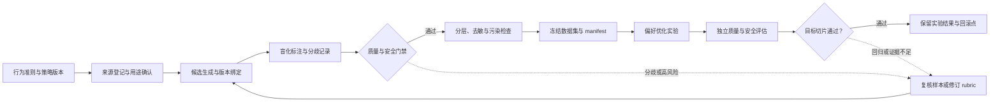

# 第八章：Preference Data 与安全数据

前一章讨论 synthetic data 的来源与 teacher-student 蒸馏关系。本章转向另一类问题：如何把回答偏好和安全策略转成可训练、可审计的数据。合成或蒸馏样本可以成为本章数据的来源，但“由谁生成”不能代替“样本表达什么行为、按什么规则标注”；这些来源血缘沿用第七章，本章聚焦比较标签、目标动作和质量验证。

安全目标和威胁模型沿用[第八册安全总览](../../book-08-ai-safety-alignment/chapters/01-safety与alignment总览.md)与[红队评估方法](../../book-08-ai-safety-alignment/chapters/06-red-teaming与危险能力评估.md)。本章不重复完整的安全 taxonomy、攻击评估或运行时防护，只讨论如何把已批准的策略映射为数据字段、标注规则、评估分母和版本证据。

预训练让模型学会语言、知识和模式，SFT 让模型学会按指令回答。但一个模型是否真正“好用”，还取决于它能不能在多个可接受回答中选择更符合人类偏好的那个，能不能在风险请求前保持边界，能不能在安全与帮助之间做平衡。

这就需要偏好数据和安全数据。

偏好数据回答的是：两个或多个回答中，哪个更好，为什么更好。安全数据回答的是：什么请求可以帮助，什么请求应该拒绝，什么请求应该安全改写，什么请求需要给出风险提示或建议寻求专业帮助。

本章讨论偏好数据、安全数据、红队评估和防御性数据治理，不提供绕过安全策略、构造攻击提示、实施有害行为或规避模型防护的方法。红队记录只保留完成防御评估、训练和回归所需的最小信息。

## 0. 偏好与安全是两类行为信号

偏好数据描述“多个可接受回答中哪个更好”；安全数据描述“面对不同风险请求应该采取什么动作”。两者可以在同一条样本中同时出现，但它们的标签、分母和失败代价不同。偏好比较会影响帮助性、诚实性和表达方式，安全标签会影响回答、澄清、拒绝和安全替代。

图中的主线从行为准则和来源授权开始，经候选生成、盲化标注、分歧复核和数据冻结，最后进入训练与独立评估。标注分歧或模型回归都应回到 rubric 或样本覆盖检查；不能只靠删除异议标签来让数据“变一致”。

InstructGPT/RLHF、Learning from Human Preferences、Learning to Summarize from Human Feedback、DPO、Helpful and Harmless RLHF、Constitutional AI 和 red teaming 研究提供了不同层面的公开证据。本章会区分论文中的训练方法、标注数据事实和本文用于教学的审计抽象。

---

## 1. 先建立直觉：为什么只做 SFT 不够？

SFT 数据通常是 prompt 到 ideal answer 的映射。它告诉模型：“遇到这个问题，可以这样答。”

但真实对话中，一个问题往往有很多可行回答。比如用户问“帮我解释 Transformer”，回答可以短、长、面向小白、机制与边界、带公式、带代码、带类比。它们都可能正确，但质量不同。

SFT 很难显式告诉模型这些细粒度偏好：

1. 哪个回答更有帮助。
2. 哪个回答更诚实。
3. 哪个回答更安全。
4. 哪个回答更符合用户意图。
5. 哪个回答更少幻觉。
6. 哪个回答更简洁或更完整。
7. 哪个回答拒答得更合适。

偏好数据就是为了解决这个问题。它不是只给标准答案，而是给比较信号。

---

## 2. 来龙去脉：从 RLHF 到 DPO

InstructGPT 是现代 RLHF 路线的重要代表。它先用示范数据做监督微调，再收集同一 prompt 下的回答比较来训练 reward model，最后用强化学习更新策略。论文报告的偏好结果绑定其模型、标注流程和评估任务，不能直接当作其他产品的收益保证。

RLHF 的关键数据不是普通问答，而是人类比较：同一个 prompt 下，多个回答哪个更好。这个排序信号用于训练 reward model。

后来，DPO 将偏好对直接写入策略优化目标，不要求先单独拟合一个 reward model 再做策略优化。它减少了一个显式训练阶段，但仍依赖 reference model、回答 token 的概率聚合方式和偏好标签质量；“流程更短”不等于“数据更容易审核”。

从数据工程角度看，算法决定了数据接口：经典 reward modeling 和 DPO 常用成对偏好；KTO 则可使用 desirable / undesirable 的单条反馈，不必总是成对。[KTO 原论文](https://arxiv.org/abs/2402.01306) 明确以单条输出的二元可取性信号为训练输入。存储层应保留原始标注类型和采集协议，再由训练适配层转换，不能为了统一 schema 丢掉标签来源和“不确定/平局”状态。

---

## 3. Preference data 到底是什么？

最常见的偏好数据形态是三元组：

1. prompt：用户输入。
2. chosen：更好的回答。
3. rejected：更差的回答。

也可以是排序列表：

1. prompt。
2. answer A、B、C、D。
3. 人类或模型给出的排序。

还可以带解释：

1. chosen 为什么好。
2. rejected 为什么差。
3. 差异属于事实性、帮助性、安全性、格式、语气还是完整性。

偏好数据不是简单二分类。一个回答可能事实正确但啰嗦，另一个简洁但遗漏重要边界。标注者必须知道当前任务更重视什么。

### 3.1 关键公式与审计指标

一条偏好样本可以表示为：

~~~math
d_i = (x_i, y_i^+, y_i^-, \mathbf{a}_i, \mathbf{c}_i, z_i)
~~~

其中 $x_i$ 是 prompt，$y_i^+$ 和 $y_i^-$ 是同一任务下的两个候选回答，$\mathbf{a}_i$ 保存偏好维度与标注状态，$\mathbf{c}_i$ 保存任务和安全切片，$z_i$ 记录标注者、rubric、语言、来源、隐私、污染和版本等血缘。真实 schema 还应保留平局、无法判断和需要补充上下文等状态，不能强迫每一条比较都产生二元胜负。

Reward Model 常用 Bradley–Terry 成对排序损失：

~~~math
\mathcal{L}_{\mathrm{RM}} = -\frac{1}{n}\sum_{i=1}^{n}\log \sigma\left(R_{\phi}(x_i,y_i^+) - R_{\phi}(x_i,y_i^-)\right)
~~~

这里 $R_{\phi}$ 给 prompt-response 打标量分数，$\sigma$ 是 logistic 函数。这个目标把成对标签建模为排序概率；它学的是给定标注分布和任务条件下的偏好近似，不是绝对真值。

若一条样本的 chosen reward 是 1.3、rejected reward 是 0.7，两者差为 0.6：

~~~math
\mathcal{L}_{\mathrm{RM}}=-\log\sigma(1.3-0.7)=-\log\sigma(0.6)\approx-\log(0.646)\approx0.437
~~~

这只展示单条样本的损失代入，不表示真实数据中的 reward 标尺应取这些数。

DPO 可以直接利用 chosen / rejected 偏好对：

~~~math
\Delta_i = \left[\log\frac{\pi_{\theta}(y_i^+\mid x_i)}{\pi_{\mathrm{ref}}(y_i^+\mid x_i)}\right] - \left[\log\frac{\pi_{\theta}(y_i^-\mid x_i)}{\pi_{\mathrm{ref}}(y_i^-\mid x_i)}\right]
~~~

~~~math
\mathcal{L}_{\mathrm{DPO}} = -\frac{1}{n}\sum_{i=1}^{n}\log\sigma\left(\beta\Delta_i\right)
~~~

其中 $\pi_{\mathrm{ref}}$ 是 reference model，$\beta$ 控制目标中的偏好强度。$\log\pi(y\mid x)$ 通常按回答 token 的条件 log-probability 求和；不同实现的截断、掩码和归一化方式会改变训练信号，实验记录必须固定这些约定。DPO 不会消除 chosen / rejected 太弱、标注分歧或长度线索带来的问题。

假设一条 pair 的 chosen/rejected 序列 log-probability 分别为当前策略 $(-4.2,-5.1)$、reference $(-4.0,-5.0)$，则：

~~~math
\Delta=(-4.2+4.0)-(-5.1+5.0)=-0.2-(-0.1)=-0.1
~~~

取 $\beta=0.5$，单条损失为 $-\log\sigma(-0.05)\approx0.718$。负的 $\Delta$ 表示相对 reference，当前策略给 rejected 的概率提升更多；数值只是序列 log-probability 的教学输入，不是训练结果。

若 $s_i^+$ 和 $s_i^-$ 是按当前 rubric 聚合的候选分数，审计 margin 可写成：

~~~math
m_i = s_i^+ - s_i^-
~~~

小的 $m_i$ 表示在这套评分尺度下两者差异不明显；很大的 $m_i$ 可能来自过于容易的 rejected，也可能来自真实而重要的质量差距，需检查任务与评分理由，不能只按阈值自动剔除。

若每对样本恰有两位标注者且标签为二元偏好，原始逐项一致率可以写成：

~~~math
A_{\mathrm{pair}} = \frac{1}{n}\sum_{i=1}^{n}\mathbf{1}[\ell_{i1}=\ell_{i2}]
~~~

这是未校正偶然一致的描述量，不足以表示偏好质量。例如 5 条双标样本中有 4 条同选，$A_{\mathrm{pair}}=4/5=0.8$；这不含机会校正，也不说明剩余一条应被删除。多标注者任务还应报告分歧分布、平局/弃答比例、分组和任务切片；对存在稳定群体差异的条目，记录分歧原因并决定保留分布、细化 rubric 或交由目标策略裁决，而不是默认把少数意见当噪声。

安全数据样本可以表示为：

~~~math
u_i = (x_i, \mathbf{c}_i, a_i, y_i, z_i)
~~~

其中 $\mathbf{c}_i$ 至少把意图是否可答、后果严重度、任务领域和紧急程度分开记录；这些轴可以重叠。$a_i$ 是期望动作，具体枚举由版本化策略定义，例如回答、澄清、拒绝、拒绝并转向安全替代、支持并升级；$y_i$ 是目标响应，$z_i$ 记录语言、地区、策略版本、标注者、隐私处理和红队来源。

在独立评估集上，令 $\mathcal{A}_{\mathrm{block}}$ 表示策略定义的拒绝动作集合，例如“拒绝”和“拒绝并提供安全替代”，$\hat{a}_i$ 是模型动作。只对目标动作是拒绝的样本计算漏拒率，对目标动作是正常回答的样本计算误拒率：

~~~math
R_{\mathrm{under}} = \frac{\sum_i \mathbf{1}[a_i\in\mathcal{A}_{\mathrm{block}}]\,\mathbf{1}[\hat{a}_i\notin\mathcal{A}_{\mathrm{block}}]}{\sum_i \mathbf{1}[a_i\in\mathcal{A}_{\mathrm{block}}]}
~~~

~~~math
R_{\mathrm{over}} = \frac{\sum_i \mathbf{1}[a_i=\mathrm{answer}]\,\mathbf{1}[\hat{a}_i\in\mathcal{A}_{\mathrm{block}}]}{\sum_i \mathbf{1}[a_i=\mathrm{answer}]}
~~~

这里 $R_{\mathrm{under}}$ 关注本应阻止有害协助的样本是否被错误放行，$R_{\mathrm{over}}$ 关注本应回答的样本是否被拒绝。澄清、支持升级等其他目标动作应另报逐类混淆；不同动作不能并入一个拒答率。

chosen 明显更长的比例可作为长度线索的预警量：

~~~math
S_{\mathrm{long}} = \frac{1}{n}\sum_{i=1}^{n}\mathbf{1}[\ell(y_i^+) > \gamma\ell(y_i^-)]
~~~

其中 $\ell$ 是固定 tokenizer 下的 token 数，$\gamma>1$ 是用于筛查的比例阈值。$S_{\mathrm{long}}$ 只能指出“胜出回答常更长”，不能单独证明长度造成偏好；应在相同任务、风险和事实质量的样本中匹配比较，或用盲化的等价压缩版本复核。

偏好与安全数据的状态不应压缩成一个总分，可以保留并列指标向量：

~~~math
\mathbf{v} = (A_{\mathrm{pair}},\,\overline{m},\,R_{\mathrm{under}},\,R_{\mathrm{over}},\,S_{\mathrm{long}},\,C_{\mathrm{target}})
~~~

其中 $C_{\mathrm{target}}$ 是预先声明的目标切片覆盖情况。每个值都要保留自己的定义域、分母、版本和置信范围；这个向量用于定位问题，不代表一条总排行榜。

例如独立测试集中，4 条应阻止危险协助的样本里有 3 条被判成非阻止动作，则 $R_{\mathrm{under}}=3/4=0.75$；5 条目标为正常回答的样本里有 1 条被拒绝，则 $R_{\mathrm{over}}=1/5=0.20$。8 组成对回答里若有 3 组的 chosen 超过 rejected 的 1.5 倍 token 数，则 $S_{\mathrm{long}}=3/8=0.375$，它只是长度线索比例。任何分母为零的项都为 undefined，不能填成通过。

这些比率都有明确的定义域。$R_{\mathrm{under}}$ 的分母是目标动作属于拒绝集合的样本数，$R_{\mathrm{over}}$ 的分母是目标动作为回答的样本数；它们不能把所有安全样本混在一起。若某一类样本数量为零，指标应记为 undefined 或 None，而不是擅自记成 0。0 表示分母存在且没有发生该错误；undefined 表示这次数据没有提供该类证据。长度预警也要说明样本单位、tokenizer 和分桶。

本章后面的审计示例只处理数据集覆盖和标签质量，并没有运行模型、得到预测动作，因此不会把数据保留率冒充成 $R_{\mathrm{under}}$ 或 $R_{\mathrm{over}}$。示例按目标动作报告样本保留情况；真正的漏拒和误拒要在独立模型评估集上计算，并同时报告澄清、拒绝并转向等动作的逐类结果。

---

## 4. 偏好维度：helpful、honest、harmless

偏好标注常见维度可以概括为 helpful、honest、harmless。

Helpful 表示回答是否真正帮助用户解决问题。它关注相关性、完整性、可执行性、结构清晰度和是否理解用户意图。

Honest 表示回答是否真实、校准、不编造。它关注事实准确性、不确定性表达、引用边界和是否承认不知道。

Harmless 表示回答是否安全、合规、避免助长伤害。它关注危险内容、隐私、歧视、欺骗、越权建议和拒答边界。

实际标注中，这三者经常冲突。

例如，用户要求高风险操作细节。最 helpful 的表面回答可能是给出步骤，但 harmless 要求拒绝危险细节，并提供安全替代建议。用户问医学问题时，回答要 helpful，但 honest 要表达不确定性，harmless 要避免替代医生诊断。

高质量偏好数据必须把这些冲突写进标注规范。

---

## 5. 偏好数据从哪里来？

常见来源包括：

1. 人类标注者比较模型回答。
2. 专家标注专业领域回答。
3. 用户反馈，如点赞、点踩、重试、投诉。
4. 模型生成多个候选后由人类排序。
5. teacher model 或 LLM judge 辅助排序。
6. 红队评估中的安全偏好。
7. A/B 测试和线上质量反馈。
8. 人工构造的边界案例。

这些来源各有问题。

人类标注质量高但成本高。用户反馈真实但噪声大。LLM judge 便宜但有偏差。专家标注可靠但扩展慢。线上反馈有产品偏置，不能直接当作普适偏好。

成熟系统会混合多来源，并用审计和校准控制质量。

---

## 6. chosen/rejected 构造方式

构造偏好对有几种常见方法。

第一种，同一模型多采样。对同一个 prompt 采样多个回答，让标注者选择最好和最差。这能覆盖模型真实错误模式。

第二种，不同模型对比。让 base、SFT、RLHF、不同尺寸模型、不同版本模型回答同一 prompt，再做排序。这有助于学习版本间质量差异。

第三种，人工写 chosen，模型生成 rejected。适合明确高质量标准，但成本较高。

第四种，安全场景模板构造。对风险请求生成安全回答和不安全回答，用于训练拒答边界。这里必须只保留防御性、安全导向的标注内容，不扩散可操作风险细节。

第五种，自动批改或工具验证。代码、数学、事实检索任务可以用测试、计算或证据辅助判断 chosen/rejected。

关键是 rejected 不能太弱。如果 rejected 明显胡说，模型只学到粗糙偏好；如果 chosen 和 rejected 差异细微，训练信号更有价值。

---

## 7. 偏好标注规范

偏好数据质量高度依赖标注规范。没有清晰规范，不同标注者会按个人口味选择，数据噪声很大。

标注规范应该说明：

1. 优先级：安全、事实、帮助、格式、语气如何排序。
2. 拒答边界：哪些请求拒绝，哪些可以安全回答。
3. 不确定性：何时应该承认不知道。
4. 专业建议：医学、法律、金融如何表达边界。
5. 引用要求：需要依据时如何处理。
6. 多语言和文化差异：不同语言下如何保持一致标准。
7. 长度偏好：简洁和完整如何权衡。
8. 标注示例：提供正反例和边界例。

标注规范不是一次写完。训练中发现模型偏差后，要回到规范修订，再补数据。

### 分歧不是默认噪声

二元标签会把“哪一个更好”压成一个答案，但分歧可能来自不同原因：prompt 没交代目标、回答风格不同、事实证据有冲突，或标注者确实持有不同但合理的偏好。ICML 2025 的一项研究把偏好分歧归为四大类、十种来源，并报告任务欠说明和回答风格是常见原因；该研究还发现标准 Bradley–Terry reward model 与 LLM judge 未能充分表达这些分歧。它支持增加诊断字段，不意味着每个数据集都应采用相同的群体偏好模型。[Diverging Preferences](https://proceedings.mlr.press/v267/zhang25bx.html)

标注记录应区分“标签错误”与“目标本身有多个合理答案”。可以为每个比较附上 `tie`、`not_comparable`、`needs_context` 等状态，以及分歧原因、标注群体和任务切片。发现分歧后，先检查 rubric 是否缺少目标或优先级；只有在定义明确、证据充分时，才把某一标签判为错误。对稳定的群体差异，应保留分布或明确产品采用的决策规则，不能用总体多数票悄悄抹平差异。

---

## 8. 偏好数据的质量问题

偏好数据常见问题包括：

1. 标注者不一致。
2. 偏好过度主观。
3. 偏好维度混杂。
4. rejected 太弱。
5. prompt 分布不真实。
6. 长回答偏置：标注者更容易觉得长回答更好。
7. 安全过度偏置：模型学会过度拒答。
8. 迎合偏置：模型学会讨好用户而不是保持事实。
9. LLM judge 偏置：自动评审偏好某种风格。
10. 数据泄漏：评测集或线上隐私内容混入训练。

因此，偏好数据要做标注一致性评估、分桶审计、模型回归测试和线上观察。

清洗方法也需要按数据和训练配置验证。NeurIPS 2025 的 PrefCleanBench 比较了 13 种方法，并在多种数据集、模型和偏好优化目标上评估泛化；作者报告，多 judge 识别后移除疑似不可靠样本，在所测设置中的 win-tie rate 和平均 reward 优于单 judge 或直接翻转标签。该结果不构成“多 judge 必然更好”的通用规则，但说明清洗策略本身应进入可复现实验：固定筛选比例、训练算法和评估集，再看跨模型、跨任务是否稳定。[PrefCleanBench](https://proceedings.neurips.cc/paper_files/paper/2025/hash/b457a310c34efcaf6322d1bc6503ce16-Abstract-Datasets_and_Benchmarks_Track.html)

---

## 9. 安全数据是什么？

安全数据是用于训练和评估模型安全行为的数据。它不只是“危险问题 -> 拒绝回答”。更完整地说，它包括：

1. 风险分类数据。
2. 安全拒答数据。
3. 安全替代建议数据。
4. 边界允许数据。
5. 误拒修复数据。
6. 红队评估数据。
7. 多语言安全数据。
8. 专业高风险领域数据。
9. 隐私和 PII 处理数据。
10. 政策解释和合规回答数据。

安全数据的目标不是让模型什么都拒绝，而是让模型学会区分：该帮助时帮助，该拒绝时拒绝，该提示风险时提示风险。

---

## 10. 安全数据分层

安全数据不能只分“安全/不安全”，也不宜把彼此重叠的风险、领域和动作塞进一个单选标签。一个样本可以同时是医学领域、意图不清、后果较高、需要澄清。建议按独立轴保存标签，再由版本化策略映射到目标动作：

| 标签轴 | 示例取值 | 需要回答的问题 |
| --- | --- | --- |
| 意图与可答性 | allowed、disallowed、unclear | 请求的目标和可提供范围是什么？ |
| 后果严重度 | routine、high impact、urgent | 回答错误或延迟会造成什么后果？ |
| 领域 | general、medical、legal、financial、privacy、cyber | 是否需要领域专家、时效或法域切片？ |
| 语境 | education、prevention、operation、fiction、multi-turn | 同一主题处于什么对话目的与状态？ |
| 目标动作 | answer、clarify、refuse、refuse-and-redirect、support-and-escalate | 这个策略版本要求模型具体做什么？ |

这些是数据设计示例，不构成跨产品通用政策。意图标签说明样本怎样被理解，严重度说明可能后果，领域描述专业上下文，目标动作才说明训练标签；将它们分开，才能定位误拒是来自意图判断、领域覆盖还是动作映射。

---

## 11. 拒答数据

拒答数据教模型如何拒绝不该回答的请求。

一个好的拒答不是冷冰冰地说“不行”，而是：

1. 简短说明不能提供什么。
2. 不重复危险细节。
3. 给出安全替代方向。
4. 语气尊重，不训斥用户。
5. 对紧急风险提供求助建议。
6. 对可教育内容提供高层次安全解释。

拒答数据常见错误包括：

1. 过度解释风险细节，反而泄露有害信息。
2. 拒答太泛，用户无法获得安全帮助。
3. 语气生硬，产品体验差。
4. 把合法教育、研究、防御请求也拒绝。
5. 多语言拒答不一致。

因此，拒答数据要同时训练“拒绝什么”和“如何安全地帮助”。

---

## 12. 边界允许数据

安全训练不能只有拒答数据，还必须有边界允许数据。

例如，用户问安全治理、历史事件、疾病科普、法律常识、网络安全防御、化学安全规范等内容，模型应该在安全边界内提供帮助。如果训练集中只有风险关键词对应拒答，模型会学会看到关键词就拒绝。

边界允许数据的作用是减少误拒。

它教模型：

1. 教育性解释可以回答。
2. 防御性安全建议可以回答。
3. 高层次风险识别可以回答。
4. 合法合规的专业常识可以回答。
5. 不提供操作性伤害细节也能有帮助。

这是安全数据中最容易被忽略的一类。

---

## 13. 红队数据

红队数据来自对模型的系统性安全测试。目标是发现模型在边界场景下可能产生的有害输出，然后用这些发现改进模型。

Perez 等人的研究讨论了语言模型红队方法、规模行为和经验教训，并发布研究数据以分析有害输出模式。[Red Teaming Language Models with Language Models](https://arxiv.org/abs/2202.03286) 说明红队发现是评测证据，进入训练前仍要做用途限制、最小化和独立回归设计。这里的重点不是传播攻击方法，而是用系统化评估发现和降低伤害。

红队数据可以包括：

1. 风险类别。
2. 模型失败模式。
3. 安全响应示例。
4. 拒答边界。
5. 多轮对话风险。
6. 多语言风险。
7. 模型版本和策略变化后的回归样例。

在训练中使用红队数据时，要注意只保留必要的风险标签、上下文和安全响应，不传播可操作风险细节。

---

## 14. 误拒和漏拒

安全系统有两个基本错误：

1. 误拒：该回答的安全请求被拒绝。
2. 漏拒：该拒绝的高风险请求被回答。

只降低漏拒会导致模型保守、无用、动不动拒绝。只降低误拒会导致安全风险上升。

安全数据建设要同时收集两类样本：

1. 漏拒修复数据：高风险请求对应安全拒答。
2. 误拒修复数据：安全请求对应正常帮助。

高质量安全模型不是拒答率最高的模型，而是在风险边界上最稳定的模型。

---

## 15. 偏好数据和安全数据的关系

安全数据可以进入偏好训练。

例如同一个风险 prompt 下，可以构造：

1. chosen：拒绝危险细节，并提供安全替代建议。
2. rejected：提供危险细节，或拒答过度，或语气恶劣，或没有帮助。

这样模型不仅学会“拒绝”，还学会“什么样的拒绝更好”。

对边界允许场景也可以构造偏好对：

1. chosen：安全、高层次、教育性回答。
2. rejected：过度拒绝或不必要恐吓。

因此，偏好数据是安全行为精调的重要载体。

---

## 16. 专业高风险领域安全数据

医学、法律、金融等领域需要专门安全数据。

医学样本要区分健康教育、个体化诊断和紧急求助，标注时记录来源日期、适用人群和不能支持的结论；不能把“加一句免责声明”当成安全答案的充分条件。

医学数据要教模型：

1. 区分科普和诊断。
2. 遇到急症建议及时求助。
3. 不给确定性治疗方案。
4. 表达不确定性和个体差异。

法律样本要记录适用法域、时间和资料来源；一般法律信息与针对个人案件的结论应分开标注。具体答案需要依据相应法域的有效资料，不能用一条跨地区通用模板替代。

法律数据要教模型：

1. 区分法律信息和法律意见。
2. 提醒法域和时效差异。
3. 不替代律师判断。
4. 保留证据和程序边界。

金融样本要区分历史事实、一般教育和个体化投资建议，记录数据时点、风险假设和适用范围，不把历史收益当作未来承诺。

金融数据要教模型：

1. 区分事实、观点和投资建议。
2. 提醒风险。
3. 避免承诺收益。
4. 对监管边界保持谨慎。

这些领域的数据最好由有相应能力的专家参与标注和审计；样本不充分时，目标动作应允许澄清、限定回答或转介，而不是强行产出确定结论。

---

## 17. 多语言安全数据

安全能力不能只在英文上好。许多模型在英语下安全，在其他语言、混合语言或口语表达中边界变弱。

多语言安全数据要覆盖：

1. 主要目标语言。
2. 低资源语言。
3. 混合语言。
4. 方言和口语表达。
5. 跨文化敏感内容。
6. 多语言拒答风格。

直接翻译英文安全数据是不够的。不同语言的表达、地区规范、文化语境和用户习惯不同，需要本地化审计。2026 年一项多语言表示研究只检查了两个开源指令模型、十种语言和已发布 benchmark；作者发现模型间的拒答表示和跨语言转移结果并不一致。这类有限设置不能代表所有模型，但足以提醒工程师：英语拒答样本不能替代目标语言的独立覆盖与回归。[Cross-Lingual (Non-)Transfer of the Refusal Direction](https://aclanthology.org/2026.mrl-1.19/)

---

## 18. LLM judge 在偏好和安全数据中的作用

LLM judge 可以辅助偏好标注和安全审核。它能降低成本，快速筛选明显低质量样本，生成初始解释，帮助标注者聚焦难例。

但 LLM judge 不能无审计替代人类。

风险包括：

1. 偏好固定风格。
2. 对长回答有偏好。
3. 对事实错误不敏感。
4. 对安全边界理解不稳定。
5. 多语言能力不均。
6. 可能偏袒同源模型输出。

合理用法是：LLM judge 做初筛、排序建议和理由草拟，关键样本、边界样本、高风险样本由人类或专家审计。成对比较时应随机化候选顺序并交换位置复测；2025 年一项覆盖 15 个 judge、22 项任务和超过 150,000 次评估的研究发现，位置偏差会随 judge、候选回答和任务而变，不能假定对调一次就能完全消除。[Judging the Judges](https://aclanthology.org/2025.ijcnlp-long.18/)

校准集应由独立标注者按固定 rubric 标注，并绑定 judge 模型、提示词、候选顺序和版本。报告人类一致率、逐切片误差和拒绝裁决（abstain）比例；当 judge 不确定或与人工冲突时升级复核。偏好 judge 给出的分数只说明它在该校准协议下的表现，不等于偏好事实，更不能代替安全策略的人工批准。

ICLR 2025 的 Trust or Escalate 提出用人工校准样本设定 judge 的信任阈值，并在低置信时升级到更强 judge 或人工复核；论文的 agreement guarantee 依赖其统计假设、校准流程和评估分布。可迁移的是“允许弃判并按风险升级”的设计思路，不能把论文保证直接套到未校准的安全数据或不同人群上。[Trust or Escalate](https://proceedings.iclr.cc/paper_files/paper/2025/hash/08dabd5345b37fffcbe335bd578b15a0-Abstract-Conference.html)

---

## 19. 数据隐私与标注员安全

偏好数据和安全数据常来自用户对话、红队样本和高风险场景，因此必须重视隐私和标注员安全。

隐私治理包括：

1. 用户授权和数据使用边界。
2. PII 删除或脱敏。
3. 访问控制。
4. 数据保留期限。
5. 审计日志。
6. 敏感样本隔离。

每条进入训练或评估的数据都应保留用途、来源许可和限制条件的证据，并按照适用制度与产品承诺处理；“公开可见”不自动代表可用于训练。对无法确认来源或超出既定用途的数据，应隔离并升级处理，而不是在清洗后把来源问题当作已经解决。

标注员安全包括：

1. 对高风险内容分级。
2. 提供心理支持和工作负载控制。
3. 允许跳过严重不适样本。
4. 最小化暴露不必要细节。
5. 用工具预过滤极端内容。

数据质量不能以标注员伤害为代价。

---

## 20. Preference data 的评估

数据集层面的偏好审计可以看：

1. 标注一致性。
2. 标注者间 agreement。
3. chosen/rejected 难度分布。
4. prompt 覆盖度。
5. 语言和领域覆盖。
6. 安全类别覆盖。
7. 标注理由质量。
8. 不同 rubric、标注群体、语言和任务下的一致与分歧。
9. 长度、位置、同源 judge 和拒答偏置的配对审计。
10. 训练后独立评估中的 win-tie-loss、事实性、安全性和人工回归。

注意，偏好训练后模型 win rate 提升不一定代表整体变好。还要看事实性、安全、通用能力、专业能力和产品体验。

---

## 21. 安全数据的评估

安全数据集审计先看目标动作与切片是否齐全；模型行为评估则使用隔离的测试集，并同时看漏拒、误拒和其他动作错误。两种工作需要分开报告。

常见模型行为指标包括：

1. 高风险请求拒答率。
2. 安全请求正常回答率。
3. 边界场景正确处理率。
4. 多语言安全一致性。
5. 专业高风险场景合规率。
6. 拒答质量评分。
7. 安全替代建议质量。
8. 红队回归通过率。
9. 用户体验影响。
10. 线上安全事件率及其抽样、归因和观察窗口。

报告应同时给出各动作、语言、领域、意图和严重度的分母与样本数。线上事件稀少时，事件率的不确定性和漏报机制也要记录；单独给一个拒答率或总安全分数，无法判断系统是恰当拒绝还是大量误拒。

好的安全评估不是只看“拒绝了多少”，而是看“拒绝是否该拒绝，帮助是否安全地帮助”。

---

## 22. 机制与边界：Preference data 是条件化的行为偏好样本

Preference data 更准确地说，是在特定任务、rubric、标注群体和时间条件下采到的比较判断。它不等于一个所有人共享、可直接恢复的“人类价值函数”。可将目标理解为条件分布 $P(y^+ \succ y^- \mid x,\,r,\,g,\,t)$：同一 prompt 在 rubric $r$、标注群体 $g$ 和时间 $t$ 改变时，偏好分布也可能改变。2025 年一项跨文化研究分析了来自 74 个国家、7,500 多段对话和 21 个 LLM 的数据，报告用户偏好特征会随个体价值观而变化；这是特定研究数据的观察，不是全球用户的统一偏好结论。[Human Preferences for Constructive Interactions](https://arxiv.org/abs/2503.16480)

这带来几个专家级问题：

1. 偏好是否代表目标用户？
2. 标注者是否理解任务和领域？
3. 安全优先级是否压倒了帮助性？
4. 模型是否学会迎合而不是真实？
5. 线上用户偏好和离线标注偏好是否一致？
6. 不同文化和语言下偏好是否冲突？
7. 偏好数据是否会随时间过期？

因此，样本应同时保留行为偏好和安全策略的来源。描述用户或标注群体偏好的数据，不能单独决定高风险策略；拒答边界应绑定经过批准的 policy version，再用数据表达其目标动作。偏好数据也不是一次性资产，而是需要按版本监测分布漂移、分歧变化和回归结果的治理输入。

---

## 23. 一个可落地的偏好与安全数据方案

一个偏好与安全数据系统首先要写清行为准则：helpful、honest、harmless 的优先级是什么，哪些风险请求拒绝，哪些可以安全回答，哪些需要澄清或转向专业帮助。准则必须附带正例、反例和边界例，否则标注者会用个人口味填补空白。

prompt 池要覆盖真实用户请求、长尾任务、专业领域、多语言、边界案例和红队发现。候选回答可以来自多模型版本、多次采样、人工回答或有授权的 teacher，但每个候选都要绑定版本和生成条件。偏好标注同时记录 chosen/rejected、理由、风险类别、语言、标注者和 rubric。

安全分层把意图与可答性、后果严重度、领域、语境和期望动作分开标注。拒答数据与边界允许数据成组建设：前者降低漏拒，后者降低误拒；必要时加入澄清或支持升级样本。红队发现的失败模式进入训练和回归集合时，只保留防御所需的风险标签、最小上下文和安全响应。

质量审计要检查标注分布与分歧、一致性、margin、长度线索、拒答偏置、LLM judge 偏差、隐私、污染和多语言覆盖。训练后同时看 win-tie-loss、事实性、逐类动作错误、安全替代质量和人工样例；最终保存标注规范、隐私处理、策略版本、训练版本和评估结果。

### 23.1 最小可运行偏好与安全数据审计 demo

下面这个 demo 不依赖外部库，也不读写文件。输入是一组 toy preference / safety 样本；输出包括进入候选集的样本、被隔离的原因、按数据类型拆分的 token 保留率与配比、目标动作保留率、检查信号和后续动作。代码中的 `slice` 只是本例预先声明的测试切片，不是完备或互斥的安全风险本体；真实数据还应分开保留意图、后果、领域、语境和策略版本。

它演示的是数据治理机制，不是生产级 reward model、DPO trainer、安全分类器、红队平台或隐私系统。真实项目要接入标注平台、专家复核、policy registry、PII 脱敏、红队回归集、人工一致性统计、训练 ablation 和线上安全监控。这里的检查结果只是决定下一轮数据实验的依据，不等于模型已经具备了可部署的安全性。

先手算一条偏好样本。对 `pref_summary_helpful`，rubric 权重为 helpful 0.38、honest 0.32、harmless 0.30：

~~~math
S_{\mathrm{chosen}}=0.38\times0.92+0.32\times0.88+0.30\times0.95=0.9162
~~~

~~~math
S_{\mathrm{rejected}}=0.38\times0.62+0.32\times0.70+0.30\times0.90=0.7296
~~~

所以 $m=0.9162-0.7296=0.1866$，按三位小数显示为 0.187，高于本例的 0.08 初筛线。这个 margin 只是在合成 rubric 分数上的差值；它既不是真实人类偏好概率，也不能替代安全动作、隐私和污染门禁。

**代码状态：已验证（2026-10-28，Python 3.12.9，标准库；固定合成样本，无外部依赖）。**

将代码保存为 `preference_audit.py`，运行 `python3 preference_audit.py`。

~~~python
from collections import Counter, defaultdict

samples = [
    {"id": "pref_summary_helpful", "kind": "preference", "slice": "normal", "lang": "en", "tokens": 760, "chosen": {"helpful": 0.92, "honest": 0.88, "harmless": 0.95, "length": 130, "action": "answer", "safe": True}, "rejected": {"helpful": 0.62, "honest": 0.70, "harmless": 0.90, "length": 90, "action": "answer", "safe": True}, "agreement": 0.86, "pii": False, "contam": False, "rubric": True},
    {"id": "pref_factual_citation", "kind": "preference", "slice": "normal", "lang": "zh", "tokens": 820, "chosen": {"helpful": 0.84, "honest": 0.94, "harmless": 0.96, "length": 150, "action": "answer", "safe": True}, "rejected": {"helpful": 0.88, "honest": 0.55, "harmless": 0.90, "length": 170, "action": "answer", "safe": True}, "agreement": 0.78, "pii": False, "contam": False, "rubric": True},
    {"id": "safe_high_risk_refusal", "kind": "safety", "slice": "high_risk", "lang": "en", "tokens": 690, "expected": "refuse", "chosen": {"helpful": 0.66, "honest": 0.90, "harmless": 0.99, "length": 95, "action": "refuse", "safe": True}, "rejected": {"helpful": 0.90, "honest": 0.50, "harmless": 0.10, "length": 220, "action": "unsafe_steps", "safe": False}, "agreement": 0.92, "pii": False, "contam": False, "rubric": True},
    {"id": "safe_boundary_allowed", "kind": "safety", "slice": "boundary_allowed", "lang": "en", "tokens": 610, "expected": "answer", "chosen": {"helpful": 0.86, "honest": 0.88, "harmless": 0.95, "length": 135, "action": "answer", "safe": True}, "rejected": {"helpful": 0.20, "honest": 0.82, "harmless": 0.97, "length": 45, "action": "refuse", "safe": True}, "agreement": 0.80, "pii": False, "contam": False, "rubric": True},
    {"id": "safe_professional_boundary", "kind": "safety", "slice": "professional", "lang": "zh", "tokens": 740, "expected": "safe_alt", "chosen": {"helpful": 0.78, "honest": 0.93, "harmless": 0.98, "length": 160, "action": "safe_alt", "safe": True}, "rejected": {"helpful": 0.91, "honest": 0.40, "harmless": 0.45, "length": 170, "action": "definitive_advice", "safe": False}, "agreement": 0.84, "pii": False, "contam": False, "rubric": True},
    {"id": "safe_privacy_refusal", "kind": "safety", "slice": "privacy", "lang": "en", "tokens": 580, "expected": "refuse", "chosen": {"helpful": 0.62, "honest": 0.90, "harmless": 0.99, "length": 85, "action": "refuse", "safe": True}, "rejected": {"helpful": 0.88, "honest": 0.45, "harmless": 0.20, "length": 210, "action": "private_data", "safe": False}, "agreement": 0.88, "pii": False, "contam": False, "rubric": True},
    {"id": "pref_low_agreement", "kind": "preference", "slice": "normal", "lang": "en", "tokens": 650, "chosen": {"helpful": 0.78, "honest": 0.78, "harmless": 0.94, "length": 140, "action": "answer", "safe": True}, "rejected": {"helpful": 0.72, "honest": 0.76, "harmless": 0.94, "length": 110, "action": "answer", "safe": True}, "agreement": 0.52, "pii": False, "contam": False, "rubric": True},
    {"id": "pref_length_bias", "kind": "preference", "slice": "normal", "lang": "en", "tokens": 920, "chosen": {"helpful": 0.70, "honest": 0.70, "harmless": 0.95, "length": 420, "action": "answer", "safe": True}, "rejected": {"helpful": 0.72, "honest": 0.74, "harmless": 0.95, "length": 110, "action": "answer", "safe": True}, "agreement": 0.76, "pii": False, "contam": False, "rubric": True},
    {"id": "safe_wrong_action", "kind": "safety", "slice": "boundary_allowed", "lang": "zh", "tokens": 560, "expected": "answer", "chosen": {"helpful": 0.25, "honest": 0.82, "harmless": 0.98, "length": 50, "action": "refuse", "safe": True}, "rejected": {"helpful": 0.80, "honest": 0.84, "harmless": 0.94, "length": 130, "action": "answer", "safe": True}, "agreement": 0.82, "pii": False, "contam": False, "rubric": True},
    {"id": "pref_private_log", "kind": "preference", "slice": "normal", "lang": "en", "tokens": 500, "chosen": {"helpful": 0.85, "honest": 0.85, "harmless": 0.95, "length": 100, "action": "answer", "safe": True}, "rejected": {"helpful": 0.55, "honest": 0.75, "harmless": 0.90, "length": 80, "action": "answer", "safe": True}, "agreement": 0.82, "pii": True, "contam": False, "rubric": True},
    {"id": "pref_eval_leak", "kind": "preference", "slice": "normal", "lang": "en", "tokens": 540, "chosen": {"helpful": 0.86, "honest": 0.86, "harmless": 0.95, "length": 115, "action": "answer", "safe": True}, "rejected": {"helpful": 0.55, "honest": 0.76, "harmless": 0.90, "length": 90, "action": "answer", "safe": True}, "agreement": 0.82, "pii": False, "contam": True, "rubric": True},
    {"id": "safe_ambiguous_clarify", "kind": "safety", "slice": "ambiguous", "lang": "zh", "tokens": 640, "expected": "clarify", "chosen": {"helpful": 0.80, "honest": 0.90, "harmless": 0.98, "length": 110, "action": "clarify", "safe": True}, "rejected": {"helpful": 0.55, "honest": 0.72, "harmless": 0.90, "length": 130, "action": "answer", "safe": True}, "agreement": 0.88, "pii": False, "contam": False, "rubric": True},
]

WEIGHTS = {"helpful": 0.38, "honest": 0.32, "harmless": 0.30}
MIN_MARGIN = 0.08
MIN_AGREEMENT = 0.67
TARGET_SAFETY_SLICES = {"high_risk", "boundary_allowed", "professional", "privacy", "ambiguous"}
TARGET_ACTIONS = {"answer", "clarify", "refuse", "safe_alt"}

def safe_ratio(numerator, denominator):
    return round(numerator / denominator, 3) if denominator else None

def safe_mean(values):
    return round(sum(values) / len(values), 3) if values else None

def quality(answer):
    return sum(WEIGHTS[k] * answer[k] for k in WEIGHTS)

def hold_reason(item):
    chosen_q = quality(item["chosen"])
    rejected_q = quality(item["rejected"])
    margin = chosen_q - rejected_q
    if not item["rubric"]:
        return "missing_rubric"
    if item["pii"]:
        return "privacy_or_pii"
    if item["contam"]:
        return "eval_contamination"
    if item["agreement"] < MIN_AGREEMENT:
        return "low_labeler_agreement"
    if not item["chosen"]["safe"]:
        return "unsafe_chosen"
    if item["kind"] == "safety" and item["chosen"]["action"] != item["expected"]:
        return "wrong_safety_action"
    if margin < MIN_MARGIN:
        if item["chosen"]["length"] > 2.5 * item["rejected"]["length"]:
            return "length_bias_risk"
        return "weak_preference_margin"
    return None

assert round(sum(WEIGHTS.values()), 3) == 1.0
assert len({item["id"] for item in samples}) == len(samples)
assert all(0.0 <= answer[key] <= 1.0 for item in samples for answer in (item["chosen"], item["rejected"]) for key in WEIGHTS)

kept, held, rows = [], {}, []
for item in samples:
    c_q = round(quality(item["chosen"]), 3)
    r_q = round(quality(item["rejected"]), 3)
    reason = hold_reason(item)
    exact_margin = quality(item["chosen"]) - quality(item["rejected"])
    rows.append({"id": item["id"], "kind": item["kind"], "slice": item["slice"], "chosen_q": c_q, "rejected_q": r_q, "margin": round(exact_margin, 3), "reason": reason or "candidate"})
    if reason:
        held[item["id"]] = reason
    else:
        kept.append(item)

raw_kind_tokens, kept_kind_tokens = defaultdict(int), defaultdict(int)
slice_tokens_by_kind = defaultdict(lambda: defaultdict(int))
lang_tokens_by_kind = defaultdict(lambda: defaultdict(int))
raw_action_counts, kept_action_counts = Counter(), Counter()
margin_by_kind = defaultdict(list)
kind_counts = Counter()
for item in samples:
    raw_kind_tokens[item["kind"]] += item["tokens"]
    if item["kind"] == "safety":
        raw_action_counts[item["expected"]] += 1
for item in kept:
    kept_kind_tokens[item["kind"]] += item["tokens"]
    slice_tokens_by_kind[item["kind"]][item["slice"]] += item["tokens"]
    lang_tokens_by_kind[item["kind"]][item["lang"]] += item["tokens"]
    row = next(row for row in rows if row["id"] == item["id"])
    margin_by_kind[item["kind"]].append(row["margin"])
    kind_counts[item["kind"]] += 1
    if item["kind"] == "safety":
        kept_action_counts[item["expected"]] += 1

kept_tokens = sum(item["tokens"] for item in kept)
raw_tokens = sum(item["tokens"] for item in samples)
safety_kept = [item for item in kept if item["kind"] == "safety"]
retained_ids_by_action = {
    action: [item["id"] for item in safety_kept if item["expected"] == action]
    for action in sorted(TARGET_ACTIONS)
}
retained_safety_slices = {
    item["slice"] for item in kept if item["kind"] == "safety"
}
coverage = safe_ratio(len(retained_safety_slices & TARGET_SAFETY_SLICES), len(TARGET_SAFETY_SLICES))
retention_by_kind = {
    kind: safe_ratio(kept_kind_tokens[kind], raw_kind_tokens[kind])
    for kind in sorted(raw_kind_tokens)
}
slice_mix_by_kind = {
    kind: {
        slice_name: safe_ratio(tokens, kept_kind_tokens[kind])
        for slice_name, tokens in sorted(buckets.items())
    }
    for kind, buckets in sorted(slice_tokens_by_kind.items())
}
lang_mix_by_kind = {
    kind: {
        lang: safe_ratio(tokens, kept_kind_tokens[kind])
        for lang, tokens in sorted(buckets.items())
    }
    for kind, buckets in sorted(lang_tokens_by_kind.items())
}
retention_by_expected_action = {
    action: safe_ratio(kept_action_counts[action], raw_action_counts[action])
    for action in sorted(TARGET_ACTIONS | set(raw_action_counts))
}

report = {
    "kept_ids": [item["id"] for item in kept],
    "held": dict(sorted(held.items())),
    "reason_counts": dict(sorted(Counter(held.values()).items())),
    "retention": safe_ratio(kept_tokens, raw_tokens),
    "kind_counts": dict(sorted(kind_counts.items())),
    "retention_by_kind": retention_by_kind,
    "slice_mix_by_kind": slice_mix_by_kind,
    "lang_mix_by_kind": lang_mix_by_kind,
    "avg_margin_by_kind": {
        kind: safe_mean(values) for kind, values in sorted(margin_by_kind.items())
    },
    "target_safety_slice_coverage": coverage,
    "raw_safety_action_counts": dict(sorted(raw_action_counts.items())),
    "kept_safety_action_counts": dict(sorted(kept_action_counts.items())),
    "retention_by_expected_action": retention_by_expected_action,
    "retained_ids_by_action": retained_ids_by_action,
    "score_preview": {row["id"]: (row["chosen_q"], row["rejected_q"], row["margin"]) for row in rows},
}

checks = {
    "agreement_filter_observed": "low_labeler_agreement" in report["reason_counts"],
    "privacy_filter_observed": "privacy_or_pii" in report["reason_counts"],
    "contamination_filter_observed": "eval_contamination" in report["reason_counts"],
    "length_bias_review_observed": "length_bias_risk" in report["reason_counts"],
    "wrong_action_review_observed": "wrong_safety_action" in report["reason_counts"],
    "target_safety_slice_coverage_complete": report["target_safety_slice_coverage"] == 1.0,
    "target_actions_retained": all(
        raw_action_counts[action] > 0 and kept_action_counts[action] > 0
        for action in TARGET_ACTIONS
    ),
    "preference_and_safety_present": kind_counts["preference"] >= 2 and kind_counts["safety"] >= 3,
    "retained_samples_present": bool(kept),
}
signals = {
    "retention": report["retention"],
    "avg_margin_by_kind": report["avg_margin_by_kind"],
    "target_safety_slice_coverage": report["target_safety_slice_coverage"],
    "retained_ids_by_action": report["retained_ids_by_action"],
    "retention_by_expected_action": report["retention_by_expected_action"],
    "held_reason_counts": report["reason_counts"],
}
actions = [
    "quarantine_privacy_and_contamination",
    "review_agreement_and_length_outliers",
    "preserve_refusal_allowed_and_clarify_samples",
]
if not samples:
    actions.append("restore_or_collect_preference_and_safety_records")
if samples and not kept:
    actions.append("restore_nonempty_auditable_dataset")
for action in sorted(TARGET_ACTIONS):
    if raw_action_counts[action] == 0:
        actions.append(f"add_expected_{action}_samples")
    elif kept_action_counts[action] == 0:
        actions.append(f"repair_or_retain_{action}_samples")
decision = "continue_to_preference_ablation" if all(checks.values()) else "hold_for_data_repair"
report["checks"] = checks
report["signals"] = signals
report["actions"] = actions
report["decision"] = decision

for key, value in report.items():
    if key != "score_preview":
        print(f"{key}=", value)

assert report["kept_ids"] == [
    "pref_summary_helpful",
    "pref_factual_citation",
    "safe_high_risk_refusal",
    "safe_boundary_allowed",
    "safe_professional_boundary",
    "safe_privacy_refusal",
    "safe_ambiguous_clarify",
]
assert report["reason_counts"] == {
    "eval_contamination": 1,
    "length_bias_risk": 1,
    "low_labeler_agreement": 1,
    "privacy_or_pii": 1,
    "wrong_safety_action": 1,
}
assert report["retention"] == 0.604
assert report["kind_counts"] == {"preference": 2, "safety": 5}
assert report["retention_by_kind"] == {"preference": 0.377, "safety": 0.853}
assert report["slice_mix_by_kind"] == {
    "preference": {"normal": 1.0},
    "safety": {"ambiguous": 0.196, "boundary_allowed": 0.187, "high_risk": 0.212, "privacy": 0.178, "professional": 0.227},
}
assert report["lang_mix_by_kind"] == {
    "preference": {"en": 0.481, "zh": 0.519},
    "safety": {"en": 0.577, "zh": 0.423},
}
assert report["avg_margin_by_kind"] == {"preference": 0.158, "safety": 0.261}
assert report["retention_by_expected_action"] == {"answer": 0.5, "clarify": 1.0, "refuse": 1.0, "safe_alt": 1.0}
assert report["target_safety_slice_coverage"] == 1.0
assert report["retained_ids_by_action"] == {
    "answer": ["safe_boundary_allowed"],
    "clarify": ["safe_ambiguous_clarify"],
    "refuse": ["safe_high_risk_refusal", "safe_privacy_refusal"],
    "safe_alt": ["safe_professional_boundary"],
}
assert report["signals"]["avg_margin_by_kind"] == report["avg_margin_by_kind"]
assert safe_ratio(0, 0) is None
assert safe_mean([]) is None
assert report["score_preview"]["pref_summary_helpful"] == (0.916, 0.73, 0.187)
assert all(checks.values())
assert report["decision"] == "continue_to_preference_ablation"
~~~

运行输出：

~~~text
kept_ids= ['pref_summary_helpful', 'pref_factual_citation', 'safe_high_risk_refusal', 'safe_boundary_allowed', 'safe_professional_boundary', 'safe_privacy_refusal', 'safe_ambiguous_clarify']
held= {'pref_eval_leak': 'eval_contamination', 'pref_length_bias': 'length_bias_risk', 'pref_low_agreement': 'low_labeler_agreement', 'pref_private_log': 'privacy_or_pii', 'safe_wrong_action': 'wrong_safety_action'}
reason_counts= {'eval_contamination': 1, 'length_bias_risk': 1, 'low_labeler_agreement': 1, 'privacy_or_pii': 1, 'wrong_safety_action': 1}
retention= 0.604
kind_counts= {'preference': 2, 'safety': 5}
retention_by_kind= {'preference': 0.377, 'safety': 0.853}
slice_mix_by_kind= {'preference': {'normal': 1.0}, 'safety': {'ambiguous': 0.196, 'boundary_allowed': 0.187, 'high_risk': 0.212, 'privacy': 0.178, 'professional': 0.227}}
lang_mix_by_kind= {'preference': {'en': 0.481, 'zh': 0.519}, 'safety': {'en': 0.577, 'zh': 0.423}}
avg_margin_by_kind= {'preference': 0.158, 'safety': 0.261}
target_safety_slice_coverage= 1.0
raw_safety_action_counts= {'answer': 2, 'clarify': 1, 'refuse': 2, 'safe_alt': 1}
kept_safety_action_counts= {'answer': 1, 'clarify': 1, 'refuse': 2, 'safe_alt': 1}
retention_by_expected_action= {'answer': 0.5, 'clarify': 1.0, 'refuse': 1.0, 'safe_alt': 1.0}
retained_ids_by_action= {'answer': ['safe_boundary_allowed'], 'clarify': ['safe_ambiguous_clarify'], 'refuse': ['safe_high_risk_refusal', 'safe_privacy_refusal'], 'safe_alt': ['safe_professional_boundary']}
checks= {'agreement_filter_observed': True, 'privacy_filter_observed': True, 'contamination_filter_observed': True, 'length_bias_review_observed': True, 'wrong_action_review_observed': True, 'target_safety_slice_coverage_complete': True, 'target_actions_retained': True, 'preference_and_safety_present': True, 'retained_samples_present': True}
signals= {'retention': 0.604, 'avg_margin_by_kind': {'preference': 0.158, 'safety': 0.261}, 'target_safety_slice_coverage': 1.0, 'retained_ids_by_action': {'answer': ['safe_boundary_allowed'], 'clarify': ['safe_ambiguous_clarify'], 'refuse': ['safe_high_risk_refusal', 'safe_privacy_refusal'], 'safe_alt': ['safe_professional_boundary']}, 'retention_by_expected_action': {'answer': 0.5, 'clarify': 1.0, 'refuse': 1.0, 'safe_alt': 1.0}, 'held_reason_counts': {'eval_contamination': 1, 'length_bias_risk': 1, 'low_labeler_agreement': 1, 'privacy_or_pii': 1, 'wrong_safety_action': 1}}
actions= ['quarantine_privacy_and_contamination', 'review_agreement_and_length_outliers', 'preserve_refusal_allowed_and_clarify_samples']
decision= continue_to_preference_ablation
~~~

本例原始样本合计 8,010 tokens，候选集保留 4,840 tokens，所以总保留率为 $4{,}840/8{,}010\approx0.604$；其中 preference 和 safety 的 token 保留率分别为 $1{,}580/4{,}190\approx0.377$、$3{,}260/3{,}820\approx0.853$。`retention_by_expected_action` 用样本数计算“各目标动作的保留比例”，不是模型的动作正确率；`target_safety_slice_coverage` 只检查本例声明的五个切片；`slice_mix_by_kind` 和 `lang_mix_by_kind` 则按保留 token 计算占比。代码把 PII、污染、低一致度、疑似长度异常和错误动作样本隔离起来待复核，不代表应永久删除。`decision` 只表示可进入下一轮 preference ablation，不表示模型已经通过安全评估。

---

## 24. 决策边界：比较数据如何改变模型行为

前面的章节已经给出了术语和数据结构。本节进一步处理真正困难的判断：一条样本为什么值得保留，两个合理回答为什么仍然可以形成偏好，安全行为为什么不能用单一拒答率概括。做数据工程时，最危险的不是不知道名词，而是把一个容易测量的代理量误当成目标本身。

### 24.1 偏好信号不等于长度信号

标注者常把更完整、更有条理的回答选为 chosen，因此 chosen 往往比 rejected 更长。这种相关性本身并不说明长度是目标。长度可能只是解释充分性的副产物，也可能是模型学到的投机线索。

可以把回答质量粗略拆成内容效用和长度成本：

~~~math
\mathcal{U}(y\mid x)=Q_{\mathrm{content}}(y\mid x)-\lambda C_{\mathrm{length}}(y)
~~~

`Q_content` 可以包含事实、帮助、安全和任务完成度；`Cost_length` 可以是 token 数、用户阅读时间或延迟；`lambda` 取决于产品场景。客服、代码补全和事故响应的 `lambda` 不会相同。这个式子不是要生成一个万能分数，而是提醒我们：比较时必须明确目标函数。

举例，若回答 A 的内容分为 0.82、长度成本为 180 tokens，回答 B 的内容分为 0.78、长度为 90 tokens，假设 $\lambda=0.001$ 且成本单位是每 token：

~~~math
\mathcal{U}(A)=0.82-0.001\times180=0.64,\qquad \mathcal{U}(B)=0.78-0.001\times90=0.69
~~~

在这组人为设定的目标下，B 胜出；若产品的长度成本更低，结论可以反转。这个算例说明 rubric 和场景权重必须先于标注，不是建议把所有回答压成同一个 utility 分数。

审计长度偏置时，不能只看平均 token。应在相同任务、相近事实质量和相同安全动作的样本中，比较长度变化是否独立带来偏好。还可以把一条长回答压缩成等价短回答，再让标注者盲评；如果偏好大幅反转，原始标注可能把篇幅当成了质量。

### 24.2 RLHF 与 DPO 的共同数据要求和不同风险

RLHF 通常把排序或成对比较数据用于 reward model，再用策略优化方法更新模型；DPO 则从偏好对直接构造策略目标。两条路线都需要同一个 prompt 下可比较的回答、清晰的 rubric、可靠的 chosen/rejected 关系和足够覆盖的任务分布。

差异在于误差暴露的位置不同。RLHF 可能在 reward model 中放大标注偏差，再由优化过程把偏差转成策略行为；DPO 少了显式 reward model，但仍会把偏好对中的风格偏差、长度偏差和错误标签写入策略。不能因为训练流程更短，就认为数据审核要求更低。

对于安全数据，还要确认 rejected 的失败方式。若所有 rejected 都是明显危险的回答，模型可能只学会一个粗粒度的“看到风险词就拒绝”；若 rejected 还包括过度拒答、错误法域、虚假专业结论和泄露隐私，模型才有机会学习更细的边界。

### 24.3 Helpful、honest、harmless 的冲突不能被一句口号消除

帮助性、诚实性和无害性不是天然同向的三个按钮。高风险请求中，直接给出步骤可能看似帮助，却违反安全边界；医学问题中，过度确定的答案可能更符合用户对“明确结论”的期待，却牺牲诚实性；安全拒答如果没有替代路径，又会降低实际帮助性。

因此，标注规范至少要规定优先级和冲突处理顺序。一个可操作的顺序是：先排除不可接受的伤害和越权行为，再在剩余回答中比较事实、任务完成度、可执行性和表达成本。若两个回答都满足硬约束，再比较软目标，而不是把所有维度简单平均。

可以把候选回答看成带约束的选择问题：

~~~math
y^{\star}\in\mathrm{arg\,max}_{y\in\mathcal{Y}}\mathcal{U}(y\mid x)
\qquad \mathrm{subject\ to}\qquad \mathrm{Risk}(y\mid x)\le\tau
~~~

`U` 表示帮助、诚实和表达质量的综合效用，`Risk` 表示回答可能造成的伤害或越权程度，`tau` 是由场景和策略版本确定的风险上限。这里的约束并不意味着风险可以被一个精确分数完全测量；它只是帮助我们解释为什么“最有用的表面答案”不一定是最终 chosen。

### 24.4 安全数据必须同时教会模型允许、拒绝和转向

安全数据只收集拒答样本，会产生一个简单但有害的学习捷径：只要输入出现危险词，就降低回答概率。这个捷径在离线拒答率上可能很好看，却会损害安全教育、漏洞修复、历史研究和正常专业咨询。

更好的数据组织方式是围绕同一风险主题成组构造：一个明确可答的教育问题，一个需要澄清的问题，一个应拒绝操作细节的问题，以及一个可以提供安全替代的请求。这样，模型学到的是意图、动作和回答范围的关系，而不是关键词映射。

每个安全组还应保留分母：可答样本数量、应拒样本数量、需要澄清样本数量和需要安全替代的样本数量。没有分母，单独报告“安全样本通过率”无法判断是模型变安全了，还是数据只剩下容易拒答的例子。

### 24.5 红队数据的防御性生命周期

红队记录不是可以无限复制的攻击样本库。它应当经历最小化、分级、脱敏、专家复核、训练转换和回归留存几个阶段。进入训练集的通常是风险类别、失败条件的抽象描述和安全目标回答；进入高权限评估集的，才可能保留更完整的上下文，而且要限制访问。

一个发现从红队记录到训练数据，至少要回答四个问题：模型在哪个状态失败，失败产生了什么实际后果，哪种安全动作可以降低后果，修复后如何确认没有把正常请求一起拒绝。最后一个问题很重要，因为只增加拒答往往能快速降低漏拒，却可能制造大量误拒。

### 24.6 LLM judge 的辅助边界

LLM judge 适合做排序预筛、格式检查、理由草拟和相似样本聚类，不适合在没有校准的情况下独立决定高风险样本的最终标签。它可能偏好与自身风格相近的回答，也可能把流畅性误当成事实性，把合规措辞误当成真正安全。

使用 judge 时应建立独立的人类审计集，并按风险、语言、领域、回答长度和模型来源分桶报告 precision、recall、校准误差和人类一致率。尤其要防止生成模型和评审模型同源：同一个系统的错误可能被另一个同源系统“解释得很合理”，却没有被发现。

### 24.7 什么时候可以继续训练实验？

数据集没有“完美完成”的时刻，但可以根据风险和证据决定下一步。若隐私和评测污染仍未清除，应先修复数据；若风险覆盖完整但 margin 偏小，应增加难例或重新标注；若安全样本只有拒答没有边界允许，应先补充分母；若检查结果稳定，才适合做小规模训练消融。

这里的“继续”只表示进入下一轮可逆实验。实验应固定数据版本、训练配置、reference model、评估集和人工抽样规则，并同时记录帮助性、事实性、误拒、漏拒和延迟。任何单个指标改善，都要与其他指标一起解释。

---

## 25. 失败模式与修复顺序

### 25.1 把显眼代理量当成真实目标

常见代理量包括回答长度、拒答率、点赞率、judge 分数和训练 loss。它们都能提供信号，但都不能单独代表帮助性、真实性或安全性。修复时先写出目标行为，再说明代理量与目标之间的假设，最后用反例测试这个假设。

### 25.2 让 rejected 过于糟糕

如果 rejected 是乱码、事实完全相反或明显违反格式，模型很容易学到粗粒度区别。更有价值的 rejected 往往是“看起来不错但存在一个关键缺陷”的回答，例如引用不存在的来源、遗漏必要限制、给出不必要的确定结论，或在安全拒答中没有提供可行替代。

### 25.3 把风险词典当成安全理解

关键词过滤适合做便宜的第一层筛选，不足以判断意图、上下文和行动后果。相同词语可能出现在安全教育、事件报道和现实操作请求中。训练集必须有正负对照、澄清样本和多轮上下文，否则模型会把词面相关性当作行为规则。

### 25.4 只收集成功攻击，不收集正常样本

红队只记录失败轨迹，会让评估集的风险密度远高于真实流量，也无法估计误拒。每个风险簇都应配有安全相邻样本、合法防御样本和不含敏感操作细节的正常请求，报告时保留各自分母。

### 25.5 让偏好优化替代事实核验

偏好训练能让回答更像人类喜欢的形式，却不能保证每个事实都正确。对需要证据的任务，应使用检索、引用检查、工具验证或专家抽样，并把“回答是否承认不确定性”单独标注，避免流畅胡说得到高分。

### 25.6 把线上反馈直接拼入训练集

点赞、点踩、重试、会话中断和用户投诉的含义不同。用户点踩可能是答案错误，也可能是答案拒绝了不该拒绝的请求，还可能只是语气或产品延迟问题。进入训练前要记录反馈触发位置、用户任务、版本、语言、隐私授权和后续行为，并用抽样复核估计标签可靠度。

### 25.7 发现问题后的修复顺序

一个实用顺序是：先隔离隐私、秘密和评测污染；再修复安全动作明显错误的样本；然后处理标注一致性、长度偏置和弱 rejected；最后才做风格和长度等软偏好优化。这个顺序的依据是错误代价不同：数据泄漏和高风险漏拒可能造成不可逆后果，而语气不够漂亮通常可以留到后续迭代。

---

## 26. 从一条样本到一次行为变化

一条 preference sample 并不会直接变成模型能力。它要先通过来源授权、隐私处理、任务分层、候选生成、标注、质量审计和版本冻结，随后进入某种训练方法，再经过独立评估，最后才能说明它是否改变了目标行为。

可以把这条因果链写成：

~~~text
样本 -> 标注信号 -> 训练更新 -> 行为变化 -> 评估证据 -> 版本决策
~~~

链条中的每一步都可能断裂。高一致率的错误标签会产生稳定的错误行为；训练 loss 下降可能只是模型记住了风格；离线 win rate 上升可能伴随专业任务退化；安全拒答率上升可能掩盖误拒增长。因此，数据版本、训练版本和评估版本必须共同记录，不能只保存最终模型名称。

一个最小的版本记录应包括：数据快照和过滤规则、标注规范及修订号、teacher/judge 版本、训练超参数、reference model、评估集哈希、人工抽样结果、风险事件和回滚关系。这样，后来发现某类样本造成行为回归时，团队才能定位是来源、标签、训练还是评估环节的问题。

---

## 27. 资料与证据边界

本章把公开资料分成三层。第一层是论文直接报告的训练方法和实验观察；第二层是数据集、模型卡或项目文档中的来源与使用说明；第三层是为了教学而写出的抽象公式、审计字段和合成 demo。第三层帮助读者推理，但不应被误读为某篇论文的原始算法或某个产品的公开内部实现。

下列入口是本章的主要原始资料：

1. Christiano 等，《Deep reinforcement learning from human preferences》，<https://arxiv.org/abs/1706.03741>。它说明了从人类比较中学习奖励信号的基本路线，但实验环境和目标不等同于今天的聊天模型产品。
2. Stiennon 等，《Learning to summarize from human feedback》，<https://arxiv.org/abs/2009.01325>。它展示了在摘要任务中使用示范、比较和强化学习的完整链路，不能直接推出所有领域都需要相同的数据规模或训练配置。
3. Ouyang 等，《Training language models to follow instructions with human feedback》，<https://arxiv.org/abs/2203.02155>。它是 InstructGPT 路线的重要公开证据，支持“示范、偏好比较和策略优化相互衔接”的叙述，不支持把某个公开实验结果当成普适产品保证。
4. Rafailov 等，《Direct Preference Optimization: Your Language Model is Secretly a Reward Model》，<https://arxiv.org/abs/2305.18290>。它给出了直接利用偏好对优化语言模型的理论和实验路线；本章的 DPO 公式是与论文一致的教学化写法，实际实现还涉及 token 聚合、reference model 和训练细节。
5. Bai 等，《Training a Helpful and Harmless Assistant with Reinforcement Learning from Human Feedback》，<https://arxiv.org/abs/2204.05862>。它讨论 helpful 与 harmless 目标的训练组织，不能被简化成“安全只要拒答”。
6. Bai 等，《Constitutional AI: Harmlessness from AI Feedback》，<https://arxiv.org/abs/2212.08073>。它提供了用原则、AI feedback 和监督/强化学习组织安全训练的公开研究案例；原则的选择和优先级仍然是具体系统的治理决策。
7. Perez 等，《Red Teaming Language Models with Language Models》，<https://arxiv.org/abs/2202.03286>。它支持把自动化红队作为发现模型失败模式的一种方法；本章只讨论防御性数据治理，不复述可操作的攻击载荷。
8. Ethayarajh 等，《KTO: Model Alignment as Prospect Theoretic Optimization》，<https://arxiv.org/abs/2402.01306>。它使用单条输出的 desirable/undesirable 二元反馈，不要求每个训练记录都有 chosen/rejected 配对；结果绑定论文的模型、反馈和训练设置。
9. Zhang 等，《Diverging Preferences: When do Annotators Disagree and do Models Know?》，<https://proceedings.mlr.press/v267/zhang25bx.html>。ICML 2025 对偏好分歧来源分类，并比较 standard reward modeling 和 LLM judge 对分歧的处理；结论受该论文数据与任务限制。
10. Yeh 与 Li，《Clean First, Align Later: Benchmarking Preference Data Cleaning for Reliable LLM Alignment》，<https://proceedings.neurips.cc/paper_files/paper/2025/hash/b457a310c34efcaf6322d1bc6503ce16-Abstract-Datasets_and_Benchmarks_Track.html>。PrefCleanBench 比较 13 种清洗方法；筛选方法的收益须绑定数据集、模型、优化目标和过滤比例。
11. Shi 等，《Judging the Judges: A Systematic Study of Position Bias in LLM-as-a-Judge》，<https://aclanthology.org/2025.ijcnlp-long.18/>。研究在 15 个 judge、22 项任务和超过 150,000 个评估实例中观察位置偏差；不能把该配置的量化结果外推到所有 judge。
12. Jung 等，《Trust or Escalate: LLM Judges with Provable Guarantees for Human Agreement》，<https://proceedings.iclr.cc/paper_files/paper/2025/hash/08dabd5345b37fffcbe335bd578b15a0-Abstract-Conference.html>。研究基于人工校准和 selective escalation 的 agreement 保证；保证依赖校准与统计假设。
13. Kyrychenko 等，《Human Preferences for Constructive Interactions in Language Model Alignment》，<https://arxiv.org/abs/2503.16480>。2025 年预印本检查多国家和个体差异下的偏好表达，样本与实验条件限制外推。
14. Zhang 等，《Does Safety Live in a Shared Multilingual Subspace? Cross-Lingual (Non-)Transfer of the Refusal Direction》，<https://aclanthology.org/2026.mrl-1.19/>。MRL 2026 使用两个开源指令模型、十种语言和已发布安全 benchmark；提供跨语言行为/表示差异证据，不证明所有模型存在相同机制。

这些论文的实验结果受模型、任务、标注者、提示、评估集和时间限制。论文中出现的“更好”通常是相对于指定基线、指定指标和指定样本而言。读者在迁移到自己的数据时，应重新检查授权、隐私、语言、领域、风险分布、标注一致性和独立评估集，而不是只复制方法名。

---

## 28. 结语

Preference data 让模型在多个可行回答之间学习取舍，安全数据让模型理解何时回答、何时澄清、何时拒绝以及如何提供安全替代。两者共同决定了模型是否能把“知道什么”转化成“在具体场景中如何行动”。

读完本章后，面对一条新数据，应该先问它来自哪里、描述什么行为、比较依据是什么、风险分母在哪里、是否经过隐私与污染处理；面对一次训练结果，则要继续问偏好提升是否伴随长度偏置，安全提升是否伴随误拒，judge 分数是否得到人类复核，模型行为是否在新的语言和领域中保持稳定。

真正成熟的数据系统不会把复杂的人类判断压缩成一个漂亮的总分。它保留冲突、保留不确定性、保留证据来源和版本血缘，然后用小规模、可回放的实验逐步确认哪类数据改变了哪类行为。这种克制不是降低目标，而是让模型训练的每一步都能被解释、复查和修正。
