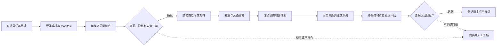
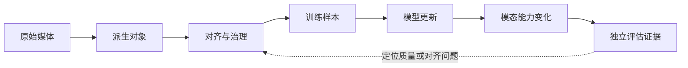

# 第九章：多模态、语音与视频数据

前面几章主要讨论文本、代码、数学、偏好和安全数据。本章进入多模态数据工程：图文、语音和视频数据。它沿用[第七章的来源血缘](07-synthetic-data与distillation-data.md)和[第八章的偏好/安全标签](08-preference-data与安全数据.md)，本章产出的媒体 manifest、对齐指标和任务切片交给[第十章数据估值](10-data-attribution与valuation.md)与[第十一章版本治理](11-dataset-versioning与governance.md)复用；模型结构和 serving 机制由第六册主讲。

多模态模型看起来是在模型结构上“加图像、加音频、加视频”，但真正决定上限的往往是数据：图像和文本是否真的对应，语音和转录是否准确，视频片段和描述是否时间对齐，OCR 是否保留，字幕是否错位，版权和隐私是否可控。

多模态数据比纯文本更难。文本只需要处理 token 序列，而图像、音频、视频还涉及采样率、分辨率、帧率、时间戳、模态对齐、视觉质量、声音质量、场景变化、人物隐私、版权来源和标注一致性。

本章重点：图文对、caption、OCR、视频片段、音频转录、时间对齐、版权和隐私。

合规边界：本章讨论合法合规的多模态数据治理、质量控制、隐私保护和评估，不提供抓取未授权媒体、规避访问控制、识别或追踪个人身份的操作方法。

## 0. 本章范围与资料

多模态数据工程面对的不是一类文件，而是一组带有不同物理时间、空间坐标和来源权利的证据对象。图片、音频和视频可以被模型编码，却不代表它们已经能被可靠地用于训练；真正需要确认的是媒体是否可用、文本是否对应、时间是否同步、回答是否有输入证据，以及数据是否可以被合法保留和删除。

本章沿着一条完整链路展开：图文对、caption、OCR 和文档版面，音频、转录和说话人时间段，视频、镜头和事件描述，多模态指令与 grounded answer，最后连接到隐私、版权、污染、配比、评估和版本治理。CLIP、LAION-5B、Whisper、Frozen in Time、VQA、TextVQA 和 DocVQA 作为方法与数据集的公开研究入口，放在章末的资料边界中讨论。

可以把一条多模态样本的生命周期画成下面的审核闭环。它先固定来源和用途，再检查单模态质量、跨模态对齐、隐私许可和污染，最后进入训练实验与独立评估；有问题的记录回到隔离复核，不直接混进训练池。

这条链路只讨论合法合规的媒体处理、质量控制、隐私保护和防御性评估，不提供未授权媒体抓取、规避访问控制、身份识别、声纹追踪、车牌或人脸追踪，以及敏感个人信息复原的方法。

---

## 1. 先建立直觉：多模态数据为什么难？

纯文本训练样本通常是一个文本片段。多模态训练样本则可能是：

1. 一张图片和一句 caption。
2. 一张图片和 OCR 文本。
3. 一段语音和对应转录。
4. 一段视频和字幕。
5. 一段视频、音频、字幕、镜头切片和事件描述。
6. 一个网页中的图片、周围文本、标题、alt text 和链接上下文。

这些模态之间不一定对齐。网页上的图片可能只是装饰图；caption 可能是广告语；视频字幕可能延迟几秒；音频转录可能漏词；OCR 可能把表格读错；图片里的人脸、车牌、医疗影像可能涉及隐私。

所以多模态数据工程的核心不是“把图片和文字拼起来”，而是判断不同模态之间是否真的互相解释。

---

## 2. 来龙去脉：从人工标注到 web-scale 弱监督

早期视觉模型主要依赖人工标注数据集，例如图像分类、检测、分割数据集。每张图片有固定类别或框标注。这类数据质量高，但规模有限，概念空间也受类别表限制。

CLIP 代表了一条重要路线：从互联网上的大规模图文对中学习视觉表示。它不是让模型只预测固定类别，而是通过自然语言监督学习图像和文本的对应关系。CLIP 论文使用 4 亿图文对，展示了自然语言监督对 zero-shot transfer 的价值。

语音领域也经历了类似变化。Whisper 使用大规模、多语言、多任务弱监督音频转录数据训练，强调规模和多样性对鲁棒语音识别的价值。

视频领域更复杂，因为视频包含图像帧、动作、声音、字幕、时间结构和事件演化。大规模视频数据通常来自视频平台、课程、电影片段、会议、直播、教学和监控类场景，但合规和隐私要求更高。

这条历史线索说明：多模态能力的突破很大程度来自 web-scale 弱监督数据，但弱监督数据必须经过严格清洗和对齐。

---

## 3. 多模态数据的基本类型

常见多模态数据包括：

1. 图文对：image-caption、image-alt text、image-surrounding text。
2. 图像问答：image-question-answer。
3. OCR 数据：图像中的文字和结构。
4. 文档图像：PDF 页面、表格、票据、截图、网页截图。
5. 语音转录：audio-transcript。
6. 语音对话：speaker turns、timestamps、transcript。
7. TTS 数据：text-audio-speaker。
8. 视频字幕：video segment-subtitle。
9. 视频问答：video-question-answer。
10. 视频描述：clip-caption、event annotation、action label。
11. 多模态指令数据：image/video/audio + user instruction + answer。

不同数据服务不同能力。图文对适合视觉语言对齐；OCR 数据适合读图和文档理解；语音转录适合 ASR；视频字幕适合视频理解；多模态指令数据适合 VLM assistant。

### 3.1 关键公式与审计指标

多模态数据池按任务和责任边界区分。集合并置只表示数据来自多个子池，不表示不同模态的监督可以不经转换就混合训练：

~~~math
D_{\mathrm{mm}} = D_{\mathrm{it}} \cup D_{\mathrm{ocr}} \cup D_{\mathrm{aud}} \cup D_{\mathrm{vid}} \cup D_{\mathrm{inst}}
~~~

`D_{\mathrm{it}}` 是图文数据，`D_{\mathrm{ocr}}` 是 OCR 和文档图像数据，`D_{\mathrm{aud}}` 是音频及转录数据，`D_{\mathrm{vid}}` 是视频描述或问答数据，`D_{\mathrm{inst}}` 是多模态指令数据。

一条记录必须同时保留媒体、文本、质量、对齐、治理和版本信息：

~~~math
m_i = (u_i, t_i, \mathbf{q}_i, a_i, r_i, z_i)
~~~

`u_i` 是媒体对象或片段元数据，`t_i` 是 caption、transcript、subtitle、question 或 answer，`\mathbf{q}_i` 是单模态质量向量，`a_i` 是跨模态对齐信息，`r_i` 是隐私、许可、安全和污染状态，`z_i` 记录来源、时间戳、hash、处理器和标注版本。

图文余弦相似度是候选筛选信号之一：

~~~math
A_i^{\mathrm{it}} = \frac{\mathbf{f}_I(I_i)^\top \mathbf{f}_T(T_i)}{\|\mathbf{f}_I(I_i)\|_2\,\|\mathbf{f}_T(T_i)\|_2}
~~~

`\mathbf{f}_I` 和 `\mathbf{f}_T` 分别是图像与文本编码器的向量。分数越高表示两个编码器认为它们越相近，不等于文本在事实层面正确描述图像。图表、文档、新闻、商品图和截图还需要 OCR、空间关系或事件上下文。

OCR 和文档样本要保留文字及其空间位置：

~~~math
O_i = \{(s_{ij}, b_{ij}, p_{ij})\}_{j=1}^{n_i}, \qquad b_{ij}=(x_{ij},y_{ij},w_{ij},h_{ij})
~~~

`s_{ij}` 是识别文本，`b_{ij}` 是归一化到原图宽高的边界框，`p_{ij}` 是 OCR 置信度。坐标要绑定图像宽高和裁剪版本，才能解释阅读顺序、表格行列和版面关系。

语音识别常用词错误率：

~~~math
\mathrm{WER} = \frac{S+D+I}{N}
~~~

`S`、`D`、`I` 分别是替换、删除和插入数，`N` 是参考转录中的词数。中文、代码或低资源语言还要明确分词/字符单位；无参考文本或 `N=0` 时 WER 为 N/A，应使用人工抽样或可验证参考，不能记作 0。

对齐误差要先定义边界单位和时间单位：

~~~math
E_i^{\mathrm{aud}} = \frac{1}{K_i}\sum_{k=1}^{K_i}|\hat{t}_{ik}-t_{ik}|
~~~

`\hat{t}_{ik}` 是预测边界，`t_{ik}` 是参考边界，`K_i` 是有效边界数。均值可能掩盖严重错位，因此同时报告超过业务阈值的边界比例或高分位数；`K_i=0` 时结果为 N/A。

固定采样率下读取的帧数可以近似为：

~~~math
F_i \approx \lfloor f_i\,\Delta t_i \rfloor
~~~

`f_i` 的单位是帧/秒，`\Delta t_i` 是片段时长（秒）。端点是否包含、抽帧策略和丢帧都影响实际帧数；这个近似不证明关键事件已被采到。

字幕或事件时间差可以表示为：

~~~math
E_i^{\mathrm{vid}} = |\hat{t}_i^{\mathrm{caption}}-t_i^{\mathrm{event}}|
~~~

只有在参考事件边界定义明确时才计算。时间差大表示文字可能对应相邻镜头或另一事件；还需核对片段级语义和音画关系。

隐私命中率按样本计数时写作：

~~~math
R_{\mathrm{privacy}} = \frac{1}{n}\sum_{i=1}^{n}\mathbf{1}[P_i=1]
~~~

`P_i=1` 表示第 `i` 条样本命中预先定义的敏感信息检查。若要报告暴露量，应另算音频小时数、视频分钟数或可访问像素，不与样本命中率混为一个分数。

grounded answer 覆盖率可写成：

~~~math
C_{\mathrm{ground}} = \frac{1}{n_{\mathrm{qa}}}\sum_{i=1}^{n_{\mathrm{qa}}} y_i^{\mathrm{ground}}
~~~

`y_i^{\mathrm{ground}}` 是人工 rubric 或可核查证据给出的二值标签，分母 `n_{\mathrm{qa}}` 是定义好的问答样本数。流畅度或模型自评分不能单独证明答案受到输入支持；空分母为 N/A。

样本级审计应并列保存各维度，而不是求一个可互相补偿的“安全总分”：

~~~math
\mathbf{c}_i = (Q_i, A_i, L_i, P_i, T_i, X_i, G_i)
~~~

它们依次表示媒体质量、跨模态对齐、许可状态、隐私处理、时间/空间结构、污染与版本隔离、grounding 证据。许可、隐私和污染是独立硬门禁，不能被高相似度或平均质量分抵消。

#### 手算：从单条样本到数据池

先看 demo 中图文样本 `img_product_caption`。以 0 到 1 的质量分计算教学代理分 `q_i^{\mathrm{soft}}=0.38q_i^{\mathrm{media}}+0.42q_i^{\mathrm{align}}+0.20q_i^{\mathrm{annotation}}`，三项权重和为 1：

~~~math
q_i^{\mathrm{soft}} = 0.38\times0.88 + 0.42\times0.91 + 0.20\times0.82 = 0.8806 \approx 0.881
~~~

它高于本例的 0.74 软阈值，但仍必须先通过许可、隐私、污染和媒体类型门禁。这个分数只是样本排序代理，不是授权或事实正确概率。

| 审计项 | 合成输入与计算 | 结果与读法 |
| --- | --- | --- |
| 图文余弦候选分 | 归一化向量 `(1,0)` 与 `(0.8,0.6)`，点积为 `0.8`，范数均为 `1` | `0.8` 只表示候选相似度，不表示描述正确 |
| WER | 20 个参考词中 `S=2,D=1,I=1`，`(2+1+1)/20` | `0.20`；关键实体错误仍需单独抽检 |
| 语音边界偏差 | 三个边界误差为 `0.2,0.5,0.3` 秒，`(0.2+0.5+0.3)/3` | `0.333` 秒均值；尾部和超过阈值比例另报 |
| 视频采样与字幕 | `f=1` 帧/秒、`Δt=8` 秒得约 8 帧；字幕 `18.6` 秒、事件 `14.0` 秒 | 时间差 `4.6` 秒；超过本例 2 秒门槛，应隔离复核 |
| 隐私切片 | 50 条抽样中命中 3 条，`3/50` | 样本命中率 `0.06`；不能替代音视频时长暴露量 |
| 答案 grounding | 10 条 QA 中 8 条有输入证据，`8/10` | `0.80`；抽样协议和证据标注决定解释范围 |
| 全池保留与配比 | demo 中 `3,550/8,850` token 保留；视频保留 `980/3,550` token | 总保留率 `0.401`，保留池中视频占 `0.276`；两者分母不同 |

表中的计算都用合成输入。阈值必须按任务、样本单位、标注协议和独立评估结果校准；多模态 mixture 的分母是保留 token，而隐私暴露量可以用时间或对象数，报告时要把单位写清。
---

## 4. 图文对数据

图文对是视觉语言模型最基础的数据形态。一个样本通常包含图片和对应文本。

文本来源可能是：

1. 人工 caption。
2. 网页 alt text。
3. 图片周围文本。
4. 标题。
5. 社交媒体正文。
6. 商品描述。
7. OCR 结果。
8. 模型生成 caption。

每种来源都有问题。

人工 caption 质量高但规模小。alt text 常常缺失或很短。周围文本可能和图片无关。商品描述可能带营销。社交媒体文本口语化且噪声大。OCR 有识别错误。模型生成 caption 可能同质化或遗漏细节。

因此，图文对数据的关键是 image-text alignment。

---

## 5. 图文对质量过滤

图文对质量可以从多个维度评估：

1. 图片是否可打开。
2. 图片分辨率是否足够。
3. 图片是否重复、模糊、水印过重或压缩严重。
4. 文本是否为空、乱码、广告或模板。
5. 文本是否真的描述图片。
6. 是否包含 OCR 文字且需要保留。
7. 是否涉及人脸、车牌、证件、医疗信息等隐私。
8. 是否存在版权或来源限制。
9. 是否包含不适合训练的风险内容。

图文对齐常用信号包括：

1. CLIP-like 相似度。
2. 图像 captioning 模型打分。
3. OCR 与文本重合度。
4. 图像分类标签与文本关键词是否一致。
5. 人工抽样审计。

但相似度分数不能替代人工判断。比如一张新闻图和新闻标题可能语义相关但不描述画面；一张商品图和商品详情相关但文本很长；一张图表的关键在 OCR 和坐标轴，而不是普通 caption。

DataComp 把数据筛选放进固定训练流程和多组下游任务中比较，展示了一个重要方法论：比较清洗/筛选策略时，要尽可能固定模型、训练预算和评估集，而不是只优化某一个 embedding 分数。[DataComp](https://arxiv.org/abs/2304.14108) 使用 12.8B 候选图文对池，并在 38 个下游测试集上评估其基准设置；这个规模与结果绑定论文流程，不是项目选数据的通用阈值。后续的 joint example selection 研究还表明，样本的“可学性”可能与 batch 组合有关，因此单条样本排名也未必等价于全池最优选择。[JEST](https://arxiv.org/abs/2406.17711) 的观察同样受参考模型、数据池和训练预算约束。

---

## 6. Caption 数据

Caption 是图像或视频片段的自然语言描述。好的 caption 应该准确、具体、不过度臆测。

常见 caption 问题包括：

1. 太泛：例如“一张图片”。
2. 太短：只有对象名，没有关系和场景。
3. 幻觉：描述了图中不存在的内容。
4. 主观推断：对人物意图、身份、情绪过度猜测。
5. 缺少细节：不描述文字、数量、位置和动作。
6. 偏见表达：对人群属性做不必要判断。
7. 时间错位：视频 caption 描述了别的片段。

高质量 caption 数据需要平衡准确性和丰富度。过短训练不出复杂理解；过长且含臆测会引入幻觉。

---

## 7. OCR 和文档图像数据

很多多模态任务不是“看图识物”，而是“读图中文字”。例如截图、表格、发票、论文页面、合同扫描件、网页截图、PPT、海报、菜单、地图。

OCR 数据的关键不只是识别文字，还要保留结构：

1. 文字内容。
2. 位置坐标。
3. 行列关系。
4. 表格结构。
5. 阅读顺序。
6. 字体和强调。
7. 图文混排关系。

如果只把 OCR 结果拼成一串文本，模型可能丢失表格、版面和空间关系。

文档图像数据还涉及敏感信息。票据、合同、证件、病历、聊天截图、后台截图都可能包含个人信息或商业秘密。进入训练前必须做来源授权、脱敏、访问控制和审计。

---

## 8. 图像数据去重和污染

图像数据也需要去重。重复可能来自转载、缩略图、不同尺寸、裁剪、加水印、镜像和压缩版本。

常见方法包括：

1. exact hash：识别完全相同图片。
2. perceptual hash：识别近似相同图片。
3. embedding 相似度：识别语义或视觉相似图片。
4. OCR 文本匹配：识别同一截图或文档。
5. 来源 URL 和元数据去重。

图像污染也存在。如果评测集图片、题目或答案出现在训练集中，VLM 评估会虚高。对于图像问答、OCR benchmark、文档理解 benchmark，都需要 train-eval overlap 检测。

---

## 9. 语音数据

语音数据的核心样本通常是 audio-transcript pair。

语音数据来源包括：

1. 有声书。
2. 播客。
3. 会议录音。
4. 课程视频音轨。
5. 字幕视频。
6. 电话客服录音。
7. 公开演讲。
8. TTS 合成数据。
9. 多语言语音数据集。

语音数据比文本多很多维度：

1. 采样率。
2. 音质。
3. 噪声。
4. 口音。
5. 语速。
6. 说话人。
7. 语言切换。
8. 情绪。
9. 背景音乐。
10. 时间戳。

Whisper 的论文展示了大规模、多语言、多任务弱监督语音训练路线；这不等于弱监督标签无需抽检，也不说明所有语言都会同等受益。[Whisper](https://arxiv.org/abs/2212.04356) 报告的结果绑定其数据混合、模型规模和评测设置。

多语言语料构造也要同时看覆盖和对齐。EuroSpeech 预印本报告从 22 个欧洲议会录音中构造超过 61,000 小时对齐片段，并以两阶段方法处理长音频和非逐字转录；作者报告在其微调设置中的平均 WER 相对下降 41.8%。这些数字只描述该论文的数据源、语言、ASR 基线和评测条件，不能直接外推成目标语言的收益或录音使用授权。[EuroSpeech](https://arxiv.org/abs/2510.00514)

---

## 10. 语音转录和时间对齐

语音训练最关键的问题之一是时间对齐。

如果一段 30 秒音频对应一句完整字幕，模型很难知道哪个词在哪个时间出现。如果字幕延迟或提前，模型会学到错误对齐。

常见处理包括：

1. VAD：切分语音和非语音区域。
2. speaker diarization：区分说话人。
3. forced alignment：把 transcript 对齐到音频时间轴。
4. segment filtering：过滤太长、太短、噪声过大或转录不匹配片段。
5. language identification：识别音频语言。
6. transcript normalization：统一标点、大小写、数字和口语填充词。

转录质量评估可以看 WER、CER、语言识别准确率、人工抽检和模型训练后的验证表现。

---

## 11. 语音数据隐私和合规

语音数据天然敏感。声音可能包含身份线索、情绪、健康状态、地点、背景谈话和个人信息。

语音数据治理要关注：

1. 录音授权。
2. 说话人同意。
3. PII 转录脱敏。
4. 声纹隐私。
5. 儿童声音和敏感人群。
6. 电话、会议、客服等场景的合规要求。
7. 数据访问控制。
8. 保留期限和删除机制。

如果目标是训练 ASR、TTS 或语音助手，隐私治理不能只处理文本转录，还要处理原始音频。

---

## 12. 视频数据

视频是最复杂的模态，因为它同时包含图像序列、声音、字幕、动作、场景变化和时间关系。

视频数据样本可能包含：

1. 原始视频。
2. 关键帧。
3. 音频轨。
4. 字幕。
5. ASR 转录。
6. OCR。
7. 镜头切分。
8. 时间戳。
9. 事件标签。
10. 视频 caption 或 QA。

视频模型需要理解的不只是单帧内容，还包括动作和事件：谁在什么时候做了什么，前后发生了什么变化，声音和画面是否对应。

---

## 13. 视频切片和时间对齐

视频不能总是整段进入训练。长视频通常要切成片段。

切片策略包括：

1. 固定长度切片。
2. 按镜头切分。
3. 按字幕句子切分。
4. 按事件检测切分。
5. 按音频活动切分。

每种策略都有 trade-off。

固定长度简单但可能切断事件。镜头切分符合视觉变化但不一定对应语义。字幕切分适合语言对齐但字幕可能错位。事件切分语义好但需要额外模型。

视频时间对齐要处理：

1. 字幕和语音是否同步。
2. 描述是否对应当前画面。
3. 音频事件是否对应视觉事件。
4. OCR 是否来自当前帧。
5. QA 是否需要跨片段上下文。

视频数据工程的难点就在这里：时间是一个额外维度。Kairos 数据集把标注扩展到 10—30 分钟视频，并沿时间记录持续动作、实体出现与属性、交互和上下文变化，适合作为“事件不等于单帧 caption”的长视频例子；它不是所有视频任务的统一标注配方。[Kairos](https://arxiv.org/abs/2609.08755)

HAVEN 则把 frame、shot 和 video 三种粒度放进同一套视频—文本对齐评测，并覆盖摘要、时间推理、grounding 和显著性排序。这个设计说明评测分辨率应与任务问题对齐；它的 benchmark 结果仍绑定其数据和协议，不能替代目标语料上的时间切片验收。[HAVEN](https://arxiv.org/abs/2605.19223)

---

## 14. 多模态指令数据

多模态助手需要 instruction data。例如：

1. “这张图里有什么？”
2. “读一下截图里的表格。”
3. “这段视频发生了什么？”
4. “这段录音主要讲了什么？”
5. “根据图片和文字回答问题。”
6. “比较两张图的差异。”
7. “从视频中找出关键步骤。”

这类数据通常来自人工标注、模型生成、任务数据集改写和真实产品反馈。

关键质量问题是：回答必须 grounded in modality。也就是说，回答应该基于图像、音频或视频内容，而不是只凭语言先验猜测。

---

## 15. 多模态数据的安全问题

多模态安全不只是文本安全。

图像可能包含人脸、证件、地址、车牌、医疗信息、儿童信息、暴力或成人内容。音频可能包含声纹和背景隐私。视频可能包含可识别人物、住址、工作场所、敏感事件和第三方隐私。

安全处理包括：

1. 来源授权。
2. PII 检测和脱敏。
3. 人脸、车牌、证件等敏感区域处理。
4. 不适宜内容分类。
5. 儿童和敏感人群保护。
6. 地理位置和元数据清理。
7. 访问控制和审计。
8. 数据删除和追踪机制。

多模态数据还要避免训练模型做不合适的身份识别、跟踪或敏感属性推断。

---

## 16. 版权和许可

多模态数据版权风险比文本更高。图片、音频、视频通常由创作者、平台、机构或个人持有权利。公开可访问不等于可训练。

版权治理要记录：

1. 来源 URL 或数据集。
2. license。
3. 使用范围。
4. 是否允许商业使用。
5. 是否允许再分发。
6. 是否允许生成衍生数据。
7. 下架和删除机制。
8. 数据版本和 hash。

尤其是视频和语音，平台条款、音乐版权、人物肖像权和字幕版权可能交织在一起。数据工程不能只看文件是否能下载。

---

## 17. 多模态质量评估

多模态数据质量评估要分模态看，也要看跨模态对齐。

图像维度：分辨率、清晰度、重复、水印、压缩、内容安全、OCR 可读性。

文本维度：caption 质量、语言、长度、是否广告、是否描述准确。

音频维度：采样率、噪声、语音活动、转录准确率、说话人、语言。

视频维度：帧率、镜头稳定性、字幕同步、音画一致、切片合理性。

跨模态维度：图文相似度、音文对齐、视频字幕对齐、OCR 与回答一致性、问答是否 grounded。

评估方法包括自动评分、人工抽检、小模型 ablation、下游 benchmark 和产品样例回归。数据筛选策略也应尽量在固定训练预算和多任务评估集上比较：DataComp 以多组下游测试集衡量候选数据集，HAVEN 则强调视频层级与时间粒度；前者关注训练数据构造比较，后者关注时空对齐任务评估，两者都不能证明目标模型在目标流量上已经可靠。

---

## 18. 机制与边界：多模态数据是对齐问题，不是拼接问题

从机制上看，多模态数据工程的本质是 alignment。

图像和文本要语义对齐；语音和转录要时间对齐；视频和字幕要事件对齐；OCR 和版面要空间对齐；多模态问答要证据对齐。

如果对齐差，模型会学到 shortcut。例如看到“猫”的 caption 就学猫，但图片里可能是狗；字幕讲上一幕，画面是下一幕；问题问表格，OCR 顺序却错乱。模型表面训练 loss 下降，真实能力却不稳定。

多模态数据还会放大偏见。图文对来自 web，会继承视觉文化偏见、职业刻板印象、地域偏差和语言偏差。语音数据会受口音、性别、年龄、录音设备影响。视频数据会受平台内容分布影响。

因此，多模态数据工程要同时处理对齐、质量、多样性、公平性、版权和隐私。

---

## 19. 一个可落地的多模态数据方案

建设多模态数据的起点不是收集尽可能多的媒体，而是先写清模型要完成的任务契约：是图文检索、OCR、文档问答、ASR、语音助手、视频理解，还是同时处理多种输入的助手。任务不同，所需的证据粒度不同。图文检索可以容忍 caption 较粗，而票据问答不能丢失坐标；ASR 可以关注转录文本，会议摘要还必须保留说话人和时间段；视频动作识别需要事件边界，视频聊天则可能需要更长的上下文。

在任务契约确定后，分别建立 image-text、OCR、audio-transcript、video-caption 和 instruction 数据池。每条记录都要绑定来源、许可、语言、采样率或分辨率、时间戳、媒体 hash、质量版本、隐私状态和删除指针。把不同模态一开始就混成一个大表，会让后续无法解释某项能力退化来自哪一类数据。

单模态清洗解决“媒体能不能用”，跨模态对齐解决“媒体和标签是不是同一件事”。图片需要处理坏图、低清、重复和过重水印；音频需要切分语音、识别语言、评估噪声和转录；视频需要处理镜头、关键帧、音频轨、字幕和事件；文档图像要保留 OCR 坐标和表格关系。自动模型可以做初筛，但困难样本必须回到人工抽样和任务级评估。

隐私与版权应在训练样本生成之前处理，而不是等模型训练完才补救。来源许可决定是否可以使用，隐私策略决定是否需要模糊、裁剪、删除或隔离，评测污染策略决定哪些媒体只能进入私有 holdout。每一种处理都要留下原始对象 hash、变换版本和可追溯删除关系。

最后才是配比和训练。不同模态、任务、语言和质量层级按照目标能力做小规模消融，分别观察 OCR、视觉问答、ASR、视频理解、通用语言能力、延迟和数据成本。下游 benchmark 只是一个观察窗口，还要加入多语言、多口音、不同分辨率、字幕错位和真实产品样例，避免模型只学会数据集的格式。

### 19.1 最小可运行多模态数据审计 demo

下面这个 demo 不依赖外部库，也不读写文件。输入是一组 toy 图文、OCR、语音、视频和多模态指令样本；输出包括保留样本、隔离待复核原因、分模态 token 保留率、保留池 mixture、按保留样本计算的平均对齐分、检查信号和后续动作。它把空分母记为 `None`，把有原始分母但全量过滤记为 `0.0`；并存的问题会分别保留，不只记录第一条失败原因。

它演示的是元数据级治理机制，不是真实 CLIP scorer、OCR、ASR、视频事件检测器、版权系统或隐私识别器。真实系统需要接入媒体解析、perceptual hash、embedding 检索、OCR / ASR / VAD / forced alignment、隐私脱敏、许可证审查、人工抽样和训练 ablation。`decision` 只说明数据是否可以进入下一轮可逆实验，不代表多模态模型已经具备可靠的生产能力。

**代码状态：已验证（2026-10-28，Python 3.12.9，标准库；固定合成样本，无外部依赖）。**

将代码保存为 `multimodal_audit.py`，运行 `python3 multimodal_audit.py`。

~~~python
import math
from collections import Counter, defaultdict

samples = [
    {"id": "img_product_caption", "kind": "image_text", "tokens": 520, "media_quality": 0.88, "alignment": 0.91, "annotation": 0.82, "license_ok": True, "privacy": False, "contam": False, "time_error": 0.0, "grounded": True},
    {"id": "img_decor_misaligned", "kind": "image_text", "tokens": 430, "media_quality": 0.84, "alignment": 0.31, "annotation": 0.50, "license_ok": True, "privacy": False, "contam": False, "time_error": 0.0, "grounded": True},
    {"id": "ocr_doc_redacted", "kind": "ocr_doc", "tokens": 760, "media_quality": 0.82, "alignment": 0.86, "annotation": 0.88, "license_ok": True, "privacy": False, "contam": False, "time_error": 0.0, "grounded": True},
    {"id": "ocr_private_id", "kind": "ocr_doc", "tokens": 690, "media_quality": 0.86, "alignment": 0.88, "annotation": 0.86, "license_ok": True, "privacy": True, "contam": False, "time_error": 0.0, "grounded": True},
    {"id": "ocr_weak_annotation", "kind": "ocr_doc", "tokens": 500, "media_quality": 0.80, "alignment": 0.80, "annotation": 0.20, "license_ok": True, "privacy": False, "contam": False, "time_error": 0.0, "grounded": True},
    {"id": "audio_multilingual_clean", "kind": "audio_transcript", "tokens": 620, "media_quality": 0.80, "alignment": 0.83, "annotation": 0.78, "license_ok": True, "privacy": False, "contam": False, "time_error": 0.35, "grounded": True},
    {"id": "audio_noisy_bad_asr", "kind": "audio_transcript", "tokens": 580, "media_quality": 0.42, "alignment": 0.55, "annotation": 0.46, "license_ok": True, "privacy": False, "contam": False, "time_error": 0.50, "grounded": True},
    {"id": "video_recipe_aligned", "kind": "video_caption", "tokens": 980, "media_quality": 0.83, "alignment": 0.84, "annotation": 0.80, "license_ok": True, "privacy": False, "contam": False, "time_error": 0.90, "grounded": True},
    {"id": "video_subtitle_shift", "kind": "video_caption", "tokens": 850, "media_quality": 0.79, "alignment": 0.75, "annotation": 0.72, "license_ok": True, "privacy": False, "contam": False, "time_error": 4.60, "grounded": True},
    {"id": "video_eval_leak", "kind": "video_caption", "tokens": 710, "media_quality": 0.81, "alignment": 0.82, "annotation": 0.78, "license_ok": True, "privacy": False, "contam": True, "time_error": 0.80, "grounded": True},
    {"id": "mm_instruction_grounded", "kind": "mm_instruction", "tokens": 670, "media_quality": 0.86, "alignment": 0.88, "annotation": 0.90, "license_ok": True, "privacy": False, "contam": False, "time_error": 0.20, "grounded": True},
    {"id": "mm_hallucinated_answer", "kind": "mm_instruction", "tokens": 640, "media_quality": 0.84, "alignment": 0.47, "annotation": 0.74, "license_ok": True, "privacy": False, "contam": False, "time_error": 0.20, "grounded": False},
    {"id": "video_unlicensed_clip", "kind": "video_caption", "tokens": 900, "media_quality": 0.80, "alignment": 0.78, "annotation": 0.76, "license_ok": False, "privacy": False, "contam": False, "time_error": 1.00, "grounded": True},
]

WEIGHTS = {"media_quality": 0.38, "alignment": 0.42, "annotation": 0.20}
THRESHOLD = 0.74
KNOWN_KINDS = {"image_text", "ocr_doc", "audio_transcript", "video_caption", "mm_instruction"}
MAX_TIME_ERROR = {"image_text": 0.0, "ocr_doc": 0.0, "audio_transcript": 1.0, "video_caption": 2.0, "mm_instruction": 1.0}
REQUIRED_FIELDS = {
    "id", "kind", "tokens", "media_quality", "alignment", "annotation",
    "license_ok", "privacy", "contam", "time_error", "grounded",
}

def safe_ratio(numerator, denominator):
    return round(numerator / denominator, 3) if denominator else None

def safe_mean(values):
    return round(sum(values) / len(values), 3) if values else None

def score(item):
    return sum(WEIGHTS[key] * item[key] for key in WEIGHTS)

def hold_reasons(item, exact_score):
    reasons = []
    if not item["license_ok"]:
        reasons.append("license_or_source")
    if item["privacy"]:
        reasons.append("privacy_or_sensitive")
    if item["contam"]:
        reasons.append("eval_contamination")
    if item["kind"] not in KNOWN_KINDS:
        reasons.append("unknown_modality")
    elif item["time_error"] > MAX_TIME_ERROR[item["kind"]]:
        reasons.append("time_misalignment")
    if not item["grounded"]:
        reasons.append("ungrounded_answer")
    if item["media_quality"] < 0.60:
        reasons.append("low_media_quality")
    if item["alignment"] < 0.62:
        reasons.append("low_alignment")
    if exact_score < THRESHOLD:
        reasons.append("low_quality")
    return sorted(reasons)

assert abs(sum(WEIGHTS.values()) - 1.0) < 1e-12
assert all(REQUIRED_FIELDS <= item.keys() for item in samples)
assert all(isinstance(item["id"], str) and item["id"] for item in samples)
assert len({item["id"] for item in samples}) == len(samples)
assert all(type(item["tokens"]) is int and item["tokens"] >= 0 for item in samples)
assert all(type(item[key]) is bool for item in samples for key in ("license_ok", "privacy", "contam", "grounded"))
assert all(math.isfinite(item[key]) and 0.0 <= item[key] <= 1.0 for item in samples for key in WEIGHTS)
assert all(math.isfinite(item["time_error"]) and item["time_error"] >= 0 for item in samples)
assert all(isinstance(item["kind"], str) for item in samples)

kept, held_for_review, rows = [], {}, []
for item in samples:
    exact_score = score(item)
    reasons = hold_reasons(item, exact_score)
    rows.append({"id": item["id"], "kind": item["kind"], "score": round(exact_score, 3), "reasons": reasons})
    if reasons:
        held_for_review[item["id"]] = reasons
    else:
        kept.append(item)

raw_tokens = sum(item["tokens"] for item in samples)
kept_tokens = sum(item["tokens"] for item in kept)
kind_raw, kind_kept = defaultdict(int), defaultdict(int)
for item in samples:
    kind_raw[item["kind"]] += item["tokens"]
for item in kept:
    kind_kept[item["kind"]] += item["tokens"]

reason_counts = dict(sorted(Counter(reason for reasons in held_for_review.values() for reason in reasons).items()))
report = {
    "kept_ids": [item["id"] for item in kept],
    "held_for_review": dict(sorted(held_for_review.items())),
    "reason_counts": reason_counts,
    "raw_tokens": raw_tokens,
    "kept_tokens": kept_tokens,
    "retention": safe_ratio(kept_tokens, raw_tokens),
    "kind_retention": {kind: safe_ratio(kind_kept[kind], kind_raw[kind]) for kind in sorted(kind_raw)},
    "mixture": {kind: safe_ratio(kind_kept[kind], kept_tokens) for kind in sorted(kind_raw)},
    "avg_alignment": {
        kind: safe_mean([item["alignment"] for item in kept if item["kind"] == kind])
        for kind in sorted(kind_raw)
    },
    "score_preview": {row["id"]: row["score"] for row in rows},
}

checks = {
    "license_issue_observed": reason_counts.get("license_or_source", 0) == 1,
    "privacy_issue_observed": reason_counts.get("privacy_or_sensitive", 0) == 1,
    "contamination_issue_observed": reason_counts.get("eval_contamination", 0) == 1,
    "time_alignment_issue_observed": reason_counts.get("time_misalignment", 0) == 1,
    "grounding_issue_observed": reason_counts.get("ungrounded_answer", 0) == 1,
    "soft_quality_hold_observed": held_for_review.get("ocr_weak_annotation") == ["low_quality"],
    "modality_coverage_complete": set(kind_kept) == {"audio_transcript", "image_text", "mm_instruction", "ocr_doc", "video_caption"},
    "alignment_floor_observed": bool(report["avg_alignment"]) and all(
        value is not None and value >= 0.80 for value in report["avg_alignment"].values()
    ),
    "retained_samples_present": bool(kept),
}
signals = {
    "retention": report["retention"],
    "lowest_kind_retention": min((value for value in report["kind_retention"].values() if value is not None), default=None),
    "lowest_average_alignment": min((value for value in report["avg_alignment"].values() if value is not None), default=None),
    "reason_counts": reason_counts,
}
actions = [
    "quarantine_unlicensed_private_and_contaminated_media",
    "review_low_quality_alignment_and_time_segments",
    "retain_all_modalities_for_small_ablation",
]
if reason_counts.get("unknown_modality", 0):
    actions.append("repair_modality_schema_before_training")
decision = "continue_to_multimodal_ablation" if all(checks.values()) else "hold_for_media_repair"
report["checks"] = checks
report["signals"] = signals
report["actions"] = actions
report["decision"] = decision

for key, value in report.items():
    print(f"{key}=", value)

assert report["kept_ids"] == [
    "img_product_caption",
    "ocr_doc_redacted",
    "audio_multilingual_clean",
    "video_recipe_aligned",
    "mm_instruction_grounded",
]
assert report["reason_counts"] == {
    "eval_contamination": 1,
    "license_or_source": 1,
    "low_alignment": 3,
    "low_media_quality": 1,
    "low_quality": 4,
    "privacy_or_sensitive": 1,
    "time_misalignment": 1,
    "ungrounded_answer": 1,
}
assert report["raw_tokens"] == 8850 and report["kept_tokens"] == 3550
assert report["retention"] == 0.401
assert report["kind_retention"] == {"audio_transcript": 0.517, "image_text": 0.547, "mm_instruction": 0.511, "ocr_doc": 0.39, "video_caption": 0.285}
assert report["mixture"] == {"audio_transcript": 0.175, "image_text": 0.146, "mm_instruction": 0.189, "ocr_doc": 0.214, "video_caption": 0.276}
assert report["avg_alignment"] == {"audio_transcript": 0.83, "image_text": 0.91, "mm_instruction": 0.88, "ocr_doc": 0.86, "video_caption": 0.84}
assert report["score_preview"]["img_product_caption"] == 0.881
assert round(score({"media_quality": 0.80, "alignment": 0.80, "annotation": 0.20}), 3) == 0.68
assert score({"media_quality": 0.74, "alignment": 0.74, "annotation": 0.74}) >= THRESHOLD
assert score({"media_quality": 0.739, "alignment": 0.739, "annotation": 0.739}) < THRESHOLD
unknown_probe = dict(samples[0], id="unknown_modality_probe", kind="unknown_modality")
assert "unknown_modality" in hold_reasons(unknown_probe, score(unknown_probe))
assert all(checks.values())
assert report["decision"] == "continue_to_multimodal_ablation"
assert safe_ratio(0, 0) is None
assert safe_ratio(0, 100) == 0.0
assert safe_mean([]) is None
~~~

运行输出：

~~~text
kept_ids= ['img_product_caption', 'ocr_doc_redacted', 'audio_multilingual_clean', 'video_recipe_aligned', 'mm_instruction_grounded']
held_for_review= {'audio_noisy_bad_asr': ['low_alignment', 'low_media_quality', 'low_quality'], 'img_decor_misaligned': ['low_alignment', 'low_quality'], 'mm_hallucinated_answer': ['low_alignment', 'low_quality', 'ungrounded_answer'], 'ocr_private_id': ['privacy_or_sensitive'], 'ocr_weak_annotation': ['low_quality'], 'video_eval_leak': ['eval_contamination'], 'video_subtitle_shift': ['time_misalignment'], 'video_unlicensed_clip': ['license_or_source']}
reason_counts= {'eval_contamination': 1, 'license_or_source': 1, 'low_alignment': 3, 'low_media_quality': 1, 'low_quality': 4, 'privacy_or_sensitive': 1, 'time_misalignment': 1, 'ungrounded_answer': 1}
raw_tokens= 8850
kept_tokens= 3550
retention= 0.401
kind_retention= {'audio_transcript': 0.517, 'image_text': 0.547, 'mm_instruction': 0.511, 'ocr_doc': 0.39, 'video_caption': 0.285}
mixture= {'audio_transcript': 0.175, 'image_text': 0.146, 'mm_instruction': 0.189, 'ocr_doc': 0.214, 'video_caption': 0.276}
avg_alignment= {'audio_transcript': 0.83, 'image_text': 0.91, 'mm_instruction': 0.88, 'ocr_doc': 0.86, 'video_caption': 0.84}
score_preview= {'img_product_caption': 0.881, 'img_decor_misaligned': 0.549, 'ocr_doc_redacted': 0.849, 'ocr_private_id': 0.868, 'ocr_weak_annotation': 0.68, 'audio_multilingual_clean': 0.809, 'audio_noisy_bad_asr': 0.483, 'video_recipe_aligned': 0.828, 'video_subtitle_shift': 0.759, 'video_eval_leak': 0.808, 'mm_instruction_grounded': 0.876, 'mm_hallucinated_answer': 0.665, 'video_unlicensed_clip': 0.784}
checks= {'license_issue_observed': True, 'privacy_issue_observed': True, 'contamination_issue_observed': True, 'time_alignment_issue_observed': True, 'grounding_issue_observed': True, 'soft_quality_hold_observed': True, 'modality_coverage_complete': True, 'alignment_floor_observed': True, 'retained_samples_present': True}
signals= {'retention': 0.401, 'lowest_kind_retention': 0.285, 'lowest_average_alignment': 0.83, 'reason_counts': {'eval_contamination': 1, 'license_or_source': 1, 'low_alignment': 3, 'low_media_quality': 1, 'low_quality': 4, 'privacy_or_sensitive': 1, 'time_misalignment': 1, 'ungrounded_answer': 1}}
actions= ['quarantine_unlicensed_private_and_contaminated_media', 'review_low_quality_alignment_and_time_segments', 'retain_all_modalities_for_small_ablation']
decision= continue_to_multimodal_ablation
~~~

这个 demo 的重点是：多模态样本必须同时通过媒体质量、跨模态对齐、时序同步、隐私版权、污染隔离和 grounded answer 检查。任何一个环节失败，都可能让模型学到错误的视觉、语音或视频对应关系。

---

## 20. 决策边界：不同模态的证据不能互相替代

多模态数据最容易出现的误判，是把一个模态的好指标当成所有模态都可靠。例如字幕很准，不代表字幕和画面同步；图文相似度很高，不代表 caption 说出了图表中的关键数值；音频 WER 很低，也不代表说话人边界和会议决策被正确保留。评估必须把单模态质量、跨模态关系和任务结果分开。

### 20.1 图文对：相似不等于描述充分

图文对的文本来源决定了监督含义。人工 caption 通常描述画面，alt text 可能只承担可访问性说明，网页周围文本可能描述网页主题，商品描述可能包含图中看不到的属性，OCR 则更接近文字读取任务。把这些文本放在同一个桶里，会让模型无法判断某句话是在描述像素、补充背景，还是表达营销意图。

图文相似度适合做大规模初筛，但不应单独决定保留。对于新闻图、图表和商品图，应该额外检查实体、数字、空间关系和来源上下文。一个实际可用的抽样指标是阈值以上候选的人工精确率：

~~~math
A_{\mathrm{precision}}(\tau) = \frac{n_{\mathrm{correct},\;s>\tau}}{n_{s>\tau}}
~~~

分子是人工确认真正对应的样本数，分母是相似度高于阈值 $\tau$ 的候选数。假设 100 个候选中有 40 个分数高于 $\tau$，人工确认其中 28 个确实对应，则 $A_{\mathrm{precision}}(\tau)=28/40=0.70$。若阈值以上没有候选，结果为 N/A。这只估计当前阈值以上的候选精确率，不说明其余 60 个低分样本无用；低分样本可能包含 OCR、细粒度关系或跨语言表达。

### 20.2 OCR：文本、坐标和阅读顺序是一个整体

OCR 数据的监督对象不是一串字符，而是字符与图像区域之间的关系。表格需要行列，合同需要段落顺序，网页截图需要区分正文、按钮和导航，地图需要保留文字与位置。解析器如果先把所有文本按检测顺序拼接，训练数据可能看起来干净，却把答案所需的空间结构打乱。

因此，一个 OCR 样本至少要保留原图 hash、图像尺寸、文本框、阅读顺序、识别置信度和结构标签。对表格还要记录单元格合并、行列索引和数字格式。抽检不能只问“字认对了吗”，还要问“文字是否放回正确区域，模型是否能据此回答问题”。

文档图像还应单独分出扫描件、手机拍照、屏幕截图、低清 PDF 和复杂表格等切片。平均 OCR 分数会掩盖某一类版面系统性失败，分桶指标才可以告诉我们是字体、语言、分辨率还是布局导致退化。

### 20.3 音频：WER 之外还要保留说话人和时间

对于干净的单人朗读，audio-transcript pair 主要关注转录准确率；对于会议、课堂和客服，多说话人、打断、背景声和重叠语音决定了数据能否用于对话理解。若只保存一段完整 transcript，模型无法学习谁说了什么，也无法把决策和时间定位到原始音频。

语音清洗应把 VAD、语言识别、speaker diarization、forced alignment、转录归一化和人工抽样视为相互关联的步骤。说话人标签不是身份认证，它只是当前片段中的匿名角色；如果任务不需要身份信息，就不要保存可用于声纹识别的额外特征。对儿童、电话、医疗和私人会议数据，授权与保留期限要先于训练价值。

WER 也有明显边界。长句中少量关键数字被替换，可能比大量语气词错误更严重；低资源语言的分词方式不同，跨语言平均 WER 可能没有可比性。因此要同时记录语言、场景、音频时长、关键实体错误和高风险切片，不能只报一个总体均值。

### 20.4 视频：切片是建模假设，不是机械预处理

固定长度切片便于批处理，却可能把一个动作拆开；按镜头切分保留视觉连续性，却可能把同一事件分成多个镜头；按字幕切分适合语言监督，却依赖字幕时间可靠；按事件切分语义更好，却引入检测器偏差。选择哪一种，取决于任务需要的最小上下文。

视频样本至少要有片段起止时间、关键帧策略、音频轨版本、字幕或 ASR 区间、OCR 时间和事件标签。对于“发生了什么”这类问题，还要保留前后片段，避免模型只看到了结果而看不到原因。对长视频，应该报告片段长度、帧采样率、关键事件召回和跨片段问答准确率。

视频污染也比图像复杂。同一节目可能出现不同分辨率、裁剪、字幕、水印和再编码版本；评测题目可能藏在字幕、音轨或评论中。去重和污染检测要同时比较媒体近邻、字幕文本、音轨转录和时间窗口，不能只对关键帧做 hash。

### 20.5 多模态指令：回答必须能指出证据

多模态 instruction data 的核心不是“问题中出现了图片”，而是回答是否依赖输入模态。对于“图中有几辆车”，证据是可数的对象；对于“截图中的错误是什么”，证据是 OCR 文本、布局和上下文；对于“视频中为什么停下来”，证据可能需要多个时间段和音画组合。

标注规范应要求回答区分观察、转录、推断和不知道。看不清时说看不清，比凭语言先验编造对象更有价值。评估时可把 grounded、unsupported、partially supported 和 unanswerable 分开，避免把“语气流畅”当成“看到了输入”。

### 20.6 隐私、版权和删除：三个不同的责任对象

版权和隐私不能用一个 allow 字段代替。版权决定是否有权使用或再分发媒体，隐私决定是否需要脱敏、隔离或限制访问，删除机制决定收到有效请求后能否定位并从后续派生数据中移除。一个样本可能有合法授权但仍含敏感个人信息，也可能已脱敏但仍不能用于商业训练。

数据登记应保留 source、license、consent 或 policy basis、privacy transform、retention、deletion pointer 和 derived artifact。对原始音视频、转录、OCR、caption、embedding 和训练 shard，要明确它们之间的血缘关系；否则删除原始文件并不等于删除模型可见的派生副本。

### 20.7 评估分母：模态、任务和时间窗口必须对齐

多模态评估至少有三种分母：媒体样本数、媒体时长或像素/帧量，以及任务样本数。报告图像保留率时用样本数合理，报告音频隐私暴露量时用小时数更合理，报告视频关键帧覆盖时则需要帧或时间窗口。不同分母不能直接比较。

发布一项数据变化时，应同时给出模态配比、语言和场景切片、质量分布、对齐误差、隐私命中、污染候选、grounded 任务结果和人工抽样区间。这样才能区分“保留了更多数据”和“保留了更多有用证据”。

---

## 21. 失败模式与修复顺序

### 21.1 把多模态对象当成文件拼接

图片、音频、视频和文本的存储格式可以放在同一条记录中，但它们的时间、空间和证据关系不会自动产生。修复方法是给每个派生对象绑定来源 hash、坐标或时间区间，再用任务级样本检查关系是否保持。

### 21.2 用一个平均质量分掩盖模态短板

平均分可能让高质量图文样本抵消低质量音频，也可能让大量短视频掩盖少量长视频错位。应按模态、语言、设备、分辨率、时长和风险类别分桶报告，并保留最小分桶样本数。

### 21.3 只看 WER，不看关键实体和边界

ASR 的总体 WER 下降，不代表数字、人名、药名、代码符号和说话人边界正确。把关键实体和高风险词单独抽样，并检查它们的时间区间，才能判断数据是否适合下游任务。

### 21.4 视频只抽帧，丢掉时间因果

抽帧可以降低成本，却可能把动作、顺序和声音线索全部打散。修复时要保留连续片段样本，设置需要跨帧推理的评估题，并报告关键事件是否被采到，而不是只报告帧数。

### 21.5 把自动相似度当成事实判断

相似度模型可能继承训练数据偏差，也可能偏爱常见物体和短 caption。它适合做候选排序，不适合单独确认版权、隐私、表格关系或回答是否有证据。难例要回到人工或可验证工具。

### 21.6 把公开可见当成训练授权

媒体能被浏览或下载，只说明当前访问路径可用，不说明平台条款、创作者许可、肖像权、音乐权利和商业使用范围。来源登记缺失时，应保留为待审或隔离状态，而不是用技术可访问性替代权利判断。

### 21.7 评测污染藏在字幕、OCR 和音轨里

多模态 benchmark 的题目可能存在于图片文字、视频字幕、音频转录、网页上下文或衍生 caption 中。训练前需要在多个派生层做近邻检测，时间切分和私有 holdout 也要覆盖媒体本身。

### 21.8 发现问题后的修复顺序

先隔离未授权、敏感隐私和评测污染；再修复时间或空间错位、grounding 失败和关键实体错误；之后处理质量、语言覆盖和模态配比；最后才优化 caption 风格、采样成本和软指标。这个顺序按潜在后果排序，避免用增加数据量掩盖不可逆的权利或隐私问题。

---

## 22. 从数据版本到模型行为变化

一条多模态样本不会直接变成模型能力。它要先经过媒体解析和派生转换，再经过对齐、隐私、版权、污染和任务标注，随后按模态和能力配比进入训练，最后用独立评估确认行为是否发生变化。

可以把因果链画成下面的流程。评估发现问题时，应回到产生受影响派生对象的步骤，更新数据版本后重新训练和评估：

每一步都可能产生新的错误。OCR 版本升级可能改变文本分布，重新切片可能改变视频事件边界，隐私模糊可能降低文字可读性，caption 模型升级可能增加描述同质化。因此版本记录不能只保存最终数据集名称，要保存原始 hash、转换器版本、阈值、抽样结果和派生血缘。

一个可回放的数据版本至少记录：来源清单、许可快照、原始对象 hash、媒体解析器、OCR/ASR/diarization/对齐版本、过滤规则、隐私变换、污染检测结果、模态配比、训练配置、评估集 hash 和人工抽样记录。发生能力回归时，团队才有可能判断是数据来源、转换器、配比、训练还是评估 harness 的变化。

---

## 23. 资料与证据边界

本章的公开资料分为研究论文、数据集或项目说明，以及本文用于教学的审计抽象。论文可以支持某种方法在指定任务和实验条件下的观察，不能自动支持某个生产系统的版权、隐私或安全结论；数据集论文可以说明构造方式，不能代替当前项目的授权审查；本章的评分、检查向量和 demo 是工程化示例，不是论文原始实现。

主要原始资料如下：

1. Radford 等，《Learning Transferable Visual Models From Natural Language Supervision》，<https://arxiv.org/abs/2103.00020>。它支持大规模图文监督和 zero-shot 视觉迁移的研究叙述，但论文中的数据规模和过滤策略不能被直接当作任何项目的授权方案。
2. Schuhmann 等，《LAION-5B: An open large-scale dataset for training next generation image-text models》，<https://arxiv.org/abs/2210.08402>。它提供 web-scale 图文数据集的公开构造案例，同时也说明大规模弱监督数据需要额外的安全、版权和质量治理。
3. Radford 等，《Robust Speech Recognition via Large-Scale Weak Supervision》，<https://arxiv.org/abs/2212.04356>。它是 Whisper 研究的公开论文入口，支持大规模、多语言、弱监督语音训练的历史叙述，不意味着弱监督转录无需人工抽样或隐私审查。
4. Bain 等，《Frozen in Time: A Joint Video and Image Encoder for End-to-End Retrieval》，<https://arxiv.org/abs/2104.00650>。它支持视频和图像联合检索的研究背景，但视频的切片、字幕和权利问题仍需独立治理。
5. Antol 等，《VQA: Visual Question Answering》，<https://arxiv.org/abs/1505.00468>。它是视觉问答任务的经典公开入口，用于说明图像、问题和答案之间的任务关系。
6. Singh 等，《Towards VQA Models That Can Read》，<https://arxiv.org/abs/1904.08920>。它对应 TextVQA 方向，支持“图像文字读取需要 OCR 和版面证据”的任务背景。
7. Mathew 等，《DocVQA: A Dataset for VQA on Document Images》，<https://arxiv.org/abs/2007.00398>。它支持文档图像问答和结构化阅读的研究背景，不能替代真实文档的隐私和授权处理。
8. NIST AI Risk Management Framework，<https://www.nist.gov/itl/ai-risk-management-framework>。它提供风险识别、治理、测量和管理的官方框架入口，本章将其用于治理思路的证据背景，不把它改写成多模态数据的具体法律意见。
9. Gadre 等，《DataComp: In Search of the Next Generation of Multimodal Datasets》，<https://arxiv.org/abs/2304.14108>。其 benchmark 固定 CLIP 训练实现并在 38 个下游测试集上评估数据构造，适合说明数据筛选要和训练预算及任务评估联动；论文中的候选池规模和收益不外推为通用阈值。
10. Evans 等，《Data Curation via Joint Example Selection Further Accelerates Multimodal Learning》，<https://arxiv.org/abs/2406.17711>。JEST 研究联合选择可学习 batch 的方法；结论依赖参考模型、候选语料和训练条件，不能据此认为单一相似度或批次得分可普遍替代人工质量与治理门禁。
11. Pfisterer 等，《EuroSpeech: A Multilingual Speech Corpus》，<https://arxiv.org/abs/2510.00514>。预印本说明其 22 个欧洲议会录音、多阶段长音频对齐流程和作者报告的下游 ASR 结果；录音来源、语言覆盖、许可判断及收益均绑定该研究语料和实验配置。
12. Ming 等，《Kairos: A Dataset for Fine-Grained Video-Language Modeling over Space, Time, and Dynamics》，<https://arxiv.org/abs/2609.08755>。研究对 10—30 分钟视频提供细粒度时间标注，包含持续动作、实体、交互和上下文变化；这是一种长视频数据构造案例，不是所有任务的必需标注格式。
13. Shi 与 Zhang，《HAVEN: Hierarchically Aligned Multimodal Benchmark for Unified Video Understanding》，<https://arxiv.org/abs/2605.19223>。其 benchmark 联结 frame、shot 和 video 粒度的文本对齐，并评估摘要、时间推理和 grounding；结果受发布数据与协议限制。

这些资料的实验条件、版本和数据分布各不相同。读者迁移到自己的项目时，应重新确认许可、隐私基础、语言和场景覆盖、评测污染、人工抽样和删除能力。论文中报告的准确率或数据规模，不是对当前数据管线的质量保证。

---

## 24. 结语

多模态数据的难点不在于文件类型变多，而在于证据关系变复杂。图片要和文本对应，文字要回到正确区域，转录要和声音同步，字幕要和事件相连，回答要能在输入中找到依据；与此同时，来源权利、个人隐私、删除血缘和评测污染必须被同一套版本系统记录。

当你面对一条新样本时，先问它描述的是哪个任务、证据来自哪个模态、时间或空间关系是否保留、自动分数的分母是什么、人工抽样是否覆盖困难切片；当你面对一次模型提升时，再问提升是否来自真正的跨模态理解，还是来自字幕、OCR、模板或 benchmark 记忆。

成熟的多模态数据工程不会把所有问题压缩成一个漂亮的平均分。它把模态质量、对齐误差、grounding、隐私、版权、污染和下游结果并列保存，再通过可回放的小规模实验确认哪类数据真正改变了哪类能力。这样，数据不是一堆媒体文件，而是一组能够被解释、审计、删除和复现的训练证据。
