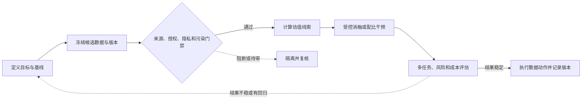
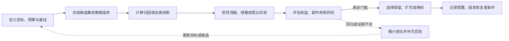

# 第十章：Data Attribution 与 Valuation

前面几章一直在回答“数据怎么采、怎么洗、怎么配”。本章讨论一个更难的问题：一条数据、一个数据源、一个数据池到底贡献了多少？

这就是 Data Attribution 与 Data Valuation。

Data Attribution 关注归因：模型某个行为、某个错误、某个能力提升，可能来自哪些训练数据。Data Valuation 关注估值：某条数据、某类数据、某个来源对目标指标有多少价值，值不值得保留、上采样、购买、标注或继续扩充。

在大模型场景下，这两个问题都非常难。因为训练数据巨大、训练成本高、模型非凸、数据之间存在强交互，几乎不可能精确回答“这条数据贡献了多少”。但工程上仍然需要近似方法，否则数据决策只能靠直觉。

本章重点：数据贡献估计、influence functions、数据选择、主动学习、数据价值评估。

合规边界：本章讨论数据价值评估、错误分析、训练数据治理和审计，不提供训练数据反推、隐私抽取或绕过数据保护的方法。

## 0. 本章范围与资料

数据归因和估值面对的是同一个困难对象：模型能力来自大量数据、训练步骤和数据交互，但工程决策必须回答“下一笔预算应该投在哪里”。因此，本章不把 attribution 当成单条样本的侦探式证明，也不把 valuation 当成脱离上下文的价格标签，而是把它们放进可回放的证据链中。

本章分别讨论源级、簇级和样本级近似，目标依赖的效用函数，influence 和 Shapley 的思想，小模型 proxy，消融实验，数据选择，主动标注优先级，负价值数据识别，以及版本化审计。重点是理解每个信号能说明什么、不能说明什么，以及何时必须回到真实训练或人工复核。

数据决策可以沿着下面的链路组织：

图中的硬门禁先于价值排序；归因线索只用来缩小候选范围，资源动作还要经过受控实验、跨任务评估和版本记录。若结果回归，回到目标与基线重新检查，而不是只调一个分数阈值。

本章不提供训练数据反推、隐私抽取或绕过数据保护的方法。任何估值结果都只是相对于模型、阶段、目标、评估集、预算和风险策略的局部证据；小模型、梯度相似或检索近邻都不能自动升级为严格因果结论。

---

## 1. 先建立直觉：为什么需要数据归因和估值？

假设你训练了一个模型，发现它在数学题上提升了 5 分，在法律问答上下降了 3 分，同时安全拒答变得过度保守。你会问：

1. 哪些数据让数学变好了？
2. 哪些数据导致法律能力下降？
3. 哪些安全数据让模型过度拒答？
4. 某个高价购买的数据源到底值不值？
5. 如果只能再标注 10 万条数据，应该标哪类？
6. 如果要删掉 20% 低价值数据，删哪里损失最小？

没有 attribution 和 valuation，团队只能靠经验拍脑袋。数据工程就会停留在“收更多、洗更干净、试试看”的阶段。

有了归因和估值，团队可以更科学地做数据选择、数据采购、质量修复、配比优化和问题定位。

---

## 2. 来龙去脉：从解释单点预测到评估数据资产

数据归因最早不是为大模型设计的。传统机器学习里，人们关心某个训练样本对某个预测有什么影响。Influence functions 是一个代表性方向。Koh 和 Liang 的工作把经典稳健统计中的 influence functions 用于解释黑盒模型预测，尝试追溯某个预测背后最有影响的训练点。

数据估值则和合作博弈里的 Shapley value 有关。Data Shapley 提出用 Shapley 思想衡量每个训练样本对模型性能的边际贡献。Jia 等工作进一步研究了基于 Shapley value 的高效数据估值近似。

这些方法在中小规模监督学习中更容易解释。但到了大模型时代，问题规模变了：

1. 数据从百万级变成万亿 token。
2. 训练一次模型成本极高。
3. 单条样本影响很小，数据源和数据分布影响更大。
4. 训练过程复杂，包含预训练、继续预训练、SFT、偏好训练和安全训练。
5. 模型能力来自数据交互，不是简单线性叠加。

因此，大模型数据估值更常用数据源级、数据簇级、任务级和配比级近似，而不是逐条精确估值。

---

## 3. Data Attribution 和 Data Valuation 的区别

Data Attribution 问的是“某个结果来自哪里”。

例如：

1. 模型为什么会输出某个错误事实？
2. 某个 benchmark 提升主要来自哪类训练数据？
3. 某个安全误拒是否来自某批安全数据？
4. 模型记住某段文本，训练集中哪些样本最相关？

Data Valuation 问的是“某个数据有多值钱”。

例如：

1. 这个数据源是否提升目标指标？
2. 这个领域数据是否值得继续采购？
3. 哪些样本最值得人工标注？
4. 哪些数据可以删掉或降权？
5. 哪些低质量数据对模型有负贡献？

简单说：attribution 更偏解释和诊断，valuation 更偏决策和资源分配。

---

## 4. 为什么大模型数据价值很难精确计算？

大模型数据价值难在几个方面。

第一，成本太高。最朴素的方法是删掉某个数据源重新训练，再看效果变化。但训练大模型成本巨大，不可能对每个数据源反复重训。

第二，数据有交互。代码数据可能增强结构化推理，数学数据可能增强验证，二者一起效果大于单独相加。单独估值会忽略交互。

第三，指标多目标。某个数据源可能提升代码能力，但降低多语言能力；提升安全性，但增加误拒。它到底“值钱”还是“不值钱”，取决于目标函数。

第四，价值随模型阶段变化。预训练阶段低价值的数据，在 SFT 阶段可能很有价值；小模型有效的数据，大模型未必同样有效。

第五，数据质量和配比耦合。一个数据源本身好，但比例过高会过拟合；一个数据源噪声大，但少量保留可增加多样性。

所以，大模型中的数据价值不是静态属性，而是相对于模型、阶段、目标、配比和评估集定义的。

### 4.1 关键公式与估值指标

把训练数据写成样本集合：

~~~math
\mathcal{D} = \{z_i \mid i = 1,\ldots,n\}
~~~

z_i 可以是一条预训练文档、一条 SFT 样本、一对 chosen/rejected 偏好样本，也可以是一个数据源中的样本。大模型数据工程里更常见的估值单元是数据源、数据簇、任务池或数据版本：

~~~math
\mathcal{C}_k = \{z_i \in \mathcal{D} \mid c_i = k\}
~~~

c_i 表示样本所属来源、领域、任务或标注批次。估值单元越大，计算越便宜，但结论也越粗；估值单元越小，越容易受到噪声和交互影响。

估值必须先定义目标效用函数：

~~~math
U(S) = \sum_{m=1}^{M} w_m M_m(S) - \lambda_R R(S) - \lambda_K K(S)
~~~

S 是被选中的数据集合，M_m(S) 是第 m 个目标指标，w_m 是业务权重，R(S) 是隐私、版权、安全和污染风险，K(S) 是采购、清洗、标注、训练和维护成本。权重和单位要由项目目标确定；这个式子不是要求把所有目标强行加成一个分数，而是把价值判断依赖的目标、风险和成本写明。

数据源级加入变化可以写成：

~~~math
\Delta^{\mathrm{add}}_k = U(S_{\mathrm{base}} \cup \mathcal{C}_k) - U(S_{\mathrm{base}})
~~~

删除变化可以写成：

~~~math
\Delta^{\mathrm{drop}}_k = U(S_{\mathrm{base}}) - U(S_{\mathrm{base}} \setminus \mathcal{C}_k)
~~~

正的 $\Delta^{\mathrm{add}}_k$ 表示在当前基线中加入数据源有净收益，正的 $\Delta^{\mathrm{drop}}_k$ 表示删除它会损失净效用。两者都依赖基线和配比，不能被解释成数据源永久不变的“价格”。

Influence functions 关心训练点 $z_i$ 对测试点 $z_*$ 的 loss 变化。标准局部推导假设参数接近经验风险的驻点，且 Hessian 可逆；实际实现可能使用阻尼、子空间或其他曲率近似。为避免把 Hessian 逆写成生产承诺，可用下面的教学记号表示：

~~~math
I_{\mathrm{up}}(z_i,z_*) = -\nabla_\theta L(z_*;\hat\theta)^\top H_{\hat\theta}^{-1}\nabla_\theta L(z_i;\hat\theta)
~~~

这里 $L(z;\theta)$ 是样本损失，$\hat\theta$ 是当前训练得到的参数，$H_{\hat\theta}$ 是训练目标在该点附近的 Hessian 或其带阻尼近似。$I_{\mathrm{up}}$ 近似描述给训练点 $z_i$ 增加极小权重时，测试点 $z_*$ 的损失变化；负值表示局部近似下测试损失下降。这个符号约定不能直接替代完整重训结果。深度非凸模型、优化路径、阻尼和分布漂移都会影响近似。

用一个二维例子看符号。设 $g_i=(1,0)^\top$、$g_*=(1,2)^\top$，并假设局部曲率近似为 $H=\begin{bmatrix}2&0\\0&1\end{bmatrix}$，则 $H^{-1}g_i=(0.5,0)^\top$，所以 $I_{\mathrm{up}}=-[(1,2)\cdot(0.5,0)]=-0.5$。这表示该训练点在这个局部二阶近似下可能降低目标损失 0.5 个损失单位；它不是 50% 的准确率提升，也不是已验证的因果效应。

梯度相似 proxy 可以写成：

~~~math
A_i = \frac{\langle g_i,g_T\rangle}{\|g_i\|_2\,\|g_T\|_2}
~~~

其中 $g_T$ 是目标任务、验证集或错误切片的梯度特征。$A_i$ 高说明梯度方向相近，只能作为候选排序线索，不能单独证明训练样本导致目标能力，也不能代替隐私、版权和污染检查。

余弦相似度要求两个梯度范数都大于 0。零梯度可能来自已饱和的样本、被 mask 的目标或尚未产生梯度的计算路径，此时结果应记为未定义，不能把零向量与目标方向相似误报为 0 或 1。类似地，单位 token 价值要求有效 token 数大于 0；没有有效 token 的数据源没有可解释的单位价值，不应记成 0。

下面用 demo 中的 `math_verified` 数据源手算一次。四个目标权重为数学 0.35、代码 0.25、安全 0.20、通用 0.20；该源对应的指标变化为 0.080、0.010、0.000、0.015，因此加权变化是 $0.35\times0.080+0.25\times0.010+0.20\times0+0.20\times0.015=0.0335$。其梯度与目标梯度的点积为 $0.758$，两个范数分别约为 $0.8768$ 和 $0.9179$，所以余弦相似度约为 $0.942$。

为演示排序，本例使用下式组合相同样本的指标变化、质量、覆盖、梯度相似、风险和成本：

~~~math
V_i^{\mathrm{proxy}} = \sum_{m=1}^{M} w_m\Delta M_{i,m} + 0.08q_i + 0.05h_i + 0.05A_i - 0.12r_i - 0.04k_i
~~~

这里 $q_i$、$h_i$、$A_i$、$r_i$ 和 $k_i$ 分别表示质量、覆盖、梯度相似、风险和归一化成本；0.08、0.05 等系数只为演示多维权衡。对 `math_verified` 代入质量 $q_i=0.92$、覆盖 $h_i=0.78$、风险 $r_i=0.03$、成本 $k_i=0.22$ 和 $A_i=0.942$，得到 $0.0335+0.0736+0.0390+0.0471-0.0036-0.0088=0.1808$。该源有 900 个有效 token，换算后约为每千 token $0.1808/900\times1000=0.2009$ 个教学效用单位。分数系数和单位都是合成示例约定，不是价格或行业标准；硬性许可、隐私与污染门禁仍在打分之前执行。

Data Shapley 把数据看成参与者，价值是不同子集中的平均边际贡献：

~~~math
\phi_i = \sum_{S\subseteq\mathcal{D}\setminus\{z_i\}} \frac{|S|!(n-|S|-1)!}{n!}\left[U(S\cup\{z_i\})-U(S)\right]
~~~

其中 $S$ 遍历不包含 $z_i$ 的子集，前面的阶乘分数是按子集大小分配的 Shapley 权重。精确遍历代价随样本数指数增长，大模型通常只在小数据池上近似，或把思想迁移到源级、簇级和任务级。

用三个参与者走完六种加入顺序，可以看见交互如何被分摊。设数学源、代码源和合成模板源是否加入分别用取值为 0 或 1 的 $M$、$C$、$T$ 表示，玩具效用定义为：

~~~math
U(M,C,T)=0.30M+0.22C-0.06T+0.08MC-0.05T(1-M)
~~~

数学源的单独收益为 0.30，代码源为 0.22，合成模板源为 -0.06；数学和代码一起出现时额外协同 +0.08；若合成模板先于数学源加入，则额外产生 -0.05 的冲突损失，数学源随后加入时会消除这项损失。例如 $U(0,0,1)=-0.11$，而 $U(1,0,1)=0.24$，所以在合成模板之后加入数学源的边际值是 $0.24-(-0.11)=0.35$。下表逐个记录每个参与者在六种加入顺序中的边际增量：

| 加入顺序 | 数学源边际值 | 代码源边际值 | 合成模板边际值 |
| --- | ---: | ---: | ---: |
| 数学 → 代码 → 合成 | 0.30 | 0.30 | -0.06 |
| 数学 → 合成 → 代码 | 0.30 | 0.30 | -0.06 |
| 代码 → 数学 → 合成 | 0.38 | 0.22 | -0.06 |
| 代码 → 合成 → 数学 | 0.43 | 0.22 | -0.11 |
| 合成 → 数学 → 代码 | 0.35 | 0.30 | -0.11 |
| 合成 → 代码 → 数学 | 0.43 | 0.22 | -0.11 |
| 六种顺序取平均 | 0.365 | 0.260 | -0.085 |

数学源在“代码已在场”时还分到一半协同收益，在“合成先到”时则会消除一部分冲突损失；代码与合成也按它们加入时的上下文计算。三个平均边际值相加为 $0.365+0.260-0.085=0.540$，恰好等于三者共同效用 $0.30+0.22-0.06+0.08=0.540$。这说明 Shapley 会把交互分配给参与者，但结果仍取决于这里定义的 utility 和参与者集合。

为了比较不同大小的数据源，可以看单位有效 token 的净价值：

~~~math
V_k^{\mathrm{unit}} = \frac{\Delta_k^{\mathrm{add}}}{T_k^{\mathrm{effective}}}
~~~

这里 $T_k^{\mathrm{effective}}$ 是经过质量、重复、污染和可用性处理后的有效 token 数。由于风险和成本已经包含在 $U(S)$ 中，单位价值只需把净增益除以有效 token，不能再重复扣一次风险和成本。这个归一化能帮助比较大小不同的数据源，但不能消除数据之间的互补关系。

最终选择可以写成带预算和覆盖约束的问题：

~~~math
\max_{\mathbf{s}\in\{0,1\}^{n}} U(\{z_i\mid s_i=1\})
\quad\text{subject to}\quad \sum_{i=1}^{n}s_i b_i\leq B,\quad R(\{z_i\mid s_i=1\})\leq\tau_R,\quad \Delta M_m\geq-\epsilon_m\ \forall m
~~~

其中 $s_i$ 表示是否选择第 $i$ 个候选，$b_i$ 是 token、标注或训练成本，$B$ 是预算，$\tau_R$ 是风险上限，$\epsilon_m$ 是第 $m$ 个指标允许的最大回退量；$\Delta M_m$ 表示所选数据相对固定基线在该指标上的变化。若目标有互补或替代关系，不能把每个数据源的单独分数相加当作真实 $U(S)$；还应按项目需要加入语言、领域、任务、来源、多样性和最小覆盖约束。

在 demo 中，预算为 3,200 tokens，每个目标允许的最大回退量是 0.01。枚举五个未阻断且未待审的正值来源，共检查 $2^5=32$ 个子集；结果选中数学、代码、安全和中文领域四个源，token 数为 $900+760+640+820=3,120$。四个目标的增量分别是数学 0.085、代码 0.080、安全 0.065、通用 0.070，均高于 -0.01；合计 proxy 值为 $0.1808+0.1599+0.1202+0.1288=0.5897$。候选排序也会随口径改变：按绝对 proxy 值，数学源排首位；按每千 token，代码源的 0.2104 高于数学源的 0.2009。这个小池的精确枚举只说明教学目标和约束下的最优组合，不能当作大规模训练数据的最优解。

如果预算内没有任何正价值且满足约束的候选，选择结果应是空集并触发补充或重新估值，而不是强行填满预算。预算选择也必须说明是固定总 token、固定训练步数还是固定计算量；否则加入数据源后总训练量增加，$\Delta^{\mathrm{add}}_k$ 可能把“训练得更多”误认为“数据更有价值”。

---

## 5. 最朴素的方法：数据消融

数据消融是最直接的数据价值评估方法。

做法是：

1. 设定 baseline 数据配比。
2. 删除或降低某个数据源。
3. 训练模型或小模型。
4. 比较 validation loss、benchmark、安全指标和人工评测。

例如，想知道代码数据是否有价值，可以训练两个小模型：一个包含代码，一个不包含代码。再比较代码 benchmark、通用问答、多语言和安全表现。

优点：

1. 直观。
2. 解释性强。
3. 和最终训练目标一致。

缺点：

1. 成本高。
2. 只能评估少量候选。
3. 小模型结论不一定外推到大模型。
4. 删除一个数据源会改变整体配比，混入其他变量。

数据消融是最可靠但最贵的方法，通常用于关键数据源和最终决策。

---

## 6. 数据源级估值

大模型中比逐条样本更常用的是数据源级估值。

数据源可以是：

1. 某个网站集合。
2. 某类书籍。
3. 某个代码数据池。
4. 某个数学题库。
5. 某个多语言语料。
6. 某个合成数据生成版本。
7. 某批偏好标注数据。

评估方法包括：

1. 源级 ablation。
2. 源级上采样/下采样实验。
3. 源级 validation loss。
4. 下游任务关联分析。
5. 质量分与收益的相关性分析。
6. 训练曲线和梯度信号观察。

数据源级估值适合回答：“这个数据池值不值得继续投入？”

---

## 7. 样本级估值

样本级估值关注单条数据的价值。它更细，但更难。

可能用途包括：

1. 找出有害样本。
2. 找出高价值标注样本。
3. 找出错误标签。
4. 选择主动学习样本。
5. 清理低质量合成数据。
6. 解释某个模型错误。

在大模型预训练中，逐条样本估值通常不可行，因为样本太多、影响太小、训练不可重复。但在 SFT、偏好训练、安全数据、领域数据等较小数据池中，样本级估值更有现实意义。

例如，DPO 数据里某些 chosen/rejected 标注可能反了；安全数据里某些拒答样本导致误拒；领域 QA 中某些专家答案过期。样本级估值可以帮助定位这些问题。

---

## 8. Influence functions：从预测追溯训练点

Influence functions 的直觉是：如果把某个训练样本权重稍微增加或删除，模型在某个测试点上的 loss 会怎样变化？前面的局部例子得到 $-0.5$，只说明在给定曲率和梯度下的近似方向；实际排序要固定 checkpoint、目标 loss、参数子集、阻尼和验证样本，并检查高排名样本是否能被小规模 downweight 实验复现。

它可以用于回答：哪些训练样本最影响这个预测？

优点：

1. 可解释性强。
2. 适合错误诊断。
3. 可用于发现数据错误。
4. 不一定需要完整重训每个样本。

局限：

1. 依赖近似。
2. 对深度非凸模型不稳定。
3. 计算 Hessian-vector 相关量成本高。
4. 大模型规模下很难直接使用。
5. 训练过程中的优化路径影响难以完全捕捉。

所以在大模型里，influence 思想更常被用于小模型、embedding 近邻、数据簇分析、SFT 数据诊断，而不是直接对万亿 token 预训练做精确 influence 计算。

---

## 9. Shapley value 和 Data Shapley

Shapley value 来自合作博弈，思想是公平分配多个参与者对整体收益的贡献。用于数据估值时，每条数据被看作参与者，模型性能是整体收益。

Data Shapley 的直觉是：一条数据的价值等于它在不同数据子集里加入后带来的平均边际提升。

优点：

1. 理论性质好。
2. 能考虑数据之间的交互。
3. 可用于发现高价值、低价值和有害数据。
4. 可指导数据采购和数据清洗。

缺点：

1. 精确计算极其昂贵。
2. 需要大量训练或近似训练。
3. 在大模型预训练规模下不可直接使用。
4. 结果依赖目标评估集。
5. 样本价值不是通用常数。

因此，Shapley 更适合作为估值思想和小规模数据池工具，而不是大模型全量 token 估值的直接方案。

---

## 10. 近似方法：从精确估值到可用信号

工程上常见近似可以按它们回答的问题分成三类：

| 方法族 | 主要回答 | 可以支持什么 | 单独不能证明什么 |
| --- | --- | --- | --- |
| 近邻、embedding、loss、训练动态 | 哪些候选与目标或模型困难样本相近？ | 生成待审候选、分层和补充标注 | 候选造成了行为、可合法使用或对其他任务有净收益 |
| Influence、梯度相似、TRAK 等归因 | 某个训练点对当前目标输出或 loss 有何局部影响线索？ | 在固定模型、目标和近似下排序诊断样本 | 对完整预训练轨迹的精确因果贡献 |
| Shapley、子集消融、数据选择器 | 一组候选在特定 utility、预算和对照下是否值得保留？ | 比较指定数据池与目标下的资源动作 | 脱离 utility、模型阶段和评估集的通用“数据价格” |

小模型 proxy、随机子集、分桶评估、LLM judge 和人工抽审可以补充这些路线，但应分别报告采样误差、标注噪声、目标依赖和人工成本。多个弱信号可以用来缩小搜索范围，却不能通过简单投票变成因果证明。

---

## 11. 数据选择

数据估值最终要服务数据选择。

数据选择的目标包括：

1. 在固定 token budget 下选最有价值数据。
2. 删除低质量或负贡献数据。
3. 上采样目标能力相关数据。
4. 降低重复和污染。
5. 控制安全和隐私风险。
6. 平衡通用能力和专项能力。

常见数据选择策略：

1. 质量分阈值。
2. 来源信誉。
3. 与目标任务 embedding 相似。
4. 多样性采样。
5. 难例优先。
6. 低 loss 或中等 loss 筛选。
7. 人工审核优先级。
8. 小模型收益验证。

注意，数据选择不是只选“最像评测集”的数据。那样容易过拟合 benchmark，损害泛化和多样性。

---

## 12. 主动学习和标注优先级

主动学习关注：在标注预算有限时，哪些样本最值得标注？

在大模型数据工程中，主动学习常用于：

1. SFT 数据标注。
2. 偏好数据标注。
3. 安全边界样本标注。
4. 专业领域专家标注。
5. 多模态 caption 或 QA 标注。

常见选择信号包括：

1. 模型不确定性高。
2. 多个模型分歧大。
3. 用户频率高。
4. 风险等级高。
5. 目标能力薄弱。
6. 代表性强。
7. 与已有数据差异大。

主动学习的核心不是找最难样本，而是在价值、覆盖、风险和标注成本之间做权衡。

---

## 13. 负价值数据

不是所有数据都有正贡献。有些数据会伤害模型。

负价值数据包括：

1. 错误标注。
2. 低质量合成数据。
3. 重复模板。
4. 过时专业知识。
5. 含隐私或敏感信息的数据。
6. benchmark 泄漏数据。
7. 不安全或不合规回答。
8. 与目标产品风格冲突的数据。
9. 引导模型过度拒答的数据。

数据估值的一个重要用途就是发现负价值数据。删掉坏数据有时比增加好数据更有效。

---

## 14. Attribution 在错误分析中的用途

当模型出现错误时，data attribution 可以帮助定位原因。

例如：

1. 模型输出错误医学知识，追溯到过时网页或低质量论坛。
2. 模型在某语言上表现差，发现低资源语言数据被质量过滤误删。
3. 模型安全误拒，发现某类安全数据过度保守。
4. 模型代码生成过时 API，发现训练数据中旧版本文档占比过高。
5. 模型在某 benchmark 异常高，发现训练集中存在题目泄漏。

这里的 attribution 不一定是精确数学归因，更多是证据链：相似训练样本、数据源统计、版本变更、消融实验和人工审计共同支持结论。

---

## 15. 数据估值和 Data Mixture 的关系

Data valuation 直接服务 data mixture。

如果某个数据源对目标任务收益高，可以上采样或扩充。如果某个数据源对安全有副作用，可以隔离或降权。如果某个合成数据版本提升 benchmark 但降低人工质量，需要重新生成或调低比例。

但估值不能只看单项指标。

例如：

1. 代码数据提升 HumanEval，但可能影响自然语言风格。
2. 安全数据降低漏拒，但可能增加误拒。
3. 多语言数据提升目标语言，但可能占用英语和代码 token budget。
4. 合成数据提升格式遵循，但可能造成模板化。

所以数据估值要输出多维价值向量，而不是单一分数。

---

## 16. 数据估值的工程指标

一个数据源的工程价值可以从多个维度衡量：

1. 目标能力收益。
2. 通用能力副作用。
3. 安全风险。
4. 隐私风险。
5. 版权和授权成本。
6. 清洗成本。
7. 标注成本。
8. 去重后有效 token 数。
9. 多样性贡献。
10. 时效性。
11. 可追溯性。
12. 对产品场景的覆盖度。

真实项目里，数据价值不是学术意义上的准确率提升，而是收益、成本、风险和可治理性的组合。

---

## 17. 大模型中的 practical attribution

在大模型里，一个更实用的 attribution pipeline 可能是：

1. 对问题样本做 embedding 检索，找相似训练样本和数据源。
2. 检查数据版本和来源统计。
3. 分析相关数据源在训练前后的配比变化。
4. 做小规模 ablation 或 downweight 实验。
5. 观察目标评估集和人工样例变化。
6. 对可疑数据做人审。
7. 将结论转成清洗规则、配比调整或标注任务。

这比追求单条样本的精确因果归因更现实。

近期研究展示了不同的规模化路线，但实验单位并不相同：

| 方法 | 主要机制与作者实验 | 结果的适用边界 |
| --- | --- | --- |
| [TRAK](https://proceedings.mlr.press/v202/park23c.html) | 随机投影后的 after-kernel 归因；作者在图像分类、CLIP、BERT 和 mT5 等设置中比较可扩展性。 | 支持在指定可微模型和任务中计算预测归因，不是完整训练轨迹的因果分解。 |
| [DataInf](https://arxiv.org/abs/2310.00902) 与 [LoGra](https://arxiv.org/abs/2405.13954) | DataInf 研究 LoRA 微调模型的 influence 近似，实验包含 Llama-2-13B-chat；LoGra 对梯度作投影，在 Llama-3-8B-Instruct 与 1B-token 数据实验中报告相对其可运行基线最高 6,500 倍吞吐和 5 倍显存下降。 | DataInf 面向受限可训练参数的影响估计；LoGra 数字绑定其实现、基线与实验设置，二者都不是对任意全量预训练的同等保证。 |
| [Mechanistic Data Attribution](https://proceedings.mlr.press/v306/chen26cv.html) | 将 influence 线索用于 Pythia 系列的可解释单元来源追踪；作者报告针对高影响样本做定向增删会改变特定 interpretable heads，随机干预未见同样效果。 | 这是特定模型家族、机制单元和干预设置的因果证据，不等同于数据源对总体能力的通用估值。 |
| [PreSelect](https://proceedings.mlr.press/v267/shum25a.html) | 用 fastText scorer 选择预测下游能力的预训练数据；作者在 1B/3B 模型实验中报告 30B 选择 token 可超过其 300B vanilla 对照。 | 这是特定数据和目标下的预测式数据选择结果，不等于逐条训练数据归因或可普遍缩小十倍预算。 |
| [BLISS](https://proceedings.mlr.press/v306/hao26b.html) | 通过小型 proxy 的多步更新训练双层 score model，尝试建模训练过程中数据偏好变化；作者在选定 C4 子集和多种小模型设置中报告结果。 | 1B 配置下报告的 1.7 倍达到同等表现速度绑定论文基线、数据子集和评价任务，不外推为通用预训练收益。 |
| [OPUS](https://proceedings.mlr.press/v306/wang26gc.html) | 在优化器诱导的更新空间估计候选效用，用于逐步预训练选择；作者报告额外计算开销为 4.7%，并在论文设置中的从头预训练与 mid-training 阶段比较基线。 | 开销与收益绑定论文模型、语料、优化器和实验协议；不证明所有训练栈都能获得相同收益。 |
| [Convex Dataset Valuation for Post-Training](https://proceedings.mlr.press/v306/zeng26k.html) | 在梯度空间用 kernel mean matching 联合考虑目标任务对齐与候选数据冗余，处理预算受限的后训练数据集选择。 | 面向论文中的后训练设置与预算问题；不能替代许可、隐私和独立安全门禁，也不代表所有预训练配比问题。 |
| [RISE](https://arxiv.org/abs/2604.16197)（2026 预印本） | 在输出侧 readout 构造 lexical residual 与 semantic projected-error 两类 sketch，分别评估回溯归因和 zero-shot 前瞻估值；作者在 OLMo/Pythia 系列报告索引存储最高压缩 112 倍，并扩展到 32B 模型。 | 尚为预印本，假设、架构适配和论文任务的结果需要独立复核；不能替代目标模型上的干预实验。 |

这些结果的模型、训练阶段、数据量、选择比例和评估协议不同，不能把其倍数排成统一排行榜。它们共同支持的是：可以降低候选筛选或归因近似的成本；最终资源决策仍要回到固定预算下的目标任务实验、风险门禁和切片评估。

---

## 18. 机制与边界：数据价值是目标依赖的边际贡献

从机制上看，数据价值不是数据本身的固定属性，而是目标依赖的边际贡献。

同一条数据在不同情况下价值不同：

1. 在缺少数学数据时，一条高质量数学题很有价值。
2. 在数学数据已经过量时，它的边际价值下降。
3. 对通用助手有价值的数据，对法律模型未必有价值。
4. 对小模型有价值的数据，对大模型可能只是重复。
5. 对训练有价值的数据，对评估可信度可能有污染风险。

因此，讨论数据价值必须同时说明：目标模型、训练阶段、评估指标、已有数据分布和风险约束。

---

## 19. 一个可落地的数据归因和估值方案

一个可落地的数据归因与估值流程，先要把“价值”改写成可观察的目标。目标可以是提升数学、代码、多语言、安全或事实性，也可以是降低幻觉、误拒和单位成功成本。若目标没有写清，任何 source ranking 都只是把隐含偏好伪装成数字。

随后建立数据元信息：来源、语言、领域、质量分、去重簇、license、token 数、时间、隐私状态、污染状态和版本。离线检查完成后，再用加入、删除、上采样和下采样实验测量源级变化；用 embedding、关键词、领域分类、validation loss 和人工样例解释它覆盖的能力；用通用能力、安全、误拒、幻觉、多语言和风格指标观察副作用。

最后把采购、清洗、标注、授权、隐私、训练和维护成本放进同一份决策记录，形成保留、扩充、上采样、降权、隔离、重洗或删除等动作。每次动作都要绑定数据版本、实验配置、评估矩阵和理由，下一次回放时才能区分真实收益与随机波动。

### 19.1 最小可运行数据归因与估值 demo

**代码状态：已验证（2026-10-28，Python 3.12.9，标准库；固定合成样本，无外部依赖）。**

将代码保存为 `data_valuation_demo.py`，运行 `python3 data_valuation_demo.py`。

下面的 demo 不依赖外部库，也不读写文件。输入是七个合成数据源，输出包含目标任务梯度相似度、源级 proxy 价值、每千有效 token 的单位值、硬门禁与软复核分流、固定预算下的精确小规模组合选择，以及三参与者的 Shapley 估值。硬性阻断、软复核和负向效用分开记录；空梯度或零 token 的单位值记为 `None`。

它演示的是小型合成池上的决策口径，不是真实 influence function、生产级 Shapley、完整小模型训练或大规模数据选择系统。示例用枚举得到该 toy pool 中满足预算和各目标不回退超过 0.01 的最高 proxy 总值；这不代表该启发式分数是模型的真实效用，也不代表大规模选择的全局最优。真实系统还需受控训练、独立评估、人工审计和合规系统。

~~~python
from itertools import combinations, permutations
from math import isfinite, sqrt

weights = {"math": 0.35, "code": 0.25, "safety": 0.20, "general": 0.20}
target_grad = [0.70, 0.55, 0.20, 0.10]
sources = [
    {"id": "math_verified", "tokens": 900, "quality": 0.92, "coverage": 0.78, "risk": 0.03, "cost": 0.22, "license_ok": True, "privacy": False, "contam": False, "grad": [0.82, 0.28, 0.12, 0.06], "delta": {"math": 0.080, "code": 0.010, "safety": 0.000, "general": 0.015}},
    {"id": "code_tests", "tokens": 760, "quality": 0.88, "coverage": 0.71, "risk": 0.04, "cost": 0.18, "license_ok": True, "privacy": False, "contam": False, "grad": [0.34, 0.86, 0.10, 0.04], "delta": {"math": 0.010, "code": 0.070, "safety": 0.000, "general": 0.010}},
    {"id": "safety_boundary", "tokens": 640, "quality": 0.84, "coverage": 0.66, "risk": 0.05, "cost": 0.15, "license_ok": True, "privacy": False, "contam": False, "grad": [0.18, 0.12, 0.88, 0.18], "delta": {"math": -0.005, "code": 0.000, "safety": 0.060, "general": -0.005}},
    {"id": "zh_domain", "tokens": 820, "quality": 0.80, "coverage": 0.73, "risk": 0.06, "cost": 0.12, "license_ok": True, "privacy": False, "contam": False, "grad": [0.40, 0.20, 0.15, 0.80], "delta": {"math": 0.000, "code": 0.000, "safety": 0.005, "general": 0.050}},
    {"id": "synthetic_template", "tokens": 700, "quality": 0.50, "coverage": 0.42, "risk": 0.22, "cost": 0.05, "license_ok": True, "privacy": False, "contam": False, "grad": [0.20, 0.18, 0.10, 0.15], "delta": {"math": 0.020, "code": 0.010, "safety": -0.020, "general": -0.030}},
    {"id": "old_legal_forum", "tokens": 680, "quality": 0.46, "coverage": 0.35, "risk": 0.36, "cost": 0.08, "license_ok": True, "privacy": False, "contam": False, "grad": [0.08, 0.04, 0.20, 0.34], "delta": {"math": 0.000, "code": 0.000, "safety": -0.300, "general": -0.200}},
    {"id": "benchmark_leak", "tokens": 520, "quality": 0.90, "coverage": 0.40, "risk": 0.70, "cost": 0.04, "license_ok": True, "privacy": False, "contam": True, "grad": [0.75, 0.25, 0.05, 0.05], "delta": {"math": 0.090, "code": 0.000, "safety": 0.000, "general": 0.000}},
]

assert set(weights) == {"math", "code", "safety", "general"}
assert abs(sum(weights.values()) - 1.0) < 1e-12
assert all(isfinite(value) and 0.0 <= value <= 1.0 for value in weights.values())
assert len(target_grad) == 4 and all(isfinite(value) for value in target_grad)
assert len({source["id"] for source in sources}) == len(sources)
for source in sources:
    assert type(source["tokens"]) is int and source["tokens"] > 0
    assert all(type(source[key]) is bool for key in ("license_ok", "privacy", "contam"))
    assert all(isfinite(source[key]) and 0.0 <= source[key] <= 1.0 for key in ("quality", "coverage", "risk", "cost"))
    assert set(source["delta"]) == set(weights)
    assert all(isfinite(value) and -1.0 <= value <= 1.0 for value in source["delta"].values())
    assert len(source["grad"]) == len(target_grad) and all(isfinite(value) for value in source["grad"])

def dot(a, b):
    return sum(x * y for x, y in zip(a, b))

def norm(a):
    return sqrt(dot(a, a))

def cosine(a, b):
    denominator = norm(a) * norm(b)
    return dot(a, b) / denominator if denominator else None

def hard_block_reasons(source):
    reasons = []
    if not source["license_ok"]:
        reasons.append("license_or_source")
    if source["privacy"]:
        reasons.append("privacy_or_sensitive")
    if source["contam"]:
        reasons.append("eval_contamination")
    return reasons

def review_reasons(source):
    reasons = []
    if source["risk"] > 0.30:
        reasons.append("high_risk")
    if source["quality"] < 0.48:
        reasons.append("low_quality")
    return reasons

def weighted_delta(source):
    return sum(weights[key] * source["delta"][key] for key in weights)

def source_value(source):
    if hard_block_reasons(source):
        return None
    grad_sim = cosine(source["grad"], target_grad)
    if grad_sim is None:
        return None
    return (
        weighted_delta(source)
        + 0.08 * source["quality"]
        + 0.05 * source["coverage"]
        + 0.05 * grad_sim
        - 0.12 * source["risk"]
        - 0.04 * source["cost"]
    )

def value_per_token(value, tokens):
    return value / tokens if value is not None and tokens > 0 else None

rows = []
for source in sources:
    value = source_value(source)
    grad_sim = cosine(source["grad"], target_grad)
    rows.append({
        "id": source["id"],
        "value": value,
        "grad_sim": grad_sim,
        "blocked": hard_block_reasons(source),
        "review": review_reasons(source),
    })
row_by_id = {row["id"]: row for row in rows}
source_by_id = {source["id"]: source for source in sources}
ranked = sorted(rows, key=lambda row: row["value"] if row["value"] is not None else float("-inf"), reverse=True)
negative_sources = [row["id"] for row in ranked if row["value"] is not None and row["value"] < 0]
blocked_sources = [(row["id"], row["blocked"]) for row in rows if row["blocked"]]
review_sources = [(row["id"], row["review"]) for row in rows if row["review"] and not row["blocked"]]
unit_values = {
    source["id"]: None if value_per_token(row_by_id[source["id"]]["value"], source["tokens"]) is None
    else round(value_per_token(row_by_id[source["id"]]["value"], source["tokens"]) * 1000, 4)
    for source in sources for row in [row_by_id[source["id"]]]
}

budget = 3200
metric_floor = {key: -0.01 for key in weights}

def metric_delta(subset):
    return {
        key: sum(source["delta"][key] for source in subset)
        for key in weights
    }

def choose_subset(candidates, token_budget):
    best_ids, best_tokens, best_value = [], 0, 0.0
    best_key = (0.0, 0, ())
    for size in range(len(candidates) + 1):
        for subset in combinations(candidates, size):
            used = sum(source["tokens"] for source in subset)
            if used > token_budget:
                continue
            deltas = metric_delta(subset)
            if any(deltas[key] < metric_floor[key] for key in weights):
                continue
            total = sum(row_by_id[source["id"]]["value"] for source in subset)
            ids = tuple(source["id"] for source in subset)
            candidate_key = (round(total, 12), -used, ids)
            if candidate_key > best_key:
                best_key = candidate_key
                best_ids, best_tokens, best_value = list(ids), used, total
    selected_sources = [source_by_id[source_id] for source_id in best_ids]
    return {
        "ids": best_ids,
        "tokens": best_tokens,
        "value": best_value,
        "metric_delta": metric_delta(selected_sources),
    }

eligible = [
    source for source in sources
    if row_by_id[source["id"]]["value"] is not None
    and row_by_id[source["id"]]["value"] > 0
    and not row_by_id[source["id"]]["review"]
]
selection = choose_subset(eligible, budget)

players = ["math_verified", "code_tests", "synthetic_template"]
base_gain = {"math_verified": 0.30, "code_tests": 0.22, "synthetic_template": -0.06}

def utility(subset):
    subset = set(subset)
    score = sum(base_gain[player] for player in subset)
    if {"math_verified", "code_tests"}.issubset(subset):
        score += 0.08
    if "synthetic_template" in subset and "math_verified" not in subset:
        score -= 0.05
    return score

shapley = {player: 0.0 for player in players}
orders = list(permutations(players))
for order in orders:
    prefix = []
    for player in order:
        shapley[player] += utility(prefix + [player]) - utility(prefix)
        prefix.append(player)
shapley = {key: round(value / len(orders), 4) for key, value in shapley.items()}

selected_set = set(selection["ids"])
selected_delta = selection["metric_delta"]
checks = {
    "hard_blocks_not_selected": not (selected_set & {source_id for source_id, _ in blocked_sources}),
    "review_sources_not_auto_selected": not (selected_set & {source_id for source_id, _ in review_sources}),
    "negative_sources_exposed": bool(negative_sources),
    "budget_respected": selection["tokens"] <= budget,
    "task_floors_met": all(selected_delta[key] >= metric_floor[key] for key in weights),
    "interaction_visible": shapley["math_verified"] > 0.30 and shapley["code_tests"] > 0.20,
    "empty_pool_returns_empty": choose_subset([], budget)["ids"] == [],
    "zero_gradient_is_undefined": cosine([0.0] * len(target_grad), target_grad) is None,
    "zero_token_unit_value_is_undefined": value_per_token(0.5, 0) is None,
}
report = {
    "ranked_sources": [(row["id"], None if row["value"] is None else round(row["value"], 4)) for row in ranked],
    "value_per_1k_tokens": unit_values,
    "top_attribution": [
        (row["id"], round(row["grad_sim"], 3))
        for row in sorted((row for row in rows if row["grad_sim"] is not None), key=lambda row: row["grad_sim"], reverse=True)[:3]
    ],
    "selected_under_budget": selection["ids"],
    "used_tokens": selection["tokens"],
    "selected_metric_delta": {key: round(value, 3) for key, value in selected_delta.items()},
    "selected_value": round(selection["value"], 4),
    "negative_sources": negative_sources,
    "review_sources": review_sources,
    "blocked_sources": blocked_sources,
    "shapley_demo": shapley,
    "checks": checks,
}
report["signals"] = {
    "top_source_by_absolute_value": ranked[0]["id"],
    "top_source_per_1k_tokens": max(unit_values, key=lambda key: unit_values[key] if unit_values[key] is not None else float("-inf")),
    "selected_value": report["selected_value"],
    "negative_sources": negative_sources,
}
report["actions"] = [
    "exclude_hard_blocked_sources",
    "review_soft_hold_and_negative_sources",
    "run_source_level_ablation",
]
report["decision"] = "continue_to_source_ablation" if all(checks.values()) else "hold_for_valuation_review"

for key, value in report.items():
    print(f"{key}=", value)

license_probe = dict(sources[0], id="license_probe", license_ok=False)
privacy_probe = dict(sources[0], id="privacy_probe", privacy=True)
zero_gradient_probe = dict(sources[0], id="zero_gradient_probe", grad=[0.0] * len(target_grad))
assert report["selected_under_budget"] == ["math_verified", "code_tests", "safety_boundary", "zh_domain"]
assert report["used_tokens"] == 3120
assert report["selected_metric_delta"] == {"math": 0.085, "code": 0.08, "safety": 0.065, "general": 0.07}
assert report["selected_value"] == 0.5897
assert report["negative_sources"] == ["old_legal_forum"]
assert report["review_sources"] == [("old_legal_forum", ["high_risk", "low_quality"])]
assert report["blocked_sources"] == [("benchmark_leak", ["eval_contamination"])]
assert report["value_per_1k_tokens"]["math_verified"] == 0.2009
assert report["value_per_1k_tokens"]["code_tests"] == 0.2104
assert report["shapley_demo"] == {"math_verified": 0.365, "code_tests": 0.26, "synthetic_template": -0.085}
assert all(checks.values())
assert report["decision"] == "continue_to_source_ablation"
assert source_value(license_probe) is None
assert source_value(privacy_probe) is None
assert source_value(zero_gradient_probe) is None
assert value_per_token(0.5, 0) is None
assert choose_subset([], budget)["ids"] == []
~~~

运行输出：

~~~text
ranked_sources= [('math_verified', 0.1808), ('code_tests', 0.1599), ('zh_domain', 0.1288), ('safety_boundary', 0.1202), ('synthetic_template', 0.0782), ('old_legal_forum', -0.0716), ('benchmark_leak', None)]
value_per_1k_tokens= {'math_verified': 0.2009, 'code_tests': 0.2104, 'safety_boundary': 0.1878, 'zh_domain': 0.1571, 'synthetic_template': 0.1117, 'old_legal_forum': -0.1053, 'benchmark_leak': None}
top_attribution= [('math_verified', 0.942), ('benchmark_leak', 0.93), ('synthetic_template', 0.922)]
selected_under_budget= ['math_verified', 'code_tests', 'safety_boundary', 'zh_domain']
used_tokens= 3120
selected_metric_delta= {'math': 0.085, 'code': 0.08, 'safety': 0.065, 'general': 0.07}
selected_value= 0.5897
negative_sources= ['old_legal_forum']
review_sources= [('old_legal_forum', ['high_risk', 'low_quality'])]
blocked_sources= [('benchmark_leak', ['eval_contamination'])]
shapley_demo= {'math_verified': 0.365, 'code_tests': 0.26, 'synthetic_template': -0.085}
checks= {'hard_blocks_not_selected': True, 'review_sources_not_auto_selected': True, 'negative_sources_exposed': True, 'budget_respected': True, 'task_floors_met': True, 'interaction_visible': True, 'empty_pool_returns_empty': True, 'zero_gradient_is_undefined': True, 'zero_token_unit_value_is_undefined': True}
signals= {'top_source_by_absolute_value': 'math_verified', 'top_source_per_1k_tokens': 'code_tests', 'selected_value': 0.5897, 'negative_sources': ['old_legal_forum']}
actions= ['exclude_hard_blocked_sources', 'review_soft_hold_and_negative_sources', 'run_source_level_ablation']
decision= continue_to_source_ablation
~~~

这个 demo 的重点是：高 attribution 相似度不等于可训练价值。`benchmark_leak` 和目标梯度很相似，但因为评测污染必须被阻断；`old_legal_forum` 虽然有一点覆盖度，但质量低、风险高且带来负向指标，应进入重洗或降权候选。

---

## 20. 决策边界：归因证据如何支持数据决策

归因和估值都在回答“数据与结果之间有什么关系”，但它们的证据责任不同。attribution 更接近解释一个错误或能力变化的来源，valuation 更接近比较候选数据对资源分配的净效用。前者找到相关训练点，不等于证明它们造成了结果；后者得到高分，也不等于数据可以购买、训练或再分发。

### 20.1 相关性、归因和因果性要分层

相似检索、关键词命中和梯度相似只能说明候选数据与目标任务接近。它们适合生成待审列表，不能单独说明“这条数据导致了模型回答”。更强的证据来自源级消融、配比对照、不同随机种子复现和独立任务评估；最强的工程证据通常仍然是受控重训或可回放的训练实验。

可以把证据强度分成三层：候选线索、干预关联和重复干预。候选线索用于缩小范围，干预关联用于比较加入/删除后的行为变化，重复干预用于判断结果是否稳定。报告时应明确当前结论停在哪一层，而不是把三个层级写成同一个 attribution score。

### 20.2 Influence functions：局部解释，不是大模型真相

Influence functions 的价值在于提供一个局部敏感性问题：训练点权重略微变化时，某个测试点 loss 可能如何变化。它能帮助发现错误标注、相似训练样本和异常数据簇，尤其适合小模型、SFT 和局部错误诊断。

它的边界同样重要。Hessian 逆的近似、训练路径、参数非凸性、优化器状态和分布变化都会影响结果。若模型已经经过多个阶段训练，某个预训练样本的局部 influence 不能直接解释后训练行为。使用时应保存模型 checkpoint、目标样本、梯度层、近似方法和随机种子，并用实际 downweight 或小规模删除实验复核高排名候选。

### 20.3 Shapley：处理交互，但代价和目标依赖仍在

Shapley 思想把数据看作参与者，观察它在不同子集中的平均边际贡献，因此比一次 ablation 更能表达互补和替代关系。数学数据和代码数据一起出现时可能产生协同，重复网页和相似模板则可能相互稀释；单独看每个源的平均收益会漏掉这些关系。

但 Shapley 的价值依赖 utility 定义。如果 utility 只看 benchmark，污染数据可能得到很高的价值；如果 utility 还包含安全、成本、版权和多样性，排序就会改变。近似算法还会引入采样误差，因此应报告子集数量、估计方差、目标评估集和是否使用污染隔离。

### 20.4 小模型 proxy 和真实训练如何衔接

小模型 proxy 的作用是便宜地筛选候选，而不是提前宣判最终结果。它适合比较明显低质源、语言覆盖和粗粒度配比，不能保证同一排序会在更大模型、更多训练步或不同 tokenizer 上保持不变。

一个稳妥的流程是：先用小模型和离线特征筛出少量候选，再在匹配训练阶段的中型模型上做源级 ablation，最后把关键决策放入目标模型的有限预算实验。每一层都要保留未选的对照组，否则只能看到被优化过的路径，看不到筛选偏差。

### 20.5 负价值数据与风险阻断不是同一件事

低 utility 可能表示数据没帮助，负 utility 可能表示它损害了目标指标；污染、未授权和敏感数据则可能即使 utility 很高也必须阻断。demo 中 benchmark_leak 与目标梯度相似，却不能进入训练；这说明价值排序必须在合规和评测完整性约束之后解释。

还要区分负价值和暂时低边际价值。一个数学源在数学数据稀缺时可能很有用，过量后边际收益下降；一个低资源语言源在总体 loss 上不显眼，却可能对该语言的用户任务不可替代。删除动作必须查看分桶结果、长尾覆盖和替代来源，而不是只看平均分。

### 20.6 主动学习：标注预算应该购买信息

主动学习的目标不是把最难样本全部交给标注者，而是在价值、代表性、风险和标注成本之间选择下一批信息。高不确定性样本可能是边界案例，也可能只是噪声；高模型分歧样本可能暴露 rubric 缺陷，也可能来自输入本身不可判定。

标注优先级可以写成一个待排序对象：

~~~math
\mathbf{p}_i = (u_i,d_i,g_i,r_i,c_i)
~~~

其中 $u_i$ 是模型不确定性，$d_i$ 是模型或标注者分歧，$g_i$ 是目标能力覆盖缺口，$r_i$ 是风险等级，$c_i$ 是预计标注成本。它是一个多维待审向量，不存在脱离任务的自然总排序；实际决策应先分桶，再由风险策略和标注预算决定复核顺序。安全、医学、法律和隐私样本需要更高的专家门槛；普通风格样本可以使用更便宜的标注策略。

### 20.7 什么时候可以把估值用于资源分配

当目标指标和分母固定、数据版本可回放、污染和授权状态明确、候选排序在独立切片上相对稳定，并且至少有一轮小规模干预实验时，估值才适合支持采购、扩充或降权。若只有一个 benchmark、一个随机种子和一个相似度分数，应把结论限定为“待验证候选”。

资源动作还要有反事实对照。例如决定采购某源时，至少比较同等 token 预算下的替代源；决定删掉某源时，观察数据量减少、配比变化和训练步数不变分别造成什么影响。否则“这个源有效”可能只是“这次训练总 token 增多了”。

---

## 21. 失败模式与修复顺序

### 21.1 把 valuation 分数当成数据价格

估值分数是相对于目标和成本的净效用近似，不是市场价格，也不是创作者补偿或法律权利的自动依据。采购决策还需要许可、可持续供给、质量稳定性、删除能力和合同条款。

### 21.2 只用一个 benchmark 训练估值器

单一 benchmark 很容易让数据选择器围绕题型、模板或污染线索优化。至少要加入目标任务、邻近任务、通用能力、安全、长尾语言和人工样例，并把训练数据与评估数据隔离。

### 21.3 用小模型排序直接外推大模型

模型尺寸、tokenizer、训练步数和优化阶段不同，会改变数据的边际价值。小模型 proxy 只能降低搜索成本，关键排序必须在更接近生产条件的实验中复核。

### 21.4 删除源的同时改变了所有变量

删除一个数据源通常会同时改变总 token、训练步数、其他数据比例、去重率和 batch 分布。对照实验应固定能固定的变量，并报告无法固定的变量；否则 $\Delta^{\mathrm{drop}}_k$ 不能归因于源本身。

### 21.5 只选正向数据，破坏分布和多样性

高分数据可能集中于头部语言、短任务和评测风格。过度筛选会删除真实口语、长尾领域和困难但有代表性的样本。数据选择必须保留覆盖约束、来源多样性和自然分布锚点。

### 21.6 梯度相似度高就允许训练

梯度相似度没有回答是否有授权、是否含 PII、是否污染评测、是否重复或是否会产生副作用。它最多决定“优先审查哪些样本”，不能绕过数据治理。

### 21.7 把异常 loss 直接当成负价值

高 loss 可能是错误样本，也可能是新知识、低资源语言、难例或有价值的边界任务。先按语言、领域、长度和来源分桶，再做人工抽样和消融，不能用一个 loss 阈值批量删除。

### 21.8 忽略版本和派生数据

同一数据源经过清洗、翻译、合成、去重和配比后，已经不是同一个数据对象。归因报告必须绑定快照和派生血缘，否则后续无法解释排名变化，更无法响应删除或污染事件。

---

## 22. 从估值信号到可回放的数据决策

数据估值的终点不是输出一个排行榜，而是形成一条可以被复查的决策记录：

目标定义要写清任务、模型阶段、评估集和权重；候选构造要写清数据源、簇和样本边界；线索估值要保存相似检索、梯度、loss 或 Shapley 近似的配置；干预实验要保存基线、随机种子、训练 token 和替代源；多维评估要覆盖收益、副作用、风险和长尾；数据动作要写明保留、扩充、降权、隔离、重洗或删除。

一个最小的归因包应包含：目标样本和评估集 hash、数据快照、候选排名、近似算法、源级消融、人工复核、风险与许可状态、训练配置、结果区间和决策人。之后如果模型在法律、代码或安全切片上发生变化，团队可以回放当时的证据，而不是重新凭记忆解释一遍。

---

## 23. 资料与证据边界

本章把资料分成经典方法论文、数据选择研究和治理框架。经典论文支持 influence 与 Shapley 的概念和近似方法；数据选择论文支持在特定模型、任务和预算下筛选数据的实验观察；治理框架支持风险、责任和审计的组织方式。它们都不能单独证明当前项目的数据许可、隐私合规或最终模型因果归因。

主要原始资料如下：

1. Koh 和 Liang，《Understanding Black-box Predictions via Influence Functions》，<https://arxiv.org/abs/1703.04730>。它是 influence functions 用于训练数据解释的经典公开入口，支持局部影响近似的理论背景，不代表大模型中可以无成本精确求解。
2. Ghorbani 和 Zou，《Data Shapley: Equitable Valuation of Data for Machine Learning》，<https://arxiv.org/abs/1904.02868>。它给出数据 Shapley 的数据估值框架，支持边际贡献和交互的叙述；实际大模型应用仍需要近似和目标限定。
3. Jia 等，《Towards Efficient Data Valuation Based on the Shapley Value》，<https://proceedings.mlr.press/v89/jia19a.html>。它研究 Shapley 数据估值的高效近似，支持“精确计算昂贵、近似要说明采样和目标”的讨论；实验不是大模型全量预训练评估。
4. Pruthi 等，《Estimating Training Data Influence by Tracing Gradient Descent》，<https://arxiv.org/abs/2002.08484>。它提出通过训练轨迹估计数据影响的路线，支持 TracIn 类信号的研究背景。
5. 《Dataset Cartography: Mapping and Diagnosing Datasets with Training Dynamics》，<https://arxiv.org/abs/2009.10795>。它支持使用训练动态分析数据集区域和疑难样本的思路，不等于异常样本都应删除。
6. Xie 等，《DoReMi: Optimizing Data Mixtures Speeds Up Language Model Pretraining》，<https://arxiv.org/abs/2305.10429>。它说明数据混合可以通过目标验证损失进行优化，支持数据配比与估值相互影响的叙述。
7. Xia 等，《LESS: Selecting Influential Data for Targeted Instruction Tuning》，<https://arxiv.org/abs/2402.04333>。它提供目标指令调优中影响数据选择的研究案例，结论仍受目标任务和实验条件约束。
8. Park 等，《TRAK: Attributing Model Behavior at Scale》，<https://proceedings.mlr.press/v202/park23c.html>。它提出可扩展的 after-kernel 归因，并在论文中的视觉与语言任务验证速度/效果权衡；结论绑定模型和任务。
9. Kwon 等，《DataInf: Efficiently Estimating Data Influence in LoRA-tuned LLMs and Diffusion Models》，<https://arxiv.org/abs/2310.00902>。ICLR 2024 论文提出适合参数高效微调的 influence 近似，实验包含 Llama-2-13B-chat；不代表全量预训练逐样本估值。
10. Choe 等，《What is Your Data Worth to GPT? LLM-Scale Data Valuation with Influence Functions》，<https://arxiv.org/abs/2405.13954>。LoGra 以梯度投影降低指定实验中的吞吐与显存成本；作者报告数字绑定 Llama-3-8B-Instruct 和 1B-token 设置。
11. Shum 等，《Predictive Data Selection: The Data That Predicts Is the Data That Teaches》，<https://proceedings.mlr.press/v267/shum25a.html>。PreSelect 在 1B/3B 模型设置中评估预测式数据筛选；30B 与 300B 对比不是通用预算承诺。
12. Hao 等，《BLISS: A Lightweight Bilevel Influence Scoring Method for Data Selection in Language Model Pretraining》，<https://proceedings.mlr.press/v306/hao26b.html>。论文用多步 proxy 更新训练双层 score model，并在 410M/1B/2.8B Pythia 和 0.5B LLaMA 设置中验证；1B 配置的 1.7 倍加速不能跨设置外推。
13. Wang 等，《OPUS: Towards Efficient and Principled Data Selection in Large Language Model Pre-training in Every Iteration》，<https://proceedings.mlr.press/v306/wang26gc.html>。论文在优化器诱导更新空间做动态筛选并报告 4.7% 额外计算开销；应按其模型、优化器、语料与任务理解结果。
14. Zeng 等，《Convex Dataset Valuation for Post-Training》，<https://proceedings.mlr.press/v306/zeng26k.html>。论文以梯度空间 kernel mean matching 联合目标对齐与数据冗余，研究预算约束下的后训练数据集选择；结论范围是对应后训练实验。
15. Chen 等，《Mechanistic Data Attribution: Tracing the Training Origins of Interpretable LLM Units》，<https://proceedings.mlr.press/v306/chen26cv.html>。论文在 Pythia 家族研究可解释单元的训练数据来源，并报告定向增删高影响样本相对随机干预的机制变化；不等同于对总体任务能力的全局因果分解。
16. Ran 等，《Sketching the Readout of Large Language Models for Scalable Data Attribution and Valuation》，<https://arxiv.org/abs/2604.16197>。RISE 2026 arXiv 预印本研究输出层 readout sketch，并报告最高 112 倍索引存储压缩及 32B 参数规模；尚需独立复核。
17. NIST AI Risk Management Framework，<https://www.nist.gov/itl/ai-risk-management-framework>。它提供风险识别、治理、测量和管理的官方框架入口，本章只借用治理结构，不把它改写成数据价值的法律或财务意见。

读者在迁移这些方法时，应明确论文的模型规模、数据分布、目标指标、采样方式和版本；同时重新检查授权、隐私、污染、长尾覆盖和独立评估。一个可复现的近似结果，仍然只是限定条件下的证据，不是跨任务、跨模型的永久结论。

---

## 24. 结语

Data Attribution 让我们追问模型行为的来源，Data Valuation 让我们在有限预算下比较数据动作。它们真正有用的地方，不是制造一个看似精确的分数，而是把数据选择从直觉判断变成可解释、可干预和可回放的过程。

当一个数据源排名靠前时，要继续问它提升了哪个目标、是否只是评测污染、是否挤占了其他能力、成本和风险是多少；当一个数据源排名靠后时，也要问它是不是长尾覆盖、关键安全边界或稀缺专业知识，而不是简单删除。

成熟的数据价值系统保留不确定性和冲突：相似度是线索，消融是干预，人工审计是证据，风险与成本是约束，版本记录是复查入口。只有把这些部分连在一起，估值才真正服务于数据工程，而不会变成另一种脱离目标的排行榜。
