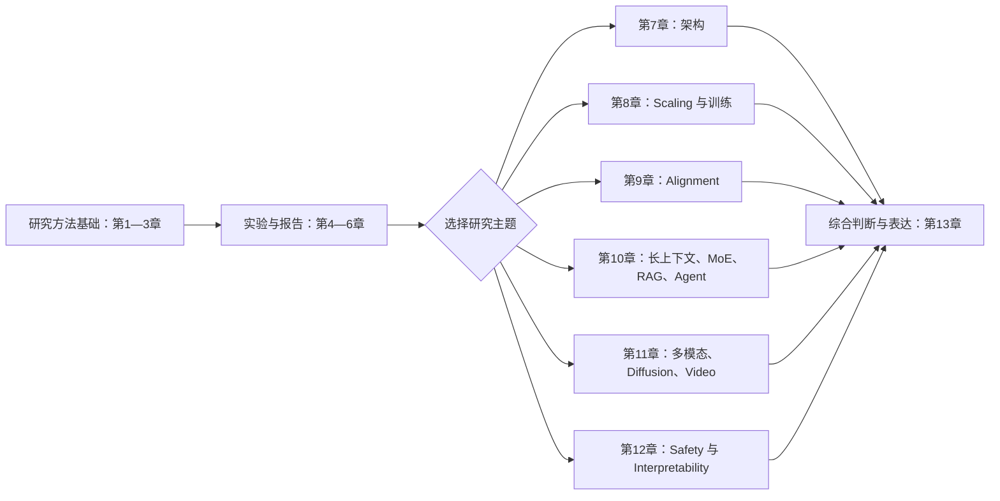

# 第十册：大模型论文精读、复现与研究方法

## 本书定位

本册从论文主张出发，训练读者判断贡献、检查证据、复现实验、设计对照并提出下一步研究问题。第一至第六章讲通用研究方法，第七至第十二章提供专题论文线，第十三章综合方法并训练表达。

## 阅读主线

第一至第三章建立论文阅读和贡献判断；第四至第六章把判断落到复现、控制实验、负结果与报告。之后按研究主题从第七至第十二章选择一条或多条论文线，最后用第十三章综合讨论。六条专题论文线是按需选择的分支，不要求每位读者全部顺读。

## 章节地图

| 章 | 要回答的问题 | 前置与交接 | 主要产物 |
| --- | --- | --- | --- |
| [第一章 研究方法总览](chapters/01-研究方法总览.md) | 研究问题、假设、方法和证据如何连成一条可检查的链？ | 全册入口；向论文阅读和实验章节提供共同框架 | 研究流程图与证据检查清单 |
| [第二章 如何读论文](chapters/02-如何读论文.md) | 怎样从论文中提取问题、方法、实验、结果和局限？ | 接第一章；为第三、四和第七至十二章提供阅读记录 | 论文主张—证据地图 |
| [第三章 如何判断论文贡献](chapters/03-如何判断论文贡献.md) | 怎样区分新颖性、技术有效性、证据强度与实际价值？ | 接第二章；为选题、复现和主题论文线提供判断标准 | 贡献矩阵与边界记录 |
| [第四章 实验复现方法](chapters/04-实验复现方法.md) | 怎样定义复现目标并对齐关键实验条件？ | 接第二、三章；连接第五章对照和第六章报告 | 复现协议、运行记录和差异诊断 |
| [第五章 Ablation 与 Controlled Experiment](chapters/05-ablation与controlled-experiment.md) | 怎样用控制实验检验组件主张并排除替代解释？ | 接第三、四章；统计与评估方法可配合第七册学习 | 比较契约、消融设计和结果解释 |
| [第六章 负结果与实验报告](chapters/06-负结果与实验报告.md) | 怎样判断一次失败是否提供证据，并报告后续决策？ | 接第四、五章；连接主题论文线和研究讨论 | 失败诊断、实验报告与继续/停止依据 |
| [第七章 Transformer 与架构论文线](chapters/07-transformer与架构论文线.md) | 架构论文提出了什么瓶颈、机制和资源取舍？ | 使用第一至第三章；机制和技术谱系接第二十一册 | 架构主张、对照与资源边界记录 |
| [第八章 Scaling 与训练论文线](chapters/08-scaling与训练论文线.md) | Scaling 和训练论文的规律在什么数据、计算和系统条件下成立？ | 使用第二至第六章；训练机制接第五册，数据条件接第九册 | 规律假设、复现实验和预算边界表 |
| [第九章 Alignment 与 Preference Optimization 论文线](chapters/09-alignment与preference-optimization论文线.md) | 不同监督信号、优化目标和评估协议如何改变结论？ | 使用第二至第六章；训练和行为专题接第五、八册 | 方法谱系、比较条件和结论边界 |
| [第十章 Long Context、MoE、RAG、Agent 论文线](chapters/10-long-context-moe-rag-agent论文线.md) | 扩展上下文、参数容量、外部证据和动作循环的论文如何公平比较？ | 使用第二至第六章；接第六、七、九、十七和二十册相应专题 | 机制—系统—评测的归因图 |
| [第十一章 Multimodal、Diffusion、Video 论文线](chapters/11-multimodal-diffusion-video论文线.md) | 多模态与生成论文如何定义表示、训练目标和评估证据？ | 使用第二至第六章；模型机制接第十五册 | 模态、目标、实验与边界对照表 |
| [第十二章 Safety 与 Interpretability 论文线](chapters/12-safety-interpretability论文线.md) | 安全行为、内部表征和模型干预分别支持哪些结论？ | 使用第二至第六章；安全与治理机制接第八册 | 主张类型、干预和评估证据记录 |
| [第十三章 研究讨论与综合判断](chapters/13-研究讨论与综合判断.md) | 怎样把论文和实验判断整理成可交流、可追问的研究计划？ | 汇合第一至第六章及已选主题论文线 | 研究讨论卡、下一步假设与复现计划 |

## 按目标选读

- **精读与面试讨论**：第一至第三章 → 相关主题论文线 → 第十三章。
- **复现实验**：第二至第五章 → 相关主题论文线 → 第六章和第十三章。
- **提出研究问题**：第一至第三章 → 第五、第六章 → 相关主题论文线 → 第十三章。
- **短期专题补课**：先读第一、二章，再选一条主题论文线；遇到实验设计、统计或运行时细节时转读相邻专题书。

## 书系交接

- 第七册提供评估设计、统计推断和线上实验方法；本册将其用于论文证据判断和复现实验，不替代完整评估教材。
- 第五册和第九册分别深入训练与数据工程；第八册、第十五册、第十七册、第二十册和第二十一册分别深入安全、多模态、Agent、运行框架和架构机制。
- 第十一册训练系统设计回答；本册训练研究主张、实验过程和证据边界的表达。
