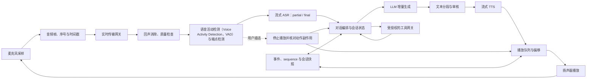

# 第八章：设计实时语音助手：在时间轴上完成一次对话

实时语音助手与上一章的音频上传任务有一个根本区别：上一章可以等文件上传完成，再转写、解析和回答；实时语音助手必须在用户仍然说话、网络仍然抖动、模型仍然生成的过程中做判断。它不仅要回答“识别到了什么”，还要决定“现在是否该开口”“用户是否正在抢话”“这段语音是否已经结束”“上一段回答是否真的播放给用户”。

因此，实时语音助手不是自动语音识别（automatic speech recognition，ASR）、大语言模型（large language model，LLM）和文本转语音（text-to-speech，TTS）三个服务简单串联。它是一套有多个时钟、多个增量状态和可取消动作的交互系统：

实线表示音频或处理结果的主要路径，虚线表示插话触发的控制路径。播放会回到麦克风输入，所以回声处理、VAD、播放器和对话编排必须共享时间与播放状态；停止播放也不能被误解成撤销已经发出的工具副作用。

本章用企业电话助手“听澜”贯穿说明。听澜可以回答订单问题、查询配送状态、安排人工回拨；高风险写操作需要用户确认，连续失败则转人工。它要在浏览器、手机或电话网关中保持长连接，同时处理噪声、回声、网络丢包、ASR 修正、模型延迟和语音播放。

设计这类系统时，最重要的问题不是“选哪个语音模型”，而是：

- 用户说完后，系统在什么事件上开始回答？
- partial transcript 可以提前使用到什么程度，哪些动作必须等待 final？
- 用户插话时，播放器、TTS、LLM 和工具调用怎样同时停止或收敛？
- 一段音频经历多个服务后，谁负责时间戳和顺序？
- 语音输出是完整审核后播放，还是边生成边播放？两者的风险如何取舍？
- 连接断开时，哪些上下文已经被用户听见，哪些只是模型生成过？
- 如何测量“自然”，而不是只测 ASR 字错率？
- 低延迟、准确率、安全和成本冲突时，系统选择什么行为？

本章聚焦实时媒体传输、会话控制和播放交付。文件上传及多模态 artifact 治理见[上一章《设计多模态助手》](07-设计多模态助手.md)；语音与音频生成机制见[第十五册第九章](../../book-15-multimodal-generative-models/chapters/09-语音与音频生成.md)，原始多模态数据治理见[第九册第九章](../../book-09-data-engineering/chapters/09-多模态语音视频数据.md)。写操作的授权、幂等和未知结果可对读[本册第六章《设计 Agent 平台》](06-设计agent平台.md)；提示注入与不可信内容边界见[第八册第五章](../../book-08-ai-safety-alignment/chapters/05-jailbreak与prompt-injection.md)。

## 8.0 先理解实时性：语音系统有多个时钟

### 8.0.1 给初学者：用户体验不是一个延迟数字

文本聊天通常有一个请求开始时间和一个响应结束时间。语音交互至少有四条相关时间线：

1. 采集时间：声音在麦克风中产生。
2. 识别时间：音频帧到达 ASR，partial 或 final 结果产生。
3. 生成时间：LLM 产生文字，TTS 产生音频。
4. 播放时间：音频真正从扬声器播放到用户耳中。

模型已经生成一句话，不代表用户已经听到；ASR 已经看到一段 partial，也不代表用户已经说完。所有事件都应带时间戳和 sequence，不能用服务收到消息的时间代替音频发生的时间。

### 8.0.2 给专家：端到端首声延迟

用户说完到助手开始播放的首声延迟，可以粗略拆成：

~~~math
T_{\mathrm{first\_audio}}
=
T_{\mathrm{uplink}}
+
T_{\mathrm{endpoint}}
+
T_{\mathrm{asr\_final}}
+
T_{\mathrm{llm\_first}}
+
T_{\mathrm{tts\_first}}
+
T_{\mathrm{playback\_buffer}}
~~~

其中 T_uplink 是最后一段音频上传延迟，T_endpoint 是系统决定用户已经说完所需的时间，T_asr_final 是获得稳定转写的时间，T_llm_first 是 LLM 产生可播片段的时间，T_tts_first 是 TTS 产生首个可播放帧的时间，T_playback_buffer 是为了平滑播放而保留的缓冲。

按一个不重叠的教学假设，若最后一帧上传 70 ms、端点等待 420 ms、ASR final 110 ms、LLM 首段 180 ms、TTS 首帧 160 ms、播放缓冲 80 ms，则串行估算为 70+420+110+180+160+80=1,020 ms，即约 1.02 秒。各段实测时若存在并行或预取，应按事件时间线重新计算关键路径；这个示例不是听澜的线上 SLA。

这不是严格的流水线加法。部分阶段可以重叠，工具调用可能插入中间，网络重传会增加长尾。但拆开它能避免只盯着 LLM 首 token，而忽略端点检测和播放缓冲才是体验瓶颈。

### 8.0.3 实时性和正确性的冲突

更早开口通常需要更多猜测：根据 partial transcript 预取检索、提前规划回答或开始 TTS。猜错后，系统要取消工作并承担资源成本，甚至可能已经播放错误内容。

高风险场景可以选择较慢但更可靠的路径；低风险闲聊可以选择较快的增量路径。实时性不是越低越好，而是在任务风险和用户耐心约束下选择合理的首声、完成和修正时间。

## 8.1 定义场景边界和会话契约

### 8.1.1 听澜的第一版范围

听澜第一版支持：

- 浏览器和移动端的单用户语音会话。
- 普通话和英语两种语言。
- 流式 ASR、短文本 LLM 和流式 TTS。
- 查询订单和配送状态等只读工具。
- 用户插话、取消、重连和转人工。
- 录音授权、转写留存和会话删除。

暂不支持多人同时说话、车载离线唤醒、长会议实时总结、声音克隆和自动付款。每一种扩展都会改变回声、身份、数据、延迟和责任边界。

### 8.1.2 会话创建契约

会话请求至少包含：

- session_id 和 requester_id。
- tenant_id、渠道和设备类型。
- 语言、采样率、声道和编码。
- 是否允许录音和保留转写。
- 能使用的工具和业务范围。
- 最大会话时长和静默超时。
- latency_class 和成本等级。
- trace_id、协议版本和客户端能力。

服务端返回会话版本、媒体协商参数、心跳间隔、事件序号起点和安全策略版本。客户端不能只凭一个临时 URL 就把任意音频流送进生产会话。

### 8.1.3 事件协议

实时链路中的事件应该区分音频、识别、控制和输出：

~~~json
{
  "type": "transcript.partial",
  "session_id": "s-42",
  "sequence": 184,
  "audio_start_ms": 12140,
  "audio_end_ms": 12860,
  "text": "我想查一下订单",
  "stability": 0.72,
  "model_version": "asr-9"
}
~~~

其它事件可以包括：

- audio.append。
- speech.started。
- speech.ended。
- transcript.final。
- response.started。
- response.text.delta。
- audio.output。
- response.cancelled。
- playback.progress。
- session.reconnected。
- tool.confirmation_required。
- session.failed。

sequence 保证同一会话内的顺序，audio_start_ms 和 audio_end_ms 保留音频时间。收到旧事件时，客户端应丢弃或按协议补偿，不能把网络重排误当成用户重新说话。

## 8.2 传输：WebRTC、WebSocket 与音频帧

### 8.2.1 WebRTC 适合什么

WebRTC（Web Real-Time Communication）是一组面向实时音视频通信的浏览器 API 与相关协议能力，适合低延迟媒体传输、网络适应、媒体轨道和实时数据。[W3C WebRTC 规范](https://www.w3.org/TR/webrtc/)描述浏览器 API 和对象模型。它通常比自行在应用层拼装音频包更接近实时通话需求，但仍需要业务层负责身份、会话、录音、审计、音频质量评估和模型编排；规范本身不提供这些业务策略，也不承诺端到端 SLA。

### 8.2.2 WebSocket 适合什么

WebSocket 提供双向长连接，协议简单，容易传输音频帧、转写事件和文本增量；[RFC 6455](https://www.rfc-editor.org/rfc/rfc6455)定义了 WebSocket 协议握手和帧语义。它适合服务端语音 API、内部网关和需要明确应用事件的场景。

但 WebSocket 不自动提供实时媒体的所有能力。应用需要自己处理：

- 音频帧序号和时间戳。
- 心跳、重连和背压。
- 丢包、重复包和超时。
- 播放取消和会话恢复。
- 网络变化和带宽限制。

选择 WebRTC 还是 WebSocket，应根据客户端、网络、媒体能力和团队运维能力决定，而不是把某个协议当成低延迟保证。

### 8.2.3 音频参数

音频契约要明确：

- 采样率，例如 16 kHz 或 48 kHz。
- 单声道还是双声道。
- PCM、Opus 等编码。
- 每帧时长和字节数。
- 声道布局和端序。
- 时间戳来源。
- 是否允许客户端重采样。

帧太小会增加包数和系统调用，帧太大则增加等待时间。参数应通过协商确定，服务端不要静默把不同采样率当成相同波形。

### 8.2.4 带宽和并发

若每路压缩音频的平均码率为 b bit/s，同时处于音频传输状态的会话数为 N_audio，粗略上行带宽为：

~~~math
B_{\mathrm{audio}}
\approx
N_{\mathrm{audio}} \cdot b \cdot (1 + r_{\mathrm{protocol}})
~~~

r_protocol 包含协议头、加密、重传和事件开销。若 N 统计的是全部长连接而不是正在发送音频的会话，应再乘以活跃音频比例。真实带宽还受静音抑制、语音活动比例和网络重传影响。容量规划要同时看连接数、活跃音频比例和下行 TTS 流量。

假设同时有 600 路活跃音频，每路平均码率 24 kbit/s，协议开销率为 20%，则上行需求约为 600×24×1.2=17,280 kbit/s，即 17.28 Mbit/s，按十进制单位约为 2.16 MB/s。若 600 是总长连接数，应先乘活跃音频比例再估算；该数值不包含独立的下行 TTS 带宽。

### 8.2.5 背压

如果客户端上传速度高于 ASR 消费速度，服务端不能无限堆积音频。可以：

- 限制每会话缓冲长度。
- 对过期音频丢弃而不是无限等待。
- 暂停读取或降低采样质量。
- 将会话降级为文本。
- 记录丢帧和端到端质量。

实时系统宁愿明确丢弃不可恢复的旧音频，也不应让几十秒前的内容在当前对话中突然出现。

## 8.3 客户端音频和回声控制

### 8.3.1 客户端预处理

客户端可以使用降噪、自动增益、回声消除和本地 VAD，减少上传带宽和环境噪声。不同浏览器、耳机、手机和系统音频栈的质量差异很大，服务端仍需要检测输入质量。

客户端预处理不能覆盖原始录音的审计需求。若业务允许保存录音，应明确保存的是原始轨道、处理后轨道，还是只保存转写。

### 8.3.2 回声消除

助手播放语音时，麦克风可能再次采集扬声器声音。回声消除器通常需要播放参考信号和麦克风信号，估计并去掉回声。播放链路若经过额外混音、蓝牙设备或系统音量变化，回声估计会变难。

回声问题会表现为：

- 助手把自己的上一句当作用户的新问题。
- VAD 一直认为有人在说话。
- 系统不断自我触发。
- 打断率异常升高。

所以播放控制和输入处理必须共享状态。播放器知道自己正在播放什么，VAD 和 ASR 才能结合参考信号判断是否为用户语音。

### 8.3.3 音频质量检测

系统可以估计：

- 信噪比。
- 削波比例。
- 静音比例。
- 丢帧比例。
- 采样率和声道是否匹配。
- 音频是否被截断或重复。

质量低时，系统应向用户解释“没有听清”并请求重说，而不是让 LLM 根据残缺文字补全一个订单号。

## 8.4 语音活动检测（VAD）与端点检测：决定何时轮到谁说

### 8.4.1 VAD 的职责

语音活动检测（Voice Activity Detection，VAD）判断一段音频是否像语音。它通常输出语音开始、语音持续和语音结束等事件。VAD 不等于理解，也不等于一句话已经结束。

VAD 太敏感会把键盘、风声和播放回声当成用户；VAD 太保守会漏掉轻声、远场和口音。它需要在设备、语言、环境和业务场景上分别评估。

### 8.4.2 端点检测

端点检测要回答“用户是否暂时停顿，还是已经说完”。可以结合：

- 静音持续时间。
- ASR partial 的稳定性。
- 句法是否完整。
- 疑问、命令和结束语气。
- 用户是否正在继续上传音频。
- 当前任务是否允许提前回答。

静音时间过短，系统容易抢话；等待过长，用户感觉迟钝。没有一个固定阈值适合所有用户。

例如，用户读订单号时在“12”和“34”之间停顿 300 ms。若固定端点阈值是 200 ms，系统会在后两位到达前关闭这一轮，final transcript 可能只剩“12”；若阈值改为 500 ms，这次停顿会保留在同一轮，但对真正已经说完并静默 300 ms 的用户，系统还要多等约 200 ms 才判定结束。这组时间是用于说明取舍的教学输入，实际阈值要按语言、设备和任务回放校准。

### 8.4.3 自适应端点

简单问句可以使用较短端点等待；复杂地址、订单号和长描述需要更长的连续窗口。系统可以按识别到的任务类型调整端点，但这个调整要可解释、可回放，并防止 partial 误识别把阈值改错。

### 8.4.4 Barge-in

Barge-in 指用户在助手播放时插话。它不是一个 UI 按钮，而是一条跨组件的控制事务：

1. VAD 检测到候选用户语音。
2. Playback Controller 立即压低或停止当前音频。
3. 会话状态记录 interruption_event。
4. TTS 停止生成未播放片段。
5. LLM 取消、截断或忽略后续输出。
6. 当前工具调用根据副作用类型决定继续、取消或进入未知状态。
7. 新语音进入 ASR 和下一轮对话。

读者要特别注意第六步：用户打断语音播放，不等于可以无条件取消已经发出的支付、预约或写入请求。

## 8.5 流式 ASR：partial 不是事实，final 也不是绝对正确

### 8.5.1 Partial transcript

partial 是在音频尚未结束时给出的临时转写。它可以帮助：

- 提前判断语言。
- 预取只读检索。
- 选择领域词表。
- 准备候选回复。
- 估计是否需要人工。

但 partial 可能被后续音频改写。例如“取消订单”可能先被识别成“查询订单”。系统不应基于不稳定 partial 执行高风险工具。

### 8.5.2 稳定前缀

流式 ASR 可以把已经多轮不变的文字当作 stable prefix，把最后几词当作 tentative suffix。上下文构造器可以只用 stable prefix 做低风险预取，并在 final 到达后重新校验。

每次更新携带 revision 或稳定度，客户端据此替换文字，而不是把所有 partial 直接追加，避免转写区出现重复句子。

### 8.5.3 Final transcript

final 表示端点后相对稳定的结果，适合进入正式意图识别和业务工具参数提取。但 final 仍可能有专名、数字和否定错误。对订单号、金额、日期、地址和权限动作，要使用确认、校验和重说机制。

### 8.5.4 领域词表和多语言

客服电话、医疗、金融和企业内部语音包含专有名词。词表、热词和上下文偏置可以改善识别，但也可能把普通词强行替换成热词。上线前要评估热词的误改率。

多语言路由要记录语言识别版本、用户声明和识别置信度。语言切换过程中，不能把不同语言的 partial 简单拼接成一个不可解释的文本。

流式识别的延迟与错误率取决于编码器如何使用历史和未来上下文，不由“是否 Transformer”单独决定。Emformer 把较长历史压缩到增强记忆库，并缓存左侧上下文注意力的键（key）和值（value）；分块处理让模型逐块读取输入。论文在 LibriSpeech 上报告：平均延迟约 960 ms 时，test-clean 与 test-other 的词错误率（word error rate，WER）分别为 2.50% 和 5.62%；平均延迟降到 80 ms 时，分别为 3.01% 和 7.09%。这组结果能说明同一研究路线中延迟与识别质量的取舍，不能直接预测普通话电话、噪声环境或订单号识别表现。[Emformer 原论文](https://arxiv.org/abs/2010.10759v4)

### 8.5.5 ASR 质量指标

词错误率（word error rate，WER）可以写成：

~~~math
\mathrm{WER}
=
\frac{S + D + I}{N}
~~~

S 是替换数，D 是删除数，I 是插入数，N 是参考词数，且只有在 N>0 时才定义这一条样本的 WER。空参考文本应单独统计为静音、无语音或无标注样本，不能把它们的 WER 记成 0。WER 适合对比转写模型，但业务还需要测数字准确率、专有名词召回、否定句准确率、订单号整段准确率和工具参数正确率；汇总时要说明是按词加总后计算，还是先按样本平均。

例如，固定分词口径后，参考词序列为“查 / 订单 / 1234 / 明天”，识别结果为“查 / 订单 / 123 / 明天”。四个参考词中有一个替换、没有删除或插入，因此 WER=(1+0+0)/4=25%。这个百分比不等于订单字段“部分正确”：如果业务要求精确匹配订单号，123 与 1234 仍是错误对象，不能把通用 WER 当作业务成功率。

## 8.6 对话编排：partial、final 和工具动作分层

### 8.6.1 三种响应路径

听澜可以把用户输入分成三条路径：

1. 低风险闲聊：允许根据 partial 预热模型，final 后开始播放。
2. 只读查询：可以根据稳定前缀预取，但 final 后确认参数再展示结果。
3. 写操作或高风险建议：必须等待 final、复述关键参数并取得确认。

这样低延迟和安全不会被迫使用同一套策略。

### 8.6.2 预取不能变成提前执行

如果 partial 识别出“查订单 12”，系统可以预取只读数据；当 final 变成“查订单 120”时，旧预取结果必须丢弃或标记为过期。预取服务不能写业务状态，也不能把结果直接当作最终回答。

### 8.6.3 语音回答要短

语音不是把文字答案朗读出来。听觉工作记忆和用户等待体验要求回答：

- 先给结论。
- 每轮只讲一到三个关键点。
- 长列表分批。
- 需要用户操作时明确下一步。
- 支持“继续”“再说一遍”和“跳过”。

模型输出可以同时有 spoken_text 和 display_text。屏幕上可以展示详细引用，语音只说摘要，避免把页码、长 URL 和 JSON 读给用户。

### 8.6.4 会话状态

会话状态至少保存：

- 用户最后稳定转写。
- 当前回答和已播放片段。
- 当前工具调用及副作用状态。
- 用户是否确认。
- 对话摘要和引用。
- 语言、音色和设备。
- 最近一次 interruption_event。
- 连接和事件 sequence。

被打断的回答不能默认当作用户已经听完。系统可以记录播放偏移，并在用户说“刚才没听清”时从未播放部分继续或重新概括。

## 8.7 LLM 流式生成与工具调用

### 8.7.1 文本增量

LLM 可以逐 token 或逐短片段输出。Dialogue Orchestrator 不应把每个 token 立即交给 TTS，因为会导致频繁请求和不自然的停顿。通常要按标点、语义边界和最大等待时间聚合成可播片段。

### 8.7.2 取消语义

当用户插话时，LLM 有几种处理：

- 取消生成，节省资源。
- 保留生成结果但不播放，供日志和调试。
- 保存已生成但未播放的文本，作为未交付草稿。
- 如果是工具规划，继续等待工具结果但不启动新的语音。

选择取决于动作副作用和会话状态。取消 HTTP 请求不能保证下游模型已经停止，也不能撤销已经发出的工具调用。

### 8.7.3 语音确认

高风险动作要使用显式确认。例如：

> 我将把订单 123 的配送地址改为上海浦东。请说“确认修改”或“取消”。

系统要绑定被确认的标准化动作、资源、参数哈希和过期时间。用户说“嗯”是否等同于确认，要按业务和语言场景单独设计，不能仅凭一个模糊词执行不可逆动作。

### 8.7.4 工具结果和口语化

工具返回结构化状态，模型负责组织口语化解释，但结果验证应在模型之外完成。订单查询工具返回“已发货”并带时间戳，模型不能把它扩展成“今天一定送达”。

## 8.8 流式 TTS：先出声和自然度的取舍

### 8.8.1 TTS 首帧

TTS 的用户感知延迟取决于从收到可播文字到生成首个音频帧的时间。流式 TTS 可以在完整回答完成前开始合成，但前提是文本片段边界稳定。

### 8.8.2 分句和缓冲

片段太短会让音色、韵律和网络请求不稳定；片段太长会增加等待。可以同时设置：

- 最小字符或词数。
- 句号、问号、逗号等边界。
- 最大等待时间。
- 最大音频队列长度。
- 用户打断时的取消窗口。

这些参数需要通过真实设备、语言和音色评估，而不是只在服务端打印时间。

### 8.8.3 FastSpeech 2 与 VITS 的证据范围

FastSpeech 2 是非自回归路线：它直接使用真实语音目标训练，并把时长、音高和能量作为条件输入；这与依赖自回归教师蒸馏的前代路线不同。[FastSpeech 2 原论文](https://arxiv.org/abs/2006.04558v8)的实验支持在其设置下比较训练和推理效率，不构成听澜的首帧承诺。VITS 把条件变分推断、归一化流（normalizing flow）、对抗训练和随机时长预测器组合进端到端合成；论文的主观平均意见分（mean opinion score，MOS）证据来自单说话人 LJ Speech 数据集。[VITS 原论文](https://proceedings.mlr.press/v139/kim21f.html)因此说明的是一种模型路线及特定语料实验，不能推出多说话人、中文电话、任意设备或网络上的自然度和首帧 SLA。

### 8.8.4 播放队列

Playback Controller 要保存：

- audio_segment_id。
- 对应的 text_segment_id。
- 生成时间和播放时间。
- 预计时长。
- 是否已开始、已播放、被取消或丢弃。
- 对应的 response_version。

当用户打断时，只删除未播放片段；已经播放的片段进入会话历史，并记录播放偏移。这样系统才能区分“模型生成了”与“用户听到了”。

## 8.9 全双工交互与轮次控制

### 8.9.1 半双工和全双工

半双工系统倾向于一个人说、另一个人说；全双工允许双方同时产生和处理音频。全双工更自然，但要求回声、重叠语音、打断、状态合并和输出取消更成熟。

第一版可以采用受控半双工：助手播放时仍监听用户，但检测到稳定语音就停止播放。不要为了宣传“全双工”而忽略重叠语音的识别和责任问题。

Moshi 是研究全双工架构的一个例子：论文把用户和助手语音作为并行流联合建模，并报告该论文系统的理论延迟为 160 ms、实践延迟约 200 ms。[Moshi 原论文](https://arxiv.org/abs/2410.00037v1)中的数字属于其音频 token、模型、推理和测量设置，不是浏览器到用户耳边的通用延迟，也不能用作企业 SLA。

### 8.9.2 重叠语音

多人或用户插话时，一段音频可能包含两个说话人。系统需要区分：

- 谁在说。
- 哪段声音是助手回声。
- 哪个语音段落属于当前轮次。
- 哪些字词无法可靠归属。

在单用户电话场景里，声道分离和回声参考可以减轻问题；会议场景则需要说话人分离和更复杂的时间线。

### 8.9.3 轮次状态

下面的状态图给出一次常见轮次及异常出口。短暂停顿可从 endpoint_pending 回到 user_speaking；只有端点事件和稳定转写齐备后才进入 thinking。工具结果回到编排器后，系统再决定继续生成、转人工还是恢复播放。

~~~mermaid
stateDiagram-v2
  [*] --> listening
  listening --> user_speaking: speech.started
  user_speaking --> endpoint_pending: 静音候选
  endpoint_pending --> user_speaking: 音频恢复
  endpoint_pending --> thinking: speech.ended 与 final 到达
  thinking --> tool_waiting: 已授权工具请求
  tool_waiting --> thinking: 工具结果已核对
  thinking --> assistant_speaking: 首个可播音频段
  assistant_speaking --> listening: 播放完成
  assistant_speaking --> interrupted: 有效插话
  interrupted --> listening: 旧播放已停止，接受新输入
  thinking --> transfer_human: 风险或质量策略要求
  tool_waiting --> transfer_human: 超时且结果未知
  listening --> failed: 会话或媒体不可恢复
  failed --> listening: 重连并核对会话快照
~~~

对话编排器（Dialogue Orchestrator）持有轮次状态和事件序号；播放控制器（Playback Controller）持有实际播放偏移；工具网关（Tool Gateway）持有写操作的执行、幂等和结果查询状态。用户插话可以结束当前播放状态，却不能回滚已提交的外部副作用。各组件应通过带版本和幂等键的事件协调，不能各自维护互相矛盾的 is_speaking 布尔值。

### 8.9.4 自然性指标

自然性可以用可观测代理指标近似：

- 抢话率。
- 用户插话后的停止时间。
- 误打断率。
- 长停顿比例。
- 重复回答率。
- 用户“再说一遍”比例。
- 中途挂断率。
- 人工主观评分。

这些指标不能完全等同于自然，但比只看 TTS 声学质量更接近真实体验。

## 8.10 安全审核：低延迟不能取消安全

### 8.10.1 输入审核

ASR final 和必要的 partial 都可以进入安全分类。转写内容仍是用户提供的数据；检索网页、工单或工具结果带回的指令也应继续视为外部内容，而不能提升为系统命令。OWASP LLM01:2025 将直接与间接提示注入列为风险，并建议隔离外部内容、限制模型权限、在代码侧校验工具调用和对高风险动作要求人工确认。[OWASP LLM01:2025](https://genai.owasp.org/llmrisk/llm01-prompt-injection/) 高风险内容需要结合用户身份、领域和工具动作判断。一个词的出现不应直接决定拒绝，完整语境和业务风险更重要。

### 8.10.2 输出审核的两种路径

流式播放有两种主要取舍：

1. 先生成完整文本、审核、再整体 TTS：安全和可控性较好，但首声延迟更高。
2. 文本片段边生成边审核边 TTS：延迟低，但后续内容可能改变上下文，已播放内容无法收回。

可以按风险分层。闲聊或低风险导航允许小片段审核；支付、医疗、法律、身份和生产操作等场景，优先使用完整回答、策略检查和人工确认。

### 8.10.3 语音中敏感信息

订单号、身份证号、银行卡号和地址可能出现在录音和转写中。系统可以使用屏幕显示、局部遮挡、数字复述确认或不朗读完整敏感字段。日志中记录引用和摘要，不保存不必要的原始音频。

### 8.10.4 转人工

以下情况可以转人工：

- 用户明确要求。
- 连续多个轮次无法识别。
- 任务需要超出权限的动作。
- 风险分类过高。
- 工具结果冲突或未知。
- 连接、ASR、LLM 或 TTS 反复失败。
- 用户情绪和业务规则要求人工处理。

转接时要传递已验证身份、会话摘要、已执行工具、未完成动作和安全事件，但要按照坐席权限过滤敏感内容。

## 8.11 会话持久化与断线恢复

### 8.11.1 断线不等于结束

移动网络可能短暂断开。服务端应保存：

- 最后确认收到的音频 sequence。
- 最后稳定 transcript。
- 当前 response 和播放偏移。
- 工具调用状态。
- 会话配置和策略版本。
- 未确认的高风险动作。
- 录音和转写保留状态。

重连请求携带 session_id、last_received_sequence 和客户端能力。服务端根据状态决定补发事件、重新开始轮次或结束会话。

### 8.11.2 音频重传和幂等

音频帧可能重复发送。接收端应使用 session_id、sequence 和时间戳去重。重复的 transcript 事件也不能让文本历史重复追加。

工具动作使用独立的幂等键。语音响应取消和重连不能自动重做订单修改或回拨预约。

### 8.11.3 播放状态

服务端不能准确知道用户是否听清每一帧，但可以知道客户端确认了什么、播放到什么偏移。对重要信息，用户需要复述确认或在屏幕上显示，不能把“音频已发送”当作“用户已理解”。

## 8.12 高层架构和请求生命周期

### 8.12.1 组件边界

| 组件 | 职责 |
| --- | --- |
| Client | 采集、播放、设备状态和用户打断 |
| Realtime Gateway | WebRTC/WebSocket、鉴权和连接路由 |
| Audio Stream Service | 帧、时间戳、缓冲、去重和背压 |
| Audio Processing | 降噪、回声消除、质量检测 |
| VAD/Endpoint | 语音活动、端点和轮次信号 |
| ASR Service | partial/final 转写、词表和语言 |
| Dialogue Orchestrator | 状态、模型调用、工具、取消和恢复 |
| LLM Gateway | 模型路由、流式输出、成本和版本 |
| Tool Gateway | 权限、幂等、审批和结果查询 |
| TTS Service | 片段合成、音色、首帧和取消 |
| Playback Controller | 队列、播放偏移、打断和回声参考 |
| Safety Service | 输入输出风险、DLP 和转人工 |
| Session Store | 会话快照、事件和保留策略 |
| Observability | trace、指标、日志和质量评估 |
### 8.12.2 一次普通查询

用户问“订单 123 到哪了”：

1. 客户端发送带 sequence 的音频帧。
2. Audio Processing 做质量和回声处理。
3. VAD 发出 speech.started 和 speech.ended。
4. ASR 先发 partial，再发 final transcript。
5. Orchestrator 验证用户身份和订单查询范围。
6. Tool Gateway 做只读权限检查并调用订单服务。
7. LLM 把结构化结果压缩成短句。
8. TTS 按句子片段合成音频。
9. Playback Controller 播放并上报偏移。
10. 用户插话时，系统取消未播放片段并回到 listening。

### 8.12.3 一个写操作

用户说“帮我取消订单 123”。系统不能沿用查询链路直接执行：

1. 等待 final transcript。
2. 校验订单归属、状态和取消条件。
3. 口头复述订单和影响。
4. 请求明确确认。
5. 生成绑定参数的审批和幂等键。
6. 调用写工具。
7. 处理成功、失败或 unknown。
8. 播放结果并记录审计。

这就是语音入口与 Agent 平台之间的边界：语音负责自然交互，执行器负责授权和副作用控制。

## 8.13 延迟、容量和成本

### 8.13.1 首声和完整响应

除了首声延迟，还要测完整响应时间：

~~~math
T_{\mathrm{complete}}
=
T_{\mathrm{first\_audio}}
+
T_{\mathrm{remaining\_tts}}
+
T_{\mathrm{network\_tail}}
~~~

首声很快但后续停顿很长，用户仍然会觉得系统卡顿。相反，完整回答很快但内容错误，也不能算成功。两者要与任务成功、打断和满意度一起看。

沿用 §8.0.2 的串行首声教学值 1.02 秒，再假设剩余语音合成需要 1.20 秒、最后一段网络发送需要 0.20 秒，则完整响应约为 1.02+1.20+0.20=2.42 秒。这里把尾段也假设为不重叠；若 TTS 与网络传输并行，应按客户端事件时间戳找实际关键路径，不能重复相加重叠时段。

### 8.13.2 LLM 请求量

设并发会话为 N，平均每个会话每分钟有效轮数为 r，则模型请求速率近似为：

~~~math
Q_{\mathrm{llm}}
\approx
N \cdot \frac{r}{60}
\cdot
(1 + p_{\mathrm{prefetch}} + p_{\mathrm{retry}})
~~~

p_prefetch 是 partial 预取带来的额外比例，p_retry 是重试比例。若预取没有复用价值，反而会增加费用和下游压力。

例如，假设有 300 个活跃会话，每个会话每分钟平均产生 3.2 个有效轮次，则基础请求率为 300×3.2/60=16 次/秒。若预取和重试分别让请求数增加 25% 与 5%，估算为 16×(1+0.25+0.05)=20.8 次/秒。这个合成例子把两类增量都定义为基础请求数的比例；实际容量应从线上事件统计复用成功的预取、重试和峰值分布。

### 8.13.3 录音存储

若每路录音码率为 b、平均通话时长为 d、每天通话数为 c、保留天数为 D，则：

~~~math
S_{\mathrm{recording}}
=
b \cdot d \cdot c \cdot D
~~~

实际要换算 bit 和 byte，并加入转写、备份和多副本。录音策略可按用户授权、业务类型和地区分层，不是所有会话都需要保存原始音频。

以持续录制的压缩音频为例，若平均码率是 24 kbit/s、每通 240 秒，则每通数据为 24×240=5,760 kbit，除以 8 后是 720 kB，即十进制约 0.72 MB。每天 30,000 通约为 21,600 MB，即 21.6 GB；保留 30 天约 648 GB。该估算假设每秒都按平均码率录制，不含元数据、转写、副本和对象存储开销，实际值应按录音授权和采样策略重新核算。

### 8.13.4 单位成功会话成本

~~~math
C_{\mathrm{success\_session}}
=
\frac{
C_{\mathrm{asr}}
+
C_{\mathrm{llm}}
+
C_{\mathrm{tts}}
+
C_{\mathrm{network}}
+
C_{\mathrm{storage}}
+
C_{\mathrm{human}}
}{
N_{\mathrm{successful\ sessions}}
}
~~~

分母为统计窗口内被明确判定为成功的会话数；当 N_successful_sessions=0 时，这个指标没有定义，应报告“无成功证据”并同时报告总成本、会话数和失败/转人工数，而不是把分母替换成 1。分子中的每一项要注明计费、折旧或估算口径，以及重试和人工接管是否已经计入，避免同一成本重复计算。失败会话和转人工会产生真实成本。只按每分钟模型价格优化，可能让用户重复说话、等待更久，最终单位成功成本更高。

假设一个统计批次中 ASR、LLM、TTS、网络、存储和人工接管合计 6,000 元，最终确认成功的会话有 5,000 个，则单位成功会话成本为 6,000/5,000=1.20 元。该合成算例假定分子已经包含失败会话与人工成本；若把它们排除，成本指标会偏低。

## 8.14 评估：把“听起来不错”变成可测量结果

### 8.14.1 分层指标

语音系统的指标可以分为：

- 传输：丢包率、重连率、帧乱序、带宽。
- 感知：VAD precision/recall、回声残留、音频质量。
- ASR：WER、数字准确率、专名和否定词。
- 对话：意图准确率、工具参数准确率、任务成功率。
- 生成：首声、完整响应、TTS 自然度和发音。
- 交互：打断成功率、误打断率、抢话率和长停顿。
- 安全：高风险未确认动作、敏感信息外发、转人工。
- 经济：每分钟成本、每轮 token、失败成本。

### 8.14.2 打断指标

定义一次用户插话为 interruption event，可以记录：

~~~math
\mathrm{BargeInSuccess}
=
\frac{
\#\{\mathrm{interruptions\ that\ stop\ playback\ within\ }\tau\}
}{
\#\{\mathrm{valid\ interruption\ events}\}
}
~~~

tau 是业务规定的最大停止时间，单位应与 playback 事件时间戳一致。只有存在至少一个 valid interruption event 时才定义该比例；没有有效插话样本时应报告未定义。还要单独统计误打断，否则系统可能通过过度敏感获得很高的“响应率”。

例如，回放中有 100 次经人工确认有效的插话；其中 88 次从插话起点到旧音频停止不超过 250 ms，则在阈值 τ=250 ms 下成功率为 88/100=88%。τ 是这组教学评估预先设定的产品目标，不是论文或行业通用标准；事件起止必须使用同一单调时钟，并另外报告误打断次数。

### 8.14.3 轮次成功

一个语音任务成功可以用条件概率链近似分解：

~~~math
P(S)
\approx
P(\mathrm{hear})
\cdot
P(\mathrm{understand}\mid\mathrm{hear})
\cdot
P(\mathrm{act}\mid\mathrm{understand})
\cdot
P(\mathrm{deliver}\mid\mathrm{act})
\cdot
P(\mathrm{user\ accepts}\mid\mathrm{deliver})
~~~

这里不是假设五个事件相互独立，而是把一次成功拆成连续条件事件；实际数据中要按任务类型和风险分层估计，避免用一个总体乘积掩盖某个渠道的失败。最后一项不一定需要用户明确说“正确”，可以通过任务结果、追问、重复请求或人工标注近似。它提醒我们：ASR 正确不代表工具动作正确，音频播放结束也不代表用户获得了正确帮助。

若同一批任务按顺序估得“听见”条件率 0.98、“听懂 | 听见”0.92、“动作正确 | 已听懂”0.96、“交付正确 | 动作正确”0.99、“用户接受 | 已正确交付”0.90，则链式结果为 0.98×0.92×0.96×0.99×0.90≈0.771，即约 77.1%。这是用于演示条件分母的假设值；只有每一步都在前一步成功的同一总体上测量，乘积才有这个端到端解释。

### 8.14.4 测试场景

回归集应覆盖：

- 安静、嘈杂、远场、耳机和扬声器。
- 口音、语速、轻声、多人和回声。
- 数字、订单号、地址、专名和否定句。
- partial 改写、端点提前和过晚。
- 用户插话、连续插话和误触发。
- 网络抖动、断线、重连和客户端切后台。
- LLM、工具、TTS 和安全服务超时。
- 高风险确认、转人工和删除请求。

测试记录原始音频、事件流、模型版本、设备、网络和最终业务状态。只录最终语音无法定位失败发生在 VAD、ASR、编排还是播放器。

### 8.14.5 研究资料的边界

流式 ASR、语音合成和全双工研究分别提供了机制与测量案例，但都不能直接证明听澜在企业电话、所有语言和网络环境下的体验。一个面向实时对话系统的补充是 [InteractionBench v1](https://arxiv.org/abs/2611.02430v1)：它评估 7 个系统、13 个场景，每系统设计 221 个条目；论文报告 1,519 次评分运行，并说明有部分运行缺失。指标覆盖轮次时机、口语任务、耳语/音量和长对话中的事实一致性（groundedness）。论文使用同一批合成英语用户音频驱动各系统，但系统提示和部分协议不同；托管系统的时序包含网络延迟，阈值是规范性选择，含义评分由 Gemini 2.5 Flash judge 参与。它没有测量自然度偏好、安全、工具使用或长期任务完成，因此可用作评估维度设计参考，不能据分数给生产系统排名或承诺 SLA。

## 8.15 故障恢复与降级

### 8.15.1 ASR 变慢

如果 ASR final 迟迟不来，可以继续显示 partial，提示用户重说，或转文本输入。不能让 LLM 根据几十秒前的 partial 执行高风险动作。

### 8.15.2 LLM 变慢

低风险场景可以先播放短的等待提示，但等待提示本身不能掩盖任务状态。高风险工具调用应保留状态并显示正在确认；超时后转人工或返回文本。

### 8.15.3 TTS 不可用

可以降级为屏幕文本、预录提示或人工通道。已生成但未播放的文字保存为未交付状态，不能标记为用户已听见。

### 8.15.4 网络断开

短暂断线可以重连并从事件 sequence 恢复。长时间断线或会话状态不一致时，重新确认用户身份和未完成动作。对未知的写操作，先查询结果，再决定是否继续。

### 8.15.5 安全服务不可用

安全审核不可用时，高风险输出和外部动作应暂停。低风险内部导航可以采用明确限定的降级，但要记录策略版本和原因。

## 8.16 完整案例：配送客服的一次通话

### 8.16.1 用户提出问题

用户说：

> 我想查一下订单一二三四什么时候到。

以下订单字段、时间和通话内容均为合成教学数据，不代表真实订单或线上记录。

音频上传后，ASR partial 先识别为“我想查一下订单 123”，随后稳定为“订单 1234”。系统只读工具在 final 后使用订单 1234 查询，避免提前查错订单。

### 8.16.2 结构化结果和口语回答

工具返回：

~~~json
{
  "order_id": "1234",
  "status": "in_transit",
  "last_scan": "2026-11-05T08:20:00+08:00",
  "estimated_window": "2026-11-06"
}
~~~

Orchestrator 检查订单属于当前用户，LLM 生成短句：

> 订单 1234 正在运输中，最近一次更新是今天早上八点二十分，预计明天送达。

TTS 分成两段，先播放订单状态，再播放时间。如果用户在第一段后插话“改地址”，播放器停止，当前回答标记为 interrupted，新的任务进入地址变更流程。

### 8.16.3 高风险变更

地址变更可能影响配送。系统先确认订单状态和可变更条件，再复述：

> 我可以尝试把订单 1234 的地址改为上海浦东新区。这个操作可能影响送达时间，请说“确认修改”或“取消”。

用户说“嗯嗯”，如果该语言场景没有明确确认规则，系统应追问，而不是擅自执行。用户说“确认修改”后，写工具使用参数哈希和幂等键执行。

### 8.16.4 超时和未知结果

写工具响应超时。系统不播放“修改失败”，而是进入 unknown：

- 查询幂等键对应的变更状态。
- 如果已成功，播放成功结果。
- 如果明确未执行，询问是否重试。
- 如果仍无法确认，转人工并说明地址变更状态未知。

这一流程比简单重试更慢，却避免了重复地址变更或错误告知。

## 8.17 三个故障复盘

### 8.17.1 端点太短导致抢话

系统把 200 毫秒静音当成用户结束。用户说“我想查询……订单号”，助手在中间停顿时开始回答，丢掉订单号。

修复方式是结合静音、ASR 稳定前缀、句法完整度和任务类型；订单号、地址等字段使用更长等待或显式确认。端点参数应按语言、设备和场景评估。

### 8.17.2 用户打断但工具继续写入

用户说“取消”，播放器停止了，但后台地址变更工具已经发出。系统把对话状态标为 cancelled，随后又报告操作成功，用户无法理解。

修复方式是把“播放取消”和“外部动作取消”分开。工具调用有副作用时要有独立状态、幂等、取消语义和 unknown 处理；只有尚未开始的动作才能安全取消。

### 8.17.3 回声造成自我对话

播放器的音频被麦克风采集，ASR 识别出助手刚才的回答，LLM 再次回答，系统进入循环。

修复方式是使用回声消除和播放参考，在服务端记录播放区间，VAD 排除高度重合的助手音频，并设置重复内容和无进展检测。不能只增加最大轮数，因为循环仍会消耗资源并产生错误语音。

## 8.18 发布和变更

### 8.18.1 分阶段上线

可以按以下顺序扩大能力：

1. 只做录音和离线转写，人工查看事件流。
2. 开放实时 ASR 文本，不生成语音。
3. 开放低风险文本回答和流式 TTS。
4. 加入打断、重连和工具只读查询。
5. 加入确认后的低风险写操作。
6. 对有限渠道和租户逐步扩大范围。

每阶段都要保留音频、事件、模型、网络和业务结果的关联，才能解释线上体验变化。

### 8.18.2 配置版本

以下变化都要有独立版本：

- VAD 和端点阈值。
- 音频预处理和回声参数。
- ASR 模型、词表和语言路由。
- LLM 提示和响应长度。
- TTS 模型、音色和分句器。
- 安全分类与确认策略。
- 工具权限和转人工规则。

只回滚 LLM 可能无法恢复“用户总被抢话”的问题，因为根因可能是 VAD 或播放缓冲。

### 8.18.3 观测与人工抽检

按渠道、设备、语言、网络、任务类型和模型版本抽取会话。人工标注抢话、误听、工具错误和安全问题，再与自动指标对照。用户满意度下降时，不能只看 ASR WER 是否变化。

## 8.19 资料和证据边界

| 资料 | 可以支持的主张 | 不能单独支持的主张 |
| --- | --- | --- |
| W3C WebRTC 规范 | 浏览器实时媒体 API 和对象模型 | 企业系统的端到端低延迟和安全 |
| Emformer | 分块流式架构、记忆与缓存机制，以及 LibriSpeech 条件下的延迟/WER 结果 | 听澜在所有口音、噪声或业务字段上的 WER |
| Whisper | 大规模语音识别和多语言研究 | 实时首字延迟或特定领域专名准确率 |
| FastSpeech 2 | 非自回归 TTS、真实目标训练和显式韵律条件 | 任意音色的自然度和首帧 SLA |
| VITS | 变分/对抗端到端语音合成路线及 LJ Speech 单说话人实验 | 多说话人生产音质、版权和安全治理 |
| Moshi | 并行用户/助手音频流与论文设置下的全双工延迟 | 企业电话场景的端到端可靠性、合规和 SLA |
| InteractionBench | 同一评测 harness 下的时机、口语任务、耳语/音量和长对话事实一致性指标 | 跨协议生产排名、真实噪声泛化、自然度偏好或长期任务能力 |
| RFC 6455 | WebSocket 协议语义 | 应用层事件顺序、重连和权限 |
| OWASP LLM01:2025 Prompt Injection | 语音转写和外部内容中的指令注入风险及缓解建议 | 某语音助手已经安全 |
| NIST AI RMF | 风险管理和治理框架 | 自动生成具体通话策略 |

资料入口：

- [W3C WebRTC 规范](https://www.w3.org/TR/webrtc/)
- [Emformer 原论文（arXiv v4）](https://arxiv.org/abs/2010.10759v4)
- [Whisper 原论文](https://arxiv.org/abs/2212.04356)
- [FastSpeech 2 原论文（arXiv v8）](https://arxiv.org/abs/2006.04558v8)
- [VITS 原论文（PMLR）](https://proceedings.mlr.press/v139/kim21f.html)
- [Moshi 原论文（arXiv v1）](https://arxiv.org/abs/2410.00037v1)
- [InteractionBench（arXiv v1）](https://arxiv.org/abs/2611.02430v1)
- [WebSocket RFC 6455](https://www.rfc-editor.org/rfc/rfc6455)
- [OWASP Top 10 for LLM Applications 2025：Prompt Injection](https://genai.owasp.org/llmrisk/llm01-prompt-injection/)
- [NIST AI Risk Management Framework](https://www.nist.gov/itl/ai-risk-management-framework)

论文、规范、官方资料和项目实测的证据级别不同。实时语音的最终结论必须来自真实设备、网络、语言、音色和业务任务的回放与线上指标。

## 8.20 读者练习：在事件和状态之间推理

### 练习一：提前识别和错订单

partial transcript 是“查询订单 123”，final transcript 是“查询订单 1234”。系统已经预取了订单 123 的结果。如何处理？

预取结果只能作为可丢弃的只读候选，不能直接播放或写入会话结论。final 到达后重新校验订单号、用户权限和结果版本；旧结果标记为 stale，并记录预取浪费。

### 练习二：插话和写工具

用户在地址变更请求发出后说“取消”。如何定义播放器、LLM、工具和会话的状态？

播放器可以立即停止；LLM 可以取消未生成文本；工具若尚未发出可以取消，若已发出则进入执行中或 unknown，并通过幂等键查询结果。会话最终要向用户说明地址变更是否已确认，而不是只说“已取消”。

### 练习三：低延迟安全取舍

一个医疗语音助手希望 500 毫秒内开口，但模型完整审核要 1.5 秒。你会如何划分路径？

可以对低风险的通用确认使用短片段和保守分类，对诊断、用药和高风险建议等待完整生成与审核；先播放非实质性的等待提示也要避免泄露或误导。指标应同时记录首声、完整回答、安全事件和转人工率。

## 8.21 结语：让系统听见时间，而不只是听见文字

实时语音助手的难点，是把音频帧、识别修正、模型生成和用户意图放在同一条时间线上。一个只会把 ASR 文本发送给 LLM 的系统，无法处理抢话、回声、端点、取消、播放偏移和未知副作用。

可承担业务责任的实时语音系统至少应做到：

- 会话和音频事件有顺序、时间戳、版本和重连语义。
- VAD、端点、ASR partial/final、LLM、TTS 和播放控制各有清楚职责。
- 首声、完整响应、打断和用户接受分别测量。
- 用户插话能停止未播放内容，但不会假装撤销已发出的外部动作。
- 高风险回答和工具调用按风险选择完整审核、确认或转人工。
- 录音、转写、声纹和日志有授权、访问、删除和保留策略。
- 降级时减少能力并说明不确定性，不用旧 partial 或残缺文本制造确定答案。
- 模型论文和协议规范只提供方法依据，线上 SLA 和体验由项目回放与实测证明。

当系统能够知道“用户正在说什么”“用户什么时候停下”“助手已经播到哪里”“哪一个动作已经产生副作用”，语音交互才真正从一条模型流水线变成了实时系统。
