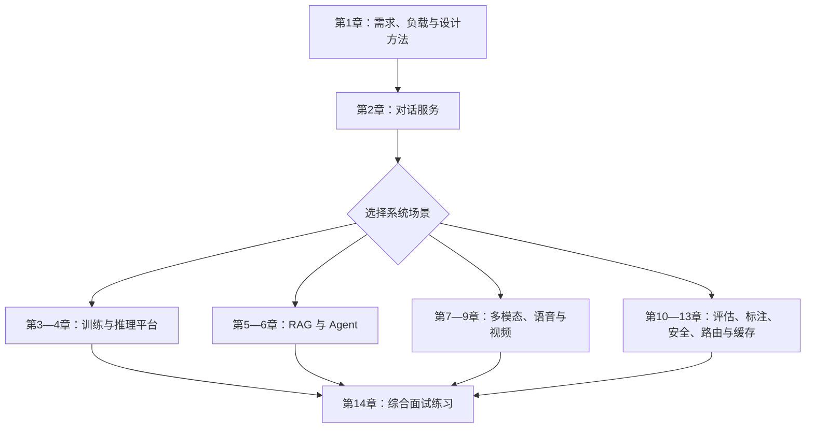

# 第十一册：大模型系统设计面试

本册用一套共通答题过程串联系统案例：澄清需求与工作负载，做容量和延迟估算，画数据/控制流，确定状态与组件边界，再讨论质量、安全、可靠性、成本和演进。第二至第十三章是可按题目选择的场景练习；第十四章用于综合追问。

## 阅读路线

## 章节地图

| 章 | 要回答的问题 | 前置与交接 | 练习产物 |
| --- | --- | --- | --- |
| [第一章 系统设计方法论](chapters/01-系统设计方法论.md) | 怎样把开放题拆成需求、规模、组件和取舍？ | 全册入口；为所有题型提供同一答题骨架 | 需求表、容量估算和架构图 |
| [第二章 设计 ChatGPT 服务](chapters/02-设计chatgpt服务.md) | 多轮会话如何穿过 API、状态、推理和流式响应？ | 接第一章；向推理、RAG 和 Agent 案例提供共同请求链 | 请求时序、状态所有权与故障路径 |
| [第三章 设计训练平台](chapters/03-设计训练平台.md) | 数据、实验、作业和算力如何组织成可恢复的训练平台？ | 接第一章；训练细节转第五册，平台工程转第二十三册 | 训练作业图和资源/产物账本 |
| [第四章 设计推理平台](chapters/04-设计推理平台.md) | 怎样调度模型与请求以满足容量和延迟目标？ | 接第二章；机制转第六册、第二十四册，集群转第二十三册 | 请求调度图和资源瓶颈表 |
| [第五章 设计 RAG 系统](chapters/05-设计rag系统.md) | 文档怎样变成可追溯的证据回答？ | 接第二章；数据血缘转第九册，项目实现转第三册 | 摄取/查询数据流与证据链 |
| [第六章 设计 Agent 平台](chapters/06-设计agent平台.md) | 模型如何在权限、状态和工具约束下完成多步任务？ | 接第二章；Agent 机制、runtime 和协议转第十七、二十、二十二册 | 执行状态机、授权与恢复路径 |
| [第七章 设计多模态助手](chapters/07-设计多模态助手.md) | 文本、图像和其他媒体如何进入同一产品请求？ | 接第二章；模型机制转第十五册 | 模态路由、预处理和输出流程 |
| [第八章 设计实时语音助手](chapters/08-设计实时语音助手.md) | 怎样处理双向音频流、打断和会话延迟？ | 接第七章；语音机制转第十五册 | 分段时序和端到端延迟预算 |
| [第九章 设计视频生成服务](chapters/09-设计视频生成服务.md) | 长时视频生成任务如何排队、运行和交付？ | 接第四、七章；模型和推理框架转第十五、二十四册 | 作业状态机、媒体资产与回收策略 |
| [第十章 设计评估平台](chapters/10-设计评估平台.md) | 怎样可重复运行、比较和监控模型/应用质量？ | 接第一章；评估方法转第七册 | 数据集、grader、运行和回归流程图 |
| [第十一章 设计数据标注平台](chapters/11-设计数据标注平台.md) | 人工任务怎样分发、校验、保护和回流？ | 支持第十章评估数据及第九册的数据血缘专题 | 标注状态机、质量抽检和审计记录 |
| [第十二章 设计安全审核系统](chapters/12-设计安全审核系统.md) | 风险检测怎样进入拦截、复核、申诉和审计？ | 接第二章和第十章；安全方法转第八册 | 策略决策流、人工升级和事件账本 |
| [第十三章 设计模型路由与缓存系统](chapters/13-设计模型路由与缓存系统.md) | 怎样在质量、延迟、成本、负载和缓存复用间选择？ | 接第四章；推理缓存机制转第六、二十四册，平台转第二十三册 | 路由策略表、缓存边界和回退路径 |
| [第十四章 系统设计面试题](chapters/14-系统设计面试题.md) | 怎样在追问中持续修正并表达系统方案？ | 汇合前十三章；面试策略转第十二册 | 限时方案、估算、trade-off 与复盘 |

## 按目标选读

- **推理与模型平台**：第一、二、四、十三、十四章。
- **RAG 与 Agent 产品**：第一、二、五、六、十二、十四章。
- **多模态交互**：第一、二、七、八、九、十四章。
- **质量、数据和治理**：第一、十、十一、十二、十三、十四章。
- **训练基础设施**：第一、三、四、十、十四章。

各专题细节按简介中的书系交接阅读；本册负责把相邻领域知识组合成面试中的系统方案。
