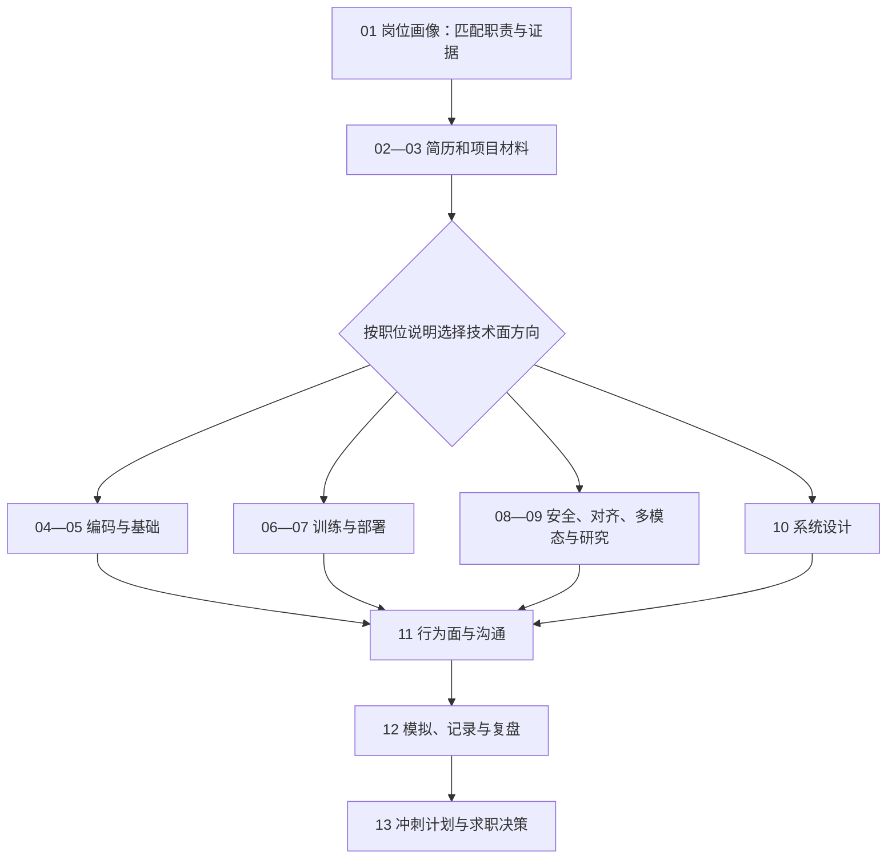

# 第十二册：OpenAI 大模型算法岗求职与面试作战手册

本册把求职过程整理为一条可以反复迭代的路径：从职位要求提取证据和差距，准备简历与项目表达，按目标选择技术练习，再通过行为面、模拟面试和复盘改进。它是面向实践的模块化手册；已确定面试方向的读者可跳到相应技术章。

OpenAI 的 [公开面试指南](https://openai.com/interview-guide/)提供的是一个招聘流程示例。指南明确团队的技能评估格式和 AI 工具许可可能不同；申请时应以最新职位说明、招聘方准备材料和直接确认结果为准。本页按 2026-11-06 复核的信息编写，不是对未来流程的保证。

## 阅读路线

## 按目标选择阅读路径

- **完整准备：** 依次读第 1—3 章，按岗位选择第 4—10 章，再读第 11—13 章。
- **研究、算法或 Post-training：** 第 1—6、8—9、11—13 章；按职位说明补读第 7、10 章。
- **推理、部署或系统方向：** 第 1—5、7、10—13 章；按职位说明补读训练、安全或多模态章节。
- **安全、对齐或多模态方向：** 第 1—5、8—10、11—13 章，并按职责选择训练、部署或研究内容。
- 以上只是入口；同一职位的实际要求以当前职位说明为准，面试结束后用第十二章复盘替代机械地刷完整套题。

## 章节地图

| 章 | 要回答的问题 | 前置与交接 | 练习产物 |
| --- | --- | --- | --- |
| [第一章 岗位画像](chapters/01-岗位画像.md) | 如何判断职位真正需要什么能力？ | 全册入口；从公开职位说明开始 | 岗位—能力—证据差距表 |
| [第二章 简历策略](chapters/02-简历策略.md) | 怎样让简历中的每项主张都能被追问和验证？ | 接第一章的职责与证据 | 面向目标职位的简历版本 |
| [第三章 项目叙事](chapters/03-项目包装.md) | 怎样讲清项目中的个人贡献、结果和局限？ | 接第二章；向技术追问提供项目上下文 | 项目故事和证据清单 |
| [第四章 Coding Interview](chapters/04-coding-interview.md) | 怎样拆题、编码、测试并解释复杂度？ | 按岗位选择；代码实现不替代讲解 | 解题记录和测试边界 |
| [第五章 ML 与 LLM 基础面试](chapters/05-ml与llm基础面试.md) | 怎样从概念和假设推导模型问题的答案？ | 按岗位查漏；底层机制转对应技术册 | 追问树与手算答案 |
| [第六章 Training 面试](chapters/06-training面试.md) | 怎样分析数据、目标、优化和训练故障？ | 适用于训练/算法职责 | 训练方案与故障分析 |
| [第七章 Deployment 面试](chapters/07-deployment面试.md) | 怎样解释请求状态、服务性能、容量与 Prefill/Decode 阶段解耦？ | 适用于推理/部署职责 | 资源估算和权衡说明 |
| [第八章 Alignment 与 Safety 面试](chapters/08-alignment与safety面试.md) | 怎样把对齐训练、风险评估和系统边界转成可复核的发布证据？ | 适用于安全、对齐或模型行为职责 | 分层评估协议与风险案例 |
| [第九章 Multimodal 与 Research 面试](chapters/09-multimodal与research面试.md) | 怎样解释多模态机制并检查评测协议、研究证据和局限？ | 适用于多模态或研究职责 | 研究讲解、评测方案和实验问题清单 |
| [第十章 System Design 面试](chapters/10-system-design面试.md) | 怎样从需求和负载推导组件、权限与证据边界、容量、恢复和评估？ | 面试推演入口；系统机制深读转第十一册及对应技术册 | 一页架构、容量估算与发布条件 |
| [第十一章 Behavioral Interview](chapters/11-behavioral-interview.md) | 怎样用可核验经历说明个人责任、失败、协作分歧和改进，并守住证据边界？ | 技术章节之后；英文练习可配合模板 | 经历证据图谱、个人贡献边界与英文表达 |
| [第十二章 Mock Interview 与复盘](chapters/12-mock-interview与复盘.md) | 怎样按目标构造模拟、记录工具与表现，并用复测形成下一步练习？ | 汇合前面材料；正式面试遵从该轮工具规则 | 有证据、有优先级的复盘与复测任务 |
| [第十三章 六个月冲刺计划](chapters/13-六个月冲刺计划.md) | 怎样安排能力建设和滚动申请，并审阅 offer 与阶段性决策？ | 全书收束；连回对应知识册和项目 | 分阶段计划、申请跟踪与 offer 比较清单 |

## 配套练习与表达材料

- [英文面试表达模板](../ENGLISH_INTERVIEW_TEMPLATES.md)：将回答骨架改写成与本人经历相符的自然表达，不要背诵空泛模板。
- [面试题库](../INTERVIEW_BANK.md)与[练习集](../EXERCISES.md)：扩展练习题并记录个人答案和证据。
