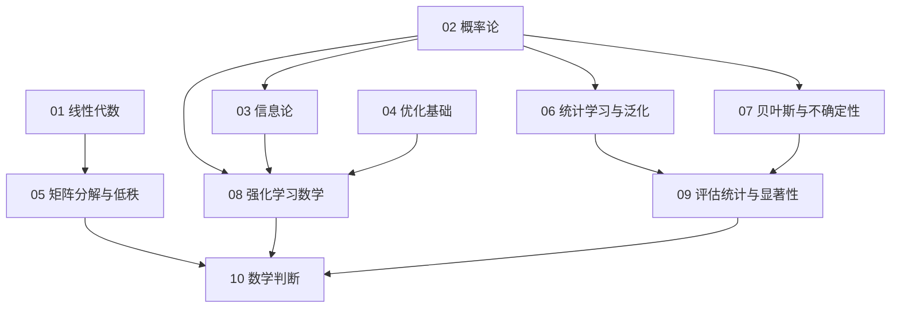

# 第十三册：大模型数学基础

本册沿线性代数、概率与信息、优化、统计学习、不确定性和强化学习建立大模型所需的数学主线。建议按第一至第十章顺序学习；下图表示知识依赖，按短板选读时可沿对应章节回读。

## 学习主线与依赖

## 章节地图

| 章节 | 要回答的问题 | 前置与依赖 | 读完后能做什么 / 交接 |
| --- | --- | --- | --- |
| [第一章 线性代数](chapters/01-线性代数.md) | 向量和矩阵如何表示 Transformer 中的投影、注意力与检索？ | 全册数学入口 | 检查 shape、相似度和几何直觉；把 SVD/LoRA 深入推导交给第五章 |
| [第二章 概率论](chapters/02-概率论.md) | 自回归模型预测什么，序列概率、期望和采样怎样定义？ | 全册概率入口 | 计算条件概率、NLL 与序列概率；为第三、六至九章提供概率基础 |
| [第三章 信息论](chapters/03-信息论.md) | 熵、交叉熵、KL、互信息和信息瓶颈分别衡量什么？ | 第二章 | 推导语言模型损失与分布比较；判断 InfoNCE、偏好约束、表示压缩和检索的信息边界 |
| [第四章 优化基础](chapters/04-优化基础.md) | 梯度和优化器如何改变参数，异常曲线和恢复状态怎样判断？ | 基本函数、导数和向量概念 | 解释 SGD、Adam/AdamW、调度、裁剪、loss spike 诊断与恢复一致性；实现转第十四册 |
| [第五章 矩阵分解与低秩](chapters/05-矩阵分解与低秩.md) | SVD、PCA 和低秩更新如何近似矩阵，误差又意味着什么？ | 第一章；优化取舍可回看第四章 | 计算压缩误差和成本，比较 LoRA、rsLoRA、DoRA 与 QLoRA，并审视 LoRA-α 预印本的证据边界；区分矩阵误差和任务质量，训练显存细节转第五册 |
| [第六章 统计学习与泛化](chapters/06-统计学习与泛化.md) | 训练分数在什么条件下能代表未见数据表现？ | 第二章的概率与抽样 | 区分过拟合、记忆、重复与 benchmark 污染，检查分布偏移和组合泛化；评估协议转第七册 |
| [第七章 贝叶斯与不确定性](chapters/07-贝叶斯与不确定性.md) | 证据如何更新判断，模型信心何时能支持行动？ | 第二、三章 | 计算贝叶斯更新、校准与覆盖率—风险；区分语义置信、证据支持和外部状态，并用 conformal 与成本决策确定回答、验证或弃答；完整系统评估转第七册 |
| [第八章 强化学习数学](chapters/08-强化学习数学.md) | 奖励如何通过回报、优势和策略梯度改变生成策略？ | 第二至第四章；第七章可补不确定性 | 读懂 MDP、PPO、GRPO 组内相对优势、偏好优化及验证器奖励的数学；reasoning/RLVR/GRPO 完整训练专题转第十六册 |
| [第九章 评估统计与显著性](chapters/09-评估统计与显著性.md) | 题目抽样、重复生成、训练运行和评分误差分别带来什么不确定性，观察到的差异又能支持什么结论？ | 第二、六、七章 | 选择统计单位，做配对推断和 judge 校准，区分效应、区间与发布门槛；评估协议设计转第七册 |
| [第十章 数学判断](chapters/10-数学面试题.md) | 如何从题目、对象和假设推到可复算、可反驳的结论？ | 回用第一至九章 | 沿训练指标、参数更新、行为代理与不确定性、统计发布四条链做综合判断；面试表达衔接第十二册 |

## 按目标选读

- **完整补基础：** 第一至第十章顺序阅读，手算主要公式，再用练习复述条件和失效边界。
- **补线性代数/低秩：** 第一、第五章；需要实现 LoRA 或 autograd 时配合第十四册。
- **补训练优化与后训练：** 第二至第四章、第八章；训练系统转第五册，后训练完整流程转第二册，reasoning/RLVR 转第十六册。
- **补不确定性与评估：** 第二、第六、第七、第九章；评估任务、数据集和线上实验设计转第七册。
- **准备数学面试：** 第十章作自测入口；每道题都回到相应知识章节核对假设、推导和边界。

## 章节文件

1. [线性代数：从向量空间到 Transformer 表示](chapters/01-线性代数.md)
2. [概率论：从条件分布到语言模型行为](chapters/02-概率论.md)
3. [信息论：从编码代价到模型约束](chapters/03-信息论.md)
4. [优化基础：从梯度估计到可恢复的训练动态](chapters/04-优化基础.md)
5. [矩阵分解与低秩：从奇异值到参数高效微调](chapters/05-矩阵分解与低秩.md)
6. [统计学习与泛化：从训练分数到可迁移能力](chapters/06-统计学习与泛化.md)
7. [贝叶斯与不确定性：从概率判断到可验证决策](chapters/07-贝叶斯与不确定性.md)
8. [强化学习数学：从生成轨迹到可控偏好优化](chapters/08-强化学习数学.md)
9. [评估统计与显著性：从一个分数到一项可复查的结论](chapters/09-评估统计与显著性.md)
10. [数学判断：从公式复述到可验证结论](chapters/10-数学面试题.md)
