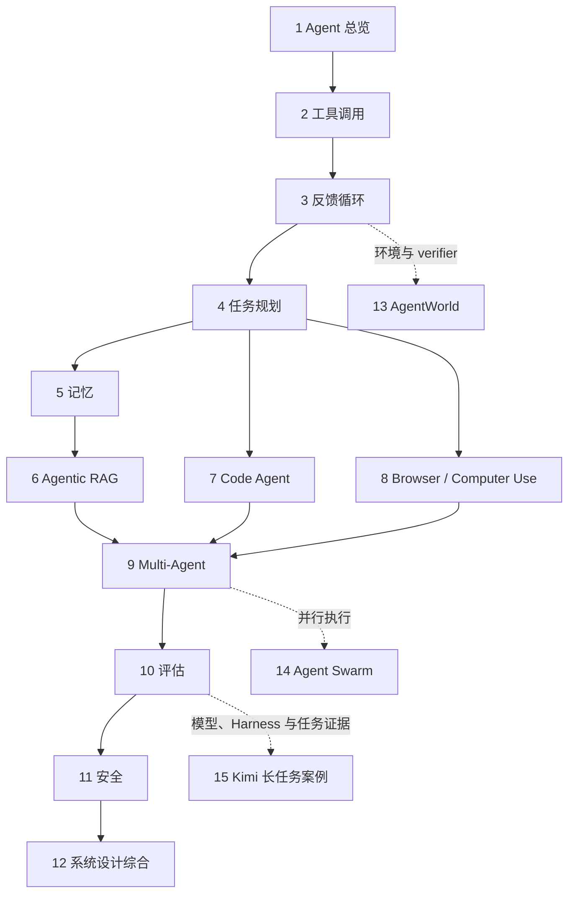

# 第十七册：Agent 与工具调用专题

本册回答一个连续问题：模型提出的动作怎样经过宿主和工具，安全地改变环境状态，并用证据确认任务完成？建议依次阅读第 1—12 章，建立 Agent 循环、工具执行、任务组织、评估与安全的主线；第 13—15 章是环境闭环、多 Agent 并行协作和长任务模型案例的进阶延伸。

## 主线与进阶路径

## 章节导航

| 章 | 阅读入口 | 本章回答的问题 | 承接与交接 |
| --- | --- | --- | --- |
| 1 | [Agent 总览](chapters/01-agent总览.md) | 什么条件下模型调用构成一个能执行任务的 Agent？ | 建立概念，交给工具接口。 |
| 2 | [Tool Use 与 Function Calling](chapters/02-tool-use与function-calling.md) | 模型如何提出结构化动作，系统如何校验、授权、执行并回传结果？ | 依赖第 1 章；协议细节延伸到第 22 册，Runtime 到第 20 册。 |
| 3 | [ReAct 与 Plan-Act-Observe](chapters/03-react与plan-act-observe.md) | 新观察如何改变计划、状态和下一动作？ | 依赖第 2 章的动作接口，为规划和环境闭环提供循环模型。 |
| 4 | [Planning 与 Task Decomposition](chapters/04-planning与task-decomposition.md) | 如何把目标拆成可检查、有依赖关系的子任务？ | 依赖第 3 章；交给记忆、RAG、代码和界面任务。 |
| 5 | [Memory 系统](chapters/05-memory系统.md) | 哪些信息应保留、检索、更新或遗忘？ | 依赖第 3—4 章；与第 6 章区分状态记忆和外部证据。 |
| 6 | [Agentic RAG](chapters/06-agentic-rag.md) | Agent 如何决定检索什么，并证明回答来自哪些证据？ | 依赖第 2—5 章；交给工具型任务与协作。 |
| 7 | [Code Agent](chapters/07-code-agent.md) | Agent 如何理解代码库、修改文件、运行测试并修复失败？ | 依赖第 2—4 章；第 10 章评估结果，第 11 章约束执行权限。 |
| 8 | [Browser 与 Computer Use Agent](chapters/08-browser与computer-use-agent.md) | Agent 如何观察并操作网页或桌面，同时保护用户和外部系统？ | 依赖第 2—4 章；第 10 章评估任务结果，第 11 章定义安全边界。 |
| 9 | [Multi-Agent](chapters/09-multi-agent.md) | 多个 Agent 如何分工、通信、共享状态并证明协作值得其成本？ | 汇总第 4—8 章的任务模式；第 14 章落实并行协作工程。 |
| 10 | [Agent 评估](chapters/10-agent评估.md) | 怎样区分任务成功、过程质量、成本和安全，并定位失败？ | 汇总前面执行方式；第 13、15 章提供具体环境与模型案例。 |
| 11 | [Agent 安全](chapters/11-agent安全.md) | 如何限制权限、处理不可信输入并保护有副作用的动作？ | 约束第 2—10 章的执行与评估，交给综合设计。 |
| 12 | [Agent 面试题](chapters/12-agent面试题.md) | 怎样把 Agent 系统设计成带状态、证据、成本与安全门槛的完整方案？ | 收束第 1—11 章主线。 |
| 13 | [AgentWorld 模型与环境闭环](chapters/13-agentworld模型与环境闭环.md) | 怎样定义任务环境、状态转移、观察、verifier 和长任务评估？ | 进阶延伸第 3、10、11 章；与论文同名的 AgentWorld benchmark 区分。 |
| 14 | [Agent Swarm 并行协作](chapters/14-agent-swarm并行协作.md) | 怎样隔离并行工作、合并 artifact、控制预算并恢复失败？ | 进阶延伸第 9 章，聚焦执行与合并机制。 |
| 15 | [Kimi K3 发布证据与长任务 Harness](chapters/15-kimi-k3发布证据与长任务harness.md) | 模型发布、协议状态、Harness 和环境共同怎样决定长任务证据？ | 进阶案例，依赖第 10 章评估视角，并与第 16、20、22 册交叉阅读。 |

## 后续入口

- 想从练习项目开始：读第三册 Agent 项目实战。
- 想深入推理模型、thinking 状态与测试时计算：读第十六册。
- 想实现文件系统、终端、沙箱、权限、checkpoint 和 replay：读第二十册。
- 想学习 MCP、A2A、工具发现和 Skill/Plugin 治理：读第二十二册。
