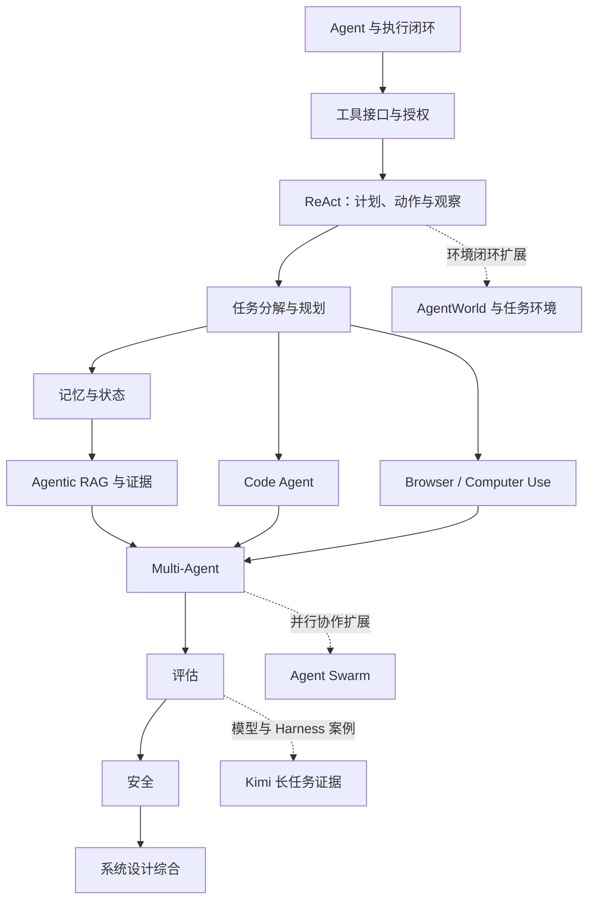

# 第十七册简介：Agent 与工具调用专题

## 这本书要回答什么

语言模型给出的是下一步建议；要把建议变成可靠任务结果，系统还得决定能否执行、怎样执行、环境发生了什么，以及结果是否真的满足任务要求。本册沿着这条闭环讨论 Agent：模型如何提出工具动作，宿主如何维护状态与权限，外部环境如何返回可核验的观察，系统又怎样恢复、评估并安全停止。

## 读者与前置

本册面向已经了解基本大模型输入输出、希望从单轮回答走向任务执行的读者。熟悉 JSON、API 或做过 RAG/工具调用 demo 会更容易跟上，但不是阅读前提；开篇会建立 Agent 循环和工具调用所需的共同概念。读者不需要预先掌握特定 Agent 框架，也不需要读完第二十册或第二十二册才能理解本册主线。

## 学完后应能做什么

读完后，读者应能把自然语言任务写成带状态、动作、观察和完成条件的执行契约；为工具设计参数校验、授权、执行、回执和失败恢复；选择计划、记忆、RAG、代码或界面操作方式；判断何时使用多个 Agent；并用任务结果、过程轨迹、成本和安全指标评估系统。遇到模型发布或 benchmark 数字时，读者还应能区分模型、Harness、环境和 verifier 各自提供的证据。

## 阅读路径

第 1—3 章从 Agent 的组成、工具接口和反馈循环起步；第 4—6 章把循环扩展为任务分解、记忆和证据检索；第 7、8 章分别进入代码仓库与浏览器/桌面环境；第 9—11 章讨论多 Agent 协作、系统评估和安全；第 12 章用设计案例把前面的方法收拢。第 13—15 章是进阶延伸：环境闭环基准、并行协作系统和 Kimi 长任务案例。初读者可以先完成第 1—12 章，再按兴趣进入延伸篇；做长任务或多 Agent 系统的读者可以把第 13、14 章提前接在第 3、9 章之后。

## 各章摘要与衔接

1. [Agent 总览](chapters/01-agent总览.md)建立模型、工具、宿主、环境和任务状态的共同图景，为全书定义执行闭环。
2. [Tool Use 与 Function Calling](chapters/02-tool-use与function-calling.md)从结构化动作提议走到参数校验、授权、执行和结果回传，并把协议与 Runtime 的深入入口交给第二十二、二十册。
3. [ReAct 与 Plan-Act-Observe](chapters/03-react与plan-act-observe.md)说明观察怎样改变下一步决策、计划如何更新、失败如何恢复以及何时停止，为后续规划和评估提供循环模型。
4. [Planning 与 Task Decomposition](chapters/04-planning与task-decomposition.md)把复杂目标拆成有依赖、有验收条件的子任务，再将计划交给记忆和执行章节。
5. [Memory 系统](chapters/05-memory系统.md)区分上下文、会话状态、长期记忆和检索结果，解释写入、读取、遗忘与安全边界。
6. [Agentic RAG](chapters/06-agentic-rag.md)将检索作为受控决策步骤，追踪查询、证据、引用和回答验收，为代码与界面 Agent 提供证据使用原则。
7. [Code Agent](chapters/07-code-agent.md)沿代码库理解、编辑、测试和修复闭环讲解仓库级任务，并把失败交给评估与安全章节分析。
8. [Browser 与 Computer Use Agent](chapters/08-browser与computer-use-agent.md)比较 API、DOM 和视觉操作，追踪界面状态、用户授权、不可逆操作与页面注入风险。
9. [Multi-Agent](chapters/09-multi-agent.md)比较协调器、角色分工、通信与共享状态，判断多 Agent 何时带来净收益，并为第 14 章的 Swarm 实现作铺垫。
10. [Agent 评估](chapters/10-agent评估.md)把任务成功、轨迹质量、失败归因、成本和安全放进明确的评估协议；第 13 章会进一步讨论环境与 verifier 的定义。
11. [Agent 安全](chapters/11-agent安全.md)从最小权限、提示注入、沙箱、确认和供应链风险建立防护边界，约束前面所有执行方式。
12. [Agent 面试题](chapters/12-agent面试题.md)以系统设计问题综合任务契约、状态、工具、记忆、评估和安全，完成主线复习。
13. [AgentWorld 模型与环境闭环](chapters/13-agentworld模型与环境闭环.md)定义 Agent 与环境之间的状态、动作、观察、重置和 verifier 契约，并讨论长任务评估；正文会区分本章的通用环境闭环与同名 benchmark。
14. [Agent Swarm 并行协作](chapters/14-agent-swarm并行协作.md)把第 9 章的协作模式落实为任务图、artifact、工作区隔离、合并、预算、恢复和验收流程。
15. [Kimi K3 发布证据与长任务 Harness](chapters/15-kimi-k3发布证据与长任务harness.md)用模型发布、思考状态、Harness 和任务环境案例训练证据分层；具体版本与评测条件以对应官方材料和固定配置为准。

## 与其他书的分工

第三册用有限篇幅带读者完成 Agent 项目，本册负责解释通用 Agent 模式、判断和评估。第十六册主要讨论推理模型、测试时计算与推理状态；本册只在它们影响工具循环时补足接口背景。第二十册深入 Runtime/Harness 的组件实现、权限和长任务运行机制；第二十二册深入 Function Calling、MCP、A2A、Skill 等协议与生态。这里解释理解 Agent 所必需的工具和运行边界，并提供继续阅读入口，不重复它们的完整工程或协议章节。
