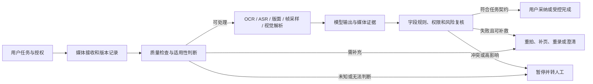

# 第八章：多模态产品落地

## 0. 范围与学习目标

本章讨论图像、文档、语音和视频怎样成为可验收的用户任务。重点不是比较模型排行榜，而是把一条产品链路拆成输入、处理、证据、交互、验收和责任：用户给了什么，系统实际读取了什么，结果按什么标准采纳，失败时怎样补充或转交，以及每份媒体和派生数据由谁访问、保留多久。

本章依赖第二章的用户任务与场景证据、第三章的体验指标、第四章的单位经济和第五章的企业权限边界。文档检索回链[第六章《RAG 产品落地》](06-rag产品落地.md)，工具动作回链[第七章《Agent 产品落地》](07-agent产品落地.md)，跨产品数据责任交给[第九章《隐私、合规与治理》](09-隐私合规与治理.md)，上线后的持续运营交给[第十章《上线运营与反馈闭环》](10-上线运营与反馈闭环.md)。视觉、语音和视频模型机制分别可继续读[第十五册第八章](../../book-15-multimodal-generative-models/chapters/08-视频生成与world-model.md)、[第十五册第九章](../../book-15-multimodal-generative-models/chapters/09-语音与音频生成.md)及[第十九册第十一章《多模态项目坑》](../../book-19-practitioner-playbook/chapters/11-多模态项目坑.md)。

下文引用的 OpenAI 图像、音频和实时语音文档只说明该供应商检索日公开的接口选项与行为；它们会变化，也不代表其他供应商或目标业务效果。风险管理与溯源资料支持控制思路，不构成法律判断或产品认证。案例中的数量和结果均为合成教学数据。

## 8.1 先定义任务契约，再选择模态

多模态不是产品目标。用户要完成的可能是填好一张报销单、找到合同条款、听懂并处理一句语音请求，或产出可编辑的分镜草稿。产品团队先写清任务的输入、输出和验收，再决定媒体要经过哪些模型、规则和人工环节。如果同一任务用文本或传统软件就能以更低风险完成，就没有理由为了展示“多模态”而增加媒体处理链。

一份可讨论的任务契约至少回答下面几个问题：

| 决策 | 要说清的问题 | 产品表达 |
| --- | --- | --- |
| 用户任务 | 谁在什么情境下要完成什么工作？ | “报销人提交一张票据并得到可核对的报销记录”，而非“识别图片”。 |
| 输入与证据 | 哪些媒体、字段、时间段或区域与判断有关？ | 图像页、裁切区域、语音时间段、视频帧及其版本。 |
| 结果与验收 | 哪些字段或约束必须正确？谁有权采纳？ | 必填字段、算术校验、用户确认、专业人员复核。 |
| 体验与失败路径 | 多久有结果？无法判断时用户做什么？ | 请求重拍、补页、澄清、转人工或安全停止。 |
| 责任与数据 | 谁可上传、查看、处理、导出和删除媒体？ | 权限、用途、保留期、第三方处理与删除传播路径。 |

图中的路径把用户动作、媒体质量和业务结果连起来。它不是固定的模型架构：任务可以跳过不相关的模态处理器，但任何不确定状态都必须有明确去向。



可以用一张小票贯穿这条链：用户拍摄票据，系统检查金额区域能否辨认，提取日期、商户、金额和税额，将字段连回原图位置，再运行业务规则；只有规则通过的结果才进入报销草稿。若识别金额与行项目合计不一致，系统显示原图区域和读取值，请用户确认或转交审核员，而不是让模型补出一个看似合理的数字。

## 8.2 图像与文档：让结果回到媒体证据

图像任务至少要区分分类、目标定位、文字识别、空间关系和开放式问答。它们的输出验收不同：分类看类别，定位看区域，OCR 看字符或字段，文档问答还要保留页码、表格单元格或坐标。把所有任务都写成“看图回答”，就无法构造匹配的测试样本，也无法解释一次失败究竟来自拍摄、解析还是推理。

常见的文档产品链路是：上传与权限确认 → 页面方向和清晰度检查 → OCR 与版面/表格结构恢复 → 字段或段落抽取 → 业务规则校验 → 原页证据展示 → 用户或审核员采纳。保留版面关系很重要：PDF 表格若被扁平化为文本，列和值可能错配；跨页条款若失去页码和版本，答案可能引用旧合同。解析结果应关联来源、页码、区域、文档版本和访问权限。

票据例子中的关键错误不是“模型答错”这么简单。若原图写着 ¥1,280.00，OCR 却读成 ¥1,280.80，系统可以用行项目合计、税额关系和原图裁切一起发现冲突；没有规则可判时，则显示待确认。模型置信度只能作为一个信号，不能直接替代业务校验。

图像生成也需要证据与控制，但验收目标不同：海报看布局和文字区域，商品图看商品轮廓与颜色是否被改变，设计草稿看用户是否能以少量编辑达到目标。生成预览、参考素材、局部修改区域和最终导出版本要分别留存，便于用户比较变更并确认使用范围。

## 8.3 语音：分别设计批处理与实时交互

会议纪要通常是批处理任务：用户上传一段完整录音，系统转写、分离说话人、生成摘要和行动项。电话客服或口语陪练则是实时交互：用户边说边期待系统响应、允许打断并能纠正识别结果。两者可以共享转写或语音合成组件，但对延迟、状态和错误恢复的要求不同。

级联式语音链路可由语音识别（ASR）、语言模型和语音合成（TTS）组成；端到端语音模型则可能直接处理语音输入并生成语音输出。选择哪种方式取决于任务需要的可检查性、实时性、可替换性和数据控制。当前供应商文档也把实时语音会话、既有文本 Agent 的语音界面、文件转写、实时字幕、翻译和语音合成列为不同工作流；这些是特定 API 的选择说明，不是所有服务都必须采用的产品架构。[OpenAI 音频文档](https://developers.openai.com/api/docs/guides/audio)

实时体验应测用户感受到的等待，而不仅是模型内部某一步：用户停止说话到首个有用响应的时间、端到端响应时间、打断后停止播放的时间，以及用户纠正后状态是否更新。Realtime API 文档明确区分服务端托管播放状态与客户端自行播放时的打断/截断处理，说明同一“打断”体验也可能依连接方式而异；产品必须按自己的客户端、网络和状态实现测量。[OpenAI Realtime 会话文档](https://developers.openai.com/api/docs/guides/realtime-conversations)

语音中的错误会向后传播。ASR 将“不允许”听成“允许”，后续回答即使逻辑连贯也已基于错误指令；说话人分离错位会把客户的陈述归到客服名下。对金额、日期、否定词、地址和权限等关键槽位，可让用户检查转写或通过屏幕确认；对无法可靠判断的多人重叠、噪声或专有名词，提供回听片段和人工接管。

录音是否开始、是否保留、谁能回放、转写是否进入检索或模型改进，都应在产品中说明并由后端执行。声纹、背景说话人、电话号码和屏幕共享音频也可能包含未主动提交的信息，不能只按用户明确说出的内容理解数据范围。

## 8.4 图像和视频生成：验收控制过程与最终用途

生成工具的价值通常体现在用户从意图到可编辑草稿的工作量是否减少，而不是单张结果是否“好看”。产品应让用户指定主体、版式、比例、参考素材和禁止变更区域，并支持变体比较、局部修改和回退。评估要记录可控条件是否满足、反复生成与编辑的次数、用户实际采纳的结果、单位成功成本及输出是否符合品牌和授权规则。

视频增加了时间维度。单帧视觉质量不能代表整段任务完成；对分镜预演或产品演示，应按镜头、关键动作和时间片段检查主体身份、动作连续、画面文字、遮挡恢复、声音同步及镜头衔接。抽样帧可能漏掉短暂风险或错误动作，审核策略需根据片段长度、内容风险和发布范围设计覆盖方式。需要稳定 UI 或产品外观时，应把文字、按钮状态和商品形状当作显式验收约束。

早期可以把结果定位为创意草稿，让用户编辑后决定是否发布；用于公开传播或涉及真人肖像、声音、公共事件的内容，则要另行核对素材授权、平台政策、适用标识规则和审核责任。版权和合规判断依适用法域及合同而定，生成模型提供了能力并不自动赋予使用权。

## 8.5 教育、医疗与工业：风险决定确认方式

教育产品要判断学习者当前会什么、需要提示还是反馈，并让题干、图形和学生步骤可检查。若图像识别把负号看成正号，后续讲解会沿着错误问题继续；因此可以先呈现题目转写和关键公式让学生或教师确认。面向未成年人的产品还要收集最少必要媒体，说明家长/学校角色及数据用途，并限制把短期学习记录变成未经解释的永久标签。

医疗影像、工业质检和安全巡检的输入分布与错误后果都更具体。上线评估应按设备、机构、材料批次、缺陷类别或人群等与任务相关的切片检查漏检和误报，不把平均准确率或模型自报置信度直接当作专业阈值。产品可以用于定位疑点、结构化信息或排序复核队列；诊断、放行、维修等决定要按领域责任、现行流程和专业要求确定人工复核与最终责任。此处是产品风险设计建议，不替代行业法规或专业判断。

## 8.6 把输入质量变成可观察状态

质量检查应在模型判断之前发生，并能改变后续路径。质量条件需由任务决定：适合商品分类的图像不一定足以读取小字；语音转录可接受的信噪比不一定适合说话人归属；视频总时长足够也不代表关键动作被采到。

| 输入 | 与任务相关的检查 | 用户可执行的下一步 |
| --- | --- | --- |
| 图片 | 清晰度、曝光、倾斜、遮挡、目标是否完整、关键区域分辨率 | 重拍、裁切、补充视角或确认局部字段 |
| 文档 | 页数完整、阅读顺序、表格列关系、页码/版本、扫描噪声 | 补传缺页、换清晰版本、选择生效文件或确认字段 |
| 音频 | 削波、静音、信噪比、语言、多人重叠、关键话语是否截断 | 重录、回听片段、确认关键转写或转人工 |
| 视频 | 帧率、压缩、关键事件覆盖、时间戳、音画同步 | 补充片段、标出时间段或转人工审阅 |

结果可分为“可处理”“需要补充”和“无法判断”。只有检查器确实覆盖了对应条件时，才能说输入通过质量检查；未检查、检测器不适用和检测器不确定要分别记录。对用户的提示应指明任务相关问题，例如“票据金额区域太模糊”，而不是只说“图片质量不佳”。

为复现错误，需将原始媒体 ID、派生媒体版本、裁切/旋转/OCR/降噪/抽帧参数、模型与规则版本关联起来。记录并不等于无期限保存原始媒体：保存时间和访问权限仍应按数据用途、用户承诺及适用要求设定，删除还需覆盖缩略图、缓存、索引和评估副本。

## 8.7 授权、隐私与不可信媒体

多模态数据链不止原始文件。图像可衍生缩略图、OCR 文本和区域坐标；录音可衍生转写、说话人片段和声学特征；视频可衍生关键帧、字幕、嵌入和审核结果。派生数据往往仍可关联原用户或揭示敏感事实，访问控制、租户边界、用途和删除要求应沿数据链传播。审计日志尽量存储必要的标识、版本和状态，不把完整敏感媒体或提示上下文作为默认日志内容。

图像、文档、网页截图和录音中的指令都应视作待理解的数据，不自动成为系统指令。OWASP 将外部文件里的指令列为间接提示注入风险，并指出多模态输入可能把隐藏图像文字与普通文本组合成攻击；提示注入不存在可保证万无一失的单一防护。[OWASP LLM01:2025](https://genai.owasp.org/llmrisk/llm01-prompt-injection/) 因此，产品要把模型能读到的内容与模型能执行的权限分开：由应用层校验用户身份、媒体访问范围、收件人、工具参数和外部副作用；高影响动作另设确认或专业复核，不依赖媒体审核器作权限决定。

NIST 的生成式 AI 风险 profile 是自愿采用的跨行业风险管理资源，且建议需要按参与者和具体用途判断适用性；它可以帮助组织提出治理问题，但不能代替特定产品的威胁模型、法律意见或验证。[NIST AI 600-1](https://www.nist.gov/publications/artificial-intelligence-risk-management-framework-generative-artificial-intelligence)

## 8.8 素材权利与内容来源记录

输入素材至少要核对用户是否有权提交，以及系统是否可按声明用途处理、展示或转交第三方。参考图、肖像、声音、字体、音乐、商标、合同和客户资料可能有不同权利主体和使用范围；一次推理使用的授权不自动包含训练、公开发布或转售授权。系统可以保存来源、授权人、用途、范围、有效期和审批记录，但不能用“用户上传”推定“用户拥有所有权利”。

输出侧的发布按钮、下载权限和使用提示要与授权状态相符。若状态未确认，应限制到内部草稿或转人工核对。内容来源凭证可记录创作和编辑声明，并通过签名与内容绑定帮助检查声明是否被更改；C2PA 2.5 规范描述了 claim/manifest、签名和资产绑定验证流程。[C2PA Content Credentials 2.5](https://spec.c2pa.org/specifications/specifications/2.5/specs/ContentCredentials.html) 按规范的验证对象范围推论，验证成功不等于画面内容真实、签署人对素材有合法授权，或输出没有版权争议。没有凭证也不能据此断定媒体一定是伪造的。

## 8.9 用分层指标复核一条产品链

每项指标要绑定具体任务、样本集、版本和时间窗，并说明分母。输入质量、模型字段、完整任务、用户采纳和业务价值回答的是不同问题，不能简单平均成一个“多模态总分”。例如 OCR 不适用于纯语音产品时应标为不适用；需要授权检查却没有记录时应标为未知，而不是按通过计入。

| 观察层 | 例子 | 必须说明的分母或条件 |
| --- | --- | --- |
| 输入覆盖与质量 | 质量通过、重拍/补传、无效输入 | 收到的提交数、检查覆盖数、任务窗口 |
| 模型与证据 | 字段正确、定位命中、关键断言有依据 | 字段数、输出数、断言数及证据抽样规则 |
| 用户任务 | 最终可用、被采纳、人工完成或放弃 | 启动任务数；需注明“可用”由谁验收 |
| 体验 | 首个有用响应、端到端延迟、打断成功、编辑时间 | 请求窗口、设备/网络、同步或人工等待是否计入 |
| 治理 | 授权记录、隐私控制、风险拦截、人审覆盖 | 适用风险样本、检查覆盖和未知项 |
| 业务 | 节省工时、错误减少、转化或单位成功成本 | 与基线对齐的时间窗和归因方法；经济计算见第四章 |

下面用一组票据任务的合成数据说明字段级和任务级口径为何要分开。所有数字只为演示算法，不是行业目标：

- 收到 100 张票据，90 张通过输入质量检查并生成结果草稿，10 张被要求重拍或补页。
- 每份草稿含 4 个必需字段，合计 360 个字段值；人工核验发现 338 个字段值正确，字段准确数为 $338/360\approx93.9\%$。这个微平均比例不表示 93.9% 的票据都可直接入账。
- 90 份草稿中，82 份的所有关键字段和业务关系检查通过，精确记录通过率为 $82/90\approx91.1\%$；另 8 份因至少一项关键错误而暂不采纳。
- 82 份通过规则检查的记录中，70 份可按产品授权自动进入草稿箱，12 份按本例风险规则转给审核员。审核员接受或修正其中 10 份，另 2 份仍待确认；因此本窗口最终被确认可用的是 80 份。

同一组数据可以用以下比率呈现。变量分别表示质量检查通过的提交数、提交总数、字段正确数、待核字段数、精确记录通过数、模型产生的草稿数，以及窗口内被用户或审核责任人确认可用的任务数。

```math
R_{\mathrm{quality}}=\frac{N_{\mathrm{quality\ pass}}}{N_{\mathrm{submitted}}}
=\frac{90}{100}=90\%
```

```math
A_{\mathrm{field}}=\frac{N_{\mathrm{field\ correct}}}{N_{\mathrm{field\ checked}}}
=\frac{338}{360}\approx93.9\%
```

```math
R_{\mathrm{exact}}=\frac{N_{\mathrm{exact\ record\ pass}}}{N_{\mathrm{drafts}}}
=\frac{82}{90}\approx91.1\%
```

```math
R_{\mathrm{task}}=\frac{N_{\mathrm{accepted\ tasks}}}{N_{\mathrm{submitted}}}
=\frac{80}{100}=80\%
```

这四个数不能互相替代。输入质量通过率说明当前输入能否进入处理；字段正确率可能被大量容易字段抬高；精确记录通过率要求每份记录的关键字段和关系都满足条件；端到端任务成功率还把重拍、错误、人工处置和窗口内未确认的任务留在分母中。若任务需要证据，还应独立抽查引用是否确实指向原图或文档区域；若涉及生成，则另报采纳、编辑和重试，不能与 OCR 或 ASR 合成一个分数。

产品上线前应按本地任务风险预先定义必要条件，并将每项记为通过、失败、未知或不适用。高影响样本缺少人工结果、没有授权记录或关键字段检查覆盖不足时，结论应是未知并限制动作；明确失败的必要条件不得被其他指标的高分抵消。不适用须说明理由。阈值由产品基线、用户承诺、错误代价和专业要求决定，本例没有提供可移用的通用阈值。

OpenAI Evals 官方文档截至 2026-11-16 说明该平台已于 2026-10-31 转为只读，并计划于 2026-11-30 关闭；正文所述的任务定义、样本切片、回归和人工复核不依赖该平台。不要把旧平台入口当成长期产品依赖。[OpenAI Working with evals](https://developers.openai.com/api/docs/guides/evals)

## 8.10 试点与故障定位

多模态试点从受控任务和明确样本开始，再按证据决定是否增加真实用户、媒体种类和自动化动作。第一批样本要覆盖常见输入，也要覆盖模糊、遮挡、噪声、缺页、多人重叠、关键帧缺失、无授权和模型不确定等路径；测试记录固定媒体版本、解析器、模型、提示/规则和人工判定。替换任何一环后，重看受影响的样本切片和端到端结果。

一旦任务失败，按链路寻找第一个偏离点：媒体是否完整、质量判断是否正确、解析是否保留结构、模型输出是否有证据、业务规则是否拦截、用户确认是否匹配，最后再看延迟、成本和责任流程。修复输入或规则问题时不必先换大模型；模型升级也不应跳过授权、安全、真实用户体验和回退验证。持续发布、告警和反馈闭环见第十章。

## 8.11 资料入口与证据范围

- [OpenAI 图像与视觉指南](https://developers.openai.com/api/docs/guides/images-vision)：支持该 provider 当前公开的图像分析、图像生成/编辑入口；不支持关于本地 OCR 准确率或业务效果的结论。
- [OpenAI 音频与语音指南](https://developers.openai.com/api/docs/guides/audio)：支持其当前公开的音频工作流选项；不支持对其他 provider 或口音/噪声场景效果的外推。
- [OpenAI Realtime 会话指南](https://developers.openai.com/api/docs/guides/realtime-conversations)：支持其会话状态、事件与打断处理的接口说明；不代替目标客户端、网络和设备验证。
- [OWASP LLM01:2025 Prompt Injection](https://genai.owasp.org/llmrisk/llm01-prompt-injection/)：多模态输入注入风险与缓解建议；不是模型或产品认证。
- [NIST AI 600-1 Generative AI Profile](https://www.nist.gov/publications/artificial-intelligence-risk-management-framework-generative-artificial-intelligence)：跨行业、自愿采用的风险管理参考；不是法规或合规结论。
- [C2PA Content Credentials 2.5](https://spec.c2pa.org/specifications/specifications/2.5/specs/ContentCredentials.html)：媒体来源声明与验证规范；签名有效不证明语义事实或授权结论。

以上资料支持公开接口、风险分类、管理建议或溯源协议，不支持本章合成票据样例的结果。实际产品仍须用自身媒体分布、任务标准、授权状态、人工判断和运行测量建立证据。

## 8.12 本章小结

多模态产品的单位不是一次模型调用，而是一项能被用户确认的任务。产品需要保留媒体证据和版本，检查输入质量，选择与任务匹配的处理路线，为不确定结果提供补充或人工路径，并沿数据副本执行权限、保留与删除规则。评估时明确分母，分开报告字段、记录、端到端任务和治理指标；关键失败或未知状态不能被平均分掩盖。

下一章转向跨产品的数据责任与治理，进一步讨论谁能处理哪些数据、为了什么目的、保留多久以及由谁承担责任。
