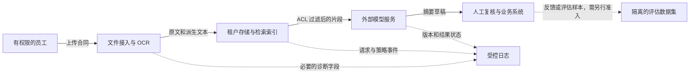

# 第九章：隐私、合规与治理

## 0. 从一次合同摘要看数据责任

一家企业的销售人员把客户合同上传到内部助手，希望得到一页摘要。合同里既有联系人姓名和电话，也有未公开的价格条款。文件先经过 OCR，正文进入租户文档库，检索片段被送到模型服务，回答和请求元数据进入日志，最后销售人员把摘要交给法务复核。用户看到的是一次问答，系统实际处理的却是一串彼此关联的数据副本和责任关系。

如果后来有人要求删除合同，仅删掉上传的 PDF 远远不够：OCR 文本、索引片段、向量、缓存、诊断日志和评估样本可能仍然存在；如果模型服务商还接触过内容，也要确认合同和产品设置怎样处理这次请求。隐私治理要回答的正是这类问题：**处理什么数据、为了什么目的、谁可以访问、会到哪些系统、保存多久、由谁证明控制有效。**

本章沿这条数据生命周期讲产品控制，并给出截至 2026 年 11 月 16 日的部分法域和法规状态入口。法规、主管机构解释、供应商声明和工程实现各自证明不同的事情。本章帮助产品和工程团队整理适用问题、设计控制与留下证据，不替代针对具体产品、主体和合同的法律意见。第十八册第 5 章讨论企业身份与系统边界；第 6—8 章分别讨论 RAG、Agent 和多模态产品中的数据风险；第 10 章承接上线后的监控与反馈。

## 9.1 先分清个人信息、PII 与企业机密

PII（personally identifiable information，个人可识别信息）是工程和安全讨论中常见的英文缩写，不是所有司法辖区通用的一套法定分类。中国《个人信息保护法》使用“个人信息”，定义关注信息是否与已识别或可识别的自然人有关；GDPR 使用 personal data；加州 CCPA 使用 personal information。产品团队可以用 PII 标签辅助扫描，但不能据此替代适用法律的定义和判断。[《个人信息保护法》第四条](https://www.cac.gov.cn/2021-08/20/c_1631050028355286.htm)、[GDPR 第 4、5 条](https://eur-lex.europa.eu/eli/reg/2016/679/oj/eng/)

分类时还要把“个人属性”和“组织保密程度”分开看：

| 数据对象 | 可能的风险 | 进入产品后的处理问题 |
| --- | --- | --- |
| 姓名、手机号、账号、精确位置 | 可直接或结合其他字段识别个人 | 是否为当前任务所需，谁能看到，是否要掩码或限制访问 |
| 医疗、金融账户、生物识别、未成年人信息 | 可能对人格尊严、人身或财产安全造成更高影响 | 是否有特定且充分必要的目的，是否需额外告知、同意、评估或审批 |
| 合同价格、客户名单、代码、未公开计划 | 可能是商业秘密或受合同保护的信息，不一定属于个人信息 | 是否能离开租户、项目或专有环境，供应商能否接触 |
| OCR/ASR 文本、摘要、embedding、缓存和日志 | 可能保留或重新关联原始材料中的信息 | 是否继承来源的用途、租户、访问权限和删除关系 |

一份合同可以同时含有个人信息和企业机密；一段摘要或向量也不会因为“不是原文”就自动变成匿名数据。工程上应先保留来源和可关联关系，只有在适用标准下确认已匿名化，才考虑降低相应保护。哈希、掩码或摘要能减少某些暴露方式，但它们解决的问题不同，不能互相替代。

## 9.2 先判断法域与产品角色

同一功能可能因为服务对象、运营地点、处理角色、数据种类和跨境链路不同而面对不同规则。下表是产品设计的核验入口，不是完整法规清单。

还要分清谁决定处理目的和关键方式，谁只是按照指示处理数据。GDPR 把前者称为 controller、后者称为 processor；中国法律也对委托处理约定目的、期限、方式、种类和双方义务提出要求。模型 API 供应商的合同标签不能单独决定实际角色，团队需要把产品设计、合同关系和实际数据流放在一起核实。[GDPR 第 4、28 条](https://eur-lex.europa.eu/eli/reg/2016/679/oj/eng/)、[《个人信息保护法》第二十一条](https://www.cac.gov.cn/2021-08/20/c_1631050028355286.htm)

| 适用入口 | 截至本章检索日可确认的规则状态 | 产品团队要据此追问什么 |
| --- | --- | --- |
| 中国大陆个人信息处理 | 《个人信息保护法》适用于境内处理个人信息的活动；境外处理者在向境内自然人提供产品/服务或分析其行为等法定情形下也可能适用。法律要求有明确合理的处理目的、与目的直接相关并限制在最小范围；处理敏感个人信息有特定目的、充分必要和严格保护等额外要求。[正式法律文本](https://www.cac.gov.cn/2021-08/20/c_1631050028355286.htm) | 谁决定处理目的和方式？处理依据是什么？是否构成敏感个人信息处理、自动化决策、委托处理或向境外提供，因而要进一步评估？ |
| 中国大陆网络数据与生成式服务 | 《网络数据安全管理条例》自 2025 年 1 月 1 日施行；第十九条对提供生成式人工智能服务的网络数据处理者提出训练数据及处理活动安全管理要求。[条例文本](https://www.cac.gov.cn/2024-09/30/c_1729384452307680.htm) 2025 年修改的《网络安全法》自 2026 年 1 月 1 日施行，其中关于人工智能的条文属于国家层面的发展与安全治理规定，不能直接当作任一产品的完整操作清单。[修改决定](https://www.cac.gov.cn/2025-10/29/c_1763461514768457.htm) | 当前产品、运营主体和数据处理活动是否属于相应规定的适用对象？生成服务怎样治理训练数据和相关处理活动？ |
| 中国大陆生成内容与拟人化服务 | 《人工智能生成合成内容标识办法》自 2025 年 9 月 1 日施行，适用对象由办法第二条界定，服务提供者的显式、隐式标识及传播环节义务要按角色分别判断。[正式办法](https://www.cac.gov.cn/2025-03/14/c_1743654684782215.htm) 《人工智能拟人化互动服务管理暂行办法》自 2026 年 7 月 15 日施行，面向境内公众提供模拟自然人人格、思维和沟通风格的持续性情感互动服务时适用；不涉及持续性情感互动的智能客服、知识问答、工作助手、学习教育和科研服务不适用该办法。[第二条及施行日期](https://www.cac.gov.cn/2026-04/10/c_1777558395078289.htm) | 产品是否提供生成/传播服务，承担哪一段角色？它是否真的提供持续性情感互动，而不只是使用了拟人语气或多轮对话？ |
| 中国大陆数据出境 | 《个人信息保护法》及后续数据出境规则分别规定了评估、标准合同、认证和例外等路径；2024 年《促进和规范数据跨境流动规定》调整了部分适用条件。[《个人信息保护法》第三十八至四十条](https://www.cac.gov.cn/2021-08/20/c_1631050028355286.htm)、[2024 年规定](https://www.cac.gov.cn/2024-03/22/c_1712776611775634.htm) | 哪些数据实际向境外提供，谁是接收方，累计规模和适用例外是什么？具体机制应按当前规则和事实判断，不能只看服务器区域标签。 |
| 欧盟个人数据与 AI 系统 | GDPR 的目的限制、数据最小化、存储期限等原则适用于其范围内的个人数据处理，数据主体权利和控制者/处理者责任仍要按角色和情形判断。[GDPR 正式文本](https://eur-lex.europa.eu/eli/reg/2016/679/oj/eng/) 《AI Act》并非整体延期：截至 2026-11-16，欧盟委员会列出的通常适用日期为 2026 年 8 月 2 日；AI 素养义务和部分禁止性规定自 2025 年 2 月 2 日起、通用人工智能模型义务自 2025 年 8 月 2 日起适用，另有特定规定按后续日期适用。2026 年《Regulation (EU) 2026/1744》将 Annex III 高风险系统相关规则调整至 2027 年 12 月 2 日，将嵌入 Annex I 受监管产品的高风险系统调整至 2028 年 8 月 2 日。[欧盟委员会时间表](https://digital-strategy.ec.europa.eu/en/faqs/navigating-ai-act)、[正式修订法规](https://eur-lex.europa.eu/eli/reg/2026/1744/oj/eng) | 产品在具体用途下是 provider、deployer 还是其他角色？属于哪类系统，现在哪些条款已适用？一般时间表不能替代系统分类和条款核对。 |
| 美国加州消费者隐私 | 加州总检察长截至 2026 年 8 月更新的 CCPA 说明，涵盖知情、删除、更正、退出出售或分享、限制敏感个人信息使用/披露等权利，并指出有适用范围和例外。[CCPA 官方说明](https://oag.ca.gov/privacy/ccpa) | 企业是否属于适用主体，当前数据处理是否触发相应权利和通知义务，供应商关系及法定例外怎样处理？ |

2026 年 7 月网信办公布的《互联网信息服务管理办法（修订草案征求意见稿）》是公开征求意见的草案材料，草案本身不能当作已经生效的义务；使用时须另查截至决策日期是否已有正式文本。[征求意见通知](https://www.cac.gov.cn/2026-07/03/c_1784822399677167.htm) 地方、行业、劳动关系、医疗金融、未成年人和数据安全要求还可能叠加。表格的作用是让团队知道下一步该核实什么，而不是替他们得出适用性结论。

## 9.3 把目的和数据范围写成任务契约

“用户同意使用产品”不是可以覆盖所有后续处理的万能授权。先给每一种数据处理写明任务目的：生成当前摘要、提供检索、监控服务质量、处理安全事件、建立评估集、用于训练或模型改进，往往是不同用途，需要分别分析依据、告知、接收方、期限和撤回/删除影响。以中国法为例，个人信息处理可以基于法律列举的不同情形；如果依赖同意，同意需要满足相应条件，处理目的、方式或种类改变时也有后续要求。[《个人信息保护法》第十三至十七条](https://www.cac.gov.cn/2021-08/20/c_1631050028355286.htm)

为合同摘要助手登记一次处理时，任务契约至少写清：

| 字段 | 合同摘要案例 |
| --- | --- |
| 用户任务 | 给有权处理该客户合同的销售或法务人员生成内部摘要草稿 |
| 输入与必要字段 | 合同条款、版本和必要上下文；不相关附件、通讯录及整段历史会话不随意拼入 |
| 数据分类与来源 | 联系人个人信息、合同商业机密、文件元数据；标出来源、租户、ACL 和版本 |
| 处理目的与依据 | 当前产品服务、检索、诊断、评估、训练分别登记；由责任人核实每一用途的依据和告知 |
| 接收方与地点 | OCR、存储、检索、模型、监控、人工审核及其下游服务商；标出数据区域和访问角色 |
| 保留与删除 | 每类对象的期限、派生关系、删除操作及确需保留时的原因、权限和到期日 |
| 验收和责任人 | 权限负例、外部传输审批、日志最小化、删除演练、人工复核及各自负责人 |

最小化不是按一个通用黑名单删除字段，而是问每个字段是否为当前任务所必需。例如摘要可能需要合同金额和期限，却不需要把客户联系人私人电话送进模型。即使字段必要，也要继续判断目的、授权、访问范围和目的地是否合适。敏感信息、用户输入和文档派生物应在采集、拼接、发送和保存各环节采用与风险相称的控制。

## 9.4 在每个数据访问点执行权限

权限检查必须由服务端执行。界面隐藏文档、Prompt 中写“不得泄露机密”，都不能代替对检索、下载、缓存、工具调用、引用展示、导出和日志查看的授权判定。

下面的合同助手数据流是示意图。每个系统还应补上实际的地区、服务商、责任角色、保留期限和删除接口：

RAG 在送入模型前就要依据当前用户、租户、资源、目的和有效权限过滤；引用展示时再确认用户仍能打开来源。权限撤销后，缓存和索引必须同步失效。Agent 的执行器应按用户身份和任务授权检查工具参数、资源归属、动作副作用与确认状态，不能让模型自行声明授权。这些细节分别连接到本册[第六章 RAG 产品落地](06-rag产品落地.md)和[第七章 Agent 产品落地](07-agent产品落地.md)。

## 9.5 外部模型服务与跨境传输要分开审查

接入第三方模型时，先盘点真实发送内容，再审查合同和服务设置。至少确认：输入是否包含原文、媒体或检索片段；供应商、子处理者、人工支持和监控系统是否接触数据；哪些日志会保留、由谁访问、多久删除；请求处理和存储区域；是否开启数据分享或反馈；删除请求怎样传递；服务退出或换供应商时能否带走审计证据。

“私有部署”也仍要治理身份、密钥、备份、运维访问和删除；“云服务在某地区存储”也不自动说明推理、支持、遥测和下游处理均在该地区。数据驻留能力只是供应商控制之一，不能单独证明数据出境规则或其他适用义务已经满足。

以供应商公开声明为例，OpenAI 当前企业数据页面称，列出的企业产品和 API 数据默认不用于训练，并称符合条件的组织可以配置数据保留控制。这是供应商对其特定产品和条件的说明，不是法律结论，也不能证明企业自建日志、评估集和第三方连接器的处理方式。[OpenAI 企业数据说明](https://openai.com/business-data/) 实际部署要继续核对所用产品、账户、端点、配置、合同、处理区域和下游服务。

中国大陆的个人信息出境需要结合《个人信息保护法》及后续规则判断。该法规定了多种出境路径，并对告知、单独同意、影响评估等事项作出要求；2024 年规定又列出特定豁免和门槛情形。因此不能把“供应商有欧洲/美国 region”“客户签了 DPA”或“数据已脱敏”单独当作出境结论。由法务与数据保护责任人按数据类别、处理者身份、规模、接收方和当前有效规则确定路径，再由工程确保路由、字段投影、密钥和日志配置符合该决定。

## 9.6 日志、评估和训练是不同用途

排障、合规审计、质量评估和模型训练需要的证据不同，不应共用一个长期保存完整请求的日志桶。

- **线上诊断**通常需要请求 ID、时间、模型/工具版本、延迟、错误类型和策略结果。优先不采原文；确需短期载荷时，单独加密、限权、设期限并审计读取。
- **责任审计**需要谁在何时以什么目的访问了哪个资源、做了哪次权限判定、向谁传了什么类别的数据、触发了哪些策略、谁批准了动作。通常可以先保存事件元数据，而不是复制全部内容。
- **离线评估**需要稳定的任务标签和可复核样本。生产样本进入评估集前，要检查授权/依据、去标识、抽样、访问和删除关系；反馈按钮不能默认把关联对话永久纳入数据集。
- **训练与模型改进**是独立用途。候选样本要有来源、目的、授权版本、适用范围、训练状态和删除关联；授权不明、目的冲突或无法追溯的样本先隔离。

关闭某个供应商的训练使用，并不等于其余处理均停止；反过来，企业内部“只用于排障”的日志如果后来复制进训练集，也发生了用途变化。每次用途变更都要重新检查规则、告知、合同、数据集来源和删除流程，而不是靠一个“允许改进模型”的全局开关。

## 9.7 用派生数据清单验证删除

保留期限要按对象和目的分别设定。原始文件、OCR/ASR 文本、索引片段、embedding、缓存、对话历史、trace、反馈、评估副本和备份各自有不同的必要性。中国《个人信息保护法》规定了应删除个人信息的情形；如法定保存期限未届满或技术上难以实现删除，应依相应规定停止除存储和采取必要安全保护措施之外的处理。[第四十七条](https://www.cac.gov.cn/2021-08/20/c_1631050028355286.htm) 这不等于所有备份都可无限期保留，仍要判断是否存在实际法定保留理由、采取什么限制以及何时释放。

继续看合同案例：系统的来源清单发现 11 个应处理对象：原始 PDF 1 个、OCR 文本 1 个、索引片段 3 个、向量 3 个、缓存记录 1 个、含载荷的诊断 trace 1 个、评估副本 1 个。首次删除只确认了 PDF、OCR、三个片段和两个向量，共 7 个对象；第三个向量、缓存、trace 和评估副本尚未清除。

此时已确认删除覆盖率为 \(7/11=63.6\%\)。这个结果足以说明删除尚未完成，不能因为主文件已消失就向用户宣称“已全部删除”。团队还需要按源对象 ID 和版本清除剩余四个对象，重新查询各存储，并记录时间、结果和责任人。若所有 11 个对象最终均得到确认，结果是 \(11/11=100\%\)；但它只证明清单内对象处理完成，并不能证明最初的派生物清单没有漏项。

删除演练可以按这个顺序进行：

1. 核验请求主体、租户、处理范围和适用的删除权利/合同要求。
2. 通过 lineage ID 找到原件、派生文件、索引、缓存、日志、反馈和评估副本，并停止新的使用或复制。
3. 向各存储和服务商发送可追踪的删除或限制处理操作。
4. 对尚未完成的对象区分“失败”“等待队列”“未知”和“有明确依据的保留例外”，不能混成通过。
5. 再次查询各系统，并把对象范围、结果、例外理由、责任人和复核/到期时间写入受控审计记录。

可用删除覆盖率做运行指标：

$R_{\mathrm{delete}}=\frac{N_{\mathrm{deleted}}}{N_{\mathrm{due}}}$

其中分子是已确认完成处理的对象数，分母是已识别且应处理的对象数。分母是对象数量，不是请求数量；备份、法定保留和技术限制应单独报告其状态和依据，不能悄悄从分母移除。若系统还不能列出所有派生副本，分母不完整，覆盖率只能标为 unknown。这样，一个百分比带有可查的对象集合和边界，而不会伪装成法律合规总分。

## 9.8 输出责任取决于动作和影响

同一句模型输出可以是内部草稿、面向客户的建议，也可以直接改写账户或批准付款，后果完全不同。产品要明确模型在流程中负责检索、排序、起草、建议还是执行动作，再据此决定需要什么证据、谁有权采纳、怎样撤回，以及出错时谁处理。

对医疗、人事、金融、法律或未成年人等可能产生重大影响的场景，人工复核必须有实际能力：审核者应看到必要证据、数据版本、权限判定、模型和规则版本、风险提示及拟产生的副作用；系统应保留其采纳、修改、拒绝或转交的结果。一个只有“确认”按钮、没有可判断材料也不能阻止动作的界面，不构成有效监督。

对于付款、客户账户变更、生产操作、对外合同承诺等动作，还要把授权、参数校验、动作前确认、执行结果、撤销能力和外部状态不确定时的恢复路径连起来。模型免责声明不能代替这些控制。实际高风险用途的规则和人工义务仍须结合具体法域及业务部门要求核实。

## 9.9 让组织责任随系统变化而更新

一张责任表应让每个控制有执行者、审批者和能提供证据的人：

| 责任角色 | 在合同助手中的工作 |
| --- | --- |
| 产品负责人 | 定义摘要任务、告知、用户控制、验收和错误后的产品处理 |
| 数据/业务所有者 | 确认数据分类、合同授权边界、任务范围和业务风险接受人 |
| 工程团队 | 实现权限过滤、字段投影、供应商路由、日志策略、删除传播和可观测证据 |
| 法务/数据保护负责人 | 判断适用法域、处理角色、处理依据、合同和影响评估要求 |
| 安全团队 | 检查外部出口、密钥、日志访问、滥用路径和事故响应 |
| 运营/审核团队 | 执行必要复核、申诉/删除受理、异常升级和记录留存 |

模型版本、Prompt、检索索引、用户范围、工具权限、供应商、数据区域或处理目的改变时，应重新检查受影响的数据流，而不是只做模型质量回归。一次可复核的变更记录至少包括变更内容、受影响的数据对象和用户、适用法域与责任角色、风险判断、测试证据、未解决项、批准人、回滚办法和复审日期。

上线结论适合逐项使用四种状态：passed、failed、unknown、not applicable。只有当每项适用控制都有证据且没有阻断项时，才能讨论是否放量。一次确定的越权读取不能被大量正常访问平均掉；没有删除日志也不能写成“未发现删除失败”；not applicable 必须有原因。业务价值、用户体验、安全和隐私分别回答不同问题，不应合成一个“合规分”。

## 9.10 出现问题时沿数据流反向定位

发现泄露、错误引用或删除投诉时，按同一条数据链反向追踪，先缩小影响范围，再定位责任环节：

1. **确认处理对象与目的：** 哪个租户、用户、任务、数据类别和版本，系统声称为此执行了什么用途？
2. **重建数据去向：** 原文经过哪些 OCR/ASR、索引、缓存、模型、工具、日志、备份和人工审核服务？哪些副本还可访问？
3. **核查权限与外发：** 出问题的请求是否有当前权限？服务端是否过滤？供应商、子处理者或其他区域是否收到数据？
4. **核查用途、保留和删除：** 是否有训练/评估复制？日志载荷为何仍在？请求是否传到了全部目标系统？是否存在有记录的保留例外？
5. **核查输出责任和变更：** 模型、Prompt、工具或政策何时变更？结果是否触发外部动作？谁复核、能否撤销、怎样通知和恢复？
6. **关闭系统性缺口：** 修复后更新数据地图、测试样本、权限与删除回归、责任人和复审日期，而不是只删除一个出问题的记录。

提示注入、模型记忆和训练数据抽取值得单独评估，但很多产品泄露发生在模型调用之前：检索过滤、缓存、日志、错误回传和工具权限已经把数据送到了不该看到的人或系统。诊断顺序应从数据与权限流开始，再检查模型层。

## 9.11 资料入口与证据边界

以下资料用于帮助读者回到适用文本。法规条文支持法律内容；主管机构 FAQ 和解释支持其发布机构当前的说明；风险框架和 OWASP 清单提供方法或威胁分类；供应商页面只支持该供应商对指定产品、版本和配置的公开声明。

- 中国法规：[个人信息保护法](https://www.cac.gov.cn/2021-08/20/c_1631050028355286.htm)、[网络数据安全管理条例](https://www.cac.gov.cn/2024-09/30/c_1729384452307680.htm)、[网络安全法修改决定](https://www.cac.gov.cn/2025-10/29/c_1763461514768457.htm)、[数据跨境流动规定](https://www.cac.gov.cn/2024-03/22/c_1712776611775634.htm)、[生成合成内容标识办法](https://www.cac.gov.cn/2025-03/14/c_1743654684782215.htm)、[拟人化互动服务管理暂行办法](https://www.cac.gov.cn/2026-04/10/c_1777558395078289.htm)。
- 欧盟及美国加州：[GDPR](https://eur-lex.europa.eu/eli/reg/2016/679/oj/eng/)、[AI Act 当前适用时间 FAQ](https://digital-strategy.ec.europa.eu/en/faqs/navigating-ai-act)、[Regulation (EU) 2026/1744](https://eur-lex.europa.eu/eli/reg/2026/1744/oj/eng)、[California DOJ 的 CCPA 说明](https://oag.ca.gov/privacy/ccpa)。
- 风险治理方法：[NIST AI RMF](https://www.nist.gov/itl/ai-risk-management-framework)、[NIST Privacy Framework](https://www.nist.gov/privacy-framework)、[NIST Generative AI Profile](https://www.nist.gov/publications/artificial-intelligence-risk-management-framework-generative-artificial-intelligence)、[OWASP Top 10 for LLM Applications](https://owasp.org/www-project-top-10-for-large-language-model-applications/)。它们是风险管理或应用安全参考，不等同于法律认证。
- 供应商声明示例：[OpenAI 企业数据说明](https://openai.com/business-data/)。它不证明你的产品配置、合同、日志和下游数据流已达到任何法域的要求。

截至本章检索日发现的 2026 年《互联网信息服务管理办法》材料为征求意见稿；如后续立法状态改变，应以正式发布文本和现行法规为准。适用法域、法规状态和产品角色都可能改变，引用快照不能替代上线前复核。

## 9.12 本章小结

隐私治理始于一条具体数据流：把个人信息、企业机密和派生对象分清，为每种处理目的、接收者和保留期限作出决定，再将这些决定落到后端权限、外部路由、日志、评估、删除和责任记录中。法律文本告诉团队需要结合哪些范围和角色判断，供应商声明告诉团队某项服务公开承诺什么，测试和审计则证明本地系统是否执行了控制；三类证据不能互相代替。

当数据被用于 RAG、Agent 或多模态流程时，权限和删除必须跨越原件与每个派生副本；当模型、Prompt、供应商或业务目的改变时，治理也要随变更重新检查。下一章将继续讨论这些控制如何进入上线后的监控、反馈和运营闭环。
