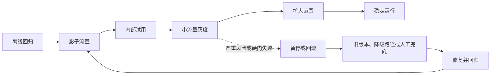

# 第十章：上线运营与反馈闭环

## 10.0 上线之后，团队要能回答什么

把模型接上接口，只说明系统开始响应请求；它没有证明用户完成了任务，也没有证明服务在真实流量、知识变化和外部依赖故障下仍然可靠。客服政策助手可以在测试集上答对问题，线上却仍可能检索到旧政策、把其他租户的文档放进上下文、生成无法核验的引用，或在工单接口超时后误报“已创建”。运营要把一次用户任务的结果、运行证据和后续处理接起来。

本章以一个只读的客服政策助手为贯穿案例：用户提交政策问题，系统核验身份和租户权限，检索有效文档，生成带引用的答复；无法确认时转人工。我们要回答的不是“模型分数够不够高”，而是：哪些任务真的解决了？问题发生在哪个环节？版本变化后是否退化？团队应当继续放量、暂停还是回滚？

上线运营会覆盖服务可用性、任务结果、质量、延迟、成本、反馈、配置变化和安全事件。它与上一章的数据治理相连：可追踪不等于长期保存原文；每条日志、反馈和 trace 仍须有明确用途、访问控制和保留策略。

## 10.1 把请求、任务和运行分开

一次 API 请求不一定等于一个用户任务。客服助手可能因为检索重试两次、调用一次模型并在用户追问后再调用一次；这些请求都可能属于同一个“解决政策问题”的任务。若团队把模型请求成功率当成任务成功率，就会把“接口返回了文本”误报成“用户的问题解决了”。

应分别记录三个对象：

| 对象 | 回答的问题 | 例子 |
| --- | --- | --- |
| 请求（request） | 一次接口调用是否成功、花了多久、消耗多少资源？ | 一次模型生成或一次检索请求 |
| 任务（task） | 用户要完成的业务目标是否达到？ | 用户获得可核验的政策答复，或被正确转给人工 |
| 运行（run） | 这次任务经过了哪些版本、步骤和状态？ | 身份检查、检索、生成、引用检查和转人工的完整轨迹 |

同一任务可以有多个运行；重试不应把它伪装成多个独立任务，人工接管也不应让它从业务分母中消失。每个对象需要稳定标识，并能关联到模型、提示词、检索器、索引、工具和输出校验器的版本。

运行记录至少要能回答：发生时间、任务类别、受控主体和租户引用、各阶段耗时、实际版本、最终任务状态、失败类别、成本、反馈和安全事件。原始输入、输出和检索证据可用受权限控制的引用关联，不必复制到普通指标表。聚合指标只保留趋势判断需要的字段；人工复核队列则单独授权、限定期限并支持删除。

## 10.2 让发布逐步扩大，并预先写下停止动作

新版本应先经过固定样本回归，再进入不影响用户结果的影子流量、内部试用和小流量灰度。每一步都要记录实际版本、观察窗口、流量切片、责任人、停止条件和可执行的恢复路径。影子流量仍会处理真实输入，因此也需要隐私、权限和保留控制。

灰度比例只回答“多少符合条件的任务被路由到新版本”，不回答“新版本是否更好”。计算时要让分子和分母使用同一个任务口径，并检查任务去重与路由记录。总体结果还要按语言、租户类型、风险、输入长度和任务类别切片；只把简单、低风险用户分给新版本，不能支持对全体用户放量。

发布前应把不同故障对应的动作写清楚。出现越权、敏感信息泄漏或未经确认的外部副作用时，先停止新版本并切换安全路径；核心任务质量下降时，暂停扩大并抽取失败样本；只有某个非关键切片延迟恶化时，可以限制该切片并查明瓶颈。恢复预案还要覆盖尚未结束的任务、数据迁移、配置回退、降级模型或人工流程，以及谁有权执行停止和回滚。一个“有旧容器”并不等于回滚已就绪。

## 10.3 用任务结果衡量产品，用服务目标衡量运行

接口返回 200、模型输出流畅或用户点击了复制，都不是任务成功的充分证据。客服助手的成功条件可以是：答复引用当前有效政策，人工抽查支持关键结论，而且用户问题已解决；如果证据不足，正确转人工也可以是任务按设计完成。若最终业务状态无法确认，应单独记为未知，不能让模型自述代替外部状态。

质量至少要分开观察四层：输出协议是否完整，引用和证据是否支持关键主张，用户任务是否达到约定结果，以及这些结果是否在不同用户与任务切片中保持稳定。自动格式校验可以确定 JSON 是否可解析，却不能判断政策解释是否完整；模型评分器可以帮助筛查样本，却不能单独充当事实裁判。高风险结论仍需业务抽样或有权限的人工复核。

对允许用户选择是否使用结果的任务，还可以报告采纳情况，但必须说明分母，例如“已核验且可采纳的任务中，实际保存或提交的任务数”。采纳不等于正确，未采纳也可能是格式、责任或信任问题。指标适用但证据不足时记为未知；产品契约中根本不存在该行为时才记为不适用。不能用空分母、缺失 trace 或没有事件自动表示通过。

延迟也要沿请求链拆开：排队与鉴权、检索和重排、首 token、后续生成、工具调用、最终校验和页面呈现。首 token 延迟（time to first token, TTFT）描述用户何时开始看到生成内容，不代表引用已检查或任务已经结束。应结合完整任务耗时和 P50、P95、P99 查看长尾，并显示时间窗口、样本量和关键切片。P95 是所选样本分布中的分位数，不是最慢 5% 请求的平均值；样本很少时，估计尤其不稳定。

服务级指标（service level indicator, SLI）描述服务行为的测量方式；服务级目标（service level objective, SLO）为特定 SLI 设定目标范围和窗口。它们适合约定可用性、错误率和延迟，但不能替代任务质量、用户恢复和业务结果；SLO 也不等同于带合同后果的 SLA。Google SRE 的方法强调按用户关心的行为选择少数指标，具体目标由服务与用户承诺决定，不能从示例抄成行业阈值。

成本统计要覆盖模型输入和输出、检索与重排、工具和外部 API、存储与网络、人工复核、重试及失败处理。按任务类型、版本、租户、输入长度、工具步数和失败原因拆分后，才知道账单为何变化。总成本除以任务数得到平均任务成本；若要衡量成功工作的成本，可用该观察窗全部成本除以已核验成功任务数，并同时报告失败与未知任务数。分母为零时报告总成本和任务结果，不能把单位成功成本写成零或无穷大。

## 10.4 反馈是待判断的线索，失败要追到第一处分叉

显式反馈包括点踩、问题类别、投诉、人工审核和转人工；隐式反馈包括复制、保存、提交、撤销、重复提问和最终业务状态。两者都有歧义：满意用户可能不反馈，点踩也可能来自政策本身不合意；复制可能表示认可，也可能只是为了修改。反馈比例不是满意度或准确率。

每条反馈应带任务和版本引用，按“收到—去重—权限与用途检查—分类—人工判定—进入修复、回归或产品待办—复测关闭”流转。需要统计处理进度时，先规定“已处理”是否要求有审查结论和下一步；尚未复核的反馈不能悄悄计作已解决。用户原文、改写和人工备注也可能含个人信息或企业机密，不能因为它们有助训练就直接加入训练集。

排查失败时，先找出结果第一次偏离任务契约的位置，而不是立即归因于模型：

| 第一处可能偏离 | 要检查的证据 | 常见修复 |
| --- | --- | --- |
| 输入、身份或任务边界 | 字段完整性、主体和租户、支持范围 | 输入校验、澄清、服务边界 |
| 文档与检索 | 文档版本、生效日期、解析结果、权限过滤和命中记录 | 文档治理、索引修复、召回与排序 |
| 生成与输出协议 | 模型和提示词版本、上下文、引用支持、结构校验 | 提示词、模型路由、校验与拒答 |
| 工具或外部状态 | 参数、授权、幂等键、返回码、最终状态查询 | 修复授权、重试和状态确认 |
| 用户接管与恢复 | 交接内容、责任人、等待状态、用户是否能继续 | 改进确认、降级、人工工作流 |

RAG 失败要保留文档标识、版本和权限判定；Agent 失败要记录动作参数的受控引用、工具返回和状态确认；多模态失败要能关联原始媒体、预处理结果与使用的模态路由。追踪这些证据的目的在于诊断，不是无限期保存完整对话。

## 10.5 离线评估、线上观察和实验各有边界

离线评估能固定输入、参考证据、工具状态和版本，适合发现回归和复现历史失败。样本应覆盖核心任务、确认过的历史失败、安全与权限边界、新语言或新文档等长尾变化，并注意时间、用户和文档来源切分，避免相同模板泄漏到调参集和最终验收集。

线上观察覆盖真实用户分布、外部依赖与最终工作流状态，但点赞、投诉和模型自评都不是天然金标准。将线上样本转为评估数据前，需要核对用途、脱敏、标注依据和访问权限；无法判断的样本保留未知。自动评分器可用于筛查和趋势比较，关键结论应抽样人工核对。

A/B 实验应先确定实验单位（用户、租户、任务或请求）、随机分流单位、分析单位、主要结果、观察窗口和安全/质量护栏。连续任务会共享上下文和用户学习，同一用户混用版本可能造成串扰；客服等持续工作流通常要按用户或租户分配。实验若同时改变模型、提示词、界面和政策，就无法把差异归因给单个因素。比较结果要同时给出分母、样本构成和不确定性；小样本的几次成功差异不构成全量替换证据。

资料状态也属于维护证据。截至 2026-11-16，OpenAI 官方文档显示 Evals 平台在 2026-10-31 已对既有内容转为只读，并计划于 2026-11-30 关闭。这个日期说明的是单一供应商平台的生命周期，不是评估方法的终止；固定任务、样本、判分规则和回归流程仍需由团队持有并可迁移。平台具体迁移入口应以当时官方时间线为准。

## 10.6 配置和模型变更必须可复现、可回退

Prompt、检索参数、工具 schema、拒答策略、输出格式、模型路由和远程配置都会改变用户可见行为。每次变更应保存变更前后的版本引用、原因、责任人、受影响任务与切片、预期改善、可能回归、离线结果、灰度范围、停止条件和恢复版本。若模板按租户动态覆盖，还要记录实际渲染配置的稳定版本标识，而非只记模板文件名。

模型升级也要检查输出协议、工具调用、拒答、引用、语言、多模态字段、延迟、成本、限流、区域和数据处理条件。用同一批固定样本做配对比较能发现行为差异，但不能证明线上因果提升；影子流量和小流量观察补充真实分布证据。切换初期应保留可用旧版本、降级模型或人工路径。模型路由策略本身也须记录，因为一个聚合指标可能混合多个实际模型。

## 10.7 RAG、Agent 与多模态各有自己的运行证据

同一张总看板无法替代各路线的关键状态。要根据系统会改变什么、哪类失败最难恢复，补充路线专属的记录和操作。

**RAG 知识库**要跟踪来源系统、文档所有者、版本和生效期、租户权限、解析状态、分块与向量版本、索引构建、缓存更新和引用可访问性。源文档已更新不表示索引已经生效；每个阶段应有时间戳和失败队列。权限不明、版本冲突或解析失败的内容要隔离，不能悄悄作为可引用知识。错误答复可能源于旧文档或权限过滤，而不只是生成质量。

**Agent 与工具**要记录工具和 schema 版本、执行主体、授权判定、受控参数引用、幂等键、返回状态、重试次数、人工确认和最终外部状态。API 接受请求不代表业务动作完成；超时后可能是“已提交但确认丢失”，应按原操作标识查询或幂等恢复。长任务还需要步骤检查点、步数与费用预算、暂停条件；恢复时重新检查权限和外部状态，避免依据过期上下文继续执行。自动化比例本身不是目标；要和人工接管、恢复成功、单位成功成本及不可逆动作保护一起看，无法可靠验证时降低自动化程度可能更合适。

**多模态系统**要记录图片清晰度、遮挡、音频噪声和语言、视频片段与关键帧、文档页数和 OCR 覆盖等输入质量信号。这些信号可决定重传、重新选择模态、限制任务范围或转人工，但不代表模型结果正确。原始媒体、转写、OCR 和摘要等派生数据要沿用上一章的授权、保留与删除关系。缺失关键证据时应明确降级或暂停，而不是静默地交给另一模态生成答案。

## 10.8 安全事故要有止血和复测闭环

安全观察要覆盖具体系统边界：提示注入是否能跨越数据与指令边界，检索是否越权，敏感信息是否进入输出或普通日志，Agent 是否能调用未授权工具，输入和重试是否造成资源耗尽。威胁分类可以帮助建立测试清单，但不构成目标产品的安全证明。

事故处理至少包含发现、止血、定位、修复、通知和复测。发现时记录时间线与最小必要证据；止血时限流、撤权、关闭工具、切换旧版本或转人工；定位时关联模型、提示词、索引、权限和外部状态；修复后用同类与相邻攻击样本回归；通知和保留依据由明确的责任人结合合同及适用法规判断；复测要检查风险是否被转移到另一入口。

报告“没有观察到安全事件”只能说明当前检测和样本中没有事件，不能写成系统安全通过。事件数量还要按严重程度、受影响主体、数据暴露和外部副作用分开；一次严重越权就足以暂停放量，不应被大量低风险成功任务抵消。

## 10.9 看板要连到负责人和动作

每个看板指标都要显示定义、分子与分母、时间窗口、样本量、版本、关键切片、更新时间、责任人以及达到条件后的动作。实时层适合错误、超时、工具失败、异常调用和严重安全事件；日级观察任务结果、反馈、成本、知识更新和长尾延迟；发布视图对照版本差异、回归覆盖、灰度路由、未结事件和回滚准备。点击聚合数据时，要能在权限允许范围内追到具体运行证据。

问题排序不要把严重性、频率、影响人数和修复成本压成一个精确分数。先处理可能导致越权、泄漏或不可逆副作用的阻断问题；再处理让核心任务无法完成或无法恢复的问题；对广泛的质量、延迟和成本变化，结合样本与版本证据排查；对影响小且证据弱的现象，补观测再决定。优先级同时记录影响范围、复发情况、证据可信度、可逆性和下一步验证人。低置信度不意味着可以忽略高后果风险，严重问题可先隔离再补证据。

## 10.10 一次客服政策助手灰度怎样得出结论

下面用一组教学数据走完观察、判断和下一步动作。数字是为解释统计口径而构造的，不是行业基准。团队在试点前已约定：新版本只处理可验证的政策检索任务；跨租户证据、无权访问、无法确认来源和严重数据风险属于硬阻断；交互式任务的端到端 P95 目标为 4.0 秒。这个目标只适用于本案例的用户承诺。

一周内共有 1,000 个符合路由条件的任务，其中 120 个进入新版本，实际灰度占比为 120/1,000，即 12%。这些 120 个任务中，104 个有业务或人工证据确认已解决，8 个确认未解决，另有 8 个到窗口结束时仍待确认。于是：

- 按全部分配任务计算，已确认成功占比为 104/120 = 0.867；确认失败为 8/120 = 0.067；未知为 8/120 = 0.067。
- 只看已有结论的 112 个任务，成功数占 104/112 = 0.929。但这个数字排除了未知任务，可能显得更好，必须与全量分母和未知数一起报告。

对 40 个按风险和语言分层抽查的答复，38 个引用支持关键政策主张，2 个存在引用缺口。这个定向样本能指出问题类型，不代表全部流量的无偏准确率。用户提交了 24 条反馈，其中 18 条已有审查结论和下一步处理，6 条仍待处理；它说明队列积压情况，不等于用户满意度。

120 个任务的端到端延迟按从小到大排序，采用最近秩定义时，第 114 个样本对应 P95。该样本是 4.6 秒，超过试点前约定的 4.0 秒。全周可归属成本为 960 元，包含模型、检索、人工复核和重试，平均每个已分配任务为 960/120 = 8 元；按已确认成功任务计算，成本为 960/104 ≈ 9.23 元。后一数字把失败和待确认任务的成本也留在分子里，避免只报成功请求的低成本。

更关键的发现来自 60 条固定回归样本：57 条通过，2 条失败，1 条无法判定。其中一条负向权限测试发现索引更新后租户标签丢失，导致其他租户的文档可能进入候选上下文。线上事件台账暂时没有确认的数据泄漏，但这不能抵消已复现的权限缺陷。运行记录也只有 112 个任务具备完整 trace，剩余 8 个不能完整还原版本和检索证据；不能假设这 8 个恰好就是前述未知任务，需用任务 ID 关联确认。

因此，本轮不扩大流量。团队保留旧版路由，先修复索引更新时租户标签丢失的问题，然后重跑同租户与跨租户的正负权限测试、全部回归样本和影子流量。只有权限硬门通过、trace 缺口得到解释、延迟和任务结果按既定窗口复查后，才决定下一阶段灰度。虽然成功样本不少，已知的权限失败仍决定了发布动作；加权总分会掩盖这一点。

## 10.11 本章小结

上线运营是一条把用户任务连接到系统证据、变更和修复的闭环。每次任务要能追到实际版本与关键状态；结果、质量、延迟、成本和安全要按各自分母衡量；未知状态应保留；反馈经审查后转成评估、修复或产品决策；版本变更先回归再渐进放量；严重风险必须触发预先约定的暂停、降级或回滚动作。

稳定运行不等于不出错，而是较早发现问题，限制影响，知道第一处分叉在哪里，并用可以复核的证据证明修复有效。下一章将把场景、体验、系统、单位经济、治理和运营放进一个完整产品案例中。

## 10.12 资料入口与适用边界

- [OpenAI Working with evals](https://developers.openai.com/api/docs/guides/evals) 与[弃用时间线](https://developers.openai.com/api/docs/deprecations)：前者展示任务、样本、评分标准和结果分析的一种供应商工作流；后者记录截至 2026-11-16 的 Evals 平台只读和计划关闭时间。平台状态会变，通用评估流程不依赖该平台。
- [OpenAI Latency optimization](https://developers.openai.com/api/docs/guides/latency-optimization)：供应商延迟工程建议，支持特定服务中的测量和优化方向；实际收益取决于完整链路、负载和任务。
- [Google SRE: Monitoring Distributed Systems](https://sre.google/sre-book/monitoring-distributed-systems/) 与[Service Level Objectives](https://sre.google/sre-book/service-level-objectives/)：支持监控信号、SLI/SLO 选择和长尾分析的方法；目标值应由服务与用户约定。
- [NIST AI 600-1](https://doi.org/10.6028/NIST.AI.600-1)：生成式 AI 风险管理 Profile，属于供组织自愿使用的风险管理参考，不是法规或产品认证。
- [OWASP GenAI LLM Top 10 2026](https://genai.owasp.org/resource/owasp-genai-llm-top-10-2026/)：社区安全风险分类与缓解指南，可用于发现威胁和建立测试方向；不证明目标系统已安全或不安全。
