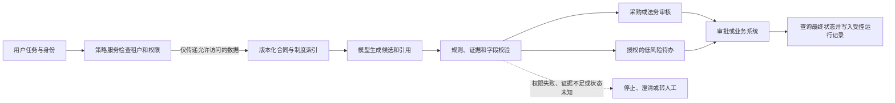

# 第十一章：从模型能力到可持续产品

前十章分别讨论了需求、体验、经济账、企业系统、RAG、Agent、多模态、治理和运营。本章不再把这些主题各自讲一遍，而是沿一项企业任务把它们连起来：合同与采购协同助手怎样从“模型能读合同”走到一项可验证、可控、值得维护的服务？

采购人员需要核对付款条款、制度要求和供应商信息；法务负责判断高风险条款；财务或授权审批人负责付款与签约。助手可以查找有权限的证据、整理差异、生成待审草稿，也可以在授权后创建可撤销的内部待办。但合同是否有效、谁能看到文档、是否提交付款，不能由模型生成的一段文字决定。

本章的案例数字均为教学构造。它们展示怎样连接任务结果、权限、时间、成本和运营决定，不代表真实企业效果。专题细节分别回到前文对应章节，本章聚焦端到端取舍。

## 11.1 从“做一个 Agent”回到一项具体工作

项目发起人最初提出“自动审核合同”。这句话混合了多个不同任务：找到条款、比较模板、识别风险、生成草稿、提交审批，甚至付款。若不把它们拆开，团队无法定义输入、成功标准、错误责任或停止条件。

访谈、观察和现有台账整理出一个较窄的工作流：采购专员每周大约处理 180 份合同或采购申请；现有核对通常需 18—30 分钟；他们要找付款条款、查当前制度、标出差异，再把高风险事项交给法务。这里的频率和时间先作为待验证基线，试点前要说明样本范围、计时方法和任务差异，不能直接把用户估计写成已实现收益。

参与者的责任也不同：

| 角色 | 关心的结果 | 需要保留的决定权 |
| --- | --- | --- |
| 采购专员 | 更快找到条款并准备可复核材料 | 确认业务上下文、修订草稿、提交低风险待办 |
| 法务 | 条款解释、风险边界和例外 | 批准法律判断及高风险条款处置 |
| 财务或授权审批人 | 付款字段、金额和审批链 | 批准付款或供应商变更 |
| 数据所有者与安全团队 | 文档权限、保留、外部处理和审计 | 设定访问及数据处理控制 |
| 产品与工程团队 | 任务结果、系统状态和运行成本 | 维护版本、停止发布并恢复服务 |

这些角色不能合并为一个“用户”。使用者、购买者、数据责任人和错误后果承担者可能是不同的人。本项目的起点是核对付款条件并形成审核材料，不是提高 Agent 步数或让更多动作自动执行。需求研究的方法与边界见[第二章](02-用户需求与场景选择.md)。

## 11.2 先选择可控入口，再决定自动化范围

团队比较了四种可能入口。选择依据不是把优缺点换算成加权总分，而是逐项检查任务证据、可验证性、错误后果和可恢复性；权限或不可逆动作的硬问题不能被低成本抵消。

| 候选任务 | 关键证据 | 第一阶段决定 |
| --- | --- | --- |
| 制度与合同条款定位 | 当前有效文档、权限、引用位置可以检查 | 先做只读证据助手 |
| 合同差异说明 | 需要人工判断解释是否完整 | 生成草稿并要求审核 |
| 内部信息补充待办 | 可定义字段、能撤销或重复查询 | 验证后再允许创建待办 |
| 付款或供应商资料变更 | 外部后果高，授权与最终状态复杂 | 保持人工执行，系统只整理证据 |

低风险入口也不是“先做完再补权限”。在进入真实文档之前，团队必须确认数据所有者、用户角色、允许的租户范围、可访问资料、保留规则和转人工路径。若其中任一项未知，应缩小范围或使用合成数据继续验证。

第一阶段的价值是缩短查找和整理时间，同时让人更快检查原文；它并不承诺代替法务或财务。类似的场景门槛在[第二章](02-用户需求与场景选择.md)展开，产品的整体决策地图见[第一章](01-产品化总览.md)。

## 11.3 写一份系统可以验收的任务契约

把合同核对任务交给工程团队前，先将“答案正确”改写成可观察的交付条件：

| 项目 | 合同付款条件核对的约定 |
| --- | --- |
| 输入与前置 | 合同版本、供应商标识、采购申请和用户身份齐全；缺项时先澄清 |
| 可用证据 | 当前生效、该用户有权访问的合同与制度；记录文档版本和原文位置 |
| 输出 | 分开呈现事实摘录、制度匹配、差异、待确认项和建议的下一步 |
| 完成条件 | 关键主张有可访问的支持证据；任务交给正确责任人，或明确显示尚未确认 |
| 允许动作 | 检索、摘录、生成草稿；低风险内部待办需单独授权 |
| 禁止动作 | 不直接批准合同、改变供应商资料或发起付款 |
| 失败状态 | 权限拒绝、证据缺失、服务超时、提交状态未知均不得伪装成成功 |
| 责任与复核 | 采购确认业务事实；法务/财务按条款和动作风险承担专业审批 |

只读阶段没有外部提交，动作提交指标不适用；如果实际提交后超时而无法确认结果，状态仍是未知。一次模型调用只是生成候选内容。任务能否完成，还取决于证据是否有效、权限是否正确、规则校验是否通过、用户能否理解下一步，以及外部状态能否被确认。界面需要显示“正在检索”“待人工审核”“证据不足”或“提交状态待确认”等真实状态，不能用一条流畅回答掩盖中间失败。体验合同和任务级指标见[第三章](03-模型能力到产品体验.md)。

## 11.4 让每个组件只承担它能被验证的职责

合同助手的系统边界可以画成一条数据与控制链：

模型负责理解表达、归纳差异和生成候选；权限服务确定用户能访问什么；检索器返回有版本的证据；确定性代码核对金额、日期和字段；人工审批承担专业与高后果决定；业务系统负责提交并返回最终状态。任何一层超时或状态不明，都要进入明确的恢复路径，而不是让模型猜测下一步。

对扫描合同，还要检查文件方向、清晰度、页数、OCR 覆盖和关键字段是否存在。OCR 质量不足时，请用户重传或转人工；不应让模型把缺失金额补成一个看似可信的数字。多模态具体路线回到[第八章](08-多模态产品落地.md)，Agent 与工具的状态、幂等和确认机制见[第七章](07-agent产品落地.md)。

## 11.5 证据、权限和数据生命周期必须共用同一条血缘

每份合同和制度文档需要来源、所有者、租户、版本、生效与失效时间、访问策略、解析状态和索引版本。系统检索时要在候选进入模型上下文前执行权限约束；引用、缓存、日志、导出和人工复核也要执行相应访问检查。向量相似度不能代替身份授权。

同一份文件会产生 OCR 文本、片段、向量、缓存、摘要、trace 和评估样本。若原文件被撤回或删除，维护方必须能找到受影响的派生对象，并确认各自是否删除、隔离或按规则保留。外部模型、标注人员和监控平台也属于数据流的一部分。

因此，数据处理目的、个人信息与企业机密分类、供应商角色、保留和删除证据从架构阶段就要确定。规则可能因地区、角色、行业和具体服务不同而变化，产品判断需回到[第九章](09-隐私合规与治理.md)的法规与责任入口；不能用一句“企业数据不训练”替代本地日志和权限审计。

## 11.6 将质量证明拆成不同层次

在小流量前，团队先准备固定评估集：40 条有权限且可回答的合同/制度问题，以及 20 条边界样本，覆盖过期制度、无答案、相似但无权的其他租户资料、OCR 缺字段和高风险动作。每条样本要有正确文档版本、主体权限、预期任务状态和评分依据；否则一个“通过率”无法说明系统实际测了什么。

第一轮权限负向测试发现，索引更新时租户标签丢失，其他租户文档有机会进入候选上下文。即使最终页面没有显示该文档，这仍是硬失败，因为不该访问的内容已经进入不可信的数据路径。团队先修正索引元数据与服务端过滤，再重跑相关测试；修复后的 20 条权限负例都被阻断，只能说明这组测试通过，不能证明所有租户、所有数据路径均无缺陷。

质量报告至少区分：

- **证据与引用**：支持结论的文档是否正确、当前且可访问；
- **任务结果**：核对、澄清、拒绝或转人工是否符合契约；
- **服务运行**：端到端延迟、超时、成本和运行记录是否完整；
- **风险控制**：权限、人工确认、删除和不可逆动作是否满足硬约束；
- **组织结果**：返工、时间、采用和业务指标是否按真实基线改善。

离线样本便于复现，线上观察揭示真实分布和流程结果，两者不能互相替代。少量人工抽查可以发现新问题，但不能直接外推总体准确率；用户反馈可以触发复核，也不等于金标准。章节级评估细节见[第六章](06-rag产品落地.md)、[第七章](07-agent产品落地.md)和[第十章](10-上线运营与反馈闭环.md)。

## 11.7 用分阶段发布来测试责任边界

该系统的发布计划按动作风险而非模型置信度变化：

| 阶段 | 系统可以做什么 | 进入下一阶段前需要的证据 |
| --- | --- | --- |
| 只读证据助手 | 检索、摘录、显示版本和引用 | 用户/租户权限、来源时效、无答案与转人工路径经过测试 |
| 审核草稿 | 生成条款差异和待办草稿 | 关键主张可复核，修改和采纳可记录，失败能回到原文 |
| 低风险待办 | 创建可撤销的内部信息请求 | 服务端授权、参数校验、幂等、外部状态查询和回滚演练 |
| 付款、签约、供应商变更 | 只整理证据并准备审批 | 人类责任人逐笔确认；系统不因运行时间或分数提高而自动执行 |

确认必须绑定待提交的具体字段、合同版本、金额、供应商和目标系统。若这些内容发生变化，之前的确认失效。工具超时后要查询原操作状态或使用同一幂等标识恢复，不可盲目重复付款或建单。什么时候灰度、暂停或回滚，见[第十章](10-上线运营与反馈闭环.md)。

## 11.8 把“节省时间”与“赚到钱”分开

假设受控样本显示：人工处理同类任务平均 18 分钟，使用草稿助手后平均 13.5 分钟；人工完全成本按每小时 60 元估算，也就是 $60/60=1$ 元/分钟。每个任务少花 4.5 分钟，对应 4.5 元的人工容量价值，但只有这段时间实际用于其他有效工作、减少加班或降低支出时，才可能成为经济收益。

运行成本还包括模型与检索、工具、审核、监控、支持和数据治理。完整 ROI 要统一期间与币种，把一次性建设和持续运维分开，并核验成本节省、收入变化或风险避免是否真实可归因。详细单位经济、盈亏平衡和回本口径见[第四章](04-成本收益与roi.md)。本章只把必要计算放进最终试点账本，不再重复整套 ROI 方法。

## 11.9 试点账本怎样改变产品决定

以下是假设已经修复首轮权限缺陷后、为期四周的一次教学试点。团队从相同任务池中分层随机分配合同类型，120 个任务使用草稿助手，另 120 个走原人工流程；不把同一合同的多个任务分到不同组，以减少上下文串扰。

**任务结果。** 助手组 120 个任务中，104 个有业务证据确认成功，8 个确认未成功，8 个到观察期结束仍未知。按全部分配任务计算，已确认成功占比为 $104/120=0.867$；未知任务占 $8/120=0.067$。人工组 120 个任务中有 106 个确认成功。组间差异很小且样本有限，不能据此声称助手提高或降低了总体质量。不能只报告助手组已有结论任务中的 $104/112=0.929$，因为它排除了 8 个未知任务。

**引用检查。** 另抽取 40 个助手组任务按风险与文档类型检查，38 个关键主张有支持，2 个存在引用缺口，即样本内 $38/40=0.95$。这是为定位问题而选的抽样，不是对所有线上任务的无偏准确率估计。

**延迟和运行证据。** 120 个助手任务的端到端延迟按升序排列，按最近秩口径取第 114 个样本作为 P95，因为 $0.95×120=114$；测得 4.6 秒。该产品团队预先约定的本轮目标为不高于 4.0 秒。目标是这个服务对用户作出的局部约定，不是通用模型门槛。120 个任务中 112 个有完整版本、检索和结果 trace；缺失的 8 个需按任务 ID 逐一补查，不能默认它们与 8 个未知任务重合。

**反馈与成本。** 用户提交了 24 条反馈，其中 18 条已复核并记录修复或不修改的依据，6 条仍待处理。助手组平均人工处理时间比对照组少 4.5 分钟，120 个任务累计少 $120×4.5=540$ 分钟，即 $540/60=9$ 小时的潜在容量。助手的模型、检索和工具变动成本按每个任务 2 元计，共 240 元。若把本月 1,200 元运营、监控和安全支持成本计入，助手组人工处理成本为 $120×13.5×1=1,620$ 元（任务数 × 分钟/任务 × 元/分钟），试点成本合计 $1,620+240+1,200=3,060$ 元；除以 104 个确认成功任务，约为每个成功任务 $3,060/104≈29.42$ 元。人工对照组的人工成本为 $120×18×1=2,160$ 元，约为每个确认成功任务 $2,160/106≈20.38$ 元。

这笔小样本试点没有证明产品已经更省钱：释放的 9 小时首先是容量，不是自动入账的现金节省；建设成本也尚未计入。每周约 180 个当前任务对应四周 $4×180=720$ 个任务。若以此作情景估算，并假设全部可以路由、每个都稳定节省 4.5 分钟且变动成本仍为 2 元，则潜在容量价值为 $720×4.5=3,240$ 元，变动成本为 $720×2=1,440$ 元，再扣除 1,200 元持续运营费用，剩余 600 元只是条件式估算，尚未扣一次性建设和风险治理成本。它不是收入预测或 ROI 结论；实际采用、成功率和节省时间是否能维持仍须试点验证。

**决定。** 目前继续保持“生成草稿、人工审核”，暂不扩大到低风险自动建单，更不开放付款动作。原因是任务成功没有显示优势、8 个结果未知、引用仍有缺口、P95 超出本地目标、部分 trace 不完整，而且小规模经济账仍为负。权限回归修复只解除一项硬阻断，并不自动替代这些结果证据。团队先补齐未知和 trace、修复引用与长尾延迟，再用固定样本及新一轮对照观察决定是否扩大。

## 11.10 让反馈和变更形成可复核的下一轮

每条反馈要能关联到任务、运行和发布版本。若用户指出付款条款引用过期，团队应保存当时索引版本和引用位置，确认是源文档未更新、索引未生效、版本过滤错误还是生成问题。确认后可以把去敏样本加入固定回归集，把文档修复交给所有者，并为新索引发布设置检查。

版本清单应覆盖模型、提示词、工具 schema、策略规则、文档快照、解析和索引版本、评估协议与前端确认界面。发布前回归，发布后按阶段观察；回滚时要确认旧配置能访问对应数据和业务接口。外部状态未知的任务应先查状态，不可用回滚掩盖已发生的业务动作。

反馈不会自动变成训练数据。需要训练用途的样本还要经过数据用途、访问权限、脱敏、标注与版本隔离审查；不适用训练但能证明产品缺陷的反馈，可以进入评估、检索修复或用户体验待办。相关数据和版本治理分别回到[第九章](09-隐私合规与治理.md)和[第十章](10-上线运营与反馈闭环.md)。

## 11.11 几种容易把团队带偏的信号

- **模型基准分上涨**不能证明用户任务更好。要回到成功标准、返工、成本和风险。
- **上下文窗口变长**不能证明证据更完整。要看版本定位、跨段关系、权限与单位成本。
- **RAG 答案带链接**不能证明有权限或引用支持。要检查权限服务、原文位置和当前版本。
- **Agent 调用更多工具**不能证明任务推进更快。要检查外部状态、重复动作、人工接管与恢复。
- **一段时间没有投诉**不能证明没有错误。要检查检测覆盖、抽样策略、trace 和未知任务。
- **自动化率提高**不能单独作为成功标准。任务风险、确认、恢复和单位有效结果成本一起决定自动化边界。

发现一个技术指标看起来变好时，先问它改变了系统的哪一层，以及是否影响任务结果和责任边界。设计对应细节见[第二至第十章](../目录.md)，本章不把这些主题再次压成总分。

## 11.12 将方案写成一项可以审查的决定

提交方案时，团队应能用一页说明：目标用户和当前任务；基线及其证据范围；本阶段支持与禁止的动作；输入、证据、权限和责任边界；成功、失败和未知的定义；固定回归与线上试点安排；完整成本和仍未验证的收益；停止、降级和恢复条件；每项决定的负责人。

方案可以得到三种结论：继续有限试点、在证据补齐后扩大，或停止某项自动化并保留人工辅助。停止付款自动化并不必然意味着产品失败；若产品已缩短证据查找时间并让审批者更快发现差异，它可能已经找到更合适的交付边界。成熟度取决于每项自动化是否有匹配的权限、证据和恢复能力，而不是自动化比例有多高。

## 11.13 资料与证据边界

- 本书第二至十章分别承担用户研究、体验/经济、企业系统、RAG、Agent、多模态、治理和运营的专题解释。本章引用它们作为详细入口，不用一个案例取代专题所需的定义与训练。
- [OpenAI Working with evals](https://developers.openai.com/api/docs/guides/evals) 描述供应商的一种任务、样本和判定标准工作流。截至 2026-11-16，官方说明既有 Evals 内容已只读并计划于 2026-11-30 关闭；这只是平台生命周期快照，评估方法不依赖该平台。
- [Google SRE Service Level Objectives](https://sre.google/sre-book/service-level-objectives/) 支持按用户关心的行为定义 SLI 与 SLO；本案例 4.0 秒是本地教学约定，不是其推荐值。
- [NIST AI 600-1](https://doi.org/10.6028/NIST.AI.600-1) 是生成式 AI 风险管理 Profile，供组织自愿使用；不是合规证明。
- [OWASP GenAI LLM Top 10 2026](https://genai.owasp.org/resource/owasp-genai-llm-top-10-2026/) 是社区安全风险分类与缓解入口；目标系统仍须按自身数据、权限、工具和后果进行测试。

## 11.14 本章小结

合同助手只有在用户任务、有效证据、后端权限、可控动作、人工责任、单位成本和恢复路径相互吻合时，才可能成为持续产品。试点账本显示，时间减少并没有自动转化为任务质量优势或财务收益；未知结果、引用缺口、延迟和 trace 都改变了下一步决策。

因此，产品方案不是“选一个最强模型再上线”，而是明确这一阶段要交付什么、系统和人各自负责什么、哪些证据允许扩大范围，以及条件不满足时怎样暂停。每次发布、反馈和修复都应留下下一轮能够复查的证据。
