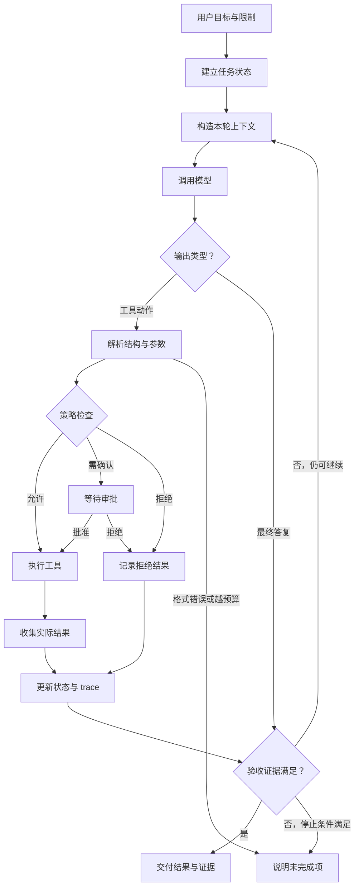

# 第一章：Harness 总览

## 0. 本讲范围与前置

本章讨论 Coding Agent（编码智能体）怎样在真实代码工作区里完成多步任务。读者需要知道，大模型能根据上下文生成回答或结构化工具调用；还需要能读普通文件路径、Git 状态和测试结果。不要求有生产 Agent 的开发经验。

这一章的重点不是某个产品的内部架构，而是一条执行链：用户给出目标和限制，模型提出下一步，Harness 判断这一步能不能执行，工具改变或读取外部环境，运行结果再影响任务状态和下一次模型调用。后续各章再分别讲工具、文件、终端、权限、trace 和评估。

不同框架对 Agent Runtime（智能体运行时）、Harness 和 Skill（技能流程）的命名并不完全一致。本书会给出便于分析系统责任的工作定义；遇到具体产品时，以该产品当前公开文档和实现为准。

读完本章后，读者应该能沿一条任务轨迹指出动作由谁提出、由谁执行、状态在哪里更新、什么证据支持完成；还能解释 Harness、Runtime、Tool、权限和隔离各自承担什么责任。

## 1.1 从一个修复任务看 Harness

先看一个小型 Coding Agent 任务。下面的文件状态、模型动作和测试结果都是**教学构造**，用来演示控制流程；它们不是实际运行某个仓库或产品得出的结果。

用户提出任务：

> 修复未登录请求仍然返回成功的问题。保留工作区里已有的无关改动，只改必要实现，运行相关测试，并说明验证结果。

任务开始时，工作区已经有一处用户自己的文档修改，`tests/test_auth.py` 中也有一个失败用例，预期未登录请求返回 `401`，当前结果却是 `200`。仅把用户这句话发给模型还不够：模型必须知道当前测试、认证处理代码、工作区状态和允许修改的范围；系统还要防止无意覆盖那处文档修改。

沿着一次完整尝试，看 Harness 怎样管理这项任务：

| 步骤 | 模型提出的动作或环境结果 | Harness/runtime 做什么 | 任务状态和执行轨迹（trace）应记录什么 |
| --- | --- | --- | --- |
| 0. 建立任务 | 用户给出目标，并要求保留已有改动 | `git status --short` 得到 ` M docs/guide.md`；把验收条件和限制放入任务状态 | `docs/guide.md` 已有修改，标成任务开始前的状态；不得把它算作本任务产物 |
| 1. 调查 | 模型请求读取 `tests/test_auth.py` 和 `src/auth.py` | 检查路径与读取权限，再调用只读工具 | 保存实际读到的文件版本和测试失败信息；不能把模型猜测当成文件事实 |
| 2. 阻止越界编辑 | 模型提议 `apply_patch(path="docs/guide.md")` | 参数格式正确，但策略发现该文件已有用户改动且不在本任务必要范围，于是拒绝这次写入 | 记录被拒绝的动作及原因；没有写操作发生。把拒绝结果交回模型，让它调整方案 |
| 3. 修改目标实现 | 模型提议在 `src/auth.py` 增加未认证请求返回 `401` 的分支 | 再检查路径、patch 和当前权限；通过后才让文件工具应用修改 | 记录实际 diff、执行结果和当前代码状态。动作“已提出”与副作用“已发生”是两件事 |
| 4. 第一次验证 | 命令 `pytest -q tests/test_auth.py::test_unauthenticated_request_rejected` 仍报 `expected 401, got 200` | 测试进程执行结束，返回退出码和标准输出/错误输出 | 把这次失败作为新的执行观察（observation），任务仍是未完成；不能因为代码已改就标记成功 |
| 5. 根据反馈修正 | 模型根据失败位置提出第二次小修改 | 重新执行参数和权限检查，再应用 patch | 保留上次失败结果，更新当前 diff 和下一步计划 |
| 6. 再次验证与验收 | 同一条相关测试返回退出码 `0` | 验收规则检查测试结果、目标文件 diff 和任务前后的工作区状态 | 只有约定的证据都满足，任务才进入完成状态；原有 `docs/guide.md` 修改仍在 |
| 7. 交付 | 模型生成任务总结 | Harness 将总结与实际执行记录对照，避免把未运行的测试说成已通过 | 告诉用户改了什么、运行了什么、结果如何；同时说明仍未解决或未验证的事项 |

这张表里的状态不是同一种东西。用户的要求属于任务约束；模型提出的是候选动作；文件工具和测试进程产生的是实际执行结果；工作区和任务状态保存当前事实；trace 则保存这段过程的记录。Harness 负责把它们连起来，而不能让前一类信息冒充后一类证据。

例如，第一次测试失败之后，当前任务状态可以简记为“任务仍在进行；第一次 patch 已应用；验收未通过；下一步要处理失败输出”。与之不同，trace 需要保留这条事件的具体命令、当时的代码版本、退出码 `1` 和测试输出。下一轮上下文可以使用前者快速了解进度；复盘时则需要后者还原究竟执行了什么。两种记录都来自这次合成轨迹，不代表真实运行日志。

## 1.2 模型提出动作，Harness 决定怎样处理

在上面的任务里，“修改 `src/auth.py`”起初只是模型的提议。只有通过动作解析、任务策略和执行环境后，文件才真的改变。可以把一次循环拆成五步：

1. **准备输入。** Harness 从任务、相关文件、历史动作和工具结果中选出本轮模型需要的信息。它还要保留用户限制，例如“不要覆盖已有改动”。
2. **接收提议。** 模型返回文本、结构化答案或工具调用。输出可能不完整、格式错误、引用不存在的工具，或提出超出任务范围的动作。
3. **检查并执行。** Harness 解析动作格式、验证参数和策略，再由工具执行器访问文件、进程或外部服务。被拒绝的动作不应产生对应副作用。
4. **记录观察并更新状态。** 执行器返回文件内容、patch 结果、退出码、stdout/stderr 或错误。Harness 将这些观察送回模型，并更新任务的已完成项、当前版本、预算和待处理问题。
5. **判断是否结束。** 模型可以建议完成，但系统仍需按任务的验收规则检查证据。若任务尚未完成且仍可继续，就开始下一轮；若无法继续，应停止并如实报告未完成状态。

下面的图把同一过程缩成一条控制流。模型输出最终答复也要经过验收；若失败或证据不足，系统应保留未完成状态，而不是仅凭答复宣布成功。



这个循环与某个 SDK 的实现可以互相印证，但不能把一种实现当成所有产品的统一标准。例如，OpenAI Agents SDK 的公开文档描述了模型调用、工具执行后再运行下一轮、handoff 后切换 agent，以及达到 turn 上限时停止等路径；它也为未知工具名提供不同的错误处理配置。这里引用它是为了展示一个具体公开实现，不表示每种 Harness 都采用同一接口或控制顺序。[OpenAI Agents SDK：Running agents](https://openai.github.io/openai-agents-python/running_agents/)

## 1.3 Harness、Agent、Runtime 和周边对象

这些术语在不同项目中会重叠，因此需要先约定本书的用法。表中的例子都对应前面的登录修复任务。

| 对象 | 本书中的工作定义 | 在修复任务中的例子 |
| --- | --- | --- |
| **Model（模型）** | 根据输入生成文本、工具调用或结构化输出的模型服务 | 提议先读测试、再修改认证处理函数 |
| **Agent（智能体）** | 围绕目标反复观察、决策和行动的行为过程；它可以由模型、工具和运行循环共同实现 | 调查失败、修改代码、读测试结果并决定下一步 |
| **Runtime（运行时）** | 推进一次运行的执行机制，包括调用模型、调度工具、处理结果、错误和运行限制 | 让读文件、改文件、运行测试依次发生，并在失败后继续 |
| **Harness** | 围绕 Agent 运行建立的控制与证据层，组织任务、上下文、动作、权限、状态、环境和验收 | 保护用户改动，限制可执行动作，保留测试结果并判断是否完成 |
| **Tool（工具）** | Agent 可请求的一项具体操作，通常有输入参数、返回值和副作用范围 | 读取文件、应用 patch、运行指定测试 |
| **Skill（技能流程）** | 可复用的一组任务指引、知识或工具使用流程；具体含义依产品而异 | “修复并验证 bug”的步骤说明可以被封装成一个可复用流程 |
| **Task state（任务状态）** | 系统认为当前任务处于什么阶段、哪些约束仍有效、已有何种执行证据 | 记下原有文档修改、已尝试的 diff、测试失败以及尚未完成的验收项 |
| **Memory（记忆）** | 为后续决策保留的信息；可能是上下文、摘要或长期偏好 | 保存任务摘要，帮助长任务续接。它本身不证明文件当前是什么状态 |
| **Trace（执行轨迹）** | 按时间记录一次运行的输入、动作、控制决定和结果，供排障或复核 | 回看谁提出写入、策略为何拒绝、测试实际返回什么 |
| **Evaluation harness（评估框架）** | 用固定任务、环境和验收器（verifier）反复运行 Agent 并整理结果的评估系统 | 在若干初始工作区上重复运行同一修复任务并检查最终 patch |

在本书中，Harness 是较大的系统视角，Runtime 是其中推进执行的核心部分。不过，不同产品可能把两者当作同义词，或使用不同模块边界。理解系统时，应先问“这个组件实际拥有哪项状态或副作用”，不要只根据名字推断责任。

Skill、Memory 和 Trace 也不能互相替代。Skill 规定某类任务怎样做；Memory 为之后的决策留下信息；Trace 记录已经发生的过程。任务状态则要能回答“当前要达到什么目标、哪些动作已生效、还有什么未验收”。一段摘要可以进入模型上下文，但不能成为文件事实或授权记录的唯一来源。

## 1.4 组件的责任：谁决定、谁执行、谁留证

把 Harness 写成一张很长的模块清单，读者仍然不知道模块之间有什么关系。更有用的检查方法是问：谁拥有当前事实？谁能产生副作用？哪个组件判断任务完成？下面按一次运行中的责任整理。

| 责任 | 常见组件 | 主要输入与输出 | 缺失时会发生什么 |
| --- | --- | --- | --- |
| 接收目标和限制 | User Interface、Task Manager | 用户目标、范围、取消或确认 → 结构化任务状态 | 模型可能漏掉“保留旧改动”等限制，系统也无法知道何时停止 |
| 准备本轮信息 | Context Builder、Session/State Store | 任务状态、相关文件、历史观察 → 本轮上下文 | 重要约束或最新工具结果可能未传给模型；跨轮状态容易丢失 |
| 适配模型协议 | Model Adapter | 当前上下文、工具定义、模型配置 → 模型响应或错误 | provider 差异泄漏到业务逻辑，格式、超时和重试难以一致处理 |
| 解释候选动作 | Action Parser、Tool Registry | 模型响应 → 经过 schema 校验的动作与参数 | 错误格式、未知工具或非法参数可能流入执行层 |
| 决定动作能否发生 | 策略层（Policy）、权限系统（Permission System）、审批界面（Approval UI） | 动作、主体、路径、风险和用户决定 → 允许、拒绝或等待确认 | 给模型的提示词被误当成强制策略，动作控制无法复核 |
| 产生真实副作用 | Tool Executor、File System Layer、Terminal Executor | 获准的动作 → 文件变化、进程结果或外部响应 | 系统无法说明是谁在什么环境里真正改动了什么 |
| 限制执行环境 | OS 权限、容器/虚拟机、网络与资源隔离 | 执行身份和环境策略 → 可访问的文件、进程、网络范围 | 确认界面可能限制不了模型或工具在宿主机能做的事 |
| 保存事实与过程 | 状态存储（State Store）、轨迹记录器（Trace Logger） | 执行结果、状态更新、策略决定 → 当前状态和历史记录 | 下一轮使用过期信息，事故后无法定位动作从哪里开始偏离 |
| 验证用户目标 | 测试、验收器（Verifier）、人工审查或业务规则 | 最终交付物（artifact）与验收标准 → 通过、失败或未知 | 模型的自信总结被误当作任务成功证明 |

这些责任可以合并到少数服务里，也可能分散到多个进程或第三方工具；表中不是要求所有产品都实现十种独立服务。无论怎样部署，系统设计都应明确状态和副作用的所有者。例如，文件工具能报告 patch 是否写入；它不一定能证明测试通过。trace 能说明曾经执行过测试；它不能替代测试结果或业务验收。

## 1.5 几组不能混为一谈的边界

### 模型提议与环境副作用

一次工具调用至少有三个时点：模型提出调用、系统决定是否允许、执行器返回结果。被拒绝的调用没有产生对应副作用；调用成功也只说明该工具按自身合同完成了工作。读文件成功不等于找对了问题，测试进程退出码为零也不自动证明所有用户要求都已满足。

### 用户确认与安全隔离

确认界面可以让人知道某项动作即将发生，并给出批准或拒绝的机会；它不会自动限制进程能够访问哪些文件或网络。安全隔离要由执行身份、操作系统权限、容器或虚拟机等执行环境提供。策略判断还要检查动作是否符合任务授权和产品规则。

一个公开例子能看出这几层的区别：截至 2026-11-17，OpenCode 仓库的 `SECURITY.md` 说明它不提供 agent sandbox，并把 permission system 描述为让用户了解和确认动作的界面；需要真正隔离时，文档建议在 Docker 容器或虚拟机内运行。[OpenCode `SECURITY.md`](https://github.com/anomalyco/opencode/blob/dev/SECURITY.md) 这是该项目在该日期的公开安全边界说明，不代表其他产品实现相同，也不证明一个实际容器配置已经安全。

### 任务状态与 Trace

状态回答“现在是什么情况”。Trace 回答“之前发生过什么”。两者通常有关联，但用途不同：状态需要可供下一步决策和恢复；trace 便于追查历史、比较和审计。把一份不可变日志直接当成可恢复状态，可能缺少当前版本或待处理决定；把一段可修改摘要当成审计日志，也无法可靠证明历史动作。

例如 OpenAI Agents SDK 将一次 workflow 作为 trace，并用 span 表示模型生成、工具调用、guardrail 等执行片段；这是一个具体 SDK 的观测设计示例。若日志会记录用户输入或工具结果，仍须单独决定敏感字段、访问控制和保留方式，不能因为启用了 trace 就默认隐私问题已经解决。[OpenAI Agents SDK：Tracing](https://openai.github.io/openai-agents-python/tracing/)

### 工具成功与任务成功

工具的成功状态只回答“这项工具调用有没有按接口执行”。任务成功则要回到用户目标：生成的 patch 是否解决了问题？有没有损坏原工作区？需要的测试和人工审核是否已完成？这两层判断应分别记录。

## 1.6 Harness 为什么不可由 Prompt（提示词）代替

Prompt 可以告诉模型可用工具、期望步骤和禁止事项，但它只是模型输入的一部分。若模型仍能调用一个没有经过策略检查的工具，单靠文字要求“不要写文件”并不能阻止写入。

公开 SDK 的实现也说明工具执行有多个独立责任。OpenAI Agents SDK 的工具文档指出，直接调用它暴露的 Python 函数会绕过该 SDK 自己的参数结构（schema）校验、上下文注入、安全检查（guardrail）、超时、失败处理和 trace 管线。因此“模型能生成函数调用”与“系统按预期控制并执行函数”不是一回事。[OpenAI Agents SDK：Tools](https://openai.github.io/openai-agents-python/tools/) 这个细节只描述该 SDK，不应外推为所有框架的内部实现。

当模型具有更多可行动作、任务涉及更大副作用、运行时间更长或失败代价更高时，系统就需要更明确地设计权限、状态、资源限制、恢复与验收。这个判断来自风险和系统责任变化；它不是一个“新模型一定要求更复杂 Harness”的经验定律。模型能力本身不能替代文件系统权限、任务状态所有权或独立验收证据。

## 1.7 安全设计：限制可以发生什么

Coding Agent 处理的内容可能来自用户、仓库文件、命令输出、网页和外部工具。它们都可能包含错误或带指令性的文本。系统应让模型知道来源和可信边界，同时把关键限制放在模型之外执行：

1. **定义任务授权。** 指明允许修改的仓库、路径和动作类型；超出范围时拒绝或请求用户决定。
2. **限制工具面。** 每个工具只暴露本任务所需能力，参数经过结构校验；不要只凭模型描述判断工具是否安全。
3. **分开策略和隔离。** 权限策略决定某类动作是否符合任务规则；执行环境限制进程即使出错也能访问什么。
4. **保留撤销与人工接管路径。** 对不可逆或影响外部系统的动作，考虑审批、备份、事务、幂等和取消语义。
5. **保护执行记录。** Trace 可能含源码、命令参数、凭证或个人数据，应控制记录范围、脱敏、访问与保留。

并非所有动作都需要相同控制强度。读取一个明确指定的文件、覆盖用户文件、执行未经审查的安装脚本、调用付费外部 API，其副作用明显不同；策略应根据数据敏感性、可逆性、授权范围和故障代价设置，而不是把一切动作归为“允许”或“危险”。第八章会深入工具权限与隔离，第十二章会从公开实现分析产品安全边界。

## 1.8 怎样评估 Harness，而不把指标拼成一个万能分数

Agent Harness 负责一次真实任务的运行；Evaluation Harness 则负责把若干次运行组织成可比较的实验。它至少需要固定或记录：

- 任务输入与初始工作区状态；
- 模型及服务配置、提示、工具定义和 Harness 版本；
- 执行环境、权限规则和可用资源；
- 任务完成的验收器，以及遇到无法自动判断时的人工判定规则；
- 重试、暂停、取消、预算和外部依赖的处理方法。

评估开始前，先写清“怎样才算完成”。对上面的修复任务，可以要求：指定测试通过、patch 只涉及必要的认证实现、任务开始时已有的文档改动保持不变。测试结果是其中一份证据；若任务还要求不改文档，diff 检查也必须进入验收。

数字要保留分母和数据范围。假设在一组固定任务中，有 2 个任务被 verifier 判为完成、总共评估了 3 个任务，就应报告“这组任务上 2/3 通过”，并解释其余任务是失败还是未判定。它不是所有仓库上的成功概率，也不是通用上线阈值。权限问题另报实际执行的违规副作用数和被拦截动作数；这两类数回答不同的问题，不能和任务通过率加权成一个看似精确的 Harness 总分。

一次 Agent 结果至少可能同时受模型、Harness、工具实现、初始环境、任务样本和验收器影响。若比较两个版本，应尽量保持其他条件一致；否则就把差异记录下来，并限制结论范围。第十章介绍怎样构造 Evaluation Harness，第十九章再讨论如何把 Harness、模型和环境差异分开归因。

## 1.9 用一条失败链定位问题

当任务没有成功时，不要笼统地归因为“模型不够聪明”。沿着实际发生的状态转移寻找第一个不符合预期的位置：

| 观察到的现象 | 首先检查 | 仍不能据此断定什么 |
| --- | --- | --- |
| 工具名不存在或参数无法解析 | 工具定义、schema、模型响应与错误回送方式 | 不能仅凭一次失败判定模型总体能力不足 |
| 动作被策略拒绝 | 任务授权、路径范围、风险规则与审批结果 | 被拦截并不一定代表执行器故障；它可能是预期安全结果 |
| 工具报告失败 | 执行环境、输入、依赖、退出码和 stderr | 不能把工具失败直接归咎于模型生成内容 |
| 工具成功但模型重复相同动作 | 观察结果是否进入新上下文、状态是否保存、模型是否读取 | trace 中有结果不代表下一轮实际使用了结果 |
| 模型称已完成但验收失败 | 最终 artifact、验收标准和 verifier 输入 | 模型的最终文字不能覆盖外部失败证据 |
| 重启后重复执行已完成副作用 | checkpoint、幂等键、事务边界和已完成状态 | 仅有对话历史不等于安全恢复状态 |

第一个偏离点常常比最后一条错误消息更有解释力。例如，模型提出错误 patch 是一个问题；若策略错误地允许覆盖用户文件，则系统还存在另一层失效。一次运行可以同时包含多个根因，trace 和工作区差异有助于按层追查，而不是把全部责任推给单一模块。

## 1.10 一个最小 Harness Loop

下面是非执行伪代码，用来概括控制责任，不是可运行程序或产品规范。它省略具体 API、事务和并发细节；这些内容后续章节再展开。

```text
state = create_task(user_request, constraints, initial_workspace)

while state.can_continue:
    context = build_context(state)
    proposal = call_model(context, available_tools)
    action = parse_and_validate(proposal)

    if action is invalid:
        record_error(state, proposal)
        continue_or_stop(state)

    decision = policy_check(action, state)
    if decision requires approval:
        decision = wait_for_approval(action)
    if decision is denied:
        record_denial_and_update_state(state, action)
        continue_or_stop(state)

    result = execute_in_configured_environment(action)
    record_result_and_update_state(state, action, result)

    if acceptance_evidence_is_sufficient(state):
        state.mark_complete()

return report_result_and_evidence(state)
```

每一步都有不同输入和结果：`parse_and_validate` 检查动作形状，`policy_check` 检查系统规则，`execute_in_configured_environment` 产生真实结果，验收器检查任务证据。真实系统还要定义停止条件、取消、超时、重试和资源预算；达到限制时应停止或交给人工，而不是无限循环。

## 1.11 面试题：怎样解释 Harness

### Harness 是什么？

Harness 是围绕模型驱动任务的运行控制和证据系统。它组织任务上下文，把模型提出的动作交给解析、策略和执行环境处理，再保存真实结果与任务状态，并根据明确的验收条件决定是否完成。它通常包括 Runtime，但两者在不同项目中的边界可能重叠。

### 为什么 Coding Agent 不能只是模型 API？

模型 API 可以生成回答或工具调用，但不会自动拥有仓库当前状态、文件系统权限、终端隔离、用户审批、恢复状态和任务验收。Coding Agent 需要 Harness 把提议连接到受控副作用，再把环境结果交回下一轮，并留下能支持复核的证据。

### 如何设计最小 Harness？

先选定一个有限任务和验收方式，再实现任务状态、上下文构造、模型适配、工具 schema、动作解析、权限策略、执行器、trace 和 verifier。先明确哪些文件和副作用可触及、失败怎样回送、怎样停止、怎样证明完成；再按真实风险增加审批、沙箱、checkpoint、并发和评估能力。不要先列模块名，却没有说明状态和权限由谁持有。

## 1.12 小练习

1. 沿 1.1 节的修复任务，分别写出模型动作提议、策略决定、工具执行结果和验收结果。指出哪一项才是文件实际改变的证据。
2. 设模型请求编辑一个已有用户改动的文件。分别说明 Parser、Permission System、执行环境和 Trace 各自应提供什么信息；其中哪一项能阻止写入，哪一项只能记录写入？
3. 将“测试工具返回退出码 0”与“任务成功”写成两个独立判断，并为任务成功补一项适合的 artifact 检查。
4. 为一个只读代码搜索任务设计最小 trace 字段。标出哪些字段用来恢复当前任务状态，哪些字段用于事后复盘，以及日志中哪些内容需要脱敏。

## 1.13 本章总结

Harness 的核心作用，是把“模型建议做什么”与“系统实际上允许并执行了什么”分开，再用环境反馈、任务状态和验收证据把多步任务连起来。理解它时，记住四个区分：

1. 模型动作提议不等于实际副作用。
2. 用户确认不等于安全隔离，trace 不等于当前状态。
3. 工具调用成功不等于用户任务完成。
4. 一次评估结果只支持特定任务、环境、配置和 verifier 范围内的结论。

下一章会把这个闭环拆成 Runtime 的组件和状态转移，继续追踪每一步由谁执行、失败如何返回，以及系统怎样判断是否继续。
