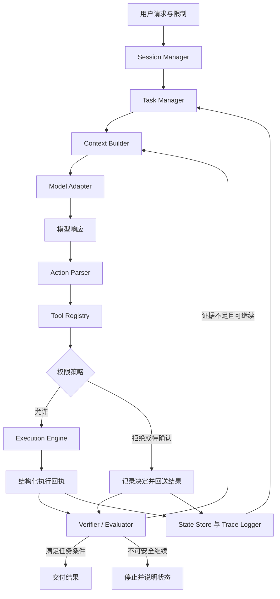

# 第二章：Agent Runtime 架构

## 0. 本讲范围与前置

第一章从整体上定义了 Harness，并用修复登录认证的任务说明模型提议如何经过策略检查、工具执行和验收。本章沿用这项合成任务，继续追问：一轮运行中的每份状态由谁保存？模型请求如何变成动作？工具失败、用户中断或工作区变化后，Runtime 怎样决定恢复、重试或停止？

读者应已理解 Agent 会根据目标和环境反馈进行多步行动，能看懂简单 JSON、文件 diff、命令输出和状态表。生产级 Agent 经验不是前置条件。本章讲通用架构责任；不同 API 的状态字段、兼容规则和服务能力并不相同，供应商特例会链接到后续专题。

读完本章，读者应该能沿一次 runtime step 追踪上下文、模型请求、动作解析、策略决定、执行回执和状态更新；能区分 session、task、workspace、checkpoint 与 trace；能根据失败发生的位置设计安全的恢复路径。

## 2.1 沿一次失败后的续跑追踪 Runtime

继续使用第一章的登录认证任务。下面的 session、状态、命令输出和用户操作均为**教学构造**，不是实际产品或仓库运行记录。

用户重新打开一个还没有完成的会话。Runtime 读到以下初始信息：

- 会话中保存了用户的目标和限制：修复未认证请求返回 `200` 的问题，并保留原有无关改动。
- 任务记录显示目标文件曾应用过一次 patch，但验收仍未通过。
- 最近一次测试结果是 `expected 401, got 200`。
- workspace 中的 `docs/guide.md` 在任务开始前已有用户修改。
- 上次运行没有最终验收结果，因此任务不能标成完成。

Runtime 需要走完下面这一轮，才能决定是否继续改代码：

| 步骤 | 当前动作或结果 | Runtime 中负责的组件 | 运行状态怎样变化 |
| --- | --- | --- | --- |
| 1. 恢复任务 | 找到原 session 和未完成的认证修复 task | Session Manager 加载会话范围；Task Manager 读取目标、限制、待验收项 | task 仍为 `active`；上一轮测试失败仍是最近观察 |
| 2. 核对 workspace | 发现 `src/auth.py` 的文件版本与上次 checkpoint 不同 | Workspace adapter 读取当前文件状态；Task Manager 把冲突标成待检查 | Runtime 不直接重放旧 patch；真实文件状态优先于对话摘要 |
| 3. 构造上下文 | 选择用户目标、相关测试、最新 handler 内容、前次失败输出和工作区约束 | Context Builder 负责筛选、排序和标注来源 | 上下文包含最新文件事实；无关历史和原始长日志不整段塞入请求 |
| 4. 调用模型 | 模型请求运行指定认证测试 | Model Adapter 按当前 provider/API contract 编码请求，记录模型、协议、工具清单和请求结果 | Runtime 保存本次调用标识；模型响应尚未改变文件或启动命令 |
| 5. 解析与授权 | 响应中出现 `run_tests`，参数指向目标测试 | Action Parser 校验动作格式和参数；Tool Registry 找到工具定义；Permission System 核对工作区与命令策略 | 合法且获准的调用才进入执行队列；格式正确不等于动作必然获准 |
| 6. 执行并收集结果 | 测试命令返回退出码 `1`，仍报告认证断言失败 | Execution Engine 捕获退出码、stdout/stderr、执行状态与持续时间 | 此次工具调用是 `failed`；这不代表整个 task 已失败或可直接重试 |
| 7. 持久化观察 | Runtime 把失败结果连到原始 tool call 和当前文件版本 | State Store 保存当前 task 状态；Trace Logger 追加事件 | task 更新为“验证未通过”；trace 保留“模型请求了什么、谁批准、执行器返回什么” |
| 8. 选择下一步 | 模型收到新的失败 observation 后，提出重新读取 handler 再编辑 | Error Handler 判断这是可继续诊断的测试失败，并创建下一步，而不是盲目重试相同命令 | task 留在 `active`，进入新一轮 context 构造；原有失败不会被覆盖成成功 |

这条运行链里有多个对象，保存它们的目的不同：session 让后续交互找回相关对话；task 记录目标与完成条件；workspace 保存实际文件；checkpoint 给中断后的恢复点；trace 记录历史事件。Runtime 必须让它们相互关联，但不能把它们压成一段可任意改写的对话摘要。

特别要注意第 2 步。恢复时，task state 中的文件摘要可能已经过时。如果文件本身在中断期间改变，Runtime 应先重新读取、比较版本，并决定是否重做计划。把旧 patch 直接写回去会覆盖人的工作；将“历史上曾读到的内容”误当作“当前文件内容”则会让后续动作建立在过时事实之上。

## 2.2 Runtime 和 Harness：边界按责任理解

第一章把 Harness 作为完整的运行控制与证据系统，把 Runtime 作为其中推进模型和工具循环的执行内核。这是本书的架构约定，不是每个产品都采用的模块名称。

在登录修复任务里，Runtime 的工作包括创建 step、构造上下文、发起模型调用、解析动作、调度工具、处理错误和保存运行状态。外围 Harness 还包括用户界面、文件和终端权限、执行沙箱、产品策略以及离线 evaluation。两者可以部署在同一个进程中，也可以跨服务协作；设计时要问的是“谁拥有这项状态、谁能产生这个副作用、谁能证明任务满足目标”，而不是只看目录或类名。

## 2.3 一次 step 的组件链

登录测试从模型提议到退出码 `1` 的过程，可以拆成以下组件关系：

图中的箭头不是单纯的数据搬运。每次交接都要保留足够的关联信息：session/task id、模型请求 id、工具调用 id、策略结果、执行器结果和当前 workspace 版本。这样 Runtime 才能回答“这个退出码属于哪次测试”“这次拒绝对应哪一个动作”“恢复后接着处理的是哪个 task”。

## 2.4 Session、Task、Workspace、Checkpoint 和 Trace

多个 Agent 产品把这些状态放进相同的 session 对象里，但它们的语义仍不同。用登录任务举例：

| 对象 | 它回答的问题 | 典型内容 | 不能单独证明什么 |
| --- | --- | --- | --- |
| **Session（会话）** | 这是哪段交互？后续输入应接到哪里？ | 对话历史、会话配置、交互标识或持久化记录 | 不自动证明发起者有权访问此会话，也不一定等于一个待办任务 |
| **Task（任务）** | 用户想达到什么结果？现在完成到哪里？ | 目标、范围、验收条件、子任务、待处理问题、完成状态 | 不证明 workspace 里的文件仍与上次读取时相同 |
| **Workspace（工作区）** | 当前实际文件和工具运行环境是什么？ | 文件内容、Git 状态、运行依赖、命令副作用 | 不包含模型看到过什么或用户是否批准某个动作的完整历史 |
| **Run state / Checkpoint（运行状态/检查点）** | 中断后从什么状态继续？ | 正在等待的调用、当前 phase、审批、模型 item、序列化上下文等 | 不保证所引用的文件、进程或远程 API 副作用仍处于原状态 |
| **Trace（执行轨迹）** | 过去实际发生了哪些事件？ | 请求、模型响应、动作、权限决定、工具回执、错误和终态 | 不一定是可以直接恢复运行的权威状态，也不应成为未脱敏的全量数据仓库 |
| **Evaluation record（评估记录）** | 这次运行如何按任务规则判定？ | 初始环境、配置、verifier 结果、失败标签与测量数据 | 不把单次评估结果推广成所有任务的保证 |

对同一个 session，用户可以先修登录问题，再提出一个独立代码清理任务；两个 task 可以共享某些会话历史，却应分别保存目标、验收状态和权限范围。反过来，一个长期 task 也可能跨多个交互会话继续。数据模型必须明确这些关系，不能把 session id 当作授权令牌。

例如，OpenAI Agents SDK 的 SQLite Sessions 文档明确指出，session id 用于选择历史记录，本身不认证用户或授予访问权；应用仍要对每次 session 访问做授权，并保护 SQLite 文件和备份。这是 SDK 对 SQLite backend 的说明，不代表其他存储后端的合同。[OpenAI Agents SDK：Sessions](https://openai.github.io/openai-agents-python/sessions/)

## 2.5 UI、Session Manager 和 Task Manager

### UI 让用户看到运行边界

用户界面（User Interface）不只是显示最终回答。它还要告诉用户当前任务处于调查、编辑、验证、等待批准还是已停止；在适用场景展示 patch、命令状态、等待的决定和最终证据。用户取消或补充指令时，UI 需要传递带关联 id 的事件给 Runtime，而不能只中止文本流。

UI 不必展示所有内部信息。涉及源代码、密钥、个人信息或不可信工具输出时，应按产品需要做摘要、隐藏或脱敏；但隐藏内容不应导致审计记录把动作来源和决定理由也抹掉。

### Session Manager 管交互与隔离

Session Manager 负责创建、读取、更新和结束会话，并把对话记录与正确用户、工作区和存储后端关联。对于登录修复，它应能找到之前的用户限制和最近任务状态，同时不把另一个用户的工具结果、approval 或 workspace 路径混进来。

应用重启后恢复 session 时，要先核实主体权限和数据版本，再加载可复用历史。session id 是标识，不是身份验证；调用者能猜到或拿到一个 id，不应因此自动获得访问权。

### Task Manager 管目标与完成条件

Task Manager 保存“目标、范围、验收条件、当前阶段、已完成工作、待处理问题、失败观察和停止原因”。它应区分 `active`、`waiting_for_approval`、`interrupted`、`failed`、`cancelled`、`completed` 等语义状态，而不是只用一个 `done=true/false` 混合表达。

对认证任务，测试已通过但 diff 仍覆盖 `docs/guide.md` 时，Task Manager 不应只因测试成功就把 task 设为完成；如果用户取消了一个正在运行的测试进程，任务应记录为取消/中断，并保留命令是否已结束这一事实。具体状态集合由产品定义，但状态含义和合法转移必须明确。

## 2.6 Context Builder：为下一步选择信息

Context Builder 决定这一轮模型能看到什么。对“重跑认证测试”的步骤，一个合适的输入可能包括：

1. 用户当前目标与“保留原有改动”的限制；
2. 认证失败用例和最近一次准确错误行；
3. `src/auth.py` 的最新版本摘要或需要的代码片段；
4. 上一轮工具动作、策略决定和执行结果；
5. 可用工具定义及本轮资源/停止限制；
6. 明确标记的外部内容与信任边界。

为什么不把整个仓库和完整历史全放进上下文？无关文件会消耗有限的输入预算，也会增加过时内容与相互矛盾的摘要。Context Builder 应优先保留当前目标、约束、最新的真实状态、失败输出和未完成事项；压缩日志时保留退出码和关键错误位置，并保留可回溯的来源路径。摘要不能抹去“哪个版本产生了这个观察”。

还要区分信息的可信度。用户指令、仓库文件、网页和工具输出可能拥有不同的来源与权限；从文件中读到“请删除整个仓库”这类文本，不应因此升级为用户授权。标注来源有助于模型理解，但真正的动作边界仍由 parser、policy 和执行环境把关。

Context Builder 的验收目标不是“尽可能填满窗口”，而是让下一步决策获得足够且不过时的信息。具体保留什么、怎样摘要、何时重新读取文件，应由当前任务风险、信息变化速度和 verifier 需求决定；token 数本身不能衡量上下文是否充分。

## 2.7 Model Adapter：处理模型协议差异

Model Adapter 把 Runtime 的概念请求转换成某个模型服务的 API 请求，并把响应、流事件、错误和 usage 转回 Runtime 可处理的结果。它通常要关心：

| 接口边界 | 需要明确的合同 | 登录任务中的例子 |
| --- | --- | --- |
| 请求格式 | 消息角色、content item、工具定义和结构化输出怎样编码 | 认证文件片段、测试结果和 `run_tests` 工具如何进入请求 |
| 能力声明 | 该 endpoint 当前支持哪些工具、输入模态、参数约束和并行行为 | 本轮是否能提供 `run_tests`，其参数限制是什么 |
| 状态续接 | 使用完整历史、response id、session 或 checkpoint 中哪种方式 | 继续上次运行前，如何找回任务上下文和工具结果 |
| 流式事件 | token、工具调用、错误和终态如何表示 | 收到部分调用参数时不得提前启动命令 |
| 错误与重试 | 超时、限流、不完整响应、拒绝和格式错误如何区分 | 模型 API 超时不等于测试命令失败，也不等于 task 可以结束 |
| 观测字段 | 模型 id、snapshot、effort、usage 和 request id 如何保存 | 评估回放时知道实际使用了哪一配置 |

Adapter 可以提供统一的内部接口，但不能假设各 provider 的外部字段、状态和工具语义等价。若一个服务不支持所需的 continuation 或 tool contract，适配层应显式拒绝、降级或要求调用方确认；不能只因 HTTP 请求成功，就默默丢掉状态字段或更改工具行为。OpenAI-compatible API 的字段差异与兼容边界会在第二十二章展开。

## 2.8 Action Parser、Tool Registry 与 Permission System

模型响应是数据，不是执行命令。Parser、Registry 和 Permission System 依次处理三个不同问题。

### Action Parser 检查结构

Parser 把响应解释成一个候选动作，例如 `run_tests` 加上测试路径参数。它要检查类型、必填字段、参数形状、调用 id 和输出是否完整。若模型返回截断的 JSON，Runtime 应记录 parse error，再选择有限重试、把错误交回模型或停止；不能从未完成的参数里猜出命令并执行。

Parser 通过只能说明“这份动作能被系统解释”。它不能证明工具有权限、路径属于当前 task、参数符合业务规则或动作能解决问题。

### Tool Registry 说明允许请求哪些能力

Tool Registry 管理工具名称、描述、输入/输出 schema、版本、副作用类型、超时与取消能力，以及策略会用到的元数据。它既帮助模型选择工具，也让 Runtime 知道如何验证和调用工具。工具定义变更后应记录版本或 hash，否则回放可能使用了不同参数含义。

工具注册也不等于授权：把 `run_shell` 暴露给模型，只表示它是候选能力之一，不表示任意 shell 命令都能运行。

### Permission System 判断本次调用

Permission System 根据任务范围、调用者、工具、路径、参数、环境和既有用户决定，输出允许、拒绝或等待确认。登录任务的规则可以允许指定只读文件访问和目标测试命令，同时拒绝写入任务之外的用户文件。

如果动作需要人批准，审批记录应绑定到具体调用和参数摘要，并明确适用范围；用户改动参数或目标后，旧审批不应自动覆盖新动作。权限决定也不能替代执行隔离：即使请求获批，进程仍应只能访问配置好的文件、网络和系统资源。第八章会详细讲授权与沙箱。

## 2.9 Execution Engine：执行动作并返回可判读结果

Execution Engine 才是真正读取文件、写入 patch、调用进程或访问外部服务的一层。对一次测试调用，至少要能区分以下结果：

| 执行状态 | 含义 | Runtime 下一步要做什么 |
| --- | --- | --- |
| `succeeded` | 工具按自身合同完成，且结果已返回 | 更新状态并交给 verifier；不直接等同 task success |
| `failed` | 工具明确返回失败或非零退出码 | 保存错误结果，判断需要修正输入、环境还是方案 |
| `denied` | policy 或审批流程拒绝执行 | 记录决定原因；不得伪装成工具执行失败 |
| `timed_out` | 等待超过限制，执行结果可能已知也可能未知 | 先确认进程/外部副作用现状，再决定重试或接管 |
| `cancelled` | 执行器确认任务已停止或取消 | 保存部分输出和实际副作用；取消不自动撤销已发生更改 |
| `unknown` | 调用方没有收到足以判断是否执行的回执 | 对非幂等动作先对账，不能假设“没回包就没发生” |

结果对象应包含可关联的调用 id、状态、退出码或错误类型、输出引用、持续时间、产物变化以及副作用是否确定。长输出可存到受控 artifact 中，让 context 只携带摘要与引用；但模型、用户和验收器仍应能按权限读取必要证据。

对于会改变环境的工具，要给出幂等键、事务、回滚或对账策略中的适用方案。超时后无条件重试“创建远程资源”“提交交易”“发送邮件”，可能重复产生副作用；先检查动作是否已成功，再安全地继续。

## 2.10 State Store 与 Checkpoint：恢复运行前先核对外部事实

State Store 保存 Runtime 需要快速读取的结构化当前状态，例如 session/task 关联、当前 phase、待执行动作、最近 observation、审批状态、checkpoint 版本和验收结果。它不必保存每一份完整原始内容；长文本、diff 和命令输出可以存成带权限和版本的引用。

Checkpoint 是恢复边界，不是“把聊天记录序列化”这么简单。至少要考虑：

1. 当前 task 目标、限制和未完成项是否保存；
2. 有副作用的动作是未执行、已执行还是结果未知；
3. 用户审批是否仍适用于当前参数和环境；
4. 当前 workspace 文件是否仍匹配 checkpoint 的版本；
5. pending tool call、外部任务和运行中的进程如何接续；
6. 模型/API 的状态续接需要哪些 item 或 id；
7. 恢复前是否需要重新做权限检查和 verifier 检查。

假设登录 task 保存 checkpoint 后，用户手动修改了 `src/auth.py`。Runtime 读文件 hash 或版本发现差异，应该将对应上下文标为 stale，重读当前文件，再决定合并、放弃旧 patch 或请求用户介入。只恢复模型的历史对话会把模型带回旧认识；只保存文件 diff 又可能遗漏用户目标和待确认审批。

不同 SDK/API 的“可恢复状态”只涵盖各自定义的范围。例如，OpenAI Agents SDK 的 `RunState` 文档将其作为暂停后序列化并恢复一次 run 的边界，包含运行上下文和中断等信息；SDK Sessions 另用于保存跨运行会话历史。这些公开接口都不能证明应用的 workspace 或业务系统副作用已经恢复一致。[OpenAI Agents SDK：Run State](https://openai.github.io/openai-agents-python/ref/run_state/)

## 2.11 Trace Logger：让每个事件能回到具体运行

Trace Logger 记录任务运行中有解释价值的事件，例如模型请求与响应标识、解析出的动作、权限决定、工具开始/结束、结果、状态更新、重试/取消、checkpoint 和最终 verifier 结论。事件应使用稳定的 session id、task id、step id 和 tool call id 关联，时间顺序清楚。

Trace 的典型用途包括：

- **排障：** 找到最早一次偏离预期的状态转移；
- **回放：** 用固定输入、环境快照和工具响应复现应用控制逻辑；
- **评估：** 汇总任务完成、错误类型、成本和运行时长；
- **审计：** 核对谁请求了副作用、权限如何决定、实际结果是什么。

Trace 不是默认安全的黑盒。模型输入、工具参数、终端输出和文件 diff 可能包含密钥、个人信息或商业数据；采集范围、脱敏、访问控制和保留周期需要与任务目的匹配。OpenAI Agents SDK 的 tracing 文档以 trace/span 记录模型、工具和 guardrail 等事件；OpenTelemetry GenAI 语义约定也把输入、输出和工具参数内容视为需明确配置的敏感数据。它们说明“能追踪”与“可以默认保存全部原文”是不同决定。[OpenAI Agents SDK：Tracing](https://openai.github.io/openai-agents-python/tracing/)，[OpenTelemetry GenAI spans](https://github.com/open-telemetry/semantic-conventions-genai/blob/main/docs/gen-ai/gen-ai-spans.md)

为了恢复运行，Runtime 还需要结构化状态和工作区核对；Trace 只保存发生过的事件，不应直接代替当前 task state。

## 2.12 Error Handler：按失败类型恢复

错误处理不等于“再问一次模型”。同一个失败通知可能来自不同层，应先识别失败发生在哪里、执行是否已经产生副作用，再选恢复动作。

| 错误类别 | 登录任务里的例子 | 合适的处理 | 应避免的做法 |
| --- | --- | --- | --- |
| 模型调用暂时失败 | API 超时或限流 | 按接口合同做有限退避重试，保留原 task 状态 | 把模型调用失败记成测试失败，或丢掉用户限制重建 task |
| 动作解析失败 | 工具调用参数截断 | 记录原响应；若可安全续传则请求合法输出，否则停止并说明 | 猜测缺失参数后执行 |
| 工具名或参数错误 | 请求了未注册工具或路径字段类型不对 | 返回结构化错误给模型，或终止该 step | 把错误交给任意工具兜底执行 |
| 权限拒绝 | patch 目标是任务范围外文件 | 将拒绝原因作为新 observation；必要时请求用户修改任务范围 | 无视拒绝重复请求，或把审批默认记为“允许” |
| 文件冲突 | 用户在中断时改了同一文件 | 重新读取并合并；不能判断时交给用户 | 直接重放旧 patch 覆盖新内容 |
| 工具明确失败 | 测试返回退出码 `1` | 保存原输出，修复方案或环境后再验证 | 忽略失败 observation，仍宣称任务完成 |
| 超时且副作用未知 | 命令超时后连接断开 | 对账执行状态，检查幂等性，再决定继续 | 因为没收到回执就假设“未执行”并再次写入 |
| 用户取消 | 测试进程仍在运行时收到取消 | 停止后续动作，协调进程终止，记录部分结果并进入 cancelled/interrupted | 只停止 UI 输出，却让后台进程继续写文件 |
| 状态持久化失败 | patch 已应用但 task state 未保存 | 先查询当前 workspace 和执行回执，再修复状态记录 | 直接恢复旧 checkpoint 并重复写入 |

一次运行可以同时有多个问题。先按 event/step id 找出第一个错误状态，再判断它导致了什么后续影响。对外部副作用结果未知时，先做对账；若无法确认安全状态，停止并请求人工处理。

## 2.13 Evaluator：Runtime 内验收与离线评测

Runtime 中的 verifier/evaluator 用来检查当前任务证据，例如测试结果、diff 范围、格式规则或业务状态。它可能是确定性测试、规则检查、人工审核，也可能由模型辅助；要明确每一种信号能支持什么结论。

对认证修复任务，目标测试通过只是一个条件；还需要检查原有文档修改是否仍存在、patch 是否超出任务范围。若验收器只会运行测试，它就不能单独证明“没有覆盖用户改动”。模型说“已完成”也不能覆盖文件系统或测试工具返回的相反事实。

离线 Evaluation Harness 则把固定任务、初始环境、模型/API 配置、Runtime 版本、工具和 verifier 组织成可重复比较的评估。报告应分开列出任务成功、权限拦截/违规副作用、运行时间、成本和未判定样本，并明确各项分母；不要用任意统一阈值把这些性质压成 Runtime 总分。统计方法和 Harness 归因分别见第七册、第十和第十九章。

## 2.14 Runtime 状态机：把“下一步做什么”变成显式状态

如果只用一个 `while not done` 循环，用户中断、审批等待、工具超时和模型最终回答都容易被混在一起。更稳妥的做法是给运行阶段命名，并规定能从哪里转到哪里：

| 当前阶段 | 事件 | 下一阶段 | 说明 |
| --- | --- | --- | --- |
| `task_created` | 任务和工作区边界已读取 | `building_context` | 记录目标、限制和当前环境版本 |
| `building_context` | 输入准备完毕 | `calling_model` | 对本轮 context 与工具清单建立版本/引用 |
| `calling_model` | 模型响应完成 | `parsing_action` | 区分文本、工具动作、拒绝、超时和不完整响应 |
| `parsing_action` | 动作结构合法 | `checking_policy` | 仍要检查 schema 外的任务语义和权限 |
| `parsing_action` | 格式无效 | `recovering` 或 `failed` | 根据可修复性决定反馈还是停止 |
| `checking_policy` | 允许 | `executing` | 执行前核对参数、工作区版本和资源限制 |
| `checking_policy` | 需要确认 | `waiting_for_approval` | 挂起具体调用，不把 task 误写成失败 |
| `checking_policy` | 拒绝 | `updating_state` | 记录无副作用的拒绝事件并回送 observation |
| `waiting_for_approval` | 批准/拒绝/取消 | `executing` / `updating_state` / `cancelled` | 决定绑定本次调用，不默认沿用到无关动作 |
| `executing` | 收到明确结果 | `recording_result` | 保存执行状态和产物变化 |
| `executing` | 超时或连接丢失 | `reconciling` | 先检查副作用状态，不能直接假定成功或失败 |
| `recording_result` | 状态保存完成 | `verifying` 或 `building_context` | 任务内验证，或继续下一轮模型决策 |
| `verifying` | 条件满足 | `completed` | 记录具体证据，而非只记录模型的完成声明 |
| `verifying` | 条件不满足且可继续 | `building_context` | 将失败原因和最新状态交回下一轮 |
| 任意可取消阶段 | 用户取消 | `cancelling` → `cancelled` | 停止后续动作并确认运行中的进程/工具状态 |

状态机使 Runtime 可以拒绝非法转移，例如在工具调用仍 pending 时标记 `completed`，或在写入结果未对账时恢复旧 checkpoint。它也为并发事件、重试和审计提供一致边界。实际产品可以有不同状态名，但须明确终态、等待态和未知结果的含义。

## 2.15 并发、取消和超时

不同工具调用能否并行，取决于它们的数据依赖和副作用，而不只取决于模型一次发出了几个请求。

- 读取互不相关的只读文件，通常可以并行；返回结果需保留 call id，不能把两个文件内容错配给两个请求。
- 两个 patch 同时写同一文件，必须有版本校验或串行化；否则第二个 patch 可能基于旧内容覆盖第一个结果。
- 多个互不相关但有副作用的 API 调用，应检查权限、幂等键、审批和部分成功后的补偿方案后再并行。
- 一个工具超时后，即使 Runtime 已停止等待，也要追踪它是否还在执行；取消请求也需要执行器确认，不只是更新 UI 上的文字。

用户取消后，Runtime 应阻止新动作发出，向正在运行的执行器发送取消，等待并记录已知结果，再持久化终态或“副作用状态未知”。取消不能撤销已完成的写入、已发送的邮件或已提交的远程任务；若无法安全回滚或确认，就需要对账或人工接管。

## 2.16 扩展点与 Provider 运行时所有权

扩展时应保持核心 step 的输入、输出、错误和状态转移可观察；模型适配器、工具执行后端、trace sink 和 evaluator 可以替换，但替换后必须记录配置版本和实际能力。插件能新增工具，不代表它自动获得任务授权；服务端能存对话历史，也不代表它管理 workspace、审批和外部任务恢复。

一个有日期边界的公开例子能说明托管方式怎样改变责任。OpenAI 当前文档把 Agents API、Agents SDK 与 Responses API 列为三种 runtime 入口：

| 入口 | 谁运行 loop / 保存跨轮状态 | 应用侧仍要明确什么 |
| --- | --- | --- |
| Agents API | OpenAI 管理 Codex harness、session orchestration、上下文压缩与恢复；session 保存配置、turns 和 items | 应用提供工具并选择执行环境；也要处理事件、required actions、产物和 verifier |
| Agents SDK | SDK runner 在应用中运行 loop/handoff；session 可由 SDK 后端保存对话历史，run state 可用于暂停后恢复 | 应用仍控制部署、存储、审批、workspace、sandbox provider 和业务任务状态 |
| Responses API | 可以直接调用模型或由应用自行构建 Agent loop；历史可由应用维护、response chaining 或 Conversations 接续 | 应用定义 orchestration、工具回执、权限、执行环境、checkpoint、trace 和任务验收 |

以上是 OpenAI 文档在 2026-11-17 的公开产品比较，不是所有 provider 都有同名接口，也不说明三种模式保存同一类状态。OpenAI 文档还特别指出，Agents API session、SDK session、Responses conversation 和 sandbox 是不同资源。选择接口时，应把“谁管理 loop、谁保存历史、谁执行工具、谁拥有文件、谁恢复外部副作用”分别写入设计，而不是只在配置中记录一个 model id。[OpenAI Agents：Runtime options](https://developers.openai.com/api/docs/guides/agents)，[Agents API overview](https://developers.openai.com/api/docs/guides/agents-api/overview)

跨 provider 的 API 兼容、地域/scope 和能力差异会在后续专题核验。例如 Qwen3.7 Plus 的官方页面按 region 与 deployment scope 列功能支持；完整能力矩阵应放在第二十二章讨论，避免把单一 provider 的合同写成 Runtime 通则。

## 2.17 面试题：Agent Runtime 怎样设计

### Runtime 包含哪些核心组件？

可以按一轮执行的责任回答：Session/Task 管交互和目标，Context Builder 准备当前输入，Model Adapter 适配接口，Action Parser 和 Tool Registry 定义候选调用，Permission System 决定能否执行，Execution Engine 产生真实结果，State Store 与 Trace Logger 保存当前状态和历史，Error Handler 与 Verifier 决定怎样恢复及是否完成。组件可以合并，但状态所有者和副作用责任要明确。

### 工具执行失败后怎样恢复？

先判断失败在哪一层、执行有没有发生、副作用状态是否确定。格式错误可以有限修复；暂时性 API 失败可按合同重试；权限拒绝需要改变授权或任务范围；测试失败应把原始 observation 反馈给模型；超时后要先对账再考虑重试；文件冲突要重新读取并合并。不要对所有错误使用同一条 retry 路径。

### 怎样让长任务可恢复？

持久化目标、限制、当前 phase、已完成项、pending action、工具回执、权限决定、checkpoint 版本和 verifier 状态；恢复时重新检查 workspace、外部任务和审批是否仍然有效。若文件或外部系统已经变化，更新事实后再续跑；若副作用是否发生无法确定，先对账或交人工，不要盲目重放。

## 2.18 小练习

1. 沿 2.1 节记录“测试退出码为 1”这次事件。列出 session、task、workspace、checkpoint 和 trace 各自应更新什么；说明哪个对象提供当前文件真值。
2. 模拟 Runtime 中断后用户修改 `src/auth.py`。设计恢复检查，决定何时可重用旧 context、何时必须重读、何时要请求用户处理冲突。
3. 写出模型调用超时、测试命令超时和外部写入 API 超时三种错误的不同恢复步骤；指出哪些情况下副作用状态是 unknown。
4. 为只读搜索、同一文件 patch、远程任务创建设计并发规则，说明各自的 call id、幂等、版本检查和部分失败处理。
5. 选择托管 Agent API、应用内 SDK 或直接模型 API，画出会话历史、任务状态、workspace、工具执行和 verifier 的所有权边界。标注结论使用的文档日期和 provider 限制。

## 2.19 本章总结

Runtime 不是只有一个循环，它要为每个 step 管理模型协议、任务状态、外部副作用、失败路径和验收证据。设计时记住：

1. Session 是交互边界，Task 是目标与验收边界，Workspace 是当前文件事实，Checkpoint 用于恢复，Trace 记录历史；它们不能相互替代。
2. 模型响应必须经过解析、工具契约和策略检查；只有执行器能报告真实副作用。
3. State Store 保存可继续决策的当前状态，Trace Logger 保存可复核的历史；两者都要保护敏感数据并绑定版本。
4. 错误恢复要基于错误类别和副作用确定性；超时、取消和持久化失败都可能留下未知状态。
5. 验收器根据任务证据判断完成；运行时指标要保留样本范围、单位和分母，不汇成通用 gate。

下一章进入 Coding Agent 工作流，从用户需求澄清和仓库探索开始，把本章的状态、接口与失败处理带入完整代码任务。
