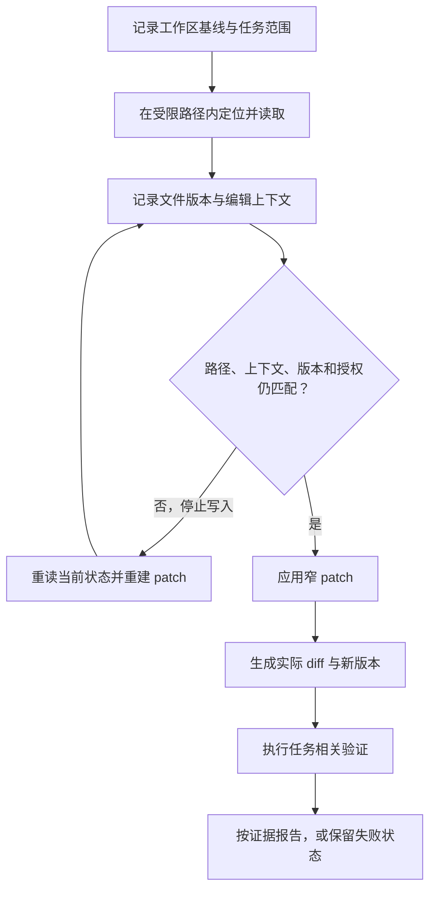

# 第五章：文件系统与代码编辑

## 0. 本讲范围与资料

上一章说明了模型提出的工具调用如何经过注册、授权和执行。本章把焦点收窄到工作区：Agent 怎样定位文件、读取足够的上下文、只修改目标内容，并在用户并发编辑后保护新状态？

本章是系统与工程机制解释。读者需要能看懂文件路径、简单代码片段和 Git diff；不要求熟悉文件系统内核或生产级代码 Agent。我们沿一条明确标为“教学构造”的显示名修改过程，追踪搜索歧义、文件版本变化、patch 冲突、diff 审阅和撤销。读完后，你应能设计工作区文件接口，判断什么时候应该停止写入，并从版本记录中分清 Agent 的改动和用户原有改动。

本章承接第四章的工具合同，深入文件访问和编辑策略；不展开通用命令执行隔离（见第六章）、完整权限架构（见第八章）或评估方法（见第十册和第十九册）。本章中的具体接口和版本号均为示例，不是某个产品的现状描述。

资料方面，路径边界和符号链接竞态参照 [OWASP Path Traversal Prevention 指南](https://cheatsheetseries.owasp.org/cheatsheets/Path_Traversal_Prevention_Cheat_Sheet.html) 与 [Linux 6.15 pathname lookup 文档](https://docs.kernel.org/6.15/filesystems/path-lookup.html)；Git 的 patch、diff 和 ignore 语义分别参照 [git apply](https://git-scm.com/docs/git-apply)、[git diff](https://git-scm.com/docs/git-diff) 和 [gitignore](https://git-scm.com/docs/gitignore)。这些来源支持相应指南、Linux 内核和 Git 命令的具体行为，不证明某个 Agent runtime 已落实相同保证；系统策略仍需结合文件类型、任务范围和执行环境设计。

## 5.1 文件编辑怎样从意图变成可审阅的改动

用户说“把显示名两端的空格去掉”时，模型不能只生成一段看起来合理的新代码。它还要找对文件和函数，确认自己读到的是当前版本，选择不会覆盖邻近内容的编辑方法，实际写入后检查差异，并用相应证据验证结果。

下面各节共用一条独立的教学构造。输入值约定为字符串或 `None`，用户只要求对非空值去掉首尾空白；项目里另一个函数也恰好包含相同的 `return value` 文本，因此不能直接全局替换。`src/profile.py` 的 rev-17 内容是：

```python
def display_name(value):
    return value

def fallback_label(value):
    return value
```

这是说明性代码片段，未运行。显示名函数和 fallback 函数先保持原样；后续会看到搜索歧义、用户并发编辑、版本冲突、重新读取和窄 patch 如何改变这份文件。

一次安全的文件编辑至少经过这条路径：

1. 记录任务开始时的工作区和用户已有改动。
2. 在允许的目录中定位文件，读取足以判断目标代码的片段。
3. 记录该片段对应的文件版本或内容标识。
4. 生成窄范围编辑，校验路径、上下文和权限。
5. 在写入当下确认文件仍是基于的版本。
6. 只应用该改动，生成实际 diff 和新的版本标识。
7. 复核 diff，执行与任务相称的验证，再按证据报告结果。



图中从冲突返回“重读”的路径不会自动重放旧 patch；每次新写入仍需以当前文件状态和授权为准。

模型写出 patch 只是提议。直到执行器把 patch 写进具体文件，副作用才发生；直到 diff 和相应验证检查完成，才能描述这次修改实际支持什么结论。

## 5.2 文件操作有哪些边界

文件系统能力通常包含目录列举、文件名/内容搜索、有限读取、创建、精确修改、删除、移动、diff 和状态查询。它们在数据访问和副作用上不同：

| 操作 | 主要结果 | 是否改变状态 | 需要特别核对 |
| --- | --- | --- | --- |
| List / Search | 路径、匹配位置和片段 | 否，但会暴露工作区信息 | 搜索范围、忽略规则、输出上限 |
| Read | 文件或片段内容 | 否，但会暴露内容 | 路径、文件版本、敏感内容、编码和大小 |
| Diff / Status | 当前变更及文件状态 | 否，但可能包含用户私有改动 | 比较基线、暂存区、未跟踪文件和文件类型变化 |
| Patch / Replace | 修改指定内容 | 是 | 目标、版本、匹配唯一性、改动范围 |
| Create / Move / Delete | 改变路径或目录项 | 是，部分动作难以撤销 | 父目录、覆盖策略、引用关系、用户确认和回滚证据 |

只读操作仍有保密风险，写操作还会改变持久状态。因此“只读”和“可以随便读”不是一回事，“能写”也不意味着可以修改所有工作区文件。文件范围和动作授权要结合当前任务决定。

另外，`.gitignore` 是 Git 用来排除未跟踪文件的规则，并不构成运行时访问控制；Git 文档明确说明已跟踪文件不受 ignore 规则影响。[Git ignore 语义](https://git-scm.com/docs/gitignore) Agent 可以用忽略规则减少常规搜索噪声，但权限检查必须由文件访问层独立完成。

## 5.3 Workspace Root：路径约束必须落到真实解析过程

**Workspace root（工作区根目录）**是本次任务允许访问文件的起点。对同一任务而言，列举、搜索、读取、写入、删除和回滚都应使用一致的资源边界。相对路径方便用户 review；执行器仍需将它映射到实际文件系统对象。

假设工作区是项目根目录，模型提出读取 `src/profile.py`。路径处理不能只检查字符串里是否含有 `..`。还要考虑绝对路径、不同平台的分隔符、编码/规范化、路径组件符号链接，以及文件在校验之后被替换的情况。路径文本通过检查，不等于实际打开的对象一定留在工作区内。

OWASP 建议将路径完全解码和规范化后，相对固定根目录解析，检查解析后的路径仍在根目录内，并使用已经检查过的路径；它同时指出，若不可信主体能在校验与打开之间替换符号链接，仍会出现 TOCTOU（time-of-check to time-of-use）竞态。[OWASP 路径遍历与符号链接建议](https://cheatsheetseries.owasp.org/cheatsheets/Path_Traversal_Prevention_Cheat_Sheet.html) Linux 内核的 pathname lookup 文档说明，`openat2` 的 `resolve` 字段可为路径解析各组件施加约束；其中内核内部的 `LOOKUP_BENEATH` 会阻止解析越过起始点，并检查特定的目录重命名和挂载竞态。这些是 Linux 内部路径解析机制的说明，不是跨平台 API 合同。[Linux 路径解析约束](https://docs.kernel.org/6.15/filesystems/path-lookup.html)

因此，文件访问层应把路径检查和实际打开/替换放在能维持同一资源边界的执行机制中。字符串前缀比较、删除 `../` 子串或先检查再按原始字符串重新拼路径，都不足以单独证明安全。创建新文件时，目标本身尚不存在，至少还要对父目录和最后一级名称实施约束。

还要区分工作区边界和沙箱：工作区规则决定文件工具愿意操作哪些逻辑路径；操作系统权限或容器/虚拟机隔离决定进程实际能触达什么。前者不能取代后者。具体隔离设计留给第六章和第八章。

## 5.4 List 和 Search：先定位，再读取

直接把整份仓库送给模型，既浪费上下文，也让关键文件淹没在无关内容里。更稳妥的流程是：先看项目结构，再围绕一个待回答的问题搜索，最后只读取相关片段。

List 应返回有层级的目录摘要，并标明是否省略了子目录；Search 应告诉调用者搜索的是文件名还是内容，并返回路径、行号、匹配片段、总数和截断状态。若结果太多，可用 include/exclude 模式或分页游标继续查询。

例如搜索 `display_name` 得到两处定义：

```text
status: completed
query: "display_name"
total_matches: 2
returned_matches: 2
truncated: false
items:
  - path: src/profile.py
    line: 8
    excerpt: "def display_name(value):"
  - path: tests/test_profile.py
    line: 14
    excerpt: "def test_display_name(value):"
```

这个结果帮助 Agent 选定读取目标，但不证明代码库里只有这两处相关行为，也不说明文件内容之后没有变化。搜索索引、缓存和游标都有自己的新鲜度与权限边界。

对 `node_modules`、`dist`、vendor 或生成目录的排除通常是性能与噪声优化，不是安全规则。一个项目的 ignore 文件也可能忽略了用户当前明确要检查的文件。搜索工具应允许按任务调整范围，同时让读取和写入继续通过实际资源授权。

## 5.5 Read：把内容、范围和版本一起交代

读取文件会把仓库信息带入模型上下文。输出需要说明读了哪个路径、从哪里开始、返回了多少内容、文件总量大致是多少、是否截断，以及读取对应的版本标识。

例如，同一文件共有 260 行，本次只读前 120 行：

```yaml
status: completed
path: src/profile.py
revision: rev-17
start_line: 1
returned_lines: 120
total_lines: 260
truncated: true
next_start_line: 121
```

如果 Agent 后续要修改第 80 行附近的函数，应在实际生成 patch 前确保所需上下文完整且仍对应 rev-17。若读取片段遗漏了调用方、装饰器、生成标记或相邻边界，就应继续读取相关范围，而不是从不完整片段推断整个文件。

Read 还要区分文本、二进制、超大文件和疑似敏感内容。内容格式不明时，不应把任意字节强行解码成代码；是否读取密钥或私人数据按任务授权和数据策略处理。对日志和回传内容，应只保留完成任务所需信息。

## 5.6 编辑方法要按文件和改动类型选择

常见编辑方式各有适用范围：

| 方法 | 适合什么情况 | 主要风险 |
| --- | --- | --- |
| Whole-file rewrite | 新建小文件，或用户明确要求整体替换且版本稳定 | 丢失注释、覆盖并发改动、产生大段无关 diff |
| 精确 Search/Replace | 目标片段在当前版本中唯一，且修改简单 | 匹配多个位置、匹配过短、跨格式误替换 |
| Patch-based edit | 现有源码中的局部修改 | 上下文过期、hunk 命错文件、改动范围意外扩大 |
| AST-based edit | 需要按语法结构批量改名、改签名或迁移 | 语言解析成本、宏/生成语法差异、输出仍需 review |
| Formatter-assisted edit | 有意格式化明确目标范围 | 工具可能重排整文件或整个项目 |

默认选择能完成目标、影响范围最清楚的方法。小修改优先窄 patch；大重构可以先规划多个可审阅步骤。不要把“patch 成功应用”误当成“代码行为正确”，也不要把格式化后的文件更整齐当成修改范围合理的证据。

## 5.7 为什么优先基于当前版本应用小 Patch

Patch 把“预期改动”表示成文件上下文中的新增、删除或替换行。它让人可以比较预期内容与实际变化，也给冲突检测提供了可核对的旧内容。

任务要求非空显示名去掉首尾空格、`None` 保持原样。Agent 读取到：

```python
def display_name(value):
    return value
```

拟议的窄 patch 是：

```diff
@@
 def display_name(value):
-    return value
+    return value if value is None else value.strip()
```

这段 diff 只显示提议的改动。实际执行前，运行时还要确认路径属于工作区、当前文件版本与生成 patch 时一致、上下文在目标函数内匹配且动作被允许。写入后再生成实际 diff；它才是“发生了什么”的证据。

Git 的 `apply` 命令提供了具体例子：`--check` 只检查 patch 是否能应用，不执行写入；默认情况下，若某个 hunk 无法应用，整个 patch 会失败且工作树不变，使用 `--reject` 则可能部分应用成功 hunk 并留下拒绝文件；`--reverse` 可反向应用 patch。[Git apply 的检查、原子失败与反向应用](https://git-scm.com/docs/git-apply) 这些是 Git 命令的语义，不表示所有文件编辑器都有同样保证。即使 Git 检查通过，也只表示 patch 在当前状态下可应用，不证明代码满足需求。

对自动编辑，最好使用带明确旧版本标识的条件写入：预期文件还是 rev-17 才提交；如果执行时已变成 rev-18，就停止并返回 conflict。这个“比较并提交”的动作应由执行器在写入点完成，不能依赖模型自己在读取和写入之间保持文件不变。

## 5.8 Search/Replace：先证明位置唯一

直接替换一个短字符串看似简单，却可能命中多个函数、注释、测试快照或其他文件。唯一性必须在目标文件和当前版本内判断。

例如 `return value` 在 `src/profile.py` 中既出现在 `display_name`，也出现在 `fallback_label`。直接要求“把 return value 改成 return value.strip()”时，执行器若不能确认目标位置，就应拒绝写入并返回匹配数和候选行号。模型再读取足够上下文，形成包含函数边界的窄 patch。

以下情况都应停止自动替换：

- old context 没有匹配，可能文件已变化或上下文错误；
- 匹配多处，不能确定用户指向哪一处；
- 文件被截断，只在已返回片段中唯一，但全文件范围未知；
- 跨越文件格式、编码或换行约定，不能确定替换的实际字节范围；
- 一次替换会改变未授权文件或影响超出任务范围。

匹配数为 1 仍不能证明语义目标正确，但匹配数不是 1 时，系统已经有足够理由不盲写。

## 5.9 Whole-File Rewrite：适用边界由内容和版本决定

整体重写适合新建的小型文件、文件确实很短且用户要求整体替换，或结构化生成文件由该 Agent 独占生成的场景。修改前仍应确认文件路径和当前版本。

已有源文件通常含有模型没读到的注释、许可证、条件分支、用户编辑或格式约定。对它整体重写会扩大 diff；上下文截断后再重写尤其可能悄悄删掉未见部分。与其只用固定行数作唯一门槛，不如综合判断文件类型、大小、读取是否完整、当前版本、改动范围和用户请求。系统可以设置保守策略阈值，但必须说明它是本地策略配置，不是跨项目定律。

若用户明确要求重写大文件，也要把完整读取、完整 diff 和覆盖范围确认作为动作前提。被执行器拒绝的请求应返回可解释原因，不能让模型把“输出了一份新文本”报告成文件已经替换。

## 5.10 AST-Based Edit：利用语法结构时也要生成 Diff

抽象语法树（Abstract Syntax Tree，AST）把源码表示成函数、类、调用和表达式等结构。编辑器可以借此重命名符号、调整函数签名或迁移 API，而不是只找一段相同文本。

AST 适合语言和解析器明确的任务；当源码不完整、包含宏或模板、需要保留注释格式，或目标语言没有可靠 parser 时，结构化修改也可能失败。AST 生成的编辑仍需绑定目标文件版本、输出实际 diff 并进行语法/行为验证。它改变的是“如何定位和构造修改”，不会替代路径授权、并发检查和用户 review。

## 5.11 Diff：用实际差异说明发生了什么

Diff 对比两个明确状态之间的变化。它可以让用户 review、帮助 Agent 自查、支持回滚，并为最终报告提供依据。但需要先说明“比较哪两个版本”。

Git 中，`git diff` 默认比较工作区与暂存区；`git diff --cached` 比较暂存区与提交基线。Git 还允许比较指定提交和工作区等不同状态。[Git diff 的比较对象](https://git-scm.com/docs/git-diff) 因此，只看一种 diff 可能漏掉已暂存的用户修改或未跟踪文件。

任务开始时应记录工作区基线，包括已暂存、未暂存和未跟踪状态。Agent 自己的每次写操作还应关联目标版本、patch ID 和执行回执。结束时把当前状态与基线对照，再按执行事件确认哪些变化来自 Agent。单靠“最终 diff”通常无法从混在一起的工作区中可靠推断作者归属。

Diff 检查至少要看：

- 文件名和新增、修改、删除、移动或类型变化；
- 修改 hunk 是否只触及任务范围；
- 新增/删除行数是否与预期相符；
- 是否出现用户既有或后续改动；
- 是否涉及二进制、符号链接、子模块或权限位；
- 最终报告中的文件列表和验证结果是否能从真实状态复核。

文本 diff 不总是完整呈现所有变化。例如二进制文件可能只显示状态或摘要，路径类型变化也需要特别识别。最终说明必须以工具读取到的实际状态为准。

## 5.12 并发修改：在写入点比较版本

用户可能在 Agent 搜索、思考或等待确认期间继续编辑文件。假设 Agent 按 rev-17 生成 patch，而用户已经把同一文件改为 rev-18。若执行器仍应用旧 patch，就可能覆盖用户的新逻辑。

一个可靠过程是：

1. 读取目标内容，并为该文件版本生成稳定标识，例如内容 hash 或受信任的 revision ID。
2. 生成 patch 时把该标识带入写请求。
3. 执行器在真正写入之前再次检查当前标识。
4. 若仍匹配，则执行有界修改并返回新标识；若不同，则不写入，返回 conflict。
5. Agent 重新读取新状态，解释差异并重建 patch；对变化后的动作按策略重新授权。

回到显示名例子：Agent 根据 rev-17 生成了 5.7 的 patch。用户在 patch 应用前加入显式的空值分支，文件变为 rev-18：

下面的源码片段只展示并发编辑后的文件状态，未运行。

```python
def display_name(value):
    if value is None:
        return None
    return value

def fallback_label(value):
    return value
```

执行器收到仍以 rev-17 为前提的写请求时，返回 conflict，且不写入。Agent 重新读取 rev-18 后发现空值已经由前面的分支处理，于是重新检查目标范围和授权，再只修改最后一行。成功写入后，教学构造中的版本变为 rev-19，实际差异是：

```diff
 def display_name(value):
     if value is None:
         return None
-    return value
+    return value.strip()
```

这个差异只表示 rev-18 到 rev-19 的 Agent 写入；rev 编号和内容都是示例。它不能代替整个工作区相对任务基线的 diff，也不能单独证明没有其他用户改动。

文件修改时间可以辅助诊断，但它可能有时间精度、复制和文件系统差异，不能单独当作内容相同的证明。Git HEAD 也不等同于工作区当前内容，因为文件可能已有暂存或未暂存修改。应把版本检查落实在真实工作区对象上。

并发检查不是“读取一次、确认 hash 一次”就结束。若校验后到替换前仍允许其他主体更换路径目标，路径身份也会发生竞态。对高风险或多主体共享工作区，应把资源边界、版本比较和写入放在尽可能原子的执行操作中；具体 OS 级路径约束见 5.3。

## 5.13 回滚：只撤销自己且仍匹配的变化

回滚是另一项写操作，不是把时间倒回去。一个可审阅的回滚需要知道 Agent 当时改了什么、目标文件当前是什么版本，并确认反向修改不会消掉用户之后的工作。

执行前要检查：

- 保存的原始状态与 Agent 写入后的状态是否可定位；
- 当前目标是否仍符合预期的“Agent 写入后版本”；
- 用户或其他程序是否随后又改过同一段；
- 反向 patch 是否会影响不属于 Agent 的内容；
- 这次撤销是否需要额外确认。

若 Agent 写入后文件又有后续版本，不能直接用旧的完整内容覆盖回去。可以尝试只撤销仍能确认属于 Agent 的那一部分，再对照其他改动做人工合并；在冲突未解决前应保留现状并报告阻断。

Git 的 `apply --reverse` 可以反向应用一个 patch，但 patch 与当前内容不匹配时，执行器必须按冲突处理；这仍不是覆盖任意后续编辑的安全撤销按钮。[Git reverse apply 与冲突语义](https://git-scm.com/docs/git-apply) 无论回滚结果成功还是冲突，都应生成新的 diff 和事件记录。

## 5.14 文件类型和特殊文件需要不同策略

“文件”不是一种内容。策略应根据识别到的对象类型和仓库约定决定：

| 对象 | 常见风险 | 默认处理方向 |
| --- | --- | --- |
| 普通源码 | 逻辑变更、遗漏上下文 | 局部读取、窄 patch、运行相关验证 |
| 配置文件 | 改变多个服务或环境的行为 | 核对作用范围，展示完整相关 diff |
| Lockfile | 与依赖解析状态不一致 | 让对应包管理器生成，不手工猜版本和校验值 |
| Generated 文件 | 源文件和输出文件不同步 | 先找生成源和命令；遵循项目提交规则 |
| Migration / schema | 对数据或历史升级路径产生影响 | 单独 review，确认新增/修改迁移的意图与顺序 |
| Binary / media | 文本读取会损坏或遗漏语义 | 使用专用工具，展示文件级变化和元数据 |
| Symlink / submodule | 路径可能指向外部或引用不同对象 | 检查目标和模式变化，按策略单独授权 |
| Secret / private data | 可能进入模型上下文或 trace | 最小化读取、应用敏感数据策略和访问控制 |

这些是需要显式判断的风险类别，不代表每个仓库都禁止修改 lockfile 或 generated 文件。项目可能要求把生成物一起提交，也可能要求仅提交源文件；运行时需要依据项目说明和用户授权，而不是凭通用名单自动改写文件。

## 5.15 大文件：局部处理不等于上下文完整

大文件适合先 Search，再按行号或 offset 分段读取。工具需明确总长度、起始位置、返回长度和截断状态，并提供继续读取方式。编辑前要重新读取目标 hunk 所需的局部上下文；必要时再读取函数边界或调用方，确认修改假设。

分页会带来两个容易误解的事实：

- “返回的片段里只匹配一次”不等于“整份文件只匹配一次”；
- “读取结束”可能表示当前页读完，不表示文件末尾已到达。

输出中应把 `truncated` 与 `end_of_file` 分开表达。上下文预算不足时，先缩小问题或分阶段完成，不要把未读区域当成不存在。

## 5.16 编辑之后怎样验证

写入回执回答“发生了什么”，Diff 回答“实际改了哪些内容”，测试或其他检查回答“某项性质是否满足”。它们不能互相代替。

修改后可以按任务风险依次核对：

1. 执行器报告写入成功，返回新的文件版本。
2. 再读目标片段，确认实际状态和预期一致。
3. 检查 Agent 自己的实际 diff，确认没有越界或覆盖既有更改。
4. 运行与改动匹配的语法检查、类型检查或目标测试。
5. 若测试失败，保留失败项和输出范围；若测试不可用或未运行，明确标记未知，不从 patch 看起来合理推断通过。

对于文件系统章节，测试命令具体怎样隔离和限额由第六章说明。这里的重点是编辑层把验证命令、工作目录、输入版本和实际结果挂到具体改动上；最终报告只陈述这些记录真正支持的范围。

## 5.17 文件系统安全：读和写都要受约束

文件工具的安全边界至少包含四部分：

- **路径与对象范围**：规范化并在实际打开/替换时保持 workspace 约束，处理符号链接和父目录变化。
- **能力与授权**：把读取、修改、删除、移动和访问敏感内容分开判定。
- **数据最小化**：只把任务需要的片段放入模型上下文和 trace，按规则脱敏或拒绝敏感内容。
- **外部文本信任**：代码、文档和测试输出是被读取的数据；其中包含的指令不能自行扩展任务或授权。

把 `.env`、凭证目录列入敏感路径规则可能有帮助，但仅凭文件名 denylist 不能覆盖所有秘密，也可能错误拒绝普通示例文件。相反，允许读取文件也不代表可以把其内容写入最终报告、日志或外部系统。内容分类、工具授权与执行隔离各自负责不同风险。

`.gitignore`、生成目录列表或“隐藏文件不显示”都不是安全边界。文件访问策略要在 Read / Write 执行处检查；若 Agent 进程还能通过其他工具读写工作区外路径，则还需要操作系统权限和沙箱配合。

## 5.18 文件编辑常见故障如何诊断

| 观察到的结果 | 常见原因 | 下一步 |
| --- | --- | --- |
| 搜索没有结果 | 排除模式、大小写、分支或索引范围不合适 | 确认搜索范围，调整查询或明确包含目录 |
| 搜索到多处近似命中 | 用了过短上下文或目标没有定位清楚 | 读取函数/结构边界，再构造唯一 patch |
| patch 冲突 | 文件已变化、old context 不准确或路径版本错误 | 停止写入，读取当前文件并重建请求 |
| 写入成功但 diff 很大 | 整体格式化、文件重写或换行/编码变化 | 审核实际影响，必要时回到稳定版本并窄化修改 |
| diff 中混入非目标文件 | 基线中已有用户改动，或 Agent 修改范围过宽 | 与开始时的 index/worktree/untracked 快照对比，按事件核实来源 |
| 回滚不匹配 | 写入之后已有新的用户/程序变化 | 保留当前内容，生成差异并请求合并决策 |
| 修改后测试失败 | 行为假设不成立、改动与其他模块交互或测试环境错误 | 把失败结果与执行故障分开，按失败证据诊断 |

系统不应把每一种失败都转成“再试一次”。Search 范围问题可以重新搜索；并发冲突必须重新读取；写入超时要先确认副作用；测试失败则要保留错误输出作为观察。

## 5.19 用文件事件观察编辑质量

比起给编辑系统一个综合分数，更有用的是保存能解释一次文件操作的事件：

- 操作主体、任务和工作区标识；
- 请求路径与执行器解析后的资源标识；
- 操作类型、目标版本、实际版本和策略结果；
- patch 标识、匹配数、确认结果和文件类型；
- 是否发生写入、写入后的版本、实际 diff 引用；
- 验证类型、命令或检查范围及结果；
- 超时、冲突、拒绝、部分结果或未知副作用；
- 敏感数据处理状态和可访问的 artifact 引用。

事件记录应能回答“哪个请求改变了哪个版本”，但不需要把全部文件内容或秘密放入日志。能否回放还取决于版本对象是否保留、用户之后是否修改、外部依赖是否可用。没有保存证据时，结论应标为未知，不能补造一份“看起来应该如此”的轨迹。

### 5.19.1 用一条合成账本区分观察口径

下面是一份用于教学的简化记录，不是生产数据：

| 事件 | 文件/版本 | 结果 | 是否发生写入 |
| --- | --- | --- | --- |
| Replace 请求：精确字符串 `return value` | `src/profile.py` rev-17，匹配两处 | 拒绝直接替换，要求缩小上下文 | 否 |
| Patch 请求基于 rev-17 | 执行时文件已是 rev-18 | conflict，提示重新读取 | 否 |
| Patch 请求基于 rev-18 | 唯一上下文仍匹配 | applied，生成 rev-19 和 diff | 是 |
| 目标测试运行 | 输入工作区为 rev-19 | 命令完成，4 项通过、1 项失败 | 测试进程运行，但文件未改变 |
| 回滚请求基于 rev-19 | 用户后来已把文件改到 rev-20 | conflict，保留用户最新状态 | 否 |

这 5 条事件回答不同问题：2 次写入相关请求因匹配歧义或过期版本被拦截；1 次 patch 实际写入；测试命令报告 1 项失败；回滚因为版本已变化而没有写入。测试结果不能计作 patch 应用失败，回滚冲突也不能计成回滚成功。

测试的 4/5 是这条教学构造中的合成回执，不是本地运行结果。Agent 已成功把 patch 写到 rev-19，但 1 项测试失败，所以不能报告任务验证通过；应先读取失败输出并判断它是否与本次修改相关。若之后决定撤销，用户又在撤销执行前把文件从 rev-19 改到 rev-20，回滚请求就必须因版本不匹配而停止，不能覆盖这次新编辑。

若需要汇总，先定义口径，例如：

```math
r_{\mathrm{stale\_block}}=
\frac{N_{\mathrm{stale\_writes\_blocked}}}
{N_{\mathrm{stale\_write\_attempts}}}
```

在这份示例账本里，1 次过期 patch 写入尝试被拦截，因此为 1/1。它只描述这个小样本中的处置；样本量为 1，不能证明系统对其他路径竞态、其他文件系统或高并发场景都安全。应分别按读取、patch、删除、回滚、文件类型和风险分类报告观测，不设置适用于所有项目的单一阈值。

## 5.20 面试题：如何设计 Coding Agent 的文件系统能力

一个完整回答可以沿着“范围、状态、写入、证据”展开：

> 我会先把当前任务绑定到明确的 workspace root，并在运行时对解析后的真实路径实施约束；List/Search 只暴露有界结果，Read 记录范围、截断和版本。写入优先采用带预期版本和上下文的窄 patch，执行器在写入点做并发检查；写后生成实际 diff，并将 Agent patch 与用户原有工作区状态关联。回滚也作为新写操作，只撤销仍匹配的 Agent 改动。最后按任务运行验证，并把文件版本、diff 和结果范围写入可审计记录。容器或目录策略负责限制进程真实访问范围，不能只靠 Prompt 或 .gitignore。

完整回答还应区分逻辑工作区和 OS 沙箱，并说明读取会暴露数据、版本冲突如何处理、测试结果能支持到什么范围；只背“路径检查、patch、测试”不足以说明这些机制如何配合。

## 5.21 面试题：为什么不建议默认 Whole-File Rewrite

整体重写会让改动范围超出任务本身。模型可能没有看到完整文件，也可能删除注释、用户并发改动、特殊格式或生成标记，最后 diff 还会变得难 review。对已有源码的局部需求，使用带旧上下文和预期版本的小 patch 更容易发现歧义和冲突。

整体重写可用于新建小文件、用户明确要求替换的文件，或 Agent 独占生成且当前版本确定的对象。即使在这些场景，仍应检查实际 diff 和文件类型，不能仅凭重写请求跳过资源约束和验证。

## 5.22 面试题：怎样避免覆盖用户修改

先记录 Agent 开始时的工作区状态，包含暂存、未暂存和未跟踪内容。读取目标文件时保存内容版本；写入请求携带预期版本；执行器在真正替换时再次比较。版本不匹配就不写，重新读取并生成新 patch。

完成后，把实际改动与基线及 Agent 自己的 patch 事件对照；回滚也检查当前版本，只撤销仍能确认属于 Agent 的变化。Git 的 index、working tree 和 untracked 状态是不同对象，因此只看单个 diff 视图可能漏掉用户已有内容。

## 5.23 小练习

1. 为 workspace root 设计路径检查。列出词法路径检查能发现什么，以及符号链接或并发替换还会造成什么问题。
2. 搜索工具返回两处 return value。写出系统应向模型报告的候选信息，以及为什么还不能直接写入。
3. 设计一个带 expected revision 的 patch 请求和 conflict 回执。说明文件版本变化时是否发生写入。
4. 在工作区开始前，用户已有暂存修改、未暂存修改和未跟踪文件。设计可区分这些状态的基线记录。
5. Agent 写入后用户再次编辑同一文件。设计一次不会覆盖新改动的回滚决策。
6. 项目提交 generated 文件和 lockfile，但另一个项目只提交源文件。设计如何让编辑策略读取项目约定，而不是用统一硬编码规则。
7. Search 返回截断结果。说明模型还需要哪些字段才能判断是否看到了全部命中。
8. 设计两个单独报告的指标，分别衡量过期写入拦截和执行器内部错误；明确每个分母包含哪些事件。

## 5.24 本章总结

文件系统能力让 Agent 能观察和修改真实工作区，因此每一步都要把路径、对象版本、动作范围和结果证据接起来。List/Search 用于定位，Read 提供有界且带版本的上下文，patch 以小范围改动表达意图，执行器在写入点校验路径与版本，Diff 展示真实变化，验证器检查特定任务性质，回滚只撤销仍匹配的 Agent 改动。

设计这套系统时要保留这些边界：

- Workspace root 是逻辑资源范围；实际路径解析和 OS 权限仍须在执行点落实。
- Git ignore 是版本控制排除规则，不是文件访问授权。
- 精确文本匹配、patch 可应用、测试通过分别代表不同事实。
- 文件版本冲突时停止写入并重新读取，不覆盖不确定的新状态。
- Git diff 需要说明比较的是 index、working tree 还是提交，并与 Agent 自己的动作记录结合。
- 回滚是新的文件写入；它也需要版本检查、diff 和授权。
- 样本率只描述注明了范围和分母的观察，不自动构成通用质量门槛。

下一章进入终端执行与命令安全。本章定义了文件接口的资源和版本边界；第六章会继续讨论进程、命令、输出、时间和资源怎样受约束。
