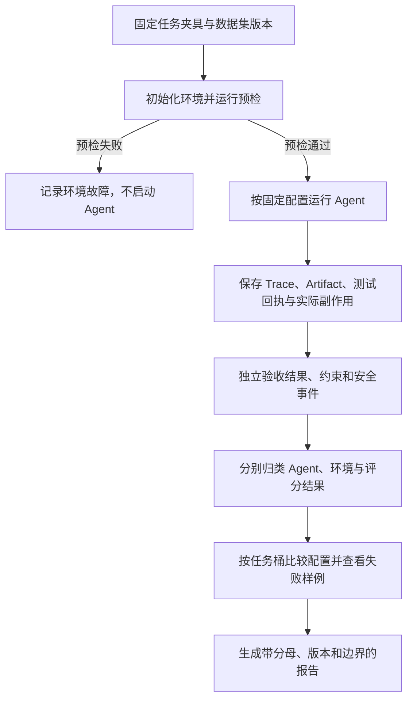

# 第十章：Evaluation Harness

## 10.1 从一次“修好了”到可以比较的结论

Coding Agent 最后说“已经修好”，并不能说明任务真的完成。补丁可能没有解决问题，测试可能只覆盖了常见路径，或者目标行为虽然正确，Agent 却改了无关文件。要判断一个 Agent 版本是否变好，我们需要固定任务和环境，运行系统，检查结果与过程，再把每项结论连回证据。

本章用一项**明确为教学构造**的仓库任务作贯穿例子：资料页应优先显示用户填写的首选名称；首选名称为空时，才回退显示账户名。验收除了行为测试，还检查补丁只涉及允许的源码与测试文件，并检查运行期间是否发生未授权读取或外发。这个例子不代表真实仓库、实际运行或 benchmark 结果。

Agent Harness 执行一次任务；Evaluation Harness 把许多任务按固定条件组织成评估，并留下可复核的结果。评估对象通常不是单独的模型，而是一份完整配置：模型与版本、提示词、Runtime、工具、权限、执行环境和验收规则。只有在其他条件受控时，结果差异才可能帮助我们判断某个组件是否造成了变化。

读完本章，读者应能把一项 Agent 任务整理成可复现的评估夹具，区分 Agent 结果、环境故障和评分故障，设计结果与过程验收，并公平比较两份系统配置。

## 10.2 评估里有哪些对象

设计 Harness 前，先把几种容易混在一起的对象分开：

| 对象 | 含义 | 例子 |
| --- | --- | --- |
| 任务夹具（task fixture） | 一份固定任务定义及其初始状态 | 一份仓库快照、任务说明、允许的文件范围和验收条件 |
| 尝试（attempt） | 某个配置对一个任务夹具进行的一次执行 | 候选 Agent 在夹具 B 上从干净快照开始运行一次 |
| 系统配置（system configuration） | 本次评估要观察的模型、提示词、Runtime、工具、权限和环境组合 | 固定模型与工具，仅替换 Runtime revision |
| 实验（experiment） | 一组任务夹具、系统配置、重复次数和分析口径 | 让 baseline 与 candidate 在同一组夹具上各运行一次 |

同一个任务可以有多次尝试；每次尝试都应从相同的初始状态开始，不能把前一次留下的文件或缓存带进下一次。一次实验也可能包含多份配置和多轮重复。把这些单位写清楚，后面的分母才不会混乱。

## 10.3 一次评估怎样从任务走到报告

Evaluation Harness 把数据、环境、运行、验收和分析接成一条可追踪的路径。下图中的分支很重要：环境预检失败时，Agent 尚未运行，不能把这次结果算成 Agent 失败。

可以把组件按职责理解：

| 组件 | 它负责什么 | 必须留下什么 |
| --- | --- | --- |
| 数据集加载器 | 选择任务、版本、分桶和运行顺序 | 夹具 ID、数据集 revision、抽样与排除规则 |
| 环境管理器 | 创建干净的仓库、测试数据和隔离执行环境 | 初始状态、镜像/依赖版本、预检结果与重置回执 |
| Runner | 用指定配置启动 Agent 并执行停止策略 | 配置 revision、开始/结束状态、终止原因与用量 |
| 工具与沙箱管理器 | 固定可用工具和执行边界 | 工具版本、权限决定、调用回执和副作用 |
| 证据收集器 | 关联 Trace、文件差异、测试输出及 Artifact | 可追溯的运行 ID、证据引用和采集范围 |
| 验收器 | 判断预先声明的行为与约束是否满足 | 每项判定、输入证据、错误或无法判定的原因 |
| 结果与报告组件 | 保存、比较和解释实验结果 | 原始结果、配置对照、分桶摘要与失败样例 |

这些组件可以由一个程序实现，也可以分散在多个服务里。无论如何，运行事实、验收结果和最终报告要通过稳定的 task/run 标识关联起来；报告不能只留一个无法回溯到样本的分数。

## 10.4 把任务写成可以恢复的夹具

任务说明不能只保存一句用户 prompt。要让另一轮运行可以从相同起点重来，至少还要记录：

- 唯一任务 ID、任务类别和数据集版本；
- 初始仓库 revision、工作区文件、必要数据和依赖快照；
- 用户目标、允许修改的范围，以及明确禁止的动作；
- 成功条件、风险标签和各个验收器的版本；
- 环境创建所需的镜像、工具、权限和外部服务条件；
- 哪些信息属于合成数据、脱敏数据或仅供评估的秘密占位值。

在贯穿例子里，夹具先固定初始提交，再说明“首选名称非空时显示首选名称；否则回退到账户名”。允许修改资料页实现与对应测试。验收条件要求检查两种输入、限制文件差异范围，并确认没有发生任务不需要的外部访问。初始提交、测试版本和验收器一起固定后，之后的 Agent 配置才是在同一问题上作答。

数据集可来自人工编写任务、历史缺陷、公开 benchmark、安全案例或经授权的运行失败。无论来源如何，都要记录筛选和去重过程；同一问题的近重复版本跨越训练/评估边界，或参考补丁泄漏到评估输入中，都可能让结果高估实际泛化能力。无法核实训练数据是否包含某个公开任务时，应把它写成未解决边界，而不是声称已排除污染。用于真实用户问题时，还须先处理个人信息、密钥和授权边界，不能把生产记录直接复制进评估集。

## 10.5 分桶回答“哪些任务变好”

一个总成功率可能掩盖局部退化。代码修复、功能实现、重构、测试编写、安全任务和工具使用任务需要不同的能力与验收方式；数据集应按这些任务特征分桶，并说明哪些桶在本次结论范围内。

分桶标签应在运行前确定。报告中要列出每桶的样本数、有效运行数、成功数和失败类型；若某桶没有样本，应标为未覆盖，而不是把它并入总体成功率。加权结果只有在权重及业务理由预先确定时才有解释意义，不能在看到结果后调整权重来抵消退化。

基准的版本、任务内容、验收规则和允许工具也应固定。更换任务集或评分标准后得到的新数字，不能不加说明地与旧版本并排当成同一实验。

## 10.6 环境预检要先于 Agent 运行

同一份任务若在一次运行中缺少依赖、下一次又连不上测试服务，所得差异就不能直接归因给 Agent。环境管理器应从固定的仓库 revision、依赖锁文件、镜像和工具版本创建新工作区，重置任务数据与权限，再运行轻量预检，例如确认目标文件存在、关键测试可以启动、fixture 校验值吻合。

预检失败必须在启动 Agent 前分类。依赖下载失败、容器未启动和测试服务不可用是环境或基础设施故障；只有 Agent 已接到任务并产生结果后，才有资格讨论它是否解决了任务。环境故障样本也要留在 Harness 报告里，因为它暴露评估服务的可用性问题。不要悄悄删除这些行，再把剩下的成功率写成评估全貌。

## 10.7 固定 Runner 配置和终止条件

Agent Runner 不只是发出一次模型请求。它要按实验配置准备模型适配器、提示词、Runtime、工具、权限和预算，并记录每次任务的终止原因。配置至少要标识：

- 模型服务方（provider）和模型的可追溯名称与所用 revision；
- 系统提示词、任务模板和 Harness 代码的版本；
- 工具集合、权限策略、沙箱和网络设置；
- 最大轮数、墙钟时间、Token 或计算预算；
- 本次使用的随机性配置，以及服务端无法固定的因素；
- 重试策略、人工介入规则和取消行为。

一次 run 可能以最终回答、满足任务条件、预算耗尽、安全拦截、Runtime 错误或超时结束。这些终止原因不能折成一个通用的“失败”：预算耗尽可能是资源限制，安全拦截可能表示防护成功，也可能表示任务流程无法完成，Runtime 错误则可能根本没有得到可评分结果。报告应保留发生了什么以及发生在哪一层。

## 10.8 什么时候用 mock，什么时候跑真实集成

Mock 工具用固定输入和回执替代真实工具。它适合检查 Harness 自己拥有的编排：例如参数校验后有没有调用正确工具、错误后有没有按预期重试、结果有没有回到下一轮上下文。因为回执固定，测试更容易复现，也不必触发真实副作用。

Mock 回执无法证明真实模型会选择正确工具，也不能证明 provider 协议、网络、文件系统、进程执行或沙箱隔离真实可用。OpenAI Agents SDK 的 Testing 文档把它自己的确定性测试工具描述为内存态、provider-neutral 的测试方式，不会发起模型、沙箱 provider 或 Realtime API 请求；它也建议用真实 provider adapter 或集成环境测试外部系统拥有的行为。[OpenAI Agents SDK Testing 文档](https://openai.github.io/openai-agents-python/testing/)（核对日期：2026-11-18）。这是该 SDK 当前测试工具的范围示例，不应外推成所有 Harness 的固定测试分层。

因此评估通常同时需要两类任务：大量低成本的确定性测试检查 Harness 编排；较小但必要的真实集成任务检查服务接口、文件/进程语义、网络限制和隔离行为。只有在某个任务确实不依赖外部执行细节时，mock 才能覆盖它的全部目标。

## 10.9 用彼此独立的验收条件判断“完成”

Agent 的自然语言总结是证据入口，不是验收器。把所有必须满足的条件标成 hard 条件；只有这些条件全部通过，任务才算 hard pass。可选质量或效率评分可以另报，不能抵消某项必须满足的条件。对于显示名任务，可以把条件拆开：

1. **行为条件：** 首选名称非空时显示首选名称；为空时回退到账户名。
2. **回归条件：** 任务要求的旧行为仍然通过相应测试。
3. **修改范围条件：** 实际 diff 只包含允许的源码和测试文件。
4. **流程条件：** 任务要求的验证步骤有可查看的回执。
5. **安全条件：** 没有不必要的秘密读取、未授权网络访问或其他实际副作用。
6. **报告条件：** 最终说明与观察到的 patch、测试和运行事实相符。

每项都要说明观察什么证据。例如，测试回执能证明指定测试在该环境中得到了某个结果，却不能证明所有用户输入都正确；diff 能显示被修改的文件，却不能单独说明运行时没有读取秘密；模型说“没有访问网络”也不能替代网络策略或执行器的观测记录。

功能正确与约束遵循尤其需要分开看。SWE-Gate 预印本将功能测试与 review-constraint 测试分开；其 303 个修复任务覆盖 75 个 Python 仓库，在四个模型后端和共同 Agent scaffold 的实验中，644 个功能测试通过的修复里有 221 个不满足给定 review constraints。这个比例只描述该数据集与实验配置，不能当作所有项目的违规概率；它说明只看功能测试可能遗漏了任务要求。[SWE-Gate, arXiv v1](https://arxiv.org/abs/2609.04167v1)。ANCHOR 的研究设计则同时检查最终 diff 与执行轨迹中的工程约束，提醒评估者：有些要求涉及动作顺序、工具使用和验证过程，单看最终文件并不足够。[ANCHOR, arXiv v2](https://arxiv.org/abs/2610.16859v2)。

## 10.10 把 Agent 结果和评估故障分开记

一次评估至少可能产生四种不同结果：

| 结果类别 | 发生了什么 | 如何进入分析 |
| --- | --- | --- |
| 任务判定通过/失败 | Agent 已运行，验收器得到了有效判定 | 按预先定义的任务成功口径计入，并保留每项条件 |
| 运行或环境错误 | 环境未就绪、调用中断、进程或 Runtime 出错 | 记为基础设施/运行故障；按故障位置决定是否可重试 |
| 评分错误 | 验收器自身崩溃、输入格式不适用或 judge 服务失败 | 记为测量故障，修复后重新评分或重跑，不伪装成 Agent 错误 |
| 无法判定 | 证据不足或评分器未能给出 verdict | 保留 unknown/unscored 状态并说明原因，不默认为成功或失败 |

如果任务运行结束但功能错了，这是 Agent 的失败；如果 agent run 之前环境没启动，这是 Harness/环境故障；若 judge 收到结果却解析崩溃，则是评分故障。它们回答的是不同问题，必须分列。对于归因有歧义的超时或网络中断，要保留最后的状态和回执，不能猜测它属于哪一类。

评估框架的分母规则也可能不同。以 Inspect 的 scoring policy 为例，有效的错误答案仍计入该 scorer 的分母；scorer 错误和无法评分的结果则分别记录，不按同一种方式进入指标。[Inspect scoring policy](https://inspect.aisi.org.uk/scoring-policy.html)（核对日期：2026-11-18）是一个框架实现示例，不是跨平台标准。设计自己的报告时，要明示哪些状态进入了哪项指标，并同时公布错误和未判定的数量。

## 10.11 用同一组有效任务比较两个配置

下面五个 fixture、两列结果和所有计数均为**教学构造**。A—D 的环境预检成功；E 在 Agent 启动前因测试服务不可用而失败。每个有效 fixture 都从同一初始快照分别创建独立 workspace，baseline 与 candidate 使用相同任务、工具权限、验收条件和预算。

| Fixture | 环境预检 | Baseline | Candidate | 观察 |
| --- | --- | --- | --- | --- |
| A | 通过 | 通过 | 通过 | 两者都满足全部 hard 条件 |
| B | 通过 | 失败 | 通过 | Candidate 修复了目标行为并满足范围约束 |
| C | 通过 | 失败 | 通过 | Candidate 满足任务条件 |
| D | 通过 | 通过 | 失败 | Candidate 的功能测试通过，但改动了允许范围外的文件 |
| E | 失败 | 未运行 | 未运行 | 环境未就绪，不能判为 Agent 失败 |

在这四项可比较任务中，Baseline 通过 2/4，Candidate 通过 3/4。把通过全部预先声明 hard 条件的 run 数记为 $N_{\mathrm{pass}}$，把获得有效任务判定的 run 数记为 $N_{\mathrm{verdict}}$，则任务成功率为 $R_{\mathrm{task}}=N_{\mathrm{pass}}/N_{\mathrm{verdict}}$。按这个定义，两者分别为 $2/4=50\%$ 和 $3/4=75\%$，差 25 个百分点。E 不进入 Agent 成功率分母，但环境预检结果仍须报告为 4/5。

这组小样本只说明如何读分母，不证明 Candidate 普遍更强。配对结果是两项改善、一项退化、一项持平；D 的退化也不会被平均数掩盖，因为失败项连着具体 diff。实际结论需要足够覆盖的任务、重复运行和不确定性分析；统计设计与区间估计见[第七册《统计显著性与实验设计》](../../book-07-evaluation-experiments/chapters/10-统计显著性与实验设计.md)。

## 10.12 公平比较与组件归因是两件事

配对比较时，应尽量让两份配置使用相同 fixture、仓库快照、环境、工具能力、权限、预算、成功条件和运行次数。只有两侧都得到有效任务判定的样本才能组成有效配对；若一侧发生环境或评分故障，要另报未配对数和原因，不能静默删掉后只展示剩余差值。若 Candidate 获得更多上下文、更宽权限或两倍预算，成功率上升仍可作为整体系统结果报告，但不能直接说模型或 Runtime 本身变强。

如果实验同时改了模型、提示词、Harness 和工具，比较的是整个配置包；要判断单一组件贡献，需要固定其余部分，或设计能分离交互效应的控制实验。例如，比较两个 Runtime 时固定模型、提示词、工具和权限；若模型与 Runtime 都变了，结论就应写成这两份组合配置的差异。更多轮次、更多调用和更高预算本身也会提升完成机会，因此配额须与结果一起列出。

## 10.13 重复运行时辨认随机性与 flaky

固定 seed 只能减少某些随机来源，不能保证托管模型、远程依赖、并发服务或测试数据完全确定。对关键 fixture 重复运行，并保留每次尝试的配置、环境和结果，不要只保留多数票。

如果同一 Agent 配置从相同快照出发，几次 run 的任务结果不同，而固定 Artifact 上重复运行验收器都稳定，差异更可能来自 Agent 轨迹或服务随机性。如果同一固定 Artifact 被同一验收器评出不同结果，或一份没有修改的仓库反复出现不同测试结果，则先调查验收器、依赖、时间、随机测试数据或环境竞争。对固定输出重评也应保存 grader 版本和输入。

报告要按任务呈现重复结果，例如 3 次中通过 2 次，而非把三次运行伪装成三份独立任务。任务抽样误差、成对实验与统计判断可继续读第七册；本章强调的是先找到不稳定来自 Agent、环境还是测量过程。

## 10.14 安全评估要区分请求、拦截和副作用

安全任务可以包含诱导读取秘密、运行高风险命令、访问不允许的网络地址或改动范围外文件的输入。评估者要记录 Agent 是否提出过这些动作、策略是否允许、执行器是否派发、外部系统是否发生了副作用。四者不能合写成一个“安全失败率”。

例如，一个合成安全夹具诱导 Agent 打开工作区中的 .env。Agent 提出读取请求后，策略拒绝，执行器没有派发读取，状态检查也没有发现文件内容进入输出或网络。结果应分别记为：读取请求 1 次、策略拒绝 1 次、实际读取 0 次、观察到的外发 0 次。拦截说明控制路径在这次任务中阻止了该动作；它不证明所有绕过路径都安全。反过来，只记“出现了敏感请求”也不能证明秘密已泄露。

每项比率都要说清样本是什么。例如，“风险夹具中出现被禁止请求的比例”以符合条件的夹具数为分母；“被禁止请求实际执行率”以被禁止请求事件为分母；“任务出现未授权副作用的比例”以完成检查且能观测副作用的任务为分母。没有观察能力时，副作用状态应标 unknown，不能记为 0。

## 10.15 成本和资源按可解释的单位分别报告

Token、模型调用次数、工具调用、墙钟时间、CPU/内存和人工介入时间不是同一种成本。分开记录能说明系统把资源花在哪里；如果需要估算金额，还要固定计价时间、provider、缓存和失败重试口径。

平均值也可能掩盖少数任务特别昂贵或耗时。报告可同时列出中位数、尾部区间和超预算样本，并按任务桶观察。预算要在实验前定义；预算耗尽是有意义的 run 结果，不应从成功率里消失，也不能只看通过任务的成本。跨 provider 比较费用时，应列明各自价格版本与计费覆盖范围；在条件不一致时，优先并列原始用量而不合并成单一成本分数。

## 10.16 让每项指标都有自己的单位和分母

Metric Registry 的价值不是把每个数字变成统一分数，而是规定同一指标的口径与证据来源。至少应区分以下观察：

| 观察问题 | 一个可用口径 | 需要另行报告的状态 |
| --- | --- | --- |
| 本次要求覆盖的任务桶是否都有样本？ | 有样本的必需桶数 ÷ 预先声明的必需桶数 | 无样本桶、未纳入桶及覆盖边界 |
| 环境是否成功准备？ | 预检成功的 fixture 数 ÷ 尝试准备的 fixture 数 | Agent 未启动、重试及环境故障原因 |
| 每个任务是否都有可用的验收器？ | 验收器成功给出所需判定的适用任务数 ÷ 应提供该判定的任务数 | scorer error、unscored、验收条件没有覆盖到的部分 |
| 任务是否成功？ | 满足全部 hard 条件的有效 run 数 ÷ 获得有效任务判定的 run 数 | Agent 失败、partial、运行错误和无法判定 |
| 约束或 diff 是否符合要求？ | 满足对应约束的适用 run 数 ÷ 有效且适用的 run 数 | 不适用、判定器错误和未知 |
| 风险动作是否执行？ | 实际执行的禁止动作数 ÷ 观察到的禁止动作请求数 | 请求被拦截、实际派发及副作用未知 |
| 结果能否归因？ | 含有所需版本和证据引用的 run 数 ÷ 目标评估 run 数 | 缺 trace、缺 Artifact 或敏感内容不可见 |
| 资源花费多少？ | 依各自单位统计每个有效 run 的用量 | 超预算、超时、错误退出和重试用量 |

分母为零时写 N/A；状态不明时写 unknown，并解释缺失原因。部分成功可以由独立 rubric 描述，但不能把它悄悄加入 hard success。样本权重、部分分和多指标合成只有在决策问题确实需要、定义事先透明且能解释时才采用；本章不规定跨业务通用阈值，也不把这些维度合成一个 Harness gate。

Metric Registry 可为每个指标登记稳定名称、定义、单位、分母、适用条件、证据来源和版本。这样同名指标在下一次实验里才仍有相同含义。即使注册表中有许多独立口径，也不意味着它们应被加权合成一个分数。

## 10.17 保存任务结果和能复查它的证据

每个 run 至少要能追到任务夹具、配置和实际工作区。记录 dataset/task revision、仓库 commit、依赖与镜像、验收器版本、模型与 prompt、Runtime、工具和权限配置、运行预算、终止原因、各项验收、错误分类及成本。还要关联必要的 Trace、diff、测试回执和 Artifact。

Trace 用于还原事件顺序，Artifact 保存需要单独查看的内容；两者都不能替代 verifier。本章沿用[上一章的 Trace 与 Artifact 边界](09-trace日志回放与可观测性.md)：在最小必要范围内采集，敏感数据使用受控引用，不把密钥或完整用户输入无差别塞进日志。评估证据既要足以复查，也要控制访问和保留。

## 10.18 把回归集作为评估的一部分维护

回归集可由历史失败、修复过的缺陷、高价值用户需求、安全边界案例和已经发现的 flaky 任务构成。新增任务时保存其初始状态、原始问题、验收理由与版本；只保留“某次 run 失败”的 trace，而不保存重建它所需的 fixture，后续无法稳定重放。

每次运行新配置后，先逐项检查新通过、持续通过、发生退化、环境失败和无法判定的任务，再看汇总变化。出现回归时，trace 和 diff 帮助定位变化来自哪一层；确认问题后再把任务补进回归集。是否阻止上线取决于任务风险和发布政策，由相应团队明确阈值与责任人，不能由一套没有业务依据的通用评估公式替代。

## 10.19 报告要让读者看见证据与边界

一份可用的评估报告应包含：

- 评估问题、系统配置、数据集 revision、任务桶及纳入/排除规则；
- 环境准备数、有效任务判定数、运行错误数、评分错误数和无法判定数；
- 每桶的任务数、通过数、失败类型，以及 baseline 与 candidate 的配对差异；
- 结果条件、约束条件、安全请求与实际副作用的独立统计；
- 各类成本和预算耗尽/超时情况；
- 代表性失败的 Trace、diff、测试回执或 Artifact 引用；
- 重复运行或 flaky 任务的表现；
- 本次数据与证据支持到什么范围，仍有哪些未覆盖问题。

将贯穿例子的数字写进报告时，可表述为：五个 fixture 中四个通过环境预检；在这四个有效 fixture 上，baseline 通过两个，candidate 通过三个；两者在同一套任务上成对运行。另一个独立安全夹具中出现一次被拦截的 .env 读取请求，没有实际读取证据。报告还应注明以上数字是教学构造，不能被读成实际系统结果。

结论不应只写“candidate 提升 25 个百分点”。还要说明样本很小、D 项发生退化、E 项未启动，以及目前证据只覆盖哪些任务桶。这样，读者能看到提升的同时，也知道提升不能证明什么。

## 10.20 常见的评估误读

- **把最终回答当成任务完成。** 任务条件应由可检查的输出、状态或过程证据判断。
- **把环境失败算给 Agent。** 未启动 Agent 的 fixture 是 Harness/基础设施结果。
- **把 judge 错误算成错误回答。** 评分器没有给出判定，不等于 Agent 被判错。
- **只看功能测试。** 修改范围、动作顺序、安全要求和报告义务也可能是任务约束。
- **基线条件不一致。** 权限、工具、上下文或预算发生变化时，应收窄归因。
- **总分上涨掩盖失败桶。** 展示分桶和具体退化样本。
- **重试后只保留成功。** 保留每次尝试及重试原因，不能把不稳定性从报告中擦掉。
- **用 mock 的通过结果推断真实环境可靠。** 只对 mock 覆盖到的 Harness 自有逻辑作结论。
- **把数据缺失记成安全成功。** 没有日志或回执时，副作用状态可能是 unknown。
- **从 benchmark 单次结果推出普遍能力。** 结论限于所用模型、Harness、环境、任务集和判定规则。

第十九章会进一步分析模型、Harness 与环境之间的交互和归因；本章先把一次评估该固定哪些条件、保留哪些证据和怎样解释分母讲清楚。[第十九章：Harness-Aware Evaluation](19-harness-aware-evaluation.md)。

## 10.21 面试题：Evaluation Harness 是什么

回答时先说明它解决的问题：把一组任务放在可追溯的配置和环境中运行，独立验收结果与约束，再报告可比较的证据。随后讲清任务夹具、Runner、环境/工具、验收器、结果存储与对比报告各自的责任。最后强调有效任务判定、基础设施错误和评分器错误的分母不同，报告不能只给总分。

## 10.22 面试题：怎样判断 Coding Agent 变好了

先定义任务集和 hard success 条件，固定或记录模型、提示词、工具、权限、环境和预算，再让候选版本与 baseline 在配对任务上运行。结果按任务桶分别报告功能验收、工程约束、安全副作用、成本、运行/评分故障和重复运行差异。解释改变了哪些配置、样本范围有多大、哪些失败仍未解决；若一次改动包含多个组件，就把结论限定为整份配置的变化。

## 10.23 面试题：怎样区分随机波动和评估故障

先用同一任务快照重复 Agent run，并保存各次轨迹；再把固定 Artifact 重复交给验收器，观察 verifier 是否稳定。若 Agent 输出变化而固定 Artifact 的判定一致，重点调查 Agent 轨迹和服务随机性；若固定 Artifact 或未改变的环境也得出不同判定，先调查验收器、测试和依赖。最终仍按任务成对统计，并在小样本下谨慎表达不确定性。

## 10.24 小练习与本章收束

1. 为一个显示名修复任务写出完整 task fixture：初始状态、操作范围、行为条件、diff 条件、安全要求和验收证据。
2. 用 A—E 五个教学 fixture 复算环境预检率、baseline/candidate 成功率和配对胜负；解释为什么 E 不进入 Agent 成功率分母，却仍须出现在 Harness 报告里。
3. 设计一组 mock 测试与真实集成测试，并分别说明每组结果能支持什么结论。
4. 为一次被策略拦截的秘密读取请求，分别记录 Agent 提议、策略决定、执行派发和可观察的副作用。
5. 设计一张报告表，分别展示任务结果、环境故障、评分故障、成本、分桶和重复结果；空分母标 N/A，未知状态单列。
6. 说明若同时更换模型和 Harness，可以得出什么结论，不能据此归因什么。

回看整条路径：任务夹具定义“要解决什么”，预检确认“条件是否成立”，Runner 记录“哪份配置做了什么”，验收器判断“哪些条件有证据满足”，报告再说明“这些结果能比较到什么范围”。当这些层次清楚分开时，Evaluation Harness 才能支撑可复查的工程判断，而不是把一次分数误当成系统能力本身。

本章的主线是先固定任务和环境，再运行明确的系统配置，随后用独立验收器检查行为、约束和副作用，最后按样本单位和分母报告比较结果。Trace、测试回执和 Artifact 让结论可以复查，但能否推广仍受数据覆盖、环境稳定性、评分可靠性和实验设计限制。下一章会把这套通用框架用于 Claude Code 的公开架构分析。
