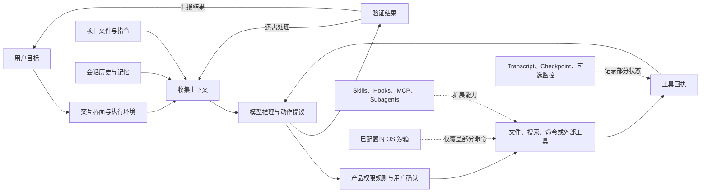

# 第十一章：Claude Code 架构分析

## 0. 本讲范围与证据等级

Claude Code 的公开资料可以帮助我们分析一个真实的 AI 编码代理（coding agent）产品，但公开产品行为不能直接还原闭源内部实现。本章以 Anthropic 官方文档截至 2026-11-18 的描述为证据，沿一项明确标记为教学构造的登录测试修复任务，练习怎样区分产品合同、可观察行为、系统设计推断和未知细节。

本讲里的“可观察行为”指使用者可以在具体版本、配置和执行环境中亲自检查的界面、工具回执、文件变化或运行记录。本章不声称执行过 Claude Code；合成任务中的测试输出和文件状态只用于讲清审计方法。

| 证据等级 | 可以怎样写 | 不能据此推出什么 |
| --- | --- | --- |
| 官方公开描述 | “官方文档说明 Claude Code 提供文件读取、编辑、搜索、命令执行和结果验证能力。” | 不能自动推出每个版本、界面和配置都具有完全相同的默认行为。 |
| 可观察行为 | “在版本 X、配置 Y 的这次运行中，界面显示了某项权限请求，命令返回了指定退出码。” | 不能把一次运行扩大成所有版本、用户或任务的一般规律。 |
| 系统设计推断 | “为了组织这些公开能力，可以把系统分析为交互面、工具执行、策略和状态等职责。” | 不能称这些职责就是产品内部的模块、服务或进程。 |
| 未知 | “公开资料没有说明具体规划器（planner）、完整隐藏系统提示词（system prompt）或内部排序机制。” | 不能用经验猜测补成事实。 |

下文会把“官方资料支持什么”与“分析者用来理解系统的抽象”分开。涉及权限默认值、平台差异和监控字段时，均以访问日期为边界；更新产品资料时应重新核对对应官方页面。

## 11.1 本章要回答的问题

读者已经在前十章学习了代理运行框架（Harness）、运行时（Runtime）、编码代理工作流、工具、文件编辑、终端执行、上下文、权限、运行轨迹（Trace）和评估框架（Evaluation Harness）。本章不再重复讲一套通用架构，而是用 Claude Code 这个公开产品案例回答：

> 面对一个内部实现并未完全公开的编码代理，怎样用公开证据分析它的工作流和控制边界，又不把合理的系统设计推断误说成产品事实？

读完后，读者应能沿一项代码任务指出公开资料能支持的能力、需要在具体运行中验证的行为、可用于讨论的架构推断，以及目前无法确认的内部细节。[第十二章《OpenCode 架构分析》](12-opencode架构分析.md)转向可检查的开源实现；[第十三章《Codex 与主流 Coding Agent 对比》](13-codex与主流coding-agent对比.md)再把不同 coding agent 放到同一组问题下比较。

## 11.2 用一个合成修复任务看证据怎么流动

假设一个教学仓库有 `tests/test_login.py` 和 `src/login.py`。测试要求过期 token 返回 HTTP `401`，现有实现却返回 HTTP `200`。用户提出：“修复这个失败，并解释原因。”

这只是合成案例，不是一次 Claude Code 运行。它让我们把“Agent 可能做什么”与“公开证据能证明什么”逐步分开。

| 步骤 | 合成案例中的状态变化 | 官方资料支持的范围 | 仍须验证或不能推断的内容 |
| --- | --- | --- | --- |
| 收集上下文 | 工具搜索测试和实现，再读取相关文件及项目说明 | Claude Code 文档列出文件读取、搜索、项目上下文和指令文件等能力；公开工作循环把 gather context 列为一个阶段。[How Claude Code works](https://code.claude.com/docs/en/how-claude-code-works) | 不能仅凭这些能力清单断言某次任务读取了哪些文件、用了什么内部检索排序，或完整上下文如何拼接。 |
| 形成修改提议 | 根据预期 HTTP `401`、实际 HTTP `200` 和代码路径，提出一个局部修正 | 文档说明模型借助工具行动，工具结果会回到循环中影响后续决定。 | “上下文构造器（Context Builder）”“规划器（planner）”是否是产品里的独立内部模块，公开资料没有证明。 |
| 执行修改 | 请求文件工具修改 `src/login.py`，形成可查看的差异 | 官方文档描述了文件编辑能力和权限规则。 | 具体修改是否符合用户意图，要看实际 diff 和任务约束，不能由“编辑成功”推出。 |
| 运行验证 | 请求测试命令，得到通过或失败回执 | 文档描述了命令执行和验证能力；某些动作受权限模式和设置影响。 | 是否无需确认、是否进入 OS 沙箱、实际执行了什么命令，都取决于版本、平台和配置，需检查本次运行。 |
| 交付结果 | 说明修改和测试结果，交给用户复核 | 官方工作循环包含 verify；公开界面可展示任务过程和结果。 | 测试通过只支持该测试在该环境中的结果，不证明所有功能、权限和安全要求均已满足。 |

这个过程展示了一个重要区别：官方文档足以支持“产品提供这些能力”，但要证明“这次任务确实按某种顺序使用了它们”，还需要具体的会话、权限、执行和任务产物（artifact）证据。还要区分命令返回成功、目标测试通过与用户任务最终满足；[第十章《Evaluation Harness》](10-evaluation-harness.md)讨论如何用独立验收条件判断最后一项。

## 11.3 Claude Code 对外呈现的产品形态

早期把 Claude Code 简称为“终端型编码代理”有助于理解它的起点，但已经不足以描述目前公开的产品形态。官方文档把它描述为可通过命令行界面（CLI）、Desktop、VS Code、JetBrains、Web、移动端和其他集成使用的编码代理产品。文档还区分代码实际运行的位置：本机、Anthropic 管理或组织自管的云环境，以及由浏览器控制但仍在本机运行的 Remote Control。界面不同，代码所在环境和配置合同也可能不同。[Platforms and integrations](https://code.claude.com/docs/en/platforms)；[How Claude Code works](https://code.claude.com/docs/en/how-claude-code-works)

| 维度 | 读者要查什么 | 为什么不能只看界面名称 |
| --- | --- | --- |
| 交互界面 | CLI、IDE 插件、Desktop、Web、移动端或持续集成（CI） | 界面影响用户怎样提供上下文、查看文件差异（diff）、回应确认和接收结果。 |
| 执行环境 | 本机、远程云环境、组织自管环境，或 Remote Control 对本机的远程控制 | 文件、进程、网络、凭据和数据保留边界取决于代码在哪里运行。 |
| 配置来源 | 用户、项目、项目本地和组织托管设置 | 同一个设置项可能有不同作用范围和优先级；云会话读取的设置也可能与本机不同。[Settings files and precedence](https://code.claude.com/docs/en/settings) |
| 可用能力 | 当前表面是否支持某个工具、扩展或管理功能 | “同一底层产品”不等于各表面暴露相同按钮、默认设置或部署控制。 |

因此，本章把“终端 vs IDE”改成一个局部比较问题：两种界面怎样改变交互和观察方式？它们不能单独说明底层执行位置、安全边界或运行状态。要回答后几项，必须继续检查实际环境和对应的产品文档。

## 11.4 先区分产品事实、观察、推断与未知

分析闭源产品时，先给每条主张贴上证据类型，再决定要不要放进架构图。下面这张证据阶梯也适用于其他 Coding Agent：

1. **公开合同**：官方文档、设置说明和发布资料明确描述的能力、限制或行为。要记录页面、访问日期、适用平台和条件。
2. **具体观察**：对固定产品版本、设置和任务直接检查得到的界面、回执、文件差异或运行记录。它证明的是这次观察。
3. **设计抽象**：为了讨论职责而构造的模型。例如把“上下文准备”“动作授权”“外部执行”“状态保存”分开谈。它是分析工具，不是源码图。
4. **未知内部**：公开材料未披露、观察也无法确认的机制。把它保留为未知，或明确写成待验证假设。

| 主张 | 合适的证据标签 | 更准确的表述 |
| --- | --- | --- |
| Claude Code 能收集项目上下文、调用工具并验证结果 | 官方公开描述 | “官方文档将其工作过程概括为 gather context、take action、verify。” |
| 某次运行读取了两个文件、获得一次权限确认并运行了测试 | 可观察行为 | “该版本、配置和任务的会话记录中出现了这些回执。” |
| 系统由会话管理器（Session Manager）、上下文构造器（Context Builder）、动作解析器（Action Parser）等组件组成 | 系统设计推断 | “为了讨论职责，可以用这些名称分析一个可能的 Harness 分层。” |
| 隐藏 planner 的算法或内部 system prompt 的完整内容 | 未知 | “公开资料没有给出足够信息，不能确认。” |

官方文档本身也划定了边界：它介绍周边层如何提供工具并管理模型看到的上下文；同时明确 Claude Code 的 system prompt 并未公开。[How Claude Code works](https://code.claude.com/docs/en/how-claude-code-works)；[Settings files and precedence](https://code.claude.com/docs/en/settings) 因此，我们可以复述公开的产品说明，也可以提出有标记的系统设计推断，但不能据此声称读过隐藏 prompt 或确认内部组件图。

## 11.5 用公开工作循环构造分析图

官方资料把代理工作循环（agentic loop）概括为三个会反复交织的阶段：收集上下文、采取行动、验证结果。工具结果会成为后续判断的新输入，用户可以在循环中介入。[How Claude Code works](https://code.claude.com/docs/en/how-claude-code-works)

下面的图把这条公开描述与其他官方文档列出的权限、执行环境、扩展和状态资料放在同一张分析图中。图中扩展能力的名称沿用官方术语：技能（skill）、钩子（hook）、Model Context Protocol（MCP，模型上下文协议）和子代理（subagent）；细节见 11.9。图里的“交互界面”“策略检查”“状态来源”等框，是为了说明审计时应追问哪些关系；它们不是 Claude Code 内部模块的确认清单。

图里的权限检查与操作系统沙箱（OS sandbox）必须分开看：前者决定某项工具动作是否被允许或需要确认；后者在特定设置和平台上限制受保护的 shell 命令及其子进程。扩展、记录和其他工具不因此自动处于同一隔离范围。后文会逐项说明这些边界。

## 11.6 交互控制面和模型工具调用不是一件事

在命令行界面中，用户输入的普通任务请求与产品控制命令承担不同职责。普通请求会进入代理工作循环；像 `/permissions`、`/sandbox`、`/resume` 这样的可见命令则用于调整、检查或恢复产品会话。文件读取、搜索、编辑和 `Bash` 等工具调用是模型在工作循环中使用的能力。把它们分开，才能判断一个操作是用户在管理产品，还是模型提议了任务动作。

这一区分并不表示每个可见命令都能改变所有界面或执行环境。当前设置文档说明，部分终端命令只在相应 CLI 表面提供；设置文件则按 `user`、`shared project`、`project-local` 和 `managed` 等作用域加载。分析一次任务时，要记录实际启动表面、设置来源和生效值，不要只根据仓库里存在一个配置文件就断定它已加载。[Settings files and precedence](https://code.claude.com/docs/en/settings)；[Configure permissions](https://code.claude.com/docs/en/permissions)

一个实用的审计记录可以分成四列：

- 用户给了什么目标或控制输入；
- 产品向模型或工具暴露了什么能力；
- 哪项权限规则、确认或系统限制影响了动作；
- 实际执行环境返回了什么回执。

这样就不会把“模型建议执行命令”“产品请求用户批准”和“命令进程确实运行”合并成一个事件。

## 11.7 上下文和跨会话状态分别来自哪里

“记忆”常被用来统称一切跨轮信息，但不同状态的来源、生命周期和约束能力不同。Claude Code 的公开资料至少区分以下几类：

| 状态来源 | 主要作用 | 可以证明什么 | 不等于什么 |
| --- | --- | --- | --- |
| 当前会话消息与工具结果 | 供当前任务继续推理 | 该会话中记录了哪些对话和工具结果 | 不是完整的长期项目状态，也不是所有外部副作用的证明。 |
| CLAUDE.md 或可读取的 AGENTS.md | 提供项目或组织指令与背景 | 某类文字说明会作为上下文加载 | 不是不可绕过的权限规则或 OS 安全边界。 |
| 自动记忆（Auto memory） | 保存模型归纳的偏好、经验和项目线索 | 相关记忆可能进入后续会话的上下文 | 不保证记忆正确、完整或具有强制执行效果。 |
| 设置（settings）/ 组织托管策略（managed policy） | 控制产品设置、权限规则和组织策略 | 对应设置范围内的产品行为受这些配置影响 | 不是模型“记住了”的自然语言说明。 |
| 文件 checkpoint | 支持恢复部分文件编辑状态 | 被追踪的文件编辑可以通过产品恢复界面回退 | 不是数据库事务、完整环境快照或外部副作用回滚。 |

官方文档说明每个新会话从新的上下文窗口开始；`CLAUDE.md` 和 `AGENTS.md` 会作为上下文提供，而非强制配置。若要在工具调用前实施控制，文档指出可用 `PreToolUse` 钩子；但这仍需和操作系统级执行隔离区分。[How Claude remembers your project](https://code.claude.com/docs/en/memory)

会话 transcript、项目指令、自动记忆和设置解决的是不同问题。前几类提供信息，设置改变产品行为；一个工具能否触碰文件或网络，还要看具体权限、运行环境和沙箱。不要因为提示词中写了“不能访问密钥”，就把它当成操作系统已经阻断访问。

## 11.8 文件 checkpoint 只恢复一部分状态

官方文档说明，本机工作时 Claude Code 会将会话消息、工具调用和结果保存为 `~/.claude/projects` 下的明文 JSON Lines（JSONL）transcript，并支持恢复、继续或分叉会话；检查点（checkpoint）会在启动新一轮的 prompt 前捕获文件状态，并记录产品文件编辑工具在当前会话中的文件变化。[How Claude Code works](https://code.claude.com/docs/en/how-claude-code-works)；[Checkpointing](https://code.claude.com/docs/en/checkpointing)

这两个机制不能合称为“完整快照”。例如，在教学任务里，模型用文件编辑工具修改了 `src/login.py`，随后在 shell 中运行测试。文件编辑可以被 checkpoint 机制追踪；测试进程可能已写日志、更新缓存或访问外部服务，这些副作用并不会因为恢复文件就自动撤销。文档也说明只由 `Bash` 改过的文件、外部手工修改及部分并行子 Agent 编辑不一定能通过当前会话 `rewind` 恢复。

所以恢复一次 coding agent 任务时，要分别检查：

1. 对话是否继续了，还是仅复制到一个新会话；
2. 哪些文件有产品 checkpoint；
3. shell 或 MCP 工具是否已产生外部副作用；
4. 是否需要 Git、数据库或其他系统自己的回滚机制；
5. 重新执行动作是否安全、幂等且仍经过授权。

检查点是文件编辑恢复能力，不是通用的撤销按钮。它和[第十七章《Long-Running Agent 与 Checkpoint》](17-long-running-agent与checkpoint.md)的长任务状态、幂等与副作用账本属于相关但不同的层次。

## 11.9 权限、沙箱和扩展点有不同执行边界

“有权限提示”“运行在沙箱里”“工具由模型调用”是三件不同的事。要分析一个动作，沿着“谁提出—谁授权—谁执行—执行过程被什么隔离—结果由谁验证”分别追问。

### 权限规则说明产品如何处理工具请求

Claude Code 当前权限文档描述了 `allow`（允许）、`ask`（询问）和 `deny`（拒绝）规则；匹配时优先级从高到低依次为 `deny`、`ask`、`allow`。权限模式和工具类型会改变哪些调用需要用户确认。这个产品权限层回答的是：Claude Code 对某个工具请求如何处理。它不等同于通用操作系统进程隔离，也不能只凭一次提示框证明整个运行时都受到了限制。[Configure permissions](https://code.claude.com/docs/en/permissions)

`/permissions` 一类管理界面和模型生成的 `Bash`/文件/MCP 工具请求也应分开记录。审批通过只说明产品允许该动作继续；还要验证审批所覆盖的具体参数、真正执行的动作和执行结果。

### OS 沙箱只覆盖文档列明的执行路径

截至本章核对日期，Claude Code 的沙箱文档说明：本机沙箱在启用且依赖可用时，通过操作系统边界限制 `Bash`、`PowerShell`、`Monitor` 命令及其子进程；默认关闭。文档同时列出内建文件与 Web 工具、MCP servers、hooks、plugin monitors、LSP servers 和辅助进程在沙箱之外运行。原生 Windows 下命令也不在此沙箱中运行；出错时还存在请求无沙箱重试的路径。[Configure the sandboxed Bash tool](https://code.claude.com/docs/en/sandboxing)

这使审计问题变得具体：测试命令是不是受沙箱约束？文件编辑工具是否在同一边界内？MCP server 自己访问外部系统的权限是什么？hook 的脚本和凭据由谁控制？不能从“`Bash` sandbox 已开启”推出“所有 Agent 动作都被同一个 OS 边界包住”。

### 扩展增加能力，也引入新的执行者

Claude Code 文档介绍了若干不同扩展点：

- **钩子（Hooks）** 可以在会话或工具生命周期事件上触发命令、HTTP、Model Context Protocol（模型上下文协议，MCP）、prompt 或 agent hook handler。不同类型有不同输入、控制和执行语义；“配置了 hook”不代表它必然是确定性、失败关闭的安全控制。[Hooks reference](https://code.claude.com/docs/en/hooks)
- **MCP** 让 Claude Code 连接外部工具、数据源和 API；要继续追查 server 身份、连接方式、认证和每个 tool 的授权。[Connect Claude Code to tools via MCP](https://code.claude.com/docs/en/mcp)
- **子代理（subagent）** 使用独立上下文，并可配置各自的工具访问和权限。它们适合隔离子任务信息，但也需要追踪委派目标、实际写入和返回结果。[Create custom subagents](https://code.claude.com/docs/en/sub-agents)
- **技能（skill）** 提供可复用工作流和相关指令；**插件（plugin）** 可以把 skills、agents、hooks、MCP servers 等组件打包成一个安装单元。[Extend Claude with skills](https://code.claude.com/docs/en/skills)；[Plugins overview](https://code.claude.com/docs/en/plugins)

这些功能是公开的产品扩展合同，不是一个统一的“插件权限”。审计时要为每类扩展分别记来源、加载范围、执行位置、可访问资源、权限来源、失败行为和 trace 证据；尤其不能假定扩展进程自动继承 shell sandbox。

## 11.10 观察产品运行和评估任务结果

产品运行留下的记录有不同用途。Claude Code 的本地 transcript 保存会话消息和工具交互；组织也可以配置 OpenTelemetry（OTel，可观测性框架与工具集）导出 metrics（指标）、events/logs（事件/日志）和可选 traces（轨迹）。OpenTelemetry 用于生成、收集和导出遥测数据，本身不是存储或可视化后端。[What is OpenTelemetry?](https://opentelemetry.io/docs/what-is-opentelemetry/) 监控文档把分布式 traces 标为 beta，并说明部分工具路径、命令或内容字段需要显式配置才会导出。因而“有遥测（telemetry）”不等于“有完整可重放轨迹”；导出内容也需要按敏感数据和保留策略审查。[Monitoring](https://code.claude.com/docs/en/monitoring-usage)

审阅一项运行时，至少分开找这些证据：

- **模型提议**：请求了哪个动作；
- **策略决定**：产品规则、hook 或用户对它作了什么决定；
- **执行回执**：工具是否实际运行、输入输出和退出状态是什么；
- **文件证据**：最终 diff 和相关 artifact；
- **任务验收**：独立测试或用户指定条件是否满足；
- **监控记录**：导出了哪些事件、字段和状态，缺失哪些信息。

这组证据不会自然合成一个“架构准备度分数”。如果要评估 Claude Code 或另一个 Agent 的表现，应像第十章那样固定任务、初始环境、配置和独立验收器（verifier），分开报告 Agent 结果、运行错误、无法判定和验收器错误。单次产品演示只能展示一种可行路径，不能替代公平的系统评估。

## 11.11 手工做一次架构审计

分析公开产品时，先建立“问题—证据—边界—待验证项”记录，不需要先给组件打分。下面的审阅表把前十章的概念应用到产品案例中。

| 审阅问题 | 要找的公开或可观察证据 | 必须保留的边界 |
| --- | --- | --- |
| 任务从哪个界面进入，代码在哪个环境运行？ | 平台文档、环境配置、会话中的实际项目和路径 | 产品表面不等于执行位置；云与本机的配置和数据边界可能不同。 |
| 官方把一次工作循环描述成什么？ | Gather / act / verify 的产品说明，具体任务里的工具回执 | 公开循环不是内部实现图，也不证明一次任务确实执行了全部步骤。 |
| 上下文由哪些公开来源构成？ | 项目文件、指令文件、session、Auto memory 和工具输出 | 来源清单不等于内部 token 拼接顺序、裁剪算法或优先级实现。 |
| 哪个主体提出、批准并执行工具动作？ | 工具请求、权限提示、规则来源、执行记录和命令回执 | 模型提议、用户同意、进程启动和任务成功是不同事件。 |
| 文件、shell 和外部服务分别受什么隔离？ | 当前平台的 permission/sandbox 配置、MCP/hook 设置及实际执行位置 | 一个沙箱范围不能推广到所有工具、扩展或宿主进程。 |
| 暂停、恢复和撤销分别保留什么？ | 会话 ID（session ID）、transcript、checkpoint、工作区（workspace）版本和外部系统状态 | 聊天历史不是执行状态；文件 rewind 不会撤销所有外部副作用。 |
| 用户能从哪里观察运行？ | transcript、diff、工具回执、可选 telemetry 和 retention 配置 | 观测面可能采样、裁剪或省略字段；trace 不是独立 verifier。 |
| 哪些能力需要任务集验证？ | 固定任务、环境、权限、独立验收器、失败分类和重复运行 | 产品文档和单次演示不能证明总体成功率或跨任务可靠性。 |
| 哪些内部内容仍然未知？ | 官方没有公开、运行时行为也无法直接观测的部分 | 将其明确记为未知，不用一个推测模块名来填空。 |

执行这份审计时，每条证据还应附上来源 URL、访问日期、官方文档的版本/适用范围，或产品观察所用的版本、设置和任务。若来源只说明“支持某能力”，记录为能力；若亲自观察一次运行，记录为单次行为；若为了讨论职责而命名组件，在句子和图题里标明“分析模型”。

## 11.12 分析公开产品时容易越界的地方

1. **把产品能力列表写成内部源码图。** 文档说产品能搜索、编辑、执行和验证，不代表系统内部必定有同名、独立部署的模块。
2. **把人工确认当作隔离。** 一次权限提示不能替代执行环境限制；审批范围还要和实际参数、执行动作相匹配。
3. **把 shell sandbox 当作全工具 sandbox。** 文件工具、MCP、hooks 和其他辅助进程可能位于 sandbox 边界之外，须按当前文档和配置逐项检查。
4. **把自然语言指令当作强制策略。** 项目说明帮助模型理解任务；真正改变产品权限的是对应设置和控制机制。
5. **把 transcript 或 checkpoint 当作全量快照。** transcript 记录对话和工具事件；checkpoint 面向部分文件编辑恢复，二者都不能证明外部副作用被撤销。
6. **把可选监控当作完整 trace。** 可导出的字段取决于配置、平台和版本；还要确认采样、内容隐私、保留和关联 ID。
7. **把一次成功当作一般能力。** 一项测试通过只证明指定测试在该环境中的结果，不等于需求、diff 范围和安全约束都已满足。
8. **把闭源猜测写得像事实。** 对隐藏 planner、完整系统 prompt、内部评分/排序或模型路由，除非官方后来提供证据，否则保留为未知或显式假设。

## 11.13 面试如何回答

遇到“Claude Code 的架构是什么”时，先说明证据范围，再给出能够解释产品行为的分析模型，而不是声称知道内部源码。可以按下面顺序组织回答：

1. **产品形态**：说明本题讨论的是哪个 Claude Code 表面和执行环境；不要把当前产品缩成只有终端。
2. **公开工作循环**：引用 gather context、take action、verify，说明工具结果怎样影响后续行动。
3. **责任划分**：把上下文来源、工具调用、产品权限、OS 执行边界、会话状态和用户交互逐项解释，并指出这是职责分析模型。
4. **证据与风险**：举一个“测试失败—读取代码—修改—重跑—检查 diff”的任务，区分提议、批准、执行回执和独立验收。
5. **未知项**：明确不推断未公开的 planner、内部模块、完整 prompt 或路由策略；对权限模式、沙箱和环境差异按版本与配置限定。

面试官若追问“测试通过是不是代表任务完成”，回答应回到验收条件：测试回执支持它实际覆盖的行为；还需要检查改动范围和题目要求，并对没有测试覆盖的条件保留未知。若追问“打开 sandbox 后是否所有操作都安全”，应明确当前文档描述的本机 sandbox 作用在特定 shell 路径，其他工具和扩展要另查。

## 11.14 练习

为上面的合成登录修复任务制作一份人工审阅表，不写代码、不运行真实产品，也不生成总分或 gate。

1. 将任务拆成输入、上下文来源、动作提议、权限决定、执行回执、文件差异、测试结果和最终验收。
2. 为每项分别标注“官方公开描述”“假设的单次观察”“系统设计推断”或“未知”。
3. 选一个 `Bash` 测试动作和一个 MCP 工具动作，分别追查权限、执行位置、沙箱覆盖和外部副作用；说明当前信息不足时要向哪份配置或回执补证。
4. 列出会话 transcript、项目指令、自动记忆、设置和文件检查点各自能证明什么、不能证明什么。
5. 写一段面试回答，说明你怎样分析公开产品能力，又怎样避免把闭源内部细节说成事实。

## 11.15 小结

Claude Code 的公开资料让我们可以具体分析一个成熟 coding agent 的产品工作循环、工具、会话、权限、沙箱和扩展能力。准确的架构分析仍需守住证据层级：官方资料支持产品合同，具体运行记录支持一次观察，系统分层是分析者的推断，未公开内部细节就保持未知。

带着这套方法继续看第十二章时，可以进一步检查一个开源 Agent 的配置、工具、扩展和权限实现；到第十三章再对齐产品表面、执行位置、状态恢复、控制边界和评估证据，避免用不同系统各自宣传材料拼成一个虚假的统一排名。
