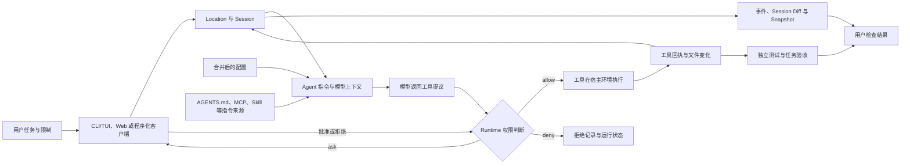

# 第十二章：OpenCode 架构分析

## 12.1 一次修复任务怎样穿过 OpenCode Runtime

测试报告一个看起来很小的问题：没有登录的请求访问受保护接口时，服务返回 HTTP `200`；项目要求返回 HTTP `401`。用户要求修复逻辑、补测试、只改认证代码和相关测试，并且不向远端推送。

要判断 OpenCode 是否完成了这项任务，不能只看它最后说了“已修复”。我们还要追踪：项目配置和指令怎样进入模型上下文；模型提出了哪些工具调用；Runtime 怎样评估权限；工具在哪个进程和文件系统里执行；Session 保存了什么；测试、diff 和独立验收分别提供了什么证据。

本章就沿着这项明确标为教学构造的任务检查 OpenCode V2。读者读完后，应能用公开文档和固定版本源码描述一条 Coding Agent 请求路径，区分配置、模型指令、权限、执行环境、状态记录和任务验收，并指出哪些结论是产品合同、源码事实或分析者推断。

## 12.2 先固定版本，再谈架构

本章以 OpenCode `v2.3.2` 为版本边界。官方 release 页面列出该版发布于 2026-11-18，源码提交为 `c0ad18b`；本章相关官方文档也在 2026-11-18 核对。可以从[固定发布页](https://github.com/anomalyco/opencode/releases/tag/v2.3.2)、[配置文档](https://opencode.ai/docs/config)和[API 参考](https://opencode.ai/docs/api)复查本章描述。

固定版本很重要，因为 OpenCode V2 的配置、插件和服务 API 与 V1 有实质差异。V2 的权限字段采用 `action`、`resource`、`effect`；V2 插件要使用新的扩展接口；网络客户端对应新的 API 合同。V1 的旧字段和代码路径不能仅凭名称相似就套用到 V2。[官方迁移说明](https://opencode.ai/docs/migrate-v1)逐项列出这些变化。

分析时还要区分四种证据：

| 证据种类 | 能支持什么 | 不能单独证明什么 |
| --- | --- | --- |
| 官方文档合同 | 访问日文档公开描述的能力、配置和限制 | 某个安装实例使用了相同配置，或每次调用都按预期成功 |
| 固定版本源码 | `c0ad18b` 中实际存在的代码路径与数据结构 | 其他版本、插件、操作系统和部署中的行为 |
| 一次真实运行观察 | 那次运行中实际出现的提示、动作、回执和文件变化 | 产品所有配置都如此，或任务普遍成功 |
| 分析者架构推断 | 用来解释多个公开接口如何组成运行系统的模型 | OpenCode 源码中存在同名模块，或源码一定按图中边界组织 |

本章只对配置、权限和 Session 操作做定向源码核查，没有完整审计全仓库；也没有启动 OpenCode 或运行模型、工具、插件和测试。因此，下文案例中的请求、授权、diff 和测试结果都只是教学构造。

## 12.3 先看一条可跟踪的运行路径

我们把任务固定成几个明确条件：初始测试发现未登录请求得到 200；改动范围限定在认证逻辑和测试；验证命令是项目提供的认证测试；远端推送不在授权范围内。

下面的图把公开接口和本章的分析抽象画在一起。它用于追踪一次任务，不表示源码中有一组同名的内部模块。

这条路径里有几个不同的事实来源。用户的任务范围是输入；模型生成工具调用只是提议；权限结果表明 Runtime 对这项调用作出的决定；工具回执记录尝试执行后的输出；diff 和测试结果分别说明文件与功能发生了什么；独立验收者再检查这些证据是否满足任务目标。最后的模型回答不能代替上述任一事实。

## 12.4 配置决定运行时有哪些选择

OpenCode 配置不仅选择默认模型。当前配置还可描述 agents、permissions、policies、MCP servers、plugins、instructions、worktrees、snapshots、compaction 和工具输出保留等行为。配置因此形成 Runtime 的控制面：它影响模型能看到哪些能力，以及宿主怎样处理模型提出的动作。

配置来源有作用域和优先级。官方文档列出全局配置、从当前目录向上发现的项目配置、系统级配置以及 managed settings。举例说，进程从项目的 `packages/web` 目录启动时，文档给出的普通 JSON/JSONC 顺序是用户全局配置、仓库根目录配置、当前子目录配置、系统配置；相同键按更高优先级的值合并，其他设置仍保留。`.opencode/**` 下的配置在直接配置文件之后加载，macOS managed preferences 又可覆盖系统目录设置。具体布局必须按 V2 当前文档核对，不能把旧版本的路径和顺序当作通用规则。[配置位置与合并顺序](https://opencode.ai/docs/config#locations)

这里有两类容易混淆的列表。Agent 定义会按配置顺序合并；例如后面的 scalar 值可以替换前面的值，而权限规则会追加。权限规则本身也有匹配顺序。阅读一份配置时，要先问“哪些文档进入了合并”，再问“哪些规则匹配此动作”，不能把其中一层当成另一层的覆盖顺序。

企业设置还有另一条边界：只下发 settings 不等于阻止用户增加 provider、MCP、agent 或 plugin。官方配置文档要求通过 managed configuration 中的 policies 表达组织限制。换言之，设置默认值和强制禁止能力不是同一种治理措施。[Policies 文档](https://opencode.ai/docs/policies)

## 12.5 指令告诉模型怎样做，不替宿主限制动作

当前 V2 会从全局及项目环境发现 `AGENTS.md`，也能从配置的 instructions 项目加载其他本地文件、glob 和 URL。MCP server、skill、reference 和 session-specific instruction 也可能提供模型可见的指导。[Instructions 文档](https://opencode.ai/docs/instructions)

回到认证任务：项目的 `AGENTS.md` 可以告诉模型认证测试怎么运行、哪些目录不应修改。这能帮助模型形成计划，但指令是模型上下文的一部分。它不会在操作系统层面阻止模型提出目录外写入，也不会把某条 shell 命令关进沙箱。不同来源的 instruction 会组合进入上下文；OpenCode 文档不承诺替用户解决彼此矛盾的项目规则。

因此，解释一项约束时要问它由哪一层兑现：

- `AGENTS.md` 中的“不要改锁文件”是给模型的项目指导。
- 对锁文件写入的 permission `deny` 是宿主对工具动作的控制。
- OS 或容器隔离限制进程能触及的资源。
- Diff 检查确认最后哪些文件确实变了。

四者能互相补充，不能相互替代。

## 12.6 Agent 分工不能自动带来权限继承

当前 V2 内建的可见 Agent 有 `Build`、`Plan`、`General` 和 `Explore`。`Build` 用于主要编码任务；`Plan` 负责探索和规划，但官方文档明确它在被要求时可以写 OpenCode 自己的 plan 文件，shell 命令仍受 permission 规则控制。所以 `Plan` 不是一个普遍只读的安全沙箱。[Agents 文档](https://opencode.ai/docs/agents)

subagent 在自己的 child session 中运行。父 Agent 的 subagent 权限决定父 Agent 可以启动哪些子 Agent；子 Agent 则按自己的配置权限工作，不是自动继承一份比父 Agent 更窄的权限子集。`v2.3.0` 发布说明记载，subagent 会立即返回、在后台继续运行，并在空闲时向父任务报告。[v2.3.0 发布说明](https://opencode.ai/changelog/v2.3.0)

这改变了我们审阅 Plan/Build 或 parent/child 结构时的提问方式。不能只检查“是否允许调用某个 Agent”，还要查目标 Agent 本身的配置、它可见的工具、运行位置和它带回父 Session 的结果。后台并行也会让用户同时看到多个未完成的分支；父 Agent 收到报告不代表子任务产物已经过独立验证。

## 12.7 工具目录定义可调用能力，不是一张固定清单

旧稿把 OpenCode 工具写成 `bash`、`todowrite`、`lsp` 等固定列表。V2 文档呈现的工具合同已不同，而且可用能力会受 Agent、配置、客户端和扩展影响。读文件、搜索文件、编辑、写入、shell、Web、问题询问、subagent、MCP 和桌面浏览器操作，是几类不同能力；不应把某一版的工具名当成整个产品永久固定的架构。

工具目录回答“模型可以请求什么动作”。权限层则需要判断“这个动作针对什么资源、按什么规则处理”。执行层最终才触碰文件、进程、网络或外部系统。把这三者混称为 Tool Registry，会让读者看不清模型的工具调用何时变成真实副作用。

V2 的 Tools 文档还介绍 Code Mode：模型可以通过一个 JavaScript 执行入口组合目录内的工具。文档称这段代码本身没有直接文件系统访问、imports 或 timers，实际能力仍通过工具目录提供。被调用的内置或 MCP 工具继续执行各自的权限检查；plugin 工具依它声明的权限合同处理。[Tools 文档](https://opencode.ai/docs/tools)描述的是公开调用方式，不证明 Code Mode 进程拥有 OS sandbox。

## 12.8 Permission 是 Runtime 的动作控制

一个权限请求可以写成三元组：

| 字段 | 在认证任务中的例子 | 要回答的问题 |
| --- | --- | --- |
| `action` | `read`、`edit`、`shell`、`subagent` 或 MCP tool | 请求做哪类动作？ |
| `resource` | 目标路径、命令文本、Agent ID 或工具名 | 动作作用于什么对象？ |
| `effect` | `allow`、`ask` 或 `deny` | 宿主当前如何处理该动作？ |

资源的解释依 `action` 而变。例如 `shell` 规则匹配 scanner 生成的命令文本，文件编辑规则匹配目标路径，`subagent` 规则匹配被启动的 Agent ID。Shell scanner 会尝试拆解复合命令；对它无法安全分析的动态语法会返回错误，但命令文本规则仍不等于隔离任意程序行为。[Permissions 文档](https://opencode.ai/docs/permissions)

在本章固定的 `c0ad18b` 源码中，权限求值会把传入的规则列表展开，并取最后一条同时匹配 `action` 和 `resource` 的规则；没有匹配项时求值函数返回 `ask`。更高层流程会把 Agent/Session 规则与已保存的项目允许规则纳入判断；官方文档说明，配置中的显式 `deny` 不会被已保存的批准覆盖。固定源码还显示，求值结果为 `deny` 时，会在调用 plugin 的 `permission/evaluate` hook 前直接返回。[固定版本的 `permission.ts`](https://github.com/anomalyco/opencode/blob/c0ad18b/packages/core/src/permission.ts) 展示了这条实现路径。这个有限源码发现能帮助解释顺序，但不能替代检查一份安装配置经过所有加载层后形成的有效规则。

如果一个规则要求 `ask`，OpenCode 会把请求交给客户端等待回复。允许一次只放行这次请求；选择 `always` 会将工具提出的模式写为项目级允许规则；拒绝会使相应调用失败。官方文档也提醒，保存规则的具体宽度取决于工具提出的 `pattern`，因此用户需要检查它将覆盖什么。保存一个批准只是为后续匹配动作留下允许规则，不能说明动作已被安全隔离或业务系统已授权。

将这条规则路径放回示例：

1. 读取认证代码时，Runtime 对 read 请求按路径规则决定是否继续。
2. 模型提议修改 `src/auth/` 下的文件时，`edit` 规则可以允许、询问或拒绝。
3. 运行认证测试时，`shell` 规则针对 scanner 分解后的命令文本决定动作。
4. 模型若提议 `git push`，有效配置对此动作返回 `deny` 时，Runtime 不应派发该命令。

这是教学配置下的预期路径，不是一次真实 OpenCode 执行记录。

## 12.9 OpenCode 不提供 Agent Sandbox

权限规则与沙箱解决不同问题。权限规则在工具动作前决定允许、询问还是拒绝；沙箱则在动作执行时限制进程能访问的文件、网络、设备或系统调用。

OpenCode `v2.3.2` 固定发布所带的官方 `SECURITY.md` 明确表示：OpenCode 本身不 sandbox Agent。权限系统帮助用户知道哪些操作正在请求并确认动作，不是安全隔离。官方建议需要真正隔离时，应从 OpenCode 外部使用 Docker 容器或虚拟机。[固定版本 Threat Model](https://github.com/anomalyco/opencode/blob/c0ad18b/SECURITY.md)

对认证任务而言，即使用户只批准运行一个测试命令，这个 shell 仍在它所在环境的权限下运行。命令可能读写用户可访问的文件、启动子进程或使用环境可用的网络。工作目录和 scanner 的目录推断有助于判断请求，但它们不会自动变成 OS 权限边界。

这也是为什么“有确认”不能推出“安全执行”：确认回答的是用户是否允许这一项动作；沙箱回答的是即使进程行为偏离预期，它最多能触碰哪些资源；独立验收回答的是任务结果是否正确。若部署需要更强保证，隔离边界必须来自 OpenCode 之外，而且要在真实部署中核验。

## 12.10 MCP、插件和 Skills 是不同扩展路径

MCP server 可以向 Runtime 提供 tools、prompts、resources 和 instructions。每个连接的 server 都可能增加模型要考虑的工具说明和上下文内容，因此接入多个服务会同时扩大可用能力、上下文开销和需要治理的信任边界。Remote MCP 的 OAuth、凭据、server 实际处理的数据及其日志策略需要分别检查。[MCP servers 文档](https://opencode.ai/docs/mcp-servers)

V2 的 Code Mode 默认能把 MCP 工具放在 server 命名空间下调用；配置也可以让某个 server 的工具直接显示给模型。权限 `action` 会根据 server 和 tool 名形成标准化的匹配入口。工具名空间便于选择和管理，但不能证明 server 可信，也不能限制其后端服务能做什么。

插件可扩展 server、TUI、GUI 和 RPC 等部分，加入工具、hooks、commands、agents、integrations 或界面。插件代码运行在哪里、能读取哪些凭据、是否拦截请求、会处理哪些输入输出，都要按插件部分和部署核查；一个插件被成功注册不等于它受独立 OS 沙箱保护。

Skill 主要提供按任务加载的指导文本；`AGENTS.md` 和普通 instruction 文件也属于模型上下文。它们不是独立可执行工具，也不具备授权作用。分析 OpenCode 的扩展面时，应分别列出“给模型的内容”“模型可调用的工具”和“Runtime 插件代码”，再分别确定信任和权限边界。

## 12.11 Client、Server 与 SDK 不是一种拓扑

OpenCode 可以通过 CLI/TUI、桌面端、Web 和程序化接口使用，但这些入口不能简化为“所有客户端都经过一台远程 Server”。官方 V2 Web 文档称 Web UI 使用和 TUI 相同的服务，默认只监听 `localhost`；共享主机需要显式配置监听地址。V2 服务使用密码保护：`OPENCODE_PASSWORD` 设置密码，旧变量 `OPENCODE_SERVER_PASSWORD` 仍兼容，HTTP Basic auth 的用户名固定为 `opencode`。浏览器可通过配对链接登录并取得 session cookie，其他 HTTP 客户端使用 Basic auth。[Web 文档](https://opencode.ai/docs/cli/web)；[V1 迁移说明](https://opencode.ai/docs/migrate-v1)

V2 有网络 API 客户端和嵌入式 SDK 两种程序化路径。`@opencode/client` 面向新的网络 API；[官方 API 参考](https://opencode.ai/docs/api)将当前 `HttpApi` 描述为 `experimental`，并覆盖选定的 instance routes。`@opencode/sdk` 则能把 OpenCode host 放进应用进程，通过内存中的 HTTP router 调用而不打开网络监听。这两种方式在网络边界和部署责任上不同。[SDK 文档](https://opencode.ai/docs/build/sdk)

网络 API 让外部程序能创建或操作 `Location`、`Agent`、`Session`、`Permission`、`Event` 和 `PTY` 等资源。一个 API 能创建 session 或批准权限，只说明存在相应控制面；它不会自动给 server 加上网络隔离、身份授权策略或独立任务验收。若服务监听在远端接口，客户端认证、TLS/网络访问控制、日志和数据保留都属于部署层面需要检查的条件。

## 12.12 Session 记录运行状态，但不判定任务真伪

在 `c0ad18b` 的 `packages/core/src/session.ts` 中，Session 操作接口包含提交 `prompt`、`compact`、`revert`、`interrupt`、`wait`、读取消息等动作，并把对应调用分派到按 Session ID 定位的会话处理对象。[固定版本的 session.ts](https://github.com/anomalyco/opencode/blob/c0ad18b/packages/core/src/session.ts) 与 [API reference](https://opencode.ai/docs/api)（公开 Session、Permission 和运行事件接口）支持把 Session 看成一项持久运行记录和控制入口；它不代表 Session 是业务状态库或正确性验证器。

对示例任务，Session 记录用户输入、Agent 响应、工具调用及结果、权限请求、步骤状态和相关事件。Diff 说明工作区中与某些运行区间相关的文件变化。它们可以帮助用户复盘“发生了什么”，但工具事件不保证输出可靠，消息中出现测试通过也不能替代测试进程的真实回执。

Snapshot 为部分文件变化提供额外恢复线索。OpenCode 文档说明每个模型步骤前后都会尝试捕获快照；捕获是 best effort，缺任一快照时，该步骤可能无法恢复文件变化。快照需要 Git repository，范围限于当前 active directory 下符合条件的 tracked files，以及每个不超过 2 MiB 的非忽略 untracked 文件；更大的单个 untracked 文件不在捕获范围内。Ignored 文件、目录外文件、Git metadata、进程、数据库和网络动作也不在文件快照覆盖范围内。[Snapshots 文档](https://opencode.ai/docs/snapshots)

Undo/Revert 可以把会话和部分文件恢复到先前边界，但恢复会覆盖受影响文件的当前内容。它不是事务回滚、备份或安全擦除；已启动的服务、发送的请求、数据库写入、提交记录或推送都不会因为文件还原而自动撤销。重要修改仍需要独立备份和 diff 检查。

## 12.13 Compaction 会改变后续模型看到的历史

长任务运行时，Session 中会累积用户要求、工具结果和讨论。V2 compaction 用摘要替代较早对话，并保留最近一段对话供后续模型调用。它降低历史上下文占用，却有信息损失；没有进入摘要或近期尾部的信息，之后模型未必仍能使用。

OpenCode 提供本地 summary 和受支持 provider 的 native compaction。两者不能混成同一个过程：native compaction 可能保存 provider 专用的不透明状态，切换模型时可移植性不同；本地摘要则由模型把较早历史整理成文字。官方文档还说明旧消息仍保留在 Session 中，只是压缩后未必发送到模型。[Compaction 文档](https://opencode.ai/docs/compaction)

对认证修复任务，摘要若漏掉“只能改认证逻辑与测试”或“不能推送”，之后的 Agent 可能得到不完整上下文。Permission 仍然是执行动作时的控制点；但若上下文中的目标被压缩遗漏，Agent 提案可能偏离任务。系统审阅应分别检查上下文保留、当前有效规则、实际副作用和最终验收，不能把 compaction 当作 checkpoint 或权限机制。

## 12.14 用问题—证据—边界来审阅架构

OpenCode 的源代码和公开文档让分析者更容易追踪配置、权限和会话路径，但开放源码不意味着每个实例都已被审计，也不意味着文档声明和线上配置一致。审阅时可以沿着一项任务，逐项填写下面这张问题表：

| 审阅问题 | 优先证据 | 需要保留的边界 |
| --- | --- | --- |
| 哪些配置和 instruction 进入模型请求？ | 指定版本配置文档、固定源码路径、实际有效配置 | 指令影响模型上下文，不等同于工具授权 |
| 模型能提出哪些动作？ | 当前 Agent 的工具目录、MCP/plugin 版本和配置 | 工具目录随版本、Agent 和扩展变化 |
| 一项权限如何得出？ | `action`/`resource`/`effect` 规则、配置顺序、保存的审批、固定源码 | 批准表示一项动作获准，不是 OS 隔离或业务授权 |
| 动作在哪里执行？ | `SECURITY.md`、服务/插件配置、实际部署和 OS 配置 | OpenCode 自身不提供 Agent sandbox |
| 文件和会话保存了什么？ | Snapshot、Session、Diff 与 Event 文档及实际记录 | best effort snapshot 不涵盖进程、网络和目录外副作用 |
| 最终任务是否完成？ | 真实测试回执、独立 verifier、最终 diff | Session 的最终文本和单个工具成功事件都不充分 |

一项主张可以同时带多个证据标签。例如，“配置文件公开了某权限字段”是文档合同；“`c0ad18b` 中权限求值取最后匹配规则”是固定源码事实；“该部署在容器外仍能访问宿主文件”需要部署证据；“这些模块共同构成 Control Plane”则是分析者的概括。把标签写清楚，比统计覆盖率或拼出一个架构总分更能避免结论越界。

可复核的任务记录可以围绕一个小事件表组织：用户约束、模型工具提议、有效 permission 规则、批准/拒绝、实际派发、回执、文件变化、测试/verifier 结果。每列都要有明确来源。对没有实际记录的事件标 unknown，不把“按文档应当发生”填成“已经发生”。

## 12.15 常见误判、面试回答与练习

审阅 OpenCode 时容易出现几类误判：

1. 把 `AGENTS.md` 或项目配置当作安全边界，忘了它们首先影响的是模型输入。
2. 把 `ask`/`allow`/`deny` 或 saved approval 说成进程隔离。
3. 认为 `Plan` 一定只读，或子 Agent 一定继承父 Agent 的最小权限。
4. 把一个旧版本的内置工具列表、配置字段或 API endpoint 当成当前产品合同。
5. 认为 snapshot/revert 能撤销 shell、网络、数据库和 Git 远端副作用。
6. 把 Session 事件、模型最终回答或一项测试回执当成任务正确性的完整证明。
7. 把网络 client、嵌入式 SDK 和本地 Web/TUI 服务混为一个拓扑。

### 面试题：如何从公开证据分析 OpenCode 架构？

先声明版本、访问日期和证据边界。沿一项具体任务说明配置和指令如何进入模型上下文，模型提出的动作怎样经过 Runtime permission，再由相应工具在其执行环境中产生结果。接着区分 Session/Event、Snapshot/Diff 与独立 verifier 的作用。指出 OpenCode V2 的 permission UX 不等于 sandbox，Agent 子任务权限也不能假设为父级子集。最后把固定版本源码事实、官方文档合同、真实部署观察和自己的架构抽象分开陈述，不为未审计的服务、插件、部署环境补写内部保证。

### 练习

1. 使用明确标为教学构造的认证修复任务，画出从用户请求到独立验收的事件表；每一行标注证据来源，并区分模型提议、permission 结果、实际执行和 verifier 结果。
2. 给定三层配置和两组 Agent 权限规则，按文档加载顺序列出最终配置；再逐条判断对 `read`、`edit`、`shell` 和 `subagent` 请求的匹配规则。说明缺少有效配置时，哪些结论不能从工具名称推断。
3. 假设测试通过但 diff 包含认证目录以外的文件，同时 shell 回执显示曾调用一个外部服务。指出 Snapshot、Diff、测试和独立验收分别能证明什么、不能撤销什么。
4. 比较一个通过 `@opencode/client` 连接网络服务的客户端与一个使用 `@opencode/sdk` 嵌入 host 的应用：为每种结构列出会新增的部署边界，并明确需要哪些实际证据才能评价其安全性。

## 本章小结

OpenCode V2 暴露了可供分析的配置、Agent、工具、权限、扩展、Session、快照、压缩和 API 合同。沿着一项具体任务追踪这些接口，能看清模型提议如何变成真实副作用，哪些状态留下记录，以及任务结果还需要什么验收证据。

但开源、配置化和工具确认都不等于安全隔离。要分析真实系统，必须固定版本，核对有效配置和执行环境，并区分公开合同、固定源码、运行记录、架构推断与未知。下一章将把 OpenCode 放入同一组审阅维度，与其他 Coding Agent 比较其产品入口、权限治理、状态恢复和扩展方式。
