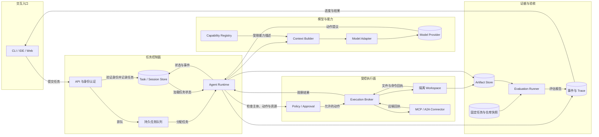

# 第十五章：Agent Harness 系统设计

一次编码任务看起来只是让 Agent 修复一个 bug，但它会跨过多个系统边界：用户把任务交给应用，应用选择仓库版本，Runtime 组织模型和工具，执行环境读写文件并运行命令，存储系统留下 diff 和测试回执，验收器再判断目标是否达到。

这些边界在正常运行时容易被一张组件图遮住。真正的设计题通常出现在中断之后：工作进程在改完文件后崩溃，用户收到的最后一条事件却是工具调用中；外部服务可能已经接受操作，只是回执丢了。此时系统不能只靠模型的最终回答猜测任务结果。

本章用一项明确标为教学构造的登录错误修复任务，走完从需求到部署的系统设计过程。读者应能把任务约束转成架构边界，说明数据与状态由谁拥有，沿一次运行定位动作和证据，并为重试、取消、审批、评估和发布设计可核对的处理方式。本章承接第 1—14 章的 Runtime、工具、权限、文件、上下文、Trace、Evaluation 和协议集成；第 16 章再按故障现象练习排查。

## 15.1 先看一条任务会跨过哪些系统边界

教学构造的需求是：开发者提交一个登录错误 issue，要求定位并修复会话校验问题、运行相关测试、交付补丁和测试结果。任务在团队的 Git 仓库中进行；Agent 可以读取仓库、改动隔离工作区并运行指定测试，但不能读取密钥、推送分支或部署。

这不是一次真正运行的产品记录，也不代表某个现有 coding agent 的内部实现。它只是一个设计样例，帮助我们把需求、动作、状态和证据放在同一条线上。

先把关键对象分开：

- 用户提出的是目标和约束，例如修复哪种登录错误，以及哪些操作禁止执行。
- 模型输出的是诊断、补丁或工具调用提议。
- Runtime 根据当前身份、任务范围和策略决定是否派发动作。
- 执行环境产生真实文件变化、命令输出和外部副作用。
- verifier 根据预先约定的验收条件判断补丁是否达到目标。

所以设计目标不是让 Agent 尽可能多地调用工具，而是让系统可以回答四个问题：这次任务允许做什么；每个动作实际发生在哪里；中断后哪些工作已完成、哪些结果仍未知；交给用户的结果凭什么算完成。

## 15.2 把用户请求写成任务契约

系统设计从功能清单之前开始：先明确请求目标、范围、成功证据和停止条件。对上面的任务，一份教学构造的任务契约可以写成：

```text
task: 修复登录接口对无效会话的处理
repository: shop-service
base_revision: rev-42
acceptance: 无效会话返回预期错误；相关回归检查通过；补丁范围可审阅
allowed_actions: 读取仓库、改动隔离工作区、运行指定测试
forbidden_actions: 读取密钥、访问生产数据库、推送、部署
result: 补丁、验证回执、未完成事项和风险说明
```

这里的 `rev-42` 是合成标识，不是仓库的真实版本。它的作用是把任务绑定到明确的代码起点。否则，即使 Agent 和测试命令完全相同，两个工作进程读取不同提交，也可能得出不同结果。

任务契约要让成功与失败都可解释。如果某项验收条件无法检查，系统就应把它标为未验证，而不是把模型回答流畅当作成功。动作范围也应具体到资源和影响：允许在临时工作区修改代码，并不自动允许把改动推送到远端。

设计前需要问清的维度如下。表中没有通用默认值，项目负责人应根据实际用户和运行环境给出答案。

| 设计维度 | 需要回答的问题 | 对系统设计的影响 |
|---|---|---|
| 用户与产品入口 | 个人 CLI、团队 IDE、Web 服务、SDK，还是 CI 机器人？ | 决定身份入口、交互方式、是否需要异步任务和事件流。 |
| 任务与成功条件 | Agent 只提供建议，还是编辑文件、跑测试、创建 PR？由谁验收？ | 决定执行器、verifier、人工确认和回滚边界。 |
| 运行环境 | 代码在本机、容器、远程 VM，还是厂商托管环境？ | 决定工作区生命周期、网络、文件持久化和环境清理责任。 |
| 数据与权限 | 仓库是否含敏感数据？Agent 代表用户、服务账号还是组织？ | 决定身份委派、租户隔离、密钥注入、日志访问和数据保留。 |
| 负载与时限 | 任务平均多久、并发多少、等待用户多久可以接受？ | 决定同步或异步 API、队列、工作进程数量和资源限额。 |
| 质量与成本 | 如何比较版本？单次任务可用多少模型调用、时间和执行资源？ | 决定评估任务集、预算控制、模型配置和发布条件。 |

先说明哪些是业务要求，哪些是实现假设。例如，用户要求任务可以在网络断开后继续，这是产品要求；使用队列和数据库保存任务状态，是一种可替换的实现方案。面试答案应把两者分开，避免把熟悉的技术栈误当成需求。

## 15.3 让确定流程留在程序里，让模型处理开放判断

登录修复任务中，有些阶段的顺序是确定的：固定仓库版本、准备工作区、检查权限、运行指定验收、保存补丁和报告。这些步骤应由 Runtime 或普通程序控制。模型更适合处理开放部分，例如根据 issue、源码和测试失败推断可能原因，并提出要读取或修改的文件。

一个可理解的分工是：

1. 应用接收请求，确定用户身份、仓库和任务边界。
2. 工作流准备隔离环境，固定源码版本和运行配置。
3. Agent 根据经过筛选的上下文提出分析或动作。
4. 策略层检查每个动作，执行器完成批准范围内的副作用。
5. 任务专用 verifier 检查最终补丁和验证证据。

只有当任务需要开放式推理时，才让模型参与相应阶段。提交任务、执行审批、保存审计记录和清理环境等责任不应依赖模型自行记住。多 Agent 也不是默认选项：只有任务可以拆成相对独立的工作、确实需要不同能力或并行收益足以抵消协调代价时，再考虑加入。Azure 的官方编排指南把顺序、并发、交接和动态计划等模式分别映射到任务结构，也提示额外 Agent 会增加延迟、资源消耗和共享状态协调问题；这是一份设计指南，不是所有工作负载的统一结论。[Azure Architecture Center：Agent 编排模式](https://learn.microsoft.com/en-us/azure/architecture/ai-ml/guide/ai-agent-design-patterns)

## 15.4 用责任边界画架构，而不是堆模块名

下面的架构按任务控制、模型与能力、执行和证据分区。它是本章的教学设计图，不是必须照搬的标准架构。外部连接器即使接入 MCP 或 A2A，也仍由本地 Runtime 负责把身份、权限、状态和结果纳入同一条任务链；完整协议语义见[第十四章](14-mcp-a2a与harness集成.md)和[第二十二册](../../book-22-tool-protocol-ecosystem/目录.md)。



读图时可以先只跟一条实线：UI 提交任务后，API 验证调用者并保存任务；队列把任务交给 Runtime；Runtime 向模型取回动作提议；Policy 决定哪些动作可执行；Executor 在受限 workspace 或外部连接器中运行它们；结果回到 Runtime，再被写入状态、trace 和 artifact。

每个方框背后不一定对应一个独立服务。单用户 CLI 可以把 API、队列和 Runtime 放进一个进程；团队异步服务通常会拆开。拆分的理由应来自并发、故障隔离、权限或扩缩容要求，而不是图上组件越多越像生产系统。

图中的三个数据出口也不能混为一谈：Task / Session Store 保存当前任务状态和会话关联；事件与 Trace 保存发生顺序和审计证据；Artifact Store 保存补丁、仓库快照或测试产物等较大的交付数据。它们可以部署在相同产品中，但保留期限、访问权限和写入语义不同。

OpenAI Agents API 的公开架构把托管 Harness、执行环境和 application server 分开，并明确自管环境的启动、重连与清理责任；这可作为一种真实责任划分样本，但不是通用 Harness 的固定组件图。[Architecture](https://developers.openai.com/api/docs/guides/agents-api/architecture)；[Sandbox lifecycle](https://developers.openai.com/api/docs/guides/agents-api/environments/lifecycle)

## 15.5 把 Session、Task、Run、Workspace 和 Artifact 分开

系统数据模型不是把所有信息塞进一个 session JSON。每类数据要有明确的范围、事实来源和生命周期。

| 对象 | 保存什么 | 它不能单独证明什么 |
|---|---|---|
| Session | 一段对话及其用户界面连续性。 | 当前 task 是否完成、文件是否已改、外部操作是否成功。 |
| Task | 任务目标、代码起点、允许动作、验收条件、负责人和业务状态。 | 某次尝试使用了哪版模型或运行环境。 |
| Run | 一次具体执行尝试及其模型、prompt、工具目录、策略和环境版本。 | 最终产物一定符合用户目标。 |
| Workspace | 当前运行时可读写的文件和进程环境，以及其基准提交。 | 工作区中的文件已经提交到远端或长期保存。 |
| Artifact | 可交接的补丁、测试报告、日志片段或其他文件及其版本。 | Artifact 中的结论已由独立验收器验证。 |
| Effect record | 外部动作的稳定 operation ID、请求摘要、派发状态和服务端回执。 | 缺少本地回执就表示外部副作用没有发生。 |
| Approval | 审批人、具体动作、目标资源、参数摘要、范围和时间。 | 未来所有相似或修改过的操作都已获准。 |

例如，`session_id` 可串联用户对话，`task_id` 表示要达成的业务目标，`run_id` 表示一次尝试，`workspace_id` 指向实际执行环境。若一个 task 失败后重跑，就保留原 task 并创建新 run；否则比较两次尝试时，无法区分任务本身没有变化和执行配置已经变化。

建议让 Task 状态表达可观察事实，而不是模型自报的心情。以下状态只是一个可用设计：

| 状态 | 进入条件 | 离开条件 |
|---|---|---|
| `queued` | 任务契约已持久化，等待 worker。 | worker 接管后进入 `preparing`。 |
| `preparing` | 正在校验仓库版本、分配 workspace 和加载策略。 | 准备完成进入 `running`；准备失败进入 `failed`。 |
| `running` | Runtime 正在分析或执行已授权动作。 | 验收前进入 `verifying`；需人工决定时进入 `waiting_for_approval`。 |
| `waiting_for_approval` | 一个具体动作暂停等待指定主体回应。 | 批准后回到策略复核，再进入 `running`；拒绝后依策略终止或继续只读工作。 |
| `verifying` | Agent 已停止提议新动作，系统检查补丁和验收证据。 | 证据满足契约才进入 `completed`；已知失败进入 `failed`。 |
| `cancelling` | 收到停止请求，系统正在停止本地任务并检查已派发动作。 | 副作用已知且 worker 停止后进入 `cancelled`；仍有未知动作则进入 `needs_reconciliation`。 |
| `needs_reconciliation` | 外部动作结果不明，不能安全地直接重试。 | 查询外部事实或人工对账后，进入合适的终态或恢复执行。 |

状态名不会自动带来正确的状态机。要为每个转移写出触发事件、守卫条件、事实来源和失败恢复。OpenAI Agents API 文档也将 session 与 turn 区分，并要求应用检查真实 turn outcome 和 tool result；`idle` 或一条最终回答不能代替任务验收。[Run and continue sessions](https://developers.openai.com/api/docs/guides/agents-api/sessions)

## 15.6 从一条用户请求走到可以交付的结果

现在沿着登录修复任务，把架构图落实成一次运行。表中的每一步都写清动作和证据；其中的补丁与回执属于教学构造，并非实际运行数据。

| 步骤 | 谁在做什么 | 保存或检查的事实 |
|---|---|---|
| 1. 接收 | API 验证用户身份、租户、仓库权限和请求字段。 | 用调用者身份生成任务范围；客户端重试应通过同一逻辑请求标识，避免无意创建重复任务。 |
| 2. 固定输入 | Task Store 保存任务契约、仓库基准 revision 和验收器版本。 | 后续能识别任务从哪个代码起点开始，以及计划用什么标准验收。 |
| 3. 分配执行 | Worker 领取任务，在隔离环境中建立对应 revision 的 workspace。 | 记录 workspace 与 run 的关联、环境镜像或依赖版本和资源预算。 |
| 4. 构建上下文 | Context Builder 先读取项目规则和相关测试，再根据搜索结果补读登录校验代码。 | 记录来源标识、revision 和截断状态；外部 issue 文本按不可信内容处理。 |
| 5. 调用模型 | Adapter 把上下文与当前可用工具投影为该 provider 支持的输入。 | 保存 model/provider、请求配置和 capability schema 版本，不假设所有 provider 语义相同。 |
| 6. 执行动作 | Runtime 收到读文件、编辑或测试提议，Policy 按用户、任务、路径、参数和动作重新判断。 | 记录策略版本、决定理由、实际派发参数和执行回执。 |
| 7. 观察反馈 | 执行器将文件 diff、测试退出状态和截断信息交给 Runtime。 | 测试输出作为观察证据进入上下文；不能把模型对输出的摘要当作原始回执。 |
| 8. 验收交付 | Verifier 检查任务约定的登录行为、测试结果和 diff 范围。 | 保存验收器版本、检查结果、补丁 artifact 和尚未验证的条件。 |
| 9. 通知用户 | API 通过事件流或查询接口返回进度和终态。 | 仅在 Task Store 中任务已通过 verifier 后报告完成；否则说明失败、被拒绝或仍待对账。 |

一个关键区分是用户界面的交互事件不一定就是业务任务的终态。模型回答工具调用已发出，只能说明有提议；执行器回报命令结束，只能说明进程有一个回执；测试通过也只支持特定检查。只有任务契约中规定的证据齐备，系统才能把 Task 标为完成。

## 15.7 让 Context、Model 和 Capability 使用同一份任务边界

Context Builder 应根据任务契约选择当前这一步需要的材料，而不是把整个仓库和完整会话历史送给模型。对登录任务，它可以先放入：用户目标与禁止项、固定的仓库 revision、项目规则、相关测试失败摘要、必要源码片段和当前 diff。搜索结果如果很大，正文保留摘要和 Artifact 引用；如果被截断，就把截断标记一起传递。

模型看到的材料还应保留来源和信任级别。仓库文件、issue 描述和 MCP 返回都可能包含指令式文本，但它们不是系统策略。模型可以把它们作为待分析数据；权限层不能因此把动作范围扩大。

Capability Registry 是 Runtime 的能力目录，而不是所有工具的无差别菜单。每个工具至少需要一个稳定身份、输入输出合同、真实执行器、作用范围、风险/副作用、超时与输出限制、版本和 owner。Registry 再根据当前任务、用户权限和 provider 能力生成模型可见的工具描述。模型可见 schema 只是接口投影，不能代替执行端的参数与资源校验。

Model Adapter 负责把通用请求映射到 provider 的具体合同，再把响应规范化给 Runtime。它应保留 tool calling、streaming、结构化输出、错误类型、用量和支持能力等差异。不能因为两个 provider 都接受一个名叫 `tools` 的字段，就推断两者的并发、拒绝、流式回执或计费语义相同；切换 provider 时还要重新评估行为。

Orchestrator 则管理有界循环：当前阶段、已完成步骤、最大时长、调用/资源预算、重试策略、用户中断、审批等待和终止条件。模型负责提出下一步；它不拥有任务状态，也不能自行改变策略或宣布 verifier 已通过。上下文管理与工具机制的详细教学分别见[第七章](07-上下文管理与记忆压缩.md)和[第四章](04-工具系统与tool-registry.md)。

## 15.8 把动作提议变成有边界的执行

工具调用从模型输出到真实副作用之间，至少有四个不同职责：

1. **身份与授权**决定当前用户、服务主体或远端连接器是否有权访问某个资源。
2. **任务策略**判断这次动作是否符合任务契约、组织策略和风险要求。
3. **人工确认**让有权的人针对一个明确动作、参数和对象作决定。
4. **执行隔离**限制进程能读取或修改哪些文件、访问哪些网络、消耗多少资源。

第五个独立职责是 verifier：它检查动作结果是否完成了任务。确认通过不等于动作已经正确执行；沙箱隔离也不等于业务权限正确；权限允许更不等于任务成功。

对本例，可以把读取和搜索限定在工作区内；编辑仅写入临时 workspace；测试由执行器在时间和资源限制内启动。读取密钥、访问生产数据库和推送远端均不在原任务契约里，因此必须拒绝，而不是因为 issue、README 或模型提议要求就追加权限。如果用户另行请求创建 PR，应生成一个新的具体操作，展示目标仓库、分支和补丁范围，并走相应的授权与确认流程。

允许执行后，仍需在执行时重新校验资源是否变化。一个延迟的审批不能授权后来改过参数的动作；一个经过授权的 tool call 也不能把 shell 子进程的所有后续行为自动纳入允许范围。

当 MCP 或 A2A 作为外部能力接入时，本地 Policy、身份映射、动作预算和事件记录仍然存在；远端工具或 Agent 的 schema、身份和完成状态不能替本地 Runtime 证明权限与业务验收。AWS Agentic AI Lens 将显式合同、端到端可观察性、行为配置版本化和与动作后果相称的人类监督列为设计原则；这些是参考建议，不是可直接复制的通用安全证明。[Design principles](https://docs.aws.amazon.com/wellarchitected/latest/agentic-ai-lens/design-principles.html)

## 15.9 失败恢复先核对副作用，再决定是否重跑

如果工作进程退出，系统必须先区分哪些步骤可安全重试、哪些步骤可能已经改变外部世界。一个持久 checkpoint 只能恢复它实际保存的状态，不能自动撤销已提交的文件写入、邮件、数据库更新或远端 PR。

| 失败点 | 本地已知事实 | 合理的恢复动作 |
|---|---|---|
| API 接收后客户端超时 | Task Store 已有相同逻辑请求标识。 | 返回已存在的 task，而不是新建另一个同样的任务。 |
| worker 在只读搜索时崩溃 | 没有发生外部写入；当前 run 未完成。 | 以相同输入和预算重试，保存新的 run 记录。 |
| 补丁写入 workspace 后崩溃 | 磁盘是否保留取决于环境生命周期；模型输出不能证明文件状态。 | 重新连接或从已保存快照恢复，读取实际 diff，再决定继续或重建。 |
| 远端服务接受操作但回执丢失 | 外部状态 unknown；本地缺少确认不等于操作没发生。 | 用稳定 operation ID 查询远端状态；确认前不盲目重放。 |
| 用户提出取消 | 取消请求只代表系统收到停止意图。 | 停止继续派发、终止可控进程，并检查已发出的外部动作；无法确认时保留 `needs_reconciliation`。 |

LangGraph 的官方 fault-tolerance 文档明确说明，其节点重试会从节点开头重新执行，语义是至少一次；节点中的外部副作用不由 checkpoint 包住。文档建议在副作用前持久化稳定幂等键，并将丢失确认保留为 unknown，再查询 provider 状态。这说明 checkpoint 和幂等键能改善恢复，但并不构成跨系统 exactly-once 保证。[Fault tolerance](https://docs.langchain.com/oss/python/langgraph/fault-tolerance)

取消和回滚也要分开。取消可以阻止未来步骤，或请求正在运行的进程退出；它不能保证已经发送的请求被远端撤销。回滚通常需要另一个明确的补偿动作，也可能失败。状态机应如实保留这些差异，而不是把所有中断都归并为 `failed`。

完整的长任务 checkpoint 和文件/外部状态所有权留给[第十七章](17-long-running-agent与checkpoint.md)与[第二十一章](21-persistent-workspace与状态边界.md)展开；本章只在系统图中指出它们的责任位置。

## 15.10 Trace、Evaluation 和发布闭环

Trace 记录一次真实运行发生了什么；Evaluation 使用固定任务和环境比较配置。二者有关联，但不能互相替代。

单次运行至少要能关联 task、run、workspace 和 trace；保存模型/provider 配置、prompt 与 tool schema 版本、策略版本、仓库 revision、环境镜像、verifier 版本、工具参数摘要、权限决定、实际派发回执、退出状态和 Artifact ID。Trace 中只保留诊断所需内容，敏感输入与输出需要最小化、脱敏和访问控制；不要假设所有内部推理文本都可见或应当长期保存。

固定评估样本则要固定仓库快照、问题、验收器、工具/权限范围和运行环境。对每个 run 分类记录任务通过、按策略安全拒绝、补丁不符合要求、执行环境故障、评估器故障或结果 unknown。将安全拒绝和基础设施错误算成模型失败，或把拒绝动作当作真实越权副作用，都会误导设计决定。

发布时应版本化模型选择、prompt、工具目录、权限策略、执行环境和 verifier。合理路径是先在固定样本上回归，再在隔离 staging 环境做端到端检查，然后对限定任务和用户逐步放量。每一阶段要有对应的安全和业务检查；不合格时需要能回到一个已知版本。具体阈值取决于任务影响和证据量，本章不设跨产品通用分数或自动上线门槛。

## 15.11 根据运行任务选择部署形态

同一套 Harness 可以有不同部署边界。区别不在于某个名称更先进，而在于谁拥有模型循环、状态、执行环境、密钥和恢复责任。

| 部署形态 | 常见责任划分 | 主要代价与问题 |
|---|---|---|
| 单用户本地 CLI | 用户进程控制 Runtime；仓库和工作区在本机；文件和命令可直接接本地开发环境。 | 易于贴近开发者工具，但进程退出、机器离线、多客户端同步和企业审计需要另外设计。 |
| 团队自托管服务 | 应用验证用户与租户；任务/会话数据库和队列保存工作；worker 在隔离环境中执行；对象存储保存 artifact。 | 支持异步、协作与统一控制，但需要负责工作进程、环境生命周期、数据隔离、密钥和运维。 |
| 管理型 Harness | Provider 负责公开合同范围内的模型循环或 session；应用仍需处理业务身份、任务授权、业务数据与最终验收。 | 接入成本可能较低，但存储、保留、环境、事件失败、可配置性和迁移能力都要逐项核对。 |

OpenAI 当前 Agents API 的文档就是第三类的一种公开实例：托管 Harness 可以和可选环境分开，应用为 self-hosted 环境管理启动、重连和释放；删除 session 也不会自动停止自管 compute。具体责任必须以所用服务的当前文档为准，不能从某个托管 API 推断所有供应商都会处理相同生命周期。[Agents API architecture](https://developers.openai.com/api/docs/guides/agents-api/architecture)；[Sandbox lifecycle](https://developers.openai.com/api/docs/guides/agents-api/environments/lifecycle)

无论采用哪种形态，扩容设计都要区分 API 接收能力、待执行队列、模型 provider 并发、工作区资源和远端工具限制。任务超过交互等待时间时，应返回可查询的 Task ID 并提供进度事件；不能让 HTTP 连接是否仍打开成为任务唯一状态记录。每个租户的并发、模型调用和执行资源也要有额度，以免一个长任务耗尽共享池。

粗略估算时，把资源换成有单位的工作量，再用实际运行数据校准。假设教学构造的忙时每小时提交 24 个修复任务，每个任务累计占用隔离 worker 5 分钟；模型等待期间如果 worker 可以释放，这 5 分钟只统计真实占用计算资源的时间。并发工作槽位（worker slot）的平均占用量约为 $24 \times 5 \div 60 = 2$，其中 24 的单位是任务/小时，5 是 worker 分钟/任务，60 是分钟/小时。这只是平均值，不能当作最终 worker 数：测试时间长尾、启动开销、突发到达和目标排队时间仍要用目标环境的测量来核算。

同一工作量还要分别估模型和存储。若每个任务平均调用模型 6 次，忙时大约产生 $24 \times 6 = 144$ 次模型请求；token 数应由每次输入/输出的实际分布另算，不能从 worker slot 推出。若每天交付 50 份、每份平均 200 KB 的补丁和报告，并保留 30 天，教学估算是 $50 \times 200 \times 30 = 300{,}000$ KB，约 300 MB 的基础 artifact 数据；Trace、快照、副本和版本保留还会增加空间。部署容量应根据观测到的峰值、延迟目标和保留策略继续调整，不把这组示例值当成推荐配置。

## 15.12 分阶段构建，每阶段都留下验收证据

可以按风险从低到高推进，但阶段并非所有团队都必须照此排列：

1. **单用户最小闭环：** 一个明确任务类型，固定仓库版本，读取/搜索/小补丁/指定测试，保留 diff 和任务结果；高影响外部动作暂不开放。
2. **持久任务与恢复：** 保存 Task 与 Run 状态、运行事件和 artifacts；定义重复提交、崩溃、取消和未知回执的处理方式。
3. **团队服务：** 增加租户身份、隔离 worker、异步队列、状态查询、进度事件、密钥管理、资源预算和审计访问控制。
4. **扩展与多环境：** 接入 MCP、A2A、插件或多个 provider；每一种扩展都有版本、权限、输出预算、trace 和 mock/真实集成的评估边界。
5. **受控放量：** 固定回归样本和策略版本，先限定用户与任务，观察任务结果、拒绝、未知状态、时延和成本，再按证据扩大动作范围。

每个阶段都要写清它允许什么动作、验收什么、失败后怎么停和恢复。新能力不是自动继承上一阶段的信任：新增远端 server、模型、工具或用户角色都需要重新评估身份、数据范围、预算和 verifier。

## 15.13 把关键取舍说成带条件的决定

系统设计面试不需要把每个维度都说成越多越好。要说明选择适用的条件以及它会带来什么代价。

| 取舍 | 更偏向左侧的条件 | 代价与补救 |
|---|---|---|
| 固定工作流 / 动态 Agent 规划 | 流程和验收稳定时固定顺序；路径确实未知时才让 Agent 规划。 | 固定流程适应性较低；动态规划增加延迟、循环和审计难度。 |
| 本地 / 远程工作区 | 依赖用户本地环境、源代码不能离开设备时偏本地；需要异步、隔离或团队协作时偏远程。 | 本地难以统一服务治理；远程增加存储、隔离、网络和环境维护责任。 |
| 多 Agent / 单 Agent 多工具 | 独立任务可并行且互相依赖少时考虑多 Agent；依赖顺序明确时先用单 Agent 工作流。 | 并发提高协调与冲突成本；显式共享状态和交接合同可以降低混乱，但不能消除成本。 |
| Trace 完整度 / 数据最小化 | 事故影响和审计要求高时保留足够事件与版本证据。 | 原始内容可能包含秘密或个人信息；按需要记录字段、限制访问和保留时间。 |
| 持久化 / 临时资源 | 需要跨中断恢复的状态和 artifact 应持久化；可重建的缓存和临时计算可丢弃。 | 持久数据需要访问控制、迁移、清理和恢复演练；临时资源需要明确丢失后的重建路径。 |
| 同步 / 异步请求 | 任务短、用户需要即时交互时可同步；可能等待模型、审批或长测试时用异步任务和事件流。 | 异步增加状态查询、通知和重复消息处理；同步长连接易受客户端和代理超时影响。 |

每项决定都可以回到四个问题：解决哪个用户问题，要求哪些前置，依赖什么机制或数据，失败时由谁观察和恢复。这样可以避免把技术偏好写成普遍架构定律。

## 15.14 用四步组织面试回答

可以用下列顺序组织一个完整但不冗长的答案：

1. **定契约：** 说明用户、任务、允许与禁止的动作、成功证据、负载、数据和交互要求。
2. **画边界：** 区分 API/身份、Task 与 Session、Runtime、Context/Model、Policy/Executor、workspace、持久状态、artifact/trace 和 verifier。
3. **走一条任务：** 从提交到模型提议、授权、实际执行、观察、验收和通知，逐步说明谁做什么、留下什么事实。
4. **讲故障和取舍：** 挑一个崩溃或丢失回执的场景，说明如何先查外部事实、再重试或接管；最后解释部署、成本、隐私和扩展选择。

例如可以这样概括：

> 我会先约定任务从哪个仓库版本开始、允许读写哪些资源、用什么测试和 diff 条件验收，以及哪些外部动作要单独授权。请求进入 API 后保存为有身份范围的 Task，worker 在隔离 workspace 中创建一个 Run；Context Builder 只取相关文件、规则和失败反馈，模型给出工具提议。Runtime 根据任务策略逐次检查参数，再由执行器运行读取、编辑和测试，结果连同版本、diff 和回执保存。最后 verifier 决定是否完成，应用向用户返回可复核的 artifact。如果 worker 在外部操作后丢了回执，我先查远端状态并保留 unknown，不直接盲目重放。

这段回答能展示系统边界，也留下讨论容量规划、身份模型、成本预算或 rollout 的入口。不要一次把所有组件名念完却不解释它们怎样交接。

## 15.15 小练习

1. 将一个 coding agent 需求写成任务契约，列出代码起点、允许动作、禁止动作、验收证据和停止条件。
2. 为单用户 CLI 和团队异步服务分别画责任图，标出 Task Store、队列、Runtime、workspace、artifact、trace 和身份系统由谁管理。
3. 追踪一次从模型提议到 verifier 的任务过程。为每一步写出主体、资源、策略决定、真实回执和持久证据。
4. 假设 worker 在 workspace 已写入补丁、但测试回执尚未入库时崩溃。分别说明 workspace 可恢复和不可恢复时怎样继续，并写出不能直接推断的事实。
5. 假设 PR 服务接受了请求但客户端没有收到响应。设计查询、幂等键和 `needs_reconciliation` 的处理路径，说明什么条件下可以安全继续。
6. 为本章的登录修复任务设计离线评估夹具，固定仓库 revision、测试环境、工具策略和 verifier；将任务失败、安全拒绝、基础设施错误和 evaluator error 分开报告。
7. 以三分钟回答一次系统设计题：先讲契约，再讲边界，完整走一条请求，最后解释一个副作用不明的恢复场景。

## 15.16 本章回收

设计 Agent Harness 时，先规定任务契约和成功证据，再决定 Runtime、环境和存储如何分工。Session、Task、Run、Workspace、Artifact、Approval 和外部 Effect Record 代表不同事实，不能靠单一对话状态替代。

模型只提出下一步；策略层判断是否允许，执行器在限定环境中实施，Trace 保存事件证据，Verifier 判断结果是否达到目标。可靠恢复要求把 checkpoint 和外部副作用分开看：状态可恢复不代表外部操作可撤销，回执丢失也不证明没有副作用。

部署与自动化范围应随任务风险、数据敏感度、可验证性、时限和成本逐步扩大。遇到真实故障时，第十六章会从症状和证据开始定位；长任务的 checkpoint 与持久工作区再分别由第十七章和第二十一章展开。

## 资料与证据范围

下列公开资料支持正文中与具体实现有关的边界判断。它们是各自平台或框架的当前文档，不构成统一标准。

- OpenAI：[Agents API architecture](https://developers.openai.com/api/docs/guides/agents-api/architecture)、[Run and continue sessions](https://developers.openai.com/api/docs/guides/agents-api/sessions)、[Sandbox lifecycle](https://developers.openai.com/api/docs/guides/agents-api/environments/lifecycle)，访问日期 2026-11-18。
- Google ADK：[State](https://adk.dev/sessions/state/)、[Event Loop](https://adk.dev/runtime/event-loop/)、[Artifacts](https://adk.dev/artifacts/)，访问日期 2026-11-18。
- LangGraph：[Persistence](https://docs.langchain.com/oss/python/langgraph/persistence)、[Fault tolerance](https://docs.langchain.com/oss/python/langgraph/fault-tolerance)，访问日期 2026-11-18。
- 架构指南：[AWS Agentic AI Lens](https://docs.aws.amazon.com/wellarchitected/latest/agentic-ai-lens/)、[Microsoft AI agent orchestration patterns](https://learn.microsoft.com/en-us/azure/architecture/ai-ml/guide/ai-agent-design-patterns)，访问日期 2026-11-18。
- 技术事实、检索范围和未验证边界见[Agent Harness 系统设计外部资料记录](../../research/agent-harness-system-design-evidence-2026-11-18.md)。
