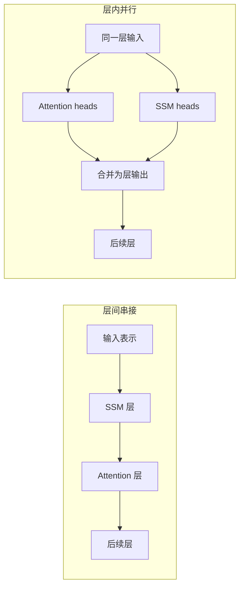

# 第四十三章：Attention + SSM 混合架构为什么现实

前一章比较了不同序列架构怎样保存和读取历史。本章进一步问：如果显式注意力和递归状态各自保留了不同的信息路径，能不能把它们安排在同一个语言模型里？答案不是“混合一定更强”，而是有几种融合方式可供实验；效果取决于融合位置、比例、训练条件和任务。

## 43.1 两种历史信息访问路径为何互补

自回归模型处理到当前位置时，过去的 token 已经变成隐藏表示。Attention 层可以为先前 token 计算并保留 key/value，再根据当前 query 对这些位置作内容相关的加权读取。这个路径保留了逐位置访问的接口，但缓存会随可见历史增长，而且访问质量仍取决于表示、注意力权重和训练。

SSM 则逐步把前缀信息写进递归状态。生成时需要携带的状态规模通常不随已经读过的 token 数持续增加，代价是模型必须把对未来有用的信息压进有限状态；某项细节能否保留下来，取决于状态容量、更新规则与训练出来的表示。固定状态带来紧凑路径，却不等于能对任意历史内容作精确查询。

两种机制的差别不是“一个有记忆、另一个没记忆”，而是可读取的历史信息以什么形式存在：Attention 通过显式的逐位置 key/value 提供查询入口，SSM 通过状态更新累积前缀摘要。混合架构试图同时提供这两种入口。论文中的动机和实验支持把它作为设计假设；是否兑现收益，仍须按具体模型和任务核对。[Jamba](https://proceedings.iclr.cc/paper_files/paper/2025/file/a9ed43fa31dc8b4a7d7a673d713dcb5f-Paper-Conference.pdf)与 [Mamba-2-Hybrid 研究](https://arxiv.org/html/2406.07887v1)都将混合解释为在状态路径与显式 Attention 路径间取舍。

## 43.2 层间混合：让表示依次经过 Attention 与 SSM

最直接的安排是把不同类型的层串在同一条主干上：一层输出的表示进入下一层，序列中既有 SSM 层，也有 Attention 层。两类层不会在同一步并行处理同一输入，而是沿深度先后更新表示。

Jamba 将 Mamba 与 Transformer 层交错。论文所示配置每个 block 有一层 Attention、七层 Mamba，并在部分 MLP 位置加入 MoE；作者在 $1.3\mathrm{B}$ 参数、$250\mathrm{B}$ tokens 的无 MoE 消融中发现，混合模型优于对应的纯 Attention 和纯 Mamba，Attention:Mamba 为 $1:3$ 与 $1:7$ 时成绩接近，因 $1:7$ 计算更省而用于较大配置。[Jamba 正式论文](https://proceedings.iclr.cc/paper_files/paper/2025/file/a9ed43fa31dc8b4a7d7a673d713dcb5f-Paper-Conference.pdf)

Mamba-2-Hybrid 展示了另一种层间布局。Waleffe 等人的 $8\mathrm{B}$ 级模型有 $56$ 层，其中 $24$ 层为 Mamba-2、$4$ 层为 Attention、$28$ 层为 MLP；Attention 和 MLP 分散在网络中，并非简单重复固定比例的 block。[论文架构与实验设置](https://arxiv.org/html/2406.07887v1)

这两例表明，“层间混合”不是单独一个比例数字。模型还要决定 Attention 放在哪里、MLP 如何分布、是否使用 MoE、各层采用什么具体算子。Jamba 的 MoE 是额外的容量设计；若拿完整 Jamba 的成绩解释 Attention–SSM 融合本身，就把不同变量混在一起。

## 43.3 层内并行混合：同一输入分配给不同 head

另一种做法是在同一层里同时安排 Attention heads 与 SSM heads：两组 head 读取同一层输入，各自沿不同路径处理上下文，然后合并为该层的输出。它们不再先后占据不同层，因此融合粒度从层间交错改成层内并行。

图中是两类融合位置的概念示意，并非所有模型都采用相同层数、head 划分或合并算子。

Hymba 的 hybrid-head 模块让 Attention 与 SSM head 并行处理同一输入；作者的设计动机是让前者提供高分辨率的回忆路径，让后者压缩上下文。[Hymba ICLR 2025 论文](https://proceedings.iclr.cc/paper_files/paper/2025/file/f32def07618040e540e0a6182e290562-Paper-Conference.pdf)

Hymba 的总体结果还包含多项共同设计：可学习 meta tokens、以 sliding-window attention 为主并保留少数 global attention 层，以及跨层 KV sharing。论文报告的 cache、throughput 和质量数字对应整套模型与其测量设置，不能单独归功于 hybrid-head。层内并行与层间串接都能把两类模块放进模型，但它们不保证具有相同的信息交互方式或硬件表现。

## 43.4 比例与层位置是需要实验回答的设计变量

比例讨论首先要说清分母和单位：有的论文数 Attention 与 SSM 层，有的按 block 描述；MLP 是否计入混合比例也要明示。即使两个模型都标成 $1:7$，它们的总层数、Attention 类型、MLP 分布和训练条件也可能不同。

Jamba 的消融在 $1.3\mathrm{B}$、$250\mathrm{B}$-token 条件下观察到 $1:3$ 与 $1:7$ 的混合成绩接近，$1:7$ 的计算开销更低。另一项系统分析分别测试层间与层内策略；在其约 $350\mathrm{M}$ 和 $1\mathrm{B}$、$60\mathrm{B}$-token 的层间实验中，$1:1$ 的质量较好，而约 $1:5$ 更适合作为该设置下质量与效率的折中。作者还发现，把 Attention 层放在网络中段的若干配置优于部分首端或末端安排。[Bae 等人的系统分析，v3](https://arxiv.org/html/2510.04800v3)

这些结果不矛盾，也不构成一个通用答案：它们使用不同模型规模、数据预算、融合定义和评价指标。层位置的收益同样来自特定消融，不能简化成“Attention 永远应该放中间”。可复用的结论是，比例和位置会改变模型行为与成本，必须在目标设置中作为变量测试。

## 43.5 结果如何归因：模型规模、任务与测量口径

Waleffe 等人报告，训练到 $3.5\mathrm{T}$ tokens 的 $8\mathrm{B}$ Mamba-2-Hybrid 在 $12$ 项标准任务上的平均分比相应 Transformer 高 $2.65$ 分。这是指定规模、训练量和任务集上的结果。该文所说长上下文下最高约 $8\times$ 的生成加速是作者对 batch size 为 $32$ 的设置所作预测，不能改写为普遍实测吞吐优势。长上下文评测也并非处处由 hybrid 占优：在其 $16\mathrm{K}/32\mathrm{K}$ 自然长上下文评测中，Transformer 变体平均约高 $1$ 分，差异尤其出现在多文档问答任务；作者还指出结果会受提示构造影响。[实验与边界见论文 §§4.2–4.3](https://arxiv.org/html/2406.07887v1)

另一份 2025 年预印本比较 Mamba 与滑动窗口 Attention 的层间顺序和层内并行，报告短上下文与长上下文上的相对表现会变化；其结论受固定的 1:1 比例、SWA 形式、模型规模与记忆任务定义约束，不能把摘要中的趋势推广到所有融合设计。[Lee 等人，arXiv v1](https://arxiv.org/html/2510.26912v1)

因此，读到 hybrid 的质量或速度数字时，应先分开核对四件事：所比较的融合结构是否一致；模型与训练数据/预算是否对齐；任务输入和上下文长度如何构造；“速度”是理论估算、单算子测量还是端到端实测。整模型还包含 MoE、meta tokens、窗口 Attention、位置机制等改动时，结果只能支持这些因素共同组成的配置，不能识别某一项的独立贡献。

## 43.6 何时值得采用混合结构，以及下一步比较什么

当任务既需要把长前缀压入紧凑状态，又需要在部分时刻回看显式保留的历史表示时，Attention–SSM 混合是值得检验的候选。它不是预先成立的升级路线：如果状态路径已满足目标，加入 Attention 可能只增加显存和计算；若模型只靠极少的 Attention 层处理高分辨率检索，也仍须检查训练后的召回能力及其长上下文表现。

有说服力的比较应围绕明确的任务假设，在对齐预算和训练条件下比较纯 Attention、纯 SSM 与不同融合粒度，并报告质量、上下文切片和对应测量口径。结论应说明哪种访问路径改善了哪类任务、付出了什么成本，以及证据还覆盖不到哪里。

下一章将把问题扩展到 Attention、卷积与 SSM 三类模块的职责；外部知识库或检索器如何接入模型，则由第 45 章讨论。
