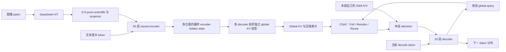

# 第 81 章 DeepSeek V4.1-Flash：CED、CSA2、缓存重算与原生多模态

本章以开放权重仓库中的 DeepSeek-V4.1-Flash-1017 为当前模型对象，以 2026 年 9 月技术报告和固定配置说明其公开架构。需要回答的主问题是：长输入、逐 token 输出、可跨层共享的 global KV、每层局部的 SWA 状态和图像表示，分别由哪些结构处理？CED、CSA2、Bounded Replay、FP4 与 DSpark 又各自改变哪一部分计算或存储？

先把职责分清：第 [77 章](77-csa-hca从压缩kv到百万上下文.md)讲 V4 的 CSA/HCA 配置与异构 cache，第 [78 章](78-mhc双随机残差连接.md)完整讲 mHC，第 [80 章](80-step-3-5-flash的mtp与滑动窗口moe.md)讲 MTP 和推测解码。本章解释 V4.1 的专属结构与报告边界；引擎操作和生产测量分别回到[第六册 KV cache](../../book-06-llm-deployment/chapters/03-kv-cache与内存管理.md)和[第二十四册 prefill/decode 资源画像](../../book-24-llm-inference-engine/chapters/35-prefill和decode的资源画像为什么不同.md)。

## 81.1 模型身份与架构总图

同名模型的报告、权重仓库、公开配置和托管服务不是同一证据对象。原始技术报告针对 2026 年 9 月发布的 V4.1-Flash；官方模型卡把 1017 标为后续 minor update。两代公开配置在本章使用的层数、CSA2 分段、专家数、窗口、Top-K、候选池、Engram 位置和 DSpark 形状等字段上相符。这支持“这些结构字段延续”，不能证明两代权重、数据、后训练或线上实现完全相同。[报告 v1](https://arxiv.org/html/2609.19969v1)、[0909 固定配置](https://huggingface.co/deepseek-ai/DeepSeek-V4.1-Flash/blob/dba1be0a40aa45a94ad051997016db3960a90277/inference/config.json)、[1017 模型卡](https://huggingface.co/deepseek-ai/DeepSeek-V4.1-Flash-1017)和[官方更新日志](https://api-docs.deepseek.com/updates/)各自说明了不同层面。

下图概括模型报告中的主要信息流。当前 decode token 进入 decoder，各层 query 通过 CSA2 读取 global 状态，同时使用本层自己的 SWA K/V。图不表示具体推理框架的内存调度，也不表示所有 cache 都能跨层共享。



这里 global 表示从 encoder 最终隐状态投影；SWA（滑动窗口注意力）状态仍由各层各自生成；CSA2 负责复用 global KV 与稀疏选择，并没有把所有层的注意力状态合成同一份。视觉输入如何接入文本序列会在 81.10 具体说明。

### 81.1.1 0909 技术报告与 1017 checkpoint 的证据对象

2026 年 9 月的技术报告公开了 V4.1-Flash 的结构、训练与评测方法。10 月 17 日，官方发布 V4.1-Flash-1017 更新，并给出更新后的 benchmark 成绩；截至本章研究日期，1017 是官方权重仓库中的当前更新对象。官方更新日志还包含 11 月的 API 产品功能说明，但那不等于又发布了一个新的公开 checkpoint。

因此要分开问三个问题：

| 要回答的问题 | 应看的材料 | 能支持的结论 |
| --- | --- | --- |
| 模型层有哪些、如何分组？ | 对应报告与固定 config.json | 固定版本公开的结构字段 |
| 1017 报告了哪些新成绩？ | 1017 模型卡与官方更新日志 | 发布方在相应 benchmark/harness 下报告的结果 |
| API 当前调用什么服务？ | 当期 API 文档与 changelog | 产品路由和服务行为，不是权重结构 |

原始配置与 1017 配置只在指定 revision 下比较；字段相符不能外推为完整训练配方、模型权重和部署 kernel 均未改变。原报告中的实验与运行结果仍应标作 0909 报告结果，不能静默改称 1017 测量。

### 81.1.2 参数量、激活量、cache 与长度不能互相换算

模型卡和技术报告分别报告 552B backbone 参数、196B Engram 参数，以及每 token 的 8B prefill 激活参数和 16B decode 激活参数。它们对应不同的结构或计算口径。模型仓库页面另有 763B 的自动参数统计，但官方材料没有给出这几个数字之间的完整对账方法；因此不把它们相加，也不据此推算权重显存。

同样，global KV 的 890 bytes/token 是 cache 字节数口径，1M 是报告中的最大上下文长度，二者既不是模型参数数，也不是整机显存。整机内存还取决于权重精度、临时激活、局部 cache、索引结构、批次、内核 workspace 和并行布局。本章只在来源明确的口径内比较这些量。

## 81.2 CED：输入与输出为何走不同计算路径

CED（Causal Encoder-Decoder，因果编码器—解码器）把输入 prefill 的主要全局表示构建与逐 token 输出主干分开。它不是传统的“双向编码器加因果解码器”：前 20 层 encoder 仍遵守因果可见性，后 20 层 decoder 通过各自的投影读取 encoder 表示。局部 SWA 仍需逐层生成或恢复，所以 CED 减少的是重复处理长输入的部分工作，不是简单把整个模型砍掉一半。

### 81.2.1 Decoder-only 基线如何建立 prefill 与 decode 状态

设输入提示有 $N$ 个 token，模型要继续生成后续 token。标准 decoder-only 主干会让提示 token 逐层通过所有 $L$ 层；每层为之后的注意力保留历史 K/V。生成阶段，每来一个新 token，它经过主干并读取允许访问的历史状态，再产生下一 token 的分布。输入处理和逐 token 输出都与同一条深层路径相关，但两者的工作形状不同：prefill 一次处理整段输入，decode 则重复处理短增量并访问不断增长的历史。

V4.1 的报告把这种输入密集型场景作为 CED 的动机。长提示包含仓库、文档或多轮上下文时，重复让所有输出层重新形成全局历史表示会有代价；同时，最近窗口又必须保留足够的逐层状态，以便下一 token 继续计算。CED 的设计问题就是：哪些历史表示能共享，哪些状态仍需每层分别维护？

### 81.2.2 Decoder 的 global KV 来自最后 encoder 层，SWA 仍逐层计算

V4.1-Flash 把 40 层主干分成 20 层 causal encoder 和 20 层 decoder。因果 encoder 为每个位置形成隐状态，保证位置 $i$ 的表示只使用位置 $i$ 及之前可见的输入；因此后续位置的 decoder 不会因为 encoder 采用“编码器”名称而看到未来 token。

接着，每个 decoder 层用自己的一组投影，从 encoder 最终隐状态形成该层要读取的 global KV 和压缩表示。投影按层不同，所以“共享”是复用同一批 encoder 输出作为来源，并不表示 20 个 decoder 层拿到完全相同的 K/V 张量。每层还生成自己的 global query，并通过 CSA2 选择它要读的历史条目。

局部窗口走另一条路径。各层的 SWA K/V 来自该层自己的隐状态；它们刻画最近窗口内逐层变化的表示，不会由 encoder 的一份 global KV 代替。于是模型同时存在两类状态：

- **global 路径**：由 encoder 最终隐状态投影，按 decoder 层形成可读取的压缩历史。
- **local 路径**：由各层自身产生的 SWA K/V，支撑最近窗口内的层级计算。

这也是 CED 仍有 20 层 decoder 的原因：输出 token 仍要经过 decoder 的逐层变换。被减少的是重复构造长程 global 表示的工作，不是输出主干本身。

### 81.2.3 Prefill 计算近似及其短轮次边界

报告把长输入 prefill 的计算写作近似形式：$O(NL/2+n_{\mathrm{win}}L/2)\approx O(NL/2)$，其中 $N\gg n_{\mathrm{win}}$。$N$ 是输入 token 数，$L$ 是层数，$n_{\mathrm{win}}$ 是 SWA 窗口。第一项近似描述 encoder 处理整段输入的工作，第二项描述 decoder 为建立局部状态而重放窗口的工作。当 $N$ 远大于窗口时，第二项相对较小，报告据此解释 prefill 的主要计算为何近似减半。

这不是延迟定律。实际时间还受稀疏索引、内存带宽、批大小、并行、量化和 kernel 影响；短上下文时 $n_{\mathrm{win}}$ 不再是小项，多轮请求的前缀命中和后缀长度也会改变工作量。应把它读作报告中的计算近似，而不是“所有输入都快一倍”的保证。

## 81.3 CSA2：跨层共享 global KV 与稀疏选择

CSA2（Compressed Sparse Attention 2，压缩稀疏注意力 2）解决两个不同问题：压缩历史表示，降低每层保留的 global 条目密度；按 query 选择稀疏历史，避免每层都读取完整 global 表示。它还通过 Full、Reindex、Reuse 模式控制这些表示在哪些层生成、刷新或复用。

它和第 77 章的 V4 CSA/HCA hybrid 不同：V4.1-Flash 报告使用 pure CSA2。第 [74 章](74-csa-hca压缩注意力.md)讲压缩历史和稀疏读取的通用机制，本节只解释 V4.1 的状态分工和配置。

### 81.3.1 一个 query 使用哪些历史表示

读一个 CSA2 attention 层，可以先分清五类对象：

| 对象 | 作用 | 是否每层独立 |
| --- | --- | --- |
| Main KV | 压缩后的 global 历史条目，供注意力读取 | 按 Full/Reindex/Reuse 的层组复用 |
| Indexer K | 为稀疏选择准备的历史键表示 | 由 Full 建立，后续层可复用 |
| Indexer query | 对当前 query 的历史条目打分 | 由需要刷新索引的层产生 |
| Top-K indices | 指向当前层要读取的 global 条目 | Full 或 Reindex 更新，Reuse 沿用 |
| SWA K/V | 最近窗口的本层局部状态 | 每层各自生成 |

压缩率 $m$ 控制 main KV 的序列条目密度；Top-K 则控制一个 query 从哪些压缩条目中读取。两步不能混为一谈：压缩决定“可索引的历史表长什么样”，稀疏索引决定“当前层从表中读哪些位置”。报告还说明 indexer K 从 main KV 投影得到；不能把它误读为另一个完整、独立的历史 cache。

每个 decoder 层仍有自己的 query 和 attention 输出。因此，Reuse 复用的是 main KV 与索引结果，不是上一层的注意力输出，也不是把 Transformer 层合并。

### 81.3.2 Full、Reindex、Reuse 三种模式改变哪些状态

可把三种模式理解成一次状态更新循环：

| 模式 | 读取的已有状态 | 本层新做的事 | 留给后续层的状态 |
| --- | --- | --- | --- |
| Full | 当前层输入 | 生成 main KV、indexer K，计算 indexer query 并选出新的 Top-K | 新 main KV、indexer K 与 Top-K |
| Reindex | 最近 Full 的 main KV 和 indexer K | 用本层 indexer query 重新评分候选位置并更新 Top-K | 复用的 main KV/indexer K 与新的 Top-K |
| Reuse | 当前共享的 main KV 和最近一次 Full/Reindex 的 Top-K | 不重跑索引；仍计算本层 query、SWA 和 attention 输出 | 沿用 global cache 与 Top-K |

沿一个 token 的层间路径看：Full 层先准备可共享的 global 状态；若下一层是 Reuse，它仍计算自己的 query 和局部状态，但复用刚才的索引位置；遇到 Reindex 时，main KV 仍可复用，却会依据本层 query 重新选择 Top-K；之后的 Reuse 又沿用这份新索引。由此节省的是重复构造和排序部分索引状态的工作，而不是所有 attention 计算。

### 81.3.3 1017 公开配置中的 encoder/decoder 层排布

报告的主干有 40 层。encoder 前两层是 SWA-only；其余 18 层按压缩率 $m=2$ 排成三组，每组是 Full + 5 Reuse。decoder 的 20 层使用 $m=1$：第一组是 Full + 3 Reuse，之后四组各是 Reindex + 3 Reuse。对应字段也出现在原始固定配置和 1017 固定 release 配置中。

把配置展开，可以核对层数是否闭合：

- Encoder：前两层 SWA-only，加上三组各 6 层，共 $2+3\times6=20$ 层。
- Decoder：第一组 4 层，加上四组各 4 层，共 $4+4\times4=20$ 层。

这个计数是对公开排布的复核，不是说所有 CSA2 模型都应使用这套周期。若只看 compress_ratios，也无法完整还原一个层属于 Full、Reindex 还是 Reuse；还需核对报告中的模式定义和配置字段。

## 81.4 Hierarchical Sparse Indexer：先建候选池，再让深层重排

Hierarchical Sparse Indexer（HSI，层次化稀疏索引）只用于 CED decoder。它把稀疏选择拆成两层：第一个 Full layer 在当前 query 可见的长历史上建候选池；后续 Reindex layer 只在这个池里重排和选取较小的 Top-K。这样重复评分的候选范围可受控，但第一层仍需要看完整因果可见历史。

### 81.4.1 2,048 个候选块如何形成 16,384 个候选位置

报告的候选构造以 8 个位置为一块，Full layer 依据块内 index score 的最大值选择候选块。最多保留 2,048 个块，因此后续可重排的位置池上限是：$2{,}048\ \text{blocks}\times 8\ \text{positions/block}=16{,}384\ \text{candidate positions}$。

最终的 per-query 选择仍至多为 Top-512；候选池 16,384 和最终读取集合 512 是两个不同阶段。后续 Reindex layer 在候选池中重新打分，再挑出当前层要读的条目。

下面是帮助理解两级筛选的教学小例，不是 V4.1 的真实索引分数。假设有 3 个块，每块 4 个位置；先按块内最大 score 保留前 2 个块，再从它们的位置中保留前 3 个：

| 块 | 各位置 index score（教学设定） | 块内最大值 |
| --- | --- | --- |
| B0 | 0.1、0.2、0.8、0.3 | 0.8 |
| B1 | 0.7、0.1、0.2、0.4 | 0.7 |
| B2 | 0.3、0.6、0.1、0.2 | 0.6 |

第一步保留 B0 和 B1，因此 B2 的位置即使有较高分，也不能进入下一步。第二步在 B0、B1 的位置中选最高的三个，得到 B0 的第三个位置、B1 的第一个位置和 B1 的第四个位置。这个过程说明，块级筛选先决定可搜索范围，位置级 Top-K 再决定当前 query 实际读取哪些位置。

### 81.4.2 固定池缩短后续评分，但引入不可恢复的漏检路径

若候选池大小固定，后续 Reindex 每次处理的候选数不会随完整上下文从 16K 扩展到更长而同比增长；但第一个 Full layer 仍要扫描当前 query 的完整因果可见范围。候选池固定不等于整条 decode 路径的成本固定，也不表示 global KV、SWA 和其他步骤都不随长度增加。

漏检会沿两级选择传递：一个相关位置若没有进入候选池，后续 Reindex 就无法把它找回来；位置即便在池中，也可能排在最终 Top-K 之外。所以评估时应同时看候选池 recall 和最终读取 recall。报告没有提供可普遍外推的 recall 保证；任何把两级 recall 相乘的公式，都必须先标出它依赖的概率和独立性假设。

## 81.5 SWA Bounded Replay：用有界重算换长期存储

SWA Bounded Replay（有界重放）处理的是局部状态缺失后的恢复。V4.1 每层使用 128-token 窗口；global KV 可长期保留以便前缀复用，局部 SWA 状态则可按报告方案短期保存或在需要时重建。它以额外计算换较小的持久 cache，但截断了精确恢复所需的跨层历史，因此是近似恢复。

### 81.5.1 精确恢复为何会跨层累积窗口依赖

假设模型要恢复每层最近 128 个 token 的 SWA K/V。最高层这 128 个状态依赖低一层对应 token 的隐状态；低一层的窗口表示又依赖更早 token 在前一层产生的状态。沿层级向下追，依赖边界会继续向历史扩展。若为每一层都精确重建窗口状态，不能只把 128 个原始 token 送入一次就结束。

报告把精确恢复需求近似描述为约 $L\times n_{\mathrm{win}}$ 个 token 的重放，而 Bounded Replay 只重放最近 $n_{\mathrm{win}}$ 个 token。它省去更早历史的递归依赖计算，代价是窗口起点之前的 SWA 影响没有精确重建。因此，重放后的状态、后续 logits 与全历史精确前向不保证完全一致。

### 81.5.2 Encoder replay 复用 global KV，只重建局部 SWA 状态

当前缀的 global KV 已命中、但局部 SWA 状态不可用时，encoder replay 重新处理这个前缀最近的窗口，以建立继续计算所需的局部状态。重放段直接使用已缓存的 global KV，不必重新写一遍 global cache；没有缓存的后缀则继续产生新的 global 与 local 状态。这样，长前缀的 global 复用与局部窗口恢复是两条不同的状态路径。

报告描述的部署方案将短时有效的 SWA KV 放在每台机器的 host DRAM 池中，而 global KV 留在持久 cache。此处只借它说明状态生命周期可以不同；池化策略、调度和实际回收行为属于运行时实现，不从架构报告外推为所有引擎的默认做法。作者报告在其模型和评测设置下，Bounded Replay 对回复质量影响很小，并在 post-training 阶段模拟该路径；这不是对任意模型、窗口和请求的质量保证。

### 81.5.3 Decoder replay 让 prefill 尾部生成 decode 所需的 SWA 状态

CED 的 decoder global KV 可由 encoder 隐状态投影得到，但输出阶段的各 decoder 层仍需要自己的局部 SWA K/V。为让下一 token 能从正确的最近窗口继续，报告在 prefill 尾部对 prompt 的最近窗口执行 decoder replay，生成这些层级局部状态。

这段 decoder replay 的结果用于开始 decode，不作为可长期复用的前缀状态。否则就会把一次截断历史得到的近似 SWA 边界，当成对另一段后续上下文同样有效的精确 cache。评估时要把每次 prefill 的 replay 计算计入成本，尤其是很多短轮次、长输入但短后缀的请求；不能只统计 global KV 的命中量。

## 81.6 FP4 global KV：存储精度与字节账本

FP4 降低的是 global main KV 的存储位宽。报告使用 E2M1 FP4 payload，并为每 16 个 channel 使用一个 E4M3 scale；SWA KV 保持 FP8。量化在 RoPE 之后写入 cache，注意力读取时再反量化。这里的“FP4 cache”描述存储表示，不保证目标硬件一定以更快的 FP4 运算完成 attention。

### 81.6.1 分组 scale 怎样构成 FP4 cache 值

设 $x_i$ 是已经应用 RoPE 的原始 cache 值，$g(i)$ 表示它所在的 16-channel 分组，$Q_{\mathrm{E2M1}}$ 是映射到 E2M1 可表示值的量化器。报告的分组存储关系可写成：

```math
q_i=Q_{\mathrm{E2M1}}\left(\frac{x_i}{s_{g(i)}}\right),\qquad
\hat{x}_i=s_{g(i)}q_i.
```

$q_i$ 是 4-bit payload，$s_{g(i)}$ 是该组共享的 E4M3 scale，$\hat{x}_i$ 是读取时反量化得到的近似值。scale 让同组 channel 共用范围信息：scale 元数据少于“每个数一个 scale”，但组内数值动态范围越不匹配，量化误差就越可能集中到小幅值项。这个式子表示存储与恢复关系，不等于报告公开了 scale 的全部选择细节。

只按 payload 和 scale 的位宽粗略摊算，每个 channel 的名义存储是：

```math
4+\frac{8}{16}=4.5\ \text{bits/channel},
```

还没有计入对齐、分块布局及其他元数据。报告详细小节把 main-KV 的 QAT（量化感知训练）安排在 post-training 阶段；因此不应把它说成 45T token 预训练从一开始就全部使用 FP4。

### 81.6.2 890 bytes/token 的分母、组成与不包含项

报告将 890 bytes/token 报作 V4.1-Flash 的 global KV footprint，约为 V4-Flash 对应 global KV 的四分之一。报告另称，在 SWA 不作为长期持久 cache、并结合 global KV 缩减后，persistent KV footprint 约为 V4-Flash 的八分之一。这两个比例的分母不同：前者比较 global KV，后者比较持久化 KV 方案。

它们都不是单个机器的总显存，也不含完整模型权重、临时 SWA 状态、候选索引、batch workspace、通信 buffer 或框架分配。要估算机器资源，必须再说明并发请求数、上下文长度、权重 dtype、层与专家的并行布局、cache 分层和临时 buffer。本文保留报告给出的每 token 数字，不把它直接乘上下文长度后宣称为整机显存。

### 81.6.3 低精度 cache 的质量与系统验证指标

降低字节数有潜在收益，也改变了 cache 数值。验证时至少要分开观察：

- **任务质量**：长距离证据检索、跨段引用和实际目标任务是否退化。
- **稀疏选择**：候选池 recall 与最终 Top-K recall 是否受量化误差影响。
- **资源路径**：cache bytes、读写带宽及反量化开销。
- **端到端表现**：在固定模型、负载、批量、硬件和引擎下的 prefill/decode 延迟与吞吐。

只有位宽对照并不能证明端到端更快；索引误差、内存布局与 dequant kernel 都可能改变瓶颈。报告中的格式和模型级估算不等于某张 GPU 上的独立 kernel/profile 结果。详细 serving 指标见[第六册量化与模型压缩](../../book-06-llm-deployment/chapters/07-量化与模型压缩.md)和[第二十四册压测指标](../../book-24-llm-inference-engine/chapters/15-压测ttft-tpot-吞吐和显存.md)。

## 81.7 MoE 与 Engram：计算专家和条件记忆的不同作用

V4.1 的 MoE 与 Engram 都会影响参数规模和 token 路径，但作用不同。MoE 按当前 token 的路由结果选择计算分支；Engram 按 token n-gram 地址查找模型内部的条件记忆。二者都不是当前请求逐 token 增长的 KV cache，也都不是可独立更新的外部 RAG 索引。通用 MoE 路由与专家并行回到[第 21 章](21-MoE路线Switch-GShard-Mixtral-DeepSeek.md)。

### 81.7.1 384 routed、1 shared、top-6 的含义和边界

报告给出 384 个 routed experts 和 1 个 shared expert，每个 token 选择 6 个 routed experts。384 描述可选的 routed 参数库；top-6 描述某个 token 进入哪些 routed 分支，不是“384 个专家都为这个 token 做前向”。shared expert 则提供另一条不随 top-6 竞争选择的共享分支。

这仍不足以单独推出 8B prefill 或 16B decode 激活参数，也不能直接得到训练或推理时的通信量。还要考虑 expert 中间宽度、shared 分支、不同层的 dense/attention 计算、token 分布、并行切分和负载均衡。官方报告为图像与文本 token 使用独立的负载平衡 correction bias；这说明按模态区分统计有意义，不表示每个模态一定占固定专家集合。

### 81.7.2 Engram 用 n-gram 哈希访问模型内条件记忆

Engram 是一个训练得到的条件记忆模块。它从当前位置附近 token 组成的 2/3/4-gram 形成哈希地址，按地址读取 embedding，再经模块自身的组合与门控路径提供给主干。官方资料列出两个 Engram 模块，放在报告所记的 layer 1 和 layer 14，并报告 196B 的 Engram 参数规模。未公开的 hash 冲突处理和运行时访问细节不能靠模块名称补齐。

区分三种“记忆”可以避免误解：

| 机制 | 地址或状态来自哪里 | 生命周期与更新方式 |
| --- | --- | --- |
| Engram | 当前 token 周围的离散 n-gram 哈希 | 参数训练得到；随 checkpoint 固定 |
| KV cache | 当前请求中此前 token 的模型隐状态 | 随请求增长，可由系统缓存或回收 |
| 外部 RAG | 检索查询与外部文档索引 | 数据库独立维护，可在模型权重不变时更新 |

Engram 可把训练中学到的局部模式存为参数化查表路径，却不是“模型自动拥有可任意改写的长期记忆”。196B 与 552B backbone 分开报告，官方没有公开材料解释 HF 自动参数统计 763B 的完整组成，因此不把数值差异自行归因给共享权重或文件重复。

## 81.8 Single-Pass mHC：用前一层系数消除融合依赖

mHC 的多路残差状态与双随机约束已在[第 78 章](78-mhc双随机残差连接.md)展开。本节只说明 V4.1 报告的 Single-Pass 部署变化：它调整输入混合系数的可用时点，减少在一个 block 内为“先算系数、再读状态融合”而产生的额外数据往返。

### 81.8.1 原 mHC 的系数依赖怎样阻止单遍融合

把第 $l$ 个 block 的多路残差状态记为 $x_l$，输入混合矩阵记为 $A_l$。原路径要由当前残差状态计算 $A_l$，再用 $A_l$ 混合这份残差状态，生成 attention 或 FFN 子层的输入。实现若要融合这两步，就会遇到依赖次序：先读状态并归约出系数，之后仍要读取状态才能按系数混合。

抽象地看，这不是 mHC 的双随机约束本身导致的，而是“当前状态生成系数，同时同一状态还要被这些系数读取”的数据依赖。若融合内核不能消除这个顺序，状态读写和 kernel 间同步会带来额外流量。矩阵 $B_l,C_l$ 等其他残差路径按原模型定义处理；Single-Pass 讨论的焦点是输入混合系数的时序。

### 81.8.2 将 $A_l$ 延迟到下一层如何降低激活流量

Single-Pass 让当前 block 使用已经存在的前一层系数 $A_{l-1}$ 完成输入混合；当前残差状态随后可与系数预测、输入融合安排进同一数据路径。换来的变化是系数使用延迟一层，得到的融合顺序则更适合单遍读取。它不是把 $A_l$、$B_l$、$C_l$ 设成相同矩阵，也不是改变第 78 章讨论的 mHC 全部数学性质。

技术报告称 Mega-mHC 部署实现的激活流量约从 $(4n+4)d$ 降至 $(2n+2)d$；其中 $n$ 是残差流数，$d$ 是每流宽度。这是作者实现中的流量估算/测量，不是所有 GPU 上的端到端时延加速比。内存流量下降是否转化成用户可见速度，还要看算术瓶颈、融合质量、kernel launch 和系统负载。

## 81.9 DSpark：半自回归草稿仍需目标模型验证

DSpark 是 V4.1 的 draft network，作用是为目标模型提出多个后续 token 候选。它与第 80 章的 MTP 在“预测未来位置”上相似，但架构、训练时序和推理责任不能混为一谈：草稿预测只是候选，最终提交仍由目标模型验证。

### 81.9.1 三层 draft、五个位置与 confidence-scheduled verify

报告描述的 DSpark draft network 有 3 个 Transformer blocks，并使用 128-token SWA。一次 draft forward 可并行提出 5 个位置；Markov head 让这些位置的预测能条件化于先前候选，confidence head 为各位置估计接受信号。验证调度器再结合当前 engine throughput 曲线选择要让目标模型验证的长度。

沿一轮流程看：

1. Drafter 从已接受的前缀状态产生若干候选 token。
2. Target model 对候选路径计算验证所需的分布。
3. 验证器接受一个连续前缀；遇到不匹配时按相应推测解码规则修正并回到新状态。
4. 下一轮只能从已确认的前缀继续，未接受的后续草稿不能直接提交。

因此“一个 forward 提出 5 个位置”不是“每轮接受 5 个 token”，更不是固定 5 倍加速。接受长度、目标验证成本、回滚工作和调度器选择都会改变实际吞吐；第 24 册的[推测解码接受长度](../../book-24-llm-inference-engine/chapters/65-acceptance-length与推测收益.md)讨论通用收益账本。

### 81.9.2 DSpark 的训练时序与 MTP-3 的区别

报告说明 DSpark 在 backbone pretraining 后单独训练；后续 post-training 可同时训练 backbone 与 DSpark，但 DSpark objective 不向 backbone 反向传播。该 backbone 的 pretraining 没有使用 MTP。公开配置和类定义能说明 draft artifact 的结构入口，不能证明具体引擎已成功加载它，也不能推出目标硬件上的接受率或时延。

第 80 章 Step 3.5 的 MTP-3 是训练目标的一部分，并在推理时可作为未来位置预测模块；DSpark 则是预训练后单独训练的草稿网络，另有 Markov 与 confidence heads 以及验证长度调度。比较两者时要分别问：参数在哪个阶段训练、loss 更新哪些权重、推理时谁提出候选、谁负责验证。仅看“预测 3 个/5 个位置”无法判断它们是同一机制。

## 81.10 原生视觉输入：图像特征怎样进入因果语言主干

视觉路径解释模型如何把图像表示变成语言主干能处理的序列位置。它说明的是模型输入架构，不代表聊天 API 的文件格式、图片配额、外部工具权限或托管服务行为。

### 81.10.1 DeepSeek-ViT、2D-RoPE 与 3×3 pixel-unshuffle

报告中的视觉编码器 DeepSeek-ViT 使用线性 patch embedding，将图像切成具有空间位置的 patch 表示，并用 2D-RoPE 表达二维位置信息。编码器还使用 RMSNorm 与 SwiGLU。对得到的空间特征执行 3×3 pixel-unshuffle 时，相邻九个空间位置被折叠到通道维，因此 token 网格尺寸约缩为原来的三分之一，token 数约为原来的九分之一；这一步重排/降采样会增大每个保留位置的通道信息，并不表示视觉信息凭空消失或九个原 patch 完全等价。

真实图片的宽高、裁剪、padding 和 patch 网格会影响最终 token 数。模型配置中的 patch size、视觉层数和上限描述的是 checkpoint 结构与实现边界，不能直接换算成任意图片必然占用的 token 数。

### 81.10.2 Projector 与文本共享序列后的模态路由

pixel-unshuffle 后的视觉特征通过 MLP projector 映射到语言主干的 hidden dimension，并写入文本序列中对应的图像 token 位置。进入 causal backbone 后，图像和文本表示共同经过语言层，模型能用共享序列位置上的上下文关系生成文字回答。

专家负载是另一条结构问题。报告为文本和图像 token 使用独立的 load-balance correction bias，避免把两个模态合并统计后，某一模态内部的不均衡被整体平均掩盖。这里仅说明两种 token 在 MoE 路由均衡中的统计区别；不会从模型原生视觉输入推断 API 图片访问、文件系统权限或工具调用能力。

## 81.11 效率与质量证据：不能把整机结果归给单个组件

报告把 CED、CSA2、cache 精度、Engram、mHC、DSpark、视觉训练和后训练组合成一个模型方案。整体成绩或成本结果无法告诉我们每项组件单独贡献多少；要做因果归因，还需要在其他条件相同的对照或消融中改变一个组件，并使用与主张相匹配的指标。

### 81.11.1 KV、decode FLOPs、延迟和质量属于不同度量

报告称 V4.1-Flash 用 45T 多模态 token 进行预训练，使用稀疏注意力从 64K 序列长度开始训练，并在处理约 34T token 后扩展至 1M 上下文。它还估算 4K 到 1M 上下文时的 decode FLOPs 增幅约为四分之一，并报告 890 bytes/token 的 global KV 和约为 V4-Flash 八分之一的 persistent KV footprint。

每一项指标都回答不同问题：

- 训练长度说明训练方案覆盖的序列范围，不等于任意任务上都能可靠利用 1M 输入。
- decode FLOPs 是报告模型下的计算量估算，不是 wall-clock TPOT 或并发吞吐。
- global KV bytes/token 和 persistent KV 比例是 cache 存储口径，不是整机显存或单位任务成本。
- benchmark 成绩测量指定任务与评估协议下的质量，不说明某个 attention 组件单独带来的变化。

因此，跨模型比较时还需对齐提示长度、输出长度、质量任务、并发、量化、硬件、引擎版本和 cache 策略；没有这些条件，不能把结构数字直接翻译成服务效果。

### 81.11.2 1017 更新成绩不证明架构收益的来源

官方更新日志和 1017 模型卡给出 1017 与原始发布版本的对照结果。例如，Terminal-Bench 4.0 为 31.2→42.3，官方说明该项使用 Claude Code framework；DeepSWE v1.1 为 74.2→77.0，使用 Mini-SWE-V2 framework；ProgramBench 为 20.3→29.1。HLE 只取纯文本子集；ZeroBench-main 使用 Pass@5。[官方 1017 更新日志](https://api-docs.deepseek.com/updates/)同时声称任务运行时间和输出长度下降，并点名多个 harness。

这些数据可以支持“发布方报告 1017 在指定任务设置中相对原始版本有变化”。它们不能证明 CED、CSA2、FP4 或 DSpark 中哪项结构造成变化，也不代表独立复现或所有使用环境都会得到相同结果。工具 benchmark 会经过模型、harness、工具、提示和 verifier 的组合；版本差分仍不是架构单因素消融。

## 81.12 面试追问：从状态变化走到成本和证据

回答这类题时，先说清每种结构操作了什么状态，再讨论省下和保留的计算；最后指出证据是否来自架构配置、模型报告、benchmark 还是目标引擎实测。

### 81.12.1 CED 与 CSA2 各自减少哪部分工作

答题时应区分 CED 的输入侧 global 表示生成与 decoder 的局部窗口重放，再区分 CSA2 的压缩、跨层 cache 复用和稀疏读取。CED 不能消除输出 decoder 层；CSA2 的 Reuse 不能省掉本层 query、SWA 和 attention 输出。公平比较需固定模型、输入输出长度、精度、cache 命中、batch 与硬件，并分别测 prefill、decode、存储和质量。

### 81.12.2 Bounded Replay 用什么近似换取什么资源

从窗口内状态对更早隐状态的跨层依赖说明，为什么精确重建会向历史扩展；再说明只重放 128 个 token 如何减少持久化 SWA cache 与恢复计算，同时丢掉窗口边界之前的部分影响。讨论方案时把 global KV 命中、local miss、cache revision/position、replay token 数、恢复质量和尾延迟列为独立条件，不能把“作者报告质量影响很小”改成普遍无损保证。

### 81.12.3 1017 的指标变化能支持哪些结论

先固定比较对象为 0909 报告模型与 1017 checkpoint，再核对任务、harness、采样和评分条件。公开配置相符支持所查看结构字段延续；benchmark 差异支持发布方在那些任务设置下报告了变化。没有 1017 的逐组件消融和本地目标引擎复现，就不能从分数变化归因 CSA2、cache 量化或某个 kernel。

## 81.13 练习：复算结构账本并设计验证

本节只使用公开配置和教学设定，不要求下载或运行完整权重。提交结果应把“配置复算”“假设演算”和“模型实测”分开标注。

### 81.13.1 从层表复原 CSA2 分组

依据报告与固定配置列出 encoder 和 decoder 各层的编号、压缩率及 Full/Reindex/Reuse 模式。验证 encoder 的 20 层由 2 个 SWA-only 层加 3 组 Full + 5 Reuse 组成；验证 decoder 的 20 层由 1 组 Full + 3 Reuse 加 4 组 Reindex + 3 Reuse 组成。再标明哪些结论来自报告模式表，哪些字段直接出现在配置中。

### 81.13.2 拆分两级 Top-K 的候选预算

用 2,048 个 8-position blocks 计算候选池最大位置数，再与最终 Top-512 比较。然后用一个教学例构造块级筛选漏掉高分位置的情况，说明为什么只报告最后 Top-K recall 会忽略候选池损失。教学分数标记为合成设定，不能写成 V4.1 的模型观测。

### 81.13.3 比较 SWA 持久化与有界重放方案

为同一提示长度与 128-token 窗口建立两个方案的符号账本：持久化 SWA cache 需保留什么，Bounded Replay 需重算什么；两者分别关注存储字节、cache 读取、重放 token、cache miss 和恢复后质量。设计至少一种 revision、位置边界或窗口不一致的情形，说明它如何导致错误状态复用，并提出可观测的验证指标。

## 81.14 来源与前置章节

**主要架构来源**

- [DeepSeek-V4.1-Flash Technical Report v1](https://arxiv.org/html/2609.19969v1)：CED、CSA2、HSI、SWA Bounded Replay、FP4 global KV、MoE/Engram、Single-Pass mHC、DSpark、视觉结构与报告实验。
- [DeepSeek-V4.1-Flash 原始固定配置 revision](https://huggingface.co/deepseek-ai/DeepSeek-V4.1-Flash/blob/dba1be0a40aa45a94ad051997016db3960a90277/inference/config.json)：2026 年 9 月发布对象的结构字段。
- [DeepSeek-V4.1-Flash-1017 模型卡](https://huggingface.co/deepseek-ai/DeepSeek-V4.1-Flash-1017)与[1017 固定配置 revision](https://huggingface.co/deepseek-ai/DeepSeek-V4.1-Flash-1017/blob/1bae0e1088993b9b82de08f59de5be5a34e42170/config.json)：当前公开 checkpoint、结构字段和发布方成绩。
- [DeepSeek 官方更新日志](https://api-docs.deepseek.com/updates/)：2026-10-17 的 1017 更新与其 benchmark 条件。

**教学组织参考**

- TRAIL Labs，[DeepSeek V4.1 Flash: smaller KV cache, same post-training](https://www.traillabs.ai/en/blog/deepseek-v4-1-flash-tech-report)：辅助梳理 CED、cache 与 replay 的解释关系；作者说明未复现模型，事实仍以报告为准。
- Stanford MS&E 319，[Lecture 5: KV Caching, Sparse Attention, and Compression](https://web.stanford.edu/class/msande319/lectures/lecture-5-notes.pdf)：用于参考 KV、稀疏选择和压缩的课程讲解层次，不作为 V4.1 配置或性能证据。

理解本章可回看第 74、77、78、80 章；MoE 通用路由见第 21 章。SWA/KV 管理、cache 分层、推测解码接受长度与目标引擎测量由第六册和第二十四册负责。
