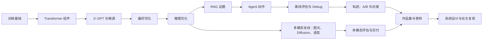

# 第三册《大模型算法岗实战手册》章节大纲

本目录按正文的项目学习路径组织章节契约。第 1—10 章从训练基础到线上评估构成主线；第 11—14 章处理图文、扩散、语音和多模态交付；第 15—18 章将项目证据转成作品集、答辩、系统设计和论文复现。每章的完整小节层级与中心内容见对应章节大纲。

## 主线：从模型实现到线上发布

### 第 1 章 PyTorch 基础实战

[正文](../../../book-03-practical-handbook/chapters/01-pytorch基础实战.md) · [章节契约](01-pytorch基础实战.md)

1.1 线性回归与参数更新；1.2 MLP 分类器；1.3 交叉熵；1.4 反向传播；1.5 优化器与数值路径；1.6 学习率调度和可恢复训练；延伸阅读与证据边界。

### 第 2 章 Transformer 组件实战

[输入表示](../../../book-03-practical-handbook/chapters/02-transformer组件实战-1-输入表示.md)、[Attention 与 Mask](../../../book-03-practical-handbook/chapters/02-transformer组件实战-2-attention与mask.md)、[Decoder Block 与现代组件](../../../book-03-practical-handbook/chapters/02-transformer组件实战-3-decoder-block与现代组件.md) · [章节契约](02-Transformer组件实战.md)

2.1 token/位置表示；2.2 缩放点积注意力；2.3 多头注意力；2.4 mask 可见性；2.5 block 残差/归一化/前馈；2.6 RoPE；2.7 RMSNorm、SwiGLU 与完整 shape 路径；继续阅读与资料边界。

### 第 3 章 从零训练小 GPT

[数据与训练](../../../book-03-practical-handbook/chapters/03-从零训练小gpt-1-数据与训练.md)、[生成与评估](../../../book-03-practical-handbook/chapters/03-从零训练小gpt-2-生成与评估.md) · [章节契约](03-从零训练小GPT.md)

3.1 token 数据约定；3.2 最小 GPT 与训练 loss；3.3 解码控制；3.4 checkpoint 与恢复；3.5 训练曲线和生成证据；3.6 BPE 迁移；3.7 公平比较与复现；延伸阅读与官方接口。

### 第 4 章 Hugging Face 微调实战

[基线与全参数 SFT](../../../book-03-practical-handbook/chapters/04-huggingface微调实战-1-基线与全参数sft.md)、[LoRA 与 QLoRA](../../../book-03-practical-handbook/chapters/04-huggingface微调实战-2-lora与qlora.md)、[评估与报告](../../../book-03-practical-handbook/chapters/04-huggingface微调实战-3-评估与报告.md) · [章节契约](04-Hugging-Face微调实战.md)

4.1 基线生成；4.2 对话监督信号；4.3 全参数 SFT；4.4 LoRA；4.5 QLoRA；4.6 训练前后行为评估与报告。

### 第 5 章 偏好优化实战

[正文](../../../book-03-practical-handbook/chapters/05-偏好优化实战.md) · [章节契约](05-偏好优化实战.md)

5.1 偏好数据；5.2 奖励模型；5.3 DPO 目标；5.4 序列到 token 计算；5.5 TRL 训练；5.6 训练后评估；5.7 方法适用边界；可复核记录与实现边界。

### 第 6 章 推理优化实战

[缓存、延迟与调度](../../../book-03-practical-handbook/chapters/06-推理优化实战-1-缓存延迟与调度.md)、[量化与推测解码](../../../book-03-practical-handbook/chapters/06-推理优化实战-2-量化与推测解码.md)、[长上下文压测与报告](../../../book-03-practical-handbook/chapters/06-推理优化实战-3-长上下文压测与报告.md) · [章节契约](06-推理优化实战.md)

6.1 KV Cache；6.2 Prefill/Decode 指标；6.3 PagedAttention 和连续批处理；6.4 量化；6.5 speculative decoding；6.6 长上下文压测；6.7 优化实验报告。

### 第 7 章 RAG 项目实战

[文档与检索](../../../book-03-practical-handbook/chapters/07-rag项目实战-1-文档与检索.md)、[重排与证据](../../../book-03-practical-handbook/chapters/07-rag项目实战-2-重排与证据.md)、[评估与失败归因](../../../book-03-practical-handbook/chapters/07-rag项目实战-3-评估与失败归因.md) · [章节契约](07-RAG项目实战.md)

7.1 文档与 chunk；7.2 检索与上下文；7.3 reranker；7.4 证据与引用；7.5 评估协议；7.6 失败归因、报告和成本。

### 第 8 章 Agent 项目实战

[协议与状态循环](../../../book-03-practical-handbook/chapters/08-agent项目实战-1-协议与状态循环.md)、[安全审计与验收](../../../book-03-practical-handbook/chapters/08-agent项目实战-2-安全审计与验收.md) · [章节契约](08-Agent项目实战.md)

8.1 工具协议；8.2 有界状态循环；8.3 动作授权和安全控制；8.4 轨迹评估；8.5 项目范围、业务语义与交付验收。

### 第 9 章 评估与 Debug 实战

[benchmark](../../../book-03-practical-handbook/chapters/09-评估与debug实战-1-评测协议与benchmark.md)、[数据与事实性核验](../../../book-03-practical-handbook/chapters/09-评估与debug实战-2-数据与事实性核验.md)、[训练调试与能力回归](../../../book-03-practical-handbook/chapters/09-评估与debug实战-3-训练调试与能力回归.md)、[人工评测](../../../book-03-practical-handbook/chapters/09-评估与debug实战-4-人工评测.md) · [章节契约](09-评估与Debug实战.md)

9.1 benchmark 协议；9.2 数据污染与泄漏；9.3 claim 事实性；9.4 不收敛诊断；9.5 微调能力退化；9.6 人工评测和 judge 校准；把四个模块带回项目。

### 第 10 章 Agent 轨迹、线上实验与灰度发布

[正文](../../../book-03-practical-handbook/chapters/10-agent轨迹与线上评估实战.md) · [章节契约](10-Agent轨迹与线上评估实战.md)

10.1 轨迹回放和失败定位；10.2 A/B 随机化、指标、统计；实验运行后的日志、灰度和回退；本章练习将离线证据迁移到面试回答。

## 选读支线：多模态项目

### 第 11 章 图文理解与检索实战

[CLIP 检索与对比学习](../../../book-03-practical-handbook/chapters/11-图文理解与检索实战-1-CLIP检索与对比学习.md)、[VLM 问答、数据与图文 RAG](../../../book-03-practical-handbook/chapters/11-图文理解与检索实战-2-VLM问答数据与RAG.md) · [章节契约](11-图文理解与检索实战.md)

11.1 CLIP 检索；11.2 对比损失；11.3 图片问答；11.4 多模态指令数据；11.5 图文 RAG 与证据评估。

### 第 12 章 Diffusion 数值实验

[正文](../../../book-03-practical-handbook/chapters/12-diffusion数值实验.md) · [章节契约](12-Diffusion数值实验.md)

12.1 前向加噪、预测目标、反向更新、CFG、生成评估和证据边界。

### 第 13 章 语音识别与问答实战

[正文](../../../book-03-practical-handbook/chapters/13-语音识别与问答实战.md) · [章节契约](13-语音识别与问答实战.md)

13.1 Whisper、切块和 ASR 指标；13.2 ASR—检索—回答链路、确认、延迟、隐私与观测。

### 第 14 章 多模态评估与交付

[正文](../../../book-03-practical-handbook/chapters/14-多模态评估与交付.md) · [章节契约](14-多模态评估与交付.md)

14.1 分任务指标与人工复核；14.2 项目记录、容量、权限、恢复、发布和回滚。

## 收束：项目表达、系统设计与论文复现

### 第 15 章 作品集实战

[正文](../../../book-03-practical-handbook/chapters/15-作品集实战.md) · [章节契约](15-作品集实战.md)

15.1 从可检验主张、运行记录和配对对照，到失败复现、README 与简历证据。

### 第 16 章 项目答辩与技术表达

[正文](../../../book-03-practical-handbook/chapters/16-项目答辩与技术表达.md) · [章节契约](16-项目答辩与技术表达.md)

16.1 Attention 数值解释；16.2 项目主张、指标、baseline、失败、责任与证据层级。

### 第 17 章 开放问题与系统设计实战

[正文](../../../book-03-practical-handbook/chapters/17-开放问题与系统设计实战.md) · [章节契约](17-开放问题与系统设计实战.md)

17.1 问题卡、硬约束和方案比较；17.2 容量、延迟、链路、权限、恢复、灰度与回滚。

### 第 18 章 论文评议与复现实战

[正文](../../../book-03-practical-handbook/chapters/18-论文评议与复现实战.md) · [章节契约](18-论文评议与复现实战.md)

18.1 从论文主张到机制/实验评议；18.2 选择最小复现并限定结论。

