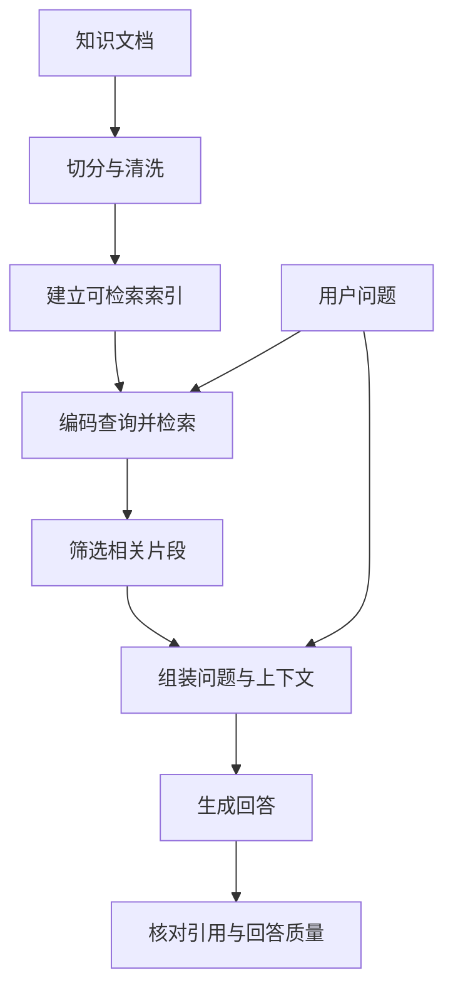

# 大模型知识点的锚点类型示例

本文用大模型领域的知识点展示不同讲解支架怎样服务理解。例文可借鉴其解释路径，不是需要照抄的章节模板。短例子适合它能讲完整的局部知识；遇到多阶段算法或系统机制，应先呈现全局结构，再选择贯穿算例、状态轨迹等形式解释细节。

## 1. 真实问题：为什么需要检索增强生成

假设一个客服助手要回答“我们上周刚更新的退货期限是多少”。如果期限只存在于最近更新的内部政策文档中，单靠模型参数里学到的旧信息，可能答错；若把所有政策文档不加筛选地塞进提示词，又会占用上下文并混入无关规定。这里真正的问题不是“模型还不够聪明”，而是回答依赖一份可更新、可定位的外部依据。检索增强生成（RAG）先按问题找出相关材料，再把问题和材料交给模型组织答案。检索能让回答获得当前任务提供的证据，但不保证检索结果正确、材料完整，也不保证模型忠实使用材料；这些仍需单独检查。

这个场景直接引出 RAG 的用途和边界：知识需要外部更新或溯源时，检索可以把相关材料带入生成过程；它不能自动修复坏文档、漏检或错误推理。

## 2. 贯穿算例：一个问题怎样经过 RAG

问题是“星河耳机可以在购买 20 天后退货吗？”知识库里有两段材料：

- 材料 A：“普通商品自签收之日起 7 天内可申请退货。”
- 材料 B：“星河耳机属于延长退货商品，自签收之日起 30 天内可申请退货；商品须保持完好。”

检索器根据问题从知识库取回材料 B。生成器随后看到“问题 + 材料 B”，于是可以回答：“可以。材料说明星河耳机自签收之日起 30 天内可申请退货，但商品须保持完好。”若问题只问期限，材料 A 的通用规则并不适用于这个特定商品；若检索器误取材料 A，生成器即使流畅复述，也会答错。

沿这一组问题和材料继续讲解，读者能区分检索器负责找什么、生成器依据什么组织回答，以及错误可能在哪个环节进入。这里的两条政策是教学设定，不代表任何真实商家的退货政策；真实系统还需处理文档版本、冲突和来源权限。

## 3. 数值演算：交叉熵怎样惩罚低概率的正确 token

某个位置的正确下一个 token 是“猫”。模型对三个候选 token 给出的 logits（归一化前的分数）是 $[2,1,0]$，顺序对应“猫”“狗”“鸟”。Softmax 将它们变成概率：

$$
p(\text{猫})=\frac{e^2}{e^2+e^1+e^0}\approx0.665,\qquad
p(\text{狗})\approx0.245,\qquad
p(\text{鸟})\approx0.090.
$$

目标 token 是“猫”，所以这个位置的交叉熵损失为 $-\log p(\text{猫})\approx0.408$。若模型把“猫”的 logit 提高、其他条件不变，它的概率会上升，这个位置的损失会下降。损失不是在评价整句话是否有帮助，而是在当前训练目标下衡量正确 token 被模型分配了多大概率；完整序列的损失还要按目标 token、padding mask 和约定的求和/平均方式汇总。

这组数值只用来让读者复算“logit → 概率 → 单 token 损失”的关系。实际词表远大于三个候选，训练口径也可能包含权重或 mask，不能把玩具数值当作真实模型输出。

## 4. 状态轨迹：KV cache 如何随生成增长

设提示词已经包含 token $A,B$，模型准备自回归生成。以下只追踪一个 Transformer 层的概念性缓存；真实实现通常为多个层分别保存 K/V，并可能采用不同的缓存布局或压缩方式。

| 时刻 | 当前要预测的 token | 本步可用的历史 K/V | 生成后缓存的内容 |
| --- | --- | --- | --- |
| 提示词预填充后 | $C$ | $A,B$ | $A,B$ |
| 生成 $C$ 后 | $D$ | $A,B,C$ | $A,B,C$ |
| 生成 $D$ 后 | 下一 token | $A,B,C,D$ | $A,B,C,D$ |

预测 $C$ 时，模型基于已有上下文计算下一 token 的分布；采样出 $C$ 后，模型为新位置计算并追加对应的 key/value。预测 $D$ 时，注意力可以使用 $A,B,C$ 的缓存，不必重新计算这些历史位置的 K/V。缓存减少了自回归解码中重复计算历史 K/V 的工作，但并未消除注意力读取历史信息的开销；随着上下文增长，缓存本身也占用更多显存。

表格追踪的是“缓存里有哪些位置”，不是完整的注意力计算，也没有表示所有框架都采用同一种内存布局。

## 5. 伪代码：复杂算法先看全局，再走查局部

伪代码适用于需要看清控制流、循环、分支或多个更新对象的算法，但不是复杂内容的必选形式。现有 [PPO-RLHF：伪代码锚点与贯穿算例](PPO-RLHF-伪代码锚点与贯穿算例.md) 是完整示范：伪代码先把 SFT、偏好数据训练 RM、采样 rollout、奖励整形、GAE、PPO 更新和评估串成全局路径；随后再沿同一条回答计算 KL 项、advantage 和策略更新。读者先知道算法各阶段怎样接力，再看局部公式为什么这样算。

关键不在于“算法必须有伪代码”，而在于完整路径必须可见。若一张流程图、状态转移图或分阶段讲解更适合该算法，就用那种形式；不要只给一组 loss 或一个数字例子，让局部演算冒充算法全貌。

## 6. 流程图：RAG 的离线准备与在线回答

RAG 不只是“把检索结果贴进提示词”。知识库准备与每次用户提问时的在线流程是两条不同的路径：



图中从“知识文档”到“索引”是知识准备路径；从“用户问题”到“生成回答”是在线路径。两条路径在检索处汇合：索引提供候选材料，当前问题决定取回哪些内容。末端的核对不能省略，因为图里的流程只说明数据如何流动，并不证明取回片段正确或回答受到证据支持。

## 7. 对齐的多种表示：从文字到下一 token 分布

看同一个预测任务在不同表示里如何变化。假设输入文字是“春天来了，树上长出新的”，目标是预测后续 token：

| 表示层 | 当前对象 | 这一层回答的问题 |
| --- | --- | --- |
| 文本 | “春天来了，树上长出新的” | 人读到的上下文是什么？ |
| Tokenizer 输出 | $t_1,t_2,\ldots,t_n$ | 这个 tokenizer 把文本切成了哪些 token？ |
| Token ID | $i_1,i_2,\ldots,i_n$ | 这些 token 在当前词表中的整数编号是什么？ |
| 模型输入 | 对应位置的 embedding 向量 | 每个编号如何变成模型可计算的向量？ |
| 输出 logits | 词表上每个候选 token 的分数 | 模型此刻倾向哪些后续 token？ |
| 解码结果 | 例如某个候选 token | 按贪心、采样或其他解码规则，最终选出什么？ |

这些表示描述的是同一条预测链，但不能混为一谈：token 不是字符，ID 不是语义向量，logit 也不是概率。具体切分和 ID 由 tokenizer 及其词表决定，所以这里用 $t_i$ 和 $i_i$ 作占位符，不伪造某个模型的 token 编号。模型输出的是词表分数；最后选哪个 token，还取决于解码规则。

## 8. 类比：把注意力理解为按当前问题查阅资料卡

可以把一次注意力计算想成：读者手里有一个当前问题，桌上摆着多张资料卡。当前问题形成 query，每张卡的索引特征形成 key，卡片上可供取用的信息形成 value。模型比较 query 和各个 key，得到一组权重，再按权重组合对应的 value。对语言模型来说，这些向量来自当前层的表示；在自注意力中，同一序列位置既参与提供 key/value，也会形成 query。

这个类比有助于区分“匹配依据”（key）和“取回内容”（value），但不能按字面理解：模型没有像人一样读懂卡片再有意识地检索，向量也不一定对应可读的字段；权重只描述这一次计算中的加权关系，不等同于完整解释或因果证明。离开类比后，应回到 query、key、value 的投影和加权求和机制。

## 9. 代码模拟：Top-k 如何缩小下一 token 候选集合

下面用四个教学 logits 演示 $k=2$ 的 Top-k。代码先保留分数最高的两个候选，再只在这两个候选之间做 Softmax；其余候选在本次采样中概率为零。

```python
import math

tokens = ["春", "夏", "秋", "冬"]
logits = [2.0, 1.0, 0.0, -1.0]
k = 2

keep = sorted(range(len(logits)), key=logits.__getitem__, reverse=True)[:k]
weights = [math.exp(logits[i]) for i in keep]
total = sum(weights)
probs = {tokens[i]: weight / total for i, weight in zip(keep, weights)}

print(probs)
```

输出约为 `{'春': 0.731, '夏': 0.269}`。原本四个候选都有非零 Softmax 概率；截断后，“秋”和“冬”不再可能被抽到，留下的概率再归一化为 1。真实生成还会涉及 temperature、停止 token、batch 与具体框架实现；这段代码只模拟最基本的 Top-k 候选截断，不代表完整生成器，也不说明截断后的文本一定更好。

## 资料来源与使用边界

- Vaswani et al., [Attention Is All You Need](https://arxiv.org/abs/1706.03762)：注意力与 Transformer 的原始方法描述；上面的资料卡仅为教学类比。
- Lewis et al., [Retrieval-Augmented Generation for Knowledge-Intensive NLP Tasks](https://arxiv.org/abs/2005.11401)：RAG 的方法定义与实验设置；本文件中的客服问题和材料均为虚构教学设定。
- Hugging Face, [KV cache explanation](https://huggingface.co/docs/transformers/en/cache_explanation)：自回归生成中的缓存解释；不同架构、缓存策略和版本的实现细节可能不同。
- Hugging Face, [Tokenizer components](https://huggingface.co/docs/tokenizers/en/pipeline)：tokenizer 处理阶段的说明；示例中的 token 和 ID 仍是占位符。
- PyTorch, [CrossEntropyLoss](https://pytorch.org/docs/stable/generated/torch.nn.CrossEntropyLoss.html)：交叉熵接口及输入约定；数值演算只展示单位置、未加权的基本情形。
- Holtzman et al., [The Curious Case of Neural Text Degeneration](https://arxiv.org/abs/1904.09751)：采样策略讨论的研究背景；代码只演示 Top-k 的候选截断，不覆盖论文讨论的全部结论。

来源用于核对概念和适用边界，不意味着这些教学例子复现了论文实验或特定框架代码。需要写入正式章节时，仍须按模块 03 核验具体版本、来源支持范围和当前主张。
